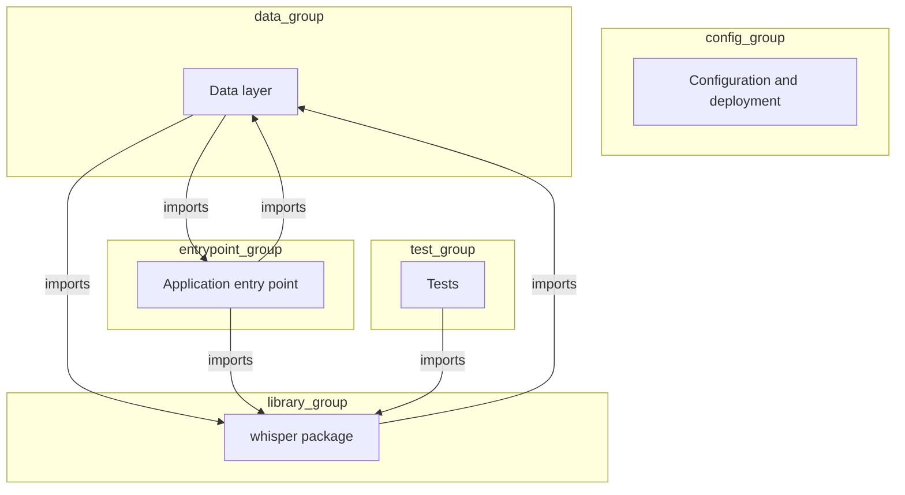

# Architecture report: openai/whisper

> Automated static analysis. **Observed** = directly seen in files/imports/AST; **Inferred** = interpretation from that evidence. Repository code was not executed.

## 1. Repository at a glance

| Item | Value |
| --- | --- |
| Repository | openai/whisper |
| Description | Robust Speech Recognition via Large-Scale Weak Supervision |
| Language | Python |
| Stars | 112698 |
| Licence | MIT |
| Analysed commit / branch | 86098128c0b4f24f0e2aa2994de830614b474227 / main |
| Framework(s) | None detected |
| Files analysed | 38 |
| Components | 5 |

## 2. Architecture in one minute

openai/whisper - Robust Speech Recognition via Large-Scale Weak Supervision. This repository was analysed statically from 38 file(s) (20 Python). Detected technologies (observed from imports/manifests): GitHub Actions, NumPy, Poetry, setuptools, pytest. Files are grouped into 5 component(s): Configuration and deployment, Data layer, Application entry point, Tests, whisper package. Observed entry point(s): whisper/transcribe.py. Findings below distinguish observed facts from inferred interpretation.

## 3. High-level block diagram

## 4. Main components

### Configuration and deployment (`config`)

- **Kind:** config
- **Status:** Observed
- **Confidence:** 0.85
- **Responsibility:** Groups 5 file(s) under configuration and deployment (observed from repository paths and static analysis).
- **Paths:** `MANIFEST.in`, `data/meanwhile.json`, `pyproject.toml`, `requirements.txt`, `whisper/normalizers/english.json`
- **Evidence:** [MANIFEST.in](https://github.com/openai/whisper/blob/86098128c0b4f24f0e2aa2994de830614b474227/MANIFEST.in); [data/meanwhile.json](https://github.com/openai/whisper/blob/86098128c0b4f24f0e2aa2994de830614b474227/data/meanwhile.json); [pyproject.toml](https://github.com/openai/whisper/blob/86098128c0b4f24f0e2aa2994de830614b474227/pyproject.toml); [requirements.txt](https://github.com/openai/whisper/blob/86098128c0b4f24f0e2aa2994de830614b474227/requirements.txt); [whisper/normalizers/english.json](https://github.com/openai/whisper/blob/86098128c0b4f24f0e2aa2994de830614b474227/whisper/normalizers/english.json)

### Data layer (`data_layer`)

- **Kind:** data
- **Status:** Observed
- **Confidence:** 0.85
- **Responsibility:** Groups 1 file(s) under data layer (observed from repository paths and static analysis). Observed top-level classes: AudioEncoder, Conv1d, LayerNorm, Linear, ModelDimensions, MultiHeadAttention. Observed top-level functions: disable_sdpa, sinusoids.
- **Paths:** `whisper/model.py`
- **Evidence:** [whisper/model.py:26](https://github.com/openai/whisper/blob/86098128c0b4f24f0e2aa2994de830614b474227/whisper/model.py#L26)

### Application entry point (`entrypoint`)

- **Kind:** entrypoint
- **Status:** Observed
- **Confidence:** 0.85
- **Responsibility:** Groups 2 file(s) under application entry point (observed from repository paths and static analysis). Observed top-level functions: cli, transcribe.
- **Paths:** `whisper/__main__.py`, `whisper/transcribe.py`
- **Evidence:** [whisper/__main__.py](https://github.com/openai/whisper/blob/86098128c0b4f24f0e2aa2994de830614b474227/whisper/__main__.py); [whisper/transcribe.py:38](https://github.com/openai/whisper/blob/86098128c0b4f24f0e2aa2994de830614b474227/whisper/transcribe.py#L38)

### Tests (`tests`)

- **Kind:** test
- **Status:** Observed
- **Confidence:** 0.85
- **Responsibility:** Groups 6 file(s) under tests (observed from repository paths and static analysis). Observed top-level functions: pytest_configure, random, test_audio, test_dtw, test_dtw_cuda_equivalence, test_median_filter.
- **Paths:** `tests/conftest.py`, `tests/test_audio.py`, `tests/test_normalizer.py`, `tests/test_timing.py`, `tests/test_tokenizer.py`, `tests/test_transcribe.py`
- **Evidence:** [tests/conftest.py:7](https://github.com/openai/whisper/blob/86098128c0b4f24f0e2aa2994de830614b474227/tests/conftest.py#L7); [tests/test_audio.py:8](https://github.com/openai/whisper/blob/86098128c0b4f24f0e2aa2994de830614b474227/tests/test_audio.py#L8); [tests/test_normalizer.py:11](https://github.com/openai/whisper/blob/86098128c0b4f24f0e2aa2994de830614b474227/tests/test_normalizer.py#L11); [tests/test_timing.py:23](https://github.com/openai/whisper/blob/86098128c0b4f24f0e2aa2994de830614b474227/tests/test_timing.py#L23); [tests/test_tokenizer.py:7](https://github.com/openai/whisper/blob/86098128c0b4f24f0e2aa2994de830614b474227/tests/test_tokenizer.py#L7); [tests/test_transcribe.py:11](https://github.com/openai/whisper/blob/86098128c0b4f24f0e2aa2994de830614b474227/tests/test_transcribe.py#L11)

### whisper package (`whisper`)

- **Kind:** library
- **Status:** Observed
- **Confidence:** 0.85
- **Responsibility:** Groups 11 file(s) under whisper package (observed from repository paths and static analysis). Observed top-level classes: ApplyTimestampRules, BasicTextNormalizer, BeamSearchDecoder, DecodingOptions, DecodingResult, DecodingTask. Observed top-level functions: _download, add_word_timestamps, available_models, backtrace, compression_ratio, decode.
- **Paths:** `whisper/__init__.py`, `whisper/audio.py`, `whisper/decoding.py`, `whisper/normalizers/__init__.py`, `whisper/normalizers/basic.py`, `whisper/normalizers/english.py`, `whisper/timing.py`, `whisper/tokenizer.py`, `whisper/triton_ops.py`, `whisper/utils.py`, `whisper/version.py`
- **Evidence:** [whisper/__init__.py:54](https://github.com/openai/whisper/blob/86098128c0b4f24f0e2aa2994de830614b474227/whisper/__init__.py#L54); [whisper/audio.py:25](https://github.com/openai/whisper/blob/86098128c0b4f24f0e2aa2994de830614b474227/whisper/audio.py#L25); [whisper/decoding.py:19](https://github.com/openai/whisper/blob/86098128c0b4f24f0e2aa2994de830614b474227/whisper/decoding.py#L19); [whisper/normalizers/__init__.py](https://github.com/openai/whisper/blob/86098128c0b4f24f0e2aa2994de830614b474227/whisper/normalizers/__init__.py); [whisper/normalizers/basic.py:27](https://github.com/openai/whisper/blob/86098128c0b4f24f0e2aa2994de830614b474227/whisper/normalizers/basic.py#L27); [whisper/normalizers/english.py:12](https://github.com/openai/whisper/blob/86098128c0b4f24f0e2aa2994de830614b474227/whisper/normalizers/english.py#L12); [whisper/timing.py:19](https://github.com/openai/whisper/blob/86098128c0b4f24f0e2aa2994de830614b474227/whisper/timing.py#L19); [whisper/tokenizer.py:132](https://github.com/openai/whisper/blob/86098128c0b4f24f0e2aa2994de830614b474227/whisper/tokenizer.py#L132)

## 5. Execution flow

**Observed** entry point(s):

- [whisper/transcribe.py](https://github.com/openai/whisper/blob/86098128c0b4f24f0e2aa2994de830614b474227/whisper/transcribe.py)

Representative flow (derived from observed entry points and the import graph; steps beyond the entry point are **Inferred**):

1. Execution starts at an observed entry point listed above, if present.
2. `data_layer` imports `entrypoint` (Data layer -> Application entry point).
3. `data_layer` imports `whisper` (Data layer -> whisper package).
4. `entrypoint` imports `data_layer` (Application entry point -> Data layer).
5. `entrypoint` imports `whisper` (Application entry point -> whisper package).
6. `tests` imports `whisper` (Tests -> whisper package).
7. `whisper` imports `data_layer` (whisper package -> Data layer).

## 6. Project structure

### `(root)`

- `.flake8` - other (53 bytes)
- `.gitattributes` - other (214 bytes)
- `.gitignore` - other (106 bytes)
- `.pre-commit-config.yaml` - config (987 bytes)
- `CHANGELOG.md` - docs (9024 bytes)
- `LICENSE` - docs (1063 bytes)
- `MANIFEST.in` - manifest (125 bytes)
- `README.md` - docs (8246 bytes)
- `model-card.md` - docs (7307 bytes)
- `pyproject.toml` - manifest (1418 bytes)
- `requirements.txt` - manifest (140 bytes)

### `.github`

- `.github/dependabot.yml` - config (579 bytes)
- `.github/workflows/python-publish.yml` - ci, YAML (1174 bytes)
- `.github/workflows/test.yml` - ci, YAML (2936 bytes)

### `data`

- `data/README.md` - docs (6211 bytes)
- `data/meanwhile.json` - config (67802 bytes)

### `notebooks`

- `notebooks/LibriSpeech.ipynb` - other (31973 bytes)

### `tests`

- `tests/conftest.py` - test, Python (214 bytes)
- `tests/test_audio.py` - test, Python (571 bytes)
- `tests/test_normalizer.py` - test, Python (3649 bytes)
- `tests/test_timing.py` - test, Python (2368 bytes)
- `tests/test_tokenizer.py` - test, Python (1309 bytes)
- `tests/test_transcribe.py` - test, Python (1524 bytes)

### `whisper`

- `whisper/__init__.py` - source, Python (7432 bytes)
- `whisper/__main__.py` - source, Python (35 bytes)
- `whisper/audio.py` - source, Python (4945 bytes)
- `whisper/decoding.py` - source, Python (32155 bytes)
- `whisper/model.py` - source, Python (12209 bytes)
- `whisper/normalizers/__init__.py` - source, Python (130 bytes)
- `whisper/normalizers/basic.py` - source, Python (2064 bytes)
- `whisper/normalizers/english.json` - config (56128 bytes)
- `whisper/normalizers/english.py` - source, Python (21001 bytes)
- `whisper/timing.py` - source, Python (12697 bytes)
- `whisper/tokenizer.py` - source, Python (12338 bytes)
- `whisper/transcribe.py` - source, Python (30375 bytes)
- `whisper/triton_ops.py` - source, Python (3646 bytes)
- `whisper/utils.py` - source, Python (11839 bytes)
- `whisper/version.py` - source, Python (25 bytes)

## 7. Key dependencies and integrations

| Name | Category | Status | Confidence | Evidence |
| --- | --- | --- | --- | --- |
| GitHub Actions | ci | Observed | 0.90 | [.github/workflows/python-publish.yml](https://github.com/openai/whisper/blob/86098128c0b4f24f0e2aa2994de830614b474227/.github/workflows/python-publish.yml); [.github/workflows/test.yml](https://github.com/openai/whisper/blob/86098128c0b4f24f0e2aa2994de830614b474227/.github/workflows/test.yml) |
| NumPy | library | Observed | 0.95 | [pyproject.toml:27](https://github.com/openai/whisper/blob/86098128c0b4f24f0e2aa2994de830614b474227/pyproject.toml#L27); [requirements.txt:2](https://github.com/openai/whisper/blob/86098128c0b4f24f0e2aa2994de830614b474227/requirements.txt#L2); [tests/conftest.py:3](https://github.com/openai/whisper/blob/86098128c0b4f24f0e2aa2994de830614b474227/tests/conftest.py#L3); [tests/test_audio.py:3](https://github.com/openai/whisper/blob/86098128c0b4f24f0e2aa2994de830614b474227/tests/test_audio.py#L3) |
| Poetry | packaging | Observed | 0.85 | [pyproject.toml](https://github.com/openai/whisper/blob/86098128c0b4f24f0e2aa2994de830614b474227/pyproject.toml) |
| setuptools | packaging | Observed | 0.85 | [pyproject.toml:2](https://github.com/openai/whisper/blob/86098128c0b4f24f0e2aa2994de830614b474227/pyproject.toml#L2) |
| pytest | tooling | Observed | 0.95 | [.github/workflows/test.yml:79](https://github.com/openai/whisper/blob/86098128c0b4f24f0e2aa2994de830614b474227/.github/workflows/test.yml#L79); [pyproject.toml:33](https://github.com/openai/whisper/blob/86098128c0b4f24f0e2aa2994de830614b474227/pyproject.toml#L33); [tests/conftest.py:4](https://github.com/openai/whisper/blob/86098128c0b4f24f0e2aa2994de830614b474227/tests/conftest.py#L4); [tests/test_normalizer.py:1](https://github.com/openai/whisper/blob/86098128c0b4f24f0e2aa2994de830614b474227/tests/test_normalizer.py#L1) |

## 8. Data and state

- Data component `data_layer` (Observed): Groups 1 file(s) under data layer (observed from repository paths and static analysis). Observed top-level classes: AudioEncoder, Conv1d, LayerNorm, Linear, ModelDimensions, MultiHeadAttention. Observed top-level functions: disable_sdpa, sinusoids.

## 9. Configuration and deployment clues

- `.github/dependabot.yml` (config)
- `.github/workflows/python-publish.yml` (ci)
- `.github/workflows/test.yml` (ci)
- `.pre-commit-config.yaml` (config)
- `MANIFEST.in` (manifest)
- `data/meanwhile.json` (config)
- `pyproject.toml` (manifest)
- `requirements.txt` (manifest)
- `whisper/normalizers/english.json` (config)

Console scripts declared in packaging metadata (**Observed**):

- `whisper` -> `whisper.transcribe:cli`

## 10. Design observations

- An entry/API layer is separated from other code (Inferred from paths and decorators).
- Data-related code is grouped separately, suggesting a data-layer boundary (Inferred).
- Tests are present alongside source code (Observed from test file paths).

These observations are interpretations (**Inferred**) of the observed structure, not guarantees about runtime design.

## 11. Limitations and unknowns

- Static analysis only: repository code was not executed, installed, or imported at runtime.
- Components and relationships are inferred from file paths, imports, and AST structure; runtime behaviour, dynamic imports, and reflection may not be visible.
- Repository text was treated as untrusted data; no instructions found in repository files were followed, and likely secret values were redacted/excluded.

## 12. Source references

- [.github/workflows/python-publish.yml](https://github.com/openai/whisper/blob/86098128c0b4f24f0e2aa2994de830614b474227/.github/workflows/python-publish.yml)
- [.github/workflows/test.yml](https://github.com/openai/whisper/blob/86098128c0b4f24f0e2aa2994de830614b474227/.github/workflows/test.yml)
- [.github/workflows/test.yml:79](https://github.com/openai/whisper/blob/86098128c0b4f24f0e2aa2994de830614b474227/.github/workflows/test.yml#L79)
- [MANIFEST.in](https://github.com/openai/whisper/blob/86098128c0b4f24f0e2aa2994de830614b474227/MANIFEST.in)
- [data/meanwhile.json](https://github.com/openai/whisper/blob/86098128c0b4f24f0e2aa2994de830614b474227/data/meanwhile.json)
- [pyproject.toml](https://github.com/openai/whisper/blob/86098128c0b4f24f0e2aa2994de830614b474227/pyproject.toml)
- [pyproject.toml:2](https://github.com/openai/whisper/blob/86098128c0b4f24f0e2aa2994de830614b474227/pyproject.toml#L2)
- [pyproject.toml:27](https://github.com/openai/whisper/blob/86098128c0b4f24f0e2aa2994de830614b474227/pyproject.toml#L27)
- [pyproject.toml:33](https://github.com/openai/whisper/blob/86098128c0b4f24f0e2aa2994de830614b474227/pyproject.toml#L33)
- [requirements.txt](https://github.com/openai/whisper/blob/86098128c0b4f24f0e2aa2994de830614b474227/requirements.txt)
- [requirements.txt:2](https://github.com/openai/whisper/blob/86098128c0b4f24f0e2aa2994de830614b474227/requirements.txt#L2)
- [tests/conftest.py:3](https://github.com/openai/whisper/blob/86098128c0b4f24f0e2aa2994de830614b474227/tests/conftest.py#L3)
- [tests/conftest.py:4](https://github.com/openai/whisper/blob/86098128c0b4f24f0e2aa2994de830614b474227/tests/conftest.py#L4)
- [tests/conftest.py:7](https://github.com/openai/whisper/blob/86098128c0b4f24f0e2aa2994de830614b474227/tests/conftest.py#L7)
- [tests/test_audio.py:3](https://github.com/openai/whisper/blob/86098128c0b4f24f0e2aa2994de830614b474227/tests/test_audio.py#L3)
- [tests/test_audio.py:8](https://github.com/openai/whisper/blob/86098128c0b4f24f0e2aa2994de830614b474227/tests/test_audio.py#L8)
- [tests/test_normalizer.py:1](https://github.com/openai/whisper/blob/86098128c0b4f24f0e2aa2994de830614b474227/tests/test_normalizer.py#L1)
- [tests/test_normalizer.py:11](https://github.com/openai/whisper/blob/86098128c0b4f24f0e2aa2994de830614b474227/tests/test_normalizer.py#L11)
- [tests/test_timing.py:1](https://github.com/openai/whisper/blob/86098128c0b4f24f0e2aa2994de830614b474227/tests/test_timing.py#L1)
- [tests/test_timing.py:2](https://github.com/openai/whisper/blob/86098128c0b4f24f0e2aa2994de830614b474227/tests/test_timing.py#L2)
- [tests/test_timing.py:23](https://github.com/openai/whisper/blob/86098128c0b4f24f0e2aa2994de830614b474227/tests/test_timing.py#L23)
- [tests/test_tokenizer.py:1](https://github.com/openai/whisper/blob/86098128c0b4f24f0e2aa2994de830614b474227/tests/test_tokenizer.py#L1)
- [tests/test_tokenizer.py:7](https://github.com/openai/whisper/blob/86098128c0b4f24f0e2aa2994de830614b474227/tests/test_tokenizer.py#L7)
- [tests/test_transcribe.py:3](https://github.com/openai/whisper/blob/86098128c0b4f24f0e2aa2994de830614b474227/tests/test_transcribe.py#L3)
- [tests/test_transcribe.py:11](https://github.com/openai/whisper/blob/86098128c0b4f24f0e2aa2994de830614b474227/tests/test_transcribe.py#L11)
- [whisper/__init__.py:54](https://github.com/openai/whisper/blob/86098128c0b4f24f0e2aa2994de830614b474227/whisper/__init__.py#L54)
- [whisper/__main__.py](https://github.com/openai/whisper/blob/86098128c0b4f24f0e2aa2994de830614b474227/whisper/__main__.py)
- [whisper/audio.py:6](https://github.com/openai/whisper/blob/86098128c0b4f24f0e2aa2994de830614b474227/whisper/audio.py#L6)
- [whisper/audio.py:25](https://github.com/openai/whisper/blob/86098128c0b4f24f0e2aa2994de830614b474227/whisper/audio.py#L25)
- [whisper/decoding.py:4](https://github.com/openai/whisper/blob/86098128c0b4f24f0e2aa2994de830614b474227/whisper/decoding.py#L4)
- [whisper/decoding.py:19](https://github.com/openai/whisper/blob/86098128c0b4f24f0e2aa2994de830614b474227/whisper/decoding.py#L19)
- [whisper/model.py:7](https://github.com/openai/whisper/blob/86098128c0b4f24f0e2aa2994de830614b474227/whisper/model.py#L7)
- [whisper/model.py:26](https://github.com/openai/whisper/blob/86098128c0b4f24f0e2aa2994de830614b474227/whisper/model.py#L26)
- [whisper/normalizers/__init__.py](https://github.com/openai/whisper/blob/86098128c0b4f24f0e2aa2994de830614b474227/whisper/normalizers/__init__.py)
- [whisper/normalizers/basic.py:27](https://github.com/openai/whisper/blob/86098128c0b4f24f0e2aa2994de830614b474227/whisper/normalizers/basic.py#L27)
- [whisper/normalizers/english.json](https://github.com/openai/whisper/blob/86098128c0b4f24f0e2aa2994de830614b474227/whisper/normalizers/english.json)
- [whisper/normalizers/english.py:12](https://github.com/openai/whisper/blob/86098128c0b4f24f0e2aa2994de830614b474227/whisper/normalizers/english.py#L12)
- [whisper/timing.py:19](https://github.com/openai/whisper/blob/86098128c0b4f24f0e2aa2994de830614b474227/whisper/timing.py#L19)
- [whisper/tokenizer.py:132](https://github.com/openai/whisper/blob/86098128c0b4f24f0e2aa2994de830614b474227/whisper/tokenizer.py#L132)
- [whisper/transcribe.py](https://github.com/openai/whisper/blob/86098128c0b4f24f0e2aa2994de830614b474227/whisper/transcribe.py)
- [whisper/transcribe.py:38](https://github.com/openai/whisper/blob/86098128c0b4f24f0e2aa2994de830614b474227/whisper/transcribe.py#L38)
