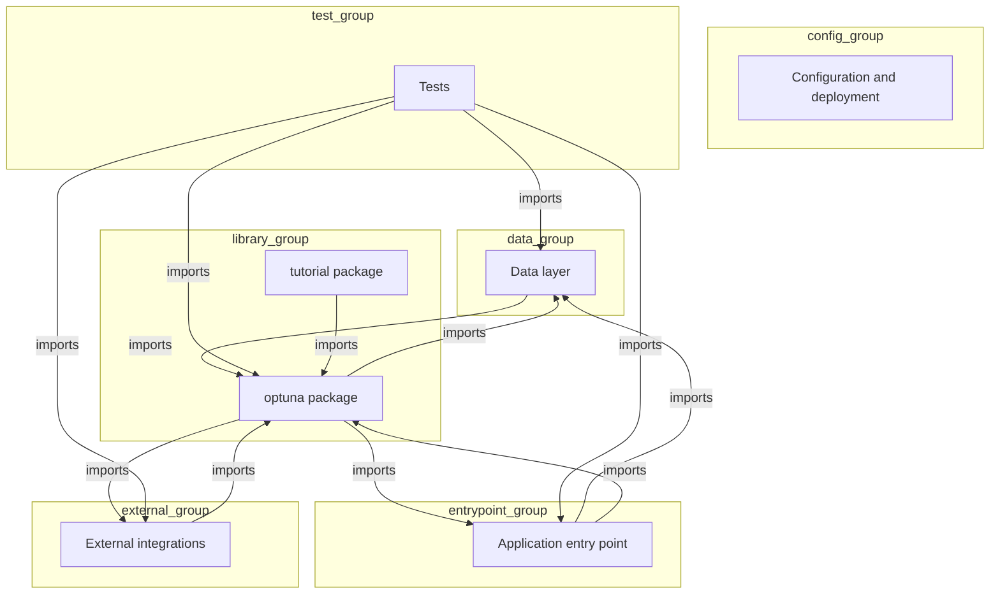

# Architecture report: optuna/optuna

> Automated static analysis. **Observed** = directly seen in files/imports/AST; **Inferred** = interpretation from that evidence. Repository code was not executed.

## 1. Repository at a glance

| Item | Value |
| --- | --- |
| Repository | optuna/optuna |
| Description | A hyperparameter optimization framework |
| Language | Python |
| Stars | 15043 |
| Licence | MIT |
| Analysed commit / branch | abf8914d48571120574469575d37c4b0929b7f0f / master |
| Framework(s) | None detected |
| Files analysed | 471 |
| Components | 7 |

## 2. Architecture in one minute

optuna/optuna - A hyperparameter optimization framework. This repository was analysed statically from 471 file(s) (381 Python). Detected technologies (observed from imports/manifests): GitHub Actions, Redis, SQLite, AWS (boto3), NumPy, pandas. Files are grouped into 7 component(s): Configuration and deployment, Data layer, Application entry point, External integrations, optuna package, Tests, tutorial package. Observed entry point(s): optuna/cli.py, tutorial/20_recipes/004_cli.py, tutorial/20_recipes/012_artifact_tutorial.py. Findings below distinguish observed facts from inferred interpretation.

## 3. High-level block diagram

## 4. Main components

### Configuration and deployment (`config`)

- **Kind:** config
- **Status:** Observed
- **Confidence:** 0.85
- **Responsibility:** Groups 3 file(s) under configuration and deployment (observed from repository paths and static analysis).
- **Paths:** `MANIFEST.in`, `optuna/storages/_rdb/alembic.ini`, `pyproject.toml`
- **Evidence:** [MANIFEST.in](https://github.com/optuna/optuna/blob/abf8914d48571120574469575d37c4b0929b7f0f/MANIFEST.in); [optuna/storages/_rdb/alembic.ini](https://github.com/optuna/optuna/blob/abf8914d48571120574469575d37c4b0929b7f0f/optuna/storages/_rdb/alembic.ini); [pyproject.toml](https://github.com/optuna/optuna/blob/abf8914d48571120574469575d37c4b0929b7f0f/pyproject.toml)

### Data layer (`data_layer`)

- **Kind:** data
- **Status:** Observed
- **Confidence:** 0.85
- **Responsibility:** Groups 1 file(s) under data layer (observed from repository paths and static analysis). Observed top-level classes: StudyDirectionModel, StudyModel, StudySystemAttributeModel, StudyUserAttributeModel, TrialHeartbeatModel, TrialIntermediateValueModel.
- **Paths:** `optuna/storages/_rdb/models.py`
- **Evidence:** [optuna/storages/_rdb/models.py:56](https://github.com/optuna/optuna/blob/abf8914d48571120574469575d37c4b0929b7f0f/optuna/storages/_rdb/models.py#L56)

### Application entry point (`entrypoint`)

- **Kind:** entrypoint
- **Status:** Observed
- **Confidence:** 0.85
- **Responsibility:** Groups 4 file(s) under application entry point (observed from repository paths and static analysis). Observed top-level classes: CellValue, Objective, ValueType, _Ask, _BaseCommand, _BestTrial. Observed top-level functions: _add_commands, _add_common_arguments, _check_storage_url, _convert_to_dict, _dump_table, _dump_value.
- **Paths:** `optuna/cli.py`, `optuna/storages/_grpc/server.py`, `tutorial/20_recipes/004_cli.py`, `tutorial/20_recipes/012_artifact_tutorial.py`
- **Evidence:** [optuna/cli.py:42](https://github.com/optuna/optuna/blob/abf8914d48571120574469575d37c4b0929b7f0f/optuna/cli.py#L42); [optuna/storages/_grpc/server.py:27](https://github.com/optuna/optuna/blob/abf8914d48571120574469575d37c4b0929b7f0f/optuna/storages/_grpc/server.py#L27); [tutorial/20_recipes/004_cli.py:32](https://github.com/optuna/optuna/blob/abf8914d48571120574469575d37c4b0929b7f0f/tutorial/20_recipes/004_cli.py#L32); [tutorial/20_recipes/012_artifact_tutorial.py:278](https://github.com/optuna/optuna/blob/abf8914d48571120574469575d37c4b0929b7f0f/tutorial/20_recipes/012_artifact_tutorial.py#L278)

### External integrations (`external_integrations`)

- **Kind:** external
- **Status:** Observed
- **Confidence:** 0.85
- **Responsibility:** Groups 21 file(s) under external integrations (observed from repository paths and static analysis). Observed top-level classes: GrpcClientCache, GrpcClientCacheEntry, GrpcStorageProxy, _LightGBMModule. Observed top-level functions: create_insecure_channel.
- **Paths:** `optuna/integration/__init__.py`, `optuna/integration/botorch.py`, `optuna/integration/catboost.py`, `optuna/integration/cma.py`, `optuna/integration/dask.py`, `optuna/integration/fastaiv2.py`, `optuna/integration/keras.py`, `optuna/integration/lightgbm.py`, `optuna/integration/mlflow.py`, `optuna/integration/pytorch_distributed.py`, `optuna/integration/pytorch_ignite.py`, `optuna/integration/pytorch_lightning.py`, `optuna/integration/shap.py`, `optuna/integration/sklearn.py`, `optuna/integration/skorch.py`, `optuna/integration/tensorboard.py`, `optuna/integration/tensorflow.py`, `optuna/integration/tfkeras.py`, `optuna/integration/wandb.py`, `optuna/integration/xgboost.py`, `optuna/storages/_grpc/client.py`
- **Evidence:** [optuna/integration/__init__.py](https://github.com/optuna/optuna/blob/abf8914d48571120574469575d37c4b0929b7f0f/optuna/integration/__init__.py); [optuna/integration/botorch.py](https://github.com/optuna/optuna/blob/abf8914d48571120574469575d37c4b0929b7f0f/optuna/integration/botorch.py); [optuna/integration/catboost.py](https://github.com/optuna/optuna/blob/abf8914d48571120574469575d37c4b0929b7f0f/optuna/integration/catboost.py); [optuna/integration/cma.py](https://github.com/optuna/optuna/blob/abf8914d48571120574469575d37c4b0929b7f0f/optuna/integration/cma.py); [optuna/integration/dask.py](https://github.com/optuna/optuna/blob/abf8914d48571120574469575d37c4b0929b7f0f/optuna/integration/dask.py); [optuna/integration/fastaiv2.py](https://github.com/optuna/optuna/blob/abf8914d48571120574469575d37c4b0929b7f0f/optuna/integration/fastaiv2.py); [optuna/integration/keras.py](https://github.com/optuna/optuna/blob/abf8914d48571120574469575d37c4b0929b7f0f/optuna/integration/keras.py); [optuna/integration/lightgbm.py:39](https://github.com/optuna/optuna/blob/abf8914d48571120574469575d37c4b0929b7f0f/optuna/integration/lightgbm.py#L39)

### optuna package (`optuna`)

- **Kind:** library
- **Status:** Observed
- **Confidence:** 0.85
- **Responsibility:** Groups 196 file(s) under optuna package (observed from repository paths and static analysis). Observed top-level classes: ArtifactMeta, ArtifactNotFound, ArtifactStore, BLXAlphaCrossover, Backoff, BaseAcquisitionFunc. Observed top-level functions: _add_rank_subplot, _adjust_discrete_uniform_high, _adjust_int_uniform_high, _associate_individuals_with_reference_points, _batched_lbfgsb, _build_numerical_dimension.
- **Paths:** `optuna/__init__.py`, `optuna/_callbacks.py`, `optuna/_convert_positional_args.py`, `optuna/_deprecated.py`, `optuna/_experimental.py`, `optuna/_gp/__init__.py`, `optuna/_gp/acqf.py`, `optuna/_gp/batched_lbfgsb.py`, `optuna/_gp/gp.py`, `optuna/_gp/optim_mixed.py`, `optuna/_gp/optim_sample.py`, `optuna/_gp/prior.py`, `optuna/_gp/qmc.py`, `optuna/_gp/search_space.py`, `optuna/_gp/thread_limiting.py`, `optuna/_hypervolume/__init__.py`, `optuna/_hypervolume/box_decomposition.py`, `optuna/_hypervolume/hssp.py`, `optuna/_hypervolume/wfg.py`, `optuna/_imports.py`, `optuna/_transform.py`, `optuna/_typing.py`, `optuna/_warnings.py`, `optuna/artifacts/__init__.py`, `optuna/artifacts/_backoff.py`, `optuna/artifacts/_boto3.py`, `optuna/artifacts/_download.py`, `optuna/artifacts/_filesystem.py`, `optuna/artifacts/_gcs.py`, `optuna/artifacts/_list_artifact_meta.py`, `optuna/artifacts/_protocol.py`, `optuna/artifacts/_upload.py`, `optuna/artifacts/exceptions.py`, `optuna/distributions.py`, `optuna/exceptions.py`, `optuna/importance/__init__.py`, `optuna/importance/_base.py`, `optuna/importance/_fanova/__init__.py`, `optuna/importance/_fanova/_evaluator.py`, `optuna/importance/_fanova/_fanova.py`, `optuna/importance/_fanova/_tree.py`, `optuna/importance/_mean_decrease_impurity.py`, `optuna/importance/_ped_anova/__init__.py`, `optuna/importance/_ped_anova/evaluator.py`, `optuna/importance/_ped_anova/scott_parzen_estimator.py`, `optuna/logging.py`, `optuna/progress_bar.py`, `optuna/pruners/__init__.py`, `optuna/pruners/_base.py`, `optuna/pruners/_hyperband.py`, `optuna/pruners/_median.py`, `optuna/pruners/_nop.py`, `optuna/pruners/_patient.py`, `optuna/pruners/_percentile.py`, `optuna/pruners/_successive_halving.py`, `optuna/pruners/_threshold.py`, `optuna/pruners/_wilcoxon.py`, `optuna/samplers/__init__.py`, `optuna/samplers/_base.py`, `optuna/samplers/_brute_force.py`, `optuna/samplers/_cmaes.py`, `optuna/samplers/_ga/__init__.py`, `optuna/samplers/_ga/_base.py`, `optuna/samplers/_gp/__init__.py`, `optuna/samplers/_gp/sampler.py`, `optuna/samplers/_grid.py`, `optuna/samplers/_lazy_random_state.py`, `optuna/samplers/_nsgaiii/__init__.py`, `optuna/samplers/_nsgaiii/_elite_population_selection_strategy.py`, `optuna/samplers/_nsgaiii/_sampler.py`, `optuna/samplers/_partial_fixed.py`, `optuna/samplers/_qmc.py`, `optuna/samplers/_random.py`, `optuna/samplers/_tpe/__init__.py`, `optuna/samplers/_tpe/_erf.py`, `optuna/samplers/_tpe/_truncnorm.py`, `optuna/samplers/_tpe/parzen_estimator.py`, `optuna/samplers/_tpe/probability_distributions.py`, `optuna/samplers/_tpe/sampler.py`, `optuna/samplers/nsgaii/__init__.py`, `optuna/samplers/nsgaii/_after_trial_strategy.py`, `optuna/samplers/nsgaii/_child_generation_strategy.py`, `optuna/samplers/nsgaii/_constraints_evaluation.py`, `optuna/samplers/nsgaii/_crossover.py`, `optuna/samplers/nsgaii/_crossovers/__init__.py`, `optuna/samplers/nsgaii/_crossovers/_base.py`, `optuna/samplers/nsgaii/_crossovers/_blxalpha.py`, `optuna/samplers/nsgaii/_crossovers/_sbx.py`, `optuna/samplers/nsgaii/_crossovers/_spx.py`, `optuna/samplers/nsgaii/_crossovers/_undx.py`, `optuna/samplers/nsgaii/_crossovers/_uniform.py`, `optuna/samplers/nsgaii/_crossovers/_vsbx.py`, `optuna/samplers/nsgaii/_elite_population_selection_strategy.py`, `optuna/samplers/nsgaii/_mutation.py`, `optuna/samplers/nsgaii/_mutations/__init__.py`, `optuna/samplers/nsgaii/_mutations/_base.py`, `optuna/samplers/nsgaii/_mutations/_polynomial.py`, `optuna/samplers/nsgaii/_sampler.py`, `optuna/search_space/__init__.py`, `optuna/search_space/group_decomposed.py`, `optuna/search_space/intersection.py`, `optuna/storages/__init__.py`, `optuna/storages/_base.py`, `optuna/storages/_cached_storage.py`, `optuna/storages/_callbacks.py`, `optuna/storages/_grpc/__init__.py`, `optuna/storages/_grpc/auto_generated/api_pb2.py`, `optuna/storages/_grpc/auto_generated/api_pb2_grpc.py`, `optuna/storages/_grpc/servicer.py`, `optuna/storages/_heartbeat.py`, `optuna/storages/_in_memory.py`, `optuna/storages/_rdb/__init__.py`, `optuna/storages/_rdb/alembic/env.py`, `optuna/storages/_rdb/alembic/versions/v0.9.0.a.py`, `optuna/storages/_rdb/alembic/versions/v1.2.0.a.py`, `optuna/storages/_rdb/alembic/versions/v1.3.0.a.py`, `optuna/storages/_rdb/alembic/versions/v2.4.0.a.py`, `optuna/storages/_rdb/alembic/versions/v2.6.0.a_.py`, `optuna/storages/_rdb/alembic/versions/v3.0.0.a.py`, `optuna/storages/_rdb/alembic/versions/v3.0.0.b.py`, `optuna/storages/_rdb/alembic/versions/v3.0.0.c.py`, `optuna/storages/_rdb/alembic/versions/v3.0.0.d.py`, `optuna/storages/_rdb/alembic/versions/v3.2.0.a_.py`, `optuna/storages/_rdb/storage.py`, `optuna/storages/journal/__init__.py`, `optuna/storages/journal/_base.py`, `optuna/storages/journal/_file.py`, `optuna/storages/journal/_redis.py`, `optuna/storages/journal/_storage.py`, `optuna/study/__init__.py`, `optuna/study/_constrained_optimization.py`, `optuna/study/_dataframe.py`, `optuna/study/_frozen.py`, `optuna/study/_multi_objective.py`, `optuna/study/_optimize.py`, `optuna/study/_study_direction.py`, `optuna/study/_study_summary.py`, `optuna/study/_tell.py`, `optuna/study/study.py`, `optuna/terminator/__init__.py`, `optuna/terminator/callback.py`, `optuna/terminator/erroreval.py`, `optuna/terminator/improvement/__init__.py`, `optuna/terminator/improvement/emmr.py`, `optuna/terminator/improvement/evaluator.py`, `optuna/terminator/median_erroreval.py`, `optuna/terminator/terminator.py`, `optuna/testing/__init__.py`, `optuna/testing/objectives.py`, `optuna/testing/pruners.py`, `optuna/testing/pytest_importance.py`, `optuna/testing/pytest_samplers.py`, `optuna/testing/pytest_storages.py`, `optuna/testing/samplers.py`, `optuna/testing/storages.py`, `optuna/testing/tempfile_pool.py`, `optuna/testing/threading.py`, `optuna/testing/trials.py`, `optuna/testing/visualization.py`, `optuna/trial/__init__.py`, `optuna/trial/_base.py`, `optuna/trial/_fixed.py`, `optuna/trial/_frozen.py`, `optuna/trial/_state.py`, `optuna/trial/_trial.py`, `optuna/version.py`, `optuna/visualization/__init__.py`, `optuna/visualization/_contour.py`, `optuna/visualization/_edf.py`, `optuna/visualization/_hypervolume_history.py`, `optuna/visualization/_intermediate_values.py`, `optuna/visualization/_optimization_history.py`, `optuna/visualization/_parallel_coordinate.py`, `optuna/visualization/_param_importances.py`, `optuna/visualization/_pareto_front.py`, `optuna/visualization/_plotly_imports.py`, `optuna/visualization/_rank.py`, `optuna/visualization/_slice.py`, `optuna/visualization/_terminator_improvement.py`, `optuna/visualization/_timeline.py`, `optuna/visualization/_utils.py`, `optuna/visualization/matplotlib/__init__.py`, `optuna/visualization/matplotlib/_contour.py`, `optuna/visualization/matplotlib/_edf.py`, `optuna/visualization/matplotlib/_hypervolume_history.py`, `optuna/visualization/matplotlib/_intermediate_values.py`, `optuna/visualization/matplotlib/_matplotlib_imports.py`, `optuna/visualization/matplotlib/_optimization_history.py`, `optuna/visualization/matplotlib/_parallel_coordinate.py`, `optuna/visualization/matplotlib/_param_importances.py`, `optuna/visualization/matplotlib/_pareto_front.py`, `optuna/visualization/matplotlib/_rank.py`, `optuna/visualization/matplotlib/_slice.py`, `optuna/visualization/matplotlib/_terminator_improvement.py`, `optuna/visualization/matplotlib/_timeline.py`, `optuna/visualization/matplotlib/_utils.py`
- **Evidence:** [optuna/__init__.py](https://github.com/optuna/optuna/blob/abf8914d48571120574469575d37c4b0929b7f0f/optuna/__init__.py); [optuna/_callbacks.py:15](https://github.com/optuna/optuna/blob/abf8914d48571120574469575d37c4b0929b7f0f/optuna/_callbacks.py#L15); [optuna/_convert_positional_args.py:24](https://github.com/optuna/optuna/blob/abf8914d48571120574469575d37c4b0929b7f0f/optuna/_convert_positional_args.py#L24); [optuna/_deprecated.py:41](https://github.com/optuna/optuna/blob/abf8914d48571120574469575d37c4b0929b7f0f/optuna/_deprecated.py#L41); [optuna/_experimental.py:31](https://github.com/optuna/optuna/blob/abf8914d48571120574469575d37c4b0929b7f0f/optuna/_experimental.py#L31); [optuna/_gp/__init__.py](https://github.com/optuna/optuna/blob/abf8914d48571120574469575d37c4b0929b7f0f/optuna/_gp/__init__.py); [optuna/_gp/acqf.py:42](https://github.com/optuna/optuna/blob/abf8914d48571120574469575d37c4b0929b7f0f/optuna/_gp/acqf.py#L42); [optuna/_gp/batched_lbfgsb.py:34](https://github.com/optuna/optuna/blob/abf8914d48571120574469575d37c4b0929b7f0f/optuna/_gp/batched_lbfgsb.py#L34)

### Tests (`tests`)

- **Kind:** test
- **Status:** Observed
- **Confidence:** 0.85
- **Responsibility:** Groups 118 file(s) under tests (observed from repository paths and static analysis). Observed routes: PATCH optuna.samplers.nsgaii._child_generation_strategy.perform_crossover, PATCH optuna.samplers.nsgaii._after_trial_strategy._process_constraints_after_trial, PATCH optuna.samplers.nsgaii._after_trial_strategy._process_constraints_after_trial, PATCH optuna.study._optimize.gc.collect, PATCH optuna.study._optimize.gc.collect. Observed top-level classes: BaseGASamplerTestSampler, FailArtifactStore, Func, InMemoryArtifactStore, InstanceGenerator, JournalLogStorageSupplier. Observed top-level fun…
- **Paths:** `tests/__init__.py`, `tests/artifacts_tests/__init__.py`, `tests/artifacts_tests/stubs.py`, `tests/artifacts_tests/test_backoff.py`, `tests/artifacts_tests/test_boto3.py`, `tests/artifacts_tests/test_download_artifact.py`, `tests/artifacts_tests/test_filesystem.py`, `tests/artifacts_tests/test_gcs.py`, `tests/artifacts_tests/test_list_artifact_meta.py`, `tests/artifacts_tests/test_upload_artifact.py`, `tests/conftest.py`, `tests/gp_tests/test_acqf.py`, `tests/gp_tests/test_batched_lbfgsb.py`, `tests/gp_tests/test_gp.py`, `tests/gp_tests/test_search_space.py`, `tests/hypervolume_tests/__init__.py`, `tests/hypervolume_tests/test_box_decomposition.py`, `tests/hypervolume_tests/test_hssp.py`, `tests/hypervolume_tests/test_wfg.py`, `tests/importance_tests/__init__.py`, `tests/importance_tests/fanova_tests/__init__.py`, `tests/importance_tests/fanova_tests/test_tree.py`, `tests/importance_tests/pedanova_tests/__init__.py`, `tests/importance_tests/pedanova_tests/test_evaluator.py`, `tests/importance_tests/pedanova_tests/test_scott_parzen_estimator.py`, `tests/importance_tests/test_evaluator.py`, `tests/pruners_tests/__init__.py`, `tests/pruners_tests/test_hyperband.py`, `tests/pruners_tests/test_median.py`, `tests/pruners_tests/test_nop.py`, `tests/pruners_tests/test_patient.py`, `tests/pruners_tests/test_percentile.py`, `tests/pruners_tests/test_successive_halving.py`, `tests/pruners_tests/test_threshold.py`, `tests/pruners_tests/test_wilcoxon.py`, `tests/samplers_tests/__init__.py`, `tests/samplers_tests/test_base_gasampler.py`, `tests/samplers_tests/test_brute_force.py`, `tests/samplers_tests/test_cmaes.py`, `tests/samplers_tests/test_gp.py`, `tests/samplers_tests/test_grid.py`, `tests/samplers_tests/test_lazy_random_state.py`, `tests/samplers_tests/test_nsgaii.py`, `tests/samplers_tests/test_nsgaiii.py`, `tests/samplers_tests/test_partial_fixed.py`, `tests/samplers_tests/test_qmc.py`, `tests/samplers_tests/test_samplers.py`, `tests/samplers_tests/tpe_tests/__init__.py`, `tests/samplers_tests/tpe_tests/test_multi_objective_sampler.py`, `tests/samplers_tests/tpe_tests/test_parzen_estimator.py`, `tests/samplers_tests/tpe_tests/test_probability_distributions.py`, `tests/samplers_tests/tpe_tests/test_sampler.py`, `tests/samplers_tests/tpe_tests/test_truncnorm.py`, `tests/search_space_tests/__init__.py`, `tests/search_space_tests/test_group_decomposed.py`, `tests/search_space_tests/test_intersection.py`, `tests/storages_tests/__init__.py`, `tests/storages_tests/journal_tests/assets/4.0.0.dev.log`, `tests/storages_tests/journal_tests/create_journal.py`, `tests/storages_tests/journal_tests/test_combination_with_grpc.py`, `tests/storages_tests/journal_tests/test_journal.py`, `tests/storages_tests/journal_tests/test_log_compatibility.py`, `tests/storages_tests/rdb_tests/__init__.py`, `tests/storages_tests/rdb_tests/create_db.py`, `tests/storages_tests/rdb_tests/test_models.py`, `tests/storages_tests/rdb_tests/test_storage.py`, `tests/storages_tests/test_cached_storage.py`, `tests/storages_tests/test_callbacks.py`, `tests/storages_tests/test_grpc.py`, `tests/storages_tests/test_heartbeat.py`, `tests/storages_tests/test_storages.py`, `tests/storages_tests/test_with_server.py`, `tests/study_tests/__init__.py`, `tests/study_tests/test_constrained_optimization.py`, `tests/study_tests/test_dataframe.py`, `tests/study_tests/test_multi_objective.py`, `tests/study_tests/test_optimize.py`, `tests/study_tests/test_study.py`, `tests/study_tests/test_study_summary.py`, `tests/terminator_tests/improvement_tests/test_emmr_evaluator.py`, `tests/terminator_tests/improvement_tests/test_evaluator.py`, `tests/terminator_tests/test_callback.py`, `tests/terminator_tests/test_erroreval.py`, `tests/terminator_tests/test_median_erroreval.py`, `tests/terminator_tests/test_terminator.py`, `tests/test_callbacks.py`, `tests/test_cli.py`, `tests/test_convert_positional_args.py`, `tests/test_deprecated.py`, `tests/test_distributions.py`, `tests/test_experimental.py`, `tests/test_imports.py`, `tests/test_logging.py`, `tests/test_multi_objective.py`, `tests/test_transform.py`, `tests/trial_tests/__init__.py`, `tests/trial_tests/test_fixed.py`, `tests/trial_tests/test_frozen.py`, `tests/trial_tests/test_trial.py`, `tests/trial_tests/test_trials.py`, `tests/visualization_tests/__init__.py`, `tests/visualization_tests/matplotlib_tests/__init__.py`, `tests/visualization_tests/matplotlib_tests/test_contour.py`, `tests/visualization_tests/matplotlib_tests/test_optimization_history.py`, `tests/visualization_tests/test_contour.py`, `tests/visualization_tests/test_edf.py`, `tests/visualization_tests/test_hypervolume_history.py`, `tests/visualization_tests/test_intermediate_plot.py`, `tests/visualization_tests/test_optimization_history.py`, `tests/visualization_tests/test_parallel_coordinate.py`, `tests/visualization_tests/test_param_importances.py`, `tests/visualization_tests/test_pareto_front.py`, `tests/visualization_tests/test_rank.py`, `tests/visualization_tests/test_slice.py`, `tests/visualization_tests/test_terminator_improvement.py`, `tests/visualization_tests/test_timeline.py`, `tests/visualization_tests/test_utils.py`, `tests/visualization_tests/test_visualizations.py`
- **Evidence:** [tests/__init__.py](https://github.com/optuna/optuna/blob/abf8914d48571120574469575d37c4b0929b7f0f/tests/__init__.py); [tests/artifacts_tests/__init__.py](https://github.com/optuna/optuna/blob/abf8914d48571120574469575d37c4b0929b7f0f/tests/artifacts_tests/__init__.py); [tests/artifacts_tests/stubs.py:16](https://github.com/optuna/optuna/blob/abf8914d48571120574469575d37c4b0929b7f0f/tests/artifacts_tests/stubs.py#L16); [tests/artifacts_tests/test_backoff.py:14](https://github.com/optuna/optuna/blob/abf8914d48571120574469575d37c4b0929b7f0f/tests/artifacts_tests/test_backoff.py#L14); [tests/artifacts_tests/test_boto3.py:22](https://github.com/optuna/optuna/blob/abf8914d48571120574469575d37c4b0929b7f0f/tests/artifacts_tests/test_boto3.py#L22); [tests/artifacts_tests/test_download_artifact.py:15](https://github.com/optuna/optuna/blob/abf8914d48571120574469575d37c4b0929b7f0f/tests/artifacts_tests/test_download_artifact.py#L15); [tests/artifacts_tests/test_filesystem.py:10](https://github.com/optuna/optuna/blob/abf8914d48571120574469575d37c4b0929b7f0f/tests/artifacts_tests/test_filesystem.py#L10); [tests/artifacts_tests/test_gcs.py:24](https://github.com/optuna/optuna/blob/abf8914d48571120574469575d37c4b0929b7f0f/tests/artifacts_tests/test_gcs.py#L24)

### tutorial package (`tutorial`)

- **Kind:** library
- **Status:** Observed
- **Confidence:** 0.85
- **Responsibility:** Groups 17 file(s) under tutorial package (observed from repository paths and static analysis). Observed top-level classes: LastPlacePruner, SAOptions, SimulatedAnnealingSampler, StopWhenTrialKeepBeingPrunedCallback. Observed top-level functions: batched_objective, define_model, detailed_objective, eval_model, make_dataset, objective.
- **Paths:** `tutorial/10_key_features/001_first.py`, `tutorial/10_key_features/002_configurations.py`, `tutorial/10_key_features/003_efficient_optimization_algorithms.py`, `tutorial/10_key_features/004_distributed.py`, `tutorial/10_key_features/005_visualization.py`, `tutorial/20_recipes/001_rdb.py`, `tutorial/20_recipes/002_multi_objective.py`, `tutorial/20_recipes/003_attributes.py`, `tutorial/20_recipes/005_user_defined_sampler.py`, `tutorial/20_recipes/006_user_defined_pruner.py`, `tutorial/20_recipes/007_optuna_callback.py`, `tutorial/20_recipes/008_specify_params.py`, `tutorial/20_recipes/009_ask_and_tell.py`, `tutorial/20_recipes/010_reuse_best_trial.py`, `tutorial/20_recipes/011_journal_storage.py`, `tutorial/20_recipes/013_wilcoxon_pruner.py`, `tutorial/20_recipes/014_ablation_study_by_optuna.py`
- **Evidence:** [tutorial/10_key_features/001_first.py:28](https://github.com/optuna/optuna/blob/abf8914d48571120574469575d37c4b0929b7f0f/tutorial/10_key_features/001_first.py#L28); [tutorial/10_key_features/002_configurations.py:20](https://github.com/optuna/optuna/blob/abf8914d48571120574469575d37c4b0929b7f0f/tutorial/10_key_features/002_configurations.py#L20); [tutorial/10_key_features/003_efficient_optimization_algorithms.py:113](https://github.com/optuna/optuna/blob/abf8914d48571120574469575d37c4b0929b7f0f/tutorial/10_key_features/003_efficient_optimization_algorithms.py#L113); [tutorial/10_key_features/004_distributed.py:135](https://github.com/optuna/optuna/blob/abf8914d48571120574469575d37c4b0929b7f0f/tutorial/10_key_features/004_distributed.py#L135); [tutorial/10_key_features/005_visualization.py:82](https://github.com/optuna/optuna/blob/abf8914d48571120574469575d37c4b0929b7f0f/tutorial/10_key_features/005_visualization.py#L82); [tutorial/20_recipes/001_rdb.py:39](https://github.com/optuna/optuna/blob/abf8914d48571120574469575d37c4b0929b7f0f/tutorial/20_recipes/001_rdb.py#L39); [tutorial/20_recipes/002_multi_objective.py:37](https://github.com/optuna/optuna/blob/abf8914d48571120574469575d37c4b0929b7f0f/tutorial/20_recipes/002_multi_objective.py#L37); [tutorial/20_recipes/003_attributes.py:59](https://github.com/optuna/optuna/blob/abf8914d48571120574469575d37c4b0929b7f0f/tutorial/20_recipes/003_attributes.py#L59)

## 5. Execution flow

**Observed** entry point(s):

- [optuna/cli.py](https://github.com/optuna/optuna/blob/abf8914d48571120574469575d37c4b0929b7f0f/optuna/cli.py)
- [tutorial/20_recipes/004_cli.py:37](https://github.com/optuna/optuna/blob/abf8914d48571120574469575d37c4b0929b7f0f/tutorial/20_recipes/004_cli.py#L37)
- [tutorial/20_recipes/012_artifact_tutorial.py:424](https://github.com/optuna/optuna/blob/abf8914d48571120574469575d37c4b0929b7f0f/tutorial/20_recipes/012_artifact_tutorial.py#L424)

**Observed** routes (from decorators):

- `PATCH optuna.samplers.nsgaii._child_generation_strategy.perform_crossover` -> `test_child_generation_strategy_crossover_prob` in `tests/samplers_tests/test_nsgaii.py:855`
- `PATCH optuna.samplers.nsgaii._after_trial_strategy._process_constraints_after_trial` -> `test_nsgaii_after_trial_strategy` in `tests/samplers_tests/test_nsgaii.py:916`
- `PATCH optuna.samplers.nsgaii._after_trial_strategy._process_constraints_after_trial` -> `test_nsgaii_after_trial_strategy` in `tests/samplers_tests/test_nsgaiii.py:223`
- `PATCH optuna.study._optimize.gc.collect` -> `test_optimize_with_gc` in `tests/study_tests/test_study.py:864`
- `PATCH optuna.study._optimize.gc.collect` -> `test_optimize_without_gc` in `tests/study_tests/test_study.py:872`
- `PATCH optuna.storages.journal._redis.redis` -> `test_get_storage_without_storage_class` in `tests/test_cli.py:1064`
- `PATCH optuna.storages.journal._redis.redis` -> `test_get_storage_with_storage_class` in `tests/test_cli.py:1085`

Representative flow (derived from observed entry points and the import graph; steps beyond the entry point are **Inferred**):

1. Execution starts at an observed entry point listed above, if present.
2. `data_layer` imports `optuna` (Data layer -> optuna package).
3. `entrypoint` imports `data_layer` (Application entry point -> Data layer).
4. `entrypoint` imports `optuna` (Application entry point -> optuna package).
5. `external_integrations` imports `optuna` (External integrations -> optuna package).
6. `optuna` imports `data_layer` (optuna package -> Data layer).
7. `optuna` imports `entrypoint` (optuna package -> Application entry point).
8. `optuna` imports `external_integrations` (optuna package -> External integrations).
9. `tests` imports `data_layer` (Tests -> Data layer).

## 6. Project structure

### `(root)`

- `.gitignore` - other (1637 bytes)
- `.pre-commit-config.yaml` - config (1223 bytes)
- `.readthedocs.yml` - config (649 bytes)
- `CITATION.cff` - other (768 bytes)
- `CODE_OF_CONDUCT.md` - docs (309 bytes)
- `CONTRIBUTING.md` - docs (11618 bytes)
- `LICENSE` - docs (1081 bytes)
- `LICENSE_THIRD_PARTY` - other (1929 bytes)
- `MANIFEST.in` - manifest (45 bytes)
- `README.md` - docs (12204 bytes)
- `SECURITY.md` - docs (1411 bytes)
- `pyproject.toml` - manifest (5762 bytes)

### `.github`

- `.github/CODEOWNERS` - other (30 bytes)
- `.github/FUNDING.yml` - config (15 bytes)
- `.github/ISSUE_TEMPLATE/bug-report.yml` - config (2150 bytes)
- `.github/ISSUE_TEMPLATE/code-fix.yml` - config (1038 bytes)
- `.github/ISSUE_TEMPLATE/config.yml` - config (28 bytes)
- `.github/ISSUE_TEMPLATE/documentation.yml` - config (425 bytes)
- `.github/ISSUE_TEMPLATE/feature-request.yml` - config (1292 bytes)
- `.github/ISSUE_TEMPLATE/questions-help-support.yml` - config (445 bytes)
- `.github/PULL_REQUEST_TEMPLATE.md` - docs (1360 bytes)
- `.github/dependabot.yml` - config (118 bytes)
- `.github/release.yml` - config (926 bytes)
- `.github/workflows/checks-optional.yaml` - ci, YAML (1043 bytes)
- `.github/workflows/checks.yml` - ci, YAML (1135 bytes)
- `.github/workflows/mac-tests.yml` - ci, YAML (1746 bytes)
- `.github/workflows/matplotlib-tests.yml` - ci, YAML (1551 bytes)
- `.github/workflows/pypi-publish.yml` - ci, YAML (2010 bytes)
- `.github/workflows/reviewdog.yml` - ci, YAML (1060 bytes)
- `.github/workflows/sphinx-build.yml` - ci, YAML (2814 bytes)
- `.github/workflows/stale.yml` - ci, YAML (1172 bytes)
- `.github/workflows/tests-storage.yml` - ci, YAML (4042 bytes)
- `.github/workflows/tests-with-minimum-versions.yml` - ci, YAML (2448 bytes)
- `.github/workflows/tests.yml` - ci, YAML (2282 bytes)
- `.github/workflows/windows-tests.yml` - ci, YAML (2265 bytes)

### `docs`

- `docs/Makefile` - docs (1305 bytes)
- `docs/make.bat` - docs (814 bytes)
- `docs/source/_static/css/custom.css` - docs (4437 bytes)
- `docs/source/_templates/autosummary/class.rst` - docs (417 bytes)
- `docs/source/_templates/breadcrumbs.html` - docs (299 bytes)
- `docs/source/_templates/footer.html` - docs (192 bytes)
- `docs/source/_templates/layout.html` - docs (1312 bytes)
- `docs/source/conf.py` - docs (7060 bytes)
- `docs/source/docutils.conf` - docs (36 bytes)
- `docs/source/faq.rst` - docs (34802 bytes)
- `docs/source/index.rst` - docs (6062 bytes)
- `docs/source/installation.rst` - docs (435 bytes)
- `docs/source/license_thirdparty.rst` - docs (1920 bytes)
- `docs/source/privacy.rst` - docs (611 bytes)
- `docs/source/reference/artifacts.rst` - docs (1815 bytes)
- `docs/source/reference/cli.rst` - docs (285 bytes)
- `docs/source/reference/distributions.rst` - docs (1170 bytes)
- `docs/source/reference/exceptions.rst` - docs (597 bytes)
- `docs/source/reference/importance.rst` - docs (1239 bytes)
- `docs/source/reference/index.rst` - docs (289 bytes)
- `docs/source/reference/integration.rst` - docs (11039 bytes)
- `docs/source/reference/logging.rst` - docs (667 bytes)
- `docs/source/reference/optuna.rst` - docs (534 bytes)
- `docs/source/reference/pruners.rst` - docs (1261 bytes)
- `docs/source/reference/samplers/index.rst` - docs (22625 bytes)
- `docs/source/reference/samplers/nsgaii.rst` - docs (598 bytes)
- `docs/source/reference/search_space.rst` - docs (298 bytes)
- `docs/source/reference/storages.rst` - docs (1808 bytes)
- `docs/source/reference/study.rst` - docs (696 bytes)
- `docs/source/reference/terminator.rst` - docs (1157 bytes)
- `docs/source/reference/trial.rst` - docs (717 bytes)
- `docs/source/reference/visualization/index.rst` - docs (3685 bytes)
- `docs/source/reference/visualization/plot_contour.rst` - docs (791 bytes)
- `docs/source/reference/visualization/plot_edf.rst` - docs (751 bytes)
- `docs/source/reference/visualization/plot_hypervolume_history.rst` - docs (911 bytes)
- `docs/source/reference/visualization/plot_intermediate_values.rst` - docs (912 bytes)
- `docs/source/reference/visualization/plot_optimization_history.rst` - docs (921 bytes)
- `docs/source/reference/visualization/plot_parallel_coordinate.rst` - docs (911 bytes)
- `docs/source/reference/visualization/plot_param_importances.rst` - docs (891 bytes)
- `docs/source/reference/visualization/plot_pareto_front.rst` - docs (841 bytes)
- `docs/source/reference/visualization/plot_rank.rst` - docs (761 bytes)
- `docs/source/reference/visualization/plot_slice.rst` - docs (771 bytes)
- `docs/source/reference/visualization/plot_terminator_improvement.rst` - docs (941 bytes)
- `docs/source/reference/visualization/plot_timeline.rst` - docs (801 bytes)
- `docs/source/tutorial/index.rst` - docs (1673 bytes)
- `docs/visualization_examples/GALLERY_HEADER.rst` - docs (783 bytes)
- `docs/visualization_examples/optuna.visualization.plot_contour.py` - docs (599 bytes)
- `docs/visualization_examples/optuna.visualization.plot_edf.py` - docs (1209 bytes)
- `docs/visualization_examples/optuna.visualization.plot_hypervolume_history.py` - docs (689 bytes)
- `docs/visualization_examples/optuna.visualization.plot_intermediate_values.py` - docs (848 bytes)
- `docs/visualization_examples/optuna.visualization.plot_optimization_history.py` - docs (623 bytes)
- `docs/visualization_examples/optuna.visualization.plot_parallel_coordinate.py` - docs (661 bytes)
- `docs/visualization_examples/optuna.visualization.plot_param_importances.py` - docs (657 bytes)
- `docs/visualization_examples/optuna.visualization.plot_pareto_front.py` - docs (1349 bytes)
- `docs/visualization_examples/optuna.visualization.plot_rank.py` - docs (648 bytes)
- `docs/visualization_examples/optuna.visualization.plot_slice.py` - docs (587 bytes)
- `docs/visualization_examples/optuna.visualization.plot_terminator_improvement.py` - docs (1494 bytes)
- `docs/visualization_examples/optuna.visualization.plot_timeline.py` - docs (739 bytes)
- `docs/visualization_matplotlib_examples/GALLERY_HEADER.rst` - docs (229 bytes)
- `docs/visualization_matplotlib_examples/optuna.visualization.matplotlib.contour.py` - docs (615 bytes)
- `docs/visualization_matplotlib_examples/optuna.visualization.matplotlib.edf.py` - docs (1225 bytes)
- `docs/visualization_matplotlib_examples/optuna.visualization.matplotlib.hypervolume_history.py` - docs (754 bytes)
- `docs/visualization_matplotlib_examples/optuna.visualization.matplotlib.intermediate_values.py` - docs (864 bytes)
- `docs/visualization_matplotlib_examples/optuna.visualization.matplotlib.optimization_history.py` - docs (638 bytes)
- `docs/visualization_matplotlib_examples/optuna.visualization.matplotlib.parallel_coordinate.py` - docs (677 bytes)
- `docs/visualization_matplotlib_examples/optuna.visualization.matplotlib.param_importances.py` - docs (673 bytes)
- `docs/visualization_matplotlib_examples/optuna.visualization.matplotlib.pareto_front.py` - docs (628 bytes)
- `docs/visualization_matplotlib_examples/optuna.visualization.matplotlib.rank.py` - docs (664 bytes)
- `docs/visualization_matplotlib_examples/optuna.visualization.matplotlib.slice.py` - docs (605 bytes)
- `docs/visualization_matplotlib_examples/optuna.visualization.matplotlib.terminator_improvement.py` - docs (1510 bytes)
- `docs/visualization_matplotlib_examples/optuna.visualization.matplotlib.timeline.py` - docs (642 bytes)

### `optuna`

- `optuna/__init__.py` - source, Python (1636 bytes)
- `optuna/_callbacks.py` - source, Python (2023 bytes)
- `optuna/_convert_positional_args.py` - source, Python (5078 bytes)
- `optuna/_deprecated.py` - source, Python (6937 bytes)
- `optuna/_experimental.py` - source, Python (4074 bytes)
- `optuna/_gp/__init__.py` - source, Python (0 bytes)
- `optuna/_gp/acqf.py` - source, Python (25792 bytes)
- `optuna/_gp/batched_lbfgsb.py` - source, Python (6193 bytes)
- `optuna/_gp/gp.py` - source, Python (24022 bytes)
- `optuna/_gp/optim_mixed.py` - source, Python (13913 bytes)
- `optuna/_gp/optim_sample.py` - source, Python (561 bytes)
- `optuna/_gp/prior.py` - source, Python (1041 bytes)
- `optuna/_gp/qmc.py` - source, Python (1009 bytes)
- `optuna/_gp/search_space.py` - source, Python (8721 bytes)
- `optuna/_gp/thread_limiting.py` - source, Python (2608 bytes)
- `optuna/_hypervolume/__init__.py` - source, Python (267 bytes)
- `optuna/_hypervolume/box_decomposition.py` - source, Python (7946 bytes)
- `optuna/_hypervolume/hssp.py` - source, Python (7681 bytes)
- `optuna/_hypervolume/wfg.py` - source, Python (9389 bytes)
- `optuna/_imports.py` - source, Python (4328 bytes)
- `optuna/_transform.py` - source, Python (12072 bytes)
- `optuna/_typing.py` - source, Python (299 bytes)
- `optuna/_warnings.py` - source, Python (1133 bytes)
- `optuna/artifacts/__init__.py` - source, Python (657 bytes)
- `optuna/artifacts/_backoff.py` - source, Python (3739 bytes)
- `optuna/artifacts/_boto3.py` - source, Python (3538 bytes)
- `optuna/artifacts/_download.py` - source, Python (784 bytes)
- `optuna/artifacts/_filesystem.py` - source, Python (2840 bytes)
- `optuna/artifacts/_gcs.py` - source, Python (3095 bytes)
- `optuna/artifacts/_list_artifact_meta.py` - source, Python (3818 bytes)
- `optuna/artifacts/_protocol.py` - source, Python (1803 bytes)
- `optuna/artifacts/_upload.py` - source, Python (3913 bytes)
- `optuna/artifacts/exceptions.py` - source, Python (334 bytes)
- `optuna/cli.py` - source, Python (34513 bytes)
- `optuna/distributions.py` - source, Python (27436 bytes)
- `optuna/exceptions.py` - source, Python (2639 bytes)
- `optuna/importance/__init__.py` - source, Python (5886 bytes)
- `optuna/importance/_base.py` - source, Python (6404 bytes)
- `optuna/importance/_fanova/__init__.py` - source, Python (117 bytes)
- `optuna/importance/_fanova/_evaluator.py` - source, Python (4937 bytes)
- `optuna/importance/_fanova/_fanova.py` - source, Python (4056 bytes)
- `optuna/importance/_fanova/_tree.py` - source, Python (12706 bytes)
- `optuna/importance/_mean_decrease_impurity.py` - source, Python (3917 bytes)
- `optuna/importance/_ped_anova/__init__.py` - source, Python (123 bytes)
- `optuna/importance/_ped_anova/evaluator.py` - source, Python (17264 bytes)
- `optuna/importance/_ped_anova/scott_parzen_estimator.py` - source, Python (7284 bytes)
- `optuna/integration/__init__.py` - source, Python (4796 bytes)
- `optuna/integration/botorch.py` - source, Python (543 bytes)
- `optuna/integration/catboost.py` - source, Python (573 bytes)
- `optuna/integration/cma.py` - source, Python (259 bytes)
- `optuna/integration/dask.py` - source, Python (533 bytes)
- `optuna/integration/fastaiv2.py` - source, Python (664 bytes)
- `optuna/integration/keras.py` - source, Python (555 bytes)
- `optuna/integration/lightgbm.py` - source, Python (1401 bytes)
- `optuna/integration/mlflow.py` - source, Python (269 bytes)
- `optuna/integration/pytorch_distributed.py` - source, Python (613 bytes)
- `optuna/integration/pytorch_ignite.py` - source, Python (605 bytes)
- `optuna/integration/pytorch_lightning.py` - source, Python (625 bytes)
- `optuna/integration/shap.py` - source, Python (563 bytes)
- `optuna/integration/sklearn.py` - source, Python (551 bytes)
- `optuna/integration/skorch.py` - source, Python (561 bytes)
- `optuna/integration/tensorboard.py` - source, Python (289 bytes)
- `optuna/integration/tensorflow.py` - source, Python (577 bytes)
- `optuna/integration/tfkeras.py` - source, Python (567 bytes)
- `optuna/integration/wandb.py` - source, Python (287 bytes)
- `optuna/integration/xgboost.py` - source, Python (567 bytes)
- `optuna/logging.py` - source, Python (10094 bytes)
- `optuna/progress_bar.py` - source, Python (4249 bytes)
- `optuna/pruners/__init__.py` - source, Python (1181 bytes)
- `optuna/pruners/_base.py` - source, Python (1002 bytes)
- `optuna/pruners/_hyperband.py` - source, Python (14213 bytes)
- `optuna/pruners/_median.py` - source, Python (3472 bytes)
- `optuna/pruners/_nop.py` - source, Python (1626 bytes)
- `optuna/pruners/_patient.py` - source, Python (4942 bytes)
- `optuna/pruners/_percentile.py` - source, Python (7620 bytes)
- `optuna/pruners/_successive_halving.py` - source, Python (10509 bytes)
- `optuna/pruners/_threshold.py` - source, Python (4567 bytes)
- `optuna/pruners/_wilcoxon.py` - source, Python (9806 bytes)
- `optuna/py.typed` - other (0 bytes)
- `optuna/samplers/__init__.py` - source, Python (936 bytes)
- `optuna/samplers/_base.py` - source, Python (9746 bytes)
- `optuna/samplers/_brute_force.py` - source, Python (19787 bytes)
- `optuna/samplers/_cmaes.py` - source, Python (28542 bytes)
- `optuna/samplers/_ga/__init__.py` - source, Python (82 bytes)
- `optuna/samplers/_ga/_base.py` - source, Python (8911 bytes)
- `optuna/samplers/_gp/__init__.py` - source, Python (76 bytes)
- `optuna/samplers/_gp/sampler.py` - source, Python (29298 bytes)
- `optuna/samplers/_grid.py` - source, Python (12282 bytes)
- `optuna/samplers/_lazy_random_state.py` - source, Python (729 bytes)
- `optuna/samplers/_nsgaiii/__init__.py` - source, Python (0 bytes)
- `optuna/samplers/_nsgaiii/_elite_population_selection_strategy.py` - source, Python (13974 bytes)
- `optuna/samplers/_nsgaiii/_sampler.py` - source, Python (10148 bytes)
- `optuna/samplers/_partial_fixed.py` - source, Python (3879 bytes)
- `optuna/samplers/_qmc.py` - source, Python (14896 bytes)
- `optuna/samplers/_random.py` - source, Python (1991 bytes)
- `optuna/samplers/_tpe/__init__.py` - source, Python (0 bytes)
- `optuna/samplers/_tpe/_erf.py` - source, Python (5072 bytes)
- `optuna/samplers/_tpe/_truncnorm.py` - source, Python (11719 bytes)
- `optuna/samplers/_tpe/parzen_estimator.py` - source, Python (8955 bytes)
- `optuna/samplers/_tpe/probability_distributions.py` - source, Python (8581 bytes)
- `optuna/samplers/_tpe/sampler.py` - source, Python (38716 bytes)
- `optuna/samplers/nsgaii/__init__.py` - source, Python (835 bytes)
- `optuna/samplers/nsgaii/_after_trial_strategy.py` - source, Python (1139 bytes)
- `optuna/samplers/nsgaii/_child_generation_strategy.py` - source, Python (4767 bytes)
- `optuna/samplers/nsgaii/_constraints_evaluation.py` - source, Python (2584 bytes)
- `optuna/samplers/nsgaii/_crossover.py` - source, Python (5953 bytes)
- `optuna/samplers/nsgaii/_crossovers/__init__.py` - source, Python (0 bytes)
- `optuna/samplers/nsgaii/_crossovers/_base.py` - source, Python (2067 bytes)
- `optuna/samplers/nsgaii/_crossovers/_blxalpha.py` - source, Python (1679 bytes)
- `optuna/samplers/nsgaii/_crossovers/_sbx.py` - source, Python (6528 bytes)
- `optuna/samplers/nsgaii/_crossovers/_spx.py` - source, Python (2121 bytes)
- `optuna/samplers/nsgaii/_crossovers/_undx.py` - source, Python (4138 bytes)
- `optuna/samplers/nsgaii/_crossovers/_uniform.py` - source, Python (1764 bytes)
- `optuna/samplers/nsgaii/_crossovers/_vsbx.py` - source, Python (5925 bytes)
- `optuna/samplers/nsgaii/_elite_population_selection_strategy.py` - source, Python (5403 bytes)
- `optuna/samplers/nsgaii/_mutation.py` - source, Python (1161 bytes)
- `optuna/samplers/nsgaii/_mutations/__init__.py` - source, Python (204 bytes)
- `optuna/samplers/nsgaii/_mutations/_base.py` - source, Python (1347 bytes)
- `optuna/samplers/nsgaii/_mutations/_polynomial.py` - source, Python (2225 bytes)
- `optuna/samplers/nsgaii/_sampler.py` - source, Python (13864 bytes)
- `optuna/search_space/__init__.py` - source, Python (424 bytes)
- `optuna/search_space/group_decomposed.py` - source, Python (2457 bytes)
- `optuna/search_space/intersection.py` - source, Python (5390 bytes)
- `optuna/storages/__init__.py` - source, Python (1992 bytes)
- `optuna/storages/_base.py` - source, Python (19259 bytes)
- `optuna/storages/_cached_storage.py` - source, Python (12294 bytes)
- `optuna/storages/_callbacks.py` - source, Python (5137 bytes)
- `optuna/storages/_grpc/__init__.py` - source, Python (190 bytes)
- `optuna/storages/_grpc/api.proto` - other (9129 bytes)
- `optuna/storages/_grpc/auto_generated/api_pb2.py` - source, Python (16856 bytes)
- `optuna/storages/_grpc/auto_generated/api_pb2.pyi` - other (34207 bytes)
- `optuna/storages/_grpc/auto_generated/api_pb2_grpc.py` - source, Python (35256 bytes)
- `optuna/storages/_grpc/client.py` - source, Python (16781 bytes)
- `optuna/storages/_grpc/server.py` - source, Python (2828 bytes)
- `optuna/storages/_grpc/servicer.py` - source, Python (16597 bytes)
- `optuna/storages/_heartbeat.py` - source, Python (6487 bytes)
- `optuna/storages/_in_memory.py` - source, Python (15790 bytes)
- `optuna/storages/_rdb/__init__.py` - source, Python (0 bytes)
- `optuna/storages/_rdb/alembic.ini` - config (1697 bytes)
- `optuna/storages/_rdb/alembic/env.py` - source, Python (2161 bytes)
- `optuna/storages/_rdb/alembic/script.py.mako` - other (494 bytes)
- `optuna/storages/_rdb/alembic/versions/v0.9.0.a.py` - source, Python (5456 bytes)
- `optuna/storages/_rdb/alembic/versions/v1.2.0.a.py` - source, Python (964 bytes)
- `optuna/storages/_rdb/alembic/versions/v1.3.0.a.py` - source, Python (2829 bytes)
- `optuna/storages/_rdb/alembic/versions/v2.4.0.a.py` - source, Python (6407 bytes)
- `optuna/storages/_rdb/alembic/versions/v2.6.0.a_.py` - source, Python (1723 bytes)
- `optuna/storages/_rdb/alembic/versions/v3.0.0.a.py` - source, Python (6219 bytes)
- `optuna/storages/_rdb/alembic/versions/v3.0.0.b.py` - source, Python (2956 bytes)
- `optuna/storages/_rdb/alembic/versions/v3.0.0.c.py` - source, Python (6396 bytes)
- `optuna/storages/_rdb/alembic/versions/v3.0.0.d.py` - source, Python (5827 bytes)
- `optuna/storages/_rdb/alembic/versions/v3.2.0.a_.py` - source, Python (714 bytes)
- `optuna/storages/_rdb/models.py` - source, Python (22485 bytes)
- `optuna/storages/_rdb/storage.py` - source, Python (51696 bytes)
- `optuna/storages/journal/__init__.py` - source, Python (770 bytes)
- `optuna/storages/journal/_base.py` - source, Python (2852 bytes)
- `optuna/storages/journal/_file.py` - source, Python (13696 bytes)
- `optuna/storages/journal/_redis.py` - source, Python (3986 bytes)
- `optuna/storages/journal/_storage.py` - source, Python (28214 bytes)
- `optuna/study/__init__.py` - source, Python (703 bytes)
- `optuna/study/_constrained_optimization.py` - source, Python (1640 bytes)
- `optuna/study/_dataframe.py` - source, Python (4641 bytes)
- `optuna/study/_frozen.py` - source, Python (2846 bytes)
- `optuna/study/_multi_objective.py` - source, Python (10395 bytes)
- `optuna/study/_optimize.py` - source, Python (9578 bytes)
- `optuna/study/_study_direction.py` - source, Python (421 bytes)
- `optuna/study/_study_summary.py` - source, Python (3270 bytes)
- `optuna/study/_tell.py` - source, Python (6372 bytes)
- `optuna/study/study.py` - source, Python (59553 bytes)
- `optuna/terminator/__init__.py` - source, Python (1143 bytes)
- `optuna/terminator/callback.py` - source, Python (3021 bytes)
- `optuna/terminator/erroreval.py` - source, Python (4493 bytes)
- `optuna/terminator/improvement/__init__.py` - source, Python (0 bytes)
- `optuna/terminator/improvement/emmr.py` - source, Python (10210 bytes)
- `optuna/terminator/improvement/evaluator.py` - source, Python (10024 bytes)
- `optuna/terminator/median_erroreval.py` - source, Python (3599 bytes)
- `optuna/terminator/terminator.py` - source, Python (5494 bytes)
- `optuna/testing/__init__.py` - source, Python (0 bytes)
- `optuna/testing/objectives.py` - source, Python (197 bytes)
- `optuna/testing/pruners.py` - source, Python (318 bytes)
- `optuna/testing/pytest_importance.py` - source, Python (14989 bytes)
- `optuna/testing/pytest_samplers.py` - source, Python (21746 bytes)
- `optuna/testing/pytest_storages.py` - source, Python (51091 bytes)
- `optuna/testing/samplers.py` - source, Python (1085 bytes)
- `optuna/testing/storages.py` - source, Python (7156 bytes)
- `optuna/testing/tempfile_pool.py` - source, Python (1781 bytes)
- `optuna/testing/threading.py` - source, Python (688 bytes)
- `optuna/testing/trials.py` - source, Python (1117 bytes)
- `optuna/testing/visualization.py` - source, Python (2622 bytes)
- `optuna/trial/__init__.py` - source, Python (377 bytes)
- `optuna/trial/_base.py` - source, Python (3569 bytes)
- `optuna/trial/_fixed.py` - source, Python (7699 bytes)
- `optuna/trial/_frozen.py` - source, Python (21903 bytes)
- `optuna/trial/_state.py` - source, Python (1038 bytes)
- `optuna/trial/_trial.py` - source, Python (30699 bytes)
- `optuna/version.py` - source, Python (26 bytes)
- `optuna/visualization/__init__.py` - source, Python (1264 bytes)
- `optuna/visualization/_contour.py` - source, Python (14985 bytes)
- `optuna/visualization/_edf.py` - source, Python (4640 bytes)
- `optuna/visualization/_hypervolume_history.py` - source, Python (4771 bytes)
- `optuna/visualization/_intermediate_values.py` - source, Python (2835 bytes)
- `optuna/visualization/_optimization_history.py` - source, Python (11203 bytes)
- `optuna/visualization/_parallel_coordinate.py` - source, Python (21469 bytes)
- `optuna/visualization/_param_importances.py` - source, Python (8461 bytes)
- `optuna/visualization/_pareto_front.py` - source, Python (14166 bytes)
- `optuna/visualization/_plotly_imports.py` - source, Python (860 bytes)
- `optuna/visualization/_rank.py` - source, Python (14280 bytes)
- `optuna/visualization/_slice.py` - source, Python (10409 bytes)
- `optuna/visualization/_terminator_improvement.py` - source, Python (7515 bytes)
- `optuna/visualization/_timeline.py` - source, Python (6064 bytes)
- `optuna/visualization/_utils.py` - source, Python (5228 bytes)
- `optuna/visualization/matplotlib/__init__.py` - source, Python (1345 bytes)
- `optuna/visualization/matplotlib/_contour.py` - source, Python (13327 bytes)
- `optuna/visualization/matplotlib/_edf.py` - source, Python (2838 bytes)
- `optuna/visualization/matplotlib/_hypervolume_history.py` - source, Python (2527 bytes)
- `optuna/visualization/matplotlib/_intermediate_values.py` - source, Python (2317 bytes)
- `optuna/visualization/matplotlib/_matplotlib_imports.py` - source, Python (1500 bytes)
- `optuna/visualization/matplotlib/_optimization_history.py` - source, Python (5581 bytes)
- `optuna/visualization/matplotlib/_parallel_coordinate.py` - source, Python (7091 bytes)
- `optuna/visualization/matplotlib/_param_importances.py` - source, Python (5715 bytes)
- `optuna/visualization/matplotlib/_pareto_front.py` - source, Python (7815 bytes)
- `optuna/visualization/matplotlib/_rank.py` - source, Python (4311 bytes)
- `optuna/visualization/matplotlib/_slice.py` - source, Python (6666 bytes)
- `optuna/visualization/matplotlib/_terminator_improvement.py` - source, Python (4325 bytes)
- `optuna/visualization/matplotlib/_timeline.py` - source, Python (4393 bytes)
- `optuna/visualization/matplotlib/_utils.py` - source, Python (1894 bytes)

### `tests`

- `tests/__init__.py` - test, Python (0 bytes)
- `tests/artifacts_tests/__init__.py` - test, Python (0 bytes)
- `tests/artifacts_tests/stubs.py` - test, Python (1609 bytes)
- `tests/artifacts_tests/test_backoff.py` - test, Python (1462 bytes)
- `tests/artifacts_tests/test_boto3.py` - test, Python (2751 bytes)
- `tests/artifacts_tests/test_download_artifact.py` - test, Python (1661 bytes)
- `tests/artifacts_tests/test_filesystem.py` - test, Python (1770 bytes)
- `tests/artifacts_tests/test_gcs.py` - test, Python (3632 bytes)
- `tests/artifacts_tests/test_list_artifact_meta.py` - test, Python (4105 bytes)
- `tests/artifacts_tests/test_upload_artifact.py` - test, Python (7036 bytes)
- `tests/conftest.py` - test, Python (438 bytes)
- `tests/gp_tests/test_acqf.py` - test, Python (8591 bytes)
- `tests/gp_tests/test_batched_lbfgsb.py` - test, Python (4605 bytes)
- `tests/gp_tests/test_gp.py` - test, Python (7182 bytes)
- `tests/gp_tests/test_search_space.py` - test, Python (6298 bytes)
- `tests/hypervolume_tests/__init__.py` - test, Python (0 bytes)
- `tests/hypervolume_tests/test_box_decomposition.py` - test, Python (5945 bytes)
- `tests/hypervolume_tests/test_hssp.py` - test, Python (2036 bytes)
- `tests/hypervolume_tests/test_wfg.py` - test, Python (3977 bytes)
- `tests/importance_tests/__init__.py` - test, Python (0 bytes)
- `tests/importance_tests/fanova_tests/__init__.py` - test, Python (0 bytes)
- `tests/importance_tests/fanova_tests/test_tree.py` - test, Python (11103 bytes)
- `tests/importance_tests/pedanova_tests/__init__.py` - test, Python (0 bytes)
- `tests/importance_tests/pedanova_tests/test_evaluator.py` - test, Python (6311 bytes)
- `tests/importance_tests/pedanova_tests/test_scott_parzen_estimator.py` - test, Python (8111 bytes)
- `tests/importance_tests/test_evaluator.py` - test, Python (4453 bytes)
- `tests/pruners_tests/__init__.py` - test, Python (0 bytes)
- `tests/pruners_tests/test_hyperband.py` - test, Python (8749 bytes)
- `tests/pruners_tests/test_median.py` - test, Python (4803 bytes)
- `tests/pruners_tests/test_nop.py` - test, Python (274 bytes)
- `tests/pruners_tests/test_patient.py` - test, Python (2852 bytes)
- `tests/pruners_tests/test_percentile.py` - test, Python (8161 bytes)
- `tests/pruners_tests/test_successive_halving.py` - test, Python (10411 bytes)
- `tests/pruners_tests/test_threshold.py` - test, Python (2994 bytes)
- `tests/pruners_tests/test_wilcoxon.py` - test, Python (4549 bytes)
- `tests/samplers_tests/__init__.py` - test, Python (0 bytes)
- `tests/samplers_tests/test_base_gasampler.py` - test, Python (7885 bytes)
- `tests/samplers_tests/test_brute_force.py` - test, Python (15364 bytes)
- `tests/samplers_tests/test_cmaes.py` - test, Python (21429 bytes)
- `tests/samplers_tests/test_gp.py` - test, Python (14422 bytes)
- `tests/samplers_tests/test_grid.py` - test, Python (10007 bytes)
- `tests/samplers_tests/test_lazy_random_state.py` - test, Python (212 bytes)
- `tests/samplers_tests/test_nsgaii.py` - test, Python (43160 bytes)
- `tests/samplers_tests/test_nsgaiii.py` - test, Python (19341 bytes)
- `tests/samplers_tests/test_partial_fixed.py` - test, Python (5607 bytes)
- `tests/samplers_tests/test_qmc.py` - test, Python (20667 bytes)
- `tests/samplers_tests/test_samplers.py` - test, Python (15176 bytes)
- `tests/samplers_tests/tpe_tests/__init__.py` - test, Python (0 bytes)
- `tests/samplers_tests/tpe_tests/test_multi_objective_sampler.py` - test, Python (13637 bytes)
- `tests/samplers_tests/tpe_tests/test_parzen_estimator.py` - test, Python (9815 bytes)
- `tests/samplers_tests/tpe_tests/test_probability_distributions.py` - test, Python (3275 bytes)
- `tests/samplers_tests/tpe_tests/test_sampler.py` - test, Python (48632 bytes)
- `tests/samplers_tests/tpe_tests/test_truncnorm.py` - test, Python (2534 bytes)
- `tests/search_space_tests/__init__.py` - test, Python (0 bytes)
- `tests/search_space_tests/test_group_decomposed.py` - test, Python (8262 bytes)
- `tests/search_space_tests/test_intersection.py` - test, Python (3592 bytes)
- `tests/storages_tests/__init__.py` - test, Python (0 bytes)
- `tests/storages_tests/journal_tests/assets/4.0.0.dev.log` - test (16933 bytes)
- `tests/storages_tests/journal_tests/create_journal.py` - test, Python (1853 bytes)
- `tests/storages_tests/journal_tests/test_combination_with_grpc.py` - test, Python (3049 bytes)
- `tests/storages_tests/journal_tests/test_journal.py` - test, Python (13354 bytes)
- `tests/storages_tests/journal_tests/test_log_compatibility.py` - test, Python (3791 bytes)
- `tests/storages_tests/rdb_tests/__init__.py` - test, Python (0 bytes)
- `tests/storages_tests/rdb_tests/create_db.py` - test, Python (3934 bytes)
- `tests/storages_tests/rdb_tests/test_models.py` - test, Python (16888 bytes)
- `tests/storages_tests/rdb_tests/test_storage.py` - test, Python (14522 bytes)
- `tests/storages_tests/test_cached_storage.py` - test, Python (7371 bytes)
- `tests/storages_tests/test_callbacks.py` - test, Python (2613 bytes)
- `tests/storages_tests/test_grpc.py` - test, Python (3209 bytes)
- `tests/storages_tests/test_heartbeat.py` - test, Python (15020 bytes)
- `tests/storages_tests/test_storages.py` - test, Python (5816 bytes)
- `tests/storages_tests/test_with_server.py` - test, Python (9041 bytes)
- `tests/study_tests/__init__.py` - test, Python (0 bytes)
- `tests/study_tests/test_constrained_optimization.py` - test, Python (683 bytes)
- `tests/study_tests/test_dataframe.py` - test, Python (9153 bytes)
- `tests/study_tests/test_multi_objective.py` - test, Python (7514 bytes)
- `tests/study_tests/test_optimize.py` - test, Python (6905 bytes)
- `tests/study_tests/test_study.py` - test, Python (68923 bytes)
- `tests/study_tests/test_study_summary.py` - test, Python (1447 bytes)
- `tests/terminator_tests/improvement_tests/test_emmr_evaluator.py` - test, Python (1783 bytes)
- `tests/terminator_tests/improvement_tests/test_evaluator.py` - test, Python (2870 bytes)
- `tests/terminator_tests/test_callback.py` - test, Python (1188 bytes)
- `tests/terminator_tests/test_erroreval.py` - test, Python (3161 bytes)
- `tests/terminator_tests/test_median_erroreval.py` - test, Python (2288 bytes)
- `tests/terminator_tests/test_terminator.py` - test, Python (2325 bytes)
- `tests/test_callbacks.py` - test, Python (704 bytes)
- `tests/test_cli.py` - test, Python (56038 bytes)
- `tests/test_convert_positional_args.py` - test, Python (4759 bytes)
- `tests/test_deprecated.py` - test, Python (6676 bytes)
- `tests/test_distributions.py` - test, Python (22915 bytes)
- `tests/test_experimental.py` - test, Python (3857 bytes)
- `tests/test_imports.py` - test, Python (856 bytes)
- `tests/test_logging.py` - test, Python (3796 bytes)
- `tests/test_multi_objective.py` - test, Python (3141 bytes)
- `tests/test_transform.py` - test, Python (8529 bytes)
- `tests/trial_tests/__init__.py` - test, Python (0 bytes)
- `tests/trial_tests/test_fixed.py` - test, Python (442 bytes)
- `tests/trial_tests/test_frozen.py` - test, Python (13823 bytes)
- `tests/trial_tests/test_trial.py` - test, Python (28863 bytes)
- `tests/trial_tests/test_trials.py` - test, Python (9975 bytes)
- `tests/visualization_tests/__init__.py` - test, Python (0 bytes)
- `tests/visualization_tests/matplotlib_tests/__init__.py` - test, Python (0 bytes)
- `tests/visualization_tests/matplotlib_tests/test_contour.py` - test, Python (1024 bytes)
- `tests/visualization_tests/matplotlib_tests/test_optimization_history.py` - test, Python (1210 bytes)
- `tests/visualization_tests/test_contour.py` - test, Python (23876 bytes)
- `tests/visualization_tests/test_edf.py` - test, Python (7870 bytes)
- `tests/visualization_tests/test_hypervolume_history.py` - test, Python (2034 bytes)
- `tests/visualization_tests/test_intermediate_plot.py` - test, Python (4121 bytes)
- `tests/visualization_tests/test_optimization_history.py` - test, Python (15187 bytes)
- `tests/visualization_tests/test_parallel_coordinate.py` - test, Python (33511 bytes)
- `tests/visualization_tests/test_param_importances.py` - test, Python (10286 bytes)
- `tests/visualization_tests/test_pareto_front.py` - test, Python (13283 bytes)
- `tests/visualization_tests/test_rank.py` - test, Python (24566 bytes)
- `tests/visualization_tests/test_slice.py` - test, Python (16333 bytes)
- `tests/visualization_tests/test_terminator_improvement.py` - test, Python (4893 bytes)
- `tests/visualization_tests/test_timeline.py` - test, Python (5896 bytes)
- `tests/visualization_tests/test_utils.py` - test, Python (8130 bytes)
- `tests/visualization_tests/test_visualizations.py` - test, Python (3269 bytes)

### `tutorial`

- `tutorial/10_key_features/001_first.py` - source, Python (4983 bytes)
- `tutorial/10_key_features/002_configurations.py` - source, Python (3367 bytes)
- `tutorial/10_key_features/003_efficient_optimization_algorithms.py` - source, Python (9681 bytes)
- `tutorial/10_key_features/004_distributed.py` - source, Python (11460 bytes)
- `tutorial/10_key_features/005_visualization.py` - source, Python (9691 bytes)
- `tutorial/10_key_features/README.rst` - docs (153 bytes)
- `tutorial/20_recipes/001_rdb.py` - source, Python (4144 bytes)
- `tutorial/20_recipes/002_multi_objective.py` - source, Python (6077 bytes)
- `tutorial/20_recipes/003_attributes.py` - source, Python (2917 bytes)
- `tutorial/20_recipes/004_cli.py` - source, Python (3065 bytes)
- `tutorial/20_recipes/005_user_defined_sampler.py` - source, Python (6682 bytes)
- `tutorial/20_recipes/006_user_defined_pruner.py` - source, Python (5574 bytes)
- `tutorial/20_recipes/007_optuna_callback.py` - source, Python (2548 bytes)
- `tutorial/20_recipes/008_specify_params.py` - source, Python (5301 bytes)
- `tutorial/20_recipes/009_ask_and_tell.py` - source, Python (9922 bytes)
- `tutorial/20_recipes/010_reuse_best_trial.py` - source, Python (4012 bytes)
- `tutorial/20_recipes/011_journal_storage.py` - source, Python (1651 bytes)
- `tutorial/20_recipes/012_artifact_tutorial.py` - source, Python (21476 bytes)
- `tutorial/20_recipes/013_wilcoxon_pruner.py` - source, Python (13366 bytes)
- `tutorial/20_recipes/014_ablation_study_by_optuna.py` - source, Python (12031 bytes)
- `tutorial/20_recipes/README.rst` - docs (100 bytes)
- `tutorial/README.rst` - docs (395 bytes)

## 7. Key dependencies and integrations

| Name | Category | Status | Confidence | Evidence |
| --- | --- | --- | --- | --- |
| GitHub Actions | ci | Observed | 0.90 | [.github/workflows/checks-optional.yaml](https://github.com/optuna/optuna/blob/abf8914d48571120574469575d37c4b0929b7f0f/.github/workflows/checks-optional.yaml); [.github/workflows/checks.yml](https://github.com/optuna/optuna/blob/abf8914d48571120574469575d37c4b0929b7f0f/.github/workflows/checks.yml); [.github/workflows/mac-tests.yml](https://github.com/optuna/optuna/blob/abf8914d48571120574469575d37c4b0929b7f0f/.github/workflows/mac-tests.yml); [.github/workflows/matplotlib-tests.yml](https://github.com/optuna/optuna/blob/abf8914d48571120574469575d37c4b0929b7f0f/.github/workflows/matplotlib-tests.yml) |
| Redis | database | Observed | 0.90 | [optuna/storages/journal/_redis.py:16](https://github.com/optuna/optuna/blob/abf8914d48571120574469575d37c4b0929b7f0f/optuna/storages/journal/_redis.py#L16); [pyproject.toml:72](https://github.com/optuna/optuna/blob/abf8914d48571120574469575d37c4b0929b7f0f/pyproject.toml#L72) |
| SQLite | database | Observed | 0.90 | [optuna/storages/_rdb/storage.py:17](https://github.com/optuna/optuna/blob/abf8914d48571120574469575d37c4b0929b7f0f/optuna/storages/_rdb/storage.py#L17) |
| AWS (boto3) | library | Observed | 0.95 | [optuna/artifacts/_boto3.py:17](https://github.com/optuna/optuna/blob/abf8914d48571120574469575d37c4b0929b7f0f/optuna/artifacts/_boto3.py#L17); [pyproject.toml:66](https://github.com/optuna/optuna/blob/abf8914d48571120574469575d37c4b0929b7f0f/pyproject.toml#L66); [tests/artifacts_tests/test_boto3.py:6](https://github.com/optuna/optuna/blob/abf8914d48571120574469575d37c4b0929b7f0f/tests/artifacts_tests/test_boto3.py#L6) |
| NumPy | library | Observed | 0.95 | [optuna/_gp/acqf.py:9](https://github.com/optuna/optuna/blob/abf8914d48571120574469575d37c4b0929b7f0f/optuna/_gp/acqf.py#L9); [optuna/_gp/batched_lbfgsb.py:5](https://github.com/optuna/optuna/blob/abf8914d48571120574469575d37c4b0929b7f0f/optuna/_gp/batched_lbfgsb.py#L5); [optuna/_gp/gp.py:32](https://github.com/optuna/optuna/blob/abf8914d48571120574469575d37c4b0929b7f0f/optuna/_gp/gp.py#L32); [optuna/_gp/optim_mixed.py:6](https://github.com/optuna/optuna/blob/abf8914d48571120574469575d37c4b0929b7f0f/optuna/_gp/optim_mixed.py#L6) |
| pandas | library | Observed | 0.95 | [optuna/study/_dataframe.py:13](https://github.com/optuna/optuna/blob/abf8914d48571120574469575d37c4b0929b7f0f/optuna/study/_dataframe.py#L13); [pyproject.toml:51](https://github.com/optuna/optuna/blob/abf8914d48571120574469575d37c4b0929b7f0f/pyproject.toml#L51); [tests/study_tests/test_dataframe.py:3](https://github.com/optuna/optuna/blob/abf8914d48571120574469575d37c4b0929b7f0f/tests/study_tests/test_dataframe.py#L3); [tests/test_cli.py:18](https://github.com/optuna/optuna/blob/abf8914d48571120574469575d37c4b0929b7f0f/tests/test_cli.py#L18) |
| SQLAlchemy | library | Observed | 0.95 | [optuna/cli.py:19](https://github.com/optuna/optuna/blob/abf8914d48571120574469575d37c4b0929b7f0f/optuna/cli.py#L19); [optuna/storages/_rdb/alembic/env.py:5](https://github.com/optuna/optuna/blob/abf8914d48571120574469575d37c4b0929b7f0f/optuna/storages/_rdb/alembic/env.py#L5); [optuna/storages/_rdb/alembic/env.py:6](https://github.com/optuna/optuna/blob/abf8914d48571120574469575d37c4b0929b7f0f/optuna/storages/_rdb/alembic/env.py#L6); [optuna/storages/_rdb/alembic/versions/v0.9.0.a.py:10](https://github.com/optuna/optuna/blob/abf8914d48571120574469575d37c4b0929b7f0f/optuna/storages/_rdb/alembic/versions/v0.9.0.a.py#L10) |
| Poetry | packaging | Observed | 0.85 | [pyproject.toml](https://github.com/optuna/optuna/blob/abf8914d48571120574469575d37c4b0929b7f0f/pyproject.toml) |
| setuptools | packaging | Observed | 0.85 | [pyproject.toml:2](https://github.com/optuna/optuna/blob/abf8914d48571120574469575d37c4b0929b7f0f/pyproject.toml#L2) |
| Alembic | tooling | Observed | 0.95 | [optuna/storages/_rdb/alembic/env.py:4](https://github.com/optuna/optuna/blob/abf8914d48571120574469575d37c4b0929b7f0f/optuna/storages/_rdb/alembic/env.py#L4); [optuna/storages/_rdb/alembic/versions/v0.9.0.a.py:9](https://github.com/optuna/optuna/blob/abf8914d48571120574469575d37c4b0929b7f0f/optuna/storages/_rdb/alembic/versions/v0.9.0.a.py#L9); [optuna/storages/_rdb/alembic/versions/v1.2.0.a.py:9](https://github.com/optuna/optuna/blob/abf8914d48571120574469575d37c4b0929b7f0f/optuna/storages/_rdb/alembic/versions/v1.2.0.a.py#L9); [optuna/storages/_rdb/alembic/versions/v1.3.0.a.py:11](https://github.com/optuna/optuna/blob/abf8914d48571120574469575d37c4b0929b7f0f/optuna/storages/_rdb/alembic/versions/v1.3.0.a.py#L11) |
| pytest | tooling | Observed | 0.95 | [.github/workflows/mac-tests.yml:57](https://github.com/optuna/optuna/blob/abf8914d48571120574469575d37c4b0929b7f0f/.github/workflows/mac-tests.yml#L57); [.github/workflows/matplotlib-tests.yml:52](https://github.com/optuna/optuna/blob/abf8914d48571120574469575d37c4b0929b7f0f/.github/workflows/matplotlib-tests.yml#L52); [.github/workflows/tests-storage.yml:112](https://github.com/optuna/optuna/blob/abf8914d48571120574469575d37c4b0929b7f0f/.github/workflows/tests-storage.yml#L112); [.github/workflows/tests-with-minimum-versions.yml:75](https://github.com/optuna/optuna/blob/abf8914d48571120574469575d37c4b0929b7f0f/.github/workflows/tests-with-minimum-versions.yml#L75) |
| unittest | tooling | Observed | 0.95 | [tests/artifacts_tests/test_backoff.py:2](https://github.com/optuna/optuna/blob/abf8914d48571120574469575d37c4b0929b7f0f/tests/artifacts_tests/test_backoff.py#L2); [tests/artifacts_tests/test_gcs.py:7](https://github.com/optuna/optuna/blob/abf8914d48571120574469575d37c4b0929b7f0f/tests/artifacts_tests/test_gcs.py#L7); [tests/importance_tests/fanova_tests/test_tree.py:4](https://github.com/optuna/optuna/blob/abf8914d48571120574469575d37c4b0929b7f0f/tests/importance_tests/fanova_tests/test_tree.py#L4); [tests/pruners_tests/test_hyperband.py:4](https://github.com/optuna/optuna/blob/abf8914d48571120574469575d37c4b0929b7f0f/tests/pruners_tests/test_hyperband.py#L4) |

## 8. Data and state

- **Redis** (Observed, confidence 0.90) - evidence: [optuna/storages/journal/_redis.py:16](https://github.com/optuna/optuna/blob/abf8914d48571120574469575d37c4b0929b7f0f/optuna/storages/journal/_redis.py#L16); [pyproject.toml:72](https://github.com/optuna/optuna/blob/abf8914d48571120574469575d37c4b0929b7f0f/pyproject.toml#L72)
- **SQLite** (Observed, confidence 0.90) - evidence: [optuna/storages/_rdb/storage.py:17](https://github.com/optuna/optuna/blob/abf8914d48571120574469575d37c4b0929b7f0f/optuna/storages/_rdb/storage.py#L17)
- Data component `data_layer` (Observed): Groups 1 file(s) under data layer (observed from repository paths and static analysis). Observed top-level classes: StudyDirectionModel, StudyModel, StudySystemAttributeModel, StudyUserAttributeModel, TrialHeartbeatModel, TrialIntermediateValueModel.

## 9. Configuration and deployment clues

- `.github/FUNDING.yml` (config)
- `.github/ISSUE_TEMPLATE/bug-report.yml` (config)
- `.github/ISSUE_TEMPLATE/code-fix.yml` (config)
- `.github/ISSUE_TEMPLATE/config.yml` (config)
- `.github/ISSUE_TEMPLATE/documentation.yml` (config)
- `.github/ISSUE_TEMPLATE/feature-request.yml` (config)
- `.github/ISSUE_TEMPLATE/questions-help-support.yml` (config)
- `.github/dependabot.yml` (config)
- `.github/release.yml` (config)
- `.github/workflows/checks-optional.yaml` (ci)
- `.github/workflows/checks.yml` (ci)
- `.github/workflows/mac-tests.yml` (ci)
- `.github/workflows/matplotlib-tests.yml` (ci)
- `.github/workflows/pypi-publish.yml` (ci)
- `.github/workflows/reviewdog.yml` (ci)
- `.github/workflows/sphinx-build.yml` (ci)
- `.github/workflows/stale.yml` (ci)
- `.github/workflows/tests-storage.yml` (ci)
- `.github/workflows/tests-with-minimum-versions.yml` (ci)
- `.github/workflows/tests.yml` (ci)
- `.github/workflows/windows-tests.yml` (ci)
- `.pre-commit-config.yaml` (config)
- `.readthedocs.yml` (config)
- `MANIFEST.in` (manifest)
- `optuna/storages/_rdb/alembic.ini` (config)
- `pyproject.toml` (manifest)

Console scripts declared in packaging metadata (**Observed**):

- `optuna` -> `optuna.cli:main`

## 10. Design observations

- An entry/API layer is separated from other code (Inferred from paths and decorators).
- Data-related code is grouped separately, suggesting a data-layer boundary (Inferred).
- Tests are present alongside source code (Observed from test file paths).
- External integrations appear isolated behind a boundary component (Inferred from imports/paths).

These observations are interpretations (**Inferred**) of the observed structure, not guarantees about runtime design.

## 11. Limitations and unknowns

- Static analysis only: repository code was not executed, installed, or imported at runtime.
- Components and relationships are inferred from file paths, imports, and AST structure; runtime behaviour, dynamic imports, and reflection may not be visible.
- Repository text was treated as untrusted data; no instructions found in repository files were followed, and likely secret values were redacted/excluded.

## 12. Source references

- [.github/workflows/checks-optional.yaml](https://github.com/optuna/optuna/blob/abf8914d48571120574469575d37c4b0929b7f0f/.github/workflows/checks-optional.yaml)
- [.github/workflows/checks.yml](https://github.com/optuna/optuna/blob/abf8914d48571120574469575d37c4b0929b7f0f/.github/workflows/checks.yml)
- [.github/workflows/mac-tests.yml](https://github.com/optuna/optuna/blob/abf8914d48571120574469575d37c4b0929b7f0f/.github/workflows/mac-tests.yml)
- [.github/workflows/mac-tests.yml:57](https://github.com/optuna/optuna/blob/abf8914d48571120574469575d37c4b0929b7f0f/.github/workflows/mac-tests.yml#L57)
- [.github/workflows/matplotlib-tests.yml](https://github.com/optuna/optuna/blob/abf8914d48571120574469575d37c4b0929b7f0f/.github/workflows/matplotlib-tests.yml)
- [.github/workflows/matplotlib-tests.yml:52](https://github.com/optuna/optuna/blob/abf8914d48571120574469575d37c4b0929b7f0f/.github/workflows/matplotlib-tests.yml#L52)
- [.github/workflows/pypi-publish.yml](https://github.com/optuna/optuna/blob/abf8914d48571120574469575d37c4b0929b7f0f/.github/workflows/pypi-publish.yml)
- [.github/workflows/reviewdog.yml](https://github.com/optuna/optuna/blob/abf8914d48571120574469575d37c4b0929b7f0f/.github/workflows/reviewdog.yml)
- [.github/workflows/sphinx-build.yml](https://github.com/optuna/optuna/blob/abf8914d48571120574469575d37c4b0929b7f0f/.github/workflows/sphinx-build.yml)
- [.github/workflows/stale.yml](https://github.com/optuna/optuna/blob/abf8914d48571120574469575d37c4b0929b7f0f/.github/workflows/stale.yml)
- [.github/workflows/tests-storage.yml:112](https://github.com/optuna/optuna/blob/abf8914d48571120574469575d37c4b0929b7f0f/.github/workflows/tests-storage.yml#L112)
- [.github/workflows/tests-with-minimum-versions.yml:75](https://github.com/optuna/optuna/blob/abf8914d48571120574469575d37c4b0929b7f0f/.github/workflows/tests-with-minimum-versions.yml#L75)
- [.github/workflows/tests.yml:83](https://github.com/optuna/optuna/blob/abf8914d48571120574469575d37c4b0929b7f0f/.github/workflows/tests.yml#L83)
- [.github/workflows/windows-tests.yml:61](https://github.com/optuna/optuna/blob/abf8914d48571120574469575d37c4b0929b7f0f/.github/workflows/windows-tests.yml#L61)
- [MANIFEST.in](https://github.com/optuna/optuna/blob/abf8914d48571120574469575d37c4b0929b7f0f/MANIFEST.in)
- [optuna/__init__.py](https://github.com/optuna/optuna/blob/abf8914d48571120574469575d37c4b0929b7f0f/optuna/__init__.py)
- [optuna/_callbacks.py:15](https://github.com/optuna/optuna/blob/abf8914d48571120574469575d37c4b0929b7f0f/optuna/_callbacks.py#L15)
- [optuna/_convert_positional_args.py:24](https://github.com/optuna/optuna/blob/abf8914d48571120574469575d37c4b0929b7f0f/optuna/_convert_positional_args.py#L24)
- [optuna/_deprecated.py:41](https://github.com/optuna/optuna/blob/abf8914d48571120574469575d37c4b0929b7f0f/optuna/_deprecated.py#L41)
- [optuna/_experimental.py:31](https://github.com/optuna/optuna/blob/abf8914d48571120574469575d37c4b0929b7f0f/optuna/_experimental.py#L31)
- [optuna/_gp/__init__.py](https://github.com/optuna/optuna/blob/abf8914d48571120574469575d37c4b0929b7f0f/optuna/_gp/__init__.py)
- [optuna/_gp/acqf.py:9](https://github.com/optuna/optuna/blob/abf8914d48571120574469575d37c4b0929b7f0f/optuna/_gp/acqf.py#L9)
- [optuna/_gp/acqf.py:42](https://github.com/optuna/optuna/blob/abf8914d48571120574469575d37c4b0929b7f0f/optuna/_gp/acqf.py#L42)
- [optuna/_gp/batched_lbfgsb.py:5](https://github.com/optuna/optuna/blob/abf8914d48571120574469575d37c4b0929b7f0f/optuna/_gp/batched_lbfgsb.py#L5)
- [optuna/_gp/batched_lbfgsb.py:34](https://github.com/optuna/optuna/blob/abf8914d48571120574469575d37c4b0929b7f0f/optuna/_gp/batched_lbfgsb.py#L34)
- [optuna/_gp/gp.py:32](https://github.com/optuna/optuna/blob/abf8914d48571120574469575d37c4b0929b7f0f/optuna/_gp/gp.py#L32)
- [optuna/_gp/optim_mixed.py:6](https://github.com/optuna/optuna/blob/abf8914d48571120574469575d37c4b0929b7f0f/optuna/_gp/optim_mixed.py#L6)
- [optuna/_gp/optim_sample.py:5](https://github.com/optuna/optuna/blob/abf8914d48571120574469575d37c4b0929b7f0f/optuna/_gp/optim_sample.py#L5)
- [optuna/_gp/search_space.py:9](https://github.com/optuna/optuna/blob/abf8914d48571120574469575d37c4b0929b7f0f/optuna/_gp/search_space.py#L9)
- [optuna/_hypervolume/box_decomposition.py:24](https://github.com/optuna/optuna/blob/abf8914d48571120574469575d37c4b0929b7f0f/optuna/_hypervolume/box_decomposition.py#L24)
- [optuna/_hypervolume/hssp.py:5](https://github.com/optuna/optuna/blob/abf8914d48571120574469575d37c4b0929b7f0f/optuna/_hypervolume/hssp.py#L5)
- [optuna/artifacts/_boto3.py:17](https://github.com/optuna/optuna/blob/abf8914d48571120574469575d37c4b0929b7f0f/optuna/artifacts/_boto3.py#L17)
- [optuna/cli.py](https://github.com/optuna/optuna/blob/abf8914d48571120574469575d37c4b0929b7f0f/optuna/cli.py)
- [optuna/cli.py:19](https://github.com/optuna/optuna/blob/abf8914d48571120574469575d37c4b0929b7f0f/optuna/cli.py#L19)
- [optuna/cli.py:42](https://github.com/optuna/optuna/blob/abf8914d48571120574469575d37c4b0929b7f0f/optuna/cli.py#L42)
- [optuna/integration/__init__.py](https://github.com/optuna/optuna/blob/abf8914d48571120574469575d37c4b0929b7f0f/optuna/integration/__init__.py)
- [optuna/integration/botorch.py](https://github.com/optuna/optuna/blob/abf8914d48571120574469575d37c4b0929b7f0f/optuna/integration/botorch.py)
- [optuna/integration/catboost.py](https://github.com/optuna/optuna/blob/abf8914d48571120574469575d37c4b0929b7f0f/optuna/integration/catboost.py)
- [optuna/integration/cma.py](https://github.com/optuna/optuna/blob/abf8914d48571120574469575d37c4b0929b7f0f/optuna/integration/cma.py)
- [optuna/integration/dask.py](https://github.com/optuna/optuna/blob/abf8914d48571120574469575d37c4b0929b7f0f/optuna/integration/dask.py)
- [optuna/integration/fastaiv2.py](https://github.com/optuna/optuna/blob/abf8914d48571120574469575d37c4b0929b7f0f/optuna/integration/fastaiv2.py)
- [optuna/integration/keras.py](https://github.com/optuna/optuna/blob/abf8914d48571120574469575d37c4b0929b7f0f/optuna/integration/keras.py)
- [optuna/integration/lightgbm.py:39](https://github.com/optuna/optuna/blob/abf8914d48571120574469575d37c4b0929b7f0f/optuna/integration/lightgbm.py#L39)
- [optuna/storages/_grpc/server.py:27](https://github.com/optuna/optuna/blob/abf8914d48571120574469575d37c4b0929b7f0f/optuna/storages/_grpc/server.py#L27)
- [optuna/storages/_rdb/alembic.ini](https://github.com/optuna/optuna/blob/abf8914d48571120574469575d37c4b0929b7f0f/optuna/storages/_rdb/alembic.ini)
- [optuna/storages/_rdb/alembic/env.py:4](https://github.com/optuna/optuna/blob/abf8914d48571120574469575d37c4b0929b7f0f/optuna/storages/_rdb/alembic/env.py#L4)
- [optuna/storages/_rdb/alembic/env.py:5](https://github.com/optuna/optuna/blob/abf8914d48571120574469575d37c4b0929b7f0f/optuna/storages/_rdb/alembic/env.py#L5)
- [optuna/storages/_rdb/alembic/env.py:6](https://github.com/optuna/optuna/blob/abf8914d48571120574469575d37c4b0929b7f0f/optuna/storages/_rdb/alembic/env.py#L6)
- [optuna/storages/_rdb/alembic/versions/v0.9.0.a.py:9](https://github.com/optuna/optuna/blob/abf8914d48571120574469575d37c4b0929b7f0f/optuna/storages/_rdb/alembic/versions/v0.9.0.a.py#L9)
- [optuna/storages/_rdb/alembic/versions/v0.9.0.a.py:10](https://github.com/optuna/optuna/blob/abf8914d48571120574469575d37c4b0929b7f0f/optuna/storages/_rdb/alembic/versions/v0.9.0.a.py#L10)
- [optuna/storages/_rdb/alembic/versions/v1.2.0.a.py:9](https://github.com/optuna/optuna/blob/abf8914d48571120574469575d37c4b0929b7f0f/optuna/storages/_rdb/alembic/versions/v1.2.0.a.py#L9)
- [optuna/storages/_rdb/alembic/versions/v1.2.0.a.py:10](https://github.com/optuna/optuna/blob/abf8914d48571120574469575d37c4b0929b7f0f/optuna/storages/_rdb/alembic/versions/v1.2.0.a.py#L10)
- [optuna/storages/_rdb/alembic/versions/v1.3.0.a.py:11](https://github.com/optuna/optuna/blob/abf8914d48571120574469575d37c4b0929b7f0f/optuna/storages/_rdb/alembic/versions/v1.3.0.a.py#L11)
- [optuna/storages/_rdb/alembic/versions/v1.3.0.a.py:12](https://github.com/optuna/optuna/blob/abf8914d48571120574469575d37c4b0929b7f0f/optuna/storages/_rdb/alembic/versions/v1.3.0.a.py#L12)
- [optuna/storages/_rdb/alembic/versions/v1.3.0.a.py:14](https://github.com/optuna/optuna/blob/abf8914d48571120574469575d37c4b0929b7f0f/optuna/storages/_rdb/alembic/versions/v1.3.0.a.py#L14)
- [optuna/storages/_rdb/alembic/versions/v1.3.0.a.py:15](https://github.com/optuna/optuna/blob/abf8914d48571120574469575d37c4b0929b7f0f/optuna/storages/_rdb/alembic/versions/v1.3.0.a.py#L15)
- [optuna/storages/_rdb/alembic/versions/v2.4.0.a.py:9](https://github.com/optuna/optuna/blob/abf8914d48571120574469575d37c4b0929b7f0f/optuna/storages/_rdb/alembic/versions/v2.4.0.a.py#L9)
- [optuna/storages/_rdb/alembic/versions/v2.6.0.a_.py:9](https://github.com/optuna/optuna/blob/abf8914d48571120574469575d37c4b0929b7f0f/optuna/storages/_rdb/alembic/versions/v2.6.0.a_.py#L9)
- [optuna/storages/_rdb/alembic/versions/v3.0.0.a.py:14](https://github.com/optuna/optuna/blob/abf8914d48571120574469575d37c4b0929b7f0f/optuna/storages/_rdb/alembic/versions/v3.0.0.a.py#L14)
- [optuna/storages/_rdb/alembic/versions/v3.0.0.b.py:11](https://github.com/optuna/optuna/blob/abf8914d48571120574469575d37c4b0929b7f0f/optuna/storages/_rdb/alembic/versions/v3.0.0.b.py#L11)
- [optuna/storages/_rdb/models.py:56](https://github.com/optuna/optuna/blob/abf8914d48571120574469575d37c4b0929b7f0f/optuna/storages/_rdb/models.py#L56)
- [optuna/storages/_rdb/storage.py:17](https://github.com/optuna/optuna/blob/abf8914d48571120574469575d37c4b0929b7f0f/optuna/storages/_rdb/storage.py#L17)
- [optuna/storages/journal/_redis.py:16](https://github.com/optuna/optuna/blob/abf8914d48571120574469575d37c4b0929b7f0f/optuna/storages/journal/_redis.py#L16)
- [optuna/study/_dataframe.py:13](https://github.com/optuna/optuna/blob/abf8914d48571120574469575d37c4b0929b7f0f/optuna/study/_dataframe.py#L13)
- [optuna/testing/pytest_importance.py:7](https://github.com/optuna/optuna/blob/abf8914d48571120574469575d37c4b0929b7f0f/optuna/testing/pytest_importance.py#L7)
- [optuna/testing/pytest_samplers.py:8](https://github.com/optuna/optuna/blob/abf8914d48571120574469575d37c4b0929b7f0f/optuna/testing/pytest_samplers.py#L8)
- [pyproject.toml](https://github.com/optuna/optuna/blob/abf8914d48571120574469575d37c4b0929b7f0f/pyproject.toml)
- [pyproject.toml:2](https://github.com/optuna/optuna/blob/abf8914d48571120574469575d37c4b0929b7f0f/pyproject.toml#L2)
- [pyproject.toml:51](https://github.com/optuna/optuna/blob/abf8914d48571120574469575d37c4b0929b7f0f/pyproject.toml#L51)
- [pyproject.toml:66](https://github.com/optuna/optuna/blob/abf8914d48571120574469575d37c4b0929b7f0f/pyproject.toml#L66)
- [pyproject.toml:72](https://github.com/optuna/optuna/blob/abf8914d48571120574469575d37c4b0929b7f0f/pyproject.toml#L72)
- [tests/__init__.py](https://github.com/optuna/optuna/blob/abf8914d48571120574469575d37c4b0929b7f0f/tests/__init__.py)
- [tests/artifacts_tests/__init__.py](https://github.com/optuna/optuna/blob/abf8914d48571120574469575d37c4b0929b7f0f/tests/artifacts_tests/__init__.py)
- [tests/artifacts_tests/stubs.py:16](https://github.com/optuna/optuna/blob/abf8914d48571120574469575d37c4b0929b7f0f/tests/artifacts_tests/stubs.py#L16)
- [tests/artifacts_tests/test_backoff.py:2](https://github.com/optuna/optuna/blob/abf8914d48571120574469575d37c4b0929b7f0f/tests/artifacts_tests/test_backoff.py#L2)
- [tests/artifacts_tests/test_backoff.py:14](https://github.com/optuna/optuna/blob/abf8914d48571120574469575d37c4b0929b7f0f/tests/artifacts_tests/test_backoff.py#L14)
- [tests/artifacts_tests/test_boto3.py:6](https://github.com/optuna/optuna/blob/abf8914d48571120574469575d37c4b0929b7f0f/tests/artifacts_tests/test_boto3.py#L6)
- [tests/artifacts_tests/test_boto3.py:22](https://github.com/optuna/optuna/blob/abf8914d48571120574469575d37c4b0929b7f0f/tests/artifacts_tests/test_boto3.py#L22)
- [tests/artifacts_tests/test_download_artifact.py:15](https://github.com/optuna/optuna/blob/abf8914d48571120574469575d37c4b0929b7f0f/tests/artifacts_tests/test_download_artifact.py#L15)
- [tests/artifacts_tests/test_filesystem.py:10](https://github.com/optuna/optuna/blob/abf8914d48571120574469575d37c4b0929b7f0f/tests/artifacts_tests/test_filesystem.py#L10)
- [tests/artifacts_tests/test_gcs.py:7](https://github.com/optuna/optuna/blob/abf8914d48571120574469575d37c4b0929b7f0f/tests/artifacts_tests/test_gcs.py#L7)
- [tests/artifacts_tests/test_gcs.py:24](https://github.com/optuna/optuna/blob/abf8914d48571120574469575d37c4b0929b7f0f/tests/artifacts_tests/test_gcs.py#L24)
- [tests/importance_tests/fanova_tests/test_tree.py:4](https://github.com/optuna/optuna/blob/abf8914d48571120574469575d37c4b0929b7f0f/tests/importance_tests/fanova_tests/test_tree.py#L4)
- [tests/pruners_tests/test_hyperband.py:4](https://github.com/optuna/optuna/blob/abf8914d48571120574469575d37c4b0929b7f0f/tests/pruners_tests/test_hyperband.py#L4)
- [tests/samplers_tests/test_base_gasampler.py:4](https://github.com/optuna/optuna/blob/abf8914d48571120574469575d37c4b0929b7f0f/tests/samplers_tests/test_base_gasampler.py#L4)
- [tests/samplers_tests/test_base_gasampler.py:5](https://github.com/optuna/optuna/blob/abf8914d48571120574469575d37c4b0929b7f0f/tests/samplers_tests/test_base_gasampler.py#L5)
- [tests/samplers_tests/test_base_gasampler.py:6](https://github.com/optuna/optuna/blob/abf8914d48571120574469575d37c4b0929b7f0f/tests/samplers_tests/test_base_gasampler.py#L6)
- [tests/samplers_tests/test_brute_force.py:5](https://github.com/optuna/optuna/blob/abf8914d48571120574469575d37c4b0929b7f0f/tests/samplers_tests/test_brute_force.py#L5)
- [tests/study_tests/test_dataframe.py:3](https://github.com/optuna/optuna/blob/abf8914d48571120574469575d37c4b0929b7f0f/tests/study_tests/test_dataframe.py#L3)
- [tests/test_cli.py:18](https://github.com/optuna/optuna/blob/abf8914d48571120574469575d37c4b0929b7f0f/tests/test_cli.py#L18)
- [tests/test_cli.py:19](https://github.com/optuna/optuna/blob/abf8914d48571120574469575d37c4b0929b7f0f/tests/test_cli.py#L19)
- [tutorial/10_key_features/001_first.py:28](https://github.com/optuna/optuna/blob/abf8914d48571120574469575d37c4b0929b7f0f/tutorial/10_key_features/001_first.py#L28)
- [tutorial/10_key_features/002_configurations.py:20](https://github.com/optuna/optuna/blob/abf8914d48571120574469575d37c4b0929b7f0f/tutorial/10_key_features/002_configurations.py#L20)
- [tutorial/10_key_features/003_efficient_optimization_algorithms.py:113](https://github.com/optuna/optuna/blob/abf8914d48571120574469575d37c4b0929b7f0f/tutorial/10_key_features/003_efficient_optimization_algorithms.py#L113)
- [tutorial/10_key_features/004_distributed.py:135](https://github.com/optuna/optuna/blob/abf8914d48571120574469575d37c4b0929b7f0f/tutorial/10_key_features/004_distributed.py#L135)
- [tutorial/10_key_features/005_visualization.py:82](https://github.com/optuna/optuna/blob/abf8914d48571120574469575d37c4b0929b7f0f/tutorial/10_key_features/005_visualization.py#L82)
- [tutorial/20_recipes/001_rdb.py:39](https://github.com/optuna/optuna/blob/abf8914d48571120574469575d37c4b0929b7f0f/tutorial/20_recipes/001_rdb.py#L39)
- [tutorial/20_recipes/002_multi_objective.py:37](https://github.com/optuna/optuna/blob/abf8914d48571120574469575d37c4b0929b7f0f/tutorial/20_recipes/002_multi_objective.py#L37)
- [tutorial/20_recipes/003_attributes.py:59](https://github.com/optuna/optuna/blob/abf8914d48571120574469575d37c4b0929b7f0f/tutorial/20_recipes/003_attributes.py#L59)
- [tutorial/20_recipes/004_cli.py:32](https://github.com/optuna/optuna/blob/abf8914d48571120574469575d37c4b0929b7f0f/tutorial/20_recipes/004_cli.py#L32)
- [tutorial/20_recipes/004_cli.py:37](https://github.com/optuna/optuna/blob/abf8914d48571120574469575d37c4b0929b7f0f/tutorial/20_recipes/004_cli.py#L37)
- [tutorial/20_recipes/012_artifact_tutorial.py:278](https://github.com/optuna/optuna/blob/abf8914d48571120574469575d37c4b0929b7f0f/tutorial/20_recipes/012_artifact_tutorial.py#L278)
- [tutorial/20_recipes/012_artifact_tutorial.py:424](https://github.com/optuna/optuna/blob/abf8914d48571120574469575d37c4b0929b7f0f/tutorial/20_recipes/012_artifact_tutorial.py#L424)
