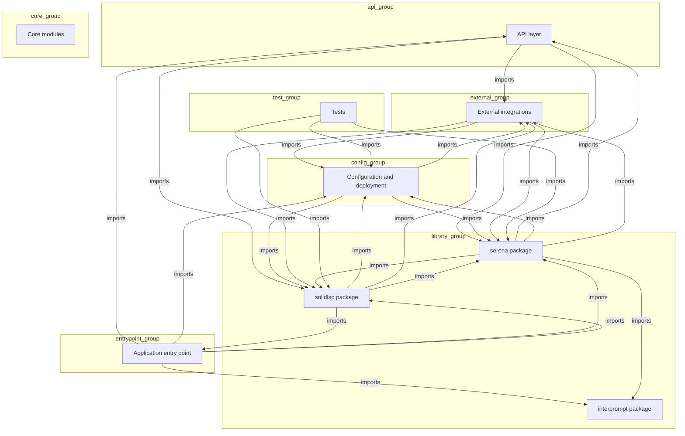

# Architecture report: oraios/serena

> Automated static analysis. **Observed** = directly seen in files/imports/AST; **Inferred** = interpretation from that evidence. Repository code was not executed.

## 1. Repository at a glance

| Item | Value |
| --- | --- |
| Repository | oraios/serena |
| Description | A powerful MCP toolkit for coding, providing semantic retrieval and editing capabilities  - the IDE for your agent |
| Language | Python |
| Stars | 31377 |
| Licence | Other |
| Analysed commit / branch | 6b39542bb108ce77901072deac699d770b302d52 / main |
| Framework(s) | Flask, Starlette, Svelte |
| Files analysed | 796 |
| Components | 9 |

## 2. Architecture in one minute

oraios/serena - A powerful MCP toolkit for coding, providing semantic retrieval and editing capabilities  - the IDE for your agent. This repository was analysed statically from 796 file(s) (232 Python). Detected technologies (observed from imports/manifests): GitHub Actions, Flask, Starlette, Svelte, Click, Pydantic. Files are grouped into 9 component(s): API layer, Configuration and deployment, Core modules, Application entry point, External integrations, interprompt package, serena package, solidlsp package. Observed entry point(s): scripts/add_spdx_headers.py, scripts/agno_agent.py, scripts/build_news_json.py. Findings below distinguish observed facts from inferred interpretation.

## 3. High-level block diagram

## 4. Main components

### API layer (`api_layer`)

- **Kind:** api
- **Status:** Observed
- **Confidence:** 0.85
- **Responsibility:** Groups 8 file(s) under api layer (observed from repository paths and static analysis). Observed top-level classes: ConfigApi, DirectoryListing, DirectoryListingRenderer, EditApi, ExternalProjectContextManager, ExternalProjectsApi. Observed top-level functions: _is_not_low_level.
- **Paths:** `src/serena/repl/api/cfg_api.py`, `src/serena/repl/api/edit_api.py`, `src/serena/repl/api/ext_api.py`, `src/serena/repl/api/fs_api.py`, `src/serena/repl/api/jb_api.py`, `src/serena/repl/api/lsp_api.py`, `src/serena/repl/api/mem_api.py`, `src/serena/repl/api/shell_api.py`
- **Evidence:** [src/serena/repl/api/cfg_api.py:16](https://github.com/oraios/serena/blob/6b39542bb108ce77901072deac699d770b302d52/src/serena/repl/api/cfg_api.py#L16); [src/serena/repl/api/edit_api.py:28](https://github.com/oraios/serena/blob/6b39542bb108ce77901072deac699d770b302d52/src/serena/repl/api/edit_api.py#L28); [src/serena/repl/api/ext_api.py:20](https://github.com/oraios/serena/blob/6b39542bb108ce77901072deac699d770b302d52/src/serena/repl/api/ext_api.py#L20); [src/serena/repl/api/fs_api.py:22](https://github.com/oraios/serena/blob/6b39542bb108ce77901072deac699d770b302d52/src/serena/repl/api/fs_api.py#L22); [src/serena/repl/api/jb_api.py:40](https://github.com/oraios/serena/blob/6b39542bb108ce77901072deac699d770b302d52/src/serena/repl/api/jb_api.py#L40); [src/serena/repl/api/lsp_api.py:43](https://github.com/oraios/serena/blob/6b39542bb108ce77901072deac699d770b302d52/src/serena/repl/api/lsp_api.py#L43); [src/serena/repl/api/mem_api.py:30](https://github.com/oraios/serena/blob/6b39542bb108ce77901072deac699d770b302d52/src/serena/repl/api/mem_api.py#L30); [src/serena/repl/api/shell_api.py:19](https://github.com/oraios/serena/blob/6b39542bb108ce77901072deac699d770b302d52/src/serena/repl/api/shell_api.py#L19)

### Configuration and deployment (`config`)

- **Kind:** config
- **Status:** Observed
- **Confidence:** 0.85
- **Responsibility:** Groups 48 file(s) under configuration and deployment (observed from repository paths and static analysis). Observed top-level classes: AgentInterface, ApiInclusionDefinition, ClientSetupHandler, ClientSetupHandlerClaudeCode, ClientSetupHandlerCodeBuddy, ClientSetupHandlerCodex. Observed top-level functions: looks_like_yaml_path.
- **Paths:** `Dockerfile`, `compose.yaml`, `pyproject.toml`, `server.json`, `src/serena/config/__init__.py`, `src/serena/config/client_setup.py`, `src/serena/config/context_mode.py`, `src/serena/config/serena_config.py`, `src/serena/config/serena_paths.py`, `src/serena/resources/config/contexts/agent.yml`, `src/serena/resources/config/contexts/antigravity.yml`, `src/serena/resources/config/contexts/chatgpt.yml`, `src/serena/resources/config/contexts/claude-code.yml`, `src/serena/resources/config/contexts/codebuddy.yml`, `src/serena/resources/config/contexts/codex.yml`, `src/serena/resources/config/contexts/context.template.yml`, `src/serena/resources/config/contexts/copilot-cli.yml`, `src/serena/resources/config/contexts/desktop-app.yml`, `src/serena/resources/config/contexts/grok.yml`, `src/serena/resources/config/contexts/ide.yml`, `src/serena/resources/config/contexts/jb-ai-assistant.yml`, `src/serena/resources/config/contexts/jb-copilot-plugin.yml`, `src/serena/resources/config/contexts/junie.yml`, `src/serena/resources/config/contexts/oaicompat-agent.yml`, `src/serena/resources/config/contexts/vscode.yml`, `src/serena/resources/config/contexts/zcode.yml`, `src/serena/resources/config/internal_modes/jetbrains.yml`, `src/serena/resources/config/modes/benchmark.yml`, `src/serena/resources/config/modes/editing.yml`, `src/serena/resources/config/modes/interactive.yml`, `src/serena/resources/config/modes/mode.template.yml`, `src/serena/resources/config/modes/no-memories.yml`, `src/serena/resources/config/modes/no-onboarding.yml`, `src/serena/resources/config/modes/onboarding.yml`, `src/serena/resources/config/modes/one-shot.yml`, `src/serena/resources/config/modes/planning.yml`, `src/serena/resources/config/modes/query-projects.yml`, `src/serena/resources/config/prompt_templates/info_prompts.yml`, `src/serena/resources/config/prompt_templates/simple_tool_outputs.yml`, `src/serena/resources/config/prompt_templates/system_prompt.yml`, `src/serena/resources/project.local.template.yml`, `src/serena/resources/project.template.yml`, `src/serena/resources/serena_config.template.yml`, `src/solidlsp/language_servers/omnisharp/initialize_params.json`, `src/solidlsp/language_servers/omnisharp/runtime_dependencies.json`, `src/solidlsp/language_servers/omnisharp/workspace_did_change_configuration.json`, `src/solidlsp/resources/downloaded_dependency_hashes.json`, `src/solidlsp/settings.py`
- **Evidence:** [Dockerfile](https://github.com/oraios/serena/blob/6b39542bb108ce77901072deac699d770b302d52/Dockerfile); [compose.yaml](https://github.com/oraios/serena/blob/6b39542bb108ce77901072deac699d770b302d52/compose.yaml); [pyproject.toml](https://github.com/oraios/serena/blob/6b39542bb108ce77901072deac699d770b302d52/pyproject.toml); [server.json](https://github.com/oraios/serena/blob/6b39542bb108ce77901072deac699d770b302d52/server.json); [src/serena/config/__init__.py](https://github.com/oraios/serena/blob/6b39542bb108ce77901072deac699d770b302d52/src/serena/config/__init__.py); [src/serena/config/client_setup.py:10](https://github.com/oraios/serena/blob/6b39542bb108ce77901072deac699d770b302d52/src/serena/config/client_setup.py#L10); [src/serena/config/context_mode.py:30](https://github.com/oraios/serena/blob/6b39542bb108ce77901072deac699d770b302d52/src/serena/config/context_mode.py#L30); [src/serena/config/serena_config.py:59](https://github.com/oraios/serena/blob/6b39542bb108ce77901072deac699d770b302d52/src/serena/config/serena_config.py#L59)

### Core modules (`core`)

- **Kind:** core
- **Status:** Observed
- **Confidence:** 0.85
- **Responsibility:** Groups 3 file(s) under core modules (observed from repository paths and static analysis). Observed top-level classes: LibRepo, OtherRepo. Observed top-level functions: call, execute, gitCommit, gitCommitWithMessageFromFile, gitLog, popen.
- **Paths:** `docker_build_and_run.sh`, `repo_dir_sync.py`, `sync.py`
- **Evidence:** [docker_build_and_run.sh](https://github.com/oraios/serena/blob/6b39542bb108ce77901072deac699d770b302d52/docker_build_and_run.sh); [repo_dir_sync.py:12](https://github.com/oraios/serena/blob/6b39542bb108ce77901072deac699d770b302d52/repo_dir_sync.py#L12); [sync.py](https://github.com/oraios/serena/blob/6b39542bb108ce77901072deac699d770b302d52/sync.py)

### Application entry point (`entrypoint`)

- **Kind:** entrypoint
- **Status:** Observed
- **Confidence:** 0.85
- **Responsibility:** Groups 24 file(s) under application entry point (observed from repository paths and static analysis). Observed top-level classes: AbortError, CheckResult, CommandResult, ContextCommands, GrokLiveTest, LSPError. Observed top-level functions: _build_call_pattern, _build_params_field, _download_ls_dependencies, _find_block_end, _find_symbol_at_position, _get_all_mrc_files.
- **Paths:** `scripts/add_spdx_headers.py`, `scripts/agno_agent.py`, `scripts/build_news_json.py`, `scripts/bump_version.py`, `scripts/demo_cli_call.py`, `scripts/demo_diagnostics.py`, `scripts/demo_find_defining_symbol.py`, `scripts/demo_find_implementing_symbol.py`, `scripts/demo_progressive_tool_shortening.py`, `scripts/demo_run_tools.py`, `scripts/gen_prompt_factory.py`, `scripts/gen_tool_capabilities.py`, `scripts/live_test_grok.py`, `scripts/mcp_server.py`, `scripts/memory_graph.py`, `scripts/print_language_list.py`, `scripts/print_mode_context_options.py`, `scripts/print_tool_overview.py`, `scripts/profile_search_text.py`, `scripts/profile_tool_call.py`, `scripts/update_downloaded_dependency_hashes.py`, `src/serena/cli.py`, `src/solidlsp/language_servers/msl_lsp_server.py`, `src/solidlsp/lsp_protocol_handler/server.py`
- **Evidence:** [scripts/add_spdx_headers.py:21](https://github.com/oraios/serena/blob/6b39542bb108ce77901072deac699d770b302d52/scripts/add_spdx_headers.py#L21); [scripts/agno_agent.py](https://github.com/oraios/serena/blob/6b39542bb108ce77901072deac699d770b302d52/scripts/agno_agent.py); [scripts/build_news_json.py:20](https://github.com/oraios/serena/blob/6b39542bb108ce77901072deac699d770b302d52/scripts/build_news_json.py#L20); [scripts/bump_version.py:38](https://github.com/oraios/serena/blob/6b39542bb108ce77901072deac699d770b302d52/scripts/bump_version.py#L38); [scripts/demo_cli_call.py](https://github.com/oraios/serena/blob/6b39542bb108ce77901072deac699d770b302d52/scripts/demo_cli_call.py); [scripts/demo_diagnostics.py:35](https://github.com/oraios/serena/blob/6b39542bb108ce77901072deac699d770b302d52/scripts/demo_diagnostics.py#L35); [scripts/demo_find_defining_symbol.py:24](https://github.com/oraios/serena/blob/6b39542bb108ce77901072deac699d770b302d52/scripts/demo_find_defining_symbol.py#L24); [scripts/demo_find_implementing_symbol.py:22](https://github.com/oraios/serena/blob/6b39542bb108ce77901072deac699d770b302d52/scripts/demo_find_implementing_symbol.py#L22)

### External integrations (`external_integrations`)

- **Kind:** external
- **Status:** Observed
- **Confidence:** 0.85
- **Responsibility:** Groups 2 file(s) under external integrations (observed from repository paths and static analysis). Observed top-level classes: APIError, ConnectionError, JetBrainsPluginClient, JetBrainsPluginClientManager, MatchedClient, PluginServerError.
- **Paths:** `src/serena/dashboard/dashboard_api.py`, `src/serena/jetbrains/jetbrains_plugin_client.py`
- **Evidence:** [src/serena/dashboard/dashboard_api.py:37](https://github.com/oraios/serena/blob/6b39542bb108ce77901072deac699d770b302d52/src/serena/dashboard/dashboard_api.py#L37); [src/serena/jetbrains/jetbrains_plugin_client.py:33](https://github.com/oraios/serena/blob/6b39542bb108ce77901072deac699d770b302d52/src/serena/jetbrains/jetbrains_plugin_client.py#L33)

### interprompt package (`interprompt`)

- **Kind:** library
- **Status:** Observed
- **Confidence:** 0.85
- **Responsibility:** Groups 6 file(s) under interprompt package (observed from repository paths and static analysis). Observed top-level classes: JinjaTemplate, LanguageFallbackMode, MultiLangPromptCollection, MultiLangPromptList, MultiLangPromptTemplate, ParameterizedTemplateInterface. Observed top-level functions: autogenerate_prompt_factory_module, singleton.
- **Paths:** `src/interprompt/__init__.py`, `src/interprompt/jinja_template.py`, `src/interprompt/multilang_prompt.py`, `src/interprompt/prompt_factory.py`, `src/interprompt/util/__init__.py`, `src/interprompt/util/class_decorators.py`
- **Evidence:** [src/interprompt/__init__.py](https://github.com/oraios/serena/blob/6b39542bb108ce77901072deac699d770b302d52/src/interprompt/__init__.py); [src/interprompt/jinja_template.py:14](https://github.com/oraios/serena/blob/6b39542bb108ce77901072deac699d770b302d52/src/interprompt/jinja_template.py#L14); [src/interprompt/multilang_prompt.py:16](https://github.com/oraios/serena/blob/6b39542bb108ce77901072deac699d770b302d52/src/interprompt/multilang_prompt.py#L16); [src/interprompt/prompt_factory.py:12](https://github.com/oraios/serena/blob/6b39542bb108ce77901072deac699d770b302d52/src/interprompt/prompt_factory.py#L12); [src/interprompt/util/__init__.py](https://github.com/oraios/serena/blob/6b39542bb108ce77901072deac699d770b302d52/src/interprompt/util/__init__.py); [src/interprompt/util/class_decorators.py:6](https://github.com/oraios/serena/blob/6b39542bb108ce77901072deac699d770b302d52/src/interprompt/util/class_decorators.py#L6)

### serena package (`serena`)

- **Kind:** library
- **Status:** Observed
- **Confidence:** 0.85
- **Responsibility:** Groups 64 file(s) under serena package (observed from repository paths and static analysis). Observed top-level classes: ActivateProjectTool, ActiveModes, AnthropicTokenCount, ApiScope, ApplyMethodProtocol, AutoRegisteringGroup. Observed top-level functions: _create_yaml, _escape_gitignore_path_component, _init_log_configuration, _is_serena_symbolic_tool_name, _lock_path_for_launch_command, _new_file_mode.
- **Paths:** `src/serena/__init__.py`, `src/serena/agent.py`, `src/serena/agno.py`, `src/serena/analytics.py`, `src/serena/code_editor.py`, `src/serena/constants.py`, `src/serena/dashboard/dashboard_tray_manager.py`, `src/serena/dashboard/dashboard_viewer.py`, `src/serena/generated/generated_prompt_factory.py`, `src/serena/generated/tool_capabilities.py`, `src/serena/gui_log_viewer.py`, `src/serena/hooks.py`, `src/serena/jetbrains/jetbrains_backend.py`, `src/serena/jetbrains/jetbrains_types.py`, `src/serena/jetbrains/launch_coordinator.py`, `src/serena/language_backend.py`, `src/serena/ls_manager.py`, `src/serena/lsp/lsp_backend.py`, `src/serena/lsp/lsp_diagnostics.py`, `src/serena/mcp.py`, `src/serena/memories/memory_manager.py`, `src/serena/memories/memory_reference_analysis.py`, `src/serena/olb/olb_jvm_backend.py`, `src/serena/project.py`, `src/serena/project_server.py`, `src/serena/prompt_factory.py`, `src/serena/repl/external_project.py`, `src/serena/repl/facade.py`, `src/serena/repl/repl.py`, `src/serena/repl/representable.py`, `src/serena/resources/dashboard/dashboard.js`, `src/serena/session.py`, `src/serena/symbol.py`, `src/serena/task_executor.py`, `src/serena/tools/__init__.py`, `src/serena/tools/cmd_tools.py`, `src/serena/tools/config_tools.py`, `src/serena/tools/file_tools.py`, `src/serena/tools/jetbrains_tools.py`, `src/serena/tools/memory_tools.py`, `src/serena/tools/query_project_tools.py`, `src/serena/tools/repl_tools.py`, `src/serena/tools/symbol_tools.py`, `src/serena/tools/tools_base.py`, `src/serena/tools/workflow_tools.py`, `src/serena/util/class_decorators.py`, `src/serena/util/cli_util.py`, `src/serena/util/dataclass.py`, `src/serena/util/dotnet.py`, `src/serena/util/exception.py`, `src/serena/util/file_proxy.py`, `src/serena/util/file_system.py`, `src/serena/util/git.py`, `src/serena/util/gui.py`, `src/serena/util/inspection.py`, `src/serena/util/logging.py`, `src/serena/util/pypi.py`, `src/serena/util/pywebview.py`, `src/serena/util/shell.py`, `src/serena/util/text_utils.py`, `src/serena/util/thread.py`, `src/serena/util/tray.py`, `src/serena/util/version.py`, `src/serena/util/yaml.py`
- **Evidence:** [src/serena/__init__.py:10](https://github.com/oraios/serena/blob/6b39542bb108ce77901072deac699d770b302d52/src/serena/__init__.py#L10); [src/serena/agent.py:93](https://github.com/oraios/serena/blob/6b39542bb108ce77901072deac699d770b302d52/src/serena/agent.py#L93); [src/serena/agno.py:27](https://github.com/oraios/serena/blob/6b39542bb108ce77901072deac699d770b302d52/src/serena/agno.py#L27); [src/serena/analytics.py:24](https://github.com/oraios/serena/blob/6b39542bb108ce77901072deac699d770b302d52/src/serena/analytics.py#L24); [src/serena/code_editor.py:26](https://github.com/oraios/serena/blob/6b39542bb108ce77901072deac699d770b302d52/src/serena/code_editor.py#L26); [src/serena/constants.py:41](https://github.com/oraios/serena/blob/6b39542bb108ce77901072deac699d770b302d52/src/serena/constants.py#L41); [src/serena/dashboard/dashboard_tray_manager.py:31](https://github.com/oraios/serena/blob/6b39542bb108ce77901072deac699d770b302d52/src/serena/dashboard/dashboard_tray_manager.py#L31); [src/serena/dashboard/dashboard_viewer.py:17](https://github.com/oraios/serena/blob/6b39542bb108ce77901072deac699d770b302d52/src/serena/dashboard/dashboard_viewer.py#L17)

### solidlsp package (`solidlsp`)

- **Kind:** library
- **Status:** Observed
- **Confidence:** 0.85
- **Responsibility:** Groups 100 file(s) under solidlsp package (observed from repository paths and static analysis). Observed top-level classes: ALLanguageServer, AdaLanguageServer, AngularLanguageServer, AngularTypeScriptServer, AnsibleLanguageServer, AstroCompanionPreparationError. Observed top-level functions: _al_extension_dirname, _al_extension_sha, _als_sha, _clojure_lsp_sha, _contains_json_file, _create_phpantom_dependencies.
- **Paths:** `src/solidlsp/__init__.py`, `src/solidlsp/dependency_provider.py`, `src/solidlsp/initialize_params.py`, `src/solidlsp/language_servers/ada_language_server.py`, `src/solidlsp/language_servers/al_language_server.py`, `src/solidlsp/language_servers/angular_language_server.py`, `src/solidlsp/language_servers/ansible_language_server.py`, `src/solidlsp/language_servers/astro_language_server.py`, `src/solidlsp/language_servers/basedpyright_server.py`, `src/solidlsp/language_servers/bash_language_server.py`, `src/solidlsp/language_servers/bsl_language_server.py`, `src/solidlsp/language_servers/ccls_language_server.py`, `src/solidlsp/language_servers/clangd_language_server.py`, `src/solidlsp/language_servers/clojure_lsp.py`, `src/solidlsp/language_servers/common.py`, `src/solidlsp/language_servers/crystal_language_server.py`, `src/solidlsp/language_servers/csharp_language_server.py`, `src/solidlsp/language_servers/cue_language_server.py`, `src/solidlsp/language_servers/dart_language_server.py`, `src/solidlsp/language_servers/deno_language_server.py`, `src/solidlsp/language_servers/devsense_php_language_server.py`, `src/solidlsp/language_servers/eclipse_jdtls.py`, `src/solidlsp/language_servers/elixir_tools/__init__.py`, `src/solidlsp/language_servers/elixir_tools/elixir_tools.py`, `src/solidlsp/language_servers/elm_language_server.py`, `src/solidlsp/language_servers/emmylua_ls.py`, `src/solidlsp/language_servers/erlang_language_server.py`, `src/solidlsp/language_servers/fatou_language_server.py`, `src/solidlsp/language_servers/fortran_language_server.py`, `src/solidlsp/language_servers/fsharp_language_server.py`, `src/solidlsp/language_servers/gleam_language_server.py`, `src/solidlsp/language_servers/godot_language_server.py`, `src/solidlsp/language_servers/gopls.py`, `src/solidlsp/language_servers/graphql_language_server.py`, `src/solidlsp/language_servers/groovy_language_server.py`, `src/solidlsp/language_servers/haskell_language_server.py`, `src/solidlsp/language_servers/haxe_language_server.py`, `src/solidlsp/language_servers/hlsl_language_server.py`, `src/solidlsp/language_servers/intelephense.py`, `src/solidlsp/language_servers/jedi_server.py`, `src/solidlsp/language_servers/json_language_server.py`, `src/solidlsp/language_servers/julia_server.py`, `src/solidlsp/language_servers/kotlin_language_server.py`, `src/solidlsp/language_servers/lean4_language_server.py`, `src/solidlsp/language_servers/lua_ls.py`, `src/solidlsp/language_servers/luau_lsp.py`, `src/solidlsp/language_servers/marksman.py`, `src/solidlsp/language_servers/matlab_language_server.py`, `src/solidlsp/language_servers/msl_language_server.py`, `src/solidlsp/language_servers/nextflow_language_server.py`, `src/solidlsp/language_servers/nixd_ls.py`, `src/solidlsp/language_servers/ocaml_lsp_server.py`, `src/solidlsp/language_servers/omnisharp.py`, `src/solidlsp/language_servers/pascal_server.py`, `src/solidlsp/language_servers/perl_language_server.py`, `src/solidlsp/language_servers/phpactor.py`, `src/solidlsp/language_servers/phpantom.py`, `src/solidlsp/language_servers/powershell_language_server.py`, `src/solidlsp/language_servers/pyrefly_server.py`, `src/solidlsp/language_servers/pyright_server.py`, `src/solidlsp/language_servers/qml_language_server.py`, `src/solidlsp/language_servers/r_language_server.py`, `src/solidlsp/language_servers/regal_server.py`, `src/solidlsp/language_servers/ruby_lsp.py`, `src/solidlsp/language_servers/rust_analyzer.py`, `src/solidlsp/language_servers/scala_language_server.py`, `src/solidlsp/language_servers/solargraph.py`, `src/solidlsp/language_servers/solidity_homedir_preload.cjs`, `src/solidlsp/language_servers/solidity_language_server.py`, `src/solidlsp/language_servers/some_sass_language_server.py`, `src/solidlsp/language_servers/sourcekit_lsp.py`, `src/solidlsp/language_servers/svelte_language_server.py`, `src/solidlsp/language_servers/systemverilog_server.py`, `src/solidlsp/language_servers/taplo_server.py`, `src/solidlsp/language_servers/terraform_ls.py`, `src/solidlsp/language_servers/texlab_language_server.py`, `src/solidlsp/language_servers/tsgo_language_server.py`, `src/solidlsp/language_servers/ty_server.py`, `src/solidlsp/language_servers/typescript_language_server.py`, `src/solidlsp/language_servers/vbnet_language_server.py`, `src/solidlsp/language_servers/vscode_html_language_server.py`, `src/solidlsp/language_servers/vts_language_server.py`, `src/solidlsp/language_servers/vue_language_server.py`, `src/solidlsp/language_servers/wolfram_language_server.py`, `src/solidlsp/language_servers/yaml_language_server.py`, `src/solidlsp/language_servers/zls.py`, `src/solidlsp/ls.py`, `src/solidlsp/ls_config.py`, `src/solidlsp/ls_exceptions.py`, `src/solidlsp/ls_process.py`, `src/solidlsp/ls_request.py`, `src/solidlsp/ls_types.py`, `src/solidlsp/ls_utils.py`, `src/solidlsp/lsp_protocol_handler/lsp_constants.py`, `src/solidlsp/lsp_protocol_handler/lsp_requests.py`, `src/solidlsp/util/cache.py`, `src/solidlsp/util/metals_db_utils.py`, `src/solidlsp/util/pickle_util.py`, `src/solidlsp/util/subprocess_util.py`, `src/solidlsp/util/zip.py`
- **Evidence:** [src/solidlsp/__init__.py](https://github.com/oraios/serena/blob/6b39542bb108ce77901072deac699d770b302d52/src/solidlsp/__init__.py); [src/solidlsp/dependency_provider.py:22](https://github.com/oraios/serena/blob/6b39542bb108ce77901072deac699d770b302d52/src/solidlsp/dependency_provider.py#L22); [src/solidlsp/initialize_params.py:18](https://github.com/oraios/serena/blob/6b39542bb108ce77901072deac699d770b302d52/src/solidlsp/initialize_params.py#L18); [src/solidlsp/language_servers/ada_language_server.py:36](https://github.com/oraios/serena/blob/6b39542bb108ce77901072deac699d770b302d52/src/solidlsp/language_servers/ada_language_server.py#L36); [src/solidlsp/language_servers/al_language_server.py:43](https://github.com/oraios/serena/blob/6b39542bb108ce77901072deac699d770b302d52/src/solidlsp/language_servers/al_language_server.py#L43); [src/solidlsp/language_servers/angular_language_server.py:101](https://github.com/oraios/serena/blob/6b39542bb108ce77901072deac699d770b302d52/src/solidlsp/language_servers/angular_language_server.py#L101); [src/solidlsp/language_servers/ansible_language_server.py:30](https://github.com/oraios/serena/blob/6b39542bb108ce77901072deac699d770b302d52/src/solidlsp/language_servers/ansible_language_server.py#L30); [src/solidlsp/language_servers/astro_language_server.py:51](https://github.com/oraios/serena/blob/6b39542bb108ce77901072deac699d770b302d52/src/solidlsp/language_servers/astro_language_server.py#L51)

### Tests (`tests`)

- **Kind:** test
- **Status:** Observed
- **Confidence:** 0.85
- **Responsibility:** Groups 430 file(s) under tests (observed from repository paths and static analysis). Observed top-level classes: Auditable, BaseModel, BaseModule, BaseProcessor, BaseService, ClassWillBeOverwritten. Observed top-level functions: _create_default_project, _create_ls, _determine_disabled_language_servers, _is_matlab_available, _is_ocaml_lsp_available, _is_perl_language_server_available.
- **Paths:** `test/__init__.py`, `test/conftest.py`, `test/resources/repos/ada/test_repo/.gitignore`, `test/resources/repos/ada/test_repo/default.gpr`, `test/resources/repos/ada/test_repo/src/diagnostics_sample.adb`, `test/resources/repos/ada/test_repo/src/helper.adb`, `test/resources/repos/ada/test_repo/src/helper.ads`, `test/resources/repos/ada/test_repo/src/main.adb`, `test/resources/repos/al/test_repo/app.json`, `test/resources/repos/al/test_repo/src/Codeunits/CustomerMgt.Codeunit.al`, `test/resources/repos/al/test_repo/src/Codeunits/PaymentProcessorImpl.Codeunit.al`, `test/resources/repos/al/test_repo/src/Enums/CustomerType.Enum.al`, `test/resources/repos/al/test_repo/src/Interfaces/IPaymentProcessor.Interface.al`, `test/resources/repos/al/test_repo/src/Pages/CustomerCard.Page.al`, `test/resources/repos/al/test_repo/src/Pages/CustomerList.Page.al`, `test/resources/repos/al/test_repo/src/TableExtensions/Item.TableExt.al`, `test/resources/repos/al/test_repo/src/Tables/Customer.Table.al`, `test/resources/repos/angular/cross_package_lib/external-greeter.ts`, `test/resources/repos/angular/cross_package_lib/tsconfig.json`, `test/resources/repos/angular/test_repo/.gitignore`, `test/resources/repos/angular/test_repo/angular.json`, `test/resources/repos/angular/test_repo/package.json`, `test/resources/repos/angular/test_repo/src/app/app.component.html`, `test/resources/repos/angular/test_repo/src/app/app.component.ts`, `test/resources/repos/angular/test_repo/src/app/diagnostics_sample.html`, `test/resources/repos/angular/test_repo/src/app/diagnostics_sample.ts`, `test/resources/repos/angular/test_repo/src/app/exclaim.pipe.ts`, `test/resources/repos/angular/test_repo/src/app/greeter.interface.ts`, `test/resources/repos/angular/test_repo/src/app/greeting.service.ts`, `test/resources/repos/angular/test_repo/src/app/inline_template_sample.ts`, `test/resources/repos/angular/test_repo/src/app/item-card.component.ts`, `test/resources/repos/angular/test_repo/src/app/jsx_component.tsx`, `test/resources/repos/angular/test_repo/src/index.html`, `test/resources/repos/angular/test_repo/src/main.ts`, `test/resources/repos/angular/test_repo/tsconfig.app.json`, `test/resources/repos/angular/test_repo/tsconfig.json`, `test/resources/repos/ansible/test_repo/inventory/hosts.yml`, `test/resources/repos/ansible/test_repo/playbook.yml`, `test/resources/repos/ansible/test_repo/roles/common/defaults/main.yml`, `test/resources/repos/ansible/test_repo/roles/common/handlers/main.yml`, `test/resources/repos/ansible/test_repo/roles/common/tasks/main.yml`, `test/resources/repos/astro/test_repo/.gitignore`, `test/resources/repos/astro/test_repo/astro.config.mjs`, `test/resources/repos/astro/test_repo/package.json`, `test/resources/repos/astro/test_repo/src/components/Card.astro`, `test/resources/repos/astro/test_repo/src/components/Footer.astro`, `test/resources/repos/astro/test_repo/src/components/Header.astro`, `test/resources/repos/astro/test_repo/src/layouts/Layout.astro`, `test/resources/repos/astro/test_repo/src/pages/index.astro`, `test/resources/repos/astro/test_repo/src/stores/counter.ts`, `test/resources/repos/astro/test_repo/src/utils/format.ts`, `test/resources/repos/astro/test_repo/tsconfig.json`, `test/resources/repos/bash/test_repo/config.sh`, `test/resources/repos/bash/test_repo/diagnostics_sample.sh`, `test/resources/repos/bash/test_repo/main.sh`, `test/resources/repos/bash/test_repo/utils.sh`, `test/resources/repos/bsl/test_repo/.bsl-language-server.json`, `test/resources/repos/bsl/test_repo/.gitkeep`, `test/resources/repos/bsl/test_repo/CommonModule.bsl`, `test/resources/repos/bsl/test_repo/ObjectModule.bsl`, `test/resources/repos/bsl/test_repo/diagnostics_sample.bsl`, `test/resources/repos/bsl/test_repo/src/CommonModules/ОбщийМодуль1.xml`, `test/resources/repos/bsl/test_repo/src/CommonModules/ОбщийМодуль1/Ext/Module.bsl`, `test/resources/repos/bsl/test_repo/src/CommonModules/ОбщийМодуль2.xml`, `test/resources/repos/bsl/test_repo/src/CommonModules/ОбщийМодуль2/Ext/Module.bsl`, `test/resources/repos/bsl/test_repo/src/ConfigDumpInfo.xml`, `test/resources/repos/bsl/test_repo/src/Configuration.xml`, `test/resources/repos/bsl/test_repo/src/Languages/Русский.xml`, `test/resources/repos/clojure/test_repo/deps.edn`, `test/resources/repos/clojure/test_repo/src/test_app/core.clj`, `test/resources/repos/clojure/test_repo/src/test_app/diagnostics_sample.clj`, `test/resources/repos/clojure/test_repo/src/test_app/extra.clj`, `test/resources/repos/clojure/test_repo/src/test_app/utils.clj`, `test/resources/repos/clojure/test_repo/sub_module/deps.edn`, `test/resources/repos/clojure/test_repo/sub_module/src/sub_module_app/consumer.clj`, `test/resources/repos/cpp/test_repo/C/a.c`, `test/resources/repos/cpp/test_repo/C/b.h`, `test/resources/repos/cpp/test_repo/CUDA/a.cu`, `test/resources/repos/cpp/test_repo/CXX20/a.cpp`, `test/resources/repos/cpp/test_repo/CXX20/b.cpp`, `test/resources/repos/cpp/test_repo/CXX20/b.cppm`, `test/resources/repos/cpp/test_repo/HIP/a.hip`, `test/resources/repos/cpp/test_repo/Objective-C/a.m`, `test/resources/repos/cpp/test_repo/OpenCL/a.cl`, `test/resources/repos/cpp/test_repo/a.cpp`, `test/resources/repos/cpp/test_repo/b.cpp`, `test/resources/repos/cpp/test_repo/b.hpp`, `test/resources/repos/cpp/test_repo/compile_commands.json`, `test/resources/repos/cpp/test_repo/diagnostics_sample.cpp`, `test/resources/repos/cpp/ue_test_repo/Intermediate/TestGame/UHT/AbilityActor.generated.h`, `test/resources/repos/cpp/ue_test_repo/Intermediate/TestGame/UHT/AbilityComponent.gen.cpp`, `test/resources/repos/cpp/ue_test_repo/Intermediate/TestGame/UHT/AbilityComponent.generated.h`, `test/resources/repos/cpp/ue_test_repo/Intermediate/TestGame/UHT/AbilityTypes.generated.h`, `test/resources/repos/cpp/ue_test_repo/Intermediate/TestGame/UHT/Damageable.generated.h`, `test/resources/repos/cpp/ue_test_repo/Intermediate/TestGame/UHT/GameCharacter.generated.h`, `test/resources/repos/cpp/ue_test_repo/MyGame.uproject`, `test/resources/repos/cpp/ue_test_repo/Source/TestGame/AbilityActor.cpp`, `test/resources/repos/cpp/ue_test_repo/Source/TestGame/AbilityActor.h`, `test/resources/repos/cpp/ue_test_repo/Source/TestGame/AbilityComponent.cpp`, `test/resources/repos/cpp/ue_test_repo/Source/TestGame/AbilityComponent.h`, `test/resources/repos/cpp/ue_test_repo/Source/TestGame/AbilityTypes.h`, `test/resources/repos/cpp/ue_test_repo/Source/TestGame/Damageable.h`, `test/resources/repos/cpp/ue_test_repo/Source/TestGame/GameCharacter.cpp`, `test/resources/repos/cpp/ue_test_repo/Source/TestGame/GameCharacter.h`, `test/resources/repos/cpp/ue_test_repo/Source/TestGame/TestGameLog.h`, `test/resources/repos/cpp/ue_test_repo/Source/TestGame/TestGameModule.cpp`, `test/resources/repos/cpp/ue_test_repo/Stubs/Components/ActorComponent.h`, `test/resources/repos/cpp/ue_test_repo/Stubs/Containers/Array.h`, `test/resources/repos/cpp/ue_test_repo/Stubs/Containers/Map.h`, `test/resources/repos/cpp/ue_test_repo/Stubs/Containers/Set.h`, `test/resources/repos/cpp/ue_test_repo/Stubs/CoreMinimal.h`, `test/resources/repos/cpp/ue_test_repo/Stubs/CoreTypes.h`, `test/resources/repos/cpp/ue_test_repo/Stubs/Delegates/DelegateCombinations.h`, `test/resources/repos/cpp/ue_test_repo/Stubs/Engine/World.h`, `test/resources/repos/cpp/ue_test_repo/Stubs/GameFramework/Actor.h`, `test/resources/repos/cpp/ue_test_repo/Stubs/GameFramework/Character.h`, `test/resources/repos/cpp/ue_test_repo/Stubs/GameFramework/Pawn.h`, `test/resources/repos/cpp/ue_test_repo/Stubs/Logging/LogMacros.h`, `test/resources/repos/cpp/ue_test_repo/Stubs/Math/MathFwd.h`, `test/resources/repos/cpp/ue_test_repo/Stubs/Misc/Optional.h`, `test/resources/repos/cpp/ue_test_repo/Stubs/Modules/ModuleManager.h`, `test/resources/repos/cpp/ue_test_repo/Stubs/Templates/SharedPointer.h`, `test/resources/repos/cpp/ue_test_repo/Stubs/Templates/SubclassOf.h`, `test/resources/repos/cpp/ue_test_repo/Stubs/Templates/UniquePtr.h`, `test/resources/repos/cpp/ue_test_repo/Stubs/UObject/Interface.h`, `test/resources/repos/cpp/ue_test_repo/Stubs/UObject/Object.h`, `test/resources/repos/cpp/ue_test_repo/Stubs/UObject/ObjectMacros.h`, `test/resources/repos/cpp/ue_test_repo/Stubs/UObject/ObjectPtr.h`, `test/resources/repos/cpp/ue_test_repo/Stubs/UObject/SoftObjectPtr.h`, `test/resources/repos/cpp/ue_test_repo/Stubs/UObject/UObjectGlobals.h`, `test/resources/repos/cpp/ue_test_repo/Stubs/UObject/WeakObjectPtr.h`, `test/resources/repos/cpp/ue_test_repo/compile_commands.json`, `test/resources/repos/crystal/test_repo/shard.yml`, `test/resources/repos/crystal/test_repo/src/diagnostics_sample.cr`, `test/resources/repos/crystal/test_repo/src/main.cr`, `test/resources/repos/crystal/test_repo/src/utils.cr`, `test/resources/repos/csharp/test_repo/.gitignore`, `test/resources/repos/csharp/test_repo/DiagnosticsSample.cs`, `test/resources/repos/csharp/test_repo/Models/Person.cs`, `test/resources/repos/csharp/test_repo/Program.cs`, `test/resources/repos/csharp/test_repo/Services/ConsoleGreeter.cs`, `test/resources/repos/csharp/test_repo/Services/IGreeter.cs`, `test/resources/repos/csharp/test_repo/TestProject.csproj`, `test/resources/repos/csharp/test_repo/serena.sln`, `test/resources/repos/cue/test_repo/.gitignore`, `test/resources/repos/cue/test_repo/cue.mod/module.cue`, `test/resources/repos/cue/test_repo/lib.cue`, `test/resources/repos/cue/test_repo/main.cue`, `test/resources/repos/cue/test_repo/schema.cue`, `test/resources/repos/dart/test_repo/.gitignore`, `test/resources/repos/dart/test_repo/lib/diagnostics_sample.dart`, `test/resources/repos/dart/test_repo/lib/helper.dart`, `test/resources/repos/dart/test_repo/lib/main.dart`, `test/resources/repos/dart/test_repo/lib/models.dart`, `test/resources/repos/dart/test_repo/pubspec.yaml`, `test/resources/repos/deno/test_repo/deno.json`, `test/resources/repos/deno/test_repo/main.ts`, `test/resources/repos/deno/test_repo/util.ts`, `test/resources/repos/elixir/test_repo/.gitignore`, `test/resources/repos/elixir/test_repo/lib/diagnostics_sample.ex`, `test/resources/repos/elixir/test_repo/lib/examples.ex`, `test/resources/repos/elixir/test_repo/lib/ignored_dir/ignored_module.ex`, `test/resources/repos/elixir/test_repo/lib/models.ex`, `test/resources/repos/elixir/test_repo/lib/services.ex`, `test/resources/repos/elixir/test_repo/lib/test_repo.ex`, `test/resources/repos/elixir/test_repo/lib/utils.ex`, `test/resources/repos/elixir/test_repo/mix.exs`, `test/resources/repos/elixir/test_repo/mix.lock`, `test/resources/repos/elixir/test_repo/scripts/build_script.ex`, `test/resources/repos/elixir/test_repo/test/models_test.exs`, `test/resources/repos/elixir/test_repo/test/test_repo_test.exs`, `test/resources/repos/elm/test_repo/DiagnosticsSample.elm`, `test/resources/repos/elm/test_repo/Main.elm`, `test/resources/repos/elm/test_repo/Utils.elm`, `test/resources/repos/elm/test_repo/elm.json`, `test/resources/repos/erlang/test_repo/hello.erl`, `test/resources/repos/erlang/test_repo/ignored_dir/ignored_module.erl`, `test/resources/repos/erlang/test_repo/include/records.hrl`, `test/resources/repos/erlang/test_repo/include/types.hrl`, `test/resources/repos/erlang/test_repo/math_utils.erl`, `test/resources/repos/erlang/test_repo/rebar.config`, `test/resources/repos/erlang/test_repo/src/app.erl`, `test/resources/repos/erlang/test_repo/src/diagnostics_sample.erl`, `test/resources/repos/erlang/test_repo/src/models.erl`, `test/resources/repos/erlang/test_repo/src/services.erl`, `test/resources/repos/erlang/test_repo/src/utils.erl`, `test/resources/repos/erlang/test_repo/test/models_tests.erl`, `test/resources/repos/erlang/test_repo/test/utils_tests.erl`, `test/resources/repos/fortran/test_repo/diagnostics_sample.f90`, `test/resources/repos/fortran/test_repo/main.f90`, `test/resources/repos/fortran/test_repo/modules/geometry.f90`, `test/resources/repos/fortran/test_repo/modules/math_utils.f90`, `test/resources/repos/fsharp/test_repo/.gitignore`, `test/resources/repos/fsharp/test_repo/Calculator.fs`, `test/resources/repos/fsharp/test_repo/DiagnosticsSample.fs`, `test/resources/repos/fsharp/test_repo/Formatter.fs`, `test/resources/repos/fsharp/test_repo/Models/Person.fs`, `test/resources/repos/fsharp/test_repo/Program.fs`, `test/resources/repos/fsharp/test_repo/README.md`, `test/resources/repos/fsharp/test_repo/Shapes.fs`, `test/resources/repos/fsharp/test_repo/TestProject.fsproj`, `test/resources/repos/gleam/test_repo/.gitignore`, `test/resources/repos/gleam/test_repo/gleam.toml`, `test/resources/repos/gleam/test_repo/manifest.toml`, `test/resources/repos/gleam/test_repo/src/calculator.gleam`, `test/resources/repos/gleam/test_repo/src/diagnostics_sample.gleam`, `test/resources/repos/gleam/test_repo/src/runner/first.gleam`, `test/resources/repos/gleam/test_repo/src/runner/second.gleam`, `test/resources/repos/gleam/test_repo/src/runner/task.gleam`, `test/resources/repos/gleam/test_repo/src/utils.gleam`, `test/resources/repos/go/test_repo/buildtags/foo.go`, `test/resources/repos/go/test_repo/buildtags/notfoo.go`, `test/resources/repos/go/test_repo/containment_sample.go`, `test/resources/repos/go/test_repo/diagnostics_sample.go`, `test/resources/repos/go/test_repo/go.mod`, `test/resources/repos/go/test_repo/main.go`, `test/resources/repos/go/test_repo/symbol_body.go`, `test/resources/repos/graphql/test_repo/.graphqlrc.yml`, `test/resources/repos/graphql/test_repo/operations/mutations.graphql`, `test/resources/repos/graphql/test_repo/operations/queries.graphql`, `test/resources/repos/graphql/test_repo/schema.graphql`, `test/resources/repos/graphql_no_config/test_repo/schema.graphql`, `test/resources/repos/graphql_unresolved_schema/test_repo/.graphqlrc.yml`, `test/resources/repos/graphql_unresolved_schema/test_repo/schema.graphql`, `test/resources/repos/groovy/test_repo/.gitignore`, `test/resources/repos/groovy/test_repo/build.gradle`, `test/resources/repos/groovy/test_repo/src/main/groovy/com/example/DiagnosticsSample.groovy`, `test/resources/repos/groovy/test_repo/src/main/groovy/com/example/Main.groovy`, `test/resources/repos/groovy/test_repo/src/main/groovy/com/example/Model.groovy`, `test/resources/repos/groovy/test_repo/src/main/groovy/com/example/ModelUser.groovy`, `test/resources/repos/groovy/test_repo/src/main/groovy/com/example/Utils.groovy`, `test/resources/repos/haskell/test_repo/app/Main.hs`, `test/resources/repos/haskell/test_repo/haskell-test-repo.cabal`, `test/resources/repos/haskell/test_repo/package.yaml`, `test/resources/repos/haskell/test_repo/src/Calculator.hs`, `test/resources/repos/haskell/test_repo/src/DiagnosticsSample.hs`, `test/resources/repos/haskell/test_repo/src/Helper.hs`, `test/resources/repos/haskell/test_repo/stack.yaml`, `test/resources/repos/haxe/test_repo/.gitignore`, `test/resources/repos/haxe/test_repo/build.hxml`, `test/resources/repos/haxe/test_repo/src/DiagnosticsSample.hx`, `test/resources/repos/haxe/test_repo/src/Main.hx`, `test/resources/repos/haxe/test_repo/src/utils/Helper.hx`, `test/resources/repos/hlsl/test_repo/common.hlsl`, `test/resources/repos/hlsl/test_repo/compute_test.hlsl`, `test/resources/repos/hlsl/test_repo/diagnostics_sample.hlsl`, `test/resources/repos/hlsl/test_repo/lighting.hlsl`, `test/resources/repos/hlsl/test_repo/terrain/terrain_sdf.hlsl`, `test/resources/repos/html/test_repo/about.html`, `test/resources/repos/html/test_repo/diagnostics_sample.html`, `test/resources/repos/html/test_repo/index.html`, `test/resources/repos/java/test_repo/pom.xml`, `test/resources/repos/java/test_repo/src/main/java/test_repo/ConsoleGreeter.java`, `test/resources/repos/java/test_repo/src/main/java/test_repo/DefaultGreeter.java`, `test/resources/repos/java/test_repo/src/main/java/test_repo/DiagnosticsSample.java`, `test/resources/repos/java/test_repo/src/main/java/test_repo/FluentLombokModel.java`, `test/resources/repos/java/test_repo/src/main/java/test_repo/Greeter.java`, `test/resources/repos/java/test_repo/src/main/java/test_repo/LombokModel.java`, `test/resources/repos/java/test_repo/src/main/java/test_repo/Main.java`, `test/resources/repos/java/test_repo/src/main/java/test_repo/Model.java`, `test/resources/repos/java/test_repo/src/main/java/test_repo/ModelUser.java`, `test/resources/repos/java/test_repo/src/main/java/test_repo/Utils.java`, `test/resources/repos/json/test_repo/config.json`, `test/resources/repos/json/test_repo/data.json`, `test/resources/repos/json/test_repo/diagnostics_sample.json`, `test/resources/repos/julia/test_repo/Project.toml`, `test/resources/repos/julia/test_repo/diagnostics_sample.jl`, `test/resources/repos/julia/test_repo/lib/helper.jl`, `test/resources/repos/julia/test_repo/main.jl`, `test/resources/repos/julia/test_repo/src/SerenaFixture.jl`, `test/resources/repos/julia/test_repo/src/fatou_a.jl`, `test/resources/repos/julia/test_repo/src/fatou_b.jl`, `test/resources/repos/kotlin/test_repo/.gitignore`, `test/resources/repos/kotlin/test_repo/build.gradle.kts`, `test/resources/repos/kotlin/test_repo/gradle/wrapper/gradle-wrapper.properties`, `test/resources/repos/kotlin/test_repo/gradlew`, `test/resources/repos/kotlin/test_repo/gradlew.bat`, `test/resources/repos/kotlin/test_repo/src/main/kotlin/test_repo/DiagnosticsSample.kt`, `test/resources/repos/kotlin/test_repo/src/main/kotlin/test_repo/Main.kt`, `test/resources/repos/kotlin/test_repo/src/main/kotlin/test_repo/Model.kt`, `test/resources/repos/kotlin/test_repo/src/main/kotlin/test_repo/ModelUser.kt`, `test/resources/repos/kotlin/test_repo/src/main/kotlin/test_repo/Utils.kt`, `test/resources/repos/latex/test_repo/.gitignore`, `test/resources/repos/latex/test_repo/main.tex`, `test/resources/repos/latex/test_repo/references.bib`, `test/resources/repos/latex/test_repo/sections/background.tex`, `test/resources/repos/latex/test_repo/slides.tex`, `test/resources/repos/lean4/test_repo/DiagnosticsSample.lean`, `test/resources/repos/lean4/test_repo/Helper.lean`, `test/resources/repos/lean4/test_repo/Main.lean`, `test/resources/repos/lean4/test_repo/lake-manifest.json`, `test/resources/repos/lean4/test_repo/lakefile.lean`, `test/resources/repos/lean4/test_repo/lean-toolchain`, `test/resources/repos/lua/test_repo/.gitignore`, `test/resources/repos/lua/test_repo/main.lua`, `test/resources/repos/lua/test_repo/src/animals.lua`, `test/resources/repos/lua/test_repo/src/calculator.lua`, `test/resources/repos/lua/test_repo/src/utils.lua`, `test/resources/repos/lua/test_repo/tests/test_calculator.lua`, `test/resources/repos/luau/test_repo/.luaurc`, `test/resources/repos/luau/test_repo/src/init.luau`, `test/resources/repos/luau/test_repo/src/module.luau`, `test/resources/repos/markdown/test_repo/CONTRIBUTING.md`, `test/resources/repos/markdown/test_repo/README.md`, `test/resources/repos/markdown/test_repo/api.md`, `test/resources/repos/markdown/test_repo/guide.md`, `test/resources/repos/matlab/test_repo/Calculator.m`, `test/resources/repos/matlab/test_repo/diagnostics_sample.m`, `test/resources/repos/matlab/test_repo/main.m`, `test/resources/repos/msl/test_repo/main.mrc`, `test/resources/repos/msl/test_repo/utils.mrc`, `test/resources/repos/nextflow/test_repo/.gitignore`, `test/resources/repos/nextflow/test_repo/main.nf`, `test/resources/repos/nextflow/test_repo/modules/greet/main.nf`, `test/resources/repos/nextflow/test_repo/modules/util/main.nf`, `test/resources/repos/nextflow/test_repo/nextflow.config`, `test/resources/repos/nix/test_repo/.gitignore`, `test/resources/repos/nix/test_repo/default.nix`, `test/resources/repos/nix/test_repo/diagnostics_sample.nix`, `test/resources/repos/nix/test_repo/flake.nix`, `test/resources/repos/nix/test_repo/hover.nix`, `test/resources/repos/nix/test_repo/lib/utils.nix`, `test/resources/repos/nix/test_repo/modules/example.nix`, `test/resources/repos/nix/test_repo/scripts/hello.sh`, `test/resources/repos/ocaml/test_repo/bin/dune`, `test/resources/repos/ocaml/test_repo/bin/main.ml`, `test/resources/repos/ocaml/test_repo/dune-project`, `test/resources/repos/ocaml/test_repo/lib/diagnostics_sample.ml`, `test/resources/repos/ocaml/test_repo/lib/dune`, `test/resources/repos/ocaml/test_repo/lib/test_repo.ml`, `test/resources/repos/ocaml/test_repo/lib/test_repo.mli`, `test/resources/repos/ocaml/test_repo/test/dune`, `test/resources/repos/ocaml/test_repo/test/test_test_repo.ml`, `test/resources/repos/ocaml/test_repo/test_repo.opam`, `test/resources/repos/pascal/test_repo/.gitignore`, `test/resources/repos/pascal/test_repo/diagnostics_sample.pas`, `test/resources/repos/pascal/test_repo/lib/helper.pas`, `test/resources/repos/pascal/test_repo/main.pas`, `test/resources/repos/perl/test_repo/diagnostics_sample.pl`, `test/resources/repos/perl/test_repo/helper.pl`, `test/resources/repos/perl/test_repo/helper.t`, `test/resources/repos/perl/test_repo/main.pl`, `test/resources/repos/php/test_repo/diagnostics_sample.php`, `test/resources/repos/php/test_repo/drupal_module.module`, `test/resources/repos/php/test_repo/helper.php`, `test/resources/repos/php/test_repo/index.php`, `test/resources/repos/php/test_repo/sample.php`, `test/resources/repos/php/test_repo/simple_var.php`, `test/resources/repos/powershell/test_repo/PowerShellEditorServices.json`, `test/resources/repos/powershell/test_repo/diagnostics_sample.ps1`, `test/resources/repos/powershell/test_repo/main.ps1`, `test/resources/repos/powershell/test_repo/utils.ps1`, `test/resources/repos/python/test_repo/.gitignore`, `test/resources/repos/python/test_repo/custom_test/__init__.py`, `test/resources/repos/python/test_repo/custom_test/advanced_features.py`, `test/resources/repos/python/test_repo/examples/__init__.py`, `test/resources/repos/python/test_repo/examples/user_management.py`, `test/resources/repos/python/test_repo/ignore_this_dir_with_postfix/ignored_module.py`, `test/resources/repos/python/test_repo/pyrefly.toml`, `test/resources/repos/python/test_repo/scripts/__init__.py`, `test/resources/repos/python/test_repo/scripts/run_app.py`, `test/resources/repos/python/test_repo/test_repo/__init__.py`, `test/resources/repos/python/test_repo/test_repo/complex_types.py`, `test/resources/repos/python/test_repo/test_repo/diagnostics_sample.py`, `test/resources/repos/python/test_repo/test_repo/models.py`, `test/resources/repos/python/test_repo/test_repo/name_collisions.py`, `test/resources/repos/python/test_repo/test_repo/nested.py`, `test/resources/repos/python/test_repo/test_repo/nested_base.py`, `test/resources/repos/python/test_repo/test_repo/overloaded.py`, `test/resources/repos/python/test_repo/test_repo/services.py`, `test/resources/repos/python/test_repo/test_repo/utils.py`, `test/resources/repos/python/test_repo/test_repo/variables.py`, `test/resources/repos/qml/test_repo/src/CustomComponent.qml`, `test/resources/repos/qml/test_repo/src/UserComponent.qml`, `test/resources/repos/qml/test_repo/src/diagnostics_sample.qml`, `test/resources/repos/qml/test_repo/src/main.qml`, `test/resources/repos/qml/test_repo/src/shapes.qml`, `test/resources/repos/r/test_repo/.Rbuildignore`, `test/resources/repos/r/test_repo/DESCRIPTION`, `test/resources/repos/r/test_repo/NAMESPACE`, `test/resources/repos/r/test_repo/R/models.R`, `test/resources/repos/r/test_repo/R/utils.R`, `test/resources/repos/r/test_repo/examples/analysis.R`, `test/resources/repos/rego/test_repo/policies/authz.rego`, `test/resources/repos/rego/test_repo/policies/validation.rego`, `test/resources/repos/rego/test_repo/utils/helpers.rego`, `test/resources/repos/ruby/test_repo/.solargraph.yml`, `test/resources/repos/ruby/test_repo/examples/user_management.rb`, `test/resources/repos/ruby/test_repo/lib.rb`, `test/resources/repos/ruby/test_repo/main.rb`, `test/resources/repos/ruby/test_repo/models.rb`, `test/resources/repos/ruby/test_repo/nested.rb`, `test/resources/repos/ruby/test_repo/services.rb`, `test/resources/repos/ruby/test_repo/variables.rb`, `test/resources/repos/rust/test_repo/Cargo.toml`, `test/resources/repos/rust/test_repo/src/diagnostics_sample.rs`, `test/resources/repos/rust/test_repo/src/lib.rs`, `test/resources/repos/rust/test_repo/src/main.rs`, `test/resources/repos/rust/test_repo_2024/Cargo.toml`, `test/resources/repos/rust/test_repo_2024/src/lib.rs`, `test/resources/repos/rust/test_repo_2024/src/main.rs`, `test/resources/repos/scala/build.sbt`, `test/resources/repos/scala/project/build.properties`, `test/resources/repos/scala/project/metals.sbt`, `test/resources/repos/scala/project/plugins.sbt`, `test/resources/repos/scala/src/main/scala/com/example/Main.scala`, `test/resources/repos/scala/src/main/scala/com/example/Utils.scala`, `test/resources/repos/scala/test_repo/src/main/scala/com/example/DiagnosticsSample.scala`, `test/resources/repos/scss/test_repo/_mixins.scss`, `test/resources/repos/scss/test_repo/_variables.scss`, `test/resources/repos/scss/test_repo/buttons.scss`, `test/resources/repos/scss/test_repo/css/diagnostics_sample.css`, `test/resources/repos/scss/test_repo/css/main.css`, `test/resources/repos/scss/test_repo/css/reset.css`, `test/resources/repos/scss/test_repo/css/theme.css`, `test/resources/repos/scss/test_repo/diagnostics_sample.scss`, `test/resources/repos/scss/test_repo/main.scss`, `test/resources/repos/solidity/test_repo/.gitignore`, `test/resources/repos/solidity/test_repo/contracts/DiagnosticsSample.sol`, `test/resources/repos/solidity/test_repo/contracts/Token.sol`, `test/resources/repos/solidity/test_repo/contracts/interfaces/IERC20.sol`, `test/resources/repos/solidity/test_repo/contracts/lib/SafeMath.sol`, `test/resources/repos/solidity/test_repo/foundry.toml`, `test/resources/repos/svelte/test_repo/.gitignore`, `test/resources/repos/svelte/test_repo/package.json`, `test/resources/repos/svelte/test_repo/src/app.html`, `test/resources/repos/svelte/test_repo/src/lib/components/Counter.svelte`, `test/resources/repos/svelte/test_repo/src/lib/components/Header.svelte`, `test/resources/repos/svelte/test_repo/src/lib/components/Words.svelte`, `test/resources/repos/svelte/test_repo/src/lib/diagnostics_sample.svelte`
- **Evidence:** [test/__init__.py](https://github.com/oraios/serena/blob/6b39542bb108ce77901072deac699d770b302d52/test/__init__.py); [test/conftest.py:36](https://github.com/oraios/serena/blob/6b39542bb108ce77901072deac699d770b302d52/test/conftest.py#L36); [test/resources/repos/ada/test_repo/.gitignore](https://github.com/oraios/serena/blob/6b39542bb108ce77901072deac699d770b302d52/test/resources/repos/ada/test_repo/.gitignore); [test/resources/repos/ada/test_repo/default.gpr](https://github.com/oraios/serena/blob/6b39542bb108ce77901072deac699d770b302d52/test/resources/repos/ada/test_repo/default.gpr); [test/resources/repos/ada/test_repo/src/diagnostics_sample.adb](https://github.com/oraios/serena/blob/6b39542bb108ce77901072deac699d770b302d52/test/resources/repos/ada/test_repo/src/diagnostics_sample.adb); [test/resources/repos/ada/test_repo/src/helper.adb](https://github.com/oraios/serena/blob/6b39542bb108ce77901072deac699d770b302d52/test/resources/repos/ada/test_repo/src/helper.adb); [test/resources/repos/ada/test_repo/src/helper.ads](https://github.com/oraios/serena/blob/6b39542bb108ce77901072deac699d770b302d52/test/resources/repos/ada/test_repo/src/helper.ads); [test/resources/repos/ada/test_repo/src/main.adb](https://github.com/oraios/serena/blob/6b39542bb108ce77901072deac699d770b302d52/test/resources/repos/ada/test_repo/src/main.adb)

## 5. Execution flow

**Observed** entry point(s):

- [scripts/add_spdx_headers.py:94](https://github.com/oraios/serena/blob/6b39542bb108ce77901072deac699d770b302d52/scripts/add_spdx_headers.py#L94)
- [scripts/agno_agent.py:33](https://github.com/oraios/serena/blob/6b39542bb108ce77901072deac699d770b302d52/scripts/agno_agent.py#L33)
- [scripts/build_news_json.py:45](https://github.com/oraios/serena/blob/6b39542bb108ce77901072deac699d770b302d52/scripts/build_news_json.py#L45)
- [scripts/bump_version.py:38](https://github.com/oraios/serena/blob/6b39542bb108ce77901072deac699d770b302d52/scripts/bump_version.py#L38)
- [scripts/demo_cli_call.py:5](https://github.com/oraios/serena/blob/6b39542bb108ce77901072deac699d770b302d52/scripts/demo_cli_call.py#L5)
- [scripts/demo_diagnostics.py:79](https://github.com/oraios/serena/blob/6b39542bb108ce77901072deac699d770b302d52/scripts/demo_diagnostics.py#L79)
- [scripts/demo_find_defining_symbol.py:68](https://github.com/oraios/serena/blob/6b39542bb108ce77901072deac699d770b302d52/scripts/demo_find_defining_symbol.py#L68)
- [scripts/demo_find_implementing_symbol.py:53](https://github.com/oraios/serena/blob/6b39542bb108ce77901072deac699d770b302d52/scripts/demo_find_implementing_symbol.py#L53)
- [src/serena/cli.py](https://github.com/oraios/serena/blob/6b39542bb108ce77901072deac699d770b302d52/src/serena/cli.py)
- [src/serena/cli.py](https://github.com/oraios/serena/blob/6b39542bb108ce77901072deac699d770b302d52/src/serena/cli.py)
- [src/serena/hooks.py](https://github.com/oraios/serena/blob/6b39542bb108ce77901072deac699d770b302d52/src/serena/hooks.py)
- [src/solidlsp/language_servers/msl_lsp_server.py:439](https://github.com/oraios/serena/blob/6b39542bb108ce77901072deac699d770b302d52/src/solidlsp/language_servers/msl_lsp_server.py#L439)

Representative flow (derived from observed entry points and the import graph; steps beyond the entry point are **Inferred**):

1. Execution starts at an observed entry point listed above, if present.
2. `api_layer` imports `external_integrations` (API layer -> External integrations).
3. `api_layer` imports `serena` (API layer -> serena package).
4. `api_layer` imports `solidlsp` (API layer -> solidlsp package).
5. `config` imports `external_integrations` (Configuration and deployment -> External integrations).
6. `config` imports `serena` (Configuration and deployment -> serena package).
7. `config` imports `solidlsp` (Configuration and deployment -> solidlsp package).
8. `entrypoint` imports `api_layer` (Application entry point -> API layer).
9. `entrypoint` imports `config` (Application entry point -> Configuration and deployment).

## 6. Project structure

### `(root)`

- `.dockerignore` - container (231 bytes)
- `.env.example` - config (66 bytes)
- `.gitattributes` - other (524 bytes)
- `.gitignore` - other (4438 bytes)
- `AGENTS.md` - docs (436 bytes)
- `CHANGELOG.md` - docs (102988 bytes)
- `CLA.md` - docs (6522 bytes)
- `CLAUDE.md` - docs (11 bytes)
- `CONTRIBUTING.md` - docs (4658 bytes)
- `DOCKER.md` - docs (5866 bytes)
- `Dockerfile` - container (2603 bytes)
- `LICENSE` - docs (3470 bytes)
- `README-dev.md` - docs (1955 bytes)
- `README.md` - docs (15329 bytes)
- `compose.yaml` - container (764 bytes)
- `docker_build_and_run.sh` - source, Shell (93 bytes)
- `flake.lock` - other (3352 bytes)
- `flake.nix` - other (6922 bytes)
- `pyproject.toml` - manifest (14291 bytes)
- `repo_dir_sync.py` - source, Python (15260 bytes)
- `server.json` - config (1520 bytes)
- `sync.py` - source, Python (224 bytes)

### `.devcontainer`

- `.devcontainer/devcontainer.json` - config (381 bytes)

### `.github`

- `.github/FUNDING.yml` - config (62 bytes)
- `.github/ISSUE_TEMPLATE/config.yml` - config (27 bytes)
- `.github/ISSUE_TEMPLATE/feature_request.md` - docs (595 bytes)
- `.github/ISSUE_TEMPLATE/issue--bug--performance-problem--question-.md` - docs (1144 bytes)
- `.github/copilot-instructions.md` - docs (239 bytes)
- `.github/pull_request_template.md` - docs (369 bytes)
- `.github/workflows/codeql.yml` - ci, YAML (4794 bytes)
- `.github/workflows/codespell.yml` - ci, YAML (581 bytes)
- `.github/workflows/create-release.yml` - ci, YAML (405 bytes)
- `.github/workflows/docker.yml` - ci, YAML (1551 bytes)
- `.github/workflows/docs.yaml` - ci, YAML (1338 bytes)
- `.github/workflows/publish.yml` - ci, YAML (644 bytes)
- `.github/workflows/pytest.yml` - ci, YAML (40463 bytes)
- `.github/workflows/python-versions.yml` - ci, YAML (4661 bytes)
- `.github/workflows/scorecard.yml` - ci, YAML (3428 bytes)

### `.serena`

- `.serena/.gitignore` - other (26 bytes)
- `.serena/memories/adding_new_language_support_guide.md` - docs (12411 bytes)
- `.serena/memories/creating_pull_requests.md` - docs (454 bytes)
- `.serena/memories/critical_info.md` - docs (4300 bytes)
- `.serena/memories/memory_maintenance.md` - docs (2052 bytes)
- `.serena/memories/project_structure.md` - docs (2450 bytes)
- `.serena/memories/repl.md` - docs (10252 bytes)
- `.serena/memories/task_completion.md` - docs (654 bytes)
- `.serena/memories/trusted_projects.md` - docs (1040 bytes)
- `.serena/project.yml` - config (11174 bytes)

### `.vscode`

- `.vscode/settings.json` - config (211 bytes)

### `LICENSES`

- `LICENSES/GPL-3.0-or-later.txt` - docs (35149 bytes)
- `LICENSES/MIT.txt` - docs (1066 bytes)

### `docs`

- `docs/.gitignore` - docs (44 bytes)
- `docs/01-about/.gitignore` - docs (68 bytes)
- `docs/01-about/020_programming-languages.md` - docs (17498 bytes)
- `docs/01-about/030_serena-in-action.md` - docs (1090 bytes)
- `docs/01-about/050_acknowledgements.md` - docs (1983 bytes)
- `docs/01-about/060_license.md` - docs (3190 bytes)
- `docs/01-about/070_privacy.md` - docs (739 bytes)
- `docs/02-usage/000_intro.md` - docs (305 bytes)
- `docs/02-usage/010_installation.md` - docs (1739 bytes)
- `docs/02-usage/020_running.md` - docs (10210 bytes)
- `docs/02-usage/025_jetbrains_plugin.md` - docs (12285 bytes)
- `docs/02-usage/030_clients.md` - docs (37571 bytes)
- `docs/02-usage/040_workflow.md` - docs (11712 bytes)
- `docs/02-usage/045_memories.md` - docs (11801 bytes)
- `docs/02-usage/050_configuration.md` - docs (83867 bytes)
- `docs/02-usage/060_dashboard.md` - docs (4193 bytes)
- `docs/02-usage/065_logs.md` - docs (621 bytes)
- `docs/02-usage/070_security.md` - docs (11150 bytes)
- `docs/02-usage/999_additional-usage.md` - docs (1402 bytes)
- `docs/03-special-guides/000_intro.md` - docs (270 bytes)
- `docs/03-special-guides/cpp_setup.md` - docs (3501 bytes)
- `docs/03-special-guides/custom_agent.md` - docs (2648 bytes)
- `docs/03-special-guides/external_language_server_registration.md` - docs (1964 bytes)
- `docs/03-special-guides/godot_gdscript_setup_guide_for_serena.md` - docs (4841 bytes)
- `docs/03-special-guides/groovy_setup_guide_for_serena.md` - docs (3175 bytes)
- `docs/03-special-guides/ocaml_setup_guide_for_serena.md` - docs (2990 bytes)
- `docs/03-special-guides/scala_setup_guide_for_serena.md` - docs (7638 bytes)
- `docs/03-special-guides/serena_on_chatgpt.md` - docs (3123 bytes)
- `docs/03-special-guides/unreal_engine_setup_guide_for_serena.md` - docs (8277 bytes)
- `docs/04-evaluation/000_evaluation-intro.md` - docs (3591 bytes)
- `docs/04-evaluation/010_methodology.md` - docs (10711 bytes)
- `docs/04-evaluation/020_prompts/000_prompts.md` - docs (275 bytes)
- `docs/04-evaluation/020_prompts/010_evaluation-prompt.md` - docs (12556 bytes)
- `docs/04-evaluation/020_prompts/020_summary-prompt.md` - docs (526 bytes)
- `docs/04-evaluation/030_results/000_evaluation-results.md` - docs (1057 bytes)
- `docs/04-evaluation/030_results/010_cc_on_tianshou.md` - docs (26420 bytes)
- `docs/04-evaluation/030_results/020_codex_on_jbplugin.md` - docs (35241 bytes)
- `docs/04-evaluation/030_results/030_copilot_cli_on_ente.md` - docs (26322 bytes)
- `docs/04-evaluation/030_results/040_glm_on_tianshou.md` - docs (26350 bytes)
- `docs/04-evaluation/030_results/050_junie_plugin_on_tianshou.md` - docs (20955 bytes)
- `docs/_config.yml` - config (8161 bytes)
- `docs/autogen_docs.py` - docs (15881 bytes)
- `docs/create_toc.py` - docs (312 bytes)
- `docs/index.md` - docs (149 bytes)

### `news`

- `news/20260111.html` - other (1313 bytes)
- `news/20260303.html` - other (520 bytes)
- `news/20260321.html` - other (599 bytes)
- `news/20260330.html` - other (635 bytes)
- `news/20260404.html` - other (1248 bytes)
- `news/20260411.html` - other (1461 bytes)
- `news/20260414.html` - other (860 bytes)
- `news/20260427.html` - other (1571 bytes)
- `news/20260512.html` - other (1747 bytes)
- `news/20260716.html` - other (2328 bytes)
- `news/20260718.html` - other (951 bytes)
- `news/20260809.html` - other (3839 bytes)
- `news/20261013.html` - other (1948 bytes)
- `news/20261019.html` - other (1058 bytes)

### `resources`

- `resources/serena-block-diagram.svg` - other (127928 bytes)

### `scripts`

- `scripts/add_spdx_headers.py` - source, Python (3009 bytes)
- `scripts/agno_agent.py` - source, Python (1021 bytes)
- `scripts/build_news_json.py` - source, Python (1732 bytes)
- `scripts/bump_version.py` - source, Python (11875 bytes)
- `scripts/demo_cli_call.py` - source, Python (132 bytes)
- `scripts/demo_diagnostics.py` - source, Python (7354 bytes)
- `scripts/demo_find_defining_symbol.py` - source, Python (4398 bytes)
- `scripts/demo_find_implementing_symbol.py` - source, Python (2747 bytes)
- `scripts/demo_progressive_tool_shortening.py` - source, Python (6920 bytes)
- `scripts/demo_run_tools.py` - source, Python (2070 bytes)
- `scripts/gen_prompt_factory.py` - source, Python (874 bytes)
- `scripts/gen_tool_capabilities.py` - source, Python (1047 bytes)
- `scripts/live_test_grok.py` - source, Python (60989 bytes)
- `scripts/mcp_server.py` - source, Python (145 bytes)
- `scripts/memory_graph.py` - source, Python (2558 bytes)
- `scripts/print_language_list.py` - source, Python (482 bytes)
- `scripts/print_mode_context_options.py` - source, Python (604 bytes)
- `scripts/print_tool_overview.py` - source, Python (152 bytes)
- `scripts/profile_search_text.py` - source, Python (4877 bytes)
- `scripts/profile_tool_call.py` - source, Python (1706 bytes)
- `scripts/update_downloaded_dependency_hashes.py` - source, Python (974 bytes)

### `src`

- `src/README.md` - docs (290 bytes)
- `src/interprompt/.syncCommitId.remote` - other (40 bytes)
- `src/interprompt/.syncCommitId.this` - other (40 bytes)
- `src/interprompt/__init__.py` - source, Python (158 bytes)
- `src/interprompt/jinja_template.py` - source, Python (1666 bytes)
- `src/interprompt/multilang_prompt.py` - source, Python (17639 bytes)
- `src/interprompt/prompt_factory.py` - source, Python (4621 bytes)
- `src/interprompt/util/__init__.py` - source, Python (0 bytes)
- `src/interprompt/util/class_decorators.py` - source, Python (333 bytes)
- `src/serena/__init__.py` - source, Python (816 bytes)
- `src/serena/agent.py` - source, Python (85192 bytes)
- `src/serena/agno.py` - source, Python (5976 bytes)
- `src/serena/analytics.py` - source, Python (6516 bytes)
- `src/serena/cli.py` - source, Python (75445 bytes)
- `src/serena/code_editor.py` - source, Python (25867 bytes)
- `src/serena/config/__init__.py` - source, Python (0 bytes)
- `src/serena/config/client_setup.py` - source, Python (5282 bytes)
- `src/serena/config/context_mode.py` - source, Python (11418 bytes)
- `src/serena/config/serena_config.py` - source, Python (71160 bytes)
- `src/serena/config/serena_paths.py` - source, Python (4361 bytes)
- `src/serena/constants.py` - source, Python (1975 bytes)
- `src/serena/dashboard/dashboard_api.py` - source, Python (36405 bytes)
- `src/serena/dashboard/dashboard_tray_manager.py` - source, Python (18327 bytes)
- `src/serena/dashboard/dashboard_viewer.py` - source, Python (4149 bytes)
- `src/serena/generated/generated_prompt_factory.py` - source, Python (1954 bytes)
- `src/serena/generated/tool_capabilities.py` - source, Python (740 bytes)
- `src/serena/gui_log_viewer.py` - source, Python (15723 bytes)
- `src/serena/hooks.py` - source, Python (39130 bytes)
- `src/serena/jetbrains/jetbrains_backend.py` - source, Python (4398 bytes)
- `src/serena/jetbrains/jetbrains_plugin_client.py` - source, Python (32075 bytes)
- `src/serena/jetbrains/jetbrains_types.py` - source, Python (2794 bytes)
- `src/serena/jetbrains/launch_coordinator.py` - source, Python (5752 bytes)
- `src/serena/language_backend.py` - source, Python (9936 bytes)
- `src/serena/ls_manager.py` - source, Python (19161 bytes)
- `src/serena/lsp/lsp_backend.py` - source, Python (3053 bytes)
- `src/serena/lsp/lsp_diagnostics.py` - source, Python (10415 bytes)
- `src/serena/mcp.py` - source, Python (20731 bytes)
- `src/serena/memories/memory_manager.py` - source, Python (21434 bytes)
- `src/serena/memories/memory_reference_analysis.py` - source, Python (38862 bytes)
- `src/serena/olb/olb_jvm_backend.py` - source, Python (2963 bytes)
- `src/serena/project.py` - source, Python (40442 bytes)
- `src/serena/project_server.py` - source, Python (12365 bytes)
- `src/serena/prompt_factory.py` - source, Python (618 bytes)
- `src/serena/repl/api/cfg_api.py` - source, Python (1581 bytes)
- `src/serena/repl/api/edit_api.py` - source, Python (15595 bytes)
- `src/serena/repl/api/ext_api.py` - source, Python (5474 bytes)
- `src/serena/repl/api/fs_api.py` - source, Python (13689 bytes)
- `src/serena/repl/api/jb_api.py` - source, Python (32862 bytes)
- `src/serena/repl/api/lsp_api.py` - source, Python (38601 bytes)
- `src/serena/repl/api/mem_api.py` - source, Python (7654 bytes)
- `src/serena/repl/api/shell_api.py` - source, Python (3267 bytes)
- `src/serena/repl/external_project.py` - source, Python (3133 bytes)
- `src/serena/repl/facade.py` - source, Python (33727 bytes)
- `src/serena/repl/repl.py` - source, Python (17265 bytes)
- `src/serena/repl/representable.py` - source, Python (3581 bytes)
- `src/serena/resources/config/contexts/agent.yml` - config (219 bytes)
- `src/serena/resources/config/contexts/antigravity.yml` - config (1453 bytes)
- `src/serena/resources/config/contexts/chatgpt.yml` - config (2068 bytes)
- `src/serena/resources/config/contexts/claude-code.yml` - config (3498 bytes)
- `src/serena/resources/config/contexts/codebuddy.yml` - config (3301 bytes)
- `src/serena/resources/config/contexts/codex.yml` - config (988 bytes)
- `src/serena/resources/config/contexts/context.template.yml` - config (2565 bytes)
- `src/serena/resources/config/contexts/copilot-cli.yml` - config (1439 bytes)
- `src/serena/resources/config/contexts/desktop-app.yml` - config (982 bytes)
- `src/serena/resources/config/contexts/grok.yml` - config (3303 bytes)
- `src/serena/resources/config/contexts/ide.yml` - config (1453 bytes)
- `src/serena/resources/config/contexts/jb-ai-assistant.yml` - config (1453 bytes)
- `src/serena/resources/config/contexts/jb-copilot-plugin.yml` - config (1595 bytes)
- `src/serena/resources/config/contexts/junie.yml` - config (1496 bytes)
- `src/serena/resources/config/contexts/oaicompat-agent.yml` - config (365 bytes)
- `src/serena/resources/config/contexts/vscode.yml` - config (1622 bytes)
- `src/serena/resources/config/contexts/zcode.yml` - config (3314 bytes)
- `src/serena/resources/config/internal_modes/jetbrains.yml` - config (758 bytes)
- `src/serena/resources/config/modes/benchmark.yml` - config (978 bytes)
- `src/serena/resources/config/modes/editing.yml` - config (3699 bytes)
- `src/serena/resources/config/modes/interactive.yml` - config (656 bytes)
- `src/serena/resources/config/modes/mode.template.yml` - config (1771 bytes)
- `src/serena/resources/config/modes/no-memories.yml` - config (348 bytes)
- `src/serena/resources/config/modes/no-onboarding.yml` - config (208 bytes)
- `src/serena/resources/config/modes/onboarding.yml` - config (714 bytes)
- `src/serena/resources/config/modes/one-shot.yml` - config (907 bytes)
- `src/serena/resources/config/modes/planning.yml` - config (350 bytes)
- `src/serena/resources/config/modes/query-projects.yml` - config (383 bytes)
- `src/serena/resources/config/prompt_templates/info_prompts.yml` - config (2851 bytes)
- `src/serena/resources/config/prompt_templates/simple_tool_outputs.yml` - config (2470 bytes)
- `src/serena/resources/config/prompt_templates/system_prompt.yml` - config (12388 bytes)
- `src/serena/resources/dashboard/dashboard.css` - other (36173 bytes)
- `src/serena/resources/dashboard/dashboard.js` - source, JavaScript (103332 bytes)
- `src/serena/resources/dashboard/index.html` - other (19585 bytes)
- `src/serena/resources/memory_maintenance.md` - docs (2043 bytes)
- `src/serena/resources/project.local.template.yml` - config (402 bytes)
- `src/serena/resources/project.template.yml` - config (11118 bytes)
- `src/serena/resources/serena_config.template.yml` - config (15112 bytes)
- `src/serena/session.py` - source, Python (3581 bytes)
- `src/serena/symbol.py` - source, Python (60584 bytes)
- `src/serena/task_executor.py` - source, Python (11080 bytes)
- `src/serena/tools/__init__.py` - source, Python (341 bytes)
- `src/serena/tools/cmd_tools.py` - source, Python (2004 bytes)
- `src/serena/tools/config_tools.py` - source, Python (2861 bytes)
- `src/serena/tools/file_tools.py` - source, Python (16984 bytes)
- `src/serena/tools/jetbrains_tools.py` - source, Python (23055 bytes)
- `src/serena/tools/memory_tools.py` - source, Python (4460 bytes)
- `src/serena/tools/query_project_tools.py` - source, Python (4045 bytes)
- `src/serena/tools/repl_tools.py` - source, Python (3823 bytes)
- `src/serena/tools/symbol_tools.py` - source, Python (20096 bytes)
- `src/serena/tools/tools_base.py` - source, Python (24894 bytes)
- `src/serena/tools/workflow_tools.py` - source, Python (2118 bytes)
- `src/serena/util/class_decorators.py` - source, Python (479 bytes)
- `src/serena/util/cli_util.py` - source, Python (1368 bytes)
- `src/serena/util/dataclass.py` - source, Python (746 bytes)
- `src/serena/util/dotnet.py` - source, Python (7210 bytes)
- `src/serena/util/exception.py` - source, Python (2268 bytes)
- `src/serena/util/file_proxy.py` - source, Python (3826 bytes)
- `src/serena/util/file_system.py` - source, Python (25449 bytes)
- `src/serena/util/git.py` - source, Python (878 bytes)
- `src/serena/util/gui.py` - source, Python (771 bytes)
- `src/serena/util/inspection.py` - source, Python (3692 bytes)
- `src/serena/util/logging.py` - source, Python (5988 bytes)
- `src/serena/util/pypi.py` - source, Python (1224 bytes)
- `src/serena/util/pywebview.py` - source, Python (8097 bytes)
- `src/serena/util/shell.py` - source, Python (1671 bytes)
- `src/serena/util/text_utils.py` - source, Python (47650 bytes)
- `src/serena/util/thread.py` - source, Python (2142 bytes)
- `src/serena/util/tray.py` - source, Python (1238 bytes)
- `src/serena/util/version.py` - source, Python (3704 bytes)
- `src/serena/util/yaml.py` - source, Python (15616 bytes)
- `src/solidlsp/.gitignore` - other (23 bytes)
- `src/solidlsp/__init__.py` - source, Python (85 bytes)
- `src/solidlsp/dependency_provider.py` - source, Python (18708 bytes)
- `src/solidlsp/initialize_params.py` - source, Python (4265 bytes)
- `src/solidlsp/language_servers/ada_language_server.py` - source, Python (9666 bytes)
- `src/solidlsp/language_servers/al_language_server.py` - source, Python (48391 bytes)
- `src/solidlsp/language_servers/angular_language_server.py` - source, Python (48351 bytes)
- `src/solidlsp/language_servers/ansible_language_server.py` - source, Python (14900 bytes)
- `src/solidlsp/language_servers/astro_language_server.py` - source, Python (29651 bytes)
- `src/solidlsp/language_servers/basedpyright_server.py` - source, Python (8571 bytes)
- `src/solidlsp/language_servers/bash_language_server.py` - source, Python (14226 bytes)
- `src/solidlsp/language_servers/bsl_language_server.py` - source, Python (8811 bytes)
- `src/solidlsp/language_servers/ccls_language_server.py` - source, Python (5835 bytes)
- `src/solidlsp/language_servers/clangd_language_server.py` - source, Python (21471 bytes)
- `src/solidlsp/language_servers/clojure_lsp.py` - source, Python (20580 bytes)
- `src/solidlsp/language_servers/common.py` - source, Python (8118 bytes)
- `src/solidlsp/language_servers/crystal_language_server.py` - source, Python (6090 bytes)
- `src/solidlsp/language_servers/csharp_language_server.py` - source, Python (37127 bytes)
- `src/solidlsp/language_servers/cue_language_server.py` - source, Python (11937 bytes)
- `src/solidlsp/language_servers/dart_language_server.py` - source, Python (11924 bytes)
- `src/solidlsp/language_servers/deno_language_server.py` - source, Python (6923 bytes)
- `src/solidlsp/language_servers/devsense_php_language_server.py` - source, Python (9849 bytes)
- `src/solidlsp/language_servers/eclipse_jdtls.py` - source, Python (81748 bytes)
- `src/solidlsp/language_servers/elixir_tools/README.md` - docs (3236 bytes)
- `src/solidlsp/language_servers/elixir_tools/__init__.py` - source, Python (1 bytes)
- `src/solidlsp/language_servers/elixir_tools/elixir_tools.py` - source, Python (21107 bytes)
- `src/solidlsp/language_servers/elm_language_server.py` - source, Python (10972 bytes)
- `src/solidlsp/language_servers/emmylua_ls.py` - source, Python (10611 bytes)
- `src/solidlsp/language_servers/erlang_language_server.py` - source, Python (12728 bytes)
- `src/solidlsp/language_servers/fatou_language_server.py` - source, Python (5123 bytes)
- `src/solidlsp/language_servers/fortran_language_server.py` - source, Python (13013 bytes)
- `src/solidlsp/language_servers/fsharp_language_server.py` - source, Python (20433 bytes)
- `src/solidlsp/language_servers/gleam_language_server.py` - source, Python (10451 bytes)
- `src/solidlsp/language_servers/godot_language_server.py` - source, Python (10237 bytes)
- `src/solidlsp/language_servers/gopls.py` - source, Python (15514 bytes)
- `src/solidlsp/language_servers/graphql_language_server.py` - source, Python (16935 bytes)
- `src/solidlsp/language_servers/groovy_language_server.py` - source, Python (15808 bytes)
- `src/solidlsp/language_servers/haskell_language_server.py` - source, Python (17158 bytes)
- `src/solidlsp/language_servers/haxe_language_server.py` - source, Python (18654 bytes)
- `src/solidlsp/language_servers/hlsl_language_server.py` - source, Python (12173 bytes)
- `src/solidlsp/language_servers/intelephense.py` - source, Python (11654 bytes)
- `src/solidlsp/language_servers/jedi_server.py` - source, Python (8562 bytes)
- `src/solidlsp/language_servers/json_language_server.py` - source, Python (7354 bytes)
- `src/solidlsp/language_servers/julia_server.py` - source, Python (9432 bytes)
- `src/solidlsp/language_servers/kotlin_language_server.py` - source, Python (34933 bytes)
- `src/solidlsp/language_servers/lean4_language_server.py` - source, Python (6904 bytes)
- `src/solidlsp/language_servers/lua_ls.py` - source, Python (14401 bytes)
- `src/solidlsp/language_servers/luau_lsp.py` - source, Python (16395 bytes)
- `src/solidlsp/language_servers/marksman.py` - source, Python (11905 bytes)
- `src/solidlsp/language_servers/matlab_language_server.py` - source, Python (24625 bytes)
- `src/solidlsp/language_servers/msl_language_server.py` - source, Python (3834 bytes)
- `src/solidlsp/language_servers/msl_lsp_server.py` - source, Python (15665 bytes)
- `src/solidlsp/language_servers/nextflow_language_server.py` - source, Python (18384 bytes)
- `src/solidlsp/language_servers/nixd_ls.py` - source, Python (19291 bytes)
- `src/solidlsp/language_servers/ocaml_lsp_server.py` - source, Python (18526 bytes)
- `src/solidlsp/language_servers/omnisharp.py` - source, Python (20688 bytes)
- `src/solidlsp/language_servers/omnisharp/initialize_params.json` - config (20780 bytes)
- `src/solidlsp/language_servers/omnisharp/runtime_dependencies.json` - config (18838 bytes)
- `src/solidlsp/language_servers/omnisharp/workspace_did_change_configuration.json` - config (4115 bytes)
- `src/solidlsp/language_servers/pascal_server.py` - source, Python (40665 bytes)
- `src/solidlsp/language_servers/perl_language_server.py` - source, Python (10798 bytes)
- `src/solidlsp/language_servers/phpactor.py` - source, Python (8171 bytes)
- `src/solidlsp/language_servers/phpantom.py` - source, Python (13085 bytes)
- `src/solidlsp/language_servers/powershell_language_server.py` - source, Python (17714 bytes)
- `src/solidlsp/language_servers/pyrefly_server.py` - source, Python (13457 bytes)
- `src/solidlsp/language_servers/pyright_server.py` - source, Python (10783 bytes)
- `src/solidlsp/language_servers/qml_language_server.py` - source, Python (5332 bytes)
- `src/solidlsp/language_servers/r_language_server.py` - source, Python (6142 bytes)
- `src/solidlsp/language_servers/regal_server.py` - source, Python (4634 bytes)
- `src/solidlsp/language_servers/ruby_lsp.py` - source, Python (23633 bytes)
- `src/solidlsp/language_servers/rust_analyzer.py` - source, Python (38246 bytes)
- `src/solidlsp/language_servers/scala_language_server.py` - source, Python (40218 bytes)
- `src/solidlsp/language_servers/solargraph.py` - source, Python (15509 bytes)
- `src/solidlsp/language_servers/solidity_homedir_preload.cjs` - source, JavaScript (372 bytes)
- `src/solidlsp/language_servers/solidity_language_server.py` - source, Python (22614 bytes)
- `src/solidlsp/language_servers/some_sass_language_server.py` - source, Python (10531 bytes)
- `src/solidlsp/language_servers/sourcekit_lsp.py` - source, Python (18130 bytes)
- `src/solidlsp/language_servers/svelte_language_server.py` - source, Python (35399 bytes)
- `src/solidlsp/language_servers/systemverilog_server.py` - source, Python (10374 bytes)
- `src/solidlsp/language_servers/taplo_server.py` - source, Python (12454 bytes)
- `src/solidlsp/language_servers/terraform_ls.py` - source, Python (12660 bytes)
- `src/solidlsp/language_servers/texlab_language_server.py` - source, Python (8117 bytes)
- `src/solidlsp/language_servers/tsgo_language_server.py` - source, Python (4175 bytes)
- `src/solidlsp/language_servers/ty_server.py` - source, Python (5332 bytes)
- `src/solidlsp/language_servers/typescript_language_server.py` - source, Python (42844 bytes)
- `src/solidlsp/language_servers/vbnet_language_server.py` - source, Python (24170 bytes)
- `src/solidlsp/language_servers/vscode_html_language_server.py` - source, Python (7816 bytes)
- `src/solidlsp/language_servers/vts_language_server.py` - source, Python (11660 bytes)
- `src/solidlsp/language_servers/vue_language_server.py` - source, Python (42677 bytes)
- `src/solidlsp/language_servers/wolfram_language_server.py` - source, Python (7551 bytes)
- `src/solidlsp/language_servers/yaml_language_server.py` - source, Python (8445 bytes)
- `src/solidlsp/language_servers/zls.py` - source, Python (9690 bytes)
- `src/solidlsp/ls.py` - source, Python (161127 bytes)
- `src/solidlsp/ls_config.py` - source, Python (54888 bytes)
- `src/solidlsp/ls_exceptions.py` - source, Python (3153 bytes)
- `src/solidlsp/ls_process.py` - source, Python (35910 bytes)
- `src/solidlsp/ls_request.py` - source, Python (20359 bytes)
- `src/solidlsp/ls_types.py` - source, Python (15082 bytes)
- `src/solidlsp/ls_utils.py` - source, Python (37425 bytes)
- `src/solidlsp/lsp_protocol_handler/lsp_constants.py` - source, Python (2079 bytes)
- `src/solidlsp/lsp_protocol_handler/lsp_requests.py` - source, Python (29398 bytes)
- `src/solidlsp/lsp_protocol_handler/server.py` - source, Python (5724 bytes)
- `src/solidlsp/resources/downloaded_dependency_hashes.json` - config (8288 bytes)
- `src/solidlsp/settings.py` - source, Python (3842 bytes)
- `src/solidlsp/util/cache.py` - source, Python (993 bytes)
- `src/solidlsp/util/metals_db_utils.py` - source, Python (8921 bytes)
- `src/solidlsp/util/pickle_util.py` - source, Python (1369 bytes)
- `src/solidlsp/util/subprocess_util.py` - source, Python (18529 bytes)
- `src/solidlsp/util/zip.py` - source, Python (4669 bytes)

### `test`

- `test/__init__.py` - test, Python (1 bytes)
- `test/conftest.py` - test, Python (24954 bytes)
- `test/resources/repos/ada/test_repo/.gitignore` - test (15 bytes)
- `test/resources/repos/ada/test_repo/default.gpr` - test (125 bytes)
- `test/resources/repos/ada/test_repo/src/diagnostics_sample.adb` - test (270 bytes)
- `test/resources/repos/ada/test_repo/src/helper.adb` - test (190 bytes)
- `test/resources/repos/ada/test_repo/src/helper.ads` - test (128 bytes)
- `test/resources/repos/ada/test_repo/src/main.adb` - test (157 bytes)
- `test/resources/repos/al/test_repo/app.json` - test (793 bytes)
- `test/resources/repos/al/test_repo/src/Codeunits/CustomerMgt.Codeunit.al` - test (6258 bytes)
- `test/resources/repos/al/test_repo/src/Codeunits/PaymentProcessorImpl.Codeunit.al` - test (2177 bytes)
- `test/resources/repos/al/test_repo/src/Enums/CustomerType.Enum.al` - test (479 bytes)
- `test/resources/repos/al/test_repo/src/Interfaces/IPaymentProcessor.Interface.al` - test (301 bytes)
- `test/resources/repos/al/test_repo/src/Pages/CustomerCard.Page.al` - test (7781 bytes)
- `test/resources/repos/al/test_repo/src/Pages/CustomerList.Page.al` - test (6004 bytes)
- `test/resources/repos/al/test_repo/src/TableExtensions/Item.TableExt.al` - test (2088 bytes)
- `test/resources/repos/al/test_repo/src/Tables/Customer.Table.al` - test (4904 bytes)
- `test/resources/repos/angular/cross_package_lib/external-greeter.ts` - test, TypeScript (459 bytes)
- `test/resources/repos/angular/cross_package_lib/tsconfig.json` - test (257 bytes)
- `test/resources/repos/angular/test_repo/.gitignore` - test (57 bytes)
- `test/resources/repos/angular/test_repo/angular.json` - test (604 bytes)
- `test/resources/repos/angular/test_repo/package.json` - test (470 bytes)
- `test/resources/repos/angular/test_repo/src/app/app.component.html` - test (475 bytes)
- `test/resources/repos/angular/test_repo/src/app/app.component.ts` - test, TypeScript (786 bytes)
- `test/resources/repos/angular/test_repo/src/app/diagnostics_sample.html` - test (308 bytes)
- `test/resources/repos/angular/test_repo/src/app/diagnostics_sample.ts` - test, TypeScript (588 bytes)
- `test/resources/repos/angular/test_repo/src/app/exclaim.pipe.ts` - test, TypeScript (268 bytes)
- `test/resources/repos/angular/test_repo/src/app/greeter.interface.ts` - test, TypeScript (63 bytes)
- `test/resources/repos/angular/test_repo/src/app/greeting.service.ts` - test, TypeScript (320 bytes)
- `test/resources/repos/angular/test_repo/src/app/inline_template_sample.ts` - test, TypeScript (765 bytes)
- `test/resources/repos/angular/test_repo/src/app/item-card.component.ts` - test, TypeScript (392 bytes)
- `test/resources/repos/angular/test_repo/src/app/jsx_component.tsx` - test, TypeScript (1225 bytes)
- `test/resources/repos/angular/test_repo/src/index.html` - test (163 bytes)
- `test/resources/repos/angular/test_repo/src/main.ts` - test, TypeScript (190 bytes)
- `test/resources/repos/angular/test_repo/tsconfig.app.json` - test (202 bytes)
- `test/resources/repos/angular/test_repo/tsconfig.json` - test (677 bytes)
- `test/resources/repos/ansible/test_repo/inventory/hosts.yml` - test (266 bytes)
- `test/resources/repos/ansible/test_repo/playbook.yml` - test (627 bytes)
- `test/resources/repos/ansible/test_repo/roles/common/defaults/main.yml` - test (46 bytes)
- `test/resources/repos/ansible/test_repo/roles/common/handlers/main.yml` - test (99 bytes)
- `test/resources/repos/ansible/test_repo/roles/common/tasks/main.yml` - test (333 bytes)
- `test/resources/repos/astro/test_repo/.gitignore` - test (66 bytes)
- `test/resources/repos/astro/test_repo/astro.config.mjs` - test, JavaScript (112 bytes)
- `test/resources/repos/astro/test_repo/package.json` - test (121 bytes)
- `test/resources/repos/astro/test_repo/src/components/Card.astro` - test (332 bytes)
- `test/resources/repos/astro/test_repo/src/components/Footer.astro` - test (100 bytes)
- `test/resources/repos/astro/test_repo/src/components/Header.astro` - test (151 bytes)
- `test/resources/repos/astro/test_repo/src/layouts/Layout.astro` - test (303 bytes)
- `test/resources/repos/astro/test_repo/src/pages/index.astro` - test (556 bytes)
- `test/resources/repos/astro/test_repo/src/stores/counter.ts` - test, TypeScript (311 bytes)
- `test/resources/repos/astro/test_repo/src/utils/format.ts` - test, TypeScript (274 bytes)
- `test/resources/repos/astro/test_repo/tsconfig.json` - test (215 bytes)
- `test/resources/repos/bash/test_repo/config.sh` - test, Shell (2179 bytes)
- `test/resources/repos/bash/test_repo/diagnostics_sample.sh` - test, Shell (57 bytes)
- `test/resources/repos/bash/test_repo/main.sh` - test, Shell (1459 bytes)
- `test/resources/repos/bash/test_repo/utils.sh` - test, Shell (1743 bytes)
- `test/resources/repos/bsl/test_repo/.bsl-language-server.json` - test (86 bytes)
- `test/resources/repos/bsl/test_repo/.gitkeep` - test (0 bytes)
- `test/resources/repos/bsl/test_repo/CommonModule.bsl` - test (595 bytes)
- `test/resources/repos/bsl/test_repo/ObjectModule.bsl` - test (486 bytes)
- `test/resources/repos/bsl/test_repo/diagnostics_sample.bsl` - test (465 bytes)
- `test/resources/repos/bsl/test_repo/src/CommonModules/ОбщийМодуль1.xml` - test (1447 bytes)
- `test/resources/repos/bsl/test_repo/src/CommonModules/ОбщийМодуль1/Ext/Module.bsl` - test (206 bytes)
- `test/resources/repos/bsl/test_repo/src/CommonModules/ОбщийМодуль2.xml` - test (1447 bytes)
- `test/resources/repos/bsl/test_repo/src/CommonModules/ОбщийМодуль2/Ext/Module.bsl` - test (255 bytes)
- `test/resources/repos/bsl/test_repo/src/ConfigDumpInfo.xml` - test (1114 bytes)
- `test/resources/repos/bsl/test_repo/src/Configuration.xml` - test (10169 bytes)
- `test/resources/repos/bsl/test_repo/src/Languages/Русский.xml` - test (1236 bytes)
- `test/resources/repos/clojure/test_repo/deps.edn` - test (182 bytes)
- `test/resources/repos/clojure/test_repo/src/test_app/core.clj` - test (356 bytes)
- `test/resources/repos/clojure/test_repo/src/test_app/diagnostics_sample.clj` - test (185 bytes)
- `test/resources/repos/clojure/test_repo/src/test_app/extra.clj` - test (312 bytes)
- `test/resources/repos/clojure/test_repo/src/test_app/utils.clj` - test (356 bytes)
- `test/resources/repos/clojure/test_repo/sub_module/deps.edn` - test (64 bytes)
- `test/resources/repos/clojure/test_repo/sub_module/src/sub_module_app/consumer.clj` - test (628 bytes)
- `test/resources/repos/cpp/test_repo/C/a.c` - test, C (68 bytes)
- `test/resources/repos/cpp/test_repo/C/b.h` - test, C/C++ (37 bytes)
- `test/resources/repos/cpp/test_repo/CUDA/a.cu` - test (224 bytes)
- `test/resources/repos/cpp/test_repo/CXX20/a.cpp` - test, C++ (88 bytes)
- `test/resources/repos/cpp/test_repo/CXX20/b.cpp` - test, C++ (173 bytes)
- `test/resources/repos/cpp/test_repo/CXX20/b.cppm` - test (232 bytes)
- `test/resources/repos/cpp/test_repo/HIP/a.hip` - test (214 bytes)
- `test/resources/repos/cpp/test_repo/Objective-C/a.m` - test (96 bytes)
- `test/resources/repos/cpp/test_repo/OpenCL/a.cl` - test (182 bytes)
- `test/resources/repos/cpp/test_repo/a.cpp` - test, C++ (70 bytes)
- `test/resources/repos/cpp/test_repo/b.cpp` - test, C++ (62 bytes)
- `test/resources/repos/cpp/test_repo/b.hpp` - test (37 bytes)
- `test/resources/repos/cpp/test_repo/compile_commands.json` - test (1058 bytes)
- `test/resources/repos/cpp/test_repo/diagnostics_sample.cpp` - test, C++ (152 bytes)
- `test/resources/repos/cpp/ue_test_repo/Intermediate/TestGame/UHT/AbilityActor.generated.h` - test, C/C++ (399 bytes)
- `test/resources/repos/cpp/ue_test_repo/Intermediate/TestGame/UHT/AbilityComponent.gen.cpp` - test, C++ (927 bytes)
- `test/resources/repos/cpp/ue_test_repo/Intermediate/TestGame/UHT/AbilityComponent.generated.h` - test, C/C++ (449 bytes)
- `test/resources/repos/cpp/ue_test_repo/Intermediate/TestGame/UHT/AbilityTypes.generated.h` - test, C/C++ (359 bytes)
- `test/resources/repos/cpp/ue_test_repo/Intermediate/TestGame/UHT/Damageable.generated.h` - test, C/C++ (415 bytes)
- `test/resources/repos/cpp/ue_test_repo/Intermediate/TestGame/UHT/GameCharacter.generated.h` - test, C/C++ (429 bytes)
- `test/resources/repos/cpp/ue_test_repo/MyGame.uproject` - test (51 bytes)
- `test/resources/repos/cpp/ue_test_repo/Source/TestGame/AbilityActor.cpp` - test, C++ (342 bytes)
- `test/resources/repos/cpp/ue_test_repo/Source/TestGame/AbilityActor.h` - test, C/C++ (632 bytes)
- `test/resources/repos/cpp/ue_test_repo/Source/TestGame/AbilityComponent.cpp` - test, C++ (390 bytes)
- `test/resources/repos/cpp/ue_test_repo/Source/TestGame/AbilityComponent.h` - test, C/C++ (1313 bytes)
- `test/resources/repos/cpp/ue_test_repo/Source/TestGame/AbilityTypes.h` - test, C/C++ (448 bytes)
- `test/resources/repos/cpp/ue_test_repo/Source/TestGame/Damageable.h` - test, C/C++ (400 bytes)
- `test/resources/repos/cpp/ue_test_repo/Source/TestGame/GameCharacter.cpp` - test, C++ (662 bytes)
- `test/resources/repos/cpp/ue_test_repo/Source/TestGame/GameCharacter.h` - test, C/C++ (1102 bytes)
- `test/resources/repos/cpp/ue_test_repo/Source/TestGame/TestGameLog.h` - test, C/C++ (92 bytes)
- `test/resources/repos/cpp/ue_test_repo/Source/TestGame/TestGameModule.cpp` - test, C++ (172 bytes)
- `test/resources/repos/cpp/ue_test_repo/Stubs/Components/ActorComponent.h` - test, C/C++ (178 bytes)
- `test/resources/repos/cpp/ue_test_repo/Stubs/Containers/Array.h` - test, C/C++ (276 bytes)
- `test/resources/repos/cpp/ue_test_repo/Stubs/Containers/Map.h` - test, C/C++ (419 bytes)
- `test/resources/repos/cpp/ue_test_repo/Stubs/Containers/Set.h` - test, C/C++ (292 bytes)
- `test/resources/repos/cpp/ue_test_repo/Stubs/CoreMinimal.h` - test, C/C++ (596 bytes)
- `test/resources/repos/cpp/ue_test_repo/Stubs/CoreTypes.h` - test, C/C++ (994 bytes)
- `test/resources/repos/cpp/ue_test_repo/Stubs/Delegates/DelegateCombinations.h` - test, C/C++ (2255 bytes)
- `test/resources/repos/cpp/ue_test_repo/Stubs/Engine/World.h` - test, C/C++ (136 bytes)
- `test/resources/repos/cpp/ue_test_repo/Stubs/GameFramework/Actor.h` - test, C/C++ (227 bytes)
- `test/resources/repos/cpp/ue_test_repo/Stubs/GameFramework/Character.h` - test, C/C++ (119 bytes)
- `test/resources/repos/cpp/ue_test_repo/Stubs/GameFramework/Pawn.h` - test, C/C++ (144 bytes)
- `test/resources/repos/cpp/ue_test_repo/Stubs/Logging/LogMacros.h` - test, C/C++ (521 bytes)
- `test/resources/repos/cpp/ue_test_repo/Stubs/Math/MathFwd.h` - test, C/C++ (457 bytes)
- `test/resources/repos/cpp/ue_test_repo/Stubs/Misc/Optional.h` - test, C/C++ (263 bytes)
- `test/resources/repos/cpp/ue_test_repo/Stubs/Modules/ModuleManager.h` - test, C/C++ (249 bytes)
- `test/resources/repos/cpp/ue_test_repo/Stubs/Templates/SharedPointer.h` - test, C/C++ (577 bytes)
- `test/resources/repos/cpp/ue_test_repo/Stubs/Templates/SubclassOf.h` - test, C/C++ (129 bytes)
- `test/resources/repos/cpp/ue_test_repo/Stubs/Templates/UniquePtr.h` - test, C/C++ (330 bytes)
- `test/resources/repos/cpp/ue_test_repo/Stubs/UObject/Interface.h` - test, C/C++ (151 bytes)
- `test/resources/repos/cpp/ue_test_repo/Stubs/UObject/Object.h` - test, C/C++ (220 bytes)
- `test/resources/repos/cpp/ue_test_repo/Stubs/UObject/ObjectMacros.h` - test, C/C++ (751 bytes)
- `test/resources/repos/cpp/ue_test_repo/Stubs/UObject/ObjectPtr.h` - test, C/C++ (336 bytes)
- `test/resources/repos/cpp/ue_test_repo/Stubs/UObject/SoftObjectPtr.h` - test, C/C++ (353 bytes)
- `test/resources/repos/cpp/ue_test_repo/Stubs/UObject/UObjectGlobals.h` - test, C/C++ (254 bytes)
- `test/resources/repos/cpp/ue_test_repo/Stubs/UObject/WeakObjectPtr.h` - test, C/C++ (252 bytes)
- `test/resources/repos/cpp/ue_test_repo/compile_commands.json` - test (913 bytes)
- `test/resources/repos/crystal/test_repo/shard.yml` - test (97 bytes)
- `test/resources/repos/crystal/test_repo/src/diagnostics_sample.cr` - test (90 bytes)
- `test/resources/repos/crystal/test_repo/src/main.cr` - test (657 bytes)
- `test/resources/repos/crystal/test_repo/src/utils.cr` - test (186 bytes)
- `test/resources/repos/csharp/test_repo/.gitignore` - test (392 bytes)
- `test/resources/repos/csharp/test_repo/DiagnosticsSample.cs` - test, C# (396 bytes)
- `test/resources/repos/csharp/test_repo/Models/Person.cs` - test, C# (754 bytes)
- `test/resources/repos/csharp/test_repo/Program.cs` - test, C# (1039 bytes)
- `test/resources/repos/csharp/test_repo/Services/ConsoleGreeter.cs` - test, C# (198 bytes)
- `test/resources/repos/csharp/test_repo/Services/IGreeter.cs` - test, C# (121 bytes)
- `test/resources/repos/csharp/test_repo/TestProject.csproj` - test (238 bytes)
- `test/resources/repos/csharp/test_repo/serena.sln` - test (2017 bytes)
- `test/resources/repos/cue/test_repo/.gitignore` - test (26 bytes)
- `test/resources/repos/cue/test_repo/cue.mod/module.cue` - test (65 bytes)
- `test/resources/repos/cue/test_repo/lib.cue` - test (459 bytes)
- `test/resources/repos/cue/test_repo/main.cue` - test (437 bytes)
- `test/resources/repos/cue/test_repo/schema.cue` - test (381 bytes)
- `test/resources/repos/dart/test_repo/.gitignore` - test (540 bytes)
- `test/resources/repos/dart/test_repo/lib/diagnostics_sample.dart` - test (45 bytes)
- `test/resources/repos/dart/test_repo/lib/helper.dart` - test (1094 bytes)
- `test/resources/repos/dart/test_repo/lib/main.dart` - test (3991 bytes)
- `test/resources/repos/dart/test_repo/lib/models.dart` - test (3938 bytes)
- `test/resources/repos/dart/test_repo/pubspec.yaml` - test (191 bytes)
- `test/resources/repos/deno/test_repo/deno.json` - test (71 bytes)
- `test/resources/repos/deno/test_repo/main.ts` - test, TypeScript (360 bytes)
- `test/resources/repos/deno/test_repo/util.ts` - test, TypeScript (146 bytes)
- `test/resources/repos/elixir/test_repo/.gitignore` - test (0 bytes)
- `test/resources/repos/elixir/test_repo/lib/diagnostics_sample.ex` - test (183 bytes)
- `test/resources/repos/elixir/test_repo/lib/examples.ex` - test (6671 bytes)
- `test/resources/repos/elixir/test_repo/lib/ignored_dir/ignored_module.ex` - test (608 bytes)
- `test/resources/repos/elixir/test_repo/lib/models.ex` - test (4136 bytes)
- `test/resources/repos/elixir/test_repo/lib/services.ex` - test (5846 bytes)
- `test/resources/repos/elixir/test_repo/lib/test_repo.ex` - test (341 bytes)
- `test/resources/repos/elixir/test_repo/lib/utils.ex` - test (728 bytes)
- `test/resources/repos/elixir/test_repo/mix.exs` - test (397 bytes)
- `test/resources/repos/elixir/test_repo/mix.lock` - test (1097 bytes)
- `test/resources/repos/elixir/test_repo/scripts/build_script.ex` - test (645 bytes)
- `test/resources/repos/elixir/test_repo/test/models_test.exs` - test (4830 bytes)
- `test/resources/repos/elixir/test_repo/test/test_repo_test.exs` - test (289 bytes)
- `test/resources/repos/elm/test_repo/DiagnosticsSample.elm` - test (108 bytes)
- `test/resources/repos/elm/test_repo/Main.elm` - test (1203 bytes)
- `test/resources/repos/elm/test_repo/Utils.elm` - test (508 bytes)
- `test/resources/repos/elm/test_repo/elm.json` - test (515 bytes)
- `test/resources/repos/erlang/test_repo/hello.erl` - test (298 bytes)
- `test/resources/repos/erlang/test_repo/ignored_dir/ignored_module.erl` - test (234 bytes)
- `test/resources/repos/erlang/test_repo/include/records.hrl` - test (758 bytes)
- `test/resources/repos/erlang/test_repo/include/types.hrl` - test (624 bytes)
- `test/resources/repos/erlang/test_repo/math_utils.erl` - test (261 bytes)
- `test/resources/repos/erlang/test_repo/rebar.config` - test (580 bytes)
- `test/resources/repos/erlang/test_repo/src/app.erl` - test (2974 bytes)
- `test/resources/repos/erlang/test_repo/src/diagnostics_sample.erl` - test (158 bytes)
- `test/resources/repos/erlang/test_repo/src/models.erl` - test (2644 bytes)
- `test/resources/repos/erlang/test_repo/src/services.erl` - test (4632 bytes)
- `test/resources/repos/erlang/test_repo/src/utils.erl` - test (4143 bytes)
- `test/resources/repos/erlang/test_repo/test/models_tests.erl` - test (2922 bytes)
- `test/resources/repos/erlang/test_repo/test/utils_tests.erl` - test (3252 bytes)
- `test/resources/repos/fortran/test_repo/diagnostics_sample.f90` - test (131 bytes)
- `test/resources/repos/fortran/test_repo/main.f90` - test (334 bytes)
- `test/resources/repos/fortran/test_repo/modules/geometry.f90` - test (1159 bytes)
- `test/resources/repos/fortran/test_repo/modules/math_utils.f90` - test (537 bytes)
- `test/resources/repos/fsharp/test_repo/.gitignore` - test (34 bytes)
- `test/resources/repos/fsharp/test_repo/Calculator.fs` - test (725 bytes)
- `test/resources/repos/fsharp/test_repo/DiagnosticsSample.fs` - test (204 bytes)
- `test/resources/repos/fsharp/test_repo/Formatter.fs` - test (214 bytes)
- `test/resources/repos/fsharp/test_repo/Models/Person.fs` - test (910 bytes)
- `test/resources/repos/fsharp/test_repo/Program.fs` - test (1146 bytes)
- `test/resources/repos/fsharp/test_repo/README.md` - test (325 bytes)
- `test/resources/repos/fsharp/test_repo/Shapes.fs` - test (196 bytes)
- `test/resources/repos/fsharp/test_repo/TestProject.fsproj` - test (435 bytes)
- `test/resources/repos/gleam/test_repo/.gitignore` - test (7 bytes)
- `test/resources/repos/gleam/test_repo/gleam.toml` - test (92 bytes)
- `test/resources/repos/gleam/test_repo/manifest.toml` - test (593 bytes)
- `test/resources/repos/gleam/test_repo/src/calculator.gleam` - test (832 bytes)
- `test/resources/repos/gleam/test_repo/src/diagnostics_sample.gleam` - test (205 bytes)
- `test/resources/repos/gleam/test_repo/src/runner/first.gleam` - test (107 bytes)
- `test/resources/repos/gleam/test_repo/src/runner/second.gleam` - test (107 bytes)
- `test/resources/repos/gleam/test_repo/src/runner/task.gleam` - test (97 bytes)
- `test/resources/repos/gleam/test_repo/src/utils.gleam` - test (316 bytes)
- `test/resources/repos/go/test_repo/buildtags/foo.go` - test, Go (81 bytes)
- `test/resources/repos/go/test_repo/buildtags/notfoo.go` - test, Go (86 bytes)
- `test/resources/repos/go/test_repo/containment_sample.go` - test, Go (267 bytes)
- `test/resources/repos/go/test_repo/diagnostics_sample.go` - test, Go (172 bytes)
- `test/resources/repos/go/test_repo/go.mod` - test (26 bytes)
- `test/resources/repos/go/test_repo/main.go` - test, Go (566 bytes)
- `test/resources/repos/go/test_repo/symbol_body.go` - test, Go (740 bytes)
- `test/resources/repos/graphql/test_repo/.graphqlrc.yml` - test (58 bytes)
- `test/resources/repos/graphql/test_repo/operations/mutations.graphql` - test (269 bytes)
- `test/resources/repos/graphql/test_repo/operations/queries.graphql` - test (268 bytes)
- `test/resources/repos/graphql/test_repo/schema.graphql` - test (1063 bytes)
- `test/resources/repos/graphql_no_config/test_repo/schema.graphql` - test (240 bytes)
- `test/resources/repos/graphql_unresolved_schema/test_repo/.graphqlrc.yml` - test (23 bytes)
- `test/resources/repos/graphql_unresolved_schema/test_repo/schema.graphql` - test (427 bytes)
- `test/resources/repos/groovy/test_repo/.gitignore` - test (9 bytes)
- `test/resources/repos/groovy/test_repo/build.gradle` - test (65 bytes)
- `test/resources/repos/groovy/test_repo/src/main/groovy/com/example/DiagnosticsSample.groovy` - test (254 bytes)
- `test/resources/repos/groovy/test_repo/src/main/groovy/com/example/Main.groovy` - test (178 bytes)
- `test/resources/repos/groovy/test_repo/src/main/groovy/com/example/Model.groovy` - test (110 bytes)
- `test/resources/repos/groovy/test_repo/src/main/groovy/com/example/ModelUser.groovy` - test (156 bytes)
- `test/resources/repos/groovy/test_repo/src/main/groovy/com/example/Utils.groovy` - test (111 bytes)
- `test/resources/repos/haskell/test_repo/app/Main.hs` - test (802 bytes)
- `test/resources/repos/haskell/test_repo/haskell-test-repo.cabal` - test (1041 bytes)
- `test/resources/repos/haskell/test_repo/package.yaml` - test (422 bytes)
- `test/resources/repos/haskell/test_repo/src/Calculator.hs` - test (1064 bytes)
- `test/resources/repos/haskell/test_repo/src/DiagnosticsSample.hs` - test (152 bytes)
- `test/resources/repos/haskell/test_repo/src/Helper.hs` - test (516 bytes)
- `test/resources/repos/haskell/test_repo/stack.yaml` - test (72 bytes)
- `test/resources/repos/haxe/test_repo/.gitignore` - test (19 bytes)
- `test/resources/repos/haxe/test_repo/build.hxml` - test (31 bytes)
- `test/resources/repos/haxe/test_repo/src/DiagnosticsSample.hx` - test (231 bytes)
- `test/resources/repos/haxe/test_repo/src/Main.hx` - test (849 bytes)
- `test/resources/repos/haxe/test_repo/src/utils/Helper.hx` - test (542 bytes)
- `test/resources/repos/hlsl/test_repo/common.hlsl` - test (578 bytes)
- `test/resources/repos/hlsl/test_repo/compute_test.hlsl` - test (631 bytes)
- `test/resources/repos/hlsl/test_repo/diagnostics_sample.hlsl` - test (58 bytes)
- `test/resources/repos/hlsl/test_repo/lighting.hlsl` - test (891 bytes)
- `test/resources/repos/hlsl/test_repo/terrain/terrain_sdf.hlsl` - test (900 bytes)
- `test/resources/repos/html/test_repo/about.html` - test (556 bytes)
- `test/resources/repos/html/test_repo/diagnostics_sample.html` - test (426 bytes)
- `test/resources/repos/html/test_repo/index.html` - test (1026 bytes)
- `test/resources/repos/java/test_repo/pom.xml` - test (1775 bytes)
- `test/resources/repos/java/test_repo/src/main/java/test_repo/ConsoleGreeter.java` - test, Java (178 bytes)
- `test/resources/repos/java/test_repo/src/main/java/test_repo/DefaultGreeter.java` - test, Java (219 bytes)
- `test/resources/repos/java/test_repo/src/main/java/test_repo/DiagnosticsSample.java` - test, Java (310 bytes)
- `test/resources/repos/java/test_repo/src/main/java/test_repo/FluentLombokModel.java` - test, Java (316 bytes)
- `test/resources/repos/java/test_repo/src/main/java/test_repo/Greeter.java` - test, Java (89 bytes)
- `test/resources/repos/java/test_repo/src/main/java/test_repo/LombokModel.java` - test, Java (610 bytes)
- `test/resources/repos/java/test_repo/src/main/java/test_repo/Main.java` - test, Java (447 bytes)
- `test/resources/repos/java/test_repo/src/main/java/test_repo/Model.java` - test, Java (476 bytes)
- `test/resources/repos/java/test_repo/src/main/java/test_repo/ModelUser.java` - test, Java (187 bytes)
- `test/resources/repos/java/test_repo/src/main/java/test_repo/Utils.java` - test, Java (136 bytes)
- `test/resources/repos/json/test_repo/config.json` - test (413 bytes)
- `test/resources/repos/json/test_repo/data.json` - test (502 bytes)
- `test/resources/repos/json/test_repo/diagnostics_sample.json` - test (41 bytes)
- `test/resources/repos/julia/test_repo/Project.toml` - test (87 bytes)
- `test/resources/repos/julia/test_repo/diagnostics_sample.jl` - test (43 bytes)
- `test/resources/repos/julia/test_repo/lib/helper.jl` - test (100 bytes)
- `test/resources/repos/julia/test_repo/main.jl` - test (244 bytes)
- `test/resources/repos/julia/test_repo/src/SerenaFixture.jl` - test (71 bytes)
- `test/resources/repos/julia/test_repo/src/fatou_a.jl` - test (42 bytes)
- `test/resources/repos/julia/test_repo/src/fatou_b.jl` - test (36 bytes)
- `test/resources/repos/kotlin/test_repo/.gitignore` - test (9 bytes)
- `test/resources/repos/kotlin/test_repo/build.gradle.kts` - test (147 bytes)
- `test/resources/repos/kotlin/test_repo/gradle/wrapper/gradle-wrapper.properties` - test (252 bytes)
- `test/resources/repos/kotlin/test_repo/gradlew` - test (8728 bytes)
- `test/resources/repos/kotlin/test_repo/gradlew.bat` - test (2843 bytes)
- `test/resources/repos/kotlin/test_repo/src/main/kotlin/test_repo/DiagnosticsSample.kt` - test (189 bytes)
- `test/resources/repos/kotlin/test_repo/src/main/kotlin/test_repo/Main.kt` - test (296 bytes)
- `test/resources/repos/kotlin/test_repo/src/main/kotlin/test_repo/Model.kt` - test (53 bytes)
- `test/resources/repos/kotlin/test_repo/src/main/kotlin/test_repo/ModelUser.kt` - test (161 bytes)
- `test/resources/repos/kotlin/test_repo/src/main/kotlin/test_repo/Utils.kt` - test (101 bytes)
- `test/resources/repos/latex/test_repo/.gitignore` - test (50 bytes)
- `test/resources/repos/latex/test_repo/main.tex` - test (824 bytes)
- `test/resources/repos/latex/test_repo/references.bib` - test (303 bytes)
- `test/resources/repos/latex/test_repo/sections/background.tex` - test (401 bytes)
- `test/resources/repos/latex/test_repo/slides.tex` - test (569 bytes)
- `test/resources/repos/lean4/test_repo/DiagnosticsSample.lean` - test (27 bytes)
- `test/resources/repos/lean4/test_repo/Helper.lean` - test (286 bytes)
- `test/resources/repos/lean4/test_repo/Main.lean` - test (788 bytes)
- `test/resources/repos/lean4/test_repo/lake-manifest.json` - test (115 bytes)
- `test/resources/repos/lean4/test_repo/lakefile.lean` - test (174 bytes)
- `test/resources/repos/lean4/test_repo/lean-toolchain` - test (24 bytes)
- `test/resources/repos/lua/test_repo/.gitignore` - test (110 bytes)
- `test/resources/repos/lua/test_repo/main.lua` - test (3718 bytes)
- `test/resources/repos/lua/test_repo/src/animals.lua` - test (658 bytes)
- `test/resources/repos/lua/test_repo/src/calculator.lua` - test (1439 bytes)
- `test/resources/repos/lua/test_repo/src/utils.lua` - test (2571 bytes)
- `test/resources/repos/lua/test_repo/tests/test_calculator.lua` - test (3598 bytes)
- `test/resources/repos/luau/test_repo/.luaurc` - test (127 bytes)
- `test/resources/repos/luau/test_repo/src/init.luau` - test (469 bytes)
- `test/resources/repos/luau/test_repo/src/module.luau` - test (263 bytes)
- `test/resources/repos/markdown/test_repo/CONTRIBUTING.md` - test (1199 bytes)
- `test/resources/repos/markdown/test_repo/README.md` - test (817 bytes)
- `test/resources/repos/markdown/test_repo/api.md` - test (1128 bytes)
- `test/resources/repos/markdown/test_repo/guide.md` - test (1056 bytes)
- `test/resources/repos/matlab/test_repo/Calculator.m` - test (2596 bytes)
- `test/resources/repos/matlab/test_repo/diagnostics_sample.m` - test (67 bytes)
- `test/resources/repos/matlab/test_repo/main.m` - test (1646 bytes)
- `test/resources/repos/msl/test_repo/main.mrc` - test (631 bytes)
- `test/resources/repos/msl/test_repo/utils.mrc` - test (440 bytes)
- `test/resources/repos/nextflow/test_repo/.gitignore` - test (32 bytes)
- `test/resources/repos/nextflow/test_repo/main.nf` - test (404 bytes)
- `test/resources/repos/nextflow/test_repo/modules/greet/main.nf` - test (335 bytes)
- `test/resources/repos/nextflow/test_repo/modules/util/main.nf` - test (151 bytes)
- `test/resources/repos/nextflow/test_repo/nextflow.config` - test (176 bytes)
- `test/resources/repos/nix/test_repo/.gitignore` - test (87 bytes)
- `test/resources/repos/nix/test_repo/default.nix` - test (3874 bytes)
- `test/resources/repos/nix/test_repo/diagnostics_sample.nix` - test (69 bytes)
- `test/resources/repos/nix/test_repo/flake.nix` - test (3867 bytes)
- `test/resources/repos/nix/test_repo/hover.nix` - test (17 bytes)
- `test/resources/repos/nix/test_repo/lib/utils.nix` - test (4033 bytes)
- `test/resources/repos/nix/test_repo/modules/example.nix` - test (3700 bytes)
- `test/resources/repos/nix/test_repo/scripts/hello.sh` - test, Shell (76 bytes)
- `test/resources/repos/ocaml/test_repo/bin/dune` - test (74 bytes)
- `test/resources/repos/ocaml/test_repo/bin/main.ml` - test (181 bytes)
- `test/resources/repos/ocaml/test_repo/dune-project` - test (544 bytes)
- `test/resources/repos/ocaml/test_repo/lib/diagnostics_sample.ml` - test (21 bytes)
- `test/resources/repos/ocaml/test_repo/lib/dune` - test (74 bytes)
- `test/resources/repos/ocaml/test_repo/lib/test_repo.ml` - test (184 bytes)
- `test/resources/repos/ocaml/test_repo/lib/test_repo.mli` - test (131 bytes)
- `test/resources/repos/ocaml/test_repo/test/dune` - test (52 bytes)
- `test/resources/repos/ocaml/test_repo/test/test_test_repo.ml` - test (404 bytes)
- `test/resources/repos/ocaml/test_repo/test_repo.opam` - test (786 bytes)
- `test/resources/repos/pascal/test_repo/.gitignore` - test (64 bytes)
- `test/resources/repos/pascal/test_repo/diagnostics_sample.pas` - test (49 bytes)
- `test/resources/repos/pascal/test_repo/lib/helper.pas` - test (1024 bytes)
- `test/resources/repos/pascal/test_repo/main.pas` - test (2314 bytes)
- `test/resources/repos/perl/test_repo/diagnostics_sample.pl` - test (80 bytes)
- `test/resources/repos/perl/test_repo/helper.pl` - test (118 bytes)
- `test/resources/repos/perl/test_repo/helper.t` - test (173 bytes)
- `test/resources/repos/perl/test_repo/main.pl` - test (298 bytes)
- `test/resources/repos/php/test_repo/diagnostics_sample.php` - test, PHP (189 bytes)
- `test/resources/repos/php/test_repo/drupal_module.module` - test (620 bytes)
- `test/resources/repos/php/test_repo/helper.php` - test, PHP (87 bytes)
- `test/resources/repos/php/test_repo/index.php` - test, PHP (263 bytes)
- `test/resources/repos/php/test_repo/sample.php` - test, PHP (2500 bytes)
- `test/resources/repos/php/test_repo/simple_var.php` - test, PHP (45 bytes)
- `test/resources/repos/powershell/test_repo/PowerShellEditorServices.json` - test (83 bytes)
- `test/resources/repos/powershell/test_repo/diagnostics_sample.ps1` - test (81 bytes)
- `test/resources/repos/powershell/test_repo/main.ps1` - test (2657 bytes)
- `test/resources/repos/powershell/test_repo/utils.ps1` - test (4146 bytes)
- `test/resources/repos/python/test_repo/.gitignore` - test (17 bytes)
- `test/resources/repos/python/test_repo/custom_test/__init__.py` - test, Python (67 bytes)
- `test/resources/repos/python/test_repo/custom_test/advanced_features.py` - test, Python (12885 bytes)
- `test/resources/repos/python/test_repo/examples/__init__.py` - test, Python (67 bytes)
- `test/resources/repos/python/test_repo/examples/user_management.py` - test, Python (4824 bytes)
- `test/resources/repos/python/test_repo/ignore_this_dir_with_postfix/ignored_module.py` - test, Python (4824 bytes)
- `test/resources/repos/python/test_repo/pyrefly.toml` - test (0 bytes)
- `test/resources/repos/python/test_repo/scripts/__init__.py` - test, Python (76 bytes)
- `test/resources/repos/python/test_repo/scripts/run_app.py` - test, Python (4975 bytes)
- `test/resources/repos/python/test_repo/test_repo/__init__.py` - test, Python (0 bytes)
- `test/resources/repos/python/test_repo/test_repo/complex_types.py` - test, Python (338 bytes)
- `test/resources/repos/python/test_repo/test_repo/diagnostics_sample.py` - test, Python (200 bytes)
- `test/resources/repos/python/test_repo/test_repo/models.py` - test, Python (7328 bytes)
- `test/resources/repos/python/test_repo/test_repo/name_collisions.py` - test, Python (502 bytes)
- `test/resources/repos/python/test_repo/test_repo/nested.py` - test, Python (297 bytes)
- `test/resources/repos/python/test_repo/test_repo/nested_base.py` - test, Python (1871 bytes)
- `test/resources/repos/python/test_repo/test_repo/overloaded.py` - test, Python (2373 bytes)
- `test/resources/repos/python/test_repo/test_repo/services.py` - test, Python (2281 bytes)
- `test/resources/repos/python/test_repo/test_repo/utils.py` - test, Python (3357 bytes)
- `test/resources/repos/python/test_repo/test_repo/variables.py` - test, Python (2788 bytes)
- `test/resources/repos/qml/test_repo/src/CustomComponent.qml` - test (219 bytes)
- `test/resources/repos/qml/test_repo/src/UserComponent.qml` - test (316 bytes)
- `test/resources/repos/qml/test_repo/src/diagnostics_sample.qml` - test (59 bytes)
- `test/resources/repos/qml/test_repo/src/main.qml` - test (332 bytes)
- `test/resources/repos/qml/test_repo/src/shapes.qml` - test (203 bytes)
- `test/resources/repos/r/test_repo/.Rbuildignore` - test (38 bytes)
- `test/resources/repos/r/test_repo/DESCRIPTION` - test (441 bytes)
- `test/resources/repos/r/test_repo/NAMESPACE` - test (158 bytes)
- `test/resources/repos/r/test_repo/R/models.R` - test (1283 bytes)
- `test/resources/repos/r/test_repo/R/utils.R` - test (977 bytes)
- `test/resources/repos/r/test_repo/examples/analysis.R` - test (686 bytes)
- `test/resources/repos/rego/test_repo/policies/authz.rego` - test (607 bytes)
- `test/resources/repos/rego/test_repo/policies/validation.rego` - test (416 bytes)
- `test/resources/repos/rego/test_repo/utils/helpers.rego` - test (433 bytes)
- `test/resources/repos/ruby/test_repo/.solargraph.yml` - test (40 bytes)
- `test/resources/repos/ruby/test_repo/examples/user_management.rb` - test, Ruby (2513 bytes)
- `test/resources/repos/ruby/test_repo/lib.rb` - test, Ruby (245 bytes)
- `test/resources/repos/ruby/test_repo/main.rb` - test, Ruby (366 bytes)
- `test/resources/repos/ruby/test_repo/models.rb` - test, Ruby (1342 bytes)
- `test/resources/repos/ruby/test_repo/nested.rb` - test, Ruby (815 bytes)
- `test/resources/repos/ruby/test_repo/services.rb` - test, Ruby (992 bytes)
- `test/resources/repos/ruby/test_repo/variables.rb` - test, Ruby (3264 bytes)
- `test/resources/repos/rust/test_repo/Cargo.toml` - test (79 bytes)
- `test/resources/repos/rust/test_repo/src/diagnostics_sample.rs` - test, Rust (192 bytes)
- `test/resources/repos/rust/test_repo/src/lib.rs` - test, Rust (399 bytes)
- `test/resources/repos/rust/test_repo/src/main.rs` - test, Rust (280 bytes)
- `test/resources/repos/rust/test_repo_2024/Cargo.toml` - test (83 bytes)
- `test/resources/repos/rust/test_repo_2024/src/lib.rs` - test, Rust (329 bytes)
- `test/resources/repos/rust/test_repo_2024/src/main.rs` - test, Rust (288 bytes)
- `test/resources/repos/scala/build.sbt` - test (26 bytes)
- `test/resources/repos/scala/project/build.properties` - test (19 bytes)
- `test/resources/repos/scala/project/metals.sbt` - test (193 bytes)
- `test/resources/repos/scala/project/plugins.sbt` - test (55 bytes)
- `test/resources/repos/scala/src/main/scala/com/example/Main.scala` - test (556 bytes)
- `test/resources/repos/scala/src/main/scala/com/example/Utils.scala` - test (161 bytes)
- `test/resources/repos/scala/test_repo/src/main/scala/com/example/DiagnosticsSample.scala` - test (198 bytes)
- `test/resources/repos/scss/test_repo/_mixins.scss` - test (376 bytes)
- `test/resources/repos/scss/test_repo/_variables.scss` - test (213 bytes)
- `test/resources/repos/scss/test_repo/buttons.scss` - test (394 bytes)
- `test/resources/repos/scss/test_repo/css/diagnostics_sample.css` - test (319 bytes)
- `test/resources/repos/scss/test_repo/css/main.css` - test (658 bytes)
- `test/resources/repos/scss/test_repo/css/reset.css` - test (181 bytes)
- `test/resources/repos/scss/test_repo/css/theme.css` - test (344 bytes)
- `test/resources/repos/scss/test_repo/diagnostics_sample.scss` - test (155 bytes)
- `test/resources/repos/scss/test_repo/main.scss` - test (297 bytes)
- `test/resources/repos/solidity/test_repo/.gitignore` - test (37 bytes)
- `test/resources/repos/solidity/test_repo/contracts/DiagnosticsSample.sol` - test (147 bytes)
- `test/resources/repos/solidity/test_repo/contracts/Token.sol` - test (4680 bytes)
- `test/resources/repos/solidity/test_repo/contracts/interfaces/IERC20.sol` - test (1347 bytes)
- `test/resources/repos/solidity/test_repo/contracts/lib/SafeMath.sol` - test (1044 bytes)
- `test/resources/repos/solidity/test_repo/foundry.toml` - test (74 bytes)
- `test/resources/repos/svelte/test_repo/.gitignore` - test (249 bytes)
- `test/resources/repos/svelte/test_repo/package.json` - test (640 bytes)
- `test/resources/repos/svelte/test_repo/src/app.html` - test (345 bytes)
- `test/resources/repos/svelte/test_repo/src/lib/components/Counter.svelte` - test, Svelte (2083 bytes)
- `test/resources/repos/svelte/test_repo/src/lib/components/Header.svelte` - test, Svelte (2040 bytes)
- `test/resources/repos/svelte/test_repo/src/lib/components/Words.svelte` - test, Svelte (290 bytes)
- `test/resources/repos/svelte/test_repo/src/lib/diagnostics_sample.svelte` - test, Svelte (87 bytes)

## 7. Key dependencies and integrations

| Name | Category | Status | Confidence | Evidence |
| --- | --- | --- | --- | --- |
| GitHub Actions | ci | Observed | 0.90 | [.github/workflows/codeql.yml](https://github.com/oraios/serena/blob/6b39542bb108ce77901072deac699d770b302d52/.github/workflows/codeql.yml); [.github/workflows/codespell.yml](https://github.com/oraios/serena/blob/6b39542bb108ce77901072deac699d770b302d52/.github/workflows/codespell.yml); [.github/workflows/create-release.yml](https://github.com/oraios/serena/blob/6b39542bb108ce77901072deac699d770b302d52/.github/workflows/create-release.yml); [.github/workflows/docker.yml](https://github.com/oraios/serena/blob/6b39542bb108ce77901072deac699d770b302d52/.github/workflows/docker.yml) |
| Flask | framework | Observed | 0.95 | [pyproject.toml:26](https://github.com/oraios/serena/blob/6b39542bb108ce77901072deac699d770b302d52/pyproject.toml#L26); [src/serena/dashboard/dashboard_api.py:13](https://github.com/oraios/serena/blob/6b39542bb108ce77901072deac699d770b302d52/src/serena/dashboard/dashboard_api.py#L13); [src/serena/dashboard/dashboard_api.py:856](https://github.com/oraios/serena/blob/6b39542bb108ce77901072deac699d770b302d52/src/serena/dashboard/dashboard_api.py#L856); [src/serena/dashboard/dashboard_tray_manager.py:18](https://github.com/oraios/serena/blob/6b39542bb108ce77901072deac699d770b302d52/src/serena/dashboard/dashboard_tray_manager.py#L18) |
| Starlette | framework | Observed | 0.85 | [pyproject.toml:49](https://github.com/oraios/serena/blob/6b39542bb108ce77901072deac699d770b302d52/pyproject.toml#L49) |
| Svelte | framework | Observed | 0.85 | [test/resources/repos/svelte/test_repo/package.json:10](https://github.com/oraios/serena/blob/6b39542bb108ce77901072deac699d770b302d52/test/resources/repos/svelte/test_repo/package.json#L10) |
| Click | library | Observed | 0.95 | [pyproject.toml:25](https://github.com/oraios/serena/blob/6b39542bb108ce77901072deac699d770b302d52/pyproject.toml#L25); [scripts/bump_version.py:13](https://github.com/oraios/serena/blob/6b39542bb108ce77901072deac699d770b302d52/scripts/bump_version.py#L13); [src/serena/cli.py:17](https://github.com/oraios/serena/blob/6b39542bb108ce77901072deac699d770b302d52/src/serena/cli.py#L17); [src/serena/config/client_setup.py:5](https://github.com/oraios/serena/blob/6b39542bb108ce77901072deac699d770b302d52/src/serena/config/client_setup.py#L5) |
| Pydantic | library | Observed | 0.95 | [pyproject.toml:28](https://github.com/oraios/serena/blob/6b39542bb108ce77901072deac699d770b302d52/pyproject.toml#L28); [src/serena/dashboard/dashboard_api.py:14](https://github.com/oraios/serena/blob/6b39542bb108ce77901072deac699d770b302d52/src/serena/dashboard/dashboard_api.py#L14); [src/serena/project_server.py:12](https://github.com/oraios/serena/blob/6b39542bb108ce77901072deac699d770b302d52/src/serena/project_server.py#L12); [src/serena/util/shell.py:6](https://github.com/oraios/serena/blob/6b39542bb108ce77901072deac699d770b302d52/src/serena/util/shell.py#L6) |
| requests | library | Observed | 0.95 | [pyproject.toml:21](https://github.com/oraios/serena/blob/6b39542bb108ce77901072deac699d770b302d52/pyproject.toml#L21); [src/serena/agent.py:22](https://github.com/oraios/serena/blob/6b39542bb108ce77901072deac699d770b302d52/src/serena/agent.py#L22); [src/serena/jetbrains/jetbrains_plugin_client.py:16](https://github.com/oraios/serena/blob/6b39542bb108ce77901072deac699d770b302d52/src/serena/jetbrains/jetbrains_plugin_client.py#L16); [src/serena/jetbrains/jetbrains_plugin_client.py:17](https://github.com/oraios/serena/blob/6b39542bb108ce77901072deac699d770b302d52/src/serena/jetbrains/jetbrains_plugin_client.py#L17) |
| SQLAlchemy | library | Observed | 0.85 | [pyproject.toml:101](https://github.com/oraios/serena/blob/6b39542bb108ce77901072deac699d770b302d52/pyproject.toml#L101) |
| Uvicorn | library | Observed | 0.90 | [src/serena/mcp.py:16](https://github.com/oraios/serena/blob/6b39542bb108ce77901072deac699d770b302d52/src/serena/mcp.py#L16) |
| Poetry | packaging | Observed | 0.85 | [pyproject.toml](https://github.com/oraios/serena/blob/6b39542bb108ce77901072deac699d770b302d52/pyproject.toml) |
| Docker | tooling | Observed | 0.90 | [.github/workflows/docker.yml:1](https://github.com/oraios/serena/blob/6b39542bb108ce77901072deac699d770b302d52/.github/workflows/docker.yml#L1); [Dockerfile](https://github.com/oraios/serena/blob/6b39542bb108ce77901072deac699d770b302d52/Dockerfile) |
| Docker Compose | tooling | Observed | 0.85 | [compose.yaml](https://github.com/oraios/serena/blob/6b39542bb108ce77901072deac699d770b302d52/compose.yaml) |
| pytest | tooling | Observed | 0.90 | [.github/workflows/pytest.yml:7](https://github.com/oraios/serena/blob/6b39542bb108ce77901072deac699d770b302d52/.github/workflows/pytest.yml#L7); [.github/workflows/python-versions.yml:6](https://github.com/oraios/serena/blob/6b39542bb108ce77901072deac699d770b302d52/.github/workflows/python-versions.yml#L6); [pyproject.toml:79](https://github.com/oraios/serena/blob/6b39542bb108ce77901072deac699d770b302d52/pyproject.toml#L79); [test/conftest.py:12](https://github.com/oraios/serena/blob/6b39542bb108ce77901072deac699d770b302d52/test/conftest.py#L12) |
| TypeScript | tooling | Observed | 0.90 | [test/resources/repos/angular/test_repo/package.json:16](https://github.com/oraios/serena/blob/6b39542bb108ce77901072deac699d770b302d52/test/resources/repos/angular/test_repo/package.json#L16); [test/resources/repos/svelte/test_repo/package.json:21](https://github.com/oraios/serena/blob/6b39542bb108ce77901072deac699d770b302d52/test/resources/repos/svelte/test_repo/package.json#L21) |
| Vite | tooling | Observed | 0.85 | [test/resources/repos/svelte/test_repo/package.json:7](https://github.com/oraios/serena/blob/6b39542bb108ce77901072deac699d770b302d52/test/resources/repos/svelte/test_repo/package.json#L7) |

## 8. Data and state

No database, cache, queue, or persistent-state usage was observed in the analysed files. State handling, if any, may be in-memory or in files that were not analysed.

## 9. Configuration and deployment clues

- `.devcontainer/devcontainer.json` (config)
- `.dockerignore` (container)
- `.env.example` (config)
- `.github/FUNDING.yml` (config)
- `.github/ISSUE_TEMPLATE/config.yml` (config)
- `.github/workflows/codeql.yml` (ci)
- `.github/workflows/codespell.yml` (ci)
- `.github/workflows/create-release.yml` (ci)
- `.github/workflows/docker.yml` (ci)
- `.github/workflows/docs.yaml` (ci)
- `.github/workflows/publish.yml` (ci)
- `.github/workflows/pytest.yml` (ci)
- `.github/workflows/python-versions.yml` (ci)
- `.github/workflows/scorecard.yml` (ci)
- `.serena/project.yml` (config)
- `.vscode/settings.json` (config)
- `Dockerfile` (container)
- `compose.yaml` (container)
- `docs/_config.yml` (config)
- `pyproject.toml` (manifest)
- `server.json` (config)
- `src/serena/resources/config/contexts/agent.yml` (config)
- `src/serena/resources/config/contexts/antigravity.yml` (config)
- `src/serena/resources/config/contexts/chatgpt.yml` (config)
- `src/serena/resources/config/contexts/claude-code.yml` (config)
- `src/serena/resources/config/contexts/codebuddy.yml` (config)
- `src/serena/resources/config/contexts/codex.yml` (config)
- `src/serena/resources/config/contexts/context.template.yml` (config)
- `src/serena/resources/config/contexts/copilot-cli.yml` (config)
- `src/serena/resources/config/contexts/desktop-app.yml` (config)
- `src/serena/resources/config/contexts/grok.yml` (config)
- `src/serena/resources/config/contexts/ide.yml` (config)
- `src/serena/resources/config/contexts/jb-ai-assistant.yml` (config)
- `src/serena/resources/config/contexts/jb-copilot-plugin.yml` (config)
- `src/serena/resources/config/contexts/junie.yml` (config)
- `src/serena/resources/config/contexts/oaicompat-agent.yml` (config)
- `src/serena/resources/config/contexts/vscode.yml` (config)
- `src/serena/resources/config/contexts/zcode.yml` (config)
- `src/serena/resources/config/internal_modes/jetbrains.yml` (config)
- `src/serena/resources/config/modes/benchmark.yml` (config)
- `src/serena/resources/config/modes/editing.yml` (config)
- `src/serena/resources/config/modes/interactive.yml` (config)
- `src/serena/resources/config/modes/mode.template.yml` (config)
- `src/serena/resources/config/modes/no-memories.yml` (config)
- `src/serena/resources/config/modes/no-onboarding.yml` (config)
- `src/serena/resources/config/modes/onboarding.yml` (config)
- `src/serena/resources/config/modes/one-shot.yml` (config)
- `src/serena/resources/config/modes/planning.yml` (config)
- `src/serena/resources/config/modes/query-projects.yml` (config)
- `src/serena/resources/config/prompt_templates/info_prompts.yml` (config)
- `src/serena/resources/config/prompt_templates/simple_tool_outputs.yml` (config)
- `src/serena/resources/config/prompt_templates/system_prompt.yml` (config)
- `src/serena/resources/project.local.template.yml` (config)
- `src/serena/resources/project.template.yml` (config)
- `src/serena/resources/serena_config.template.yml` (config)
- `src/solidlsp/language_servers/omnisharp/initialize_params.json` (config)
- `src/solidlsp/language_servers/omnisharp/runtime_dependencies.json` (config)
- `src/solidlsp/language_servers/omnisharp/workspace_did_change_configuration.json` (config)
- `src/solidlsp/resources/downloaded_dependency_hashes.json` (config)

Environment variable *names* seen in example env files (values never recorded):

- `.env.example`: `ANTHROPIC_API_KEY`, `GOOGLE_API_KEY`

Console scripts declared in packaging metadata (**Observed**):

- `serena` -> `serena.cli:top_level`
- `serena-agent` -> `serena.cli:top_level`
- `serena-hooks` -> `serena.hooks:hook_commands`

## 10. Design observations

- An entry/API layer is separated from other code (Inferred from paths and decorators).
- Tests are present alongside source code (Observed from test file paths).
- External integrations appear isolated behind a boundary component (Inferred from imports/paths).

These observations are interpretations (**Inferred**) of the observed structure, not guarantees about runtime design.

## 11. Limitations and unknowns

- Static analysis only: repository code was not executed, installed, or imported at runtime.
- Components and relationships are inferred from file paths, imports, and AST structure; runtime behaviour, dynamic imports, and reflection may not be visible.
- 4 file(s) were skipped during inventory (4 x lockfile excluded).
- Repository text was treated as untrusted data; no instructions found in repository files were followed, and likely secret values were redacted/excluded.

## 12. Source references

- [.github/workflows/codeql.yml](https://github.com/oraios/serena/blob/6b39542bb108ce77901072deac699d770b302d52/.github/workflows/codeql.yml)
- [.github/workflows/codespell.yml](https://github.com/oraios/serena/blob/6b39542bb108ce77901072deac699d770b302d52/.github/workflows/codespell.yml)
- [.github/workflows/create-release.yml](https://github.com/oraios/serena/blob/6b39542bb108ce77901072deac699d770b302d52/.github/workflows/create-release.yml)
- [.github/workflows/docker.yml](https://github.com/oraios/serena/blob/6b39542bb108ce77901072deac699d770b302d52/.github/workflows/docker.yml)
- [.github/workflows/docker.yml:1](https://github.com/oraios/serena/blob/6b39542bb108ce77901072deac699d770b302d52/.github/workflows/docker.yml#L1)
- [.github/workflows/docs.yaml](https://github.com/oraios/serena/blob/6b39542bb108ce77901072deac699d770b302d52/.github/workflows/docs.yaml)
- [.github/workflows/publish.yml](https://github.com/oraios/serena/blob/6b39542bb108ce77901072deac699d770b302d52/.github/workflows/publish.yml)
- [.github/workflows/pytest.yml](https://github.com/oraios/serena/blob/6b39542bb108ce77901072deac699d770b302d52/.github/workflows/pytest.yml)
- [.github/workflows/pytest.yml:7](https://github.com/oraios/serena/blob/6b39542bb108ce77901072deac699d770b302d52/.github/workflows/pytest.yml#L7)
- [.github/workflows/python-versions.yml](https://github.com/oraios/serena/blob/6b39542bb108ce77901072deac699d770b302d52/.github/workflows/python-versions.yml)
- [.github/workflows/python-versions.yml:6](https://github.com/oraios/serena/blob/6b39542bb108ce77901072deac699d770b302d52/.github/workflows/python-versions.yml#L6)
- [Dockerfile](https://github.com/oraios/serena/blob/6b39542bb108ce77901072deac699d770b302d52/Dockerfile)
- [compose.yaml](https://github.com/oraios/serena/blob/6b39542bb108ce77901072deac699d770b302d52/compose.yaml)
- [docker_build_and_run.sh](https://github.com/oraios/serena/blob/6b39542bb108ce77901072deac699d770b302d52/docker_build_and_run.sh)
- [pyproject.toml](https://github.com/oraios/serena/blob/6b39542bb108ce77901072deac699d770b302d52/pyproject.toml)
- [pyproject.toml:21](https://github.com/oraios/serena/blob/6b39542bb108ce77901072deac699d770b302d52/pyproject.toml#L21)
- [pyproject.toml:25](https://github.com/oraios/serena/blob/6b39542bb108ce77901072deac699d770b302d52/pyproject.toml#L25)
- [pyproject.toml:26](https://github.com/oraios/serena/blob/6b39542bb108ce77901072deac699d770b302d52/pyproject.toml#L26)
- [pyproject.toml:28](https://github.com/oraios/serena/blob/6b39542bb108ce77901072deac699d770b302d52/pyproject.toml#L28)
- [pyproject.toml:49](https://github.com/oraios/serena/blob/6b39542bb108ce77901072deac699d770b302d52/pyproject.toml#L49)
- [pyproject.toml:79](https://github.com/oraios/serena/blob/6b39542bb108ce77901072deac699d770b302d52/pyproject.toml#L79)
- [pyproject.toml:101](https://github.com/oraios/serena/blob/6b39542bb108ce77901072deac699d770b302d52/pyproject.toml#L101)
- [repo_dir_sync.py:12](https://github.com/oraios/serena/blob/6b39542bb108ce77901072deac699d770b302d52/repo_dir_sync.py#L12)
- [scripts/add_spdx_headers.py:21](https://github.com/oraios/serena/blob/6b39542bb108ce77901072deac699d770b302d52/scripts/add_spdx_headers.py#L21)
- [scripts/add_spdx_headers.py:94](https://github.com/oraios/serena/blob/6b39542bb108ce77901072deac699d770b302d52/scripts/add_spdx_headers.py#L94)
- [scripts/agno_agent.py](https://github.com/oraios/serena/blob/6b39542bb108ce77901072deac699d770b302d52/scripts/agno_agent.py)
- [scripts/agno_agent.py:33](https://github.com/oraios/serena/blob/6b39542bb108ce77901072deac699d770b302d52/scripts/agno_agent.py#L33)
- [scripts/build_news_json.py:20](https://github.com/oraios/serena/blob/6b39542bb108ce77901072deac699d770b302d52/scripts/build_news_json.py#L20)
- [scripts/build_news_json.py:45](https://github.com/oraios/serena/blob/6b39542bb108ce77901072deac699d770b302d52/scripts/build_news_json.py#L45)
- [scripts/bump_version.py:13](https://github.com/oraios/serena/blob/6b39542bb108ce77901072deac699d770b302d52/scripts/bump_version.py#L13)
- [scripts/bump_version.py:38](https://github.com/oraios/serena/blob/6b39542bb108ce77901072deac699d770b302d52/scripts/bump_version.py#L38)
- [scripts/demo_cli_call.py](https://github.com/oraios/serena/blob/6b39542bb108ce77901072deac699d770b302d52/scripts/demo_cli_call.py)
- [scripts/demo_cli_call.py:5](https://github.com/oraios/serena/blob/6b39542bb108ce77901072deac699d770b302d52/scripts/demo_cli_call.py#L5)
- [scripts/demo_diagnostics.py:35](https://github.com/oraios/serena/blob/6b39542bb108ce77901072deac699d770b302d52/scripts/demo_diagnostics.py#L35)
- [scripts/demo_diagnostics.py:79](https://github.com/oraios/serena/blob/6b39542bb108ce77901072deac699d770b302d52/scripts/demo_diagnostics.py#L79)
- [scripts/demo_find_defining_symbol.py:24](https://github.com/oraios/serena/blob/6b39542bb108ce77901072deac699d770b302d52/scripts/demo_find_defining_symbol.py#L24)
- [scripts/demo_find_defining_symbol.py:68](https://github.com/oraios/serena/blob/6b39542bb108ce77901072deac699d770b302d52/scripts/demo_find_defining_symbol.py#L68)
- [scripts/demo_find_implementing_symbol.py:22](https://github.com/oraios/serena/blob/6b39542bb108ce77901072deac699d770b302d52/scripts/demo_find_implementing_symbol.py#L22)
- [scripts/demo_find_implementing_symbol.py:53](https://github.com/oraios/serena/blob/6b39542bb108ce77901072deac699d770b302d52/scripts/demo_find_implementing_symbol.py#L53)
- [server.json](https://github.com/oraios/serena/blob/6b39542bb108ce77901072deac699d770b302d52/server.json)
- [src/interprompt/__init__.py](https://github.com/oraios/serena/blob/6b39542bb108ce77901072deac699d770b302d52/src/interprompt/__init__.py)
- [src/interprompt/jinja_template.py:14](https://github.com/oraios/serena/blob/6b39542bb108ce77901072deac699d770b302d52/src/interprompt/jinja_template.py#L14)
- [src/interprompt/multilang_prompt.py:16](https://github.com/oraios/serena/blob/6b39542bb108ce77901072deac699d770b302d52/src/interprompt/multilang_prompt.py#L16)
- [src/interprompt/prompt_factory.py:12](https://github.com/oraios/serena/blob/6b39542bb108ce77901072deac699d770b302d52/src/interprompt/prompt_factory.py#L12)
- [src/interprompt/util/__init__.py](https://github.com/oraios/serena/blob/6b39542bb108ce77901072deac699d770b302d52/src/interprompt/util/__init__.py)
- [src/interprompt/util/class_decorators.py:6](https://github.com/oraios/serena/blob/6b39542bb108ce77901072deac699d770b302d52/src/interprompt/util/class_decorators.py#L6)
- [src/serena/__init__.py:10](https://github.com/oraios/serena/blob/6b39542bb108ce77901072deac699d770b302d52/src/serena/__init__.py#L10)
- [src/serena/agent.py:22](https://github.com/oraios/serena/blob/6b39542bb108ce77901072deac699d770b302d52/src/serena/agent.py#L22)
- [src/serena/agent.py:93](https://github.com/oraios/serena/blob/6b39542bb108ce77901072deac699d770b302d52/src/serena/agent.py#L93)
- [src/serena/agno.py:27](https://github.com/oraios/serena/blob/6b39542bb108ce77901072deac699d770b302d52/src/serena/agno.py#L27)
- [src/serena/analytics.py:24](https://github.com/oraios/serena/blob/6b39542bb108ce77901072deac699d770b302d52/src/serena/analytics.py#L24)
- [src/serena/cli.py](https://github.com/oraios/serena/blob/6b39542bb108ce77901072deac699d770b302d52/src/serena/cli.py)
- [src/serena/cli.py:17](https://github.com/oraios/serena/blob/6b39542bb108ce77901072deac699d770b302d52/src/serena/cli.py#L17)
- [src/serena/code_editor.py:26](https://github.com/oraios/serena/blob/6b39542bb108ce77901072deac699d770b302d52/src/serena/code_editor.py#L26)
- [src/serena/config/__init__.py](https://github.com/oraios/serena/blob/6b39542bb108ce77901072deac699d770b302d52/src/serena/config/__init__.py)
- [src/serena/config/client_setup.py:5](https://github.com/oraios/serena/blob/6b39542bb108ce77901072deac699d770b302d52/src/serena/config/client_setup.py#L5)
- [src/serena/config/client_setup.py:10](https://github.com/oraios/serena/blob/6b39542bb108ce77901072deac699d770b302d52/src/serena/config/client_setup.py#L10)
- [src/serena/config/context_mode.py:30](https://github.com/oraios/serena/blob/6b39542bb108ce77901072deac699d770b302d52/src/serena/config/context_mode.py#L30)
- [src/serena/config/serena_config.py:59](https://github.com/oraios/serena/blob/6b39542bb108ce77901072deac699d770b302d52/src/serena/config/serena_config.py#L59)
- [src/serena/constants.py:41](https://github.com/oraios/serena/blob/6b39542bb108ce77901072deac699d770b302d52/src/serena/constants.py#L41)
- [src/serena/dashboard/dashboard_api.py:13](https://github.com/oraios/serena/blob/6b39542bb108ce77901072deac699d770b302d52/src/serena/dashboard/dashboard_api.py#L13)
- [src/serena/dashboard/dashboard_api.py:14](https://github.com/oraios/serena/blob/6b39542bb108ce77901072deac699d770b302d52/src/serena/dashboard/dashboard_api.py#L14)
- [src/serena/dashboard/dashboard_api.py:37](https://github.com/oraios/serena/blob/6b39542bb108ce77901072deac699d770b302d52/src/serena/dashboard/dashboard_api.py#L37)
- [src/serena/dashboard/dashboard_api.py:856](https://github.com/oraios/serena/blob/6b39542bb108ce77901072deac699d770b302d52/src/serena/dashboard/dashboard_api.py#L856)
- [src/serena/dashboard/dashboard_tray_manager.py:18](https://github.com/oraios/serena/blob/6b39542bb108ce77901072deac699d770b302d52/src/serena/dashboard/dashboard_tray_manager.py#L18)
- [src/serena/dashboard/dashboard_tray_manager.py:31](https://github.com/oraios/serena/blob/6b39542bb108ce77901072deac699d770b302d52/src/serena/dashboard/dashboard_tray_manager.py#L31)
- [src/serena/dashboard/dashboard_viewer.py:17](https://github.com/oraios/serena/blob/6b39542bb108ce77901072deac699d770b302d52/src/serena/dashboard/dashboard_viewer.py#L17)
- [src/serena/hooks.py](https://github.com/oraios/serena/blob/6b39542bb108ce77901072deac699d770b302d52/src/serena/hooks.py)
- [src/serena/hooks.py:17](https://github.com/oraios/serena/blob/6b39542bb108ce77901072deac699d770b302d52/src/serena/hooks.py#L17)
- [src/serena/jetbrains/jetbrains_plugin_client.py:16](https://github.com/oraios/serena/blob/6b39542bb108ce77901072deac699d770b302d52/src/serena/jetbrains/jetbrains_plugin_client.py#L16)
- [src/serena/jetbrains/jetbrains_plugin_client.py:17](https://github.com/oraios/serena/blob/6b39542bb108ce77901072deac699d770b302d52/src/serena/jetbrains/jetbrains_plugin_client.py#L17)
- [src/serena/jetbrains/jetbrains_plugin_client.py:33](https://github.com/oraios/serena/blob/6b39542bb108ce77901072deac699d770b302d52/src/serena/jetbrains/jetbrains_plugin_client.py#L33)
- [src/serena/mcp.py:16](https://github.com/oraios/serena/blob/6b39542bb108ce77901072deac699d770b302d52/src/serena/mcp.py#L16)
- [src/serena/project_server.py:10](https://github.com/oraios/serena/blob/6b39542bb108ce77901072deac699d770b302d52/src/serena/project_server.py#L10)
- [src/serena/project_server.py:11](https://github.com/oraios/serena/blob/6b39542bb108ce77901072deac699d770b302d52/src/serena/project_server.py#L11)
- [src/serena/project_server.py:12](https://github.com/oraios/serena/blob/6b39542bb108ce77901072deac699d770b302d52/src/serena/project_server.py#L12)
- [src/serena/project_server.py:197](https://github.com/oraios/serena/blob/6b39542bb108ce77901072deac699d770b302d52/src/serena/project_server.py#L197)
- [src/serena/repl/api/cfg_api.py:16](https://github.com/oraios/serena/blob/6b39542bb108ce77901072deac699d770b302d52/src/serena/repl/api/cfg_api.py#L16)
- [src/serena/repl/api/edit_api.py:28](https://github.com/oraios/serena/blob/6b39542bb108ce77901072deac699d770b302d52/src/serena/repl/api/edit_api.py#L28)
- [src/serena/repl/api/ext_api.py:20](https://github.com/oraios/serena/blob/6b39542bb108ce77901072deac699d770b302d52/src/serena/repl/api/ext_api.py#L20)
- [src/serena/repl/api/fs_api.py:22](https://github.com/oraios/serena/blob/6b39542bb108ce77901072deac699d770b302d52/src/serena/repl/api/fs_api.py#L22)
- [src/serena/repl/api/jb_api.py:40](https://github.com/oraios/serena/blob/6b39542bb108ce77901072deac699d770b302d52/src/serena/repl/api/jb_api.py#L40)
- [src/serena/repl/api/lsp_api.py:43](https://github.com/oraios/serena/blob/6b39542bb108ce77901072deac699d770b302d52/src/serena/repl/api/lsp_api.py#L43)
- [src/serena/repl/api/mem_api.py:30](https://github.com/oraios/serena/blob/6b39542bb108ce77901072deac699d770b302d52/src/serena/repl/api/mem_api.py#L30)
- [src/serena/repl/api/shell_api.py:19](https://github.com/oraios/serena/blob/6b39542bb108ce77901072deac699d770b302d52/src/serena/repl/api/shell_api.py#L19)
- [src/serena/util/cli_util.py:3](https://github.com/oraios/serena/blob/6b39542bb108ce77901072deac699d770b302d52/src/serena/util/cli_util.py#L3)
- [src/serena/util/pypi.py:4](https://github.com/oraios/serena/blob/6b39542bb108ce77901072deac699d770b302d52/src/serena/util/pypi.py#L4)
- [src/serena/util/shell.py:6](https://github.com/oraios/serena/blob/6b39542bb108ce77901072deac699d770b302d52/src/serena/util/shell.py#L6)
- [src/solidlsp/__init__.py](https://github.com/oraios/serena/blob/6b39542bb108ce77901072deac699d770b302d52/src/solidlsp/__init__.py)
- [src/solidlsp/dependency_provider.py:22](https://github.com/oraios/serena/blob/6b39542bb108ce77901072deac699d770b302d52/src/solidlsp/dependency_provider.py#L22)
- [src/solidlsp/initialize_params.py:18](https://github.com/oraios/serena/blob/6b39542bb108ce77901072deac699d770b302d52/src/solidlsp/initialize_params.py#L18)
- [src/solidlsp/language_servers/ada_language_server.py:36](https://github.com/oraios/serena/blob/6b39542bb108ce77901072deac699d770b302d52/src/solidlsp/language_servers/ada_language_server.py#L36)
- [src/solidlsp/language_servers/al_language_server.py:43](https://github.com/oraios/serena/blob/6b39542bb108ce77901072deac699d770b302d52/src/solidlsp/language_servers/al_language_server.py#L43)
- [src/solidlsp/language_servers/angular_language_server.py:101](https://github.com/oraios/serena/blob/6b39542bb108ce77901072deac699d770b302d52/src/solidlsp/language_servers/angular_language_server.py#L101)
- [src/solidlsp/language_servers/ansible_language_server.py:30](https://github.com/oraios/serena/blob/6b39542bb108ce77901072deac699d770b302d52/src/solidlsp/language_servers/ansible_language_server.py#L30)
- [src/solidlsp/language_servers/astro_language_server.py:51](https://github.com/oraios/serena/blob/6b39542bb108ce77901072deac699d770b302d52/src/solidlsp/language_servers/astro_language_server.py#L51)
- [src/solidlsp/language_servers/msl_lsp_server.py:439](https://github.com/oraios/serena/blob/6b39542bb108ce77901072deac699d770b302d52/src/solidlsp/language_servers/msl_lsp_server.py#L439)
- [src/solidlsp/ls_utils.py:26](https://github.com/oraios/serena/blob/6b39542bb108ce77901072deac699d770b302d52/src/solidlsp/ls_utils.py#L26)
- [sync.py](https://github.com/oraios/serena/blob/6b39542bb108ce77901072deac699d770b302d52/sync.py)
- [test/__init__.py](https://github.com/oraios/serena/blob/6b39542bb108ce77901072deac699d770b302d52/test/__init__.py)
- [test/conftest.py:12](https://github.com/oraios/serena/blob/6b39542bb108ce77901072deac699d770b302d52/test/conftest.py#L12)
- [test/conftest.py:36](https://github.com/oraios/serena/blob/6b39542bb108ce77901072deac699d770b302d52/test/conftest.py#L36)
- [test/resources/repos/ada/test_repo/.gitignore](https://github.com/oraios/serena/blob/6b39542bb108ce77901072deac699d770b302d52/test/resources/repos/ada/test_repo/.gitignore)
- [test/resources/repos/ada/test_repo/default.gpr](https://github.com/oraios/serena/blob/6b39542bb108ce77901072deac699d770b302d52/test/resources/repos/ada/test_repo/default.gpr)
- [test/resources/repos/ada/test_repo/src/diagnostics_sample.adb](https://github.com/oraios/serena/blob/6b39542bb108ce77901072deac699d770b302d52/test/resources/repos/ada/test_repo/src/diagnostics_sample.adb)
- [test/resources/repos/ada/test_repo/src/helper.adb](https://github.com/oraios/serena/blob/6b39542bb108ce77901072deac699d770b302d52/test/resources/repos/ada/test_repo/src/helper.adb)
- [test/resources/repos/ada/test_repo/src/helper.ads](https://github.com/oraios/serena/blob/6b39542bb108ce77901072deac699d770b302d52/test/resources/repos/ada/test_repo/src/helper.ads)
- [test/resources/repos/ada/test_repo/src/main.adb](https://github.com/oraios/serena/blob/6b39542bb108ce77901072deac699d770b302d52/test/resources/repos/ada/test_repo/src/main.adb)
- [test/resources/repos/angular/test_repo/package.json:16](https://github.com/oraios/serena/blob/6b39542bb108ce77901072deac699d770b302d52/test/resources/repos/angular/test_repo/package.json#L16)
- [test/resources/repos/svelte/test_repo/package.json:7](https://github.com/oraios/serena/blob/6b39542bb108ce77901072deac699d770b302d52/test/resources/repos/svelte/test_repo/package.json#L7)
- [test/resources/repos/svelte/test_repo/package.json:10](https://github.com/oraios/serena/blob/6b39542bb108ce77901072deac699d770b302d52/test/resources/repos/svelte/test_repo/package.json#L10)
- [test/resources/repos/svelte/test_repo/package.json:21](https://github.com/oraios/serena/blob/6b39542bb108ce77901072deac699d770b302d52/test/resources/repos/svelte/test_repo/package.json#L21)
