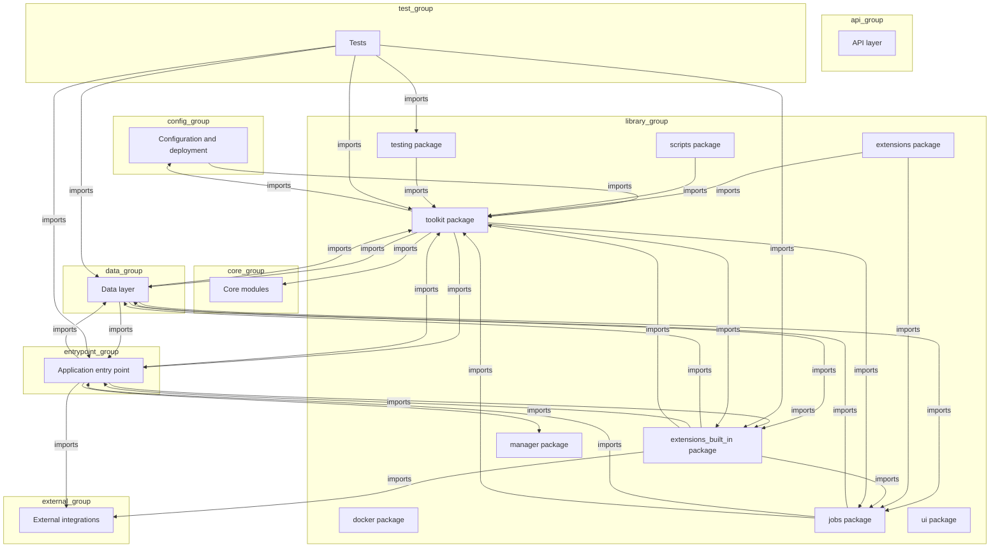

# Architecture report: ostris/ai-toolkit

> Automated static analysis. **Observed** = directly seen in files/imports/AST; **Inferred** = interpretation from that evidence. Repository code was not executed.

## 1. Repository at a glance

| Item | Value |
| --- | --- |
| Repository | ostris/ai-toolkit |
| Description | The ultimate training toolkit for finetuning diffusion models |
| Language | Python |
| Stars | 12629 |
| Licence | MIT |
| Analysed commit / branch | d6a18ad72da9abca3ffb67ea8e42c25764eee61a / main |
| Framework(s) | FastAPI, Next.js, React |
| Files analysed | 688 |
| Components | 16 |

## 2. Architecture in one minute

ostris/ai-toolkit - The ultimate training toolkit for finetuning diffusion models. This repository was analysed statically from 688 file(s) (560 Python). Detected technologies (observed from imports/manifests): GitHub Actions, SQLite, FastAPI, Next.js, React, axios. Files are grouped into 16 component(s): API layer, Configuration and deployment, Core modules, Data layer, docker package, Application entry point, extensions package, extensions_built_in package. Observed entry point(s): extensions_built_in/audio_models/ace_step/src/model.py, extensions_built_in/diffusion_models/f_light/src/model.py, extensions_built_in/inference_engine/server.py. Findings below distinguish observed facts from inferred interpretation.

## 3. High-level block diagram

## 4. Main components

### API layer (`api_layer`)

- **Kind:** api
- **Status:** Observed
- **Confidence:** 0.85
- **Responsibility:** Groups 28 file(s) under api layer (observed from repository paths and static analysis).
- **Paths:** `ui/src/app/api/audio/art/[...audioPath]/route.ts`, `ui/src/app/api/auth/route.ts`, `ui/src/app/api/caption/get/route.ts`, `ui/src/app/api/caption/getBatch/route.ts`, `ui/src/app/api/cpu/route.ts`, `ui/src/app/api/datasets/create/route.tsx`, `ui/src/app/api/datasets/delete/route.tsx`, `ui/src/app/api/datasets/list/route.ts`, `ui/src/app/api/datasets/listImages/route.ts`, `ui/src/app/api/datasets/upload/route.ts`, `ui/src/app/api/files/[...filePath]/route.ts`, `ui/src/app/api/files/delete/route.ts`, `ui/src/app/api/files/info/route.ts`, `ui/src/app/api/gpu/route.ts`, `ui/src/app/api/img/[...imagePath]/route.ts`, `ui/src/app/api/img/caption/route.ts`, `ui/src/app/api/img/delete/route.ts`, `ui/src/app/api/img/upload/route.ts`, `ui/src/app/api/inference/[...path]/route.ts`, `ui/src/app/api/jobs/[jobID]/delete/route.ts`, `ui/src/app/api/jobs/[jobID]/files/route.ts`, `ui/src/app/api/jobs/[jobID]/kill/route.ts`, `ui/src/app/api/jobs/[jobID]/log/route.ts`, `ui/src/app/api/jobs/[jobID]/mark_stopped/route.ts`, `ui/src/app/api/jobs/[jobID]/notes/route.ts`, `ui/src/app/api/jobs/[jobID]/plugin/route.ts`, `ui/src/app/api/jobs/[jobID]/sample_now/route.ts`, `ui/src/app/api/jobs/[jobID]/save_now/route.ts`
- **Evidence:** [ui/src/app/api/audio/art/[...audioPath]/route.ts](https://github.com/ostris/ai-toolkit/blob/d6a18ad72da9abca3ffb67ea8e42c25764eee61a/ui/src/app/api/audio/art/%5B...audioPath%5D/route.ts); [ui/src/app/api/auth/route.ts](https://github.com/ostris/ai-toolkit/blob/d6a18ad72da9abca3ffb67ea8e42c25764eee61a/ui/src/app/api/auth/route.ts); [ui/src/app/api/caption/get/route.ts](https://github.com/ostris/ai-toolkit/blob/d6a18ad72da9abca3ffb67ea8e42c25764eee61a/ui/src/app/api/caption/get/route.ts); [ui/src/app/api/caption/getBatch/route.ts](https://github.com/ostris/ai-toolkit/blob/d6a18ad72da9abca3ffb67ea8e42c25764eee61a/ui/src/app/api/caption/getBatch/route.ts); [ui/src/app/api/cpu/route.ts](https://github.com/ostris/ai-toolkit/blob/d6a18ad72da9abca3ffb67ea8e42c25764eee61a/ui/src/app/api/cpu/route.ts); [ui/src/app/api/datasets/create/route.tsx](https://github.com/ostris/ai-toolkit/blob/d6a18ad72da9abca3ffb67ea8e42c25764eee61a/ui/src/app/api/datasets/create/route.tsx); [ui/src/app/api/datasets/delete/route.tsx](https://github.com/ostris/ai-toolkit/blob/d6a18ad72da9abca3ffb67ea8e42c25764eee61a/ui/src/app/api/datasets/delete/route.tsx); [ui/src/app/api/datasets/list/route.ts](https://github.com/ostris/ai-toolkit/blob/d6a18ad72da9abca3ffb67ea8e42c25764eee61a/ui/src/app/api/datasets/list/route.ts)

### Configuration and deployment (`config`)

- **Kind:** config
- **Status:** Observed
- **Confidence:** 0.85
- **Responsibility:** Groups 45 file(s) under configuration and deployment (observed from repository paths and static analysis). Observed top-level functions: get_config, get_cwd_abs_path, preprocess_config, replace_env_vars_in_string.
- **Paths:** `config/examples/extract.example.yml`, `config/examples/generate.example.yaml`, `config/examples/mod_lora_scale.yaml`, `config/examples/modal/modal_train_lora_flux_24gb.yaml`, `config/examples/modal/modal_train_lora_flux_schnell_24gb.yaml`, `config/examples/train_flex_redux.yaml`, `config/examples/train_full_fine_tune_flex.yaml`, `config/examples/train_full_fine_tune_lumina.yaml`, `config/examples/train_lora_chroma_24gb.yaml`, `config/examples/train_lora_flex2_24gb.yaml`, `config/examples/train_lora_flex_24gb.yaml`, `config/examples/train_lora_flux_24gb.yaml`, `config/examples/train_lora_flux_kontext_24gb.yaml`, `config/examples/train_lora_flux_schnell_24gb.yaml`, `config/examples/train_lora_hidream_48.yaml`, `config/examples/train_lora_lumina.yaml`, `config/examples/train_lora_omnigen2_24gb.yaml`, `config/examples/train_lora_qwen_image_24gb.yaml`, `config/examples/train_lora_qwen_image_edit_2509_32gb.yaml`, `config/examples/train_lora_qwen_image_edit_32gb.yaml`, `config/examples/train_lora_sd35_large_24gb.yaml`, `config/examples/train_lora_wan21_14b_24gb.yaml`, `config/examples/train_lora_wan21_1b_24gb.yaml`, `config/examples/train_lora_wan22_14b_24gb.yaml`, `config/examples/train_slider.example.yml`, `docker-compose.yml`, `docker/Dockerfile`, `extensions/example/config/config.example.yaml`, `extensions_built_in/advanced_generator/config/train.example.yaml`, `extensions_built_in/concept_replacer/config/train.example.yaml`, `extensions_built_in/image_reference_slider_trainer/config/train.example.yaml`, `extensions_built_in/sd_trainer/config/train.example.yaml`, `extensions_built_in/ultimate_slider_trainer/config/train.example.yaml`, `requirements.txt`, `requirements_base.txt`, `toolkit/config.py`, `toolkit/keymaps/stable_diffusion_refiner_unmatched.json`, `toolkit/keymaps/stable_diffusion_sd1.json`, `toolkit/keymaps/stable_diffusion_sd2.json`, `toolkit/keymaps/stable_diffusion_sd2_unmatched.json`, `toolkit/keymaps/stable_diffusion_sdxl_unmatched.json`, `toolkit/keymaps/stable_diffusion_ssd_unmatched.json`, `toolkit/orig_configs/sd_xl_refiner.yaml`, `tsconfig.json`, `ui/package.json`
- **Evidence:** [config/examples/extract.example.yml](https://github.com/ostris/ai-toolkit/blob/d6a18ad72da9abca3ffb67ea8e42c25764eee61a/config/examples/extract.example.yml); [config/examples/generate.example.yaml](https://github.com/ostris/ai-toolkit/blob/d6a18ad72da9abca3ffb67ea8e42c25764eee61a/config/examples/generate.example.yaml); [config/examples/mod_lora_scale.yaml](https://github.com/ostris/ai-toolkit/blob/d6a18ad72da9abca3ffb67ea8e42c25764eee61a/config/examples/mod_lora_scale.yaml); [config/examples/modal/modal_train_lora_flux_24gb.yaml](https://github.com/ostris/ai-toolkit/blob/d6a18ad72da9abca3ffb67ea8e42c25764eee61a/config/examples/modal/modal_train_lora_flux_24gb.yaml); [config/examples/modal/modal_train_lora_flux_schnell_24gb.yaml](https://github.com/ostris/ai-toolkit/blob/d6a18ad72da9abca3ffb67ea8e42c25764eee61a/config/examples/modal/modal_train_lora_flux_schnell_24gb.yaml); [config/examples/train_flex_redux.yaml](https://github.com/ostris/ai-toolkit/blob/d6a18ad72da9abca3ffb67ea8e42c25764eee61a/config/examples/train_flex_redux.yaml); [config/examples/train_full_fine_tune_flex.yaml](https://github.com/ostris/ai-toolkit/blob/d6a18ad72da9abca3ffb67ea8e42c25764eee61a/config/examples/train_full_fine_tune_flex.yaml); [config/examples/train_full_fine_tune_lumina.yaml](https://github.com/ostris/ai-toolkit/blob/d6a18ad72da9abca3ffb67ea8e42c25764eee61a/config/examples/train_full_fine_tune_lumina.yaml)

### Core modules (`core`)

- **Kind:** core
- **Status:** Observed
- **Confidence:** 0.85
- **Responsibility:** Groups 2 file(s) under core modules (observed from repository paths and static analysis).
- **Paths:** `info.py`, `run_linux.sh`
- **Evidence:** [info.py](https://github.com/ostris/ai-toolkit/blob/d6a18ad72da9abca3ffb67ea8e42c25764eee61a/info.py); [run_linux.sh](https://github.com/ostris/ai-toolkit/blob/d6a18ad72da9abca3ffb67ea8e42c25764eee61a/run_linux.sh)

### Data layer (`data_layer`)

- **Kind:** data
- **Status:** Observed
- **Confidence:** 0.85
- **Responsibility:** Groups 104 file(s) under data layer (observed from repository paths and static analysis). Observed top-level classes: AggressiveWanI2VUnloadPipeline, AggressiveWanUnloadPipeline, AnimaTextConditioner, Attention, AttentionHog, AttnBlock. Observed top-level functions: _build_fusion_stack, _fold_frames_to_batch, _make_2tuple, _markers_from_header, _nar_lora_from_safetensors, _rewrite_diffusers_key.
- **Paths:** `extensions_built_in/audio_models/yue2/src/model.py`, `extensions_built_in/diffusion_models/chroma/src/model.py`, `extensions_built_in/diffusion_models/example_model/src/model.py`, `extensions_built_in/diffusion_models/flux2/src/model.py`, `extensions_built_in/diffusion_models/hidream/src/models/attention.py`, `extensions_built_in/diffusion_models/hidream/src/models/attention_processor.py`, `extensions_built_in/diffusion_models/hidream/src/models/embeddings.py`, `extensions_built_in/diffusion_models/hidream/src/models/moe.py`, `extensions_built_in/diffusion_models/hidream/src/models/transformers/transformer_hidream_image.py`, `extensions_built_in/diffusion_models/omnigen2/src/models/__init__.py`, `extensions_built_in/diffusion_models/omnigen2/src/models/attention_processor.py`, `extensions_built_in/diffusion_models/omnigen2/src/models/embeddings.py`, `extensions_built_in/diffusion_models/omnigen2/src/models/transformers/__init__.py`, `extensions_built_in/diffusion_models/omnigen2/src/models/transformers/block_lumina2.py`, `extensions_built_in/diffusion_models/omnigen2/src/models/transformers/components.py`, `extensions_built_in/diffusion_models/omnigen2/src/models/transformers/repo.py`, `extensions_built_in/diffusion_models/omnigen2/src/models/transformers/transformer_omnigen2.py`, `jobs/process/models/critic.py`, `jobs/process/models/vgg19_critic.py`, `toolkit/audio/melbandroformer/model.py`, `toolkit/models/DoRA.py`, `toolkit/models/FakeVAE.py`, `toolkit/models/LoRAFormer.py`, `toolkit/models/RRDB.py`, `toolkit/models/auraflow.py`, `toolkit/models/autoencoder_tiny_with_pooled_exits.py`, `toolkit/models/base_model.py`, `toolkit/models/block.py`, `toolkit/models/clip_fusion.py`, `toolkit/models/clip_pre_processor.py`, `toolkit/models/cogview4.py`, `toolkit/models/control_lora_adapter.py`, `toolkit/models/decorator.py`, `toolkit/models/diffusion_feature_extraction.py`, `toolkit/models/flux.py`, `toolkit/models/flux_sage_attn.py`, `toolkit/models/i2v_adapter.py`, `toolkit/models/ilora.py`, `toolkit/models/ilora2.py`, `toolkit/models/llm_adapter.py`, `toolkit/models/loaders/__init__.py`, `toolkit/models/loaders/umt5.py`, `toolkit/models/lokr.py`, `toolkit/models/mean_flow_adapter.py`, `toolkit/models/pixtral_vision.py`, `toolkit/models/redux.py`, `toolkit/models/registry.py`, `toolkit/models/sapiens2.py`, `toolkit/models/single_value_adapter.py`, `toolkit/models/size_agnostic_feature_encoder.py`, `toolkit/models/sref.py`, `toolkit/models/subpixel_adapter.py`, `toolkit/models/te_adapter.py`, `toolkit/models/te_aug_adapter.py`, `toolkit/models/tipsv2.py`, `toolkit/models/v2/__init__.py`, `toolkit/models/v2/_mixin.py`, `toolkit/models/v2/diffusion_models/__init__.py`, `toolkit/models/v2/diffusion_models/auraflow.py`, `toolkit/models/v2/diffusion_models/cosmos.py`, `toolkit/models/v2/diffusion_models/flux.py`, `toolkit/models/v2/diffusion_models/hidream.py`, `toolkit/models/v2/diffusion_models/ltx2.py`, `toolkit/models/v2/diffusion_models/lumina2.py`, `toolkit/models/v2/diffusion_models/nucleus_image.py`, `toolkit/models/v2/diffusion_models/pixart.py`, `toolkit/models/v2/diffusion_models/qwen_image.py`, `toolkit/models/v2/diffusion_models/sd3.py`, `toolkit/models/v2/diffusion_models/unet.py`, `toolkit/models/v2/diffusion_models/wan.py`, `toolkit/models/v2/diffusion_models/z_image.py`, `toolkit/models/v2/pool.py`, `toolkit/models/v2/resolver.py`, `toolkit/models/v2/text_encoders/__init__.py`, `toolkit/models/v2/text_encoders/anima.py`, `toolkit/models/v2/text_encoders/clip.py`, `toolkit/models/v2/text_encoders/gemma2.py`, `toolkit/models/v2/text_encoders/gemma3.py`, `toolkit/models/v2/text_encoders/llama.py`, `toolkit/models/v2/text_encoders/mistral3.py`, `toolkit/models/v2/text_encoders/qwen25_vl.py`, `toolkit/models/v2/text_encoders/qwen3.py`, `toolkit/models/v2/text_encoders/qwen35.py`, `toolkit/models/v2/text_encoders/qwen3_vl.py`, `toolkit/models/v2/text_encoders/t5.py`, `toolkit/models/v2/text_encoders/umt5.py`, `toolkit/models/v2/vae/__init__.py`, `toolkit/models/v2/vae/autoencoder_kl.py`, `toolkit/models/v2/vae/autoencoder_kl_flux2.py`, `toolkit/models/v2/vae/flux2_kl.py`, `toolkit/models/v2/vae/ltx2.py`, `toolkit/models/v2/vae/qwen_image.py`, `toolkit/models/v2/vae/wan.py`, `toolkit/models/v2/vision_encoders/__init__.py`, `toolkit/models/v2/vision_encoders/clip_vision.py`, `toolkit/models/vd_adapter.py`, `toolkit/models/wan21/__init__.py`, `toolkit/models/wan21/autoencoder_kl_wan.py`, `toolkit/models/wan21/wan21.py`, `toolkit/models/wan21/wan21_i2v.py`, `toolkit/models/wan21/wan_attn.py`, `toolkit/models/wan21/wan_lora_convert.py`, `toolkit/models/wan21/wan_utils.py`, `toolkit/models/zipper_resampler.py`
- **Evidence:** [extensions_built_in/audio_models/yue2/src/model.py:41](https://github.com/ostris/ai-toolkit/blob/d6a18ad72da9abca3ffb67ea8e42c25764eee61a/extensions_built_in/audio_models/yue2/src/model.py#L41); [extensions_built_in/diffusion_models/chroma/src/model.py:21](https://github.com/ostris/ai-toolkit/blob/d6a18ad72da9abca3ffb67ea8e42c25764eee61a/extensions_built_in/diffusion_models/chroma/src/model.py#L21); [extensions_built_in/diffusion_models/example_model/src/model.py:57](https://github.com/ostris/ai-toolkit/blob/d6a18ad72da9abca3ffb67ea8e42c25764eee61a/extensions_built_in/diffusion_models/example_model/src/model.py#L57); [extensions_built_in/diffusion_models/flux2/src/model.py:12](https://github.com/ostris/ai-toolkit/blob/d6a18ad72da9abca3ffb67ea8e42c25764eee61a/extensions_built_in/diffusion_models/flux2/src/model.py#L12); [extensions_built_in/diffusion_models/hidream/src/models/attention.py:8](https://github.com/ostris/ai-toolkit/blob/d6a18ad72da9abca3ffb67ea8e42c25764eee61a/extensions_built_in/diffusion_models/hidream/src/models/attention.py#L8); [extensions_built_in/diffusion_models/hidream/src/models/attention_processor.py:21](https://github.com/ostris/ai-toolkit/blob/d6a18ad72da9abca3ffb67ea8e42c25764eee61a/extensions_built_in/diffusion_models/hidream/src/models/attention_processor.py#L21); [extensions_built_in/diffusion_models/hidream/src/models/embeddings.py:7](https://github.com/ostris/ai-toolkit/blob/d6a18ad72da9abca3ffb67ea8e42c25764eee61a/extensions_built_in/diffusion_models/hidream/src/models/embeddings.py#L7); [extensions_built_in/diffusion_models/hidream/src/models/moe.py:9](https://github.com/ostris/ai-toolkit/blob/d6a18ad72da9abca3ffb67ea8e42c25764eee61a/extensions_built_in/diffusion_models/hidream/src/models/moe.py#L9)

### docker package (`docker`)

- **Kind:** library
- **Status:** Observed
- **Confidence:** 0.85
- **Responsibility:** Groups 1 file(s) under docker package (observed from repository paths and static analysis).
- **Paths:** `docker/start.sh`
- **Evidence:** [docker/start.sh](https://github.com/ostris/ai-toolkit/blob/d6a18ad72da9abca3ffb67ea8e42c25764eee61a/docker/start.sh)

### Application entry point (`entrypoint`)

- **Kind:** entrypoint
- **Status:** Observed
- **Confidence:** 0.85
- **Responsibility:** Groups 24 file(s) under application entry point (observed from repository paths and static analysis). Observed application object created via FastAPI. Observed top-level classes: AceStep15, ArchHandler, Attention, AutoencoderPixelMixer, ConditionEncoder, Config. Observed top-level functions: WNConv1d, WNConvT1d, _exif_orientation, _png_exif_orientation, _resolve_spec, _toolkit_version.
- **Paths:** `extensions_built_in/audio_models/ace_step/src/model.py`, `extensions_built_in/diffusion_models/f_light/src/model.py`, `extensions_built_in/inference_engine/server.py`, `flux_train_ui.py`, `manager/__main__.py`, `run.py`, `run_modal.py`, `scripts/add_mask_dataset.py`, `scripts/caption_audio_dataset.py`, `scripts/convert_cog.py`, `scripts/convert_melbandroformer.py`, `scripts/convert_vllm_to_comfy.py`, `scripts/update_sponsors.py`, `toolkit/audio/album_artwork.py`, `toolkit/audio/make_video.py`, `toolkit/audio/melbandroformer/__main__.py`, `toolkit/civitai.py`, `toolkit/control_generator.py`, `toolkit/image_utils.py`, `toolkit/kohya_model_util.py`, `toolkit/llvae.py`, `toolkit/photomaker.py`, `toolkit/pixel_shuffle_encoder.py`, `toolkit/util/mask.py`
- **Evidence:** [extensions_built_in/audio_models/ace_step/src/model.py:69](https://github.com/ostris/ai-toolkit/blob/d6a18ad72da9abca3ffb67ea8e42c25764eee61a/extensions_built_in/audio_models/ace_step/src/model.py#L69); [extensions_built_in/diffusion_models/f_light/src/model.py:18](https://github.com/ostris/ai-toolkit/blob/d6a18ad72da9abca3ffb67ea8e42c25764eee61a/extensions_built_in/diffusion_models/f_light/src/model.py#L18); [extensions_built_in/inference_engine/server.py:25](https://github.com/ostris/ai-toolkit/blob/d6a18ad72da9abca3ffb67ea8e42c25764eee61a/extensions_built_in/inference_engine/server.py#L25); [flux_train_ui.py:25](https://github.com/ostris/ai-toolkit/blob/d6a18ad72da9abca3ffb67ea8e42c25764eee61a/flux_train_ui.py#L25); [manager/__main__.py:29](https://github.com/ostris/ai-toolkit/blob/d6a18ad72da9abca3ffb67ea8e42c25764eee61a/manager/__main__.py#L29); [run.py:58](https://github.com/ostris/ai-toolkit/blob/d6a18ad72da9abca3ffb67ea8e42c25764eee61a/run.py#L58); [run_modal.py:89](https://github.com/ostris/ai-toolkit/blob/d6a18ad72da9abca3ffb67ea8e42c25764eee61a/run_modal.py#L89); [scripts/add_mask_dataset.py:18](https://github.com/ostris/ai-toolkit/blob/d6a18ad72da9abca3ffb67ea8e42c25764eee61a/scripts/add_mask_dataset.py#L18)

### extensions package (`extensions`)

- **Kind:** library
- **Status:** Observed
- **Confidence:** 0.85
- **Responsibility:** Groups 2 file(s) under extensions package (observed from repository paths and static analysis). Observed top-level classes: ExampleMergeExtension, ExampleMergeModels, ModelInputConfig. Observed top-level functions: flush.
- **Paths:** `extensions/example/ExampleMergeModels.py`, `extensions/example/__init__.py`
- **Evidence:** [extensions/example/ExampleMergeModels.py:17](https://github.com/ostris/ai-toolkit/blob/d6a18ad72da9abca3ffb67ea8e42c25764eee61a/extensions/example/ExampleMergeModels.py#L17); [extensions/example/__init__.py:6](https://github.com/ostris/ai-toolkit/blob/d6a18ad72da9abca3ffb67ea8e42c25764eee61a/extensions/example/__init__.py#L6)

### extensions_built_in package (`extensions_built_in`)

- **Kind:** library
- **Status:** Observed
- **Confidence:** 0.85
- **Responsibility:** Groups 256 file(s) under extensions_built_in package (observed from repository paths and static analysis). Observed top-level classes: AMPBlock, APGConfig, ARDecodeGraph, AbcRepairError, AceStep15Model, AceStep15Pipeline. Observed top-level functions: Normalize, WNConv1d, WNConvT1d, _add_rmsnorm_fake, _add_rmsnorm_op, _apply_rope.
- **Paths:** `extensions_built_in/advanced_generator/Img2ImgGenerator.py`, `extensions_built_in/advanced_generator/PureLoraGenerator.py`, `extensions_built_in/advanced_generator/ReferenceGenerator.py`, `extensions_built_in/advanced_generator/__init__.py`, `extensions_built_in/audio_models/__init__.py`, `extensions_built_in/audio_models/ace_step/__init__.py`, `extensions_built_in/audio_models/ace_step/ace_step_15_model.py`, `extensions_built_in/audio_models/ace_step/src/__init__.py`, `extensions_built_in/audio_models/ace_step/src/pipeline.py`, `extensions_built_in/audio_models/base_audio_model.py`, `extensions_built_in/audio_models/ui.tsx`, `extensions_built_in/audio_models/yue2/__init__.py`, `extensions_built_in/audio_models/yue2/src/__init__.py`, `extensions_built_in/audio_models/yue2/src/pipeline.py`, `extensions_built_in/audio_models/yue2/src/sheetsage_decoder.py`, `extensions_built_in/audio_models/yue2/src/sheetsage_generate.py`, `extensions_built_in/audio_models/yue2/src/sheetsage_repair.py`, `extensions_built_in/audio_models/yue2/src/shims/__init__.py`, `extensions_built_in/audio_models/yue2/src/shims/mir_eval_chord.py`, `extensions_built_in/audio_models/yue2/src/shims/pretty_midi.py`, `extensions_built_in/audio_models/yue2/src/tokenizer.py`, `extensions_built_in/audio_models/yue2/src/vae.py`, `extensions_built_in/audio_models/yue2/yue2_model.py`, `extensions_built_in/captioner/AceStepCaptioner.py`, `extensions_built_in/captioner/BaseCaptioner.py`, `extensions_built_in/captioner/Ideogram4Captioner.py`, `extensions_built_in/captioner/MossMusicCaptioner.py`, `extensions_built_in/captioner/Qwen25OmniCaptioner.py`, `extensions_built_in/captioner/Qwen32Captioner.py`, `extensions_built_in/captioner/Qwen38Captioner.py`, `extensions_built_in/captioner/Qwen3OmniCaptioner.py`, `extensions_built_in/captioner/Qwen3VLCaptioner.py`, `extensions_built_in/captioner/__init__.py`, `extensions_built_in/captioner/prompts/__init__.py`, `extensions_built_in/captioner/prompts/ideogram4_caption_prompt.py`, `extensions_built_in/captioner/prompts/ideogram4_prompt.py`, `extensions_built_in/captioner/prompts/ideogram4_upsample_prompt.py`, `extensions_built_in/concept_replacer/ConceptReplacer.py`, `extensions_built_in/concept_replacer/__init__.py`, `extensions_built_in/concept_slider/ConceptSliderTrainer.py`, `extensions_built_in/concept_slider/__init__.py`, `extensions_built_in/dataset_tools/DatasetTools.py`, `extensions_built_in/dataset_tools/SuperTagger.py`, `extensions_built_in/dataset_tools/SyncFromCollection.py`, `extensions_built_in/dataset_tools/__init__.py`, `extensions_built_in/dataset_tools/tools/caption.py`, `extensions_built_in/dataset_tools/tools/dataset_tools_config_modules.py`, `extensions_built_in/dataset_tools/tools/fuyu_utils.py`, `extensions_built_in/dataset_tools/tools/image_tools.py`, `extensions_built_in/dataset_tools/tools/llava_utils.py`, `extensions_built_in/dataset_tools/tools/sync_tools.py`, `extensions_built_in/diffusion_models/__init__.py`, `extensions_built_in/diffusion_models/anima/__init__.py`, `extensions_built_in/diffusion_models/anima/anima.py`, `extensions_built_in/diffusion_models/boogu_image/__init__.py`, `extensions_built_in/diffusion_models/boogu_image/boogu_image.py`, `extensions_built_in/diffusion_models/boogu_image/boogu_image_edit.py`, `extensions_built_in/diffusion_models/boogu_image/src/__init__.py`, `extensions_built_in/diffusion_models/boogu_image/src/attention_processor.py`, `extensions_built_in/diffusion_models/boogu_image/src/block_lumina2.py`, `extensions_built_in/diffusion_models/boogu_image/src/embeddings.py`, `extensions_built_in/diffusion_models/boogu_image/src/pipeline.py`, `extensions_built_in/diffusion_models/boogu_image/src/rope.py`, `extensions_built_in/diffusion_models/boogu_image/src/transformer.py`, `extensions_built_in/diffusion_models/chroma/__init__.py`, `extensions_built_in/diffusion_models/chroma/chroma_model.py`, `extensions_built_in/diffusion_models/chroma/chroma_radiance_model.py`, `extensions_built_in/diffusion_models/chroma/pipeline.py`, `extensions_built_in/diffusion_models/chroma/src/__init__.py`, `extensions_built_in/diffusion_models/chroma/src/layers.py`, `extensions_built_in/diffusion_models/chroma/src/math.py`, `extensions_built_in/diffusion_models/chroma/src/radiance.py`, `extensions_built_in/diffusion_models/ernie_image/__init__.py`, `extensions_built_in/diffusion_models/ernie_image/ernie_image.py`, `extensions_built_in/diffusion_models/ernie_image/transformer.py`, `extensions_built_in/diffusion_models/example_model/__init__.py`, `extensions_built_in/diffusion_models/example_model/example_model.py`, `extensions_built_in/diffusion_models/example_model/src/__init__.py`, `extensions_built_in/diffusion_models/example_model/src/pipeline.py`, `extensions_built_in/diffusion_models/f_light/__init__.py`, `extensions_built_in/diffusion_models/f_light/f_light.py`, `extensions_built_in/diffusion_models/f_light/src/__init__.py`, `extensions_built_in/diffusion_models/f_light/src/pipeline.py`, `extensions_built_in/diffusion_models/fibo2/__init__.py`, `extensions_built_in/diffusion_models/fibo2/fibo2.py`, `extensions_built_in/diffusion_models/fibo2/src/__init__.py`, `extensions_built_in/diffusion_models/fibo2/src/checkpoints.py`, `extensions_built_in/diffusion_models/fibo2/src/pipeline.py`, `extensions_built_in/diffusion_models/fibo2/src/references.py`, `extensions_built_in/diffusion_models/fibo2/src/text_encoder.py`, `extensions_built_in/diffusion_models/fibo2/src/transformer.py`, `extensions_built_in/diffusion_models/flux2/__init__.py`, `extensions_built_in/diffusion_models/flux2/flux2_klein_model.py`, `extensions_built_in/diffusion_models/flux2/flux2_model.py`, `extensions_built_in/diffusion_models/flux2/src/__init__.py`, `extensions_built_in/diffusion_models/flux2/src/pipeline.py`, `extensions_built_in/diffusion_models/flux2/src/sampling.py`, `extensions_built_in/diffusion_models/flux3/__init__.py`, `extensions_built_in/diffusion_models/flux3/flux3.py`, `extensions_built_in/diffusion_models/flux3/src/__init__.py`, `extensions_built_in/diffusion_models/flux3/src/checkpoints.py`, `extensions_built_in/diffusion_models/flux3/src/image_vae.py`, `extensions_built_in/diffusion_models/flux3/src/pipeline.py`, `extensions_built_in/diffusion_models/flux3/src/positional.py`, `extensions_built_in/diffusion_models/flux3/src/text_encoder.py`, `extensions_built_in/diffusion_models/flux3/src/transformer.py`, `extensions_built_in/diffusion_models/flux_kontext/__init__.py`, `extensions_built_in/diffusion_models/flux_kontext/flux_kontext.py`, `extensions_built_in/diffusion_models/hidream/__init__.py`, `extensions_built_in/diffusion_models/hidream/hidream_e1_model.py`, `extensions_built_in/diffusion_models/hidream/hidream_model.py`, `extensions_built_in/diffusion_models/hidream/hidream_o1_model.py`, `extensions_built_in/diffusion_models/hidream/src/__init__.py`, `extensions_built_in/diffusion_models/hidream/src/hidream_o1/__init__.py`, `extensions_built_in/diffusion_models/hidream/src/hidream_o1/model_config.py`, `extensions_built_in/diffusion_models/hidream/src/hidream_o1/pipeline.py`, `extensions_built_in/diffusion_models/hidream/src/hidream_o1/qwen3_vl_transformers.py`, `extensions_built_in/diffusion_models/hidream/src/pipelines/hidream_image/pipeline_hidream_image.py`, `extensions_built_in/diffusion_models/hidream/src/pipelines/hidream_image/pipeline_hidream_image_editing.py`, `extensions_built_in/diffusion_models/hidream/src/pipelines/hidream_image/pipeline_output.py`, `extensions_built_in/diffusion_models/hidream/src/schedulers/flash_flow_match.py`, `extensions_built_in/diffusion_models/hidream/src/schedulers/fm_solvers_unipc.py`, `extensions_built_in/diffusion_models/ideogram4/__init__.py`, `extensions_built_in/diffusion_models/ideogram4/ideogram4.py`, `extensions_built_in/diffusion_models/ideogram4/src/__init__.py`, `extensions_built_in/diffusion_models/ideogram4/src/latent_norm.py`, `extensions_built_in/diffusion_models/ideogram4/src/pipeline.py`, `extensions_built_in/diffusion_models/ideogram4/src/transformer.py`, `extensions_built_in/diffusion_models/iris3b/__init__.py`, `extensions_built_in/diffusion_models/iris3b/iris3b.py`, `extensions_built_in/diffusion_models/iris3b/src/__init__.py`, `extensions_built_in/diffusion_models/iris3b/src/dit.py`, `extensions_built_in/diffusion_models/iris3b/src/pipeline.py`, `extensions_built_in/diffusion_models/iris3b/src/text_encoder.py`, `extensions_built_in/diffusion_models/krea2/__init__.py`, `extensions_built_in/diffusion_models/krea2/krea2.py`, `extensions_built_in/diffusion_models/krea2/src/__init__.py`, `extensions_built_in/diffusion_models/krea2/src/mmdit.py`, `extensions_built_in/diffusion_models/krea2/src/pipeline.py`, `extensions_built_in/diffusion_models/krea2/src/text_encoder.py`, `extensions_built_in/diffusion_models/ltx2/__init__.py`, `extensions_built_in/diffusion_models/ltx2/convert_ltx2_to_diffusers.py`, `extensions_built_in/diffusion_models/ltx2/ltx2.py`, `extensions_built_in/diffusion_models/mageflow/__init__.py`, `extensions_built_in/diffusion_models/mageflow/mageflow.py`, `extensions_built_in/diffusion_models/mageflow/src/__init__.py`, `extensions_built_in/diffusion_models/mageflow/src/attn.py`, `extensions_built_in/diffusion_models/mageflow/src/pipeline.py`, `extensions_built_in/diffusion_models/mageflow/src/text_encoder.py`, `extensions_built_in/diffusion_models/mageflow/src/transformer.py`, `extensions_built_in/diffusion_models/mageflow/src/vae.py`, `extensions_built_in/diffusion_models/ming_image/__init__.py`, `extensions_built_in/diffusion_models/ming_image/ming_image.py`, `extensions_built_in/diffusion_models/ming_image/src/__init__.py`, `extensions_built_in/diffusion_models/ming_image/src/bailing_moe_v2.py`, `extensions_built_in/diffusion_models/ming_image/src/checkpoints.py`, `extensions_built_in/diffusion_models/ming_image/src/moe_kernels.py`, `extensions_built_in/diffusion_models/ming_image/src/pipeline.py`, `extensions_built_in/diffusion_models/ming_image/src/text_encoder.py`, `extensions_built_in/diffusion_models/ming_image/src/transformer.py`, `extensions_built_in/diffusion_models/ming_image/src/vae.py`, `extensions_built_in/diffusion_models/minimax_h3/__init__.py`, `extensions_built_in/diffusion_models/minimax_h3/minimax_h3.py`, `extensions_built_in/diffusion_models/minimax_h3/minimax_h3_image.py`, `extensions_built_in/diffusion_models/minimax_h3/p_h3_image.py`, `extensions_built_in/diffusion_models/minimax_h3/src/audio_vae.py`, `extensions_built_in/diffusion_models/minimax_h3/src/packing.py`, `extensions_built_in/diffusion_models/minimax_h3/src/pipeline.py`, `extensions_built_in/diffusion_models/minimax_h3/src/ref_video_cache.py`, `extensions_built_in/diffusion_models/minimax_h3/src/text_encoder.py`, `extensions_built_in/diffusion_models/minimax_h3/src/transformer.py`, `extensions_built_in/diffusion_models/minimax_h3/src/vae.py`, `extensions_built_in/diffusion_models/minimax_h3/src/vsa.py`, `extensions_built_in/diffusion_models/minimax_h3/src/vsa_kernels/__init__.py`, `extensions_built_in/diffusion_models/minimax_h3/src/vsa_kernels/block_sparse_attn_triton.py`, `extensions_built_in/diffusion_models/minimax_h3/src/vsa_kernels/index.py`, `extensions_built_in/diffusion_models/moss_image/__init__.py`, `extensions_built_in/diffusion_models/moss_image/moss_image.py`, `extensions_built_in/diffusion_models/moss_image/src/__init__.py`, `extensions_built_in/diffusion_models/moss_image/src/checkpoints.py`, `extensions_built_in/diffusion_models/moss_image/src/pipeline.py`, `extensions_built_in/diffusion_models/moss_image/src/transformer.py`, `extensions_built_in/diffusion_models/nucleus_image/__init__.py`, `extensions_built_in/diffusion_models/nucleus_image/nucleus_image_model.py`, `extensions_built_in/diffusion_models/omnigen2/__init__.py`, `extensions_built_in/diffusion_models/omnigen2/src/__init__.py`, `extensions_built_in/diffusion_models/omnigen2/src/ops/triton/__init__.py`, `extensions_built_in/diffusion_models/omnigen2/src/ops/triton/layer_norm.py`, `extensions_built_in/diffusion_models/omnigen2/src/pipelines/__init__.py`, `extensions_built_in/diffusion_models/omnigen2/src/pipelines/image_processor.py`, `extensions_built_in/diffusion_models/omnigen2/src/pipelines/omnigen2/pipeline_omnigen2.py`, `extensions_built_in/diffusion_models/omnigen2/src/pipelines/omnigen2/pipeline_omnigen2_chat.py`, `extensions_built_in/diffusion_models/omnigen2/src/pipelines/pipeline_utils.py`, `extensions_built_in/diffusion_models/omnigen2/src/schedulers/__init__.py`, `extensions_built_in/diffusion_models/omnigen2/src/schedulers/scheduling_dpmsolver_multistep.py`, `extensions_built_in/diffusion_models/omnigen2/src/schedulers/scheduling_flow_match_euler_discrete.py`, `extensions_built_in/diffusion_models/omnigen2/src/utils/__init__.py`, `extensions_built_in/diffusion_models/omnigen2/src/utils/img_util.py`, `extensions_built_in/diffusion_models/omnigen2/src/utils/import_utils.py`, `extensions_built_in/diffusion_models/prx_pixel_t2i/__init__.py`, `extensions_built_in/diffusion_models/prx_pixel_t2i/prx_pixel_t2i.py`, `extensions_built_in/diffusion_models/prx_pixel_t2i/src/__init__.py`, `extensions_built_in/diffusion_models/prx_pixel_t2i/src/pipeline.py`, `extensions_built_in/diffusion_models/prx_pixel_t2i/src/transformer_prx.py`, `extensions_built_in/diffusion_models/qwen_image/__init__.py`, `extensions_built_in/diffusion_models/qwen_image/qwen_image.py`, `extensions_built_in/diffusion_models/qwen_image/qwen_image_edit.py`, `extensions_built_in/diffusion_models/qwen_image/qwen_image_edit_plus.py`, `extensions_built_in/diffusion_models/qwen_image/qwen_image_pipelines.py`, `extensions_built_in/diffusion_models/qwen_image_2/__init__.py`, `extensions_built_in/diffusion_models/qwen_image_2/qwen_image_2.py`, `extensions_built_in/diffusion_models/qwen_image_2/src/__init__.py`, `extensions_built_in/diffusion_models/qwen_image_2/src/pipeline.py`, `extensions_built_in/diffusion_models/qwen_image_2/src/text_encoder.py`, `extensions_built_in/diffusion_models/qwen_image_2/src/transformer.py`, `extensions_built_in/diffusion_models/qwen_image_2/src/vae.py`, `extensions_built_in/diffusion_models/ui.tsx`, `extensions_built_in/diffusion_models/wan22/__init__.py`, `extensions_built_in/diffusion_models/wan22/wan22_14b_i2v_model.py`, `extensions_built_in/diffusion_models/wan22/wan22_14b_model.py`, `extensions_built_in/diffusion_models/wan22/wan22_5b_model.py`, `extensions_built_in/diffusion_models/wan22/wan22_pipeline.py`, `extensions_built_in/diffusion_models/z_image/__init__.py`, `extensions_built_in/diffusion_models/z_image/z_image.py`, `extensions_built_in/diffusion_models/z_image/z_image_l2p_model.py`, `extensions_built_in/diffusion_models/zeta_chroma/__init__.py`, `extensions_built_in/diffusion_models/zeta_chroma/zeta_chroma_model.py`, `extensions_built_in/diffusion_models/zeta_chroma/zeta_chroma_pipeline.py`, `extensions_built_in/diffusion_models/zeta_chroma/zeta_chroma_transformer.py`, `extensions_built_in/flex2/__init__.py`, `extensions_built_in/flex2/flex2.py`, `extensions_built_in/flex2/pipeline.py`, `extensions_built_in/flex2/ui.tsx`, `extensions_built_in/image_reference_slider_trainer/ImageReferenceSliderTrainerProcess.py`, `extensions_built_in/image_reference_slider_trainer/__init__.py`, `extensions_built_in/inference_engine/InferenceEngine.py`, `extensions_built_in/inference_engine/__init__.py`, `extensions_built_in/inference_engine/engine.py`, `extensions_built_in/inference_engine/latent_format_tables.py`, `extensions_built_in/inference_engine/latent_preview.py`, `extensions_built_in/inference_engine/protocol.py`, `extensions_built_in/llm_models/__init__.py`, `extensions_built_in/llm_models/qwen25_omni.py`, `extensions_built_in/llm_models/qwen38.py`, `extensions_built_in/llm_models/src/__init__.py`, `extensions_built_in/llm_models/src/qwen38_kernels.py`, `extensions_built_in/llm_models/src/qwen38_load.py`, `extensions_built_in/llm_models/src/qwen38_model.py`, `extensions_built_in/llm_models/src/thinker.py`, `extensions_built_in/llm_models/ui.tsx`, `extensions_built_in/sd_trainer/DiffusionTrainer.py`, `extensions_built_in/sd_trainer/SDTrainer.py`, `extensions_built_in/sd_trainer/UITrainer.py`, `extensions_built_in/sd_trainer/__init__.py`, `extensions_built_in/ultimate_slider_trainer/UltimateSliderTrainerProcess.py`, `extensions_built_in/ultimate_slider_trainer/__init__.py`
- **Evidence:** [extensions_built_in/advanced_generator/Img2ImgGenerator.py:29](https://github.com/ostris/ai-toolkit/blob/d6a18ad72da9abca3ffb67ea8e42c25764eee61a/extensions_built_in/advanced_generator/Img2ImgGenerator.py#L29); [extensions_built_in/advanced_generator/PureLoraGenerator.py:14](https://github.com/ostris/ai-toolkit/blob/d6a18ad72da9abca3ffb67ea8e42c25764eee61a/extensions_built_in/advanced_generator/PureLoraGenerator.py#L14); [extensions_built_in/advanced_generator/ReferenceGenerator.py:26](https://github.com/ostris/ai-toolkit/blob/d6a18ad72da9abca3ffb67ea8e42c25764eee61a/extensions_built_in/advanced_generator/ReferenceGenerator.py#L26); [extensions_built_in/advanced_generator/__init__.py:6](https://github.com/ostris/ai-toolkit/blob/d6a18ad72da9abca3ffb67ea8e42c25764eee61a/extensions_built_in/advanced_generator/__init__.py#L6); [extensions_built_in/audio_models/__init__.py](https://github.com/ostris/ai-toolkit/blob/d6a18ad72da9abca3ffb67ea8e42c25764eee61a/extensions_built_in/audio_models/__init__.py); [extensions_built_in/audio_models/ace_step/__init__.py](https://github.com/ostris/ai-toolkit/blob/d6a18ad72da9abca3ffb67ea8e42c25764eee61a/extensions_built_in/audio_models/ace_step/__init__.py); [extensions_built_in/audio_models/ace_step/ace_step_15_model.py:31](https://github.com/ostris/ai-toolkit/blob/d6a18ad72da9abca3ffb67ea8e42c25764eee61a/extensions_built_in/audio_models/ace_step/ace_step_15_model.py#L31); [extensions_built_in/audio_models/ace_step/src/__init__.py](https://github.com/ostris/ai-toolkit/blob/d6a18ad72da9abca3ffb67ea8e42c25764eee61a/extensions_built_in/audio_models/ace_step/src/__init__.py)

### External integrations (`external_integrations`)

- **Kind:** external
- **Status:** Inferred
- **Confidence:** 0.70
- **Responsibility:** Groups 0 file(s) under external integrations (observed from repository paths and static analysis).
- **Evidence:** [extensions_built_in/captioner/BaseCaptioner.py:4](https://github.com/ostris/ai-toolkit/blob/d6a18ad72da9abca3ffb67ea8e42c25764eee61a/extensions_built_in/captioner/BaseCaptioner.py#L4); [extensions_built_in/dataset_tools/tools/sync_tools.py:2](https://github.com/ostris/ai-toolkit/blob/d6a18ad72da9abca3ffb67ea8e42c25764eee61a/extensions_built_in/dataset_tools/tools/sync_tools.py#L2); [extensions_built_in/inference_engine/server.py:8](https://github.com/ostris/ai-toolkit/blob/d6a18ad72da9abca3ffb67ea8e42c25764eee61a/extensions_built_in/inference_engine/server.py#L8); [extensions_built_in/sd_trainer/DiffusionTrainer.py:3](https://github.com/ostris/ai-toolkit/blob/d6a18ad72da9abca3ffb67ea8e42c25764eee61a/extensions_built_in/sd_trainer/DiffusionTrainer.py#L3); [extensions_built_in/sd_trainer/UITrainer.py:3](https://github.com/ostris/ai-toolkit/blob/d6a18ad72da9abca3ffb67ea8e42c25764eee61a/extensions_built_in/sd_trainer/UITrainer.py#L3); [scripts/update_sponsors.py:2](https://github.com/ostris/ai-toolkit/blob/d6a18ad72da9abca3ffb67ea8e42c25764eee61a/scripts/update_sponsors.py#L2)

### jobs package (`jobs`)

- **Kind:** library
- **Status:** Observed
- **Confidence:** 0.85
- **Responsibility:** Groups 26 file(s) under jobs package (observed from repository paths and static analysis). Observed top-level classes: ACTION_TYPES_SLIDER, BaseExtensionProcess, BaseExtractProcess, BaseJob, BaseMergeProcess, BaseProcess. Observed top-level functions: channel_dropout, flush, sharpen_image, unnormalize.
- **Paths:** `jobs/BaseJob.py`, `jobs/ExtensionJob.py`, `jobs/ExtractJob.py`, `jobs/GenerateJob.py`, `jobs/MergeJob.py`, `jobs/ModJob.py`, `jobs/TrainJob.py`, `jobs/__init__.py`, `jobs/process/BaseExtensionProcess.py`, `jobs/process/BaseExtractProcess.py`, `jobs/process/BaseMergeProcess.py`, `jobs/process/BaseProcess.py`, `jobs/process/BaseSDTrainProcess.py`, `jobs/process/BaseTrainProcess.py`, `jobs/process/ExtractLoconProcess.py`, `jobs/process/ExtractLoraProcess.py`, `jobs/process/GenerateProcess.py`, `jobs/process/MergeLoconProcess.py`, `jobs/process/ModRescaleLoraProcess.py`, `jobs/process/TrainESRGANProcess.py`, `jobs/process/TrainFineTuneProcess.py`, `jobs/process/TrainSDRescaleProcess.py`, `jobs/process/TrainSliderProcess.py`, `jobs/process/TrainSliderProcessOld.py`, `jobs/process/TrainVAEProcess.py`, `jobs/process/__init__.py`
- **Evidence:** [jobs/BaseJob.py:8](https://github.com/ostris/ai-toolkit/blob/d6a18ad72da9abca3ffb67ea8e42c25764eee61a/jobs/BaseJob.py#L8); [jobs/ExtensionJob.py:7](https://github.com/ostris/ai-toolkit/blob/d6a18ad72da9abca3ffb67ea8e42c25764eee61a/jobs/ExtensionJob.py#L7); [jobs/ExtractJob.py:12](https://github.com/ostris/ai-toolkit/blob/d6a18ad72da9abca3ffb67ea8e42c25764eee61a/jobs/ExtractJob.py#L12); [jobs/GenerateJob.py:9](https://github.com/ostris/ai-toolkit/blob/d6a18ad72da9abca3ffb67ea8e42c25764eee61a/jobs/GenerateJob.py#L9); [jobs/MergeJob.py:10](https://github.com/ostris/ai-toolkit/blob/d6a18ad72da9abca3ffb67ea8e42c25764eee61a/jobs/MergeJob.py#L10); [jobs/ModJob.py:12](https://github.com/ostris/ai-toolkit/blob/d6a18ad72da9abca3ffb67ea8e42c25764eee61a/jobs/ModJob.py#L12); [jobs/TrainJob.py:23](https://github.com/ostris/ai-toolkit/blob/d6a18ad72da9abca3ffb67ea8e42c25764eee61a/jobs/TrainJob.py#L23); [jobs/__init__.py](https://github.com/ostris/ai-toolkit/blob/d6a18ad72da9abca3ffb67ea8e42c25764eee61a/jobs/__init__.py)

### manager package (`manager`)

- **Kind:** library
- **Status:** Observed
- **Confidence:** 0.85
- **Responsibility:** Groups 14 file(s) under manager package (observed from repository paths and static analysis). Observed top-level classes: EnvSpec. Observed top-level functions: _asset, _build_spec, _check, _cuda_flavor, _cuda_spec, _dist_url.
- **Paths:** `manager/__init__.py`, `manager/detect.py`, `manager/doctor.py`, `manager/env.py`, `manager/ffmpeg.py`, `manager/gitops.py`, `manager/gitwin.py`, `manager/launch.py`, `manager/migrations.py`, `manager/nodejs.py`, `manager/sparkdeps.py`, `manager/spec.py`, `manager/util.py`, `manager/uvbin.py`
- **Evidence:** [manager/__init__.py](https://github.com/ostris/ai-toolkit/blob/d6a18ad72da9abca3ffb67ea8e42c25764eee61a/manager/__init__.py); [manager/detect.py:11](https://github.com/ostris/ai-toolkit/blob/d6a18ad72da9abca3ffb67ea8e42c25764eee61a/manager/detect.py#L11); [manager/doctor.py:13](https://github.com/ostris/ai-toolkit/blob/d6a18ad72da9abca3ffb67ea8e42c25764eee61a/manager/doctor.py#L13); [manager/env.py:41](https://github.com/ostris/ai-toolkit/blob/d6a18ad72da9abca3ffb67ea8e42c25764eee61a/manager/env.py#L41); [manager/ffmpeg.py:63](https://github.com/ostris/ai-toolkit/blob/d6a18ad72da9abca3ffb67ea8e42c25764eee61a/manager/ffmpeg.py#L63); [manager/gitops.py:9](https://github.com/ostris/ai-toolkit/blob/d6a18ad72da9abca3ffb67ea8e42c25764eee61a/manager/gitops.py#L9); [manager/gitwin.py:28](https://github.com/ostris/ai-toolkit/blob/d6a18ad72da9abca3ffb67ea8e42c25764eee61a/manager/gitwin.py#L28); [manager/launch.py:24](https://github.com/ostris/ai-toolkit/blob/d6a18ad72da9abca3ffb67ea8e42c25764eee61a/manager/launch.py#L24)

### scripts package (`scripts`)

- **Kind:** library
- **Status:** Observed
- **Confidence:** 0.85
- **Responsibility:** Groups 10 file(s) under scripts package (observed from repository paths and static analysis). Observed top-level functions: extract_diff, flush, is_in_diffusers_map, scale_weights_to_8bit, stochastic_round_to, swap_scale_shift.
- **Paths:** `scripts/calculate_timestep_weighing_flex.py`, `scripts/convert_diffusers_to_comfy.py`, `scripts/convert_diffusers_to_comfy_transformer_only.py`, `scripts/convert_lora_to_peft_format.py`, `scripts/extract_lora_from_flex.py`, `scripts/generate_sampler_step_scales.py`, `scripts/make_diffusers_model.py`, `scripts/make_lcm_sdxl_model.py`, `scripts/patch_te_adapter.py`, `scripts/repair_dataset_folder.py`
- **Evidence:** [scripts/calculate_timestep_weighing_flex.py:34](https://github.com/ostris/ai-toolkit/blob/d6a18ad72da9abca3ffb67ea8e42c25764eee61a/scripts/calculate_timestep_weighing_flex.py#L34); [scripts/convert_diffusers_to_comfy.py:247](https://github.com/ostris/ai-toolkit/blob/d6a18ad72da9abca3ffb67ea8e42c25764eee61a/scripts/convert_diffusers_to_comfy.py#L247); [scripts/convert_diffusers_to_comfy_transformer_only.py:253](https://github.com/ostris/ai-toolkit/blob/d6a18ad72da9abca3ffb67ea8e42c25764eee61a/scripts/convert_diffusers_to_comfy_transformer_only.py#L253); [scripts/convert_lora_to_peft_format.py](https://github.com/ostris/ai-toolkit/blob/d6a18ad72da9abca3ffb67ea8e42c25764eee61a/scripts/convert_lora_to_peft_format.py); [scripts/extract_lora_from_flex.py:37](https://github.com/ostris/ai-toolkit/blob/d6a18ad72da9abca3ffb67ea8e42c25764eee61a/scripts/extract_lora_from_flex.py#L37); [scripts/generate_sampler_step_scales.py](https://github.com/ostris/ai-toolkit/blob/d6a18ad72da9abca3ffb67ea8e42c25764eee61a/scripts/generate_sampler_step_scales.py); [scripts/make_diffusers_model.py](https://github.com/ostris/ai-toolkit/blob/d6a18ad72da9abca3ffb67ea8e42c25764eee61a/scripts/make_diffusers_model.py); [scripts/make_lcm_sdxl_model.py](https://github.com/ostris/ai-toolkit/blob/d6a18ad72da9abca3ffb67ea8e42c25764eee61a/scripts/make_lcm_sdxl_model.py)

### testing package (`testing`)

- **Kind:** library
- **Status:** Observed
- **Confidence:** 0.85
- **Responsibility:** Groups 10 file(s) under testing package (observed from repository paths and static analysis). Observed top-level classes: StageProfiler, _Sampler. Observed top-level functions: export_state_dict, flush, get_reduced_shape, get_slices_from_string, import_state_dict, profile_top.
- **Paths:** `testing/compare_keys.py`, `testing/generate_lora_mapping.py`, `testing/generate_weight_mappings.py`, `testing/merge_in_text_encoder_adapter.py`, `testing/shrink_pixart.py`, `testing/shrink_pixart2.py`, `testing/shrink_pixart_sm.py`, `testing/shrink_pixart_sm2.py`, `testing/shrink_pixart_sm3.py`, `testing/stage_profiler.py`
- **Evidence:** [testing/compare_keys.py](https://github.com/ostris/ai-toolkit/blob/d6a18ad72da9abca3ffb67ea8e42c25764eee61a/testing/compare_keys.py); [testing/generate_lora_mapping.py:73](https://github.com/ostris/ai-toolkit/blob/d6a18ad72da9abca3ffb67ea8e42c25764eee61a/testing/generate_lora_mapping.py#L73); [testing/generate_weight_mappings.py:29](https://github.com/ostris/ai-toolkit/blob/d6a18ad72da9abca3ffb67ea8e42c25764eee61a/testing/generate_weight_mappings.py#L29); [testing/merge_in_text_encoder_adapter.py](https://github.com/ostris/ai-toolkit/blob/d6a18ad72da9abca3ffb67ea8e42c25764eee61a/testing/merge_in_text_encoder_adapter.py); [testing/shrink_pixart.py](https://github.com/ostris/ai-toolkit/blob/d6a18ad72da9abca3ffb67ea8e42c25764eee61a/testing/shrink_pixart.py); [testing/shrink_pixart2.py:37](https://github.com/ostris/ai-toolkit/blob/d6a18ad72da9abca3ffb67ea8e42c25764eee61a/testing/shrink_pixart2.py#L37); [testing/shrink_pixart_sm.py:11](https://github.com/ostris/ai-toolkit/blob/d6a18ad72da9abca3ffb67ea8e42c25764eee61a/testing/shrink_pixart_sm.py#L11); [testing/shrink_pixart_sm2.py:11](https://github.com/ostris/ai-toolkit/blob/d6a18ad72da9abca3ffb67ea8e42c25764eee61a/testing/shrink_pixart_sm2.py#L11)

### Tests (`tests`)

- **Kind:** test
- **Status:** Observed
- **Confidence:** 0.85
- **Responsibility:** Groups 11 file(s) under tests (observed from repository paths and static analysis). Observed top-level classes: AdapterScaleTest, Client, FakeAdapter, FakeSD, RamMonitor, Transformer. Observed top-level functions: _finish_result, _linear, _mux_with_ffmpeg, _stack_fwd_peak, _stack_train_peak, _tensor_to_uint8_video.
- **Paths:** `scripts/test_quantizations.py`, `testing/test_bucket_dataloader.py`, `testing/test_inference_engine.py`, `testing/test_lora_compile_scalars.py`, `testing/test_ltx_dataloader.py`, `testing/test_model_load_save.py`, `testing/test_model_loading.py`, `testing/test_vae.py`, `testing/test_vae_cycle.py`, `toolkit/memory_management/test_memory_manager.py`, `toolkit/optimizers/test_optimizers.py`
- **Evidence:** [scripts/test_quantizations.py:60](https://github.com/ostris/ai-toolkit/blob/d6a18ad72da9abca3ffb67ea8e42c25764eee61a/scripts/test_quantizations.py#L60); [testing/test_bucket_dataloader.py:44](https://github.com/ostris/ai-toolkit/blob/d6a18ad72da9abca3ffb67ea8e42c25764eee61a/testing/test_bucket_dataloader.py#L44); [testing/test_inference_engine.py:40](https://github.com/ostris/ai-toolkit/blob/d6a18ad72da9abca3ffb67ea8e42c25764eee61a/testing/test_inference_engine.py#L40); [testing/test_lora_compile_scalars.py:13](https://github.com/ostris/ai-toolkit/blob/d6a18ad72da9abca3ffb67ea8e42c25764eee61a/testing/test_lora_compile_scalars.py#L13); [testing/test_ltx_dataloader.py:43](https://github.com/ostris/ai-toolkit/blob/d6a18ad72da9abca3ffb67ea8e42c25764eee61a/testing/test_ltx_dataloader.py#L43); [testing/test_model_load_save.py](https://github.com/ostris/ai-toolkit/blob/d6a18ad72da9abca3ffb67ea8e42c25764eee61a/testing/test_model_load_save.py); [testing/test_model_loading.py:344](https://github.com/ostris/ai-toolkit/blob/d6a18ad72da9abca3ffb67ea8e42c25764eee61a/testing/test_model_loading.py#L344); [testing/test_vae.py:15](https://github.com/ostris/ai-toolkit/blob/d6a18ad72da9abca3ffb67ea8e42c25764eee61a/testing/test_vae.py#L15)

### toolkit package (`toolkit`)

- **Kind:** library
- **Status:** Observed
- **Confidence:** 0.85
- **Responsibility:** Groups 105 file(s) under toolkit package (observed from repository paths and static analysis). Observed top-level classes: ACTION_TYPES_SLIDER, Adafactor, Adam8bit, AdamConvRot, AdapterConfig, AdvancedPromptEmbeds. Observed top-level functions: FeedForward, _adopt_v2, _assign_codes, _assign_grid, _band_lows, _bands.
- **Paths:** `toolkit/__init__.py`, `toolkit/accelerator.py`, `toolkit/advanced_prompt_embeds.py`, `toolkit/assistant_lora.py`, `toolkit/audio/melbandroformer/__init__.py`, `toolkit/audio/melbandroformer/separate.py`, `toolkit/audio/moss_music/__init__.py`, `toolkit/audio/moss_music/configuration.py`, `toolkit/audio/moss_music/modeling.py`, `toolkit/audio/moss_music/processing.py`, `toolkit/audio/preserve_pitch.py`, `toolkit/basic.py`, `toolkit/buckets.py`, `toolkit/clip_vision_adapter.py`, `toolkit/config_modules.py`, `toolkit/cuda_malloc.py`, `toolkit/custom_adapter.py`, `toolkit/data_loader.py`, `toolkit/data_transfer_object/data_loader.py`, `toolkit/dataloader_mixins.py`, `toolkit/dequantize.py`, `toolkit/dto.py`, `toolkit/ema.py`, `toolkit/embedding.py`, `toolkit/esrgan_utils.py`, `toolkit/extension.py`, `toolkit/guidance.py`, `toolkit/ideogram_caption.py`, `toolkit/inference_lora.py`, `toolkit/inversion_utils.py`, `toolkit/ip_adapter.py`, `toolkit/job.py`, `toolkit/kohya_lora.py`, `toolkit/layers.py`, `toolkit/logging_aitk.py`, `toolkit/lora_special.py`, `toolkit/lorm.py`, `toolkit/losses.py`, `toolkit/lycoris_special.py`, `toolkit/lycoris_utils.py`, `toolkit/memory_management/__init__.py`, `toolkit/memory_management/manager.py`, `toolkit/memory_management/manager_modules.py`, `toolkit/metadata.py`, `toolkit/network_mixins.py`, `toolkit/optimizer.py`, `toolkit/optimizers/adafactor.py`, `toolkit/optimizers/adam8bit.py`, `toolkit/optimizers/adamconvrot.py`, `toolkit/optimizers/automagic.py`, `toolkit/optimizers/automagic2.py`, `toolkit/optimizers/automagic3.py`, `toolkit/optimizers/automagic4.py`, `toolkit/optimizers/automagicEXPERIMENT.py`, `toolkit/optimizers/optimizer_utils.py`, `toolkit/optimizers/prodigy_8bit.py`, `toolkit/paths.py`, `toolkit/photomaker_pipeline.py`, `toolkit/pipelines.py`, `toolkit/print.py`, `toolkit/progress_bar.py`, `toolkit/prompt_utils.py`, `toolkit/reference_adapter.py`, `toolkit/resampler.py`, `toolkit/sample_sigmas.py`, `toolkit/sample_step_hook.py`, `toolkit/sampler.py`, `toolkit/samplers/custom_flowmatch_sampler.py`, `toolkit/samplers/custom_lcm_scheduler.py`, `toolkit/samplers/mean_flow_scheduler.py`, `toolkit/saving.py`, `toolkit/scheduler.py`, `toolkit/sd_device_states_presets.py`, `toolkit/stable_diffusion_model.py`, `toolkit/style.py`, `toolkit/timer.py`, `toolkit/timestep_weighing/__init__.py`, `toolkit/timestep_weighing/default_weighing_scheme.py`, `toolkit/train_pipelines.py`, `toolkit/train_tools.py`, `toolkit/ui_job_status.py`, `toolkit/unloader.py`, `toolkit/util/blended_blur_noise.py`, `toolkit/util/comfy_quant_export.py`, `toolkit/util/comfy_quant_import.py`, `toolkit/util/convrot_quant.py`, `toolkit/util/convrot_w4a8_quant.py`, `toolkit/util/float8_quant.py`, `toolkit/util/get_model.py`, `toolkit/util/inverse_cfg.py`, `toolkit/util/ip_adapter_utils.py`, `toolkit/util/losses.py`, `toolkit/util/mixed_precision.py`, `toolkit/util/nvfp4_quant.py`, `toolkit/util/orbit_quant.py`, `toolkit/util/orbit_vq_quant.py`, `toolkit/util/ostris_quant.py`, `toolkit/util/quantize.py`, `toolkit/util/qwen_vae_gradient_checkpointing.py`, `toolkit/util/shuffle.py`, `toolkit/util/streamed_safetensors.py`, `toolkit/util/uintx_quant.py`, `toolkit/util/unified_memory.py`, `toolkit/util/vae.py`, `toolkit/win_console.py`
- **Evidence:** [toolkit/__init__.py:5](https://github.com/ostris/ai-toolkit/blob/d6a18ad72da9abca3ffb67ea8e42c25764eee61a/toolkit/__init__.py#L5); [toolkit/accelerator.py:7](https://github.com/ostris/ai-toolkit/blob/d6a18ad72da9abca3ffb67ea8e42c25764eee61a/toolkit/accelerator.py#L7); [toolkit/advanced_prompt_embeds.py:7](https://github.com/ostris/ai-toolkit/blob/d6a18ad72da9abca3ffb67ea8e42c25764eee61a/toolkit/advanced_prompt_embeds.py#L7); [toolkit/assistant_lora.py:10](https://github.com/ostris/ai-toolkit/blob/d6a18ad72da9abca3ffb67ea8e42c25764eee61a/toolkit/assistant_lora.py#L10); [toolkit/audio/melbandroformer/__init__.py](https://github.com/ostris/ai-toolkit/blob/d6a18ad72da9abca3ffb67ea8e42c25764eee61a/toolkit/audio/melbandroformer/__init__.py); [toolkit/audio/melbandroformer/separate.py:15](https://github.com/ostris/ai-toolkit/blob/d6a18ad72da9abca3ffb67ea8e42c25764eee61a/toolkit/audio/melbandroformer/separate.py#L15); [toolkit/audio/moss_music/__init__.py:10](https://github.com/ostris/ai-toolkit/blob/d6a18ad72da9abca3ffb67ea8e42c25764eee61a/toolkit/audio/moss_music/__init__.py#L10); [toolkit/audio/moss_music/configuration.py:8](https://github.com/ostris/ai-toolkit/blob/d6a18ad72da9abca3ffb67ea8e42c25764eee61a/toolkit/audio/moss_music/configuration.py#L8)

### ui package (`ui`)

- **Kind:** library
- **Status:** Observed
- **Confidence:** 0.85
- **Responsibility:** Groups 10 file(s) under ui package (observed from repository paths and static analysis).
- **Paths:** `ui/cron/actions/processQueue.ts`, `ui/cron/actions/startJob.ts`, `ui/cron/fileServer.ts`, `ui/cron/paths.ts`, `ui/cron/prisma.ts`, `ui/cron/pythonPath.ts`, `ui/cron/worker.ts`, `ui/next.config.ts`, `ui/postcss.config.mjs`, `ui/src/app/page.tsx`
- **Evidence:** [ui/cron/actions/processQueue.ts](https://github.com/ostris/ai-toolkit/blob/d6a18ad72da9abca3ffb67ea8e42c25764eee61a/ui/cron/actions/processQueue.ts); [ui/cron/actions/startJob.ts](https://github.com/ostris/ai-toolkit/blob/d6a18ad72da9abca3ffb67ea8e42c25764eee61a/ui/cron/actions/startJob.ts); [ui/cron/fileServer.ts](https://github.com/ostris/ai-toolkit/blob/d6a18ad72da9abca3ffb67ea8e42c25764eee61a/ui/cron/fileServer.ts); [ui/cron/paths.ts](https://github.com/ostris/ai-toolkit/blob/d6a18ad72da9abca3ffb67ea8e42c25764eee61a/ui/cron/paths.ts); [ui/cron/prisma.ts](https://github.com/ostris/ai-toolkit/blob/d6a18ad72da9abca3ffb67ea8e42c25764eee61a/ui/cron/prisma.ts); [ui/cron/pythonPath.ts](https://github.com/ostris/ai-toolkit/blob/d6a18ad72da9abca3ffb67ea8e42c25764eee61a/ui/cron/pythonPath.ts); [ui/cron/worker.ts](https://github.com/ostris/ai-toolkit/blob/d6a18ad72da9abca3ffb67ea8e42c25764eee61a/ui/cron/worker.ts); [ui/next.config.ts](https://github.com/ostris/ai-toolkit/blob/d6a18ad72da9abca3ffb67ea8e42c25764eee61a/ui/next.config.ts)

## 5. Execution flow

**Observed** entry point(s):

- [extensions_built_in/audio_models/ace_step/src/model.py:1584](https://github.com/ostris/ai-toolkit/blob/d6a18ad72da9abca3ffb67ea8e42c25764eee61a/extensions_built_in/audio_models/ace_step/src/model.py#L1584)
- [extensions_built_in/diffusion_models/f_light/src/model.py:445](https://github.com/ostris/ai-toolkit/blob/d6a18ad72da9abca3ffb67ea8e42c25764eee61a/extensions_built_in/diffusion_models/f_light/src/model.py#L445)
- [extensions_built_in/inference_engine/server.py:25](https://github.com/ostris/ai-toolkit/blob/d6a18ad72da9abca3ffb67ea8e42c25764eee61a/extensions_built_in/inference_engine/server.py#L25)
- [flux_train_ui.py:413](https://github.com/ostris/ai-toolkit/blob/d6a18ad72da9abca3ffb67ea8e42c25764eee61a/flux_train_ui.py#L413)
- [manager/__main__.py:248](https://github.com/ostris/ai-toolkit/blob/d6a18ad72da9abca3ffb67ea8e42c25764eee61a/manager/__main__.py#L248)
- [run.py:150](https://github.com/ostris/ai-toolkit/blob/d6a18ad72da9abca3ffb67ea8e42c25764eee61a/run.py#L150)
- [run_modal.py:144](https://github.com/ostris/ai-toolkit/blob/d6a18ad72da9abca3ffb67ea8e42c25764eee61a/run_modal.py#L144)
- [scripts/add_mask_dataset.py:255](https://github.com/ostris/ai-toolkit/blob/d6a18ad72da9abca3ffb67ea8e42c25764eee61a/scripts/add_mask_dataset.py#L255)
- [scripts/caption_audio_dataset.py:308](https://github.com/ostris/ai-toolkit/blob/d6a18ad72da9abca3ffb67ea8e42c25764eee61a/scripts/caption_audio_dataset.py#L308)
- [scripts/convert_cog.py:93](https://github.com/ostris/ai-toolkit/blob/d6a18ad72da9abca3ffb67ea8e42c25764eee61a/scripts/convert_cog.py#L93)
- [scripts/convert_melbandroformer.py:126](https://github.com/ostris/ai-toolkit/blob/d6a18ad72da9abca3ffb67ea8e42c25764eee61a/scripts/convert_melbandroformer.py#L126)
- [scripts/convert_vllm_to_comfy.py:343](https://github.com/ostris/ai-toolkit/blob/d6a18ad72da9abca3ffb67ea8e42c25764eee61a/scripts/convert_vllm_to_comfy.py#L343)

Representative flow (derived from observed entry points and the import graph; steps beyond the entry point are **Inferred**):

1. Execution starts at an observed entry point listed above, if present.
2. `config` imports `toolkit` (Configuration and deployment -> toolkit package).
3. `data_layer` imports `entrypoint` (Data layer -> Application entry point).
4. `data_layer` imports `extensions_built_in` (Data layer -> extensions_built_in package).
5. `data_layer` imports `jobs` (Data layer -> jobs package).
6. `data_layer` imports `toolkit` (Data layer -> toolkit package).
7. `entrypoint` imports `data_layer` (Application entry point -> Data layer).
8. `entrypoint` imports `extensions_built_in` (Application entry point -> extensions_built_in package).
9. `entrypoint` imports `external_integrations` (Application entry point -> External integrations).

## 6. Project structure

### `(root)`

- `.gitignore` - other (3541 bytes)
- `.gitmodules` - other (0 bytes)
- `FAQ.md` - docs (167 bytes)
- `LICENSE` - docs (1068 bytes)
- `README.md` - docs (19085 bytes)
- `build_and_push_docker` - other (1060 bytes)
- `build_and_push_docker_dev` - other (575 bytes)
- `docker-compose.yml` - container (652 bytes)
- `flux_train_ui.py` - source, Python (16802 bytes)
- `info.py` - source, Python (201 bytes)
- `requirements.txt` - manifest (39 bytes)
- `requirements_base.txt` - manifest (840 bytes)
- `run.py` - source, Python (4841 bytes)
- `run_linux.sh` - source, Shell (2225 bytes)
- `run_mac.zsh` - other (2158 bytes)
- `run_modal.py` - source, Python (5839 bytes)
- `run_windows.bat` - other (2535 bytes)
- `spark_requirements.txt` - docs (2779 bytes)
- `tsconfig.json` - config (639 bytes)

### `.github`

- `.github/FUNDING.yml` - config (32 bytes)
- `.github/ISSUE_TEMPLATE/bug_report.md` - docs (384 bytes)
- `.github/ISSUE_TEMPLATE/config.yml` - config (202 bytes)
- `.github/PULL_REQUEST_TEMPLATE.md` - docs (622 bytes)
- `.github/workflows/stale-issues.yml` - ci, YAML (3714 bytes)

### `.vscode`

- `.vscode/launch.json` - config (1607 bytes)

### `assets`

- `assets/glif.svg` - other (12926 bytes)

### `config`

- `config/examples/extract.example.yml` - config (2499 bytes)
- `config/examples/generate.example.yaml` - config (2774 bytes)
- `config/examples/mod_lora_scale.yaml` - config (1999 bytes)
- `config/examples/modal/modal_train_lora_flux_24gb.yaml` - config (5014 bytes)
- `config/examples/modal/modal_train_lora_flux_schnell_24gb.yaml` - config (5335 bytes)
- `config/examples/train_flex_redux.yaml` - config (4685 bytes)
- `config/examples/train_full_fine_tune_flex.yaml` - config (5250 bytes)
- `config/examples/train_full_fine_tune_lumina.yaml` - config (5189 bytes)
- `config/examples/train_lora_chroma_24gb.yaml` - config (5201 bytes)
- `config/examples/train_lora_flex2_24gb.yaml` - config (9070 bytes)
- `config/examples/train_lora_flex_24gb.yaml` - config (5056 bytes)
- `config/examples/train_lora_flux_24gb.yaml` - config (4941 bytes)
- `config/examples/train_lora_flux_kontext_24gb.yaml` - config (5704 bytes)
- `config/examples/train_lora_flux_schnell_24gb.yaml` - config (5208 bytes)
- `config/examples/train_lora_hidream_48.yaml` - config (5832 bytes)
- `config/examples/train_lora_lumina.yaml` - config (5007 bytes)
- `config/examples/train_lora_omnigen2_24gb.yaml` - config (4739 bytes)
- `config/examples/train_lora_qwen_image_24gb.yaml` - config (4775 bytes)
- `config/examples/train_lora_qwen_image_edit_2509_32gb.yaml` - config (4641 bytes)
- `config/examples/train_lora_qwen_image_edit_32gb.yaml` - config (4443 bytes)
- `config/examples/train_lora_sd35_large_24gb.yaml` - config (4872 bytes)
- `config/examples/train_lora_wan21_14b_24gb.yaml` - config (4738 bytes)
- `config/examples/train_lora_wan21_1b_24gb.yaml` - config (4096 bytes)
- `config/examples/train_lora_wan22_14b_24gb.yaml` - config (5304 bytes)
- `config/examples/train_slider.example.yml` - config (12640 bytes)

### `docker`

- `docker/Dockerfile` - container (5274 bytes)
- `docker/start.sh` - source, Shell (2356 bytes)

### `extensions`

- `extensions/example/ExampleMergeModels.py` - source, Python (5672 bytes)
- `extensions/example/__init__.py` - source, Python (859 bytes)
- `extensions/example/config/config.example.yaml` - config (1889 bytes)

### `extensions_built_in`

- `extensions_built_in/advanced_generator/Img2ImgGenerator.py` - source, Python (11769 bytes)
- `extensions_built_in/advanced_generator/PureLoraGenerator.py` - source, Python (4040 bytes)
- `extensions_built_in/advanced_generator/ReferenceGenerator.py` - source, Python (8312 bytes)
- `extensions_built_in/advanced_generator/__init__.py` - source, Python (2226 bytes)
- `extensions_built_in/advanced_generator/config/train.example.yaml` - config (2962 bytes)
- `extensions_built_in/audio_models/__init__.py` - source, Python (207 bytes)
- `extensions_built_in/audio_models/ace_step/__init__.py` - source, Python (63 bytes)
- `extensions_built_in/audio_models/ace_step/ace_step_15_model.py` - source, Python (11609 bytes)
- `extensions_built_in/audio_models/ace_step/src/__init__.py` - source, Python (0 bytes)
- `extensions_built_in/audio_models/ace_step/src/model.py` - source, Python (53055 bytes)
- `extensions_built_in/audio_models/ace_step/src/pipeline.py` - source, Python (6206 bytes)
- `extensions_built_in/audio_models/base_audio_model.py` - source, Python (2692 bytes)
- `extensions_built_in/audio_models/ui.tsx` - source, TypeScript (10492 bytes)
- `extensions_built_in/audio_models/yue2/__init__.py` - source, Python (39 bytes)
- `extensions_built_in/audio_models/yue2/src/__init__.py` - source, Python (0 bytes)
- `extensions_built_in/audio_models/yue2/src/model.py` - source, Python (20452 bytes)
- `extensions_built_in/audio_models/yue2/src/pipeline.py` - source, Python (13160 bytes)
- `extensions_built_in/audio_models/yue2/src/sheetsage_decoder.py` - source, Python (8907 bytes)
- `extensions_built_in/audio_models/yue2/src/sheetsage_generate.py` - source, Python (10339 bytes)
- `extensions_built_in/audio_models/yue2/src/sheetsage_repair.py` - source, Python (8223 bytes)
- `extensions_built_in/audio_models/yue2/src/shims/__init__.py` - source, Python (853 bytes)
- `extensions_built_in/audio_models/yue2/src/shims/mir_eval_chord.py` - source, Python (16944 bytes)
- `extensions_built_in/audio_models/yue2/src/shims/pretty_midi.py` - source, Python (3541 bytes)
- `extensions_built_in/audio_models/yue2/src/tokenizer.py` - source, Python (12466 bytes)
- `extensions_built_in/audio_models/yue2/src/vae.py` - source, Python (6204 bytes)
- `extensions_built_in/audio_models/yue2/yue2_model.py` - source, Python (43441 bytes)
- `extensions_built_in/captioner/AceStepCaptioner.py` - source, Python (26881 bytes)
- `extensions_built_in/captioner/BaseCaptioner.py` - source, Python (23270 bytes)
- `extensions_built_in/captioner/Ideogram4Captioner.py` - source, Python (8071 bytes)
- `extensions_built_in/captioner/MossMusicCaptioner.py` - source, Python (7046 bytes)
- `extensions_built_in/captioner/Qwen25OmniCaptioner.py` - source, Python (17255 bytes)
- `extensions_built_in/captioner/Qwen32Captioner.py` - source, Python (0 bytes)
- `extensions_built_in/captioner/Qwen38Captioner.py` - source, Python (6912 bytes)
- `extensions_built_in/captioner/Qwen3OmniCaptioner.py` - source, Python (42036 bytes)
- `extensions_built_in/captioner/Qwen3VLCaptioner.py` - source, Python (6218 bytes)
- `extensions_built_in/captioner/__init__.py` - source, Python (2635 bytes)
- `extensions_built_in/captioner/prompts/__init__.py` - source, Python (0 bytes)
- `extensions_built_in/captioner/prompts/ideogram4_caption_prompt.py` - source, Python (23028 bytes)
- `extensions_built_in/captioner/prompts/ideogram4_prompt.py` - source, Python (29822 bytes)
- `extensions_built_in/captioner/prompts/ideogram4_upsample_prompt.py` - source, Python (8001 bytes)
- `extensions_built_in/concept_replacer/ConceptReplacer.py` - source, Python (5857 bytes)
- `extensions_built_in/concept_replacer/__init__.py` - source, Python (872 bytes)
- `extensions_built_in/concept_replacer/config/train.example.yaml` - config (2962 bytes)
- `extensions_built_in/concept_slider/ConceptSliderTrainer.py` - source, Python (11719 bytes)
- `extensions_built_in/concept_slider/__init__.py` - source, Python (896 bytes)
- `extensions_built_in/dataset_tools/DatasetTools.py` - source, Python (446 bytes)
- `extensions_built_in/dataset_tools/SuperTagger.py` - source, Python (7840 bytes)
- `extensions_built_in/dataset_tools/SyncFromCollection.py` - source, Python (4912 bytes)
- `extensions_built_in/dataset_tools/__init__.py` - source, Python (1276 bytes)
- `extensions_built_in/dataset_tools/tools/caption.py` - source, Python (1927 bytes)
- `extensions_built_in/dataset_tools/tools/dataset_tools_config_modules.py` - source, Python (7480 bytes)
- `extensions_built_in/dataset_tools/tools/fuyu_utils.py` - source, Python (2904 bytes)
- `extensions_built_in/dataset_tools/tools/image_tools.py` - source, Python (1321 bytes)
- `extensions_built_in/dataset_tools/tools/llava_utils.py` - source, Python (3888 bytes)
- `extensions_built_in/dataset_tools/tools/sync_tools.py` - source, Python (9624 bytes)
- `extensions_built_in/diffusion_models/__init__.py` - source, Python (2352 bytes)
- `extensions_built_in/diffusion_models/anima/__init__.py` - source, Python (49 bytes)
- `extensions_built_in/diffusion_models/anima/anima.py` - source, Python (26270 bytes)
- `extensions_built_in/diffusion_models/boogu_image/__init__.py` - source, Python (145 bytes)
- `extensions_built_in/diffusion_models/boogu_image/boogu_image.py` - source, Python (16040 bytes)
- `extensions_built_in/diffusion_models/boogu_image/boogu_image_edit.py` - source, Python (16107 bytes)
- `extensions_built_in/diffusion_models/boogu_image/src/__init__.py` - source, Python (0 bytes)
- `extensions_built_in/diffusion_models/boogu_image/src/attention_processor.py` - source, Python (18943 bytes)
- `extensions_built_in/diffusion_models/boogu_image/src/block_lumina2.py` - source, Python (5165 bytes)
- `extensions_built_in/diffusion_models/boogu_image/src/embeddings.py` - source, Python (3706 bytes)
- `extensions_built_in/diffusion_models/boogu_image/src/pipeline.py` - source, Python (8353 bytes)
- `extensions_built_in/diffusion_models/boogu_image/src/rope.py` - source, Python (8573 bytes)
- `extensions_built_in/diffusion_models/boogu_image/src/transformer.py` - source, Python (44721 bytes)
- `extensions_built_in/diffusion_models/chroma/__init__.py` - source, Python (92 bytes)
- `extensions_built_in/diffusion_models/chroma/chroma_model.py` - source, Python (14294 bytes)
- `extensions_built_in/diffusion_models/chroma/chroma_radiance_model.py` - source, Python (12851 bytes)
- `extensions_built_in/diffusion_models/chroma/pipeline.py` - source, Python (12390 bytes)
- `extensions_built_in/diffusion_models/chroma/src/__init__.py` - source, Python (111 bytes)
- `extensions_built_in/diffusion_models/chroma/src/layers.py` - source, Python (26220 bytes)
- `extensions_built_in/diffusion_models/chroma/src/math.py` - source, Python (1879 bytes)
- `extensions_built_in/diffusion_models/chroma/src/model.py` - source, Python (11181 bytes)
- `extensions_built_in/diffusion_models/chroma/src/radiance.py` - source, Python (15225 bytes)
- `extensions_built_in/diffusion_models/ernie_image/__init__.py` - source, Python (40 bytes)
- `extensions_built_in/diffusion_models/ernie_image/ernie_image.py` - source, Python (11167 bytes)
- `extensions_built_in/diffusion_models/ernie_image/transformer.py` - source, Python (17773 bytes)
- `extensions_built_in/diffusion_models/example_model/README.md` - docs (12774 bytes)
- `extensions_built_in/diffusion_models/example_model/__init__.py` - source, Python (657 bytes)
- `extensions_built_in/diffusion_models/example_model/example_model.py` - source, Python (23344 bytes)
- `extensions_built_in/diffusion_models/example_model/src/__init__.py` - source, Python (232 bytes)
- `extensions_built_in/diffusion_models/example_model/src/model.py` - source, Python (12899 bytes)
- `extensions_built_in/diffusion_models/example_model/src/pipeline.py` - source, Python (6527 bytes)
- `extensions_built_in/diffusion_models/f_light/__init__.py` - source, Python (31 bytes)
- `extensions_built_in/diffusion_models/f_light/f_light.py` - source, Python (7938 bytes)
- `extensions_built_in/diffusion_models/f_light/src/__init__.py` - source, Python (164 bytes)
- `extensions_built_in/diffusion_models/f_light/src/model.py` - source, Python (15404 bytes)
- `extensions_built_in/diffusion_models/f_light/src/pipeline.py` - source, Python (12759 bytes)
- `extensions_built_in/diffusion_models/fibo2/__init__.py` - source, Python (56 bytes)
- `extensions_built_in/diffusion_models/fibo2/fibo2.py` - source, Python (18454 bytes)
- `extensions_built_in/diffusion_models/fibo2/src/__init__.py` - source, Python (0 bytes)
- `extensions_built_in/diffusion_models/fibo2/src/checkpoints.py` - source, Python (3412 bytes)
- `extensions_built_in/diffusion_models/fibo2/src/pipeline.py` - source, Python (5299 bytes)
- `extensions_built_in/diffusion_models/fibo2/src/references.py` - source, Python (4874 bytes)
- `extensions_built_in/diffusion_models/fibo2/src/text_encoder.py` - source, Python (8264 bytes)
- `extensions_built_in/diffusion_models/fibo2/src/transformer.py` - source, Python (18221 bytes)
- `extensions_built_in/diffusion_models/flux2/__init__.py` - source, Python (104 bytes)
- `extensions_built_in/diffusion_models/flux2/flux2_klein_model.py` - source, Python (2215 bytes)
- `extensions_built_in/diffusion_models/flux2/flux2_model.py` - source, Python (18516 bytes)
- `extensions_built_in/diffusion_models/flux2/src/__init__.py` - source, Python (0 bytes)
- `extensions_built_in/diffusion_models/flux2/src/model.py` - source, Python (17564 bytes)
- `extensions_built_in/diffusion_models/flux2/src/pipeline.py` - source, Python (15570 bytes)
- `extensions_built_in/diffusion_models/flux2/src/sampling.py` - source, Python (11149 bytes)
- `extensions_built_in/diffusion_models/flux3/__init__.py` - source, Python (56 bytes)
- `extensions_built_in/diffusion_models/flux3/flux3.py` - source, Python (26850 bytes)
- `extensions_built_in/diffusion_models/flux3/src/__init__.py` - source, Python (0 bytes)
- `extensions_built_in/diffusion_models/flux3/src/checkpoints.py` - source, Python (1656 bytes)
- `extensions_built_in/diffusion_models/flux3/src/image_vae.py` - source, Python (11456 bytes)
- `extensions_built_in/diffusion_models/flux3/src/pipeline.py` - source, Python (8638 bytes)
- `extensions_built_in/diffusion_models/flux3/src/positional.py` - source, Python (2277 bytes)
- `extensions_built_in/diffusion_models/flux3/src/text_encoder.py` - source, Python (5675 bytes)
- `extensions_built_in/diffusion_models/flux3/src/transformer.py` - source, Python (27156 bytes)
- `extensions_built_in/diffusion_models/flux_kontext/__init__.py` - source, Python (43 bytes)
- `extensions_built_in/diffusion_models/flux_kontext/flux_kontext.py` - source, Python (14956 bytes)
- `extensions_built_in/diffusion_models/hidream/__init__.py` - source, Python (130 bytes)
- `extensions_built_in/diffusion_models/hidream/hidream_e1_model.py` - source, Python (7368 bytes)
- `extensions_built_in/diffusion_models/hidream/hidream_model.py` - source, Python (13763 bytes)
- `extensions_built_in/diffusion_models/hidream/hidream_o1_model.py` - source, Python (19785 bytes)
- `extensions_built_in/diffusion_models/hidream/src/__init__.py` - source, Python (171 bytes)
- `extensions_built_in/diffusion_models/hidream/src/hidream_o1/__init__.py` - source, Python (0 bytes)
- `extensions_built_in/diffusion_models/hidream/src/hidream_o1/model_config.py` - source, Python (1611 bytes)
- `extensions_built_in/diffusion_models/hidream/src/hidream_o1/pipeline.py` - source, Python (15569 bytes)
- `extensions_built_in/diffusion_models/hidream/src/hidream_o1/qwen3_vl_transformers.py` - source, Python (100316 bytes)
- `extensions_built_in/diffusion_models/hidream/src/models/attention.py` - source, Python (3772 bytes)
- `extensions_built_in/diffusion_models/hidream/src/models/attention_processor.py` - source, Python (5026 bytes)
- `extensions_built_in/diffusion_models/hidream/src/models/embeddings.py` - source, Python (4185 bytes)
- `extensions_built_in/diffusion_models/hidream/src/models/moe.py` - source, Python (6687 bytes)
- `extensions_built_in/diffusion_models/hidream/src/models/transformers/transformer_hidream_image.py` - source, Python (21610 bytes)
- `extensions_built_in/diffusion_models/hidream/src/pipelines/hidream_image/pipeline_hidream_image.py` - source, Python (31831 bytes)
- `extensions_built_in/diffusion_models/hidream/src/pipelines/hidream_image/pipeline_hidream_image_editing.py` - source, Python (61365 bytes)
- `extensions_built_in/diffusion_models/hidream/src/pipelines/hidream_image/pipeline_output.py` - source, Python (608 bytes)
- `extensions_built_in/diffusion_models/hidream/src/schedulers/flash_flow_match.py` - source, Python (17538 bytes)
- `extensions_built_in/diffusion_models/hidream/src/schedulers/fm_solvers_unipc.py` - source, Python (32645 bytes)
- `extensions_built_in/diffusion_models/ideogram4/__init__.py` - source, Python (38 bytes)
- `extensions_built_in/diffusion_models/ideogram4/ideogram4.py` - source, Python (22651 bytes)
- `extensions_built_in/diffusion_models/ideogram4/src/__init__.py` - source, Python (0 bytes)
- `extensions_built_in/diffusion_models/ideogram4/src/latent_norm.py` - source, Python (4530 bytes)
- `extensions_built_in/diffusion_models/ideogram4/src/pipeline.py` - source, Python (15225 bytes)
- `extensions_built_in/diffusion_models/ideogram4/src/transformer.py` - source, Python (19964 bytes)
- `extensions_built_in/diffusion_models/iris3b/README.md` - docs (3637 bytes)
- `extensions_built_in/diffusion_models/iris3b/__init__.py` - source, Python (59 bytes)
- `extensions_built_in/diffusion_models/iris3b/iris3b.py` - source, Python (19286 bytes)
- `extensions_built_in/diffusion_models/iris3b/src/__init__.py` - source, Python (0 bytes)
- `extensions_built_in/diffusion_models/iris3b/src/dit.py` - source, Python (47502 bytes)
- `extensions_built_in/diffusion_models/iris3b/src/pipeline.py` - source, Python (6215 bytes)
- `extensions_built_in/diffusion_models/iris3b/src/text_encoder.py` - source, Python (5624 bytes)
- `extensions_built_in/diffusion_models/krea2/__init__.py` - source, Python (56 bytes)
- `extensions_built_in/diffusion_models/krea2/krea2.py` - source, Python (30517 bytes)
- `extensions_built_in/diffusion_models/krea2/src/__init__.py` - source, Python (0 bytes)
- `extensions_built_in/diffusion_models/krea2/src/mmdit.py` - source, Python (22132 bytes)
- `extensions_built_in/diffusion_models/krea2/src/pipeline.py` - source, Python (15988 bytes)
- `extensions_built_in/diffusion_models/krea2/src/text_encoder.py` - source, Python (5627 bytes)
- `extensions_built_in/diffusion_models/ltx2/__init__.py` - source, Python (51 bytes)
- `extensions_built_in/diffusion_models/ltx2/convert_ltx2_to_diffusers.py` - source, Python (44072 bytes)
- `extensions_built_in/diffusion_models/ltx2/ltx2.py` - source, Python (58694 bytes)
- `extensions_built_in/diffusion_models/mageflow/__init__.py` - source, Python (55 bytes)
- `extensions_built_in/diffusion_models/mageflow/mageflow.py` - source, Python (23569 bytes)
- `extensions_built_in/diffusion_models/mageflow/src/__init__.py` - source, Python (0 bytes)
- `extensions_built_in/diffusion_models/mageflow/src/attn.py` - source, Python (2124 bytes)
- `extensions_built_in/diffusion_models/mageflow/src/pipeline.py` - source, Python (8832 bytes)
- `extensions_built_in/diffusion_models/mageflow/src/text_encoder.py` - source, Python (5803 bytes)
- `extensions_built_in/diffusion_models/mageflow/src/transformer.py` - source, Python (30744 bytes)
- `extensions_built_in/diffusion_models/mageflow/src/vae.py` - source, Python (25921 bytes)
- `extensions_built_in/diffusion_models/ming_image/__init__.py` - source, Python (69 bytes)
- `extensions_built_in/diffusion_models/ming_image/ming_image.py` - source, Python (24396 bytes)
- `extensions_built_in/diffusion_models/ming_image/src/__init__.py` - source, Python (0 bytes)
- `extensions_built_in/diffusion_models/ming_image/src/bailing_moe_v2.py` - source, Python (27433 bytes)
- `extensions_built_in/diffusion_models/ming_image/src/checkpoints.py` - source, Python (1970 bytes)
- `extensions_built_in/diffusion_models/ming_image/src/moe_kernels.py` - source, Python (8967 bytes)
- `extensions_built_in/diffusion_models/ming_image/src/pipeline.py` - source, Python (6194 bytes)
- `extensions_built_in/diffusion_models/ming_image/src/text_encoder.py` - source, Python (32229 bytes)
- `extensions_built_in/diffusion_models/ming_image/src/transformer.py` - source, Python (26452 bytes)
- `extensions_built_in/diffusion_models/ming_image/src/vae.py` - source, Python (3428 bytes)
- `extensions_built_in/diffusion_models/minimax_h3/__init__.py` - source, Python (189 bytes)
- `extensions_built_in/diffusion_models/minimax_h3/minimax_h3.py` - source, Python (75645 bytes)
- `extensions_built_in/diffusion_models/minimax_h3/minimax_h3_image.py` - source, Python (9936 bytes)
- `extensions_built_in/diffusion_models/minimax_h3/p_h3_image.py` - source, Python (14658 bytes)
- `extensions_built_in/diffusion_models/minimax_h3/src/audio_vae.py` - source, Python (20570 bytes)
- `extensions_built_in/diffusion_models/minimax_h3/src/packing.py` - source, Python (27092 bytes)
- `extensions_built_in/diffusion_models/minimax_h3/src/pipeline.py` - source, Python (12498 bytes)
- `extensions_built_in/diffusion_models/minimax_h3/src/ref_video_cache.py` - source, Python (10586 bytes)
- `extensions_built_in/diffusion_models/minimax_h3/src/text_encoder.py` - source, Python (11722 bytes)
- `extensions_built_in/diffusion_models/minimax_h3/src/transformer.py` - source, Python (25951 bytes)
- `extensions_built_in/diffusion_models/minimax_h3/src/vae.py` - source, Python (37277 bytes)
- `extensions_built_in/diffusion_models/minimax_h3/src/vsa.py` - source, Python (12875 bytes)
- `extensions_built_in/diffusion_models/minimax_h3/src/vsa_kernels/__init__.py` - source, Python (4599 bytes)
- `extensions_built_in/diffusion_models/minimax_h3/src/vsa_kernels/block_sparse_attn_triton.py` - source, Python (24717 bytes)
- `extensions_built_in/diffusion_models/minimax_h3/src/vsa_kernels/index.py` - source, Python (7884 bytes)
- `extensions_built_in/diffusion_models/moss_image/__init__.py` - source, Python (69 bytes)
- `extensions_built_in/diffusion_models/moss_image/moss_image.py` - source, Python (30078 bytes)
- `extensions_built_in/diffusion_models/moss_image/src/__init__.py` - source, Python (0 bytes)
- `extensions_built_in/diffusion_models/moss_image/src/checkpoints.py` - source, Python (10951 bytes)
- `extensions_built_in/diffusion_models/moss_image/src/pipeline.py` - source, Python (6357 bytes)
- `extensions_built_in/diffusion_models/moss_image/src/transformer.py` - source, Python (22436 bytes)
- `extensions_built_in/diffusion_models/nucleus_image/__init__.py` - source, Python (50 bytes)
- `extensions_built_in/diffusion_models/nucleus_image/nucleus_image_model.py` - source, Python (11951 bytes)
- `extensions_built_in/diffusion_models/omnigen2/__init__.py` - source, Python (11514 bytes)
- `extensions_built_in/diffusion_models/omnigen2/src/__init__.py` - source, Python (0 bytes)
- `extensions_built_in/diffusion_models/omnigen2/src/models/__init__.py` - source, Python (0 bytes)
- `extensions_built_in/diffusion_models/omnigen2/src/models/attention_processor.py` - source, Python (13571 bytes)
- `extensions_built_in/diffusion_models/omnigen2/src/models/embeddings.py` - source, Python (4673 bytes)
- `extensions_built_in/diffusion_models/omnigen2/src/models/transformers/__init__.py` - source, Python (102 bytes)
- `extensions_built_in/diffusion_models/omnigen2/src/models/transformers/block_lumina2.py` - source, Python (7369 bytes)
- `extensions_built_in/diffusion_models/omnigen2/src/models/transformers/components.py` - source, Python (110 bytes)
- `extensions_built_in/diffusion_models/omnigen2/src/models/transformers/repo.py` - source, Python (5987 bytes)
- `extensions_built_in/diffusion_models/omnigen2/src/models/transformers/transformer_omnigen2.py` - source, Python (24799 bytes)
- `extensions_built_in/diffusion_models/omnigen2/src/ops/triton/__init__.py` - source, Python (0 bytes)
- `extensions_built_in/diffusion_models/omnigen2/src/ops/triton/layer_norm.py` - source, Python (41999 bytes)
- `extensions_built_in/diffusion_models/omnigen2/src/pipelines/__init__.py` - source, Python (0 bytes)
- `extensions_built_in/diffusion_models/omnigen2/src/pipelines/image_processor.py` - source, Python (12644 bytes)
- `extensions_built_in/diffusion_models/omnigen2/src/pipelines/omnigen2/pipeline_omnigen2.py` - source, Python (29358 bytes)
- `extensions_built_in/diffusion_models/omnigen2/src/pipelines/omnigen2/pipeline_omnigen2_chat.py` - source, Python (33887 bytes)
- `extensions_built_in/diffusion_models/omnigen2/src/pipelines/pipeline_utils.py` - source, Python (2850 bytes)
- `extensions_built_in/diffusion_models/omnigen2/src/schedulers/__init__.py` - source, Python (0 bytes)
- `extensions_built_in/diffusion_models/omnigen2/src/schedulers/scheduling_dpmsolver_multistep.py` - source, Python (48241 bytes)
- `extensions_built_in/diffusion_models/omnigen2/src/schedulers/scheduling_flow_match_euler_discrete.py` - source, Python (8974 bytes)
- `extensions_built_in/diffusion_models/omnigen2/src/utils/__init__.py` - source, Python (0 bytes)
- `extensions_built_in/diffusion_models/omnigen2/src/utils/img_util.py` - source, Python (1077 bytes)
- `extensions_built_in/diffusion_models/omnigen2/src/utils/import_utils.py` - source, Python (1562 bytes)
- `extensions_built_in/diffusion_models/prx_pixel_t2i/README.md` - docs (2553 bytes)
- `extensions_built_in/diffusion_models/prx_pixel_t2i/__init__.py` - source, Python (76 bytes)
- `extensions_built_in/diffusion_models/prx_pixel_t2i/prx_pixel_t2i.py` - source, Python (12686 bytes)
- `extensions_built_in/diffusion_models/prx_pixel_t2i/src/__init__.py` - source, Python (245 bytes)
- `extensions_built_in/diffusion_models/prx_pixel_t2i/src/pipeline.py` - source, Python (6737 bytes)
- `extensions_built_in/diffusion_models/prx_pixel_t2i/src/transformer_prx.py` - source, Python (33304 bytes)
- `extensions_built_in/diffusion_models/qwen_image/__init__.py` - source, Python (144 bytes)
- `extensions_built_in/diffusion_models/qwen_image/qwen_image.py` - source, Python (12926 bytes)
- `extensions_built_in/diffusion_models/qwen_image/qwen_image_edit.py` - source, Python (10600 bytes)
- `extensions_built_in/diffusion_models/qwen_image/qwen_image_edit_plus.py` - source, Python (16337 bytes)
- `extensions_built_in/diffusion_models/qwen_image/qwen_image_pipelines.py` - source, Python (14166 bytes)
- `extensions_built_in/diffusion_models/qwen_image_2/__init__.py` - source, Python (73 bytes)
- `extensions_built_in/diffusion_models/qwen_image_2/qwen_image_2.py` - source, Python (30317 bytes)
- `extensions_built_in/diffusion_models/qwen_image_2/src/__init__.py` - source, Python (0 bytes)
- `extensions_built_in/diffusion_models/qwen_image_2/src/pipeline.py` - source, Python (17373 bytes)
- `extensions_built_in/diffusion_models/qwen_image_2/src/text_encoder.py` - source, Python (2378 bytes)
- `extensions_built_in/diffusion_models/qwen_image_2/src/transformer.py` - source, Python (53106 bytes)
- `extensions_built_in/diffusion_models/qwen_image_2/src/vae.py` - source, Python (65903 bytes)
- `extensions_built_in/diffusion_models/ui.tsx` - source, TypeScript (116358 bytes)
- `extensions_built_in/diffusion_models/wan22/__init__.py` - source, Python (133 bytes)
- `extensions_built_in/diffusion_models/wan22/wan22_14b_i2v_model.py` - source, Python (4872 bytes)
- `extensions_built_in/diffusion_models/wan22/wan22_14b_model.py` - source, Python (22341 bytes)
- `extensions_built_in/diffusion_models/wan22/wan22_5b_model.py` - source, Python (12333 bytes)
- `extensions_built_in/diffusion_models/wan22/wan22_pipeline.py` - source, Python (13639 bytes)
- `extensions_built_in/diffusion_models/z_image/__init__.py` - source, Python (78 bytes)
- `extensions_built_in/diffusion_models/z_image/z_image.py` - source, Python (14805 bytes)
- `extensions_built_in/diffusion_models/z_image/z_image_l2p_model.py` - source, Python (20026 bytes)
- `extensions_built_in/diffusion_models/zeta_chroma/__init__.py` - source, Python (46 bytes)
- `extensions_built_in/diffusion_models/zeta_chroma/zeta_chroma_model.py` - source, Python (11188 bytes)
- `extensions_built_in/diffusion_models/zeta_chroma/zeta_chroma_pipeline.py` - source, Python (6674 bytes)
- `extensions_built_in/diffusion_models/zeta_chroma/zeta_chroma_transformer.py` - source, Python (24495 bytes)
- `extensions_built_in/flex2/__init__.py` - source, Python (92 bytes)
- `extensions_built_in/flex2/flex2.py` - source, Python (22621 bytes)
- `extensions_built_in/flex2/pipeline.py` - source, Python (17319 bytes)
- `extensions_built_in/flex2/ui.tsx` - source, TypeScript (1418 bytes)
- `extensions_built_in/image_reference_slider_trainer/ImageReferenceSliderTrainerProcess.py` - source, Python (9831 bytes)
- `extensions_built_in/image_reference_slider_trainer/__init__.py` - source, Python (933 bytes)
- `extensions_built_in/image_reference_slider_trainer/config/train.example.yaml` - config (4016 bytes)
- `extensions_built_in/inference_engine/InferenceEngine.py` - source, Python (5959 bytes)
- `extensions_built_in/inference_engine/PLANNING.md` - docs (21948 bytes)
- `extensions_built_in/inference_engine/README.md` - docs (4638 bytes)
- `extensions_built_in/inference_engine/__init__.py` - source, Python (420 bytes)
- `extensions_built_in/inference_engine/engine.py` - source, Python (31620 bytes)
- `extensions_built_in/inference_engine/latent_format_tables.py` - source, Python (23865 bytes)
- `extensions_built_in/inference_engine/latent_preview.py` - source, Python (3049 bytes)
- `extensions_built_in/inference_engine/protocol.py` - source, Python (3165 bytes)
- `extensions_built_in/inference_engine/server.py` - source, Python (6777 bytes)
- `extensions_built_in/llm_models/__init__.py` - source, Python (128 bytes)
- `extensions_built_in/llm_models/qwen25_omni.py` - source, Python (24560 bytes)
- `extensions_built_in/llm_models/qwen38.py` - source, Python (21940 bytes)
- `extensions_built_in/llm_models/src/__init__.py` - source, Python (0 bytes)
- `extensions_built_in/llm_models/src/qwen38_kernels.py` - source, Python (12210 bytes)
- `extensions_built_in/llm_models/src/qwen38_load.py` - source, Python (5217 bytes)
- `extensions_built_in/llm_models/src/qwen38_model.py` - source, Python (38719 bytes)
- `extensions_built_in/llm_models/src/thinker.py` - source, Python (13617 bytes)
- `extensions_built_in/llm_models/ui.tsx` - source, TypeScript (6712 bytes)
- `extensions_built_in/sd_trainer/DiffusionTrainer.py` - source, Python (17480 bytes)
- `extensions_built_in/sd_trainer/SDTrainer.py` - source, Python (129515 bytes)
- `extensions_built_in/sd_trainer/UITrainer.py` - source, Python (12104 bytes)
- `extensions_built_in/sd_trainer/__init__.py` - source, Python (2260 bytes)
- `extensions_built_in/sd_trainer/config/train.example.yaml` - config (2962 bytes)
- `extensions_built_in/ultimate_slider_trainer/UltimateSliderTrainerProcess.py` - source, Python (23315 bytes)
- `extensions_built_in/ultimate_slider_trainer/__init__.py` - source, Python (889 bytes)
- `extensions_built_in/ultimate_slider_trainer/config/train.example.yaml` - config (4016 bytes)

### `jobs`

- `jobs/BaseJob.py` - source, Python (2557 bytes)
- `jobs/ExtensionJob.py` - source, Python (662 bytes)
- `jobs/ExtractJob.py` - source, Python (2373 bytes)
- `jobs/GenerateJob.py` - source, Python (587 bytes)
- `jobs/MergeJob.py` - source, Python (837 bytes)
- `jobs/ModJob.py` - source, Python (704 bytes)
- `jobs/TrainJob.py` - source, Python (1397 bytes)
- `jobs/__init__.py` - source, Python (229 bytes)
- `jobs/process/BaseExtensionProcess.py` - source, Python (486 bytes)
- `jobs/process/BaseExtractProcess.py` - source, Python (2995 bytes)
- `jobs/process/BaseMergeProcess.py` - source, Python (1341 bytes)
- `jobs/process/BaseProcess.py` - source, Python (1835 bytes)
- `jobs/process/BaseSDTrainProcess.py` - source, Python (142426 bytes)
- `jobs/process/BaseTrainProcess.py` - source, Python (2735 bytes)
- `jobs/process/ExtractLoconProcess.py` - source, Python (2147 bytes)
- `jobs/process/ExtractLoraProcess.py` - source, Python (2215 bytes)
- `jobs/process/GenerateProcess.py` - source, Python (7280 bytes)
- `jobs/process/MergeLoconProcess.py` - source, Python (650 bytes)
- `jobs/process/ModRescaleLoraProcess.py` - source, Python (4502 bytes)
- `jobs/process/TrainESRGANProcess.py` - source, Python (28257 bytes)
- `jobs/process/TrainFineTuneProcess.py` - source, Python (392 bytes)
- `jobs/process/TrainSDRescaleProcess.py` - source, Python (10693 bytes)
- `jobs/process/TrainSliderProcess.py` - source, Python (30797 bytes)
- `jobs/process/TrainSliderProcessOld.py` - source, Python (14656 bytes)
- `jobs/process/TrainVAEProcess.py` - source, Python (55357 bytes)
- `jobs/process/__init__.py` - source, Python (755 bytes)
- `jobs/process/models/critic.py` - source, Python (8450 bytes)
- `jobs/process/models/vgg19_critic.py` - source, Python (7973 bytes)

### `manager`

- `manager/README.md` - docs (6238 bytes)
- `manager/__init__.py` - source, Python (279 bytes)
- `manager/__main__.py` - source, Python (8656 bytes)
- `manager/detect.py` - source, Python (3557 bytes)
- `manager/doctor.py` - source, Python (5881 bytes)
- `manager/env.py` - source, Python (27416 bytes)
- `manager/ffmpeg.py` - source, Python (6360 bytes)
- `manager/gitops.py` - source, Python (2511 bytes)
- `manager/gitwin.py` - source, Python (2858 bytes)
- `manager/launch.py` - source, Python (3321 bytes)
- `manager/migrations.py` - source, Python (943 bytes)
- `manager/nodejs.py` - source, Python (8717 bytes)
- `manager/sparkdeps.py` - source, Python (7623 bytes)
- `manager/spec.py` - source, Python (19321 bytes)
- `manager/util.py` - source, Python (7773 bytes)
- `manager/uvbin.py` - source, Python (2481 bytes)

### `notebooks`

- `notebooks/FLUX_1_dev_LoRA_Training.ipynb` - other (12409 bytes)
- `notebooks/FLUX_1_schnell_LoRA_Training.ipynb` - other (12714 bytes)
- `notebooks/SliderTraining.ipynb` - other (17953 bytes)

### `output`

- `output/.gitkeep` - other (0 bytes)

### `scripts`

- `scripts/add_mask_dataset.py` - source, Python (9110 bytes)
- `scripts/calculate_timestep_weighing_flex.py` - source, Python (7391 bytes)
- `scripts/caption_audio_dataset.py` - source, Python (13210 bytes)
- `scripts/convert_cog.py` - source, Python (4297 bytes)
- `scripts/convert_diffusers_to_comfy.py` - source, Python (13332 bytes)
- `scripts/convert_diffusers_to_comfy_transformer_only.py` - source, Python (14806 bytes)
- `scripts/convert_lora_to_peft_format.py` - source, Python (2463 bytes)
- `scripts/convert_melbandroformer.py` - source, Python (5048 bytes)
- `scripts/convert_vllm_to_comfy.py` - source, Python (12727 bytes)
- `scripts/extract_lora_from_flex.py` - source, Python (8497 bytes)
- `scripts/generate_sampler_step_scales.py` - source, Python (575 bytes)
- `scripts/make_diffusers_model.py` - source, Python (1432 bytes)
- `scripts/make_lcm_sdxl_model.py` - source, Python (1631 bytes)
- `scripts/patch_te_adapter.py` - source, Python (2565 bytes)
- `scripts/repair_dataset_folder.py` - source, Python (1849 bytes)
- `scripts/test_quantizations.py` - test, Python (23204 bytes)
- `scripts/update_sponsors.py` - source, Python (11795 bytes)

### `testing`

- `testing/compare_keys.py` - source, Python (2784 bytes)
- `testing/generate_lora_mapping.py` - source, Python (4297 bytes)
- `testing/generate_weight_mappings.py` - source, Python (19108 bytes)
- `testing/merge_in_text_encoder_adapter.py` - source, Python (6117 bytes)
- `testing/shrink_pixart.py` - source, Python (2976 bytes)
- `testing/shrink_pixart2.py` - source, Python (3682 bytes)
- `testing/shrink_pixart_sm.py` - source, Python (2955 bytes)
- `testing/shrink_pixart_sm2.py` - source, Python (3946 bytes)
- `testing/shrink_pixart_sm3.py` - source, Python (3856 bytes)
- `testing/stage_profiler.py` - source, Python (5503 bytes)
- `testing/test_bucket_dataloader.py` - test, Python (4471 bytes)
- `testing/test_inference_engine.py` - test, Python (16095 bytes)
- `testing/test_lora_compile_scalars.py` - test, Python (5223 bytes)
- `testing/test_ltx_dataloader.py` - test, Python (7969 bytes)
- `testing/test_model_load_save.py` - test, Python (4887 bytes)
- `testing/test_model_loading.py` - test, Python (40308 bytes)
- `testing/test_vae.py` - test, Python (4676 bytes)
- `testing/test_vae_cycle.py` - test, Python (3897 bytes)

### `toolkit`

- `toolkit/__init__.py` - source, Python (772 bytes)
- `toolkit/accelerator.py` - source, Python (551 bytes)
- `toolkit/advanced_prompt_embeds.py` - source, Python (7546 bytes)
- `toolkit/assistant_lora.py` - source, Python (1974 bytes)
- `toolkit/audio/album_artwork.py` - source, Python (3443 bytes)
- `toolkit/audio/make_video.py` - source, Python (4519 bytes)
- `toolkit/audio/melbandroformer/HF_README.md` - docs (2184 bytes)
- `toolkit/audio/melbandroformer/LICENSE` - docs (1525 bytes)
- `toolkit/audio/melbandroformer/__init__.py` - source, Python (314 bytes)
- `toolkit/audio/melbandroformer/__main__.py` - source, Python (5197 bytes)
- `toolkit/audio/melbandroformer/model.py` - source, Python (18312 bytes)
- `toolkit/audio/melbandroformer/separate.py` - source, Python (6089 bytes)
- `toolkit/audio/moss_music/LICENSE` - docs (1073 bytes)
- `toolkit/audio/moss_music/__init__.py` - source, Python (1035 bytes)
- `toolkit/audio/moss_music/configuration.py` - source, Python (4774 bytes)
- `toolkit/audio/moss_music/modeling.py` - source, Python (21617 bytes)
- `toolkit/audio/moss_music/processing.py` - source, Python (9647 bytes)
- `toolkit/audio/preserve_pitch.py` - source, Python (2198 bytes)
- `toolkit/basic.py` - source, Python (2795 bytes)
- `toolkit/buckets.py` - source, Python (1501 bytes)
- `toolkit/civitai.py` - source, Python (7869 bytes)
- `toolkit/clip_vision_adapter.py` - source, Python (17979 bytes)
- `toolkit/config.py` - source, Python (3997 bytes)
- `toolkit/config_modules.py` - source, Python (82069 bytes)
- `toolkit/control_generator.py` - source, Python (13335 bytes)
- `toolkit/cuda_malloc.py` - source, Python (3254 bytes)
- `toolkit/custom_adapter.py` - source, Python (67331 bytes)
- `toolkit/data_loader.py` - source, Python (38229 bytes)
- `toolkit/data_transfer_object/data_loader.py` - source, Python (28091 bytes)
- `toolkit/dataloader_mixins.py` - source, Python (143722 bytes)
- `toolkit/dequantize.py` - source, Python (3238 bytes)
- `toolkit/dto.py` - source, Python (7551 bytes)
- `toolkit/ema.py` - source, Python (13532 bytes)
- `toolkit/embedding.py` - source, Python (12406 bytes)
- `toolkit/esrgan_utils.py` - source, Python (1909 bytes)
- `toolkit/extension.py` - source, Python (1831 bytes)
- `toolkit/guidance.py` - source, Python (29464 bytes)
- `toolkit/ideogram_caption.py` - source, Python (11404 bytes)
- `toolkit/image_utils.py` - source, Python (21700 bytes)
- `toolkit/inference_lora.py` - source, Python (22770 bytes)
- `toolkit/inversion_utils.py` - source, Python (16380 bytes)
- `toolkit/ip_adapter.py` - source, Python (63635 bytes)
- `toolkit/job.py` - source, Python (1102 bytes)
- `toolkit/keymaps/stable_diffusion_refiner_unmatched.json` - config (619 bytes)
- `toolkit/keymaps/stable_diffusion_sd1.json` - config (149419 bytes)
- `toolkit/keymaps/stable_diffusion_sd2.json` - config (198596 bytes)
- `toolkit/keymaps/stable_diffusion_sd2_unmatched.json` - config (5337 bytes)
- `toolkit/keymaps/stable_diffusion_sdxl_unmatched.json` - config (838 bytes)
- `toolkit/keymaps/stable_diffusion_ssd_unmatched.json` - config (474 bytes)
- `toolkit/kohya_lora.py` - source, Python (50284 bytes)
- `toolkit/kohya_model_util.py` - source, Python (74190 bytes)
- `toolkit/layers.py` - source, Python (1698 bytes)
- `toolkit/llvae.py` - source, Python (5901 bytes)
- `toolkit/logging_aitk.py` - source, Python (10726 bytes)
- `toolkit/lora_special.py` - source, Python (35916 bytes)
- `toolkit/lorm.py` - source, Python (15924 bytes)
- `toolkit/losses.py` - source, Python (4215 bytes)
- `toolkit/lycoris_special.py` - source, Python (15483 bytes)
- `toolkit/lycoris_utils.py` - source, Python (21614 bytes)
- `toolkit/memory_management/__init__.py` - source, Python (84 bytes)
- `toolkit/memory_management/manager.py` - source, Python (20359 bytes)
- `toolkit/memory_management/manager_modules.py` - source, Python (36583 bytes)
- `toolkit/memory_management/test_memory_manager.py` - test, Python (12401 bytes)
- `toolkit/metadata.py` - source, Python (2960 bytes)
- `toolkit/models/DoRA.py` - source, Python (6164 bytes)
- `toolkit/models/FakeVAE.py` - source, Python (3379 bytes)
- `toolkit/models/LoRAFormer.py` - source, Python (8910 bytes)
- `toolkit/models/RRDB.py` - source, Python (43427 bytes)
- `toolkit/models/auraflow.py` - source, Python (4766 bytes)
- `toolkit/models/autoencoder_tiny_with_pooled_exits.py` - source, Python (6474 bytes)
- `toolkit/models/base_model.py` - source, Python (82579 bytes)
- `toolkit/models/block.py` - source, Python (14538 bytes)
- `toolkit/models/clip_fusion.py` - source, Python (4561 bytes)
- `toolkit/models/clip_pre_processor.py` - source, Python (4131 bytes)
- `toolkit/models/cogview4.py` - source, Python (18065 bytes)
- `toolkit/models/control_lora_adapter.py` - source, Python (10884 bytes)
- `toolkit/models/decorator.py` - source, Python (1159 bytes)
- `toolkit/models/diffusion_feature_extraction.py` - source, Python (58617 bytes)
- `toolkit/models/flux.py` - source, Python (7227 bytes)
- `toolkit/models/flux_sage_attn.py` - source, Python (4108 bytes)
- `toolkit/models/i2v_adapter.py` - source, Python (24606 bytes)
- `toolkit/models/ilora.py` - source, Python (11954 bytes)
- `toolkit/models/ilora2.py` - source, Python (11954 bytes)
- `toolkit/models/llm_adapter.py` - source, Python (7094 bytes)
- `toolkit/models/loaders/__init__.py` - source, Python (0 bytes)
- `toolkit/models/loaders/umt5.py` - source, Python (892 bytes)
- `toolkit/models/lokr.py` - source, Python (17633 bytes)
- `toolkit/models/mean_flow_adapter.py` - source, Python (12992 bytes)
- `toolkit/models/pixtral_vision.py` - source, Python (20427 bytes)
- `toolkit/models/redux.py` - source, Python (747 bytes)
- `toolkit/models/registry.py` - source, Python (11570 bytes)
- `toolkit/models/sapiens2.py` - source, Python (39705 bytes)
- `toolkit/models/single_value_adapter.py` - source, Python (16148 bytes)
- `toolkit/models/size_agnostic_feature_encoder.py` - source, Python (8782 bytes)
- `toolkit/models/sref.py` - source, Python (2141 bytes)
- `toolkit/models/subpixel_adapter.py` - source, Python (11773 bytes)
- `toolkit/models/te_adapter.py` - source, Python (18303 bytes)
- `toolkit/models/te_aug_adapter.py` - source, Python (11072 bytes)
- `toolkit/models/tipsv2.py` - source, Python (37860 bytes)
- `toolkit/models/v2/PLANNING.md` - docs (38692 bytes)
- `toolkit/models/v2/__init__.py` - source, Python (0 bytes)
- `toolkit/models/v2/_mixin.py` - source, Python (42279 bytes)
- `toolkit/models/v2/diffusion_models/__init__.py` - source, Python (0 bytes)
- `toolkit/models/v2/diffusion_models/auraflow.py` - source, Python (392 bytes)
- `toolkit/models/v2/diffusion_models/cosmos.py` - source, Python (402 bytes)
- `toolkit/models/v2/diffusion_models/flux.py` - source, Python (465 bytes)
- `toolkit/models/v2/diffusion_models/hidream.py` - source, Python (541 bytes)
- `toolkit/models/v2/diffusion_models/ltx2.py` - source, Python (1462 bytes)
- `toolkit/models/v2/diffusion_models/lumina2.py` - source, Python (341 bytes)
- `toolkit/models/v2/diffusion_models/nucleus_image.py` - source, Python (394 bytes)
- `toolkit/models/v2/diffusion_models/pixart.py` - source, Python (695 bytes)
- `toolkit/models/v2/diffusion_models/qwen_image.py` - source, Python (2131 bytes)
- `toolkit/models/v2/diffusion_models/sd3.py` - source, Python (331 bytes)
- `toolkit/models/v2/diffusion_models/unet.py` - source, Python (367 bytes)
- `toolkit/models/v2/diffusion_models/wan.py` - source, Python (9318 bytes)
- `toolkit/models/v2/diffusion_models/z_image.py` - source, Python (6298 bytes)
- `toolkit/models/v2/pool.py` - source, Python (6754 bytes)
- `toolkit/models/v2/resolver.py` - source, Python (11933 bytes)
- `toolkit/models/v2/text_encoders/__init__.py` - source, Python (0 bytes)
- `toolkit/models/v2/text_encoders/anima.py` - source, Python (313 bytes)
- `toolkit/models/v2/text_encoders/clip.py` - source, Python (889 bytes)
- `toolkit/models/v2/text_encoders/gemma2.py` - source, Python (397 bytes)
- `toolkit/models/v2/text_encoders/gemma3.py` - source, Python (1594 bytes)
- `toolkit/models/v2/text_encoders/llama.py` - source, Python (400 bytes)
- `toolkit/models/v2/text_encoders/mistral3.py` - source, Python (793 bytes)
- `toolkit/models/v2/text_encoders/qwen25_vl.py` - source, Python (786 bytes)
- `toolkit/models/v2/text_encoders/qwen3.py` - source, Python (875 bytes)
- `toolkit/models/v2/text_encoders/qwen35.py` - source, Python (3547 bytes)
- `toolkit/models/v2/text_encoders/qwen3_vl.py` - source, Python (4000 bytes)
- `toolkit/models/v2/text_encoders/t5.py` - source, Python (544 bytes)
- `toolkit/models/v2/text_encoders/umt5.py` - source, Python (2730 bytes)
- `toolkit/models/v2/vae/__init__.py` - source, Python (0 bytes)
- `toolkit/models/v2/vae/autoencoder_kl.py` - source, Python (301 bytes)
- `toolkit/models/v2/vae/autoencoder_kl_flux2.py` - source, Python (313 bytes)
- `toolkit/models/v2/vae/flux2_kl.py` - source, Python (18537 bytes)
- `toolkit/models/v2/vae/ltx2.py` - source, Python (463 bytes)
- `toolkit/models/v2/vae/qwen_image.py` - source, Python (3118 bytes)
- `toolkit/models/v2/vae/wan.py` - source, Python (202 bytes)
- `toolkit/models/v2/vision_encoders/__init__.py` - source, Python (0 bytes)
- `toolkit/models/v2/vision_encoders/clip_vision.py` - source, Python (361 bytes)
- `toolkit/models/vd_adapter.py` - source, Python (34634 bytes)
- `toolkit/models/wan21/__init__.py` - source, Python (56 bytes)
- `toolkit/models/wan21/autoencoder_kl_wan.py` - source, Python (6557 bytes)
- `toolkit/models/wan21/wan21.py` - source, Python (24630 bytes)
- `toolkit/models/wan21/wan21_i2v.py` - source, Python (19695 bytes)
- `toolkit/models/wan21/wan_attn.py` - source, Python (3507 bytes)
- `toolkit/models/wan21/wan_lora_convert.py` - source, Python (2640 bytes)
- `toolkit/models/wan21/wan_utils.py` - source, Python (7086 bytes)
- `toolkit/models/zipper_resampler.py` - source, Python (5083 bytes)
- `toolkit/network_mixins.py` - source, Python (37580 bytes)
- `toolkit/optimizer.py` - source, Python (5952 bytes)
- `toolkit/optimizers/adafactor.py` - source, Python (14451 bytes)
- `toolkit/optimizers/adam8bit.py` - source, Python (6413 bytes)
- `toolkit/optimizers/adamconvrot.py` - source, Python (25283 bytes)
- `toolkit/optimizers/automagic.py` - source, Python (16932 bytes)
- `toolkit/optimizers/automagic2.py` - source, Python (8553 bytes)
- `toolkit/optimizers/automagic3.py` - source, Python (34329 bytes)
- `toolkit/optimizers/automagic4.py` - source, Python (10917 bytes)
- `toolkit/optimizers/automagicEXPERIMENT.py` - source, Python (29896 bytes)
- `toolkit/optimizers/optimizer_utils.py` - source, Python (8085 bytes)
- `toolkit/optimizers/prodigy_8bit.py` - source, Python (11312 bytes)
- `toolkit/optimizers/test_optimizers.py` - test, Python (9410 bytes)
- `toolkit/orig_configs/sd_xl_refiner.yaml` - config (2948 bytes)
- `toolkit/paths.py` - source, Python (818 bytes)
- `toolkit/photomaker.py` - source, Python (5834 bytes)
- `toolkit/photomaker_pipeline.py` - source, Python (22993 bytes)
- `toolkit/pipelines.py` - source, Python (76582 bytes)
- `toolkit/pixel_shuffle_encoder.py` - source, Python (6189 bytes)
- `toolkit/print.py` - source, Python (1168 bytes)
- `toolkit/progress_bar.py` - source, Python (839 bytes)
- `toolkit/prompt_utils.py` - source, Python (30836 bytes)
- `toolkit/reference_adapter.py` - source, Python (16402 bytes)
- `toolkit/resampler.py` - source, Python (5242 bytes)
- `toolkit/sample_sigmas.py` - source, Python (6347 bytes)
- `toolkit/sample_step_hook.py` - source, Python (5873 bytes)
- `toolkit/sampler.py` - source, Python (5597 bytes)
- `toolkit/samplers/custom_flowmatch_sampler.py` - source, Python (9023 bytes)
- `toolkit/samplers/custom_lcm_scheduler.py` - source, Python (26640 bytes)
- `toolkit/samplers/mean_flow_scheduler.py` - source, Python (3035 bytes)
- `toolkit/saving.py` - source, Python (13121 bytes)
- `toolkit/scheduler.py` - source, Python (1982 bytes)
- `toolkit/sd_device_states_presets.py` - source, Python (3246 bytes)
- `toolkit/stable_diffusion_model.py` - source, Python (152185 bytes)
- `toolkit/style.py` - source, Python (8897 bytes)
- `toolkit/timer.py` - source, Python (2713 bytes)
- `toolkit/timestep_weighing/__init__.py` - source, Python (0 bytes)
- `toolkit/timestep_weighing/default_weighing_scheme.py` - source, Python (47595 bytes)
- `toolkit/train_pipelines.py` - source, Python (18210 bytes)
- `toolkit/train_tools.py` - source, Python (27413 bytes)
- `toolkit/ui_job_status.py` - source, Python (4627 bytes)
- `toolkit/unloader.py` - source, Python (2905 bytes)
- `toolkit/util/band_loss.svg` - other (16947 bytes)
- `toolkit/util/blended_blur_noise.py` - source, Python (2734 bytes)
- `toolkit/util/comfy_quant_export.py` - source, Python (4542 bytes)
- `toolkit/util/comfy_quant_import.py` - source, Python (19744 bytes)
- `toolkit/util/convrot_quant.py` - source, Python (104855 bytes)
- `toolkit/util/convrot_w4a8_quant.py` - source, Python (30055 bytes)
- `toolkit/util/float8_quant.py` - source, Python (2093 bytes)
- `toolkit/util/get_model.py` - source, Python (2421 bytes)
- `toolkit/util/inverse_cfg.py` - source, Python (1277 bytes)
- `toolkit/util/ip_adapter_utils.py` - source, Python (22610 bytes)
- `toolkit/util/losses.py` - source, Python (6387 bytes)
- `toolkit/util/mask.py` - source, Python (9910 bytes)
- `toolkit/util/mixed_precision.py` - source, Python (4142 bytes)
- `toolkit/util/nvfp4_quant.py` - source, Python (7607 bytes)
- `toolkit/util/orbit_quant.py` - source, Python (10471 bytes)
- `toolkit/util/orbit_vq_quant.py` - source, Python (16844 bytes)
- `toolkit/util/ostris_quant.py` - source, Python (17078 bytes)
- `toolkit/util/quantize.py` - source, Python (27321 bytes)
- `toolkit/util/qwen_vae_gradient_checkpointing.py` - source, Python (2418 bytes)
- `toolkit/util/shuffle.py` - source, Python (1652 bytes)
- `toolkit/util/streamed_safetensors.py` - source, Python (1931 bytes)
- `toolkit/util/uintx_quant.py` - source, Python (8996 bytes)
- `toolkit/util/unified_memory.py` - source, Python (2616 bytes)
- `toolkit/util/vae.py` - source, Python (520 bytes)
- `toolkit/win_console.py` - source, Python (1982 bytes)

### `ui`

- `ui/.gitignore` - other (521 bytes)
- `ui/README.md` - docs (1450 bytes)
- `ui/cron/actions/processQueue.ts` - source, TypeScript (1986 bytes)
- `ui/cron/actions/startJob.ts` - source, TypeScript (14935 bytes)
- `ui/cron/fileServer.ts` - source, TypeScript (26631 bytes)
- `ui/cron/paths.ts` - source, TypeScript (1515 bytes)
- `ui/cron/prisma.ts` - source, TypeScript (106 bytes)
- `ui/cron/pythonPath.ts` - source, TypeScript (1643 bytes)
- `ui/cron/worker.ts` - source, TypeScript (2877 bytes)
- `ui/next.config.ts` - source, TypeScript (1069 bytes)
- `ui/package.json` - manifest (2120 bytes)
- `ui/postcss.config.mjs` - source, JavaScript (135 bytes)
- `ui/prisma/schema.prisma` - other (1479 bytes)
- `ui/public/file.svg` - other (391 bytes)
- `ui/public/globe.svg` - other (1035 bytes)
- `ui/public/next.svg` - other (1375 bytes)
- `ui/public/vercel.svg` - other (128 bytes)
- `ui/public/window.svg` - other (385 bytes)
- `ui/src/app/api/audio/art/[...audioPath]/route.ts` - source, TypeScript (8237 bytes)
- `ui/src/app/api/auth/route.ts` - source, TypeScript (186 bytes)
- `ui/src/app/api/caption/get/route.ts` - source, TypeScript (2267 bytes)
- `ui/src/app/api/caption/getBatch/route.ts` - source, TypeScript (1605 bytes)
- `ui/src/app/api/cpu/route.ts` - source, TypeScript (2388 bytes)
- `ui/src/app/api/datasets/create/route.tsx` - source, TypeScript (826 bytes)
- `ui/src/app/api/datasets/delete/route.tsx` - source, TypeScript (1204 bytes)
- `ui/src/app/api/datasets/list/route.ts` - source, TypeScript (792 bytes)
- `ui/src/app/api/datasets/listImages/route.ts` - source, TypeScript (4398 bytes)
- `ui/src/app/api/datasets/upload/route.ts` - source, TypeScript (2275 bytes)
- `ui/src/app/api/files/[...filePath]/route.ts` - source, TypeScript (4847 bytes)
- `ui/src/app/api/files/delete/route.ts` - source, TypeScript (1978 bytes)
- `ui/src/app/api/files/info/route.ts` - source, TypeScript (4078 bytes)
- `ui/src/app/api/gpu/route.ts` - source, TypeScript (6588 bytes)
- `ui/src/app/api/img/[...imagePath]/route.ts` - source, TypeScript (5669 bytes)
- `ui/src/app/api/img/caption/route.ts` - source, TypeScript (1143 bytes)
- `ui/src/app/api/img/delete/route.ts` - source, TypeScript (1482 bytes)
- `ui/src/app/api/img/upload/route.ts` - source, TypeScript (1752 bytes)
- `ui/src/app/api/inference/[...path]/route.ts` - source, TypeScript (5231 bytes)
- `ui/src/app/api/jobs/[jobID]/delete/route.ts` - source, TypeScript (843 bytes)
- `ui/src/app/api/jobs/[jobID]/files/route.ts` - source, TypeScript (1608 bytes)
- `ui/src/app/api/jobs/[jobID]/kill/route.ts` - source, TypeScript (1618 bytes)
- `ui/src/app/api/jobs/[jobID]/log/route.ts` - source, TypeScript (3126 bytes)
- `ui/src/app/api/jobs/[jobID]/mark_stopped/route.ts` - source, TypeScript (589 bytes)
- `ui/src/app/api/jobs/[jobID]/notes/route.ts` - source, TypeScript (1765 bytes)
- `ui/src/app/api/jobs/[jobID]/plugin/route.ts` - source, TypeScript (1465 bytes)
- `ui/src/app/api/jobs/[jobID]/sample_now/route.ts` - source, TypeScript (437 bytes)
- `ui/src/app/api/jobs/[jobID]/save_now/route.ts` - source, TypeScript (433 bytes)
- `ui/src/app/page.tsx` - source, TypeScript (106 bytes)

## 7. Key dependencies and integrations

| Name | Category | Status | Confidence | Evidence |
| --- | --- | --- | --- | --- |
| GitHub Actions | ci | Observed | 0.85 | [.github/workflows/stale-issues.yml](https://github.com/ostris/ai-toolkit/blob/d6a18ad72da9abca3ffb67ea8e42c25764eee61a/.github/workflows/stale-issues.yml) |
| SQLite | database | Observed | 0.95 | [extensions_built_in/captioner/BaseCaptioner.py:4](https://github.com/ostris/ai-toolkit/blob/d6a18ad72da9abca3ffb67ea8e42c25764eee61a/extensions_built_in/captioner/BaseCaptioner.py#L4); [extensions_built_in/sd_trainer/DiffusionTrainer.py:3](https://github.com/ostris/ai-toolkit/blob/d6a18ad72da9abca3ffb67ea8e42c25764eee61a/extensions_built_in/sd_trainer/DiffusionTrainer.py#L3); [extensions_built_in/sd_trainer/UITrainer.py:3](https://github.com/ostris/ai-toolkit/blob/d6a18ad72da9abca3ffb67ea8e42c25764eee61a/extensions_built_in/sd_trainer/UITrainer.py#L3); [toolkit/logging_aitk.py:6](https://github.com/ostris/ai-toolkit/blob/d6a18ad72da9abca3ffb67ea8e42c25764eee61a/toolkit/logging_aitk.py#L6) |
| FastAPI | framework | Observed | 0.95 | [extensions_built_in/inference_engine/server.py:14](https://github.com/ostris/ai-toolkit/blob/d6a18ad72da9abca3ffb67ea8e42c25764eee61a/extensions_built_in/inference_engine/server.py#L14); [extensions_built_in/inference_engine/server.py:15](https://github.com/ostris/ai-toolkit/blob/d6a18ad72da9abca3ffb67ea8e42c25764eee61a/extensions_built_in/inference_engine/server.py#L15); [requirements_base.txt:35](https://github.com/ostris/ai-toolkit/blob/d6a18ad72da9abca3ffb67ea8e42c25764eee61a/requirements_base.txt#L35) |
| Next.js | framework | Observed | 0.85 | [ui/package.json:7](https://github.com/ostris/ai-toolkit/blob/d6a18ad72da9abca3ffb67ea8e42c25764eee61a/ui/package.json#L7) |
| React | framework | Observed | 0.90 | [ui/package.json:18](https://github.com/ostris/ai-toolkit/blob/d6a18ad72da9abca3ffb67ea8e42c25764eee61a/ui/package.json#L18); [ui/package.json:29](https://github.com/ostris/ai-toolkit/blob/d6a18ad72da9abca3ffb67ea8e42c25764eee61a/ui/package.json#L29) |
| axios | library | Observed | 0.85 | [ui/package.json:22](https://github.com/ostris/ai-toolkit/blob/d6a18ad72da9abca3ffb67ea8e42c25764eee61a/ui/package.json#L22) |
| NumPy | library | Observed | 0.95 | [extensions_built_in/advanced_generator/Img2ImgGenerator.py:7](https://github.com/ostris/ai-toolkit/blob/d6a18ad72da9abca3ffb67ea8e42c25764eee61a/extensions_built_in/advanced_generator/Img2ImgGenerator.py#L7); [extensions_built_in/advanced_generator/ReferenceGenerator.py:6](https://github.com/ostris/ai-toolkit/blob/d6a18ad72da9abca3ffb67ea8e42c25764eee61a/extensions_built_in/advanced_generator/ReferenceGenerator.py#L6); [extensions_built_in/audio_models/ace_step/src/model.py:71](https://github.com/ostris/ai-toolkit/blob/d6a18ad72da9abca3ffb67ea8e42c25764eee61a/extensions_built_in/audio_models/ace_step/src/model.py#L71); [extensions_built_in/audio_models/yue2/src/sheetsage_repair.py:14](https://github.com/ostris/ai-toolkit/blob/d6a18ad72da9abca3ffb67ea8e42c25764eee61a/extensions_built_in/audio_models/yue2/src/sheetsage_repair.py#L14) |
| Prisma | library | Observed | 0.85 | [ui/package.json:13](https://github.com/ostris/ai-toolkit/blob/d6a18ad72da9abca3ffb67ea8e42c25764eee61a/ui/package.json#L13) |
| Pydantic | library | Observed | 0.85 | [requirements_base.txt:18](https://github.com/ostris/ai-toolkit/blob/d6a18ad72da9abca3ffb67ea8e42c25764eee61a/requirements_base.txt#L18) |
| requests | library | Observed | 0.95 | [extensions_built_in/dataset_tools/tools/sync_tools.py:2](https://github.com/ostris/ai-toolkit/blob/d6a18ad72da9abca3ffb67ea8e42c25764eee61a/extensions_built_in/dataset_tools/tools/sync_tools.py#L2); [scripts/update_sponsors.py:2](https://github.com/ostris/ai-toolkit/blob/d6a18ad72da9abca3ffb67ea8e42c25764eee61a/scripts/update_sponsors.py#L2); [toolkit/civitai.py:2](https://github.com/ostris/ai-toolkit/blob/d6a18ad72da9abca3ffb67ea8e42c25764eee61a/toolkit/civitai.py#L2) |
| Tailwind CSS | library | Observed | 0.85 | [ui/package.json:51](https://github.com/ostris/ai-toolkit/blob/d6a18ad72da9abca3ffb67ea8e42c25764eee61a/ui/package.json#L51) |
| Uvicorn | library | Observed | 0.90 | [extensions_built_in/inference_engine/server.py:152](https://github.com/ostris/ai-toolkit/blob/d6a18ad72da9abca3ffb67ea8e42c25764eee61a/extensions_built_in/inference_engine/server.py#L152); [requirements_base.txt:36](https://github.com/ostris/ai-toolkit/blob/d6a18ad72da9abca3ffb67ea8e42c25764eee61a/requirements_base.txt#L36) |
| setuptools | packaging | Observed | 0.85 | [requirements_base.txt:41](https://github.com/ostris/ai-toolkit/blob/d6a18ad72da9abca3ffb67ea8e42c25764eee61a/requirements_base.txt#L41) |
| Docker | tooling | Observed | 0.85 | [docker/Dockerfile](https://github.com/ostris/ai-toolkit/blob/d6a18ad72da9abca3ffb67ea8e42c25764eee61a/docker/Dockerfile) |
| Docker Compose | tooling | Observed | 0.85 | [docker-compose.yml](https://github.com/ostris/ai-toolkit/blob/d6a18ad72da9abca3ffb67ea8e42c25764eee61a/docker-compose.yml) |
| TypeScript | tooling | Observed | 0.85 | [ui/package.json:53](https://github.com/ostris/ai-toolkit/blob/d6a18ad72da9abca3ffb67ea8e42c25764eee61a/ui/package.json#L53) |
| unittest | tooling | Observed | 0.95 | [testing/test_lora_compile_scalars.py:1](https://github.com/ostris/ai-toolkit/blob/d6a18ad72da9abca3ffb67ea8e42c25764eee61a/testing/test_lora_compile_scalars.py#L1); [testing/test_lora_compile_scalars.py:2](https://github.com/ostris/ai-toolkit/blob/d6a18ad72da9abca3ffb67ea8e42c25764eee61a/testing/test_lora_compile_scalars.py#L2); [toolkit/image_utils.py:375](https://github.com/ostris/ai-toolkit/blob/d6a18ad72da9abca3ffb67ea8e42c25764eee61a/toolkit/image_utils.py#L375); [toolkit/image_utils.py:492](https://github.com/ostris/ai-toolkit/blob/d6a18ad72da9abca3ffb67ea8e42c25764eee61a/toolkit/image_utils.py#L492) |

## 8. Data and state

- **SQLite** (Observed, confidence 0.95) - evidence: [extensions_built_in/captioner/BaseCaptioner.py:4](https://github.com/ostris/ai-toolkit/blob/d6a18ad72da9abca3ffb67ea8e42c25764eee61a/extensions_built_in/captioner/BaseCaptioner.py#L4); [extensions_built_in/sd_trainer/DiffusionTrainer.py:3](https://github.com/ostris/ai-toolkit/blob/d6a18ad72da9abca3ffb67ea8e42c25764eee61a/extensions_built_in/sd_trainer/DiffusionTrainer.py#L3); [extensions_built_in/sd_trainer/UITrainer.py:3](https://github.com/ostris/ai-toolkit/blob/d6a18ad72da9abca3ffb67ea8e42c25764eee61a/extensions_built_in/sd_trainer/UITrainer.py#L3); [toolkit/logging_aitk.py:6](https://github.com/ostris/ai-toolkit/blob/d6a18ad72da9abca3ffb67ea8e42c25764eee61a/toolkit/logging_aitk.py#L6)
- Data component `data_layer` (Observed): Groups 104 file(s) under data layer (observed from repository paths and static analysis). Observed top-level classes: AggressiveWanI2VUnloadPipeline, AggressiveWanUnloadPipeline, AnimaTextConditioner, Attention, AttentionHog, AttnBlock. Observed top-level functions: _build_fusion_stack, _fold_frame…

## 9. Configuration and deployment clues

- `.github/FUNDING.yml` (config)
- `.github/ISSUE_TEMPLATE/config.yml` (config)
- `.github/workflows/stale-issues.yml` (ci)
- `.vscode/launch.json` (config)
- `config/examples/extract.example.yml` (config)
- `config/examples/generate.example.yaml` (config)
- `config/examples/mod_lora_scale.yaml` (config)
- `config/examples/modal/modal_train_lora_flux_24gb.yaml` (config)
- `config/examples/modal/modal_train_lora_flux_schnell_24gb.yaml` (config)
- `config/examples/train_flex_redux.yaml` (config)
- `config/examples/train_full_fine_tune_flex.yaml` (config)
- `config/examples/train_full_fine_tune_lumina.yaml` (config)
- `config/examples/train_lora_chroma_24gb.yaml` (config)
- `config/examples/train_lora_flex2_24gb.yaml` (config)
- `config/examples/train_lora_flex_24gb.yaml` (config)
- `config/examples/train_lora_flux_24gb.yaml` (config)
- `config/examples/train_lora_flux_kontext_24gb.yaml` (config)
- `config/examples/train_lora_flux_schnell_24gb.yaml` (config)
- `config/examples/train_lora_hidream_48.yaml` (config)
- `config/examples/train_lora_lumina.yaml` (config)
- `config/examples/train_lora_omnigen2_24gb.yaml` (config)
- `config/examples/train_lora_qwen_image_24gb.yaml` (config)
- `config/examples/train_lora_qwen_image_edit_2509_32gb.yaml` (config)
- `config/examples/train_lora_qwen_image_edit_32gb.yaml` (config)
- `config/examples/train_lora_sd35_large_24gb.yaml` (config)
- `config/examples/train_lora_wan21_14b_24gb.yaml` (config)
- `config/examples/train_lora_wan21_1b_24gb.yaml` (config)
- `config/examples/train_lora_wan22_14b_24gb.yaml` (config)
- `config/examples/train_slider.example.yml` (config)
- `docker-compose.yml` (container)
- `docker/Dockerfile` (container)
- `extensions/example/config/config.example.yaml` (config)
- `extensions_built_in/advanced_generator/config/train.example.yaml` (config)
- `extensions_built_in/concept_replacer/config/train.example.yaml` (config)
- `extensions_built_in/image_reference_slider_trainer/config/train.example.yaml` (config)
- `extensions_built_in/sd_trainer/config/train.example.yaml` (config)
- `extensions_built_in/ultimate_slider_trainer/config/train.example.yaml` (config)
- `requirements.txt` (manifest)
- `requirements_base.txt` (manifest)
- `toolkit/keymaps/stable_diffusion_refiner_unmatched.json` (config)
- `toolkit/keymaps/stable_diffusion_sd1.json` (config)
- `toolkit/keymaps/stable_diffusion_sd2.json` (config)
- `toolkit/keymaps/stable_diffusion_sd2_unmatched.json` (config)
- `toolkit/keymaps/stable_diffusion_sdxl_unmatched.json` (config)
- `toolkit/keymaps/stable_diffusion_ssd_unmatched.json` (config)
- `toolkit/orig_configs/sd_xl_refiner.yaml` (config)
- `tsconfig.json` (config)
- `ui/package.json` (manifest)

## 10. Design observations

- An entry/API layer is separated from other code (Inferred from paths and decorators).
- Data-related code is grouped separately, suggesting a data-layer boundary (Inferred).
- Tests are present alongside source code (Observed from test file paths).
- External integrations appear isolated behind a boundary component (Inferred from imports/paths).

These observations are interpretations (**Inferred**) of the observed structure, not guarantees about runtime design.

## 11. Limitations and unknowns

- Static analysis only: repository code was not executed, installed, or imported at runtime.
- Components and relationships are inferred from file paths, imports, and AST structure; runtime behaviour, dynamic imports, and reflection may not be visible.
- Repository text was treated as untrusted data; no instructions found in repository files were followed, and likely secret values were redacted/excluded.

## 12. Source references

- [.github/workflows/stale-issues.yml](https://github.com/ostris/ai-toolkit/blob/d6a18ad72da9abca3ffb67ea8e42c25764eee61a/.github/workflows/stale-issues.yml)
- [config/examples/extract.example.yml](https://github.com/ostris/ai-toolkit/blob/d6a18ad72da9abca3ffb67ea8e42c25764eee61a/config/examples/extract.example.yml)
- [config/examples/generate.example.yaml](https://github.com/ostris/ai-toolkit/blob/d6a18ad72da9abca3ffb67ea8e42c25764eee61a/config/examples/generate.example.yaml)
- [config/examples/mod_lora_scale.yaml](https://github.com/ostris/ai-toolkit/blob/d6a18ad72da9abca3ffb67ea8e42c25764eee61a/config/examples/mod_lora_scale.yaml)
- [config/examples/modal/modal_train_lora_flux_24gb.yaml](https://github.com/ostris/ai-toolkit/blob/d6a18ad72da9abca3ffb67ea8e42c25764eee61a/config/examples/modal/modal_train_lora_flux_24gb.yaml)
- [config/examples/modal/modal_train_lora_flux_schnell_24gb.yaml](https://github.com/ostris/ai-toolkit/blob/d6a18ad72da9abca3ffb67ea8e42c25764eee61a/config/examples/modal/modal_train_lora_flux_schnell_24gb.yaml)
- [config/examples/train_flex_redux.yaml](https://github.com/ostris/ai-toolkit/blob/d6a18ad72da9abca3ffb67ea8e42c25764eee61a/config/examples/train_flex_redux.yaml)
- [config/examples/train_full_fine_tune_flex.yaml](https://github.com/ostris/ai-toolkit/blob/d6a18ad72da9abca3ffb67ea8e42c25764eee61a/config/examples/train_full_fine_tune_flex.yaml)
- [config/examples/train_full_fine_tune_lumina.yaml](https://github.com/ostris/ai-toolkit/blob/d6a18ad72da9abca3ffb67ea8e42c25764eee61a/config/examples/train_full_fine_tune_lumina.yaml)
- [docker-compose.yml](https://github.com/ostris/ai-toolkit/blob/d6a18ad72da9abca3ffb67ea8e42c25764eee61a/docker-compose.yml)
- [docker/Dockerfile](https://github.com/ostris/ai-toolkit/blob/d6a18ad72da9abca3ffb67ea8e42c25764eee61a/docker/Dockerfile)
- [docker/start.sh](https://github.com/ostris/ai-toolkit/blob/d6a18ad72da9abca3ffb67ea8e42c25764eee61a/docker/start.sh)
- [extensions/example/ExampleMergeModels.py:17](https://github.com/ostris/ai-toolkit/blob/d6a18ad72da9abca3ffb67ea8e42c25764eee61a/extensions/example/ExampleMergeModels.py#L17)
- [extensions/example/__init__.py:6](https://github.com/ostris/ai-toolkit/blob/d6a18ad72da9abca3ffb67ea8e42c25764eee61a/extensions/example/__init__.py#L6)
- [extensions_built_in/advanced_generator/Img2ImgGenerator.py:7](https://github.com/ostris/ai-toolkit/blob/d6a18ad72da9abca3ffb67ea8e42c25764eee61a/extensions_built_in/advanced_generator/Img2ImgGenerator.py#L7)
- [extensions_built_in/advanced_generator/Img2ImgGenerator.py:29](https://github.com/ostris/ai-toolkit/blob/d6a18ad72da9abca3ffb67ea8e42c25764eee61a/extensions_built_in/advanced_generator/Img2ImgGenerator.py#L29)
- [extensions_built_in/advanced_generator/PureLoraGenerator.py:14](https://github.com/ostris/ai-toolkit/blob/d6a18ad72da9abca3ffb67ea8e42c25764eee61a/extensions_built_in/advanced_generator/PureLoraGenerator.py#L14)
- [extensions_built_in/advanced_generator/ReferenceGenerator.py:6](https://github.com/ostris/ai-toolkit/blob/d6a18ad72da9abca3ffb67ea8e42c25764eee61a/extensions_built_in/advanced_generator/ReferenceGenerator.py#L6)
- [extensions_built_in/advanced_generator/ReferenceGenerator.py:26](https://github.com/ostris/ai-toolkit/blob/d6a18ad72da9abca3ffb67ea8e42c25764eee61a/extensions_built_in/advanced_generator/ReferenceGenerator.py#L26)
- [extensions_built_in/advanced_generator/__init__.py:6](https://github.com/ostris/ai-toolkit/blob/d6a18ad72da9abca3ffb67ea8e42c25764eee61a/extensions_built_in/advanced_generator/__init__.py#L6)
- [extensions_built_in/audio_models/__init__.py](https://github.com/ostris/ai-toolkit/blob/d6a18ad72da9abca3ffb67ea8e42c25764eee61a/extensions_built_in/audio_models/__init__.py)
- [extensions_built_in/audio_models/ace_step/__init__.py](https://github.com/ostris/ai-toolkit/blob/d6a18ad72da9abca3ffb67ea8e42c25764eee61a/extensions_built_in/audio_models/ace_step/__init__.py)
- [extensions_built_in/audio_models/ace_step/ace_step_15_model.py:31](https://github.com/ostris/ai-toolkit/blob/d6a18ad72da9abca3ffb67ea8e42c25764eee61a/extensions_built_in/audio_models/ace_step/ace_step_15_model.py#L31)
- [extensions_built_in/audio_models/ace_step/src/__init__.py](https://github.com/ostris/ai-toolkit/blob/d6a18ad72da9abca3ffb67ea8e42c25764eee61a/extensions_built_in/audio_models/ace_step/src/__init__.py)
- [extensions_built_in/audio_models/ace_step/src/model.py:69](https://github.com/ostris/ai-toolkit/blob/d6a18ad72da9abca3ffb67ea8e42c25764eee61a/extensions_built_in/audio_models/ace_step/src/model.py#L69)
- [extensions_built_in/audio_models/ace_step/src/model.py:71](https://github.com/ostris/ai-toolkit/blob/d6a18ad72da9abca3ffb67ea8e42c25764eee61a/extensions_built_in/audio_models/ace_step/src/model.py#L71)
- [extensions_built_in/audio_models/ace_step/src/model.py:1584](https://github.com/ostris/ai-toolkit/blob/d6a18ad72da9abca3ffb67ea8e42c25764eee61a/extensions_built_in/audio_models/ace_step/src/model.py#L1584)
- [extensions_built_in/audio_models/yue2/src/model.py:41](https://github.com/ostris/ai-toolkit/blob/d6a18ad72da9abca3ffb67ea8e42c25764eee61a/extensions_built_in/audio_models/yue2/src/model.py#L41)
- [extensions_built_in/audio_models/yue2/src/sheetsage_repair.py:14](https://github.com/ostris/ai-toolkit/blob/d6a18ad72da9abca3ffb67ea8e42c25764eee61a/extensions_built_in/audio_models/yue2/src/sheetsage_repair.py#L14)
- [extensions_built_in/audio_models/yue2/src/shims/mir_eval_chord.py:30](https://github.com/ostris/ai-toolkit/blob/d6a18ad72da9abca3ffb67ea8e42c25764eee61a/extensions_built_in/audio_models/yue2/src/shims/mir_eval_chord.py#L30)
- [extensions_built_in/captioner/AceStepCaptioner.py:9](https://github.com/ostris/ai-toolkit/blob/d6a18ad72da9abca3ffb67ea8e42c25764eee61a/extensions_built_in/captioner/AceStepCaptioner.py#L9)
- [extensions_built_in/captioner/BaseCaptioner.py:4](https://github.com/ostris/ai-toolkit/blob/d6a18ad72da9abca3ffb67ea8e42c25764eee61a/extensions_built_in/captioner/BaseCaptioner.py#L4)
- [extensions_built_in/dataset_tools/tools/image_tools.py:4](https://github.com/ostris/ai-toolkit/blob/d6a18ad72da9abca3ffb67ea8e42c25764eee61a/extensions_built_in/dataset_tools/tools/image_tools.py#L4)
- [extensions_built_in/dataset_tools/tools/sync_tools.py:2](https://github.com/ostris/ai-toolkit/blob/d6a18ad72da9abca3ffb67ea8e42c25764eee61a/extensions_built_in/dataset_tools/tools/sync_tools.py#L2)
- [extensions_built_in/diffusion_models/boogu_image/src/pipeline.py:21](https://github.com/ostris/ai-toolkit/blob/d6a18ad72da9abca3ffb67ea8e42c25764eee61a/extensions_built_in/diffusion_models/boogu_image/src/pipeline.py#L21)
- [extensions_built_in/diffusion_models/chroma/src/model.py:21](https://github.com/ostris/ai-toolkit/blob/d6a18ad72da9abca3ffb67ea8e42c25764eee61a/extensions_built_in/diffusion_models/chroma/src/model.py#L21)
- [extensions_built_in/diffusion_models/example_model/src/model.py:57](https://github.com/ostris/ai-toolkit/blob/d6a18ad72da9abca3ffb67ea8e42c25764eee61a/extensions_built_in/diffusion_models/example_model/src/model.py#L57)
- [extensions_built_in/diffusion_models/f_light/src/model.py:18](https://github.com/ostris/ai-toolkit/blob/d6a18ad72da9abca3ffb67ea8e42c25764eee61a/extensions_built_in/diffusion_models/f_light/src/model.py#L18)
- [extensions_built_in/diffusion_models/f_light/src/model.py:445](https://github.com/ostris/ai-toolkit/blob/d6a18ad72da9abca3ffb67ea8e42c25764eee61a/extensions_built_in/diffusion_models/f_light/src/model.py#L445)
- [extensions_built_in/diffusion_models/flux2/src/model.py:12](https://github.com/ostris/ai-toolkit/blob/d6a18ad72da9abca3ffb67ea8e42c25764eee61a/extensions_built_in/diffusion_models/flux2/src/model.py#L12)
- [extensions_built_in/diffusion_models/hidream/src/models/attention.py:8](https://github.com/ostris/ai-toolkit/blob/d6a18ad72da9abca3ffb67ea8e42c25764eee61a/extensions_built_in/diffusion_models/hidream/src/models/attention.py#L8)
- [extensions_built_in/diffusion_models/hidream/src/models/attention_processor.py:21](https://github.com/ostris/ai-toolkit/blob/d6a18ad72da9abca3ffb67ea8e42c25764eee61a/extensions_built_in/diffusion_models/hidream/src/models/attention_processor.py#L21)
- [extensions_built_in/diffusion_models/hidream/src/models/embeddings.py:7](https://github.com/ostris/ai-toolkit/blob/d6a18ad72da9abca3ffb67ea8e42c25764eee61a/extensions_built_in/diffusion_models/hidream/src/models/embeddings.py#L7)
- [extensions_built_in/diffusion_models/hidream/src/models/moe.py:9](https://github.com/ostris/ai-toolkit/blob/d6a18ad72da9abca3ffb67ea8e42c25764eee61a/extensions_built_in/diffusion_models/hidream/src/models/moe.py#L9)
- [extensions_built_in/inference_engine/server.py:8](https://github.com/ostris/ai-toolkit/blob/d6a18ad72da9abca3ffb67ea8e42c25764eee61a/extensions_built_in/inference_engine/server.py#L8)
- [extensions_built_in/inference_engine/server.py:14](https://github.com/ostris/ai-toolkit/blob/d6a18ad72da9abca3ffb67ea8e42c25764eee61a/extensions_built_in/inference_engine/server.py#L14)
- [extensions_built_in/inference_engine/server.py:15](https://github.com/ostris/ai-toolkit/blob/d6a18ad72da9abca3ffb67ea8e42c25764eee61a/extensions_built_in/inference_engine/server.py#L15)
- [extensions_built_in/inference_engine/server.py:25](https://github.com/ostris/ai-toolkit/blob/d6a18ad72da9abca3ffb67ea8e42c25764eee61a/extensions_built_in/inference_engine/server.py#L25)
- [extensions_built_in/inference_engine/server.py:152](https://github.com/ostris/ai-toolkit/blob/d6a18ad72da9abca3ffb67ea8e42c25764eee61a/extensions_built_in/inference_engine/server.py#L152)
- [extensions_built_in/sd_trainer/DiffusionTrainer.py:3](https://github.com/ostris/ai-toolkit/blob/d6a18ad72da9abca3ffb67ea8e42c25764eee61a/extensions_built_in/sd_trainer/DiffusionTrainer.py#L3)
- [extensions_built_in/sd_trainer/UITrainer.py:3](https://github.com/ostris/ai-toolkit/blob/d6a18ad72da9abca3ffb67ea8e42c25764eee61a/extensions_built_in/sd_trainer/UITrainer.py#L3)
- [flux_train_ui.py:25](https://github.com/ostris/ai-toolkit/blob/d6a18ad72da9abca3ffb67ea8e42c25764eee61a/flux_train_ui.py#L25)
- [flux_train_ui.py:413](https://github.com/ostris/ai-toolkit/blob/d6a18ad72da9abca3ffb67ea8e42c25764eee61a/flux_train_ui.py#L413)
- [info.py](https://github.com/ostris/ai-toolkit/blob/d6a18ad72da9abca3ffb67ea8e42c25764eee61a/info.py)
- [jobs/BaseJob.py:8](https://github.com/ostris/ai-toolkit/blob/d6a18ad72da9abca3ffb67ea8e42c25764eee61a/jobs/BaseJob.py#L8)
- [jobs/ExtensionJob.py:7](https://github.com/ostris/ai-toolkit/blob/d6a18ad72da9abca3ffb67ea8e42c25764eee61a/jobs/ExtensionJob.py#L7)
- [jobs/ExtractJob.py:12](https://github.com/ostris/ai-toolkit/blob/d6a18ad72da9abca3ffb67ea8e42c25764eee61a/jobs/ExtractJob.py#L12)
- [jobs/GenerateJob.py:9](https://github.com/ostris/ai-toolkit/blob/d6a18ad72da9abca3ffb67ea8e42c25764eee61a/jobs/GenerateJob.py#L9)
- [jobs/MergeJob.py:10](https://github.com/ostris/ai-toolkit/blob/d6a18ad72da9abca3ffb67ea8e42c25764eee61a/jobs/MergeJob.py#L10)
- [jobs/ModJob.py:12](https://github.com/ostris/ai-toolkit/blob/d6a18ad72da9abca3ffb67ea8e42c25764eee61a/jobs/ModJob.py#L12)
- [jobs/TrainJob.py:23](https://github.com/ostris/ai-toolkit/blob/d6a18ad72da9abca3ffb67ea8e42c25764eee61a/jobs/TrainJob.py#L23)
- [jobs/__init__.py](https://github.com/ostris/ai-toolkit/blob/d6a18ad72da9abca3ffb67ea8e42c25764eee61a/jobs/__init__.py)
- [manager/__init__.py](https://github.com/ostris/ai-toolkit/blob/d6a18ad72da9abca3ffb67ea8e42c25764eee61a/manager/__init__.py)
- [manager/__main__.py:29](https://github.com/ostris/ai-toolkit/blob/d6a18ad72da9abca3ffb67ea8e42c25764eee61a/manager/__main__.py#L29)
- [manager/__main__.py:248](https://github.com/ostris/ai-toolkit/blob/d6a18ad72da9abca3ffb67ea8e42c25764eee61a/manager/__main__.py#L248)
- [manager/detect.py:11](https://github.com/ostris/ai-toolkit/blob/d6a18ad72da9abca3ffb67ea8e42c25764eee61a/manager/detect.py#L11)
- [manager/doctor.py:13](https://github.com/ostris/ai-toolkit/blob/d6a18ad72da9abca3ffb67ea8e42c25764eee61a/manager/doctor.py#L13)
- [manager/env.py:41](https://github.com/ostris/ai-toolkit/blob/d6a18ad72da9abca3ffb67ea8e42c25764eee61a/manager/env.py#L41)
- [manager/ffmpeg.py:63](https://github.com/ostris/ai-toolkit/blob/d6a18ad72da9abca3ffb67ea8e42c25764eee61a/manager/ffmpeg.py#L63)
- [manager/gitops.py:9](https://github.com/ostris/ai-toolkit/blob/d6a18ad72da9abca3ffb67ea8e42c25764eee61a/manager/gitops.py#L9)
- [manager/gitwin.py:28](https://github.com/ostris/ai-toolkit/blob/d6a18ad72da9abca3ffb67ea8e42c25764eee61a/manager/gitwin.py#L28)
- [manager/launch.py:24](https://github.com/ostris/ai-toolkit/blob/d6a18ad72da9abca3ffb67ea8e42c25764eee61a/manager/launch.py#L24)
- [requirements_base.txt:18](https://github.com/ostris/ai-toolkit/blob/d6a18ad72da9abca3ffb67ea8e42c25764eee61a/requirements_base.txt#L18)
- [requirements_base.txt:35](https://github.com/ostris/ai-toolkit/blob/d6a18ad72da9abca3ffb67ea8e42c25764eee61a/requirements_base.txt#L35)
- [requirements_base.txt:36](https://github.com/ostris/ai-toolkit/blob/d6a18ad72da9abca3ffb67ea8e42c25764eee61a/requirements_base.txt#L36)
- [requirements_base.txt:41](https://github.com/ostris/ai-toolkit/blob/d6a18ad72da9abca3ffb67ea8e42c25764eee61a/requirements_base.txt#L41)
- [run.py:58](https://github.com/ostris/ai-toolkit/blob/d6a18ad72da9abca3ffb67ea8e42c25764eee61a/run.py#L58)
- [run.py:150](https://github.com/ostris/ai-toolkit/blob/d6a18ad72da9abca3ffb67ea8e42c25764eee61a/run.py#L150)
- [run_linux.sh](https://github.com/ostris/ai-toolkit/blob/d6a18ad72da9abca3ffb67ea8e42c25764eee61a/run_linux.sh)
- [run_modal.py:89](https://github.com/ostris/ai-toolkit/blob/d6a18ad72da9abca3ffb67ea8e42c25764eee61a/run_modal.py#L89)
- [run_modal.py:144](https://github.com/ostris/ai-toolkit/blob/d6a18ad72da9abca3ffb67ea8e42c25764eee61a/run_modal.py#L144)
- [scripts/add_mask_dataset.py:18](https://github.com/ostris/ai-toolkit/blob/d6a18ad72da9abca3ffb67ea8e42c25764eee61a/scripts/add_mask_dataset.py#L18)
- [scripts/add_mask_dataset.py:255](https://github.com/ostris/ai-toolkit/blob/d6a18ad72da9abca3ffb67ea8e42c25764eee61a/scripts/add_mask_dataset.py#L255)
- [scripts/calculate_timestep_weighing_flex.py:34](https://github.com/ostris/ai-toolkit/blob/d6a18ad72da9abca3ffb67ea8e42c25764eee61a/scripts/calculate_timestep_weighing_flex.py#L34)
- [scripts/caption_audio_dataset.py:308](https://github.com/ostris/ai-toolkit/blob/d6a18ad72da9abca3ffb67ea8e42c25764eee61a/scripts/caption_audio_dataset.py#L308)
- [scripts/convert_cog.py:93](https://github.com/ostris/ai-toolkit/blob/d6a18ad72da9abca3ffb67ea8e42c25764eee61a/scripts/convert_cog.py#L93)
- [scripts/convert_diffusers_to_comfy.py:247](https://github.com/ostris/ai-toolkit/blob/d6a18ad72da9abca3ffb67ea8e42c25764eee61a/scripts/convert_diffusers_to_comfy.py#L247)
- [scripts/convert_diffusers_to_comfy_transformer_only.py:253](https://github.com/ostris/ai-toolkit/blob/d6a18ad72da9abca3ffb67ea8e42c25764eee61a/scripts/convert_diffusers_to_comfy_transformer_only.py#L253)
- [scripts/convert_lora_to_peft_format.py](https://github.com/ostris/ai-toolkit/blob/d6a18ad72da9abca3ffb67ea8e42c25764eee61a/scripts/convert_lora_to_peft_format.py)
- [scripts/convert_melbandroformer.py:126](https://github.com/ostris/ai-toolkit/blob/d6a18ad72da9abca3ffb67ea8e42c25764eee61a/scripts/convert_melbandroformer.py#L126)
- [scripts/convert_vllm_to_comfy.py:343](https://github.com/ostris/ai-toolkit/blob/d6a18ad72da9abca3ffb67ea8e42c25764eee61a/scripts/convert_vllm_to_comfy.py#L343)
- [scripts/extract_lora_from_flex.py:37](https://github.com/ostris/ai-toolkit/blob/d6a18ad72da9abca3ffb67ea8e42c25764eee61a/scripts/extract_lora_from_flex.py#L37)
- [scripts/generate_sampler_step_scales.py](https://github.com/ostris/ai-toolkit/blob/d6a18ad72da9abca3ffb67ea8e42c25764eee61a/scripts/generate_sampler_step_scales.py)
- [scripts/make_diffusers_model.py](https://github.com/ostris/ai-toolkit/blob/d6a18ad72da9abca3ffb67ea8e42c25764eee61a/scripts/make_diffusers_model.py)
- [scripts/make_lcm_sdxl_model.py](https://github.com/ostris/ai-toolkit/blob/d6a18ad72da9abca3ffb67ea8e42c25764eee61a/scripts/make_lcm_sdxl_model.py)
- [scripts/test_quantizations.py:60](https://github.com/ostris/ai-toolkit/blob/d6a18ad72da9abca3ffb67ea8e42c25764eee61a/scripts/test_quantizations.py#L60)
- [scripts/update_sponsors.py:2](https://github.com/ostris/ai-toolkit/blob/d6a18ad72da9abca3ffb67ea8e42c25764eee61a/scripts/update_sponsors.py#L2)
- [testing/compare_keys.py](https://github.com/ostris/ai-toolkit/blob/d6a18ad72da9abca3ffb67ea8e42c25764eee61a/testing/compare_keys.py)
- [testing/generate_lora_mapping.py:73](https://github.com/ostris/ai-toolkit/blob/d6a18ad72da9abca3ffb67ea8e42c25764eee61a/testing/generate_lora_mapping.py#L73)
- [testing/generate_weight_mappings.py:29](https://github.com/ostris/ai-toolkit/blob/d6a18ad72da9abca3ffb67ea8e42c25764eee61a/testing/generate_weight_mappings.py#L29)
- [testing/merge_in_text_encoder_adapter.py](https://github.com/ostris/ai-toolkit/blob/d6a18ad72da9abca3ffb67ea8e42c25764eee61a/testing/merge_in_text_encoder_adapter.py)
- [testing/shrink_pixart.py](https://github.com/ostris/ai-toolkit/blob/d6a18ad72da9abca3ffb67ea8e42c25764eee61a/testing/shrink_pixart.py)
- [testing/shrink_pixart2.py:37](https://github.com/ostris/ai-toolkit/blob/d6a18ad72da9abca3ffb67ea8e42c25764eee61a/testing/shrink_pixart2.py#L37)
- [testing/shrink_pixart_sm.py:11](https://github.com/ostris/ai-toolkit/blob/d6a18ad72da9abca3ffb67ea8e42c25764eee61a/testing/shrink_pixart_sm.py#L11)
- [testing/shrink_pixart_sm2.py:11](https://github.com/ostris/ai-toolkit/blob/d6a18ad72da9abca3ffb67ea8e42c25764eee61a/testing/shrink_pixart_sm2.py#L11)
- [testing/test_bucket_dataloader.py:44](https://github.com/ostris/ai-toolkit/blob/d6a18ad72da9abca3ffb67ea8e42c25764eee61a/testing/test_bucket_dataloader.py#L44)
- [testing/test_inference_engine.py:40](https://github.com/ostris/ai-toolkit/blob/d6a18ad72da9abca3ffb67ea8e42c25764eee61a/testing/test_inference_engine.py#L40)
- [testing/test_lora_compile_scalars.py:1](https://github.com/ostris/ai-toolkit/blob/d6a18ad72da9abca3ffb67ea8e42c25764eee61a/testing/test_lora_compile_scalars.py#L1)
- [testing/test_lora_compile_scalars.py:2](https://github.com/ostris/ai-toolkit/blob/d6a18ad72da9abca3ffb67ea8e42c25764eee61a/testing/test_lora_compile_scalars.py#L2)
- [testing/test_lora_compile_scalars.py:13](https://github.com/ostris/ai-toolkit/blob/d6a18ad72da9abca3ffb67ea8e42c25764eee61a/testing/test_lora_compile_scalars.py#L13)
- [testing/test_ltx_dataloader.py:43](https://github.com/ostris/ai-toolkit/blob/d6a18ad72da9abca3ffb67ea8e42c25764eee61a/testing/test_ltx_dataloader.py#L43)
- [testing/test_model_load_save.py](https://github.com/ostris/ai-toolkit/blob/d6a18ad72da9abca3ffb67ea8e42c25764eee61a/testing/test_model_load_save.py)
- [testing/test_model_loading.py:344](https://github.com/ostris/ai-toolkit/blob/d6a18ad72da9abca3ffb67ea8e42c25764eee61a/testing/test_model_loading.py#L344)
- [testing/test_vae.py:15](https://github.com/ostris/ai-toolkit/blob/d6a18ad72da9abca3ffb67ea8e42c25764eee61a/testing/test_vae.py#L15)
- [toolkit/__init__.py:5](https://github.com/ostris/ai-toolkit/blob/d6a18ad72da9abca3ffb67ea8e42c25764eee61a/toolkit/__init__.py#L5)
- [toolkit/accelerator.py:7](https://github.com/ostris/ai-toolkit/blob/d6a18ad72da9abca3ffb67ea8e42c25764eee61a/toolkit/accelerator.py#L7)
- [toolkit/advanced_prompt_embeds.py:7](https://github.com/ostris/ai-toolkit/blob/d6a18ad72da9abca3ffb67ea8e42c25764eee61a/toolkit/advanced_prompt_embeds.py#L7)
- [toolkit/assistant_lora.py:10](https://github.com/ostris/ai-toolkit/blob/d6a18ad72da9abca3ffb67ea8e42c25764eee61a/toolkit/assistant_lora.py#L10)
- [toolkit/audio/melbandroformer/__init__.py](https://github.com/ostris/ai-toolkit/blob/d6a18ad72da9abca3ffb67ea8e42c25764eee61a/toolkit/audio/melbandroformer/__init__.py)
- [toolkit/audio/melbandroformer/separate.py:15](https://github.com/ostris/ai-toolkit/blob/d6a18ad72da9abca3ffb67ea8e42c25764eee61a/toolkit/audio/melbandroformer/separate.py#L15)
- [toolkit/audio/moss_music/__init__.py:10](https://github.com/ostris/ai-toolkit/blob/d6a18ad72da9abca3ffb67ea8e42c25764eee61a/toolkit/audio/moss_music/__init__.py#L10)
- [toolkit/audio/moss_music/configuration.py:8](https://github.com/ostris/ai-toolkit/blob/d6a18ad72da9abca3ffb67ea8e42c25764eee61a/toolkit/audio/moss_music/configuration.py#L8)
- [toolkit/civitai.py:2](https://github.com/ostris/ai-toolkit/blob/d6a18ad72da9abca3ffb67ea8e42c25764eee61a/toolkit/civitai.py#L2)
- [toolkit/image_utils.py:375](https://github.com/ostris/ai-toolkit/blob/d6a18ad72da9abca3ffb67ea8e42c25764eee61a/toolkit/image_utils.py#L375)
- [toolkit/image_utils.py:492](https://github.com/ostris/ai-toolkit/blob/d6a18ad72da9abca3ffb67ea8e42c25764eee61a/toolkit/image_utils.py#L492)
- [toolkit/logging_aitk.py:6](https://github.com/ostris/ai-toolkit/blob/d6a18ad72da9abca3ffb67ea8e42c25764eee61a/toolkit/logging_aitk.py#L6)
- [toolkit/ui_job_status.py:11](https://github.com/ostris/ai-toolkit/blob/d6a18ad72da9abca3ffb67ea8e42c25764eee61a/toolkit/ui_job_status.py#L11)
- [ui/cron/actions/processQueue.ts](https://github.com/ostris/ai-toolkit/blob/d6a18ad72da9abca3ffb67ea8e42c25764eee61a/ui/cron/actions/processQueue.ts)
- [ui/cron/actions/startJob.ts](https://github.com/ostris/ai-toolkit/blob/d6a18ad72da9abca3ffb67ea8e42c25764eee61a/ui/cron/actions/startJob.ts)
- [ui/cron/fileServer.ts](https://github.com/ostris/ai-toolkit/blob/d6a18ad72da9abca3ffb67ea8e42c25764eee61a/ui/cron/fileServer.ts)
- [ui/cron/paths.ts](https://github.com/ostris/ai-toolkit/blob/d6a18ad72da9abca3ffb67ea8e42c25764eee61a/ui/cron/paths.ts)
- [ui/cron/prisma.ts](https://github.com/ostris/ai-toolkit/blob/d6a18ad72da9abca3ffb67ea8e42c25764eee61a/ui/cron/prisma.ts)
- [ui/cron/pythonPath.ts](https://github.com/ostris/ai-toolkit/blob/d6a18ad72da9abca3ffb67ea8e42c25764eee61a/ui/cron/pythonPath.ts)
- [ui/cron/worker.ts](https://github.com/ostris/ai-toolkit/blob/d6a18ad72da9abca3ffb67ea8e42c25764eee61a/ui/cron/worker.ts)
- [ui/next.config.ts](https://github.com/ostris/ai-toolkit/blob/d6a18ad72da9abca3ffb67ea8e42c25764eee61a/ui/next.config.ts)
- [ui/package.json:7](https://github.com/ostris/ai-toolkit/blob/d6a18ad72da9abca3ffb67ea8e42c25764eee61a/ui/package.json#L7)
- [ui/package.json:13](https://github.com/ostris/ai-toolkit/blob/d6a18ad72da9abca3ffb67ea8e42c25764eee61a/ui/package.json#L13)
- [ui/package.json:18](https://github.com/ostris/ai-toolkit/blob/d6a18ad72da9abca3ffb67ea8e42c25764eee61a/ui/package.json#L18)
- [ui/package.json:22](https://github.com/ostris/ai-toolkit/blob/d6a18ad72da9abca3ffb67ea8e42c25764eee61a/ui/package.json#L22)
- [ui/package.json:29](https://github.com/ostris/ai-toolkit/blob/d6a18ad72da9abca3ffb67ea8e42c25764eee61a/ui/package.json#L29)
- [ui/package.json:36](https://github.com/ostris/ai-toolkit/blob/d6a18ad72da9abca3ffb67ea8e42c25764eee61a/ui/package.json#L36)
- [ui/package.json:51](https://github.com/ostris/ai-toolkit/blob/d6a18ad72da9abca3ffb67ea8e42c25764eee61a/ui/package.json#L51)
- [ui/package.json:53](https://github.com/ostris/ai-toolkit/blob/d6a18ad72da9abca3ffb67ea8e42c25764eee61a/ui/package.json#L53)
- [ui/src/app/api/audio/art/[...audioPath]/route.ts](https://github.com/ostris/ai-toolkit/blob/d6a18ad72da9abca3ffb67ea8e42c25764eee61a/ui/src/app/api/audio/art/%5B...audioPath%5D/route.ts)
- [ui/src/app/api/auth/route.ts](https://github.com/ostris/ai-toolkit/blob/d6a18ad72da9abca3ffb67ea8e42c25764eee61a/ui/src/app/api/auth/route.ts)
- [ui/src/app/api/caption/get/route.ts](https://github.com/ostris/ai-toolkit/blob/d6a18ad72da9abca3ffb67ea8e42c25764eee61a/ui/src/app/api/caption/get/route.ts)
- [ui/src/app/api/caption/getBatch/route.ts](https://github.com/ostris/ai-toolkit/blob/d6a18ad72da9abca3ffb67ea8e42c25764eee61a/ui/src/app/api/caption/getBatch/route.ts)
- [ui/src/app/api/cpu/route.ts](https://github.com/ostris/ai-toolkit/blob/d6a18ad72da9abca3ffb67ea8e42c25764eee61a/ui/src/app/api/cpu/route.ts)
- [ui/src/app/api/datasets/create/route.tsx](https://github.com/ostris/ai-toolkit/blob/d6a18ad72da9abca3ffb67ea8e42c25764eee61a/ui/src/app/api/datasets/create/route.tsx)
- [ui/src/app/api/datasets/delete/route.tsx](https://github.com/ostris/ai-toolkit/blob/d6a18ad72da9abca3ffb67ea8e42c25764eee61a/ui/src/app/api/datasets/delete/route.tsx)
- [ui/src/app/api/datasets/list/route.ts](https://github.com/ostris/ai-toolkit/blob/d6a18ad72da9abca3ffb67ea8e42c25764eee61a/ui/src/app/api/datasets/list/route.ts)
