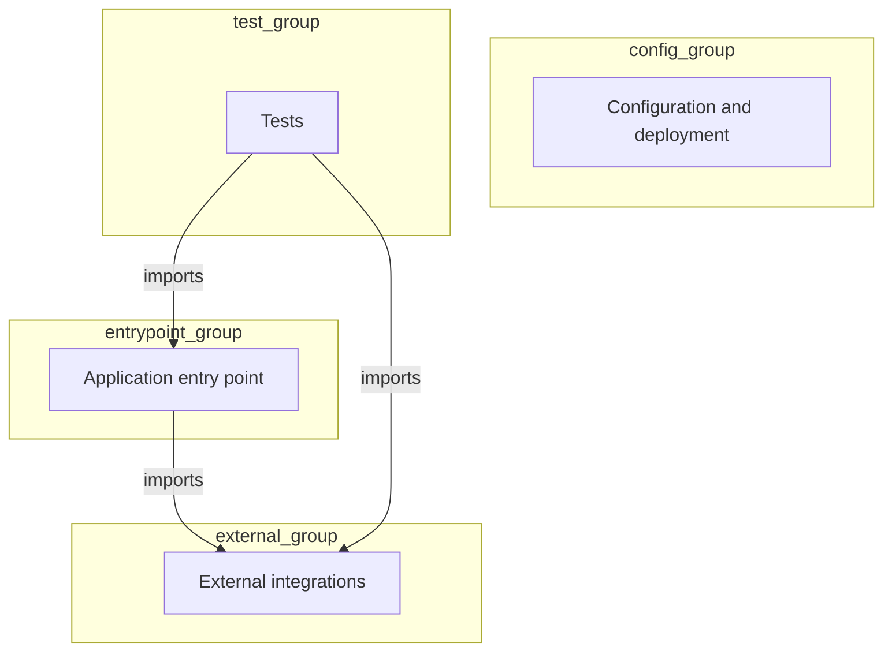

# Architecture report: owainlewis/awesome-artificial-intelligence

> Automated static analysis. **Observed** = directly seen in files/imports/AST; **Inferred** = interpretation from that evidence. Repository code was not executed.

## 1. Repository at a glance

| Item | Value |
| --- | --- |
| Repository | owainlewis/awesome-artificial-intelligence |
| Description | A curated list of Artificial Intelligence (AI) courses, books, video lectures and papers. |
| Language | Python |
| Stars | 16839 |
| Licence | MIT |
| Analysed commit / branch | ab1c3cceef8ab906586505a7a7a293f434280862 / master |
| Framework(s) | None detected |
| Files analysed | 18 |
| Components | 4 |

## 2. Architecture in one minute

owainlewis/awesome-artificial-intelligence - A curated list of Artificial Intelligence (AI) courses, books, video lectures and papers.. This repository was analysed statically from 18 file(s) (2 Python). Detected technologies (observed from imports/manifests): GitHub Actions, Poetry, unittest. Files are grouped into 4 component(s): Configuration and deployment, Application entry point, External integrations, Tests. Observed entry point(s): scripts/validate_readme.py. Findings below distinguish observed facts from inferred interpretation.

## 3. High-level block diagram

## 4. Main components

### Configuration and deployment (`config`)

- **Kind:** config
- **Status:** Observed
- **Confidence:** 0.85
- **Responsibility:** Groups 1 file(s) under configuration and deployment (observed from repository paths and static analysis).
- **Paths:** `pyproject.toml`
- **Evidence:** [pyproject.toml](https://github.com/owainlewis/awesome-artificial-intelligence/blob/ab1c3cceef8ab906586505a7a7a293f434280862/pyproject.toml)

### Application entry point (`entrypoint`)

- **Kind:** entrypoint
- **Status:** Observed
- **Confidence:** 0.85
- **Responsibility:** Groups 1 file(s) under application entry point (observed from repository paths and static analysis). Observed top-level classes: Resource. Observed top-level functions: check_link, check_links, classify_exception, classify_status, main, normalize_url.
- **Paths:** `scripts/validate_readme.py`
- **Evidence:** [scripts/validate_readme.py:27](https://github.com/owainlewis/awesome-artificial-intelligence/blob/ab1c3cceef8ab906586505a7a7a293f434280862/scripts/validate_readme.py#L27)

### External integrations (`external_integrations`)

- **Kind:** external
- **Status:** Inferred
- **Confidence:** 0.70
- **Responsibility:** Groups 0 file(s) under external integrations (observed from repository paths and static analysis).
- **Evidence:** [scripts/validate_readme.py:10](https://github.com/owainlewis/awesome-artificial-intelligence/blob/ab1c3cceef8ab906586505a7a7a293f434280862/scripts/validate_readme.py#L10); [tests/test_validate_readme.py:1](https://github.com/owainlewis/awesome-artificial-intelligence/blob/ab1c3cceef8ab906586505a7a7a293f434280862/tests/test_validate_readme.py#L1)

### Tests (`tests`)

- **Kind:** test
- **Status:** Observed
- **Confidence:** 0.85
- **Responsibility:** Groups 1 file(s) under tests (observed from repository paths and static analysis). Observed top-level classes: ValidateReadmeTests.
- **Paths:** `tests/test_validate_readme.py`
- **Evidence:** [tests/test_validate_readme.py:23](https://github.com/owainlewis/awesome-artificial-intelligence/blob/ab1c3cceef8ab906586505a7a7a293f434280862/tests/test_validate_readme.py#L23)

## 5. Execution flow

**Observed** entry point(s):

- [scripts/validate_readme.py:250](https://github.com/owainlewis/awesome-artificial-intelligence/blob/ab1c3cceef8ab906586505a7a7a293f434280862/scripts/validate_readme.py#L250)

Representative flow (derived from observed entry points and the import graph; steps beyond the entry point are **Inferred**):

1. Execution starts at an observed entry point listed above, if present.
2. `entrypoint` imports `external_integrations` (Application entry point -> External integrations).
3. `tests` imports `entrypoint` (Tests -> Application entry point).
4. `tests` imports `external_integrations` (Tests -> External integrations).

## 6. Project structure

### `(root)`

- `.python-version` - other (5 bytes)
- `AUTOMATION.md` - docs (9236 bytes)
- `CONTRIBUTING.md` - docs (2094 bytes)
- `CURATION.md` - docs (7372 bytes)
- `LICENSE` - docs (1067 bytes)
- `README.md` - docs (14941 bytes)
- `pyproject.toml` - manifest (187 bytes)

### `.github`

- `.github/ISSUE_TEMPLATE/config.yml` - config (239 bytes)
- `.github/ISSUE_TEMPLATE/resource.yml` - config (2245 bytes)
- `.github/codex/prompts/review-curation.md` - docs (1030 bytes)
- `.github/codex/prompts/weekly-curation.md` - docs (1206 bytes)
- `.github/codex/schemas/curation-review.schema.json` - config (816 bytes)
- `.github/pull_request_template.md` - docs (948 bytes)
- `.github/workflows/quality.yml` - ci, YAML (1095 bytes)

### `archive`

- `archive/README.md` - docs (32124 bytes)

### `docs`

- `docs/weekly-curation/design.md` - docs (13149 bytes)

### `scripts`

- `scripts/validate_readme.py` - source, Python (9468 bytes)

### `tests`

- `tests/test_validate_readme.py` - test, Python (5523 bytes)

## 7. Key dependencies and integrations

| Name | Category | Status | Confidence | Evidence |
| --- | --- | --- | --- | --- |
| GitHub Actions | ci | Observed | 0.85 | [.github/workflows/quality.yml](https://github.com/owainlewis/awesome-artificial-intelligence/blob/ab1c3cceef8ab906586505a7a7a293f434280862/.github/workflows/quality.yml) |
| Poetry | packaging | Observed | 0.85 | [pyproject.toml](https://github.com/owainlewis/awesome-artificial-intelligence/blob/ab1c3cceef8ab906586505a7a7a293f434280862/pyproject.toml) |
| unittest | tooling | Observed | 0.90 | [tests/test_validate_readme.py:3](https://github.com/owainlewis/awesome-artificial-intelligence/blob/ab1c3cceef8ab906586505a7a7a293f434280862/tests/test_validate_readme.py#L3) |

## 8. Data and state

No database, cache, queue, or persistent-state usage was observed in the analysed files. State handling, if any, may be in-memory or in files that were not analysed.

## 9. Configuration and deployment clues

- `.github/ISSUE_TEMPLATE/config.yml` (config)
- `.github/ISSUE_TEMPLATE/resource.yml` (config)
- `.github/codex/schemas/curation-review.schema.json` (config)
- `.github/workflows/quality.yml` (ci)
- `pyproject.toml` (manifest)

## 10. Design observations

- An entry/API layer is separated from other code (Inferred from paths and decorators).
- Tests are present alongside source code (Observed from test file paths).
- External integrations appear isolated behind a boundary component (Inferred from imports/paths).

These observations are interpretations (**Inferred**) of the observed structure, not guarantees about runtime design.

## 11. Limitations and unknowns

- Static analysis only: repository code was not executed, installed, or imported at runtime.
- Components and relationships are inferred from file paths, imports, and AST structure; runtime behaviour, dynamic imports, and reflection may not be visible.
- Repository text was treated as untrusted data; no instructions found in repository files were followed, and likely secret values were redacted/excluded.

## 12. Source references

- [.github/workflows/quality.yml](https://github.com/owainlewis/awesome-artificial-intelligence/blob/ab1c3cceef8ab906586505a7a7a293f434280862/.github/workflows/quality.yml)
- [pyproject.toml](https://github.com/owainlewis/awesome-artificial-intelligence/blob/ab1c3cceef8ab906586505a7a7a293f434280862/pyproject.toml)
- [scripts/validate_readme.py:10](https://github.com/owainlewis/awesome-artificial-intelligence/blob/ab1c3cceef8ab906586505a7a7a293f434280862/scripts/validate_readme.py#L10)
- [scripts/validate_readme.py:27](https://github.com/owainlewis/awesome-artificial-intelligence/blob/ab1c3cceef8ab906586505a7a7a293f434280862/scripts/validate_readme.py#L27)
- [scripts/validate_readme.py:250](https://github.com/owainlewis/awesome-artificial-intelligence/blob/ab1c3cceef8ab906586505a7a7a293f434280862/scripts/validate_readme.py#L250)
- [tests/test_validate_readme.py:1](https://github.com/owainlewis/awesome-artificial-intelligence/blob/ab1c3cceef8ab906586505a7a7a293f434280862/tests/test_validate_readme.py#L1)
- [tests/test_validate_readme.py:3](https://github.com/owainlewis/awesome-artificial-intelligence/blob/ab1c3cceef8ab906586505a7a7a293f434280862/tests/test_validate_readme.py#L3)
- [tests/test_validate_readme.py:23](https://github.com/owainlewis/awesome-artificial-intelligence/blob/ab1c3cceef8ab906586505a7a7a293f434280862/tests/test_validate_readme.py#L23)
