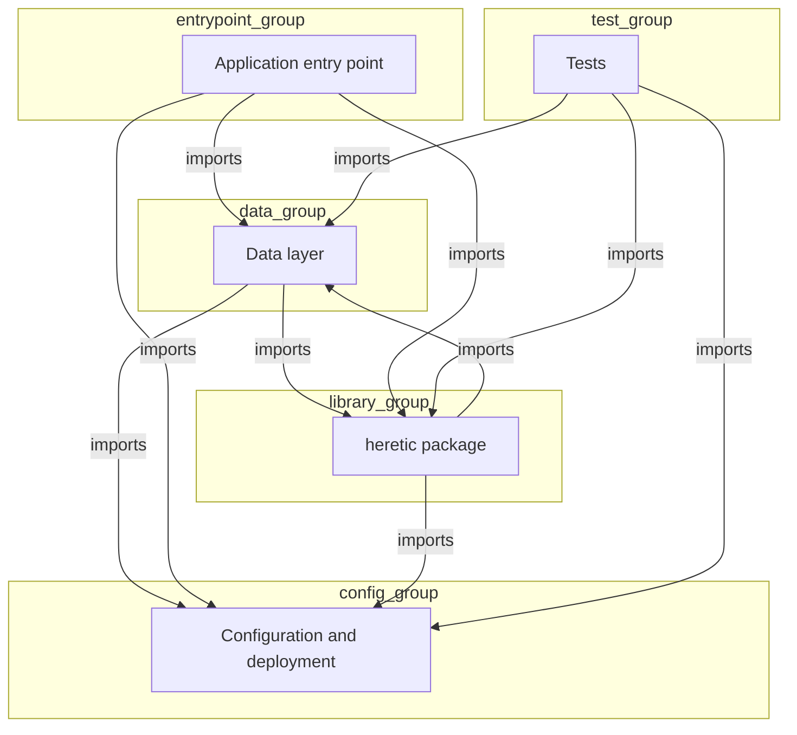

# Architecture report: p-e-w/heretic

> Automated static analysis. **Observed** = directly seen in files/imports/AST; **Inferred** = interpretation from that evidence. Repository code was not executed.

## 1. Repository at a glance

| Item | Value |
| --- | --- |
| Repository | p-e-w/heretic |
| Description | Training-free language model modification: Remove censorship, suppress slop, reduce sycophancy, and more |
| Language | Python |
| Stars | 40595 |
| Licence | AGPL-3.0 |
| Analysed commit / branch | a14b8543537b50ce8db4db7eaae4eb295d5d5142 / master |
| Framework(s) | None detected |
| Files analysed | 95 |
| Components | 5 |

## 2. Architecture in one minute

p-e-w/heretic - Training-free language model modification: Remove censorship, suppress slop, reduce sycophancy, and more. This repository was analysed statically from 95 file(s) (28 Python). Detected technologies (observed from imports/manifests): GitHub Actions, NumPy, Pydantic, Poetry, unittest. Files are grouped into 5 component(s): Configuration and deployment, Data layer, Application entry point, heretic package, Tests. Observed entry point(s): src/heretic/main.py. Findings below distinguish observed facts from inferred interpretation.

## 3. High-level block diagram

## 4. Main components

### Configuration and deployment (`config`)

- **Kind:** config
- **Status:** Observed
- **Confidence:** 0.85
- **Responsibility:** Groups 10 file(s) under configuration and deployment (observed from repository paths and static analysis). Observed top-level classes: BenchmarkSpecification, ExportStrategy, InitOnlySettings, ModifierConfig, QuantizationMethod, ScorerConfig. Observed top-level functions: _config_path.
- **Paths:** `config.classifier.toml`, `config.default.toml`, `config.emotions.toml`, `config.nohumor.toml`, `config.noslop.toml`, `config.nosyco.toml`, `config.piqa.toml`, `config.terse.toml`, `pyproject.toml`, `src/heretic/config.py`
- **Evidence:** [config.classifier.toml](https://github.com/p-e-w/heretic/blob/a14b8543537b50ce8db4db7eaae4eb295d5d5142/config.classifier.toml); [config.default.toml](https://github.com/p-e-w/heretic/blob/a14b8543537b50ce8db4db7eaae4eb295d5d5142/config.default.toml); [config.emotions.toml](https://github.com/p-e-w/heretic/blob/a14b8543537b50ce8db4db7eaae4eb295d5d5142/config.emotions.toml); [config.nohumor.toml](https://github.com/p-e-w/heretic/blob/a14b8543537b50ce8db4db7eaae4eb295d5d5142/config.nohumor.toml); [config.noslop.toml](https://github.com/p-e-w/heretic/blob/a14b8543537b50ce8db4db7eaae4eb295d5d5142/config.noslop.toml); [config.nosyco.toml](https://github.com/p-e-w/heretic/blob/a14b8543537b50ce8db4db7eaae4eb295d5d5142/config.nosyco.toml); [config.piqa.toml](https://github.com/p-e-w/heretic/blob/a14b8543537b50ce8db4db7eaae4eb295d5d5142/config.piqa.toml); [config.terse.toml](https://github.com/p-e-w/heretic/blob/a14b8543537b50ce8db4db7eaae4eb295d5d5142/config.terse.toml)

### Data layer (`data_layer`)

- **Kind:** data
- **Status:** Observed
- **Confidence:** 0.85
- **Responsibility:** Groups 1 file(s) under data layer (observed from repository paths and static analysis). Observed top-level classes: Model. Observed top-level functions: _collapse_flattened_residual_streams, chat_template_supports_system_role, check_model_resident, get_model_class, strftime_fixed_date.
- **Paths:** `src/heretic/model.py`
- **Evidence:** [src/heretic/model.py:36](https://github.com/p-e-w/heretic/blob/a14b8543537b50ce8db4db7eaae4eb295d5d5142/src/heretic/model.py#L36)

### Application entry point (`entrypoint`)

- **Kind:** entrypoint
- **Status:** Observed
- **Confidence:** 0.85
- **Responsibility:** Groups 1 file(s) under application entry point (observed from repository paths and static analysis). Observed top-level functions: _is_help_invocation, main, obtain_export_strategy, run.
- **Paths:** `src/heretic/main.py`
- **Evidence:** [src/heretic/main.py:30](https://github.com/p-e-w/heretic/blob/a14b8543537b50ce8db4db7eaae4eb295d5d5142/src/heretic/main.py#L30)

### heretic package (`heretic`)

- **Kind:** library
- **Status:** Observed
- **Confidence:** 0.85
- **Responsibility:** Groups 18 file(s) under heretic package (observed from repository paths and static analysis). Observed top-level classes: ARA, Abliteration, BERTClassifier, BenchmarkScore, Context, Evaluator. Observed top-level functions: _load_prompts_single, _strip_none_values, ara_loss, ask_if_unset, batchify, check_environment.
- **Paths:** `src/heretic/__init__.py`, `src/heretic/evaluator.py`, `src/heretic/modifier.py`, `src/heretic/modifiers/__init__.py`, `src/heretic/modifiers/abliteration.py`, `src/heretic/modifiers/ara.py`, `src/heretic/plugin.py`, `src/heretic/progress.py`, `src/heretic/reproduce.py`, `src/heretic/scorer.py`, `src/heretic/scorers/__init__.py`, `src/heretic/scorers/benchmark_score.py`, `src/heretic/scorers/bert_classifier.py`, `src/heretic/scorers/keyword_rate.py`, `src/heretic/scorers/kl_divergence.py`, `src/heretic/scorers/response_length.py`, `src/heretic/system.py`, `src/heretic/utils.py`
- **Evidence:** [src/heretic/__init__.py](https://github.com/p-e-w/heretic/blob/a14b8543537b50ce8db4db7eaae4eb295d5d5142/src/heretic/__init__.py); [src/heretic/evaluator.py:18](https://github.com/p-e-w/heretic/blob/a14b8543537b50ce8db4db7eaae4eb295d5d5142/src/heretic/evaluator.py#L18); [src/heretic/modifier.py:23](https://github.com/p-e-w/heretic/blob/a14b8543537b50ce8db4db7eaae4eb295d5d5142/src/heretic/modifier.py#L23); [src/heretic/modifiers/__init__.py](https://github.com/p-e-w/heretic/blob/a14b8543537b50ce8db4db7eaae4eb295d5d5142/src/heretic/modifiers/__init__.py); [src/heretic/modifiers/abliteration.py:28](https://github.com/p-e-w/heretic/blob/a14b8543537b50ce8db4db7eaae4eb295d5d5142/src/heretic/modifiers/abliteration.py#L28); [src/heretic/modifiers/ara.py:30](https://github.com/p-e-w/heretic/blob/a14b8543537b50ce8db4db7eaae4eb295d5d5142/src/heretic/modifiers/ara.py#L30); [src/heretic/plugin.py:33](https://github.com/p-e-w/heretic/blob/a14b8543537b50ce8db4db7eaae4eb295d5d5142/src/heretic/plugin.py#L33); [src/heretic/progress.py:13](https://github.com/p-e-w/heretic/blob/a14b8543537b50ce8db4db7eaae4eb295d5d5142/src/heretic/progress.py#L13)

### Tests (`tests`)

- **Kind:** test
- **Status:** Observed
- **Confidence:** 0.85
- **Responsibility:** Groups 57 file(s) under tests (observed from repository paths and static analysis). Observed top-level classes: ApplySystemRoleTests, ChatTemplateSupportTests, ConfigFileSelectionTests, DummyNestedSettings, DummyPlugin, DummyPluginWithoutSettings. Observed top-level functions: _dense_output, _lowrank_output, _tokenizer, get_file_sha256.
- **Paths:** `tests/README.md`, `tests/deepseek-v4-ara/SHA256SUMS.ci`, `tests/deepseek-v4-ara/SHA256SUMS.ci2`, `tests/deepseek-v4-ara/SHA256SUMS.ci3`, `tests/deepseek-v4-ara/SHA256SUMS.ci4`, `tests/deepseek-v4-ara/config.toml`, `tests/deepseek-v4/SHA256SUMS.ci`, `tests/deepseek-v4/SHA256SUMS.ci2`, `tests/deepseek-v4/SHA256SUMS.ci3`, `tests/deepseek-v4/SHA256SUMS.ci4`, `tests/deepseek-v4/SHA256SUMS.linux`, `tests/deepseek-v4/SHA256SUMS.windows`, `tests/deepseek-v4/config.toml`, `tests/gemma-3/SHA256SUMS.ci`, `tests/gemma-3/SHA256SUMS.ci2`, `tests/gemma-3/SHA256SUMS.ci3`, `tests/gemma-3/SHA256SUMS.windows`, `tests/gemma-3/config.toml`, `tests/gemma-4e/SHA256SUMS.ci`, `tests/gemma-4e/SHA256SUMS.ci2`, `tests/gemma-4e/SHA256SUMS.ci3`, `tests/gemma-4e/SHA256SUMS.linux`, `tests/gemma-4e/SHA256SUMS.windows`, `tests/gemma-4e/config.toml`, `tests/gpt-oss/SHA256SUMS.linux`, `tests/gpt-oss/SHA256SUMS.windows`, `tests/gpt-oss/config.toml`, `tests/minicpm5/SHA256SUMS.linux`, `tests/minicpm5/SHA256SUMS.windows`, `tests/minicpm5/config.toml`, `tests/mistral-3/SHA256SUMS.ci`, `tests/mistral-3/SHA256SUMS.ci2`, `tests/mistral-3/SHA256SUMS.ci3`, `tests/mistral-3/SHA256SUMS.linux`, `tests/mistral-3/SHA256SUMS.windows`, `tests/mistral-3/config.toml`, `tests/qwen2.5/SHA256SUMS.ci`, `tests/qwen2.5/SHA256SUMS.linux`, `tests/qwen2.5/SHA256SUMS.windows`, `tests/qwen2.5/config.toml`, `tests/qwen3.5-moe/SHA256SUMS.ci`, `tests/qwen3.5-moe/SHA256SUMS.ci2`, `tests/qwen3.5-moe/SHA256SUMS.linux`, `tests/qwen3.5-moe/SHA256SUMS.windows`, `tests/qwen3.5-moe/config.toml`, `tests/run_tests.py`, `tests/seed-oss/SHA256SUMS.ci`, `tests/seed-oss/SHA256SUMS.ci2`, `tests/seed-oss/SHA256SUMS.linux`, `tests/seed-oss/SHA256SUMS.windows`, `tests/seed-oss/config.toml`, `tests/test_ara_lowrank_equivalence.py`, `tests/test_chat_template.py`, `tests/test_config.py`, `tests/test_keyword_rate.py`, `tests/test_plugin.py`, `tests/test_residual_streams.py`
- **Evidence:** [tests/README.md](https://github.com/p-e-w/heretic/blob/a14b8543537b50ce8db4db7eaae4eb295d5d5142/tests/README.md); [tests/deepseek-v4-ara/SHA256SUMS.ci](https://github.com/p-e-w/heretic/blob/a14b8543537b50ce8db4db7eaae4eb295d5d5142/tests/deepseek-v4-ara/SHA256SUMS.ci); [tests/deepseek-v4-ara/SHA256SUMS.ci2](https://github.com/p-e-w/heretic/blob/a14b8543537b50ce8db4db7eaae4eb295d5d5142/tests/deepseek-v4-ara/SHA256SUMS.ci2); [tests/deepseek-v4-ara/SHA256SUMS.ci3](https://github.com/p-e-w/heretic/blob/a14b8543537b50ce8db4db7eaae4eb295d5d5142/tests/deepseek-v4-ara/SHA256SUMS.ci3); [tests/deepseek-v4-ara/SHA256SUMS.ci4](https://github.com/p-e-w/heretic/blob/a14b8543537b50ce8db4db7eaae4eb295d5d5142/tests/deepseek-v4-ara/SHA256SUMS.ci4); [tests/deepseek-v4-ara/config.toml](https://github.com/p-e-w/heretic/blob/a14b8543537b50ce8db4db7eaae4eb295d5d5142/tests/deepseek-v4-ara/config.toml); [tests/deepseek-v4/SHA256SUMS.ci](https://github.com/p-e-w/heretic/blob/a14b8543537b50ce8db4db7eaae4eb295d5d5142/tests/deepseek-v4/SHA256SUMS.ci); [tests/deepseek-v4/SHA256SUMS.ci2](https://github.com/p-e-w/heretic/blob/a14b8543537b50ce8db4db7eaae4eb295d5d5142/tests/deepseek-v4/SHA256SUMS.ci2)

## 5. Execution flow

**Observed** entry point(s):

- [src/heretic/main.py](https://github.com/p-e-w/heretic/blob/a14b8543537b50ce8db4db7eaae4eb295d5d5142/src/heretic/main.py)

Representative flow (derived from observed entry points and the import graph; steps beyond the entry point are **Inferred**):

1. Execution starts at an observed entry point listed above, if present.
2. `data_layer` imports `config` (Data layer -> Configuration and deployment).
3. `data_layer` imports `heretic` (Data layer -> heretic package).
4. `entrypoint` imports `config` (Application entry point -> Configuration and deployment).
5. `entrypoint` imports `data_layer` (Application entry point -> Data layer).
6. `entrypoint` imports `heretic` (Application entry point -> heretic package).
7. `heretic` imports `config` (heretic package -> Configuration and deployment).
8. `heretic` imports `data_layer` (heretic package -> Data layer).
9. `tests` imports `config` (Tests -> Configuration and deployment).

## 6. Project structure

### `(root)`

- `.gitattributes` - other (14 bytes)
- `.gitignore` - other (358 bytes)
- `.python-version` - other (5 bytes)
- `LICENSE` - docs (34523 bytes)
- `README.md` - docs (15322 bytes)
- `config.classifier.toml` - config (687 bytes)
- `config.default.toml` - config (13829 bytes)
- `config.emotions.toml` - config (4776 bytes)
- `config.nohumor.toml` - config (1313 bytes)
- `config.noslop.toml` - config (3362 bytes)
- `config.nosyco.toml` - config (4380 bytes)
- `config.piqa.toml` - config (338 bytes)
- `config.terse.toml` - config (2417 bytes)
- `pyproject.toml` - manifest (2602 bytes)

### `.github`

- `.github/pull_request_template.md` - docs (962 bytes)
- `.github/workflows/ci.yml` - ci, YAML (1516 bytes)

### `docs`

- `docs/migration_v1_to_v2.md` - docs (2265 bytes)

### `src`

- `src/heretic/__init__.py` - source, Python (0 bytes)
- `src/heretic/config.py` - source, Python (22017 bytes)
- `src/heretic/evaluator.py` - source, Python (8355 bytes)
- `src/heretic/main.py` - source, Python (69256 bytes)
- `src/heretic/model.py` - source, Python (40477 bytes)
- `src/heretic/modifier.py` - source, Python (5617 bytes)
- `src/heretic/modifiers/__init__.py` - source, Python (0 bytes)
- `src/heretic/modifiers/abliteration.py` - source, Python (19765 bytes)
- `src/heretic/modifiers/ara.py` - source, Python (16012 bytes)
- `src/heretic/plugin.py` - source, Python (14554 bytes)
- `src/heretic/progress.py` - source, Python (1314 bytes)
- `src/heretic/reproduce.py` - source, Python (11953 bytes)
- `src/heretic/scorer.py` - source, Python (1771 bytes)
- `src/heretic/scorers/__init__.py` - source, Python (0 bytes)
- `src/heretic/scorers/benchmark_score.py` - source, Python (2254 bytes)
- `src/heretic/scorers/bert_classifier.py` - source, Python (10305 bytes)
- `src/heretic/scorers/keyword_rate.py` - source, Python (4696 bytes)
- `src/heretic/scorers/kl_divergence.py` - source, Python (2395 bytes)
- `src/heretic/scorers/response_length.py` - source, Python (3449 bytes)
- `src/heretic/system.py` - source, Python (15825 bytes)
- `src/heretic/utils.py` - source, Python (27579 bytes)

### `tests`

- `tests/README.md` - test (3532 bytes)
- `tests/deepseek-v4-ara/SHA256SUMS.ci` - test (92 bytes)
- `tests/deepseek-v4-ara/SHA256SUMS.ci2` - test (92 bytes)
- `tests/deepseek-v4-ara/SHA256SUMS.ci3` - test (92 bytes)
- `tests/deepseek-v4-ara/SHA256SUMS.ci4` - test (92 bytes)
- `tests/deepseek-v4-ara/config.toml` - test (1643 bytes)
- `tests/deepseek-v4/SHA256SUMS.ci` - test (92 bytes)
- `tests/deepseek-v4/SHA256SUMS.ci2` - test (92 bytes)
- `tests/deepseek-v4/SHA256SUMS.ci3` - test (92 bytes)
- `tests/deepseek-v4/SHA256SUMS.ci4` - test (92 bytes)
- `tests/deepseek-v4/SHA256SUMS.linux` - test (92 bytes)
- `tests/deepseek-v4/SHA256SUMS.windows` - test (92 bytes)
- `tests/deepseek-v4/config.toml` - test (1661 bytes)
- `tests/gemma-3/SHA256SUMS.ci` - test (331 bytes)
- `tests/gemma-3/SHA256SUMS.ci2` - test (331 bytes)
- `tests/gemma-3/SHA256SUMS.ci3` - test (331 bytes)
- `tests/gemma-3/SHA256SUMS.windows` - test (331 bytes)
- `tests/gemma-3/config.toml` - test (2026 bytes)
- `tests/gemma-4e/SHA256SUMS.ci` - test (594 bytes)
- `tests/gemma-4e/SHA256SUMS.ci2` - test (594 bytes)
- `tests/gemma-4e/SHA256SUMS.ci3` - test (594 bytes)
- `tests/gemma-4e/SHA256SUMS.linux` - test (594 bytes)
- `tests/gemma-4e/SHA256SUMS.windows` - test (594 bytes)
- `tests/gemma-4e/config.toml` - test (1466 bytes)
- `tests/gpt-oss/SHA256SUMS.linux` - test (506 bytes)
- `tests/gpt-oss/SHA256SUMS.windows` - test (506 bytes)
- `tests/gpt-oss/config.toml` - test (1356 bytes)
- `tests/minicpm5/SHA256SUMS.linux` - test (506 bytes)
- `tests/minicpm5/SHA256SUMS.windows` - test (506 bytes)
- `tests/minicpm5/config.toml` - test (1529 bytes)
- `tests/mistral-3/SHA256SUMS.ci` - test (594 bytes)
- `tests/mistral-3/SHA256SUMS.ci2` - test (594 bytes)
- `tests/mistral-3/SHA256SUMS.ci3` - test (594 bytes)
- `tests/mistral-3/SHA256SUMS.linux` - test (594 bytes)
- `tests/mistral-3/SHA256SUMS.windows` - test (594 bytes)
- `tests/mistral-3/config.toml` - test (1466 bytes)
- `tests/qwen2.5/SHA256SUMS.ci` - test (506 bytes)
- `tests/qwen2.5/SHA256SUMS.linux` - test (506 bytes)
- `tests/qwen2.5/SHA256SUMS.windows` - test (506 bytes)
- `tests/qwen2.5/config.toml` - test (1526 bytes)
- `tests/qwen3.5-moe/SHA256SUMS.ci` - test (594 bytes)
- `tests/qwen3.5-moe/SHA256SUMS.ci2` - test (594 bytes)
- `tests/qwen3.5-moe/SHA256SUMS.linux` - test (594 bytes)
- `tests/qwen3.5-moe/SHA256SUMS.windows` - test (594 bytes)
- `tests/qwen3.5-moe/config.toml` - test (1466 bytes)
- `tests/run_tests.py` - test, Python (3338 bytes)
- `tests/seed-oss/SHA256SUMS.ci` - test (506 bytes)
- `tests/seed-oss/SHA256SUMS.ci2` - test (506 bytes)
- `tests/seed-oss/SHA256SUMS.linux` - test (506 bytes)
- `tests/seed-oss/SHA256SUMS.windows` - test (506 bytes)
- `tests/seed-oss/config.toml` - test (1637 bytes)
- `tests/test_ara_lowrank_equivalence.py` - test, Python (2504 bytes)
- `tests/test_chat_template.py` - test, Python (4793 bytes)
- `tests/test_config.py` - test, Python (7974 bytes)
- `tests/test_keyword_rate.py` - test, Python (2573 bytes)
- `tests/test_plugin.py` - test, Python (8571 bytes)
- `tests/test_residual_streams.py` - test, Python (1953 bytes)

## 7. Key dependencies and integrations

| Name | Category | Status | Confidence | Evidence |
| --- | --- | --- | --- | --- |
| GitHub Actions | ci | Observed | 0.85 | [.github/workflows/ci.yml](https://github.com/p-e-w/heretic/blob/a14b8543537b50ce8db4db7eaae4eb295d5d5142/.github/workflows/ci.yml) |
| NumPy | library | Observed | 0.90 | [pyproject.toml:35](https://github.com/p-e-w/heretic/blob/a14b8543537b50ce8db4db7eaae4eb295d5d5142/pyproject.toml#L35); [src/heretic/main.py:65](https://github.com/p-e-w/heretic/blob/a14b8543537b50ce8db4db7eaae4eb295d5d5142/src/heretic/main.py#L65) |
| Pydantic | library | Observed | 0.95 | [src/heretic/config.py:8](https://github.com/p-e-w/heretic/blob/a14b8543537b50ce8db4db7eaae4eb295d5d5142/src/heretic/config.py#L8); [src/heretic/evaluator.py:8](https://github.com/p-e-w/heretic/blob/a14b8543537b50ce8db4db7eaae4eb295d5d5142/src/heretic/evaluator.py#L8); [src/heretic/main.py:79](https://github.com/p-e-w/heretic/blob/a14b8543537b50ce8db4db7eaae4eb295d5d5142/src/heretic/main.py#L79); [src/heretic/modifier.py:10](https://github.com/p-e-w/heretic/blob/a14b8543537b50ce8db4db7eaae4eb295d5d5142/src/heretic/modifier.py#L10) |
| Poetry | packaging | Observed | 0.85 | [pyproject.toml](https://github.com/p-e-w/heretic/blob/a14b8543537b50ce8db4db7eaae4eb295d5d5142/pyproject.toml) |
| unittest | tooling | Observed | 0.95 | [tests/test_ara_lowrank_equivalence.py:4](https://github.com/p-e-w/heretic/blob/a14b8543537b50ce8db4db7eaae4eb295d5d5142/tests/test_ara_lowrank_equivalence.py#L4); [tests/test_chat_template.py:4](https://github.com/p-e-w/heretic/blob/a14b8543537b50ce8db4db7eaae4eb295d5d5142/tests/test_chat_template.py#L4); [tests/test_config.py:7](https://github.com/p-e-w/heretic/blob/a14b8543537b50ce8db4db7eaae4eb295d5d5142/tests/test_config.py#L7); [tests/test_config.py:9](https://github.com/p-e-w/heretic/blob/a14b8543537b50ce8db4db7eaae4eb295d5d5142/tests/test_config.py#L9) |

## 8. Data and state

- Data component `data_layer` (Observed): Groups 1 file(s) under data layer (observed from repository paths and static analysis). Observed top-level classes: Model. Observed top-level functions: _collapse_flattened_residual_streams, chat_template_supports_system_role, check_model_resident, get_model_class, strftime_fixed_date.

## 9. Configuration and deployment clues

- `.github/workflows/ci.yml` (ci)
- `config.classifier.toml` (config)
- `config.default.toml` (config)
- `config.emotions.toml` (config)
- `config.nohumor.toml` (config)
- `config.noslop.toml` (config)
- `config.nosyco.toml` (config)
- `config.piqa.toml` (config)
- `config.terse.toml` (config)
- `pyproject.toml` (manifest)

Console scripts declared in packaging metadata (**Observed**):

- `heretic` -> `heretic.main:main`

## 10. Design observations

- An entry/API layer is separated from other code (Inferred from paths and decorators).
- Data-related code is grouped separately, suggesting a data-layer boundary (Inferred).
- Tests are present alongside source code (Observed from test file paths).

These observations are interpretations (**Inferred**) of the observed structure, not guarantees about runtime design.

## 11. Limitations and unknowns

- Static analysis only: repository code was not executed, installed, or imported at runtime.
- Components and relationships are inferred from file paths, imports, and AST structure; runtime behaviour, dynamic imports, and reflection may not be visible.
- Repository text was treated as untrusted data; no instructions found in repository files were followed, and likely secret values were redacted/excluded.

## 12. Source references

- [.github/workflows/ci.yml](https://github.com/p-e-w/heretic/blob/a14b8543537b50ce8db4db7eaae4eb295d5d5142/.github/workflows/ci.yml)
- [config.classifier.toml](https://github.com/p-e-w/heretic/blob/a14b8543537b50ce8db4db7eaae4eb295d5d5142/config.classifier.toml)
- [config.default.toml](https://github.com/p-e-w/heretic/blob/a14b8543537b50ce8db4db7eaae4eb295d5d5142/config.default.toml)
- [config.emotions.toml](https://github.com/p-e-w/heretic/blob/a14b8543537b50ce8db4db7eaae4eb295d5d5142/config.emotions.toml)
- [config.nohumor.toml](https://github.com/p-e-w/heretic/blob/a14b8543537b50ce8db4db7eaae4eb295d5d5142/config.nohumor.toml)
- [config.noslop.toml](https://github.com/p-e-w/heretic/blob/a14b8543537b50ce8db4db7eaae4eb295d5d5142/config.noslop.toml)
- [config.nosyco.toml](https://github.com/p-e-w/heretic/blob/a14b8543537b50ce8db4db7eaae4eb295d5d5142/config.nosyco.toml)
- [config.piqa.toml](https://github.com/p-e-w/heretic/blob/a14b8543537b50ce8db4db7eaae4eb295d5d5142/config.piqa.toml)
- [config.terse.toml](https://github.com/p-e-w/heretic/blob/a14b8543537b50ce8db4db7eaae4eb295d5d5142/config.terse.toml)
- [pyproject.toml](https://github.com/p-e-w/heretic/blob/a14b8543537b50ce8db4db7eaae4eb295d5d5142/pyproject.toml)
- [pyproject.toml:35](https://github.com/p-e-w/heretic/blob/a14b8543537b50ce8db4db7eaae4eb295d5d5142/pyproject.toml#L35)
- [src/heretic/__init__.py](https://github.com/p-e-w/heretic/blob/a14b8543537b50ce8db4db7eaae4eb295d5d5142/src/heretic/__init__.py)
- [src/heretic/config.py:8](https://github.com/p-e-w/heretic/blob/a14b8543537b50ce8db4db7eaae4eb295d5d5142/src/heretic/config.py#L8)
- [src/heretic/evaluator.py:8](https://github.com/p-e-w/heretic/blob/a14b8543537b50ce8db4db7eaae4eb295d5d5142/src/heretic/evaluator.py#L8)
- [src/heretic/evaluator.py:18](https://github.com/p-e-w/heretic/blob/a14b8543537b50ce8db4db7eaae4eb295d5d5142/src/heretic/evaluator.py#L18)
- [src/heretic/main.py](https://github.com/p-e-w/heretic/blob/a14b8543537b50ce8db4db7eaae4eb295d5d5142/src/heretic/main.py)
- [src/heretic/main.py:30](https://github.com/p-e-w/heretic/blob/a14b8543537b50ce8db4db7eaae4eb295d5d5142/src/heretic/main.py#L30)
- [src/heretic/main.py:65](https://github.com/p-e-w/heretic/blob/a14b8543537b50ce8db4db7eaae4eb295d5d5142/src/heretic/main.py#L65)
- [src/heretic/main.py:79](https://github.com/p-e-w/heretic/blob/a14b8543537b50ce8db4db7eaae4eb295d5d5142/src/heretic/main.py#L79)
- [src/heretic/model.py:36](https://github.com/p-e-w/heretic/blob/a14b8543537b50ce8db4db7eaae4eb295d5d5142/src/heretic/model.py#L36)
- [src/heretic/modifier.py:10](https://github.com/p-e-w/heretic/blob/a14b8543537b50ce8db4db7eaae4eb295d5d5142/src/heretic/modifier.py#L10)
- [src/heretic/modifier.py:23](https://github.com/p-e-w/heretic/blob/a14b8543537b50ce8db4db7eaae4eb295d5d5142/src/heretic/modifier.py#L23)
- [src/heretic/modifiers/__init__.py](https://github.com/p-e-w/heretic/blob/a14b8543537b50ce8db4db7eaae4eb295d5d5142/src/heretic/modifiers/__init__.py)
- [src/heretic/modifiers/abliteration.py:15](https://github.com/p-e-w/heretic/blob/a14b8543537b50ce8db4db7eaae4eb295d5d5142/src/heretic/modifiers/abliteration.py#L15)
- [src/heretic/modifiers/abliteration.py:28](https://github.com/p-e-w/heretic/blob/a14b8543537b50ce8db4db7eaae4eb295d5d5142/src/heretic/modifiers/abliteration.py#L28)
- [src/heretic/modifiers/ara.py:16](https://github.com/p-e-w/heretic/blob/a14b8543537b50ce8db4db7eaae4eb295d5d5142/src/heretic/modifiers/ara.py#L16)
- [src/heretic/modifiers/ara.py:30](https://github.com/p-e-w/heretic/blob/a14b8543537b50ce8db4db7eaae4eb295d5d5142/src/heretic/modifiers/ara.py#L30)
- [src/heretic/plugin.py:22](https://github.com/p-e-w/heretic/blob/a14b8543537b50ce8db4db7eaae4eb295d5d5142/src/heretic/plugin.py#L22)
- [src/heretic/plugin.py:33](https://github.com/p-e-w/heretic/blob/a14b8543537b50ce8db4db7eaae4eb295d5d5142/src/heretic/plugin.py#L33)
- [src/heretic/progress.py:13](https://github.com/p-e-w/heretic/blob/a14b8543537b50ce8db4db7eaae4eb295d5d5142/src/heretic/progress.py#L13)
- [src/heretic/scorer.py:7](https://github.com/p-e-w/heretic/blob/a14b8543537b50ce8db4db7eaae4eb295d5d5142/src/heretic/scorer.py#L7)
- [tests/README.md](https://github.com/p-e-w/heretic/blob/a14b8543537b50ce8db4db7eaae4eb295d5d5142/tests/README.md)
- [tests/deepseek-v4-ara/SHA256SUMS.ci](https://github.com/p-e-w/heretic/blob/a14b8543537b50ce8db4db7eaae4eb295d5d5142/tests/deepseek-v4-ara/SHA256SUMS.ci)
- [tests/deepseek-v4-ara/SHA256SUMS.ci2](https://github.com/p-e-w/heretic/blob/a14b8543537b50ce8db4db7eaae4eb295d5d5142/tests/deepseek-v4-ara/SHA256SUMS.ci2)
- [tests/deepseek-v4-ara/SHA256SUMS.ci3](https://github.com/p-e-w/heretic/blob/a14b8543537b50ce8db4db7eaae4eb295d5d5142/tests/deepseek-v4-ara/SHA256SUMS.ci3)
- [tests/deepseek-v4-ara/SHA256SUMS.ci4](https://github.com/p-e-w/heretic/blob/a14b8543537b50ce8db4db7eaae4eb295d5d5142/tests/deepseek-v4-ara/SHA256SUMS.ci4)
- [tests/deepseek-v4-ara/config.toml](https://github.com/p-e-w/heretic/blob/a14b8543537b50ce8db4db7eaae4eb295d5d5142/tests/deepseek-v4-ara/config.toml)
- [tests/deepseek-v4/SHA256SUMS.ci](https://github.com/p-e-w/heretic/blob/a14b8543537b50ce8db4db7eaae4eb295d5d5142/tests/deepseek-v4/SHA256SUMS.ci)
- [tests/deepseek-v4/SHA256SUMS.ci2](https://github.com/p-e-w/heretic/blob/a14b8543537b50ce8db4db7eaae4eb295d5d5142/tests/deepseek-v4/SHA256SUMS.ci2)
- [tests/test_ara_lowrank_equivalence.py:4](https://github.com/p-e-w/heretic/blob/a14b8543537b50ce8db4db7eaae4eb295d5d5142/tests/test_ara_lowrank_equivalence.py#L4)
- [tests/test_chat_template.py:4](https://github.com/p-e-w/heretic/blob/a14b8543537b50ce8db4db7eaae4eb295d5d5142/tests/test_chat_template.py#L4)
- [tests/test_config.py:7](https://github.com/p-e-w/heretic/blob/a14b8543537b50ce8db4db7eaae4eb295d5d5142/tests/test_config.py#L7)
- [tests/test_config.py:9](https://github.com/p-e-w/heretic/blob/a14b8543537b50ce8db4db7eaae4eb295d5d5142/tests/test_config.py#L9)
- [tests/test_keyword_rate.py:5](https://github.com/p-e-w/heretic/blob/a14b8543537b50ce8db4db7eaae4eb295d5d5142/tests/test_keyword_rate.py#L5)
- [tests/test_keyword_rate.py:7](https://github.com/p-e-w/heretic/blob/a14b8543537b50ce8db4db7eaae4eb295d5d5142/tests/test_keyword_rate.py#L7)
- [tests/test_plugin.py:8](https://github.com/p-e-w/heretic/blob/a14b8543537b50ce8db4db7eaae4eb295d5d5142/tests/test_plugin.py#L8)
- [tests/test_plugin.py:9](https://github.com/p-e-w/heretic/blob/a14b8543537b50ce8db4db7eaae4eb295d5d5142/tests/test_plugin.py#L9)
