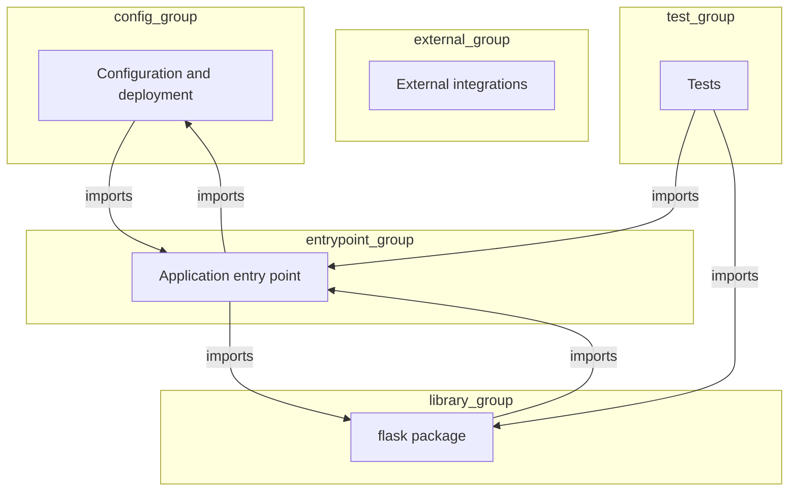

# Architecture report: pallets/flask

> Automated static analysis. **Observed** = directly seen in files/imports/AST; **Inferred** = interpretation from that evidence. Repository code was not executed.

## 1. Repository at a glance

| Item | Value |
| --- | --- |
| Repository | pallets/flask |
| Description | The Python micro framework for building web applications. |
| Language | Python |
| Stars | 75116 |
| Licence | BSD-3-Clause |
| Analysed commit / branch | 49943b5a94413a530761350f04e896f76e8d620e / main |
| Framework(s) | Flask |
| Files analysed | 229 |
| Components | 5 |

## 2. Architecture in one minute

pallets/flask - The Python micro framework for building web applications.. This repository was analysed statically from 229 file(s) (83 Python). Detected technologies (observed from imports/manifests): GitHub Actions, Redis, SQLite, Flask, Celery, Click. Files are grouped into 5 component(s): Configuration and deployment, Application entry point, External integrations, flask package, Tests. Observed entry point(s): src/flask/cli.py. Findings below distinguish observed facts from inferred interpretation.

## 3. High-level block diagram

## 4. Main components

### Configuration and deployment (`config`)

- **Kind:** config
- **Status:** Observed
- **Confidence:** 0.85
- **Responsibility:** Groups 2 file(s) under configuration and deployment (observed from repository paths and static analysis). Observed top-level classes: Config, ConfigAttribute.
- **Paths:** `pyproject.toml`, `src/flask/config.py`
- **Evidence:** [pyproject.toml](https://github.com/pallets/flask/blob/49943b5a94413a530761350f04e896f76e8d620e/pyproject.toml); [src/flask/config.py:20](https://github.com/pallets/flask/blob/49943b5a94413a530761350f04e896f76e8d620e/src/flask/config.py#L20)

### Application entry point (`entrypoint`)

- **Kind:** entrypoint
- **Status:** Observed
- **Confidence:** 0.85
- **Responsibility:** Groups 4 file(s) under application entry point (observed from repository paths and static analysis). Observed top-level classes: App, AppGroup, CertParamType, Flask, FlaskGroup, NoAppException. Observed top-level functions: _called_with_wrong_args, _env_file_callback, _make_timedelta, _path_is_ancestor, _set_app, _set_debug.
- **Paths:** `src/flask/__main__.py`, `src/flask/app.py`, `src/flask/cli.py`, `src/flask/sansio/app.py`
- **Evidence:** [src/flask/__main__.py](https://github.com/pallets/flask/blob/49943b5a94413a530761350f04e896f76e8d620e/src/flask/__main__.py); [src/flask/app.py:72](https://github.com/pallets/flask/blob/49943b5a94413a530761350f04e896f76e8d620e/src/flask/app.py#L72); [src/flask/cli.py:37](https://github.com/pallets/flask/blob/49943b5a94413a530761350f04e896f76e8d620e/src/flask/cli.py#L37); [src/flask/sansio/app.py:53](https://github.com/pallets/flask/blob/49943b5a94413a530761350f04e896f76e8d620e/src/flask/sansio/app.py#L53)

### External integrations (`external_integrations`)

- **Kind:** external
- **Status:** Inferred
- **Confidence:** 0.70
- **Responsibility:** Groups 0 file(s) under external integrations (observed from repository paths and static analysis).
- **Evidence:** [examples/tutorial/flaskr/db.py:1](https://github.com/pallets/flask/blob/49943b5a94413a530761350f04e896f76e8d620e/examples/tutorial/flaskr/db.py#L1); [examples/tutorial/tests/test_db.py:1](https://github.com/pallets/flask/blob/49943b5a94413a530761350f04e896f76e8d620e/examples/tutorial/tests/test_db.py#L1)

### flask package (`flask`)

- **Kind:** library
- **Status:** Observed
- **Confidence:** 0.85
- **Responsibility:** Groups 19 file(s) under flask package (observed from repository paths and static analysis). Observed top-level classes: AppContext, Blueprint, BlueprintSetupState, DebugFilesKeyError, DefaultJSONProvider, DispatchingJinjaLoader. Observed top-level functions: __getattr__, _default, _default_template_ctx_processor, _dump_loader_info, _endpoint_from_view_func, _find_package_path.
- **Paths:** `src/flask/__init__.py`, `src/flask/blueprints.py`, `src/flask/ctx.py`, `src/flask/debughelpers.py`, `src/flask/globals.py`, `src/flask/helpers.py`, `src/flask/json/__init__.py`, `src/flask/json/provider.py`, `src/flask/json/tag.py`, `src/flask/logging.py`, `src/flask/sansio/blueprints.py`, `src/flask/sansio/scaffold.py`, `src/flask/sessions.py`, `src/flask/signals.py`, `src/flask/templating.py`, `src/flask/testing.py`, `src/flask/typing.py`, `src/flask/views.py`, `src/flask/wrappers.py`
- **Evidence:** [src/flask/__init__.py](https://github.com/pallets/flask/blob/49943b5a94413a530761350f04e896f76e8d620e/src/flask/__init__.py); [src/flask/blueprints.py:18](https://github.com/pallets/flask/blob/49943b5a94413a530761350f04e896f76e8d620e/src/flask/blueprints.py#L18); [src/flask/ctx.py:30](https://github.com/pallets/flask/blob/49943b5a94413a530761350f04e896f76e8d620e/src/flask/ctx.py#L30); [src/flask/debughelpers.py:17](https://github.com/pallets/flask/blob/49943b5a94413a530761350f04e896f76e8d620e/src/flask/debughelpers.py#L17); [src/flask/globals.py:65](https://github.com/pallets/flask/blob/49943b5a94413a530761350f04e896f76e8d620e/src/flask/globals.py#L65); [src/flask/helpers.py:28](https://github.com/pallets/flask/blob/49943b5a94413a530761350f04e896f76e8d620e/src/flask/helpers.py#L28); [src/flask/json/__init__.py:13](https://github.com/pallets/flask/blob/49943b5a94413a530761350f04e896f76e8d620e/src/flask/json/__init__.py#L13); [src/flask/json/provider.py:19](https://github.com/pallets/flask/blob/49943b5a94413a530761350f04e896f76e8d620e/src/flask/json/provider.py#L19)

### Tests (`tests`)

- **Kind:** test
- **Status:** Observed
- **Confidence:** 0.85
- **Responsibility:** Groups 68 file(s) under tests (observed from repository paths and static analysis). Observed application object created via Flask, Group. Observed routes: ROUTE /, ROUTE /index2, ROUTE /, ROUTE /missing, ROUTE /. Observed top-level classes: AppError, AsyncMethodView, AsyncView, AuthActions, BlueprintError, FakePath. Observed top-level functions: _async_app, _has_encoding, _standard_os_environ, after_async, after_sync, app.
- **Paths:** `examples/javascript/tests/conftest.py`, `examples/javascript/tests/test_js_example.py`, `examples/tutorial/tests/conftest.py`, `examples/tutorial/tests/data.sql`, `examples/tutorial/tests/test_auth.py`, `examples/tutorial/tests/test_blog.py`, `examples/tutorial/tests/test_db.py`, `examples/tutorial/tests/test_factory.py`, `tests/conftest.py`, `tests/static/config.json`, `tests/static/config.toml`, `tests/static/index.html`, `tests/templates/_macro.html`, `tests/templates/context_template.html`, `tests/templates/escaping_template.html`, `tests/templates/mail.txt`, `tests/templates/nested/nested.txt`, `tests/templates/non_escaping_template.txt`, `tests/templates/simple_template.html`, `tests/templates/template_filter.html`, `tests/templates/template_test.html`, `tests/test_appctx.py`, `tests/test_apps/.flaskenv`, `tests/test_apps/blueprintapp/__init__.py`, `tests/test_apps/blueprintapp/apps/__init__.py`, `tests/test_apps/blueprintapp/apps/admin/__init__.py`, `tests/test_apps/blueprintapp/apps/admin/static/css/test.css`, `tests/test_apps/blueprintapp/apps/admin/static/test.txt`, `tests/test_apps/blueprintapp/apps/admin/templates/admin/index.html`, `tests/test_apps/blueprintapp/apps/frontend/__init__.py`, `tests/test_apps/blueprintapp/apps/frontend/templates/frontend/index.html`, `tests/test_apps/cliapp/__init__.py`, `tests/test_apps/cliapp/app.py`, `tests/test_apps/cliapp/factory.py`, `tests/test_apps/cliapp/importerrorapp.py`, `tests/test_apps/cliapp/inner1/__init__.py`, `tests/test_apps/cliapp/inner1/inner2/__init__.py`, `tests/test_apps/cliapp/inner1/inner2/flask.py`, `tests/test_apps/cliapp/message.txt`, `tests/test_apps/cliapp/multiapp.py`, `tests/test_apps/helloworld/hello.py`, `tests/test_apps/helloworld/wsgi.py`, `tests/test_apps/subdomaintestmodule/__init__.py`, `tests/test_apps/subdomaintestmodule/static/hello.txt`, `tests/test_async.py`, `tests/test_basic.py`, `tests/test_blueprints.py`, `tests/test_cli.py`, `tests/test_config.py`, `tests/test_converters.py`, `tests/test_helpers.py`, `tests/test_instance_config.py`, `tests/test_json.py`, `tests/test_json_tag.py`, `tests/test_logging.py`, `tests/test_regression.py`, `tests/test_reqctx.py`, `tests/test_request.py`, `tests/test_session_interface.py`, `tests/test_signals.py`, `tests/test_subclassing.py`, `tests/test_templating.py`, `tests/test_testing.py`, `tests/test_user_error_handler.py`, `tests/test_views.py`, `tests/type_check/typing_app_decorators.py`, `tests/type_check/typing_error_handler.py`, `tests/type_check/typing_route.py`
- **Evidence:** [examples/javascript/tests/conftest.py:7](https://github.com/pallets/flask/blob/49943b5a94413a530761350f04e896f76e8d620e/examples/javascript/tests/conftest.py#L7); [examples/javascript/tests/test_js_example.py:14](https://github.com/pallets/flask/blob/49943b5a94413a530761350f04e896f76e8d620e/examples/javascript/tests/test_js_example.py#L14); [examples/tutorial/tests/conftest.py:16](https://github.com/pallets/flask/blob/49943b5a94413a530761350f04e896f76e8d620e/examples/tutorial/tests/conftest.py#L16); [examples/tutorial/tests/data.sql](https://github.com/pallets/flask/blob/49943b5a94413a530761350f04e896f76e8d620e/examples/tutorial/tests/data.sql); [examples/tutorial/tests/test_auth.py:8](https://github.com/pallets/flask/blob/49943b5a94413a530761350f04e896f76e8d620e/examples/tutorial/tests/test_auth.py#L8); [examples/tutorial/tests/test_blog.py:6](https://github.com/pallets/flask/blob/49943b5a94413a530761350f04e896f76e8d620e/examples/tutorial/tests/test_blog.py#L6); [examples/tutorial/tests/test_db.py:8](https://github.com/pallets/flask/blob/49943b5a94413a530761350f04e896f76e8d620e/examples/tutorial/tests/test_db.py#L8); [examples/tutorial/tests/test_factory.py:4](https://github.com/pallets/flask/blob/49943b5a94413a530761350f04e896f76e8d620e/examples/tutorial/tests/test_factory.py#L4)

## 5. Execution flow

**Observed** entry point(s):

- [src/flask/cli.py](https://github.com/pallets/flask/blob/49943b5a94413a530761350f04e896f76e8d620e/src/flask/cli.py)

**Observed** routes (from decorators):

- `GET /result/<id>` -> `result` in `examples/celery/src/task_app/views.py:11`
- `POST /add` -> `add` in `examples/celery/src/task_app/views.py:22`
- `POST /block` -> `block` in `examples/celery/src/task_app/views.py:30`
- `POST /process` -> `process` in `examples/celery/src/task_app/views.py:36`
- `ROUTE /` -> `index` in `examples/javascript/js_example/views.py:10`
- `ROUTE /<any(xhr, jquery, fetch):js>` -> `index` in `examples/javascript/js_example/views.py:10`
- `ROUTE /add` -> `add` in `examples/javascript/js_example/views.py:15`
- `ROUTE /register` -> `register` in `examples/tutorial/flaskr/auth.py:47`
- `ROUTE /login` -> `login` in `examples/tutorial/flaskr/auth.py:85`
- `ROUTE /logout` -> `logout` in `examples/tutorial/flaskr/auth.py:113`
- `ROUTE /` -> `index` in `examples/tutorial/flaskr/blog.py:17`
- `ROUTE /create` -> `create` in `examples/tutorial/flaskr/blog.py:62`
- `ROUTE /<int:id>/update` -> `update` in `examples/tutorial/flaskr/blog.py:88`
- `ROUTE /<int:id>/delete` -> `delete` in `examples/tutorial/flaskr/blog.py:115`
- `ROUTE /` -> `index` in `tests/test_apps/blueprintapp/apps/admin/__init__.py:14`
- `ROUTE /index2` -> `index2` in `tests/test_apps/blueprintapp/apps/admin/__init__.py:19`
- `ROUTE /` -> `index` in `tests/test_apps/blueprintapp/apps/frontend/__init__.py:8`
- `ROUTE /missing` -> `missing_template` in `tests/test_apps/blueprintapp/apps/frontend/__init__.py:13`
- `ROUTE /` -> `hello` in `tests/test_apps/helloworld/hello.py:7`
- `ROUTE /str` -> `hello_str` in `tests/type_check/typing_route.py:17`
- `ROUTE /bytes` -> `hello_bytes` in `tests/type_check/typing_route.py:22`
- `ROUTE /json` -> `hello_json` in `tests/type_check/typing_route.py:27`
- `ROUTE /json/dict` -> `hello_json_dict` in `tests/type_check/typing_route.py:32`
- `ROUTE /json/dict` -> `hello_json_list` in `tests/type_check/typing_route.py:37`
- `ROUTE /typed-dict` -> `typed_dict` in `tests/type_check/typing_route.py:46`
- `ROUTE /generator` -> `hello_generator` in `tests/type_check/typing_route.py:51`
- `ROUTE /generator-expression` -> `hello_generator_expression` in `tests/type_check/typing_route.py:60`
- `ROUTE /iterator` -> `hello_iterator` in `tests/type_check/typing_route.py:65`
- `ROUTE /status` -> `tuple_status` in `tests/type_check/typing_route.py:71`
- `ROUTE /status/<int:code>` -> `tuple_status` in `tests/type_check/typing_route.py:71`
- `ROUTE /status-enum` -> `tuple_status_enum` in `tests/type_check/typing_route.py:76`
- `ROUTE /headers` -> `tuple_headers` in `tests/type_check/typing_route.py:81`
- `ROUTE /template` -> `return_template` in `tests/type_check/typing_route.py:87`
- `ROUTE /template/<name>` -> `return_template` in `tests/type_check/typing_route.py:87`
- `ROUTE /template` -> `return_template_stream` in `tests/type_check/typing_route.py:92`
- `ROUTE /async` -> `async_route` in `tests/type_check/typing_route.py:97`

Representative flow (derived from observed entry points and the import graph; steps beyond the entry point are **Inferred**):

1. Execution starts at an observed entry point listed above, if present.
2. `config` imports `entrypoint` (Configuration and deployment -> Application entry point).
3. `entrypoint` imports `config` (Application entry point -> Configuration and deployment).
4. `entrypoint` imports `flask` (Application entry point -> flask package).
5. `flask` imports `entrypoint` (flask package -> Application entry point).
6. `tests` imports `entrypoint` (Tests -> Application entry point).
7. `tests` imports `flask` (Tests -> flask package).

## 6. Project structure

### `(root)`

- `.editorconfig` - config (233 bytes)
- `.gitignore` - other (74 bytes)
- `.pre-commit-config.yaml` - config (844 bytes)
- `.readthedocs.yaml` - config (242 bytes)
- `CHANGES.rst` - docs (73668 bytes)
- `LICENSE.txt` - docs (1475 bytes)
- `README.md` - docs (1639 bytes)
- `pyproject.toml` - manifest (6424 bytes)

### `.devcontainer`

- `.devcontainer/devcontainer.json` - config (434 bytes)
- `.devcontainer/on-create-command.sh` - source, Shell (165 bytes)

### `.github`

- `.github/ISSUE_TEMPLATE/bug-report.md` - docs (615 bytes)
- `.github/ISSUE_TEMPLATE/config.yml` - config (511 bytes)
- `.github/ISSUE_TEMPLATE/feature-request.md` - docs (416 bytes)
- `.github/pull_request_template.md` - docs (822 bytes)
- `.github/workflows/lock.yaml` - ci, YAML (741 bytes)
- `.github/workflows/pre-commit.yaml` - ci, YAML (1074 bytes)
- `.github/workflows/publish.yaml` - ci, YAML (2041 bytes)
- `.github/workflows/tests.yaml` - ci, YAML (2367 bytes)
- `.github/workflows/zizmor.yaml` - ci, YAML (654 bytes)

### `docs`

- `docs/Makefile` - docs (634 bytes)
- `docs/_static/flask-icon.svg` - docs (1999 bytes)
- `docs/_static/flask-logo.svg` - docs (3455 bytes)
- `docs/_static/flask-name.svg` - docs (5311 bytes)
- `docs/api.rst` - docs (21212 bytes)
- `docs/appcontext.rst` - docs (7691 bytes)
- `docs/async-await.rst` - docs (4709 bytes)
- `docs/blueprints.rst` - docs (12561 bytes)
- `docs/changes.rst` - docs (45 bytes)
- `docs/cli.rst` - docs (16701 bytes)
- `docs/conf.py` - docs (3386 bytes)
- `docs/config.rst` - docs (29006 bytes)
- `docs/contributing.rst` - docs (274 bytes)
- `docs/debugging.rst` - docs (3462 bytes)
- `docs/deploying/apache-httpd.rst` - docs (2364 bytes)
- `docs/deploying/asgi.rst` - docs (673 bytes)
- `docs/deploying/eventlet.rst` - docs (141 bytes)
- `docs/deploying/gevent.rst` - docs (2248 bytes)
- `docs/deploying/gunicorn.rst` - docs (3645 bytes)
- `docs/deploying/index.rst` - docs (3173 bytes)
- `docs/deploying/mod_wsgi.rst` - docs (2813 bytes)
- `docs/deploying/nginx.rst` - docs (2316 bytes)
- `docs/deploying/proxy_fix.rst` - docs (1365 bytes)
- `docs/deploying/uwsgi.rst` - docs (4734 bytes)
- `docs/deploying/waitress.rst` - docs (2337 bytes)
- `docs/design.rst` - docs (11215 bytes)
- `docs/errorhandling.rst` - docs (18376 bytes)
- `docs/extensiondev.rst` - docs (12918 bytes)
- `docs/extensions.rst` - docs (1372 bytes)
- `docs/gevent.rst` - docs (4075 bytes)
- `docs/index.rst` - docs (2065 bytes)
- `docs/installation.rst` - docs (3768 bytes)
- `docs/license.rst` - docs (98 bytes)
- `docs/lifecycle.rst` - docs (8987 bytes)
- `docs/logging.rst` - docs (5927 bytes)
- `docs/make.bat` - docs (760 bytes)
- `docs/patterns/appdispatch.rst` - docs (6507 bytes)
- `docs/patterns/appfactories.rst` - docs (4098 bytes)
- `docs/patterns/caching.rst` - docs (653 bytes)
- `docs/patterns/celery.rst` - docs (8670 bytes)
- `docs/patterns/deferredcallbacks.rst` - docs (1848 bytes)
- `docs/patterns/favicon.rst` - docs (2101 bytes)
- `docs/patterns/fileuploads.rst` - docs (7297 bytes)
- `docs/patterns/flashing.rst` - docs (4536 bytes)
- `docs/patterns/index.rst` - docs (961 bytes)
- `docs/patterns/javascript.rst` - docs (9038 bytes)
- `docs/patterns/jquery.rst` - docs (96 bytes)
- `docs/patterns/lazyloading.rst` - docs (3847 bytes)
- `docs/patterns/methodoverrides.rst` - docs (1456 bytes)
- `docs/patterns/mongoengine.rst` - docs (2882 bytes)
- `docs/patterns/packages.rst` - docs (4105 bytes)
- `docs/patterns/requestchecksum.rst` - docs (1861 bytes)
- `docs/patterns/singlepageapplications.rst` - docs (731 bytes)
- `docs/patterns/sqlalchemy.rst` - docs (7265 bytes)
- `docs/patterns/sqlite3.rst` - docs (5028 bytes)
- `docs/patterns/streaming.rst` - docs (3307 bytes)
- `docs/patterns/subclassing.rst` - docs (676 bytes)
- `docs/patterns/templateinheritance.rst` - docs (2197 bytes)
- `docs/patterns/urlprocessors.rst` - docs (4306 bytes)
- `docs/patterns/viewdecorators.rst` - docs (6318 bytes)
- `docs/patterns/wtforms.rst` - docs (4708 bytes)
- `docs/quickstart.rst` - docs (30055 bytes)
- `docs/reqcontext.rst` - docs (93 bytes)
- `docs/server.rst` - docs (3712 bytes)
- `docs/shell.rst` - docs (2853 bytes)
- `docs/signals.rst` - docs (6107 bytes)
- `docs/templating.rst` - docs (8935 bytes)
- `docs/testing.rst` - docs (10426 bytes)
- `docs/tutorial/blog.rst` - docs (11388 bytes)
- `docs/tutorial/database.rst` - docs (7028 bytes)
- `docs/tutorial/deploy.rst` - docs (3699 bytes)
- `docs/tutorial/factory.rst` - docs (5878 bytes)
- `docs/tutorial/index.rst` - docs (2061 bytes)
- `docs/tutorial/install.rst` - docs (2838 bytes)
- `docs/tutorial/layout.rst` - docs (2878 bytes)
- `docs/tutorial/next.rst` - docs (1631 bytes)
- `docs/tutorial/static.rst` - docs (3170 bytes)
- `docs/tutorial/templates.rst` - docs (6962 bytes)
- `docs/tutorial/tests.rst` - docs (18268 bytes)
- `docs/tutorial/views.rst` - docs (10924 bytes)
- `docs/views.rst` - docs (10270 bytes)
- `docs/web-security.rst` - docs (13085 bytes)

### `examples`

- `examples/celery/README.md` - docs (950 bytes)
- `examples/celery/make_celery.py` - source, Python (102 bytes)
- `examples/celery/pyproject.toml` - manifest (485 bytes)
- `examples/celery/requirements.txt` - manifest (1073 bytes)
- `examples/celery/src/task_app/__init__.py` - source, Python (1024 bytes)
- `examples/celery/src/task_app/tasks.py` - source, Python (484 bytes)
- `examples/celery/src/task_app/templates/index.html` - other (2909 bytes)
- `examples/celery/src/task_app/views.py` - source, Python (954 bytes)
- `examples/javascript/.gitignore` - other (119 bytes)
- `examples/javascript/LICENSE.txt` - docs (1475 bytes)
- `examples/javascript/README.rst` - docs (1086 bytes)
- `examples/javascript/js_example/__init__.py` - source, Python (91 bytes)
- `examples/javascript/js_example/templates/base.html` - other (1178 bytes)
- `examples/javascript/js_example/templates/fetch.html` - other (852 bytes)
- `examples/javascript/js_example/templates/jquery.html` - other (666 bytes)
- `examples/javascript/js_example/templates/xhr.html` - other (933 bytes)
- `examples/javascript/js_example/views.py` - source, Python (429 bytes)
- `examples/javascript/pyproject.toml` - manifest (842 bytes)
- `examples/javascript/tests/conftest.py` - test, Python (216 bytes)
- `examples/javascript/tests/test_js_example.py` - test, Python (727 bytes)
- `examples/tutorial/.gitignore` - other (119 bytes)
- `examples/tutorial/LICENSE.txt` - docs (1475 bytes)
- `examples/tutorial/README.rst` - docs (1273 bytes)
- `examples/tutorial/flaskr/__init__.py` - source, Python (1406 bytes)
- `examples/tutorial/flaskr/auth.py` - source, Python (3296 bytes)
- `examples/tutorial/flaskr/blog.py` - source, Python (3305 bytes)
- `examples/tutorial/flaskr/db.py` - source, Python (1317 bytes)
- `examples/tutorial/flaskr/schema.sql` - data, SQL (498 bytes)
- `examples/tutorial/flaskr/static/style.css` - other (1696 bytes)
- `examples/tutorial/flaskr/templates/auth/login.html` - other (424 bytes)
- `examples/tutorial/flaskr/templates/auth/register.html` - other (428 bytes)
- `examples/tutorial/flaskr/templates/base.html` - other (752 bytes)
- `examples/tutorial/flaskr/templates/blog/create.html` - other (447 bytes)
- `examples/tutorial/flaskr/templates/blog/index.html` - other (790 bytes)
- `examples/tutorial/flaskr/templates/blog/update.html` - other (690 bytes)
- `examples/tutorial/pyproject.toml` - manifest (873 bytes)
- `examples/tutorial/tests/conftest.py` - test, Python (1454 bytes)
- `examples/tutorial/tests/data.sql` - test, SQL (394 bytes)
- `examples/tutorial/tests/test_auth.py` - test, Python (2070 bytes)
- `examples/tutorial/tests/test_blog.py` - test, Python (2503 bytes)
- `examples/tutorial/tests/test_db.py` - test, Python (616 bytes)
- `examples/tutorial/tests/test_factory.py` - test, Python (298 bytes)

### `src`

- `src/flask/__init__.py` - source, Python (2072 bytes)
- `src/flask/__main__.py` - source, Python (30 bytes)
- `src/flask/app.py` - source, Python (67780 bytes)
- `src/flask/blueprints.py` - source, Python (4541 bytes)
- `src/flask/cli.py` - source, Python (36756 bytes)
- `src/flask/config.py` - source, Python (13219 bytes)
- `src/flask/ctx.py` - source, Python (18261 bytes)
- `src/flask/debughelpers.py` - source, Python (6070 bytes)
- `src/flask/globals.py` - source, Python (2414 bytes)
- `src/flask/helpers.py` - source, Python (24511 bytes)
- `src/flask/json/__init__.py` - source, Python (5583 bytes)
- `src/flask/json/provider.py` - source, Python (7644 bytes)
- `src/flask/json/tag.py` - source, Python (9281 bytes)
- `src/flask/logging.py` - source, Python (2377 bytes)
- `src/flask/py.typed` - other (0 bytes)
- `src/flask/sansio/README.md` - docs (229 bytes)
- `src/flask/sansio/app.py` - source, Python (39534 bytes)
- `src/flask/sansio/blueprints.py` - source, Python (27017 bytes)
- `src/flask/sansio/scaffold.py` - source, Python (30633 bytes)
- `src/flask/sessions.py` - source, Python (14955 bytes)
- `src/flask/signals.py` - source, Python (750 bytes)
- `src/flask/templating.py` - source, Python (7336 bytes)
- `src/flask/testing.py` - source, Python (10134 bytes)
- `src/flask/typing.py` - source, Python (3114 bytes)
- `src/flask/views.py` - source, Python (6971 bytes)
- `src/flask/wrappers.py` - source, Python (9365 bytes)

### `tests`

- `tests/conftest.py` - test, Python (2546 bytes)
- `tests/static/config.json` - test (54 bytes)
- `tests/static/config.toml` - test (35 bytes)
- `tests/static/index.html` - test (22 bytes)
- `tests/templates/_macro.html` - test (55 bytes)
- `tests/templates/context_template.html` - test (36 bytes)
- `tests/templates/escaping_template.html` - test (147 bytes)
- `tests/templates/mail.txt` - test (14 bytes)
- `tests/templates/nested/nested.txt` - test (11 bytes)
- `tests/templates/non_escaping_template.txt` - test (169 bytes)
- `tests/templates/simple_template.html` - test (23 bytes)
- `tests/templates/template_filter.html` - test (26 bytes)
- `tests/templates/template_test.html` - test (51 bytes)
- `tests/test_appctx.py` - test, Python (6622 bytes)
- `tests/test_apps/.flaskenv` - test (28 bytes)
- `tests/test_apps/blueprintapp/__init__.py` - test, Python (256 bytes)
- `tests/test_apps/blueprintapp/apps/__init__.py` - test, Python (0 bytes)
- `tests/test_apps/blueprintapp/apps/admin/__init__.py` - test, Python (366 bytes)
- `tests/test_apps/blueprintapp/apps/admin/static/css/test.css` - test (18 bytes)
- `tests/test_apps/blueprintapp/apps/admin/static/test.txt` - test (11 bytes)
- `tests/test_apps/blueprintapp/apps/admin/templates/admin/index.html` - test (21 bytes)
- `tests/test_apps/blueprintapp/apps/frontend/__init__.py` - test, Python (327 bytes)
- `tests/test_apps/blueprintapp/apps/frontend/templates/frontend/index.html` - test (24 bytes)
- `tests/test_apps/cliapp/__init__.py` - test, Python (0 bytes)
- `tests/test_apps/cliapp/app.py` - test, Python (52 bytes)
- `tests/test_apps/cliapp/factory.py` - test, Python (169 bytes)
- `tests/test_apps/cliapp/importerrorapp.py` - test, Python (73 bytes)
- `tests/test_apps/cliapp/inner1/__init__.py` - test, Python (55 bytes)
- `tests/test_apps/cliapp/inner1/inner2/__init__.py` - test, Python (0 bytes)
- `tests/test_apps/cliapp/inner1/inner2/flask.py` - test, Python (47 bytes)
- `tests/test_apps/cliapp/message.txt` - test (38 bytes)
- `tests/test_apps/cliapp/multiapp.py` - test, Python (67 bytes)
- `tests/test_apps/helloworld/hello.py` - test, Python (104 bytes)
- `tests/test_apps/helloworld/wsgi.py` - test, Python (36 bytes)
- `tests/test_apps/subdomaintestmodule/__init__.py` - test, Python (73 bytes)
- `tests/test_apps/subdomaintestmodule/static/hello.txt` - test (16 bytes)
- `tests/test_async.py` - test, Python (3335 bytes)
- `tests/test_basic.py` - test, Python (54281 bytes)
- `tests/test_blueprints.py` - test, Python (31287 bytes)
- `tests/test_cli.py` - test, Python (20303 bytes)
- `tests/test_config.py` - test, Python (7686 bytes)
- `tests/test_converters.py` - test, Python (1093 bytes)
- `tests/test_helpers.py` - test, Python (11218 bytes)
- `tests/test_instance_config.py` - test, Python (3317 bytes)
- `tests/test_json.py` - test, Python (8741 bytes)
- `tests/test_json_tag.py` - test, Python (1984 bytes)
- `tests/test_logging.py` - test, Python (2529 bytes)
- `tests/test_regression.py` - test, Python (712 bytes)
- `tests/test_reqctx.py` - test, Python (6696 bytes)
- `tests/test_request.py` - test, Python (1902 bytes)
- `tests/test_session_interface.py` - test, Python (784 bytes)
- `tests/test_signals.py` - test, Python (4864 bytes)
- `tests/test_subclassing.py` - test, Python (480 bytes)
- `tests/test_templating.py` - test, Python (15403 bytes)
- `tests/test_testing.py` - test, Python (10559 bytes)
- `tests/test_user_error_handler.py` - test, Python (8436 bytes)
- `tests/test_views.py` - test, Python (7058 bytes)
- `tests/type_check/typing_app_decorators.py` - test, Python (589 bytes)
- `tests/type_check/typing_error_handler.py` - test, Python (647 bytes)
- `tests/type_check/typing_route.py` - test, Python (2532 bytes)

## 7. Key dependencies and integrations

| Name | Category | Status | Confidence | Evidence |
| --- | --- | --- | --- | --- |
| GitHub Actions | ci | Observed | 0.90 | [.github/workflows/lock.yaml](https://github.com/pallets/flask/blob/49943b5a94413a530761350f04e896f76e8d620e/.github/workflows/lock.yaml); [.github/workflows/pre-commit.yaml](https://github.com/pallets/flask/blob/49943b5a94413a530761350f04e896f76e8d620e/.github/workflows/pre-commit.yaml); [.github/workflows/publish.yaml](https://github.com/pallets/flask/blob/49943b5a94413a530761350f04e896f76e8d620e/.github/workflows/publish.yaml); [.github/workflows/tests.yaml](https://github.com/pallets/flask/blob/49943b5a94413a530761350f04e896f76e8d620e/.github/workflows/tests.yaml) |
| Redis | database | Observed | 0.85 | [examples/celery/requirements.txt:10](https://github.com/pallets/flask/blob/49943b5a94413a530761350f04e896f76e8d620e/examples/celery/requirements.txt#L10) |
| SQLite | database | Observed | 0.95 | [examples/tutorial/flaskr/db.py:1](https://github.com/pallets/flask/blob/49943b5a94413a530761350f04e896f76e8d620e/examples/tutorial/flaskr/db.py#L1); [examples/tutorial/tests/test_db.py:1](https://github.com/pallets/flask/blob/49943b5a94413a530761350f04e896f76e8d620e/examples/tutorial/tests/test_db.py#L1) |
| Flask | framework | Observed | 0.95 | [examples/celery/pyproject.toml:2](https://github.com/pallets/flask/blob/49943b5a94413a530761350f04e896f76e8d620e/examples/celery/pyproject.toml#L2); [examples/celery/requirements.txt:14](https://github.com/pallets/flask/blob/49943b5a94413a530761350f04e896f76e8d620e/examples/celery/requirements.txt#L14); [examples/celery/src/task_app/__init__.py:3](https://github.com/pallets/flask/blob/49943b5a94413a530761350f04e896f76e8d620e/examples/celery/src/task_app/__init__.py#L3); [examples/celery/src/task_app/__init__.py:4](https://github.com/pallets/flask/blob/49943b5a94413a530761350f04e896f76e8d620e/examples/celery/src/task_app/__init__.py#L4) |
| Celery | library | Observed | 0.95 | [examples/celery/pyproject.toml:2](https://github.com/pallets/flask/blob/49943b5a94413a530761350f04e896f76e8d620e/examples/celery/pyproject.toml#L2); [examples/celery/requirements.txt:12](https://github.com/pallets/flask/blob/49943b5a94413a530761350f04e896f76e8d620e/examples/celery/requirements.txt#L12); [examples/celery/src/task_app/__init__.py:1](https://github.com/pallets/flask/blob/49943b5a94413a530761350f04e896f76e8d620e/examples/celery/src/task_app/__init__.py#L1); [examples/celery/src/task_app/__init__.py:2](https://github.com/pallets/flask/blob/49943b5a94413a530761350f04e896f76e8d620e/examples/celery/src/task_app/__init__.py#L2) |
| Click | library | Observed | 0.95 | [examples/celery/requirements.txt:17](https://github.com/pallets/flask/blob/49943b5a94413a530761350f04e896f76e8d620e/examples/celery/requirements.txt#L17); [examples/tutorial/flaskr/db.py:4](https://github.com/pallets/flask/blob/49943b5a94413a530761350f04e896f76e8d620e/examples/tutorial/flaskr/db.py#L4); [pyproject.toml:25](https://github.com/pallets/flask/blob/49943b5a94413a530761350f04e896f76e8d620e/pyproject.toml#L25); [src/flask/app.py:17](https://github.com/pallets/flask/blob/49943b5a94413a530761350f04e896f76e8d620e/src/flask/app.py#L17) |
| Kombu | library | Observed | 0.85 | [examples/celery/requirements.txt:8](https://github.com/pallets/flask/blob/49943b5a94413a530761350f04e896f76e8d620e/examples/celery/requirements.txt#L8) |
| Poetry | packaging | Observed | 0.90 | [examples/celery/pyproject.toml](https://github.com/pallets/flask/blob/49943b5a94413a530761350f04e896f76e8d620e/examples/celery/pyproject.toml); [examples/javascript/pyproject.toml](https://github.com/pallets/flask/blob/49943b5a94413a530761350f04e896f76e8d620e/examples/javascript/pyproject.toml); [examples/tutorial/pyproject.toml](https://github.com/pallets/flask/blob/49943b5a94413a530761350f04e896f76e8d620e/examples/tutorial/pyproject.toml); [pyproject.toml](https://github.com/pallets/flask/blob/49943b5a94413a530761350f04e896f76e8d620e/pyproject.toml) |
| pytest | tooling | Observed | 0.95 | [examples/javascript/pyproject.toml:15](https://github.com/pallets/flask/blob/49943b5a94413a530761350f04e896f76e8d620e/examples/javascript/pyproject.toml#L15); [examples/javascript/tests/conftest.py:1](https://github.com/pallets/flask/blob/49943b5a94413a530761350f04e896f76e8d620e/examples/javascript/tests/conftest.py#L1); [examples/javascript/tests/test_js_example.py:1](https://github.com/pallets/flask/blob/49943b5a94413a530761350f04e896f76e8d620e/examples/javascript/tests/test_js_example.py#L1); [examples/tutorial/pyproject.toml:17](https://github.com/pallets/flask/blob/49943b5a94413a530761350f04e896f76e8d620e/examples/tutorial/pyproject.toml#L17) |

## 8. Data and state

- **Redis** (Observed, confidence 0.85) - evidence: [examples/celery/requirements.txt:10](https://github.com/pallets/flask/blob/49943b5a94413a530761350f04e896f76e8d620e/examples/celery/requirements.txt#L10)
- **SQLite** (Observed, confidence 0.95) - evidence: [examples/tutorial/flaskr/db.py:1](https://github.com/pallets/flask/blob/49943b5a94413a530761350f04e896f76e8d620e/examples/tutorial/flaskr/db.py#L1); [examples/tutorial/tests/test_db.py:1](https://github.com/pallets/flask/blob/49943b5a94413a530761350f04e896f76e8d620e/examples/tutorial/tests/test_db.py#L1)

## 9. Configuration and deployment clues

- `.devcontainer/devcontainer.json` (config)
- `.editorconfig` (config)
- `.github/ISSUE_TEMPLATE/config.yml` (config)
- `.github/workflows/lock.yaml` (ci)
- `.github/workflows/pre-commit.yaml` (ci)
- `.github/workflows/publish.yaml` (ci)
- `.github/workflows/tests.yaml` (ci)
- `.github/workflows/zizmor.yaml` (ci)
- `.pre-commit-config.yaml` (config)
- `.readthedocs.yaml` (config)
- `examples/celery/pyproject.toml` (manifest)
- `examples/celery/requirements.txt` (manifest)
- `examples/javascript/pyproject.toml` (manifest)
- `examples/tutorial/pyproject.toml` (manifest)
- `pyproject.toml` (manifest)

Console scripts declared in packaging metadata (**Observed**):

- `flask` -> `flask.cli:main`

## 10. Design observations

- An entry/API layer is separated from other code (Inferred from paths and decorators).
- Tests are present alongside source code (Observed from test file paths).
- External integrations appear isolated behind a boundary component (Inferred from imports/paths).

These observations are interpretations (**Inferred**) of the observed structure, not guarantees about runtime design.

## 11. Limitations and unknowns

- Static analysis only: repository code was not executed, installed, or imported at runtime.
- Components and relationships are inferred from file paths, imports, and AST structure; runtime behaviour, dynamic imports, and reflection may not be visible.
- 1 file(s) were skipped during inventory (1 x likely secret file excluded).
- Repository text was treated as untrusted data; no instructions found in repository files were followed, and likely secret values were redacted/excluded.

## 12. Source references

- [.github/workflows/lock.yaml](https://github.com/pallets/flask/blob/49943b5a94413a530761350f04e896f76e8d620e/.github/workflows/lock.yaml)
- [.github/workflows/pre-commit.yaml](https://github.com/pallets/flask/blob/49943b5a94413a530761350f04e896f76e8d620e/.github/workflows/pre-commit.yaml)
- [.github/workflows/publish.yaml](https://github.com/pallets/flask/blob/49943b5a94413a530761350f04e896f76e8d620e/.github/workflows/publish.yaml)
- [.github/workflows/tests.yaml](https://github.com/pallets/flask/blob/49943b5a94413a530761350f04e896f76e8d620e/.github/workflows/tests.yaml)
- [.github/workflows/zizmor.yaml](https://github.com/pallets/flask/blob/49943b5a94413a530761350f04e896f76e8d620e/.github/workflows/zizmor.yaml)
- [examples/celery/pyproject.toml](https://github.com/pallets/flask/blob/49943b5a94413a530761350f04e896f76e8d620e/examples/celery/pyproject.toml)
- [examples/celery/pyproject.toml:2](https://github.com/pallets/flask/blob/49943b5a94413a530761350f04e896f76e8d620e/examples/celery/pyproject.toml#L2)
- [examples/celery/requirements.txt:8](https://github.com/pallets/flask/blob/49943b5a94413a530761350f04e896f76e8d620e/examples/celery/requirements.txt#L8)
- [examples/celery/requirements.txt:10](https://github.com/pallets/flask/blob/49943b5a94413a530761350f04e896f76e8d620e/examples/celery/requirements.txt#L10)
- [examples/celery/requirements.txt:12](https://github.com/pallets/flask/blob/49943b5a94413a530761350f04e896f76e8d620e/examples/celery/requirements.txt#L12)
- [examples/celery/requirements.txt:14](https://github.com/pallets/flask/blob/49943b5a94413a530761350f04e896f76e8d620e/examples/celery/requirements.txt#L14)
- [examples/celery/requirements.txt:17](https://github.com/pallets/flask/blob/49943b5a94413a530761350f04e896f76e8d620e/examples/celery/requirements.txt#L17)
- [examples/celery/src/task_app/__init__.py:1](https://github.com/pallets/flask/blob/49943b5a94413a530761350f04e896f76e8d620e/examples/celery/src/task_app/__init__.py#L1)
- [examples/celery/src/task_app/__init__.py:2](https://github.com/pallets/flask/blob/49943b5a94413a530761350f04e896f76e8d620e/examples/celery/src/task_app/__init__.py#L2)
- [examples/celery/src/task_app/__init__.py:3](https://github.com/pallets/flask/blob/49943b5a94413a530761350f04e896f76e8d620e/examples/celery/src/task_app/__init__.py#L3)
- [examples/celery/src/task_app/__init__.py:4](https://github.com/pallets/flask/blob/49943b5a94413a530761350f04e896f76e8d620e/examples/celery/src/task_app/__init__.py#L4)
- [examples/celery/src/task_app/tasks.py:3](https://github.com/pallets/flask/blob/49943b5a94413a530761350f04e896f76e8d620e/examples/celery/src/task_app/tasks.py#L3)
- [examples/celery/src/task_app/tasks.py:4](https://github.com/pallets/flask/blob/49943b5a94413a530761350f04e896f76e8d620e/examples/celery/src/task_app/tasks.py#L4)
- [examples/celery/src/task_app/views.py:1](https://github.com/pallets/flask/blob/49943b5a94413a530761350f04e896f76e8d620e/examples/celery/src/task_app/views.py#L1)
- [examples/celery/src/task_app/views.py:2](https://github.com/pallets/flask/blob/49943b5a94413a530761350f04e896f76e8d620e/examples/celery/src/task_app/views.py#L2)
- [examples/celery/src/task_app/views.py:3](https://github.com/pallets/flask/blob/49943b5a94413a530761350f04e896f76e8d620e/examples/celery/src/task_app/views.py#L3)
- [examples/javascript/js_example/__init__.py:1](https://github.com/pallets/flask/blob/49943b5a94413a530761350f04e896f76e8d620e/examples/javascript/js_example/__init__.py#L1)
- [examples/javascript/js_example/views.py:1](https://github.com/pallets/flask/blob/49943b5a94413a530761350f04e896f76e8d620e/examples/javascript/js_example/views.py#L1)
- [examples/javascript/pyproject.toml](https://github.com/pallets/flask/blob/49943b5a94413a530761350f04e896f76e8d620e/examples/javascript/pyproject.toml)
- [examples/javascript/pyproject.toml:15](https://github.com/pallets/flask/blob/49943b5a94413a530761350f04e896f76e8d620e/examples/javascript/pyproject.toml#L15)
- [examples/javascript/tests/conftest.py:1](https://github.com/pallets/flask/blob/49943b5a94413a530761350f04e896f76e8d620e/examples/javascript/tests/conftest.py#L1)
- [examples/javascript/tests/conftest.py:7](https://github.com/pallets/flask/blob/49943b5a94413a530761350f04e896f76e8d620e/examples/javascript/tests/conftest.py#L7)
- [examples/javascript/tests/test_js_example.py:1](https://github.com/pallets/flask/blob/49943b5a94413a530761350f04e896f76e8d620e/examples/javascript/tests/test_js_example.py#L1)
- [examples/javascript/tests/test_js_example.py:14](https://github.com/pallets/flask/blob/49943b5a94413a530761350f04e896f76e8d620e/examples/javascript/tests/test_js_example.py#L14)
- [examples/tutorial/flaskr/db.py:1](https://github.com/pallets/flask/blob/49943b5a94413a530761350f04e896f76e8d620e/examples/tutorial/flaskr/db.py#L1)
- [examples/tutorial/flaskr/db.py:4](https://github.com/pallets/flask/blob/49943b5a94413a530761350f04e896f76e8d620e/examples/tutorial/flaskr/db.py#L4)
- [examples/tutorial/pyproject.toml](https://github.com/pallets/flask/blob/49943b5a94413a530761350f04e896f76e8d620e/examples/tutorial/pyproject.toml)
- [examples/tutorial/pyproject.toml:17](https://github.com/pallets/flask/blob/49943b5a94413a530761350f04e896f76e8d620e/examples/tutorial/pyproject.toml#L17)
- [examples/tutorial/tests/conftest.py:4](https://github.com/pallets/flask/blob/49943b5a94413a530761350f04e896f76e8d620e/examples/tutorial/tests/conftest.py#L4)
- [examples/tutorial/tests/conftest.py:16](https://github.com/pallets/flask/blob/49943b5a94413a530761350f04e896f76e8d620e/examples/tutorial/tests/conftest.py#L16)
- [examples/tutorial/tests/data.sql](https://github.com/pallets/flask/blob/49943b5a94413a530761350f04e896f76e8d620e/examples/tutorial/tests/data.sql)
- [examples/tutorial/tests/test_auth.py:1](https://github.com/pallets/flask/blob/49943b5a94413a530761350f04e896f76e8d620e/examples/tutorial/tests/test_auth.py#L1)
- [examples/tutorial/tests/test_auth.py:8](https://github.com/pallets/flask/blob/49943b5a94413a530761350f04e896f76e8d620e/examples/tutorial/tests/test_auth.py#L8)
- [examples/tutorial/tests/test_blog.py:1](https://github.com/pallets/flask/blob/49943b5a94413a530761350f04e896f76e8d620e/examples/tutorial/tests/test_blog.py#L1)
- [examples/tutorial/tests/test_blog.py:6](https://github.com/pallets/flask/blob/49943b5a94413a530761350f04e896f76e8d620e/examples/tutorial/tests/test_blog.py#L6)
- [examples/tutorial/tests/test_db.py:1](https://github.com/pallets/flask/blob/49943b5a94413a530761350f04e896f76e8d620e/examples/tutorial/tests/test_db.py#L1)
- [examples/tutorial/tests/test_db.py:3](https://github.com/pallets/flask/blob/49943b5a94413a530761350f04e896f76e8d620e/examples/tutorial/tests/test_db.py#L3)
- [examples/tutorial/tests/test_db.py:8](https://github.com/pallets/flask/blob/49943b5a94413a530761350f04e896f76e8d620e/examples/tutorial/tests/test_db.py#L8)
- [examples/tutorial/tests/test_factory.py:4](https://github.com/pallets/flask/blob/49943b5a94413a530761350f04e896f76e8d620e/examples/tutorial/tests/test_factory.py#L4)
- [pyproject.toml](https://github.com/pallets/flask/blob/49943b5a94413a530761350f04e896f76e8d620e/pyproject.toml)
- [pyproject.toml:25](https://github.com/pallets/flask/blob/49943b5a94413a530761350f04e896f76e8d620e/pyproject.toml#L25)
- [src/flask/__init__.py](https://github.com/pallets/flask/blob/49943b5a94413a530761350f04e896f76e8d620e/src/flask/__init__.py)
- [src/flask/__main__.py](https://github.com/pallets/flask/blob/49943b5a94413a530761350f04e896f76e8d620e/src/flask/__main__.py)
- [src/flask/app.py:17](https://github.com/pallets/flask/blob/49943b5a94413a530761350f04e896f76e8d620e/src/flask/app.py#L17)
- [src/flask/app.py:72](https://github.com/pallets/flask/blob/49943b5a94413a530761350f04e896f76e8d620e/src/flask/app.py#L72)
- [src/flask/blueprints.py:18](https://github.com/pallets/flask/blob/49943b5a94413a530761350f04e896f76e8d620e/src/flask/blueprints.py#L18)
- [src/flask/cli.py](https://github.com/pallets/flask/blob/49943b5a94413a530761350f04e896f76e8d620e/src/flask/cli.py)
- [src/flask/cli.py:17](https://github.com/pallets/flask/blob/49943b5a94413a530761350f04e896f76e8d620e/src/flask/cli.py#L17)
- [src/flask/cli.py:18](https://github.com/pallets/flask/blob/49943b5a94413a530761350f04e896f76e8d620e/src/flask/cli.py#L18)
- [src/flask/cli.py:37](https://github.com/pallets/flask/blob/49943b5a94413a530761350f04e896f76e8d620e/src/flask/cli.py#L37)
- [src/flask/config.py:20](https://github.com/pallets/flask/blob/49943b5a94413a530761350f04e896f76e8d620e/src/flask/config.py#L20)
- [src/flask/ctx.py:30](https://github.com/pallets/flask/blob/49943b5a94413a530761350f04e896f76e8d620e/src/flask/ctx.py#L30)
- [src/flask/debughelpers.py:17](https://github.com/pallets/flask/blob/49943b5a94413a530761350f04e896f76e8d620e/src/flask/debughelpers.py#L17)
- [src/flask/globals.py:65](https://github.com/pallets/flask/blob/49943b5a94413a530761350f04e896f76e8d620e/src/flask/globals.py#L65)
- [src/flask/helpers.py:28](https://github.com/pallets/flask/blob/49943b5a94413a530761350f04e896f76e8d620e/src/flask/helpers.py#L28)
- [src/flask/json/__init__.py:13](https://github.com/pallets/flask/blob/49943b5a94413a530761350f04e896f76e8d620e/src/flask/json/__init__.py#L13)
- [src/flask/json/provider.py:19](https://github.com/pallets/flask/blob/49943b5a94413a530761350f04e896f76e8d620e/src/flask/json/provider.py#L19)
- [src/flask/sansio/app.py:53](https://github.com/pallets/flask/blob/49943b5a94413a530761350f04e896f76e8d620e/src/flask/sansio/app.py#L53)
- [src/flask/sansio/scaffold.py:22](https://github.com/pallets/flask/blob/49943b5a94413a530761350f04e896f76e8d620e/src/flask/sansio/scaffold.py#L22)
- [src/flask/testing.py:12](https://github.com/pallets/flask/blob/49943b5a94413a530761350f04e896f76e8d620e/src/flask/testing.py#L12)
