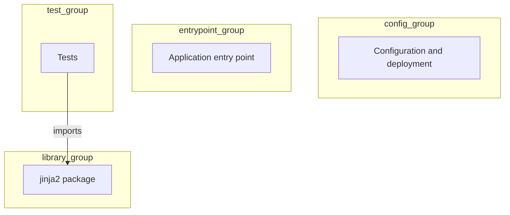

# Architecture report: pallets/jinja

> Automated static analysis. **Observed** = directly seen in files/imports/AST; **Inferred** = interpretation from that evidence. Repository code was not executed.

## 1. Repository at a glance

| Item | Value |
| --- | --- |
| Repository | pallets/jinja |
| Description | A very fast and expressive template engine. |
| Language | Python |
| Stars | 11817 |
| Licence | BSD-3-Clause |
| Analysed commit / branch | 5ef70112a1ff19c05324ff889dd30405b1002044 / main |
| Framework(s) | None detected |
| Files analysed | 105 |
| Components | 4 |

## 2. Architecture in one minute

pallets/jinja - A very fast and expressive template engine.. This repository was analysed statically from 105 file(s) (60 Python). Detected technologies (observed from imports/manifests): GitHub Actions, Poetry, pytest. Files are grouped into 4 component(s): Configuration and deployment, Application entry point, jinja2 package, Tests. Observed entry point(s): scripts/generate_identifier_pattern.py. Findings below distinguish observed facts from inferred interpretation.

## 3. High-level block diagram

## 4. Main components

### Configuration and deployment (`config`)

- **Kind:** config
- **Status:** Observed
- **Confidence:** 0.85
- **Responsibility:** Groups 1 file(s) under configuration and deployment (observed from repository paths and static analysis).
- **Paths:** `pyproject.toml`
- **Evidence:** [pyproject.toml](https://github.com/pallets/jinja/blob/5ef70112a1ff19c05324ff889dd30405b1002044/pyproject.toml)

### Application entry point (`entrypoint`)

- **Kind:** entrypoint
- **Status:** Observed
- **Confidence:** 0.85
- **Responsibility:** Groups 1 file(s) under application entry point (observed from repository paths and static analysis). Observed top-level functions: build_pattern, collapse_ranges, get_characters, main.
- **Paths:** `scripts/generate_identifier_pattern.py`
- **Evidence:** [scripts/generate_identifier_pattern.py:7](https://github.com/pallets/jinja/blob/5ef70112a1ff19c05324ff889dd30405b1002044/scripts/generate_identifier_pattern.py#L7)

### jinja2 package (`jinja2`)

- **Kind:** library
- **Status:** Observed
- **Confidence:** 0.85
- **Responsibility:** Groups 25 file(s) under jinja2 package (observed from repository paths and static analysis). Observed top-level classes: Add, And, Assign, AssignBlock, AsyncLoopContext, BaseLoader. Observed top-level functions: __getattr__, _describe_token_type, _dict_method_all, _environment_config_check, _failing_new, _gettext_alias.
- **Paths:** `src/jinja2/__init__.py`, `src/jinja2/_identifier.py`, `src/jinja2/async_utils.py`, `src/jinja2/bccache.py`, `src/jinja2/compiler.py`, `src/jinja2/constants.py`, `src/jinja2/debug.py`, `src/jinja2/defaults.py`, `src/jinja2/environment.py`, `src/jinja2/exceptions.py`, `src/jinja2/ext.py`, `src/jinja2/filters.py`, `src/jinja2/idtracking.py`, `src/jinja2/lexer.py`, `src/jinja2/loaders.py`, `src/jinja2/meta.py`, `src/jinja2/nativetypes.py`, `src/jinja2/nodes.py`, `src/jinja2/optimizer.py`, `src/jinja2/parser.py`, `src/jinja2/runtime.py`, `src/jinja2/sandbox.py`, `src/jinja2/tests.py`, `src/jinja2/utils.py`, `src/jinja2/visitor.py`
- **Evidence:** [src/jinja2/__init__.py:43](https://github.com/pallets/jinja/blob/5ef70112a1ff19c05324ff889dd30405b1002044/src/jinja2/__init__.py#L43); [src/jinja2/_identifier.py](https://github.com/pallets/jinja/blob/5ef70112a1ff19c05324ff889dd30405b1002044/src/jinja2/_identifier.py); [src/jinja2/async_utils.py:15](https://github.com/pallets/jinja/blob/5ef70112a1ff19c05324ff889dd30405b1002044/src/jinja2/async_utils.py#L15); [src/jinja2/bccache.py:44](https://github.com/pallets/jinja/blob/5ef70112a1ff19c05324ff889dd30405b1002044/src/jinja2/bccache.py#L44); [src/jinja2/compiler.py:45](https://github.com/pallets/jinja/blob/5ef70112a1ff19c05324ff889dd30405b1002044/src/jinja2/compiler.py#L45); [src/jinja2/constants.py](https://github.com/pallets/jinja/blob/5ef70112a1ff19c05324ff889dd30405b1002044/src/jinja2/constants.py); [src/jinja2/debug.py:14](https://github.com/pallets/jinja/blob/5ef70112a1ff19c05324ff889dd30405b1002044/src/jinja2/debug.py#L14); [src/jinja2/defaults.py](https://github.com/pallets/jinja/blob/5ef70112a1ff19c05324ff889dd30405b1002044/src/jinja2/defaults.py)

### Tests (`tests`)

- **Kind:** test
- **Status:** Observed
- **Confidence:** 0.85
- **Responsibility:** Groups 32 file(s) under tests (observed from repository paths and static analysis). Observed top-level classes: DerivedExampleExtension, ExampleExtension, Magic, Magic2, MockMemcached, MyDict. Observed top-level functions: _asyncio_run, _get_with_context, async_native_env, choice_loader, closing_factory, dict_loader.
- **Paths:** `examples/basic/test_filter_and_linestatements.py`, `examples/basic/test_loop_filter.py`, `tests/conftest.py`, `tests/res/__init__.py`, `tests/res/templates/broken.html`, `tests/res/templates/foo/test.html`, `tests/res/templates/mojibake.txt`, `tests/res/templates/syntaxerror.html`, `tests/res/templates/test.html`, `tests/res/templates2/foo`, `tests/test_api.py`, `tests/test_async.py`, `tests/test_async_filters.py`, `tests/test_bytecode_cache.py`, `tests/test_compile.py`, `tests/test_core_tags.py`, `tests/test_debug.py`, `tests/test_ext.py`, `tests/test_filters.py`, `tests/test_idtracking.py`, `tests/test_imports.py`, `tests/test_inheritance.py`, `tests/test_lexnparse.py`, `tests/test_loader.py`, `tests/test_nativetypes.py`, `tests/test_nodes.py`, `tests/test_pickle.py`, `tests/test_regression.py`, `tests/test_runtime.py`, `tests/test_security.py`, `tests/test_tests.py`, `tests/test_utils.py`
- **Evidence:** [examples/basic/test_filter_and_linestatements.py](https://github.com/pallets/jinja/blob/5ef70112a1ff19c05324ff889dd30405b1002044/examples/basic/test_filter_and_linestatements.py); [examples/basic/test_loop_filter.py](https://github.com/pallets/jinja/blob/5ef70112a1ff19c05324ff889dd30405b1002044/examples/basic/test_loop_filter.py); [tests/conftest.py:11](https://github.com/pallets/jinja/blob/5ef70112a1ff19c05324ff889dd30405b1002044/tests/conftest.py#L11); [tests/res/__init__.py](https://github.com/pallets/jinja/blob/5ef70112a1ff19c05324ff889dd30405b1002044/tests/res/__init__.py); [tests/res/templates/broken.html](https://github.com/pallets/jinja/blob/5ef70112a1ff19c05324ff889dd30405b1002044/tests/res/templates/broken.html); [tests/res/templates/foo/test.html](https://github.com/pallets/jinja/blob/5ef70112a1ff19c05324ff889dd30405b1002044/tests/res/templates/foo/test.html); [tests/res/templates/mojibake.txt](https://github.com/pallets/jinja/blob/5ef70112a1ff19c05324ff889dd30405b1002044/tests/res/templates/mojibake.txt); [tests/res/templates/syntaxerror.html](https://github.com/pallets/jinja/blob/5ef70112a1ff19c05324ff889dd30405b1002044/tests/res/templates/syntaxerror.html)

## 5. Execution flow

**Observed** entry point(s):

- [scripts/generate_identifier_pattern.py:72](https://github.com/pallets/jinja/blob/5ef70112a1ff19c05324ff889dd30405b1002044/scripts/generate_identifier_pattern.py#L72)

Representative flow (derived from observed entry points and the import graph; steps beyond the entry point are **Inferred**):

1. Execution starts at an observed entry point listed above, if present.
2. `tests` imports `jinja2` (Tests -> jinja2 package).

## 6. Project structure

### `(root)`

- `.editorconfig` - config (233 bytes)
- `.gitignore` - other (74 bytes)
- `.pre-commit-config.yaml` - config (629 bytes)
- `.readthedocs.yaml` - config (242 bytes)
- `CHANGES.rst` - docs (42983 bytes)
- `LICENSE.txt` - docs (1475 bytes)
- `README.md` - docs (1965 bytes)
- `pyproject.toml` - manifest (4567 bytes)

### `.devcontainer`

- `.devcontainer/devcontainer.json` - config (434 bytes)
- `.devcontainer/on-create-command.sh` - source, Shell (445 bytes)

### `.github`

- `.github/ISSUE_TEMPLATE/bug-report.md` - docs (615 bytes)
- `.github/ISSUE_TEMPLATE/config.yml` - config (332 bytes)
- `.github/ISSUE_TEMPLATE/feature-request.md` - docs (416 bytes)
- `.github/pull_request_template.md` - docs (822 bytes)
- `.github/workflows/lock.yaml` - ci, YAML (682 bytes)
- `.github/workflows/pre-commit.yaml` - ci, YAML (983 bytes)
- `.github/workflows/publish.yaml` - ci, YAML (1562 bytes)
- `.github/workflows/tests.yaml` - ci, YAML (1795 bytes)

### `docs`

- `docs/Makefile` - docs (581 bytes)
- `docs/_static/jinja-icon.svg` - docs (2727 bytes)
- `docs/_static/jinja-logo.svg` - docs (4990 bytes)
- `docs/_static/jinja-name.svg` - docs (7067 bytes)
- `docs/api.rst` - docs (30799 bytes)
- `docs/changes.rst` - docs (45 bytes)
- `docs/conf.py` - docs (1957 bytes)
- `docs/examples/cache_extension.py` - docs (2053 bytes)
- `docs/examples/inline_gettext_extension.py` - docs (2397 bytes)
- `docs/extensions.rst` - docs (13070 bytes)
- `docs/faq.rst` - docs (3376 bytes)
- `docs/index.rst` - docs (522 bytes)
- `docs/integration.rst` - docs (2754 bytes)
- `docs/intro.rst` - docs (1977 bytes)
- `docs/license.rst` - docs (98 bytes)
- `docs/make.bat` - docs (757 bytes)
- `docs/nativetypes.rst` - docs (1843 bytes)
- `docs/sandbox.rst` - docs (4184 bytes)
- `docs/switching.rst` - docs (4413 bytes)
- `docs/templates.rst` - docs (63165 bytes)
- `docs/tricks.rst` - docs (3168 bytes)

### `examples`

- `examples/basic/cycle.py` - source, Python (301 bytes)
- `examples/basic/debugger.py` - source, Python (223 bytes)
- `examples/basic/inheritance.py` - source, Python (392 bytes)
- `examples/basic/templates/broken.html` - other (124 bytes)
- `examples/basic/templates/subbroken.html` - other (64 bytes)
- `examples/basic/test.py` - source, Python (679 bytes)
- `examples/basic/test_filter_and_linestatements.py` - test, Python (456 bytes)
- `examples/basic/test_loop_filter.py` - test, Python (301 bytes)
- `examples/basic/translate.py` - source, Python (544 bytes)

### `scripts`

- `scripts/generate_identifier_pattern.py` - source, Python (2149 bytes)

### `src`

- `src/jinja2/__init__.py` - source, Python (2458 bytes)
- `src/jinja2/_identifier.py` - source, Python (2085 bytes)
- `src/jinja2/async_utils.py` - source, Python (2816 bytes)
- `src/jinja2/bccache.py` - source, Python (13986 bytes)
- `src/jinja2/compiler.py` - source, Python (73918 bytes)
- `src/jinja2/constants.py` - source, Python (1433 bytes)
- `src/jinja2/debug.py` - source, Python (5753 bytes)
- `src/jinja2/defaults.py` - source, Python (1255 bytes)
- `src/jinja2/environment.py` - source, Python (60847 bytes)
- `src/jinja2/exceptions.py` - source, Python (5026 bytes)
- `src/jinja2/ext.py` - source, Python (31109 bytes)
- `src/jinja2/filters.py` - source, Python (54599 bytes)
- `src/jinja2/idtracking.py` - source, Python (10490 bytes)
- `src/jinja2/lexer.py` - source, Python (29687 bytes)
- `src/jinja2/loaders.py` - source, Python (23709 bytes)
- `src/jinja2/meta.py` - source, Python (4382 bytes)
- `src/jinja2/nativetypes.py` - source, Python (4205 bytes)
- `src/jinja2/nodes.py` - source, Python (34189 bytes)
- `src/jinja2/optimizer.py` - source, Python (1646 bytes)
- `src/jinja2/parser.py` - source, Python (40095 bytes)
- `src/jinja2/py.typed` - other (0 bytes)
- `src/jinja2/runtime.py` - source, Python (34148 bytes)
- `src/jinja2/sandbox.py` - source, Python (14942 bytes)
- `src/jinja2/tests.py` - source, Python (5926 bytes)
- `src/jinja2/utils.py` - source, Python (24080 bytes)
- `src/jinja2/visitor.py` - source, Python (3550 bytes)

### `tests`

- `tests/conftest.py` - test, Python (1416 bytes)
- `tests/res/__init__.py` - test, Python (0 bytes)
- `tests/res/templates/broken.html` - test (26 bytes)
- `tests/res/templates/foo/test.html` - test (4 bytes)
- `tests/res/templates/mojibake.txt` - test (13 bytes)
- `tests/res/templates/syntaxerror.html` - test (47 bytes)
- `tests/res/templates/test.html` - test (4 bytes)
- `tests/res/templates2/foo` - test (99 bytes)
- `tests/test_api.py` - test, Python (16861 bytes)
- `tests/test_async.py` - test, Python (23791 bytes)
- `tests/test_async_filters.py` - test, Python (9130 bytes)
- `tests/test_bytecode_cache.py` - test, Python (1984 bytes)
- `tests/test_compile.py` - test, Python (3889 bytes)
- `tests/test_core_tags.py` - test, Python (20567 bytes)
- `tests/test_debug.py` - test, Python (3704 bytes)
- `tests/test_ext.py` - test, Python (26300 bytes)
- `tests/test_filters.py` - test, Python (32741 bytes)
- `tests/test_idtracking.py` - test, Python (8653 bytes)
- `tests/test_imports.py` - test, Python (7571 bytes)
- `tests/test_inheritance.py` - test, Python (13504 bytes)
- `tests/test_lexnparse.py` - test, Python (35458 bytes)
- `tests/test_loader.py` - test, Python (15606 bytes)
- `tests/test_nativetypes.py` - test, Python (4996 bytes)
- `tests/test_nodes.py` - test, Python (86 bytes)
- `tests/test_pickle.py` - test, Python (148 bytes)
- `tests/test_regression.py` - test, Python (22902 bytes)
- `tests/test_runtime.py` - test, Python (4172 bytes)
- `tests/test_security.py` - test, Python (7078 bytes)
- `tests/test_tests.py` - test, Python (7851 bytes)
- `tests/test_utils.py` - test, Python (6367 bytes)

## 7. Key dependencies and integrations

| Name | Category | Status | Confidence | Evidence |
| --- | --- | --- | --- | --- |
| GitHub Actions | ci | Observed | 0.90 | [.github/workflows/lock.yaml](https://github.com/pallets/jinja/blob/5ef70112a1ff19c05324ff889dd30405b1002044/.github/workflows/lock.yaml); [.github/workflows/pre-commit.yaml](https://github.com/pallets/jinja/blob/5ef70112a1ff19c05324ff889dd30405b1002044/.github/workflows/pre-commit.yaml); [.github/workflows/publish.yaml](https://github.com/pallets/jinja/blob/5ef70112a1ff19c05324ff889dd30405b1002044/.github/workflows/publish.yaml); [.github/workflows/tests.yaml](https://github.com/pallets/jinja/blob/5ef70112a1ff19c05324ff889dd30405b1002044/.github/workflows/tests.yaml) |
| Poetry | packaging | Observed | 0.85 | [pyproject.toml](https://github.com/pallets/jinja/blob/5ef70112a1ff19c05324ff889dd30405b1002044/pyproject.toml) |
| pytest | tooling | Observed | 0.95 | [tests/conftest.py:4](https://github.com/pallets/jinja/blob/5ef70112a1ff19c05324ff889dd30405b1002044/tests/conftest.py#L4); [tests/test_api.py:5](https://github.com/pallets/jinja/blob/5ef70112a1ff19c05324ff889dd30405b1002044/tests/test_api.py#L5); [tests/test_async.py:1](https://github.com/pallets/jinja/blob/5ef70112a1ff19c05324ff889dd30405b1002044/tests/test_async.py#L1); [tests/test_async_filters.py:4](https://github.com/pallets/jinja/blob/5ef70112a1ff19c05324ff889dd30405b1002044/tests/test_async_filters.py#L4) |

## 8. Data and state

No database, cache, queue, or persistent-state usage was observed in the analysed files. State handling, if any, may be in-memory or in files that were not analysed.

## 9. Configuration and deployment clues

- `.devcontainer/devcontainer.json` (config)
- `.editorconfig` (config)
- `.github/ISSUE_TEMPLATE/config.yml` (config)
- `.github/workflows/lock.yaml` (ci)
- `.github/workflows/pre-commit.yaml` (ci)
- `.github/workflows/publish.yaml` (ci)
- `.github/workflows/tests.yaml` (ci)
- `.pre-commit-config.yaml` (config)
- `.readthedocs.yaml` (config)
- `pyproject.toml` (manifest)

## 10. Design observations

- An entry/API layer is separated from other code (Inferred from paths and decorators).
- Tests are present alongside source code (Observed from test file paths).

These observations are interpretations (**Inferred**) of the observed structure, not guarantees about runtime design.

## 11. Limitations and unknowns

- Static analysis only: repository code was not executed, installed, or imported at runtime.
- Components and relationships are inferred from file paths, imports, and AST structure; runtime behaviour, dynamic imports, and reflection may not be visible.
- 1 file(s) were skipped during inventory (1 x lockfile excluded).
- Repository text was treated as untrusted data; no instructions found in repository files were followed, and likely secret values were redacted/excluded.

## 12. Source references

- [.github/workflows/lock.yaml](https://github.com/pallets/jinja/blob/5ef70112a1ff19c05324ff889dd30405b1002044/.github/workflows/lock.yaml)
- [.github/workflows/pre-commit.yaml](https://github.com/pallets/jinja/blob/5ef70112a1ff19c05324ff889dd30405b1002044/.github/workflows/pre-commit.yaml)
- [.github/workflows/publish.yaml](https://github.com/pallets/jinja/blob/5ef70112a1ff19c05324ff889dd30405b1002044/.github/workflows/publish.yaml)
- [.github/workflows/tests.yaml](https://github.com/pallets/jinja/blob/5ef70112a1ff19c05324ff889dd30405b1002044/.github/workflows/tests.yaml)
- [examples/basic/test_filter_and_linestatements.py](https://github.com/pallets/jinja/blob/5ef70112a1ff19c05324ff889dd30405b1002044/examples/basic/test_filter_and_linestatements.py)
- [examples/basic/test_loop_filter.py](https://github.com/pallets/jinja/blob/5ef70112a1ff19c05324ff889dd30405b1002044/examples/basic/test_loop_filter.py)
- [pyproject.toml](https://github.com/pallets/jinja/blob/5ef70112a1ff19c05324ff889dd30405b1002044/pyproject.toml)
- [scripts/generate_identifier_pattern.py:7](https://github.com/pallets/jinja/blob/5ef70112a1ff19c05324ff889dd30405b1002044/scripts/generate_identifier_pattern.py#L7)
- [scripts/generate_identifier_pattern.py:72](https://github.com/pallets/jinja/blob/5ef70112a1ff19c05324ff889dd30405b1002044/scripts/generate_identifier_pattern.py#L72)
- [src/jinja2/__init__.py:43](https://github.com/pallets/jinja/blob/5ef70112a1ff19c05324ff889dd30405b1002044/src/jinja2/__init__.py#L43)
- [src/jinja2/_identifier.py](https://github.com/pallets/jinja/blob/5ef70112a1ff19c05324ff889dd30405b1002044/src/jinja2/_identifier.py)
- [src/jinja2/async_utils.py:15](https://github.com/pallets/jinja/blob/5ef70112a1ff19c05324ff889dd30405b1002044/src/jinja2/async_utils.py#L15)
- [src/jinja2/bccache.py:44](https://github.com/pallets/jinja/blob/5ef70112a1ff19c05324ff889dd30405b1002044/src/jinja2/bccache.py#L44)
- [src/jinja2/compiler.py:45](https://github.com/pallets/jinja/blob/5ef70112a1ff19c05324ff889dd30405b1002044/src/jinja2/compiler.py#L45)
- [src/jinja2/constants.py](https://github.com/pallets/jinja/blob/5ef70112a1ff19c05324ff889dd30405b1002044/src/jinja2/constants.py)
- [src/jinja2/debug.py:14](https://github.com/pallets/jinja/blob/5ef70112a1ff19c05324ff889dd30405b1002044/src/jinja2/debug.py#L14)
- [src/jinja2/defaults.py](https://github.com/pallets/jinja/blob/5ef70112a1ff19c05324ff889dd30405b1002044/src/jinja2/defaults.py)
- [tests/conftest.py:4](https://github.com/pallets/jinja/blob/5ef70112a1ff19c05324ff889dd30405b1002044/tests/conftest.py#L4)
- [tests/conftest.py:11](https://github.com/pallets/jinja/blob/5ef70112a1ff19c05324ff889dd30405b1002044/tests/conftest.py#L11)
- [tests/res/__init__.py](https://github.com/pallets/jinja/blob/5ef70112a1ff19c05324ff889dd30405b1002044/tests/res/__init__.py)
- [tests/res/templates/broken.html](https://github.com/pallets/jinja/blob/5ef70112a1ff19c05324ff889dd30405b1002044/tests/res/templates/broken.html)
- [tests/res/templates/foo/test.html](https://github.com/pallets/jinja/blob/5ef70112a1ff19c05324ff889dd30405b1002044/tests/res/templates/foo/test.html)
- [tests/res/templates/mojibake.txt](https://github.com/pallets/jinja/blob/5ef70112a1ff19c05324ff889dd30405b1002044/tests/res/templates/mojibake.txt)
- [tests/res/templates/syntaxerror.html](https://github.com/pallets/jinja/blob/5ef70112a1ff19c05324ff889dd30405b1002044/tests/res/templates/syntaxerror.html)
- [tests/test_api.py:5](https://github.com/pallets/jinja/blob/5ef70112a1ff19c05324ff889dd30405b1002044/tests/test_api.py#L5)
- [tests/test_async.py:1](https://github.com/pallets/jinja/blob/5ef70112a1ff19c05324ff889dd30405b1002044/tests/test_async.py#L1)
- [tests/test_async_filters.py:4](https://github.com/pallets/jinja/blob/5ef70112a1ff19c05324ff889dd30405b1002044/tests/test_async_filters.py#L4)
- [tests/test_bytecode_cache.py:1](https://github.com/pallets/jinja/blob/5ef70112a1ff19c05324ff889dd30405b1002044/tests/test_bytecode_cache.py#L1)
- [tests/test_compile.py:4](https://github.com/pallets/jinja/blob/5ef70112a1ff19c05324ff889dd30405b1002044/tests/test_compile.py#L4)
- [tests/test_core_tags.py:1](https://github.com/pallets/jinja/blob/5ef70112a1ff19c05324ff889dd30405b1002044/tests/test_core_tags.py#L1)
- [tests/test_debug.py:5](https://github.com/pallets/jinja/blob/5ef70112a1ff19c05324ff889dd30405b1002044/tests/test_debug.py#L5)
