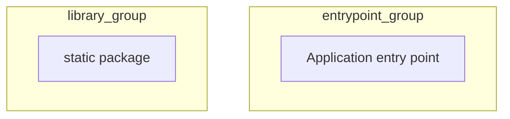

# Architecture report: paperswithbacktest/awesome-systematic-trading

> Automated static analysis. **Observed** = directly seen in files/imports/AST; **Inferred** = interpretation from that evidence. Repository code was not executed.

## 1. Repository at a glance

| Item | Value |
| --- | --- |
| Repository | paperswithbacktest/awesome-systematic-trading |
| Description | A curated list of awesome libraries, packages, strategies, books, blogs, tutorials for systematic trading. |
| Language | Python |
| Stars | 15359 |
| Licence | Not detected |
| Analysed commit / branch | ddfee8bb548bd6914191cb8fdb695d533ae16b0d / main |
| Framework(s) | None detected |
| Files analysed | 71 |
| Components | 2 |

## 2. Architecture in one minute

paperswithbacktest/awesome-systematic-trading - A curated list of awesome libraries, packages, strategies, books, blogs, tutorials for systematic trading.. This repository was analysed statically from 71 file(s) (63 Python). Detected technologies (observed from imports/manifests): GitHub Actions, NumPy, pandas. Files are grouped into 2 component(s): Application entry point, static package. Observed entry point(s): scripts/build_strategies_table.py, scripts/check_links.py, scripts/update_counts.py. Findings below distinguish observed facts from inferred interpretation.

## 3. High-level block diagram

## 4. Main components

### Application entry point (`entrypoint`)

- **Kind:** entrypoint
- **Status:** Observed
- **Confidence:** 0.85
- **Responsibility:** Groups 3 file(s) under application entry point (observed from repository paths and static analysis). Observed top-level functions: active_window, asset_bucket, classify, clean_title, count, fetch.
- **Paths:** `scripts/build_strategies_table.py`, `scripts/check_links.py`, `scripts/update_counts.py`
- **Evidence:** [scripts/build_strategies_table.py:98](https://github.com/paperswithbacktest/awesome-systematic-trading/blob/ddfee8bb548bd6914191cb8fdb695d533ae16b0d/scripts/build_strategies_table.py#L98); [scripts/check_links.py:26](https://github.com/paperswithbacktest/awesome-systematic-trading/blob/ddfee8bb548bd6914191cb8fdb695d533ae16b0d/scripts/check_links.py#L26); [scripts/update_counts.py:80](https://github.com/paperswithbacktest/awesome-systematic-trading/blob/ddfee8bb548bd6914191cb8fdb695d533ae16b0d/scripts/update_counts.py#L80)

### static package (`static`)

- **Kind:** library
- **Status:** Observed
- **Confidence:** 0.85
- **Responsibility:** Groups 60 file(s) under static package (observed from repository paths and static analysis). Observed top-level classes: AccrualAnomaly, AccrualsData, AcrrualsData, AssetClassTrendFollowing, AssetGrowthEffect, BettingAgainstBetaFactorinInternationalEquities. Observed top-level functions: MonthDiff, MultipleLinearRegression, Return, Volatility.
- **Paths:** `static/strategies/12-month-cycle-in-cross-section-of-stocks-returns.py`, `static/strategies/52-weeks-high-effect-in-stocks.py`, `static/strategies/accrual-anomaly.py`, `static/strategies/asset-class-momentum-rotational-system.py`, `static/strategies/asset-class-trend-following.py`, `static/strategies/asset-growth-effect.py`, `static/strategies/betting-against-beta-factor-in-country-equity-indexes.py`, `static/strategies/betting-against-beta-factor-in-stocks.py`, `static/strategies/combining-fundamental-fscore-and-equity-short-term-reversals.py`, `static/strategies/combining-smart-factors-momentum-and-market-portfolio.py`, `static/strategies/consistent-momentum-strategy.py`, `static/strategies/crude-oil-predicts-equity-returns.py`, `static/strategies/currency-momentum-factor.py`, `static/strategies/currency-value-factor-ppp-strategy.py`, `static/strategies/dispersion-trading.py`, `static/strategies/dollar-carry-trade.py`, `static/strategies/earnings-announcement-premium.py`, `static/strategies/earnings-announcements-combined-with-stock-repurchases.py`, `static/strategies/earnings-quality-factor.py`, `static/strategies/esg-factor-momentum-strategy.py`, `static/strategies/fed-model.py`, `static/strategies/fx-carry-trade.py`, `static/strategies/how-to-use-lexical-density-of-company-filings.py`, `static/strategies/intraday-seasonality-in-bitcoin.py`, `static/strategies/january-barometer.py`, `static/strategies/low-volatility-factor-effect-in-stocks.py`, `static/strategies/market-sentiment-and-an-overnight-anomaly.py`, `static/strategies/momentum-and-reversal-combined-with-volatility-effect-in-stocks.py`, `static/strategies/momentum-effect-in-commodities.py`, `static/strategies/momentum-factor-and-style-rotation-effect.py`, `static/strategies/momentum-factor-combined-with-asset-growth-effect.py`, `static/strategies/momentum-factor-effect-in-stocks.py`, `static/strategies/momentum-in-mutual-fund-returns.py`, `static/strategies/option-expiration-week-effect.py`, `static/strategies/paired-switching.py`, `static/strategies/pairs-trading-with-country-etfs.py`, `static/strategies/payday-anomaly.py`, `static/strategies/rd-expenditures-and-stock-returns.py`, `static/strategies/rebalancing-premium-in-cryptocurrencies.py`, `static/strategies/residual-momentum-factor.py`, `static/strategies/return-asymmetry-effect-in-commodity-futures.py`, `static/strategies/reversal-during-earnings-announcements.py`, `static/strategies/roa-effect-within-stocks.py`, `static/strategies/sector-momentum-rotational-system.py`, `static/strategies/short-interest-effect-long-short-version.py`, `static/strategies/short-term-reversal-in-stocks.py`, `static/strategies/short-term-reversal-with-futures.py`, `static/strategies/skewness-effect-in-commodities.py`, `static/strategies/small-capitalization-stocks-premium-anomaly.py`, `static/strategies/soccer-clubs-stocks-arbitrage.py`, `static/strategies/synthetic-lending-rates-predict-subsequent-market-return.py`, `static/strategies/term-structure-effect-in-commodities.py`, `static/strategies/time-series-momentum-effect.py`, `static/strategies/trading-wti-brent-spread.py`, `static/strategies/trend-following-effect-in-stocks.py`, `static/strategies/turn-of-the-month-in-equity-indexes.py`, `static/strategies/value-and-momentum-factors-across-asset-classes.py`, `static/strategies/value-book-to-market-factor.py`, `static/strategies/value-factor-effect-within-countries.py`, `static/strategies/volatility-risk-premium-effect.py`
- **Evidence:** [static/strategies/12-month-cycle-in-cross-section-of-stocks-returns.py:13](https://github.com/paperswithbacktest/awesome-systematic-trading/blob/ddfee8bb548bd6914191cb8fdb695d533ae16b0d/static/strategies/12-month-cycle-in-cross-section-of-stocks-returns.py#L13); [static/strategies/52-weeks-high-effect-in-stocks.py:18](https://github.com/paperswithbacktest/awesome-systematic-trading/blob/ddfee8bb548bd6914191cb8fdb695d533ae16b0d/static/strategies/52-weeks-high-effect-in-stocks.py#L18); [static/strategies/accrual-anomaly.py:17](https://github.com/paperswithbacktest/awesome-systematic-trading/blob/ddfee8bb548bd6914191cb8fdb695d533ae16b0d/static/strategies/accrual-anomaly.py#L17); [static/strategies/asset-class-momentum-rotational-system.py:12](https://github.com/paperswithbacktest/awesome-systematic-trading/blob/ddfee8bb548bd6914191cb8fdb695d533ae16b0d/static/strategies/asset-class-momentum-rotational-system.py#L12); [static/strategies/asset-class-trend-following.py:15](https://github.com/paperswithbacktest/awesome-systematic-trading/blob/ddfee8bb548bd6914191cb8fdb695d533ae16b0d/static/strategies/asset-class-trend-following.py#L15); [static/strategies/asset-growth-effect.py:13](https://github.com/paperswithbacktest/awesome-systematic-trading/blob/ddfee8bb548bd6914191cb8fdb695d533ae16b0d/static/strategies/asset-growth-effect.py#L13); [static/strategies/betting-against-beta-factor-in-country-equity-indexes.py:14](https://github.com/paperswithbacktest/awesome-systematic-trading/blob/ddfee8bb548bd6914191cb8fdb695d533ae16b0d/static/strategies/betting-against-beta-factor-in-country-equity-indexes.py#L14); [static/strategies/betting-against-beta-factor-in-stocks.py:16](https://github.com/paperswithbacktest/awesome-systematic-trading/blob/ddfee8bb548bd6914191cb8fdb695d533ae16b0d/static/strategies/betting-against-beta-factor-in-stocks.py#L16)

## 5. Execution flow

**Observed** entry point(s):

- [scripts/build_strategies_table.py:234](https://github.com/paperswithbacktest/awesome-systematic-trading/blob/ddfee8bb548bd6914191cb8fdb695d533ae16b0d/scripts/build_strategies_table.py#L234)
- [scripts/check_links.py:96](https://github.com/paperswithbacktest/awesome-systematic-trading/blob/ddfee8bb548bd6914191cb8fdb695d533ae16b0d/scripts/check_links.py#L96)
- [scripts/update_counts.py:139](https://github.com/paperswithbacktest/awesome-systematic-trading/blob/ddfee8bb548bd6914191cb8fdb695d533ae16b0d/scripts/update_counts.py#L139)

Representative flow (derived from observed entry points and the import graph; steps beyond the entry point are **Inferred**):

1. Execution starts at an observed entry point listed above, if present.
2. No internal import relationships between components were observed.

## 6. Project structure

### `(root)`

- `.gitignore` - other (9 bytes)
- `README.md` - docs (92960 bytes)
- `README_ja.md` - docs (113057 bytes)
- `README_zh.md` - docs (81536 bytes)

### `.github`

- `.github/workflows/link-check.yml` - ci, YAML (1700 bytes)

### `.vscode`

- `.vscode/launch.json` - config (371 bytes)
- `.vscode/settings.json` - config (110 bytes)

### `scripts`

- `scripts/build_strategies_table.py` - source, Python (9221 bytes)
- `scripts/check_links.py` - source, Python (3104 bytes)
- `scripts/update_counts.py` - source, Python (5132 bytes)

### `static`

- `static/strategies/12-month-cycle-in-cross-section-of-stocks-returns.py` - source, Python (6242 bytes)
- `static/strategies/52-weeks-high-effect-in-stocks.py` - source, Python (8438 bytes)
- `static/strategies/accrual-anomaly.py` - source, Python (7511 bytes)
- `static/strategies/asset-class-momentum-rotational-system.py` - source, Python (1685 bytes)
- `static/strategies/asset-class-trend-following.py` - source, Python (1789 bytes)
- `static/strategies/asset-growth-effect.py` - source, Python (4674 bytes)
- `static/strategies/betting-against-beta-factor-in-country-equity-indexes.py` - source, Python (6537 bytes)
- `static/strategies/betting-against-beta-factor-in-stocks.py` - source, Python (7250 bytes)
- `static/strategies/combining-fundamental-fscore-and-equity-short-term-reversals.py` - source, Python (12570 bytes)
- `static/strategies/combining-smart-factors-momentum-and-market-portfolio.py` - source, Python (9285 bytes)
- `static/strategies/consistent-momentum-strategy.py` - source, Python (6510 bytes)
- `static/strategies/crude-oil-predicts-equity-returns.py` - source, Python (16384 bytes)
- `static/strategies/currency-momentum-factor.py` - source, Python (3956 bytes)
- `static/strategies/currency-value-factor-ppp-strategy.py` - source, Python (5086 bytes)
- `static/strategies/dispersion-trading.py` - source, Python (7359 bytes)
- `static/strategies/dollar-carry-trade.py` - source, Python (5073 bytes)
- `static/strategies/earnings-announcement-premium.py` - source, Python (8486 bytes)
- `static/strategies/earnings-announcements-combined-with-stock-repurchases.py` - source, Python (8417 bytes)
- `static/strategies/earnings-quality-factor.py` - source, Python (11502 bytes)
- `static/strategies/esg-factor-momentum-strategy.py` - source, Python (8889 bytes)
- `static/strategies/fed-model.py` - source, Python (5506 bytes)
- `static/strategies/fx-carry-trade.py` - source, Python (4776 bytes)
- `static/strategies/how-to-use-lexical-density-of-company-filings.py` - source, Python (10467 bytes)
- `static/strategies/intraday-seasonality-in-bitcoin.py` - source, Python (1788 bytes)
- `static/strategies/january-barometer.py` - source, Python (2076 bytes)
- `static/strategies/low-volatility-factor-effect-in-stocks.py` - source, Python (4866 bytes)
- `static/strategies/market-sentiment-and-an-overnight-anomaly.py` - source, Python (4367 bytes)
- `static/strategies/momentum-and-reversal-combined-with-volatility-effect-in-stocks.py` - source, Python (8902 bytes)
- `static/strategies/momentum-effect-in-commodities.py` - source, Python (5491 bytes)
- `static/strategies/momentum-factor-and-style-rotation-effect.py` - source, Python (2988 bytes)
- `static/strategies/momentum-factor-combined-with-asset-growth-effect.py` - source, Python (8965 bytes)
- `static/strategies/momentum-factor-effect-in-stocks.py` - source, Python (4886 bytes)
- `static/strategies/momentum-in-mutual-fund-returns.py` - source, Python (4757 bytes)
- `static/strategies/option-expiration-week-effect.py` - source, Python (1387 bytes)
- `static/strategies/paired-switching.py` - source, Python (2900 bytes)
- `static/strategies/pairs-trading-with-country-etfs.py` - source, Python (9680 bytes)
- `static/strategies/pairs-trading-with-stocks` - other (8920 bytes)
- `static/strategies/payday-anomaly.py` - source, Python (1591 bytes)
- `static/strategies/rd-expenditures-and-stock-returns.py` - source, Python (6834 bytes)
- `static/strategies/rebalancing-premium-in-cryptocurrencies.py` - source, Python (5508 bytes)
- `static/strategies/residual-momentum-factor.py` - source, Python (11702 bytes)
- `static/strategies/return-asymmetry-effect-in-commodity-futures.py` - source, Python (8390 bytes)
- `static/strategies/reversal-during-earnings-announcements.py` - source, Python (9702 bytes)
- `static/strategies/roa-effect-within-stocks.py` - source, Python (4835 bytes)
- `static/strategies/sector-momentum-rotational-system.py` - source, Python (2858 bytes)
- `static/strategies/short-interest-effect-long-short-version.py` - source, Python (4827 bytes)
- `static/strategies/short-term-reversal-in-stocks.py` - source, Python (5944 bytes)
- `static/strategies/short-term-reversal-with-futures.py` - source, Python (12454 bytes)
- `static/strategies/skewness-effect-in-commodities.py` - source, Python (6608 bytes)
- `static/strategies/small-capitalization-stocks-premium-anomaly.py` - source, Python (3452 bytes)
- `static/strategies/soccer-clubs-stocks-arbitrage.py` - source, Python (3392 bytes)
- `static/strategies/synthetic-lending-rates-predict-subsequent-market-return.py` - source, Python (3298 bytes)
- `static/strategies/term-structure-effect-in-commodities.py` - source, Python (8320 bytes)
- `static/strategies/time-series-momentum-effect.py` - source, Python (10850 bytes)
- `static/strategies/trading-wti-brent-spread.py` - source, Python (3508 bytes)
- `static/strategies/trend-following-effect-in-stocks.py` - source, Python (5122 bytes)
- `static/strategies/turn-of-the-month-in-equity-indexes.py` - source, Python (1147 bytes)
- `static/strategies/value-and-momentum-factors-across-asset-classes.py` - source, Python (14383 bytes)
- `static/strategies/value-book-to-market-factor.py` - source, Python (3723 bytes)
- `static/strategies/value-factor-effect-within-countries.py` - source, Python (6877 bytes)
- `static/strategies/volatility-risk-premium-effect.py` - source, Python (3569 bytes)

## 7. Key dependencies and integrations

| Name | Category | Status | Confidence | Evidence |
| --- | --- | --- | --- | --- |
| GitHub Actions | ci | Observed | 0.85 | [.github/workflows/link-check.yml](https://github.com/paperswithbacktest/awesome-systematic-trading/blob/ddfee8bb548bd6914191cb8fdb695d533ae16b0d/.github/workflows/link-check.yml) |
| NumPy | library | Observed | 0.95 | [scripts/build_strategies_table.py:18](https://github.com/paperswithbacktest/awesome-systematic-trading/blob/ddfee8bb548bd6914191cb8fdb695d533ae16b0d/scripts/build_strategies_table.py#L18); [static/strategies/52-weeks-high-effect-in-stocks.py:15](https://github.com/paperswithbacktest/awesome-systematic-trading/blob/ddfee8bb548bd6914191cb8fdb695d533ae16b0d/static/strategies/52-weeks-high-effect-in-stocks.py#L15); [static/strategies/betting-against-beta-factor-in-country-equity-indexes.py:10](https://github.com/paperswithbacktest/awesome-systematic-trading/blob/ddfee8bb548bd6914191cb8fdb695d533ae16b0d/static/strategies/betting-against-beta-factor-in-country-equity-indexes.py#L10); [static/strategies/betting-against-beta-factor-in-stocks.py:14](https://github.com/paperswithbacktest/awesome-systematic-trading/blob/ddfee8bb548bd6914191cb8fdb695d533ae16b0d/static/strategies/betting-against-beta-factor-in-stocks.py#L14) |
| pandas | library | Observed | 0.95 | [scripts/build_strategies_table.py:19](https://github.com/paperswithbacktest/awesome-systematic-trading/blob/ddfee8bb548bd6914191cb8fdb695d533ae16b0d/scripts/build_strategies_table.py#L19); [static/strategies/time-series-momentum-effect.py:16](https://github.com/paperswithbacktest/awesome-systematic-trading/blob/ddfee8bb548bd6914191cb8fdb695d533ae16b0d/static/strategies/time-series-momentum-effect.py#L16) |

## 8. Data and state

No database, cache, queue, or persistent-state usage was observed in the analysed files. State handling, if any, may be in-memory or in files that were not analysed.

## 9. Configuration and deployment clues

- `.github/workflows/link-check.yml` (ci)
- `.vscode/launch.json` (config)
- `.vscode/settings.json` (config)

## 10. Design observations

- An entry/API layer is separated from other code (Inferred from paths and decorators).

These observations are interpretations (**Inferred**) of the observed structure, not guarantees about runtime design.

## 11. Limitations and unknowns

- Static analysis only: repository code was not executed, installed, or imported at runtime.
- Components and relationships are inferred from file paths, imports, and AST structure; runtime behaviour, dynamic imports, and reflection may not be visible.
- Repository text was treated as untrusted data; no instructions found in repository files were followed, and likely secret values were redacted/excluded.

## 12. Source references

- [.github/workflows/link-check.yml](https://github.com/paperswithbacktest/awesome-systematic-trading/blob/ddfee8bb548bd6914191cb8fdb695d533ae16b0d/.github/workflows/link-check.yml)
- [scripts/build_strategies_table.py:18](https://github.com/paperswithbacktest/awesome-systematic-trading/blob/ddfee8bb548bd6914191cb8fdb695d533ae16b0d/scripts/build_strategies_table.py#L18)
- [scripts/build_strategies_table.py:19](https://github.com/paperswithbacktest/awesome-systematic-trading/blob/ddfee8bb548bd6914191cb8fdb695d533ae16b0d/scripts/build_strategies_table.py#L19)
- [scripts/build_strategies_table.py:98](https://github.com/paperswithbacktest/awesome-systematic-trading/blob/ddfee8bb548bd6914191cb8fdb695d533ae16b0d/scripts/build_strategies_table.py#L98)
- [scripts/build_strategies_table.py:234](https://github.com/paperswithbacktest/awesome-systematic-trading/blob/ddfee8bb548bd6914191cb8fdb695d533ae16b0d/scripts/build_strategies_table.py#L234)
- [scripts/check_links.py:26](https://github.com/paperswithbacktest/awesome-systematic-trading/blob/ddfee8bb548bd6914191cb8fdb695d533ae16b0d/scripts/check_links.py#L26)
- [scripts/check_links.py:96](https://github.com/paperswithbacktest/awesome-systematic-trading/blob/ddfee8bb548bd6914191cb8fdb695d533ae16b0d/scripts/check_links.py#L96)
- [scripts/update_counts.py:80](https://github.com/paperswithbacktest/awesome-systematic-trading/blob/ddfee8bb548bd6914191cb8fdb695d533ae16b0d/scripts/update_counts.py#L80)
- [scripts/update_counts.py:139](https://github.com/paperswithbacktest/awesome-systematic-trading/blob/ddfee8bb548bd6914191cb8fdb695d533ae16b0d/scripts/update_counts.py#L139)
- [static/strategies/12-month-cycle-in-cross-section-of-stocks-returns.py:13](https://github.com/paperswithbacktest/awesome-systematic-trading/blob/ddfee8bb548bd6914191cb8fdb695d533ae16b0d/static/strategies/12-month-cycle-in-cross-section-of-stocks-returns.py#L13)
- [static/strategies/52-weeks-high-effect-in-stocks.py:15](https://github.com/paperswithbacktest/awesome-systematic-trading/blob/ddfee8bb548bd6914191cb8fdb695d533ae16b0d/static/strategies/52-weeks-high-effect-in-stocks.py#L15)
- [static/strategies/52-weeks-high-effect-in-stocks.py:18](https://github.com/paperswithbacktest/awesome-systematic-trading/blob/ddfee8bb548bd6914191cb8fdb695d533ae16b0d/static/strategies/52-weeks-high-effect-in-stocks.py#L18)
- [static/strategies/accrual-anomaly.py:17](https://github.com/paperswithbacktest/awesome-systematic-trading/blob/ddfee8bb548bd6914191cb8fdb695d533ae16b0d/static/strategies/accrual-anomaly.py#L17)
- [static/strategies/asset-class-momentum-rotational-system.py:12](https://github.com/paperswithbacktest/awesome-systematic-trading/blob/ddfee8bb548bd6914191cb8fdb695d533ae16b0d/static/strategies/asset-class-momentum-rotational-system.py#L12)
- [static/strategies/asset-class-trend-following.py:15](https://github.com/paperswithbacktest/awesome-systematic-trading/blob/ddfee8bb548bd6914191cb8fdb695d533ae16b0d/static/strategies/asset-class-trend-following.py#L15)
- [static/strategies/asset-growth-effect.py:13](https://github.com/paperswithbacktest/awesome-systematic-trading/blob/ddfee8bb548bd6914191cb8fdb695d533ae16b0d/static/strategies/asset-growth-effect.py#L13)
- [static/strategies/betting-against-beta-factor-in-country-equity-indexes.py:10](https://github.com/paperswithbacktest/awesome-systematic-trading/blob/ddfee8bb548bd6914191cb8fdb695d533ae16b0d/static/strategies/betting-against-beta-factor-in-country-equity-indexes.py#L10)
- [static/strategies/betting-against-beta-factor-in-country-equity-indexes.py:14](https://github.com/paperswithbacktest/awesome-systematic-trading/blob/ddfee8bb548bd6914191cb8fdb695d533ae16b0d/static/strategies/betting-against-beta-factor-in-country-equity-indexes.py#L14)
- [static/strategies/betting-against-beta-factor-in-stocks.py:14](https://github.com/paperswithbacktest/awesome-systematic-trading/blob/ddfee8bb548bd6914191cb8fdb695d533ae16b0d/static/strategies/betting-against-beta-factor-in-stocks.py#L14)
- [static/strategies/betting-against-beta-factor-in-stocks.py:16](https://github.com/paperswithbacktest/awesome-systematic-trading/blob/ddfee8bb548bd6914191cb8fdb695d533ae16b0d/static/strategies/betting-against-beta-factor-in-stocks.py#L16)
- [static/strategies/combining-fundamental-fscore-and-equity-short-term-reversals.py:3](https://github.com/paperswithbacktest/awesome-systematic-trading/blob/ddfee8bb548bd6914191cb8fdb695d533ae16b0d/static/strategies/combining-fundamental-fscore-and-equity-short-term-reversals.py#L3)
- [static/strategies/combining-smart-factors-momentum-and-market-portfolio.py:19](https://github.com/paperswithbacktest/awesome-systematic-trading/blob/ddfee8bb548bd6914191cb8fdb695d533ae16b0d/static/strategies/combining-smart-factors-momentum-and-market-portfolio.py#L19)
- [static/strategies/crude-oil-predicts-equity-returns.py:3](https://github.com/paperswithbacktest/awesome-systematic-trading/blob/ddfee8bb548bd6914191cb8fdb695d533ae16b0d/static/strategies/crude-oil-predicts-equity-returns.py#L3)
- [static/strategies/crude-oil-predicts-equity-returns.py:301](https://github.com/paperswithbacktest/awesome-systematic-trading/blob/ddfee8bb548bd6914191cb8fdb695d533ae16b0d/static/strategies/crude-oil-predicts-equity-returns.py#L301)
- [static/strategies/time-series-momentum-effect.py:16](https://github.com/paperswithbacktest/awesome-systematic-trading/blob/ddfee8bb548bd6914191cb8fdb695d533ae16b0d/static/strategies/time-series-momentum-effect.py#L16)
