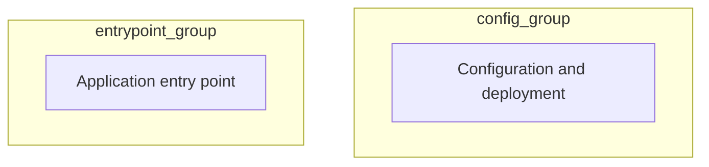

# Architecture report: petergyang/no-ai-slop

> Automated static analysis. **Observed** = directly seen in files/imports/AST; **Inferred** = interpretation from that evidence. Repository code was not executed.

## 1. Repository at a glance

| Item | Value |
| --- | --- |
| Repository | petergyang/no-ai-slop |
| Description | Removes 20+ patterns of AI slop from any piece of writing. |
| Language | Python |
| Stars | 13498 |
| Licence | MIT |
| Analysed commit / branch | 000650b156983f5159695b441477f4e63b25dc85 / main |
| Framework(s) | None detected |
| Files analysed | 13 |
| Components | 2 |

## 2. Architecture in one minute

petergyang/no-ai-slop - Removes 20+ patterns of AI slop from any piece of writing.. This repository was analysed statically from 13 file(s) (1 Python). Detected technologies (observed from imports/manifests): GitHub Actions. Files are grouped into 2 component(s): Configuration and deployment, Application entry point. Observed entry point(s): scripts/build_plugin.py. Findings below distinguish observed facts from inferred interpretation.

## 3. High-level block diagram

## 4. Main components

### Configuration and deployment (`config`)

- **Kind:** config
- **Status:** Observed
- **Confidence:** 0.85
- **Responsibility:** Groups 2 file(s) under configuration and deployment (observed from repository paths and static analysis).
- **Paths:** `agents/openai.yaml`, `skills/no-ai-slop/agents/openai.yaml`
- **Evidence:** [agents/openai.yaml](https://github.com/petergyang/no-ai-slop/blob/000650b156983f5159695b441477f4e63b25dc85/agents/openai.yaml); [skills/no-ai-slop/agents/openai.yaml](https://github.com/petergyang/no-ai-slop/blob/000650b156983f5159695b441477f4e63b25dc85/skills/no-ai-slop/agents/openai.yaml)

### Application entry point (`entrypoint`)

- **Kind:** entrypoint
- **Status:** Observed
- **Confidence:** 0.85
- **Responsibility:** Groups 1 file(s) under application entry point (observed from repository paths and static analysis). Observed top-level functions: build_plugin, main, parse_args, validate_build, validate_source.
- **Paths:** `scripts/build_plugin.py`
- **Evidence:** [scripts/build_plugin.py:19](https://github.com/petergyang/no-ai-slop/blob/000650b156983f5159695b441477f4e63b25dc85/scripts/build_plugin.py#L19)

## 5. Execution flow

**Observed** entry point(s):

- [scripts/build_plugin.py:126](https://github.com/petergyang/no-ai-slop/blob/000650b156983f5159695b441477f4e63b25dc85/scripts/build_plugin.py#L126)

Representative flow (derived from observed entry points and the import graph; steps beyond the entry point are **Inferred**):

1. Execution starts at an observed entry point listed above, if present.
2. No internal import relationships between components were observed.

## 6. Project structure

### `(root)`

- `.gitignore` - other (6 bytes)
- `LICENSE` - docs (1067 bytes)
- `PRIVACY.md` - docs (470 bytes)
- `README.md` - docs (3248 bytes)
- `TERMS.md` - docs (510 bytes)
- `plugin-submission.md` - docs (1746 bytes)

### `.codex-plugin`

- `.codex-plugin/plugin.json` - config (1937 bytes)

### `.github`

- `.github/workflows/plugin.yml` - ci, YAML (1309 bytes)

### `agents`

- `agents/openai.yaml` - config (235 bytes)

### `scripts`

- `scripts/build_plugin.py` - source, Python (4581 bytes)

### `skills`

- `skills/no-ai-slop/SKILL.md` - docs (10853 bytes)
- `skills/no-ai-slop/agents/openai.yaml` - config (235 bytes)
- `skills/no-ai-slop/eval.md` - docs (3214 bytes)

## 7. Key dependencies and integrations

| Name | Category | Status | Confidence | Evidence |
| --- | --- | --- | --- | --- |
| GitHub Actions | ci | Observed | 0.85 | [.github/workflows/plugin.yml](https://github.com/petergyang/no-ai-slop/blob/000650b156983f5159695b441477f4e63b25dc85/.github/workflows/plugin.yml) |

## 8. Data and state

No database, cache, queue, or persistent-state usage was observed in the analysed files. State handling, if any, may be in-memory or in files that were not analysed.

## 9. Configuration and deployment clues

- `.codex-plugin/plugin.json` (config)
- `.github/workflows/plugin.yml` (ci)
- `agents/openai.yaml` (config)
- `skills/no-ai-slop/agents/openai.yaml` (config)

## 10. Design observations

- An entry/API layer is separated from other code (Inferred from paths and decorators).

These observations are interpretations (**Inferred**) of the observed structure, not guarantees about runtime design.

## 11. Limitations and unknowns

- Static analysis only: repository code was not executed, installed, or imported at runtime.
- Components and relationships are inferred from file paths, imports, and AST structure; runtime behaviour, dynamic imports, and reflection may not be visible.
- Repository text was treated as untrusted data; no instructions found in repository files were followed, and likely secret values were redacted/excluded.

## 12. Source references

- [.github/workflows/plugin.yml](https://github.com/petergyang/no-ai-slop/blob/000650b156983f5159695b441477f4e63b25dc85/.github/workflows/plugin.yml)
- [agents/openai.yaml](https://github.com/petergyang/no-ai-slop/blob/000650b156983f5159695b441477f4e63b25dc85/agents/openai.yaml)
- [scripts/build_plugin.py:19](https://github.com/petergyang/no-ai-slop/blob/000650b156983f5159695b441477f4e63b25dc85/scripts/build_plugin.py#L19)
- [scripts/build_plugin.py:126](https://github.com/petergyang/no-ai-slop/blob/000650b156983f5159695b441477f4e63b25dc85/scripts/build_plugin.py#L126)
- [skills/no-ai-slop/agents/openai.yaml](https://github.com/petergyang/no-ai-slop/blob/000650b156983f5159695b441477f4e63b25dc85/skills/no-ai-slop/agents/openai.yaml)
