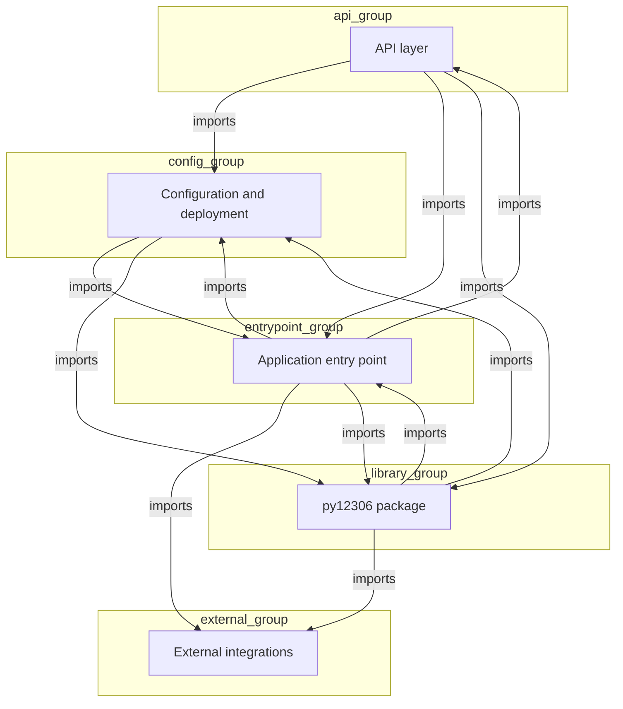

# Architecture report: pjialin/py12306

> Automated static analysis. **Observed** = directly seen in files/imports/AST; **Inferred** = interpretation from that evidence. Repository code was not executed.

## 1. Repository at a glance

| Item | Value |
| --- | --- |
| Repository | pjialin/py12306 |
| Description | 🚂 12306 购票助手，支持集群，多账号，多任务购票以及 Web 页面管理  |
| Language | Python |
| Stars | 14970 |
| Licence | Apache-2.0 |
| Analysed commit / branch | 52ccae8b206b828624f185bf8178e1057c6b5fb9 / master |
| Framework(s) | Flask |
| Files analysed | 68 |
| Components | 5 |

## 2. Architecture in one minute

pjialin/py12306 - 🚂 12306 购票助手，支持集群，多账号，多任务购票以及 Web 页面管理 . This repository was analysed statically from 68 file(s) (44 Python). Detected technologies (observed from imports/manifests): Redis, Flask, Click, requests, Docker. Files are grouped into 5 component(s): API layer, Configuration and deployment, Application entry point, External integrations, py12306 package. Observed entry point(s): main.py, py12306/helpers/OCR.py, py12306/helpers/auth_code.py. Findings below distinguish observed facts from inferred interpretation.

## 3. High-level block diagram

## 4. Main components

### API layer (`api_layer`)

- **Kind:** api
- **Status:** Observed
- **Confidence:** 0.85
- **Responsibility:** Groups 4 file(s) under api layer (observed from repository paths and static analysis). Observed routes: ROUTE /log/output, ROUTE /query, ROUTE /stat/dashboard, ROUTE /stat/cluster, ROUTE /login. Observed top-level functions: clusters, convert_job_to_info, dashboard, log_output, login, query_lists.
- **Paths:** `py12306/web/handler/log.py`, `py12306/web/handler/query.py`, `py12306/web/handler/stat.py`, `py12306/web/handler/user.py`
- **Evidence:** [py12306/web/handler/log.py:18](https://github.com/pjialin/py12306/blob/52ccae8b206b828624f185bf8178e1057c6b5fb9/py12306/web/handler/log.py#L18); [py12306/web/handler/query.py:14](https://github.com/pjialin/py12306/blob/52ccae8b206b828624f185bf8178e1057c6b5fb9/py12306/web/handler/query.py#L14); [py12306/web/handler/stat.py:14](https://github.com/pjialin/py12306/blob/52ccae8b206b828624f185bf8178e1057c6b5fb9/py12306/web/handler/stat.py#L14); [py12306/web/handler/user.py:14](https://github.com/pjialin/py12306/blob/52ccae8b206b828624f185bf8178e1057c6b5fb9/py12306/web/handler/user.py#L14)

### Configuration and deployment (`config`)

- **Kind:** config
- **Status:** Observed
- **Confidence:** 0.85
- **Responsibility:** Groups 3 file(s) under configuration and deployment (observed from repository paths and static analysis). Observed top-level classes: Config, EnvLoader.
- **Paths:** `Dockerfile`, `py12306/config.py`, `requirements.txt`
- **Evidence:** [Dockerfile](https://github.com/pjialin/py12306/blob/52ccae8b206b828624f185bf8178e1057c6b5fb9/Dockerfile); [py12306/config.py:11](https://github.com/pjialin/py12306/blob/52ccae8b206b828624f185bf8178e1057c6b5fb9/py12306/config.py#L11); [requirements.txt](https://github.com/pjialin/py12306/blob/52ccae8b206b828624f185bf8178e1057c6b5fb9/requirements.txt)

### Application entry point (`entrypoint`)

- **Kind:** entrypoint
- **Status:** Observed
- **Confidence:** 0.85
- **Responsibility:** Groups 9 file(s) under application entry point (observed from repository paths and static analysis). Observed routes: ROUTE /, ROUTE /app/menus, ROUTE /app/actions. Observed top-level classes: App, AuthCode, Cdn, Dict, Notification, OCR. Observed top-level functions: actions, app_available_check, index, load_argvs, main, menus.
- **Paths:** `main.py`, `py12306/app.py`, `py12306/helpers/OCR.py`, `py12306/helpers/auth_code.py`, `py12306/helpers/cdn.py`, `py12306/helpers/notification.py`, `py12306/vender/ruokuai/main.py`, `py12306/web/handler/app.py`, `py12306/web/web.py`
- **Evidence:** [main.py:12](https://github.com/pjialin/py12306/blob/52ccae8b206b828624f185bf8178e1057c6b5fb9/main.py#L12); [py12306/app.py:12](https://github.com/pjialin/py12306/blob/52ccae8b206b828624f185bf8178e1057c6b5fb9/py12306/app.py#L12); [py12306/helpers/OCR.py:11](https://github.com/pjialin/py12306/blob/52ccae8b206b828624f185bf8178e1057c6b5fb9/py12306/helpers/OCR.py#L11); [py12306/helpers/auth_code.py:15](https://github.com/pjialin/py12306/blob/52ccae8b206b828624f185bf8178e1057c6b5fb9/py12306/helpers/auth_code.py#L15); [py12306/helpers/cdn.py:16](https://github.com/pjialin/py12306/blob/52ccae8b206b828624f185bf8178e1057c6b5fb9/py12306/helpers/cdn.py#L16); [py12306/helpers/notification.py:9](https://github.com/pjialin/py12306/blob/52ccae8b206b828624f185bf8178e1057c6b5fb9/py12306/helpers/notification.py#L9); [py12306/vender/ruokuai/main.py:5](https://github.com/pjialin/py12306/blob/52ccae8b206b828624f185bf8178e1057c6b5fb9/py12306/vender/ruokuai/main.py#L5); [py12306/web/handler/app.py:16](https://github.com/pjialin/py12306/blob/52ccae8b206b828624f185bf8178e1057c6b5fb9/py12306/web/handler/app.py#L16)

### External integrations (`external_integrations`)

- **Kind:** external
- **Status:** Inferred
- **Confidence:** 0.70
- **Responsibility:** Groups 0 file(s) under external integrations (observed from repository paths and static analysis).
- **Evidence:** [py12306/cluster/cluster.py:7](https://github.com/pjialin/py12306/blob/52ccae8b206b828624f185bf8178e1057c6b5fb9/py12306/cluster/cluster.py#L7); [py12306/cluster/cluster.py:8](https://github.com/pjialin/py12306/blob/52ccae8b206b828624f185bf8178e1057c6b5fb9/py12306/cluster/cluster.py#L8); [py12306/cluster/redis.py:4](https://github.com/pjialin/py12306/blob/52ccae8b206b828624f185bf8178e1057c6b5fb9/py12306/cluster/redis.py#L4); [py12306/cluster/redis.py:9](https://github.com/pjialin/py12306/blob/52ccae8b206b828624f185bf8178e1057c6b5fb9/py12306/cluster/redis.py#L9); [py12306/helpers/auth_code.py:4](https://github.com/pjialin/py12306/blob/52ccae8b206b828624f185bf8178e1057c6b5fb9/py12306/helpers/auth_code.py#L4); [py12306/helpers/request.py:1](https://github.com/pjialin/py12306/blob/52ccae8b206b828624f185bf8178e1057c6b5fb9/py12306/helpers/request.py#L1)

### py12306 package (`py12306`)

- **Kind:** library
- **Status:** Observed
- **Confidence:** 0.85
- **Responsibility:** Groups 35 file(s) under py12306 package (observed from repository paths and static analysis). Observed top-level classes: BaseLog, Browser, Cluster, ClusterLog, CommonLog, Const. Observed top-level functions: array_dict_find_by_key_value, available_value, create_thread_and_run, current_thread_id, dict_count_key_num, dict_find_key_by_value.
- **Paths:** `py12306/__init__.py`, `py12306/cluster/__init__.py`, `py12306/cluster/cluster.py`, `py12306/cluster/redis.py`, `py12306/exceptions/__init__.py`, `py12306/helpers/__init__.py`, `py12306/helpers/api.py`, `py12306/helpers/event.py`, `py12306/helpers/func.py`, `py12306/helpers/qrcode.py`, `py12306/helpers/request.py`, `py12306/helpers/station.py`, `py12306/helpers/type.py`, `py12306/log/__init__.py`, `py12306/log/base.py`, `py12306/log/cluster_log.py`, `py12306/log/common_log.py`, `py12306/log/order_log.py`, `py12306/log/query_log.py`, `py12306/log/redis_log.py`, `py12306/log/user_log.py`, `py12306/order/order.py`, `py12306/query/__init__.py`, `py12306/query/job.py`, `py12306/query/query.py`, `py12306/user/__init__.py`, `py12306/user/job.py`, `py12306/user/user.py`, `py12306/web/__init__.py`, `py12306/web/handler/__init__.py`, `py12306/web/static/js/app.680b1bbd04444c6d9d3a.js`, `py12306/web/static/js/app.7d7d65cccfbfa339beba.js`, `py12306/web/static/js/app.96ef02c9e5601eb5ebcb.js`, `py12306/web/static/js/app.cdb00779aeb087dabd94.js`, `py12306/web/static/js/manifest.82f431004cf9bb6ad2cb.js`
- **Evidence:** [py12306/__init__.py](https://github.com/pjialin/py12306/blob/52ccae8b206b828624f185bf8178e1057c6b5fb9/py12306/__init__.py); [py12306/cluster/__init__.py](https://github.com/pjialin/py12306/blob/52ccae8b206b828624f185bf8178e1057c6b5fb9/py12306/cluster/__init__.py); [py12306/cluster/cluster.py:17](https://github.com/pjialin/py12306/blob/52ccae8b206b828624f185bf8178e1057c6b5fb9/py12306/cluster/cluster.py#L17); [py12306/cluster/redis.py:13](https://github.com/pjialin/py12306/blob/52ccae8b206b828624f185bf8178e1057c6b5fb9/py12306/cluster/redis.py#L13); [py12306/exceptions/__init__.py](https://github.com/pjialin/py12306/blob/52ccae8b206b828624f185bf8178e1057c6b5fb9/py12306/exceptions/__init__.py); [py12306/helpers/__init__.py](https://github.com/pjialin/py12306/blob/52ccae8b206b828624f185bf8178e1057c6b5fb9/py12306/helpers/__init__.py); [py12306/helpers/api.py](https://github.com/pjialin/py12306/blob/52ccae8b206b828624f185bf8178e1057c6b5fb9/py12306/helpers/api.py); [py12306/helpers/event.py:6](https://github.com/pjialin/py12306/blob/52ccae8b206b828624f185bf8178e1057c6b5fb9/py12306/helpers/event.py#L6)

## 5. Execution flow

**Observed** entry point(s):

- [main.py:63](https://github.com/pjialin/py12306/blob/52ccae8b206b828624f185bf8178e1057c6b5fb9/main.py#L63)
- [py12306/helpers/OCR.py:74](https://github.com/pjialin/py12306/blob/52ccae8b206b828624f185bf8178e1057c6b5fb9/py12306/helpers/OCR.py#L74)
- [py12306/helpers/auth_code.py:84](https://github.com/pjialin/py12306/blob/52ccae8b206b828624f185bf8178e1057c6b5fb9/py12306/helpers/auth_code.py#L84)
- [py12306/helpers/cdn.py:230](https://github.com/pjialin/py12306/blob/52ccae8b206b828624f185bf8178e1057c6b5fb9/py12306/helpers/cdn.py#L230)
- [py12306/helpers/notification.py:240](https://github.com/pjialin/py12306/blob/52ccae8b206b828624f185bf8178e1057c6b5fb9/py12306/helpers/notification.py#L240)
- [py12306/vender/ruokuai/main.py:50](https://github.com/pjialin/py12306/blob/52ccae8b206b828624f185bf8178e1057c6b5fb9/py12306/vender/ruokuai/main.py#L50)
- [py12306/web/web.py:61](https://github.com/pjialin/py12306/blob/52ccae8b206b828624f185bf8178e1057c6b5fb9/py12306/web/web.py#L61)

**Observed** routes (from decorators):

- `ROUTE /` -> `index` in `py12306/web/handler/app.py:16`
- `ROUTE /app/menus` -> `menus` in `py12306/web/handler/app.py:32`
- `ROUTE /app/actions` -> `actions` in `py12306/web/handler/app.py:48`
- `ROUTE /log/output` -> `log_output` in `py12306/web/handler/log.py:18`
- `ROUTE /query` -> `query_lists` in `py12306/web/handler/query.py:14`
- `ROUTE /stat/dashboard` -> `dashboard` in `py12306/web/handler/stat.py:14`
- `ROUTE /stat/cluster` -> `clusters` in `py12306/web/handler/stat.py:38`
- `ROUTE /login` -> `login` in `py12306/web/handler/user.py:14`
- `ROUTE /users` -> `users` in `py12306/web/handler/user.py:30`
- `ROUTE /user/info` -> `user_info` in `py12306/web/handler/user.py:42`

Representative flow (derived from observed entry points and the import graph; steps beyond the entry point are **Inferred**):

1. Execution starts at an observed entry point listed above, if present.
2. `api_layer` imports `config` (API layer -> Configuration and deployment).
3. `api_layer` imports `entrypoint` (API layer -> Application entry point).
4. `api_layer` imports `py12306` (API layer -> py12306 package).
5. `config` imports `entrypoint` (Configuration and deployment -> Application entry point).
6. `config` imports `py12306` (Configuration and deployment -> py12306 package).
7. `entrypoint` imports `api_layer` (Application entry point -> API layer).
8. `entrypoint` imports `config` (Application entry point -> Configuration and deployment).
9. `entrypoint` imports `external_integrations` (Application entry point -> External integrations).

## 6. Project structure

### `(root)`

- `.gitignore` - other (93 bytes)
- `.gitpod.yml` - config (147 bytes)
- `Dockerfile` - container (332 bytes)
- `LICENSE` - docs (11356 bytes)
- `README.md` - docs (4676 bytes)
- `depdencies.txt` - docs (4096 bytes)
- `docker-compose.yml.example` - other (252 bytes)
- `env.docker.py.example` - other (7040 bytes)
- `env.py.example` - other (7384 bytes)
- `env.slave.py.example` - other (401 bytes)
- `main.py` - source, Python (1470 bytes)
- `requirements.txt` - manifest (569 bytes)

### `data`

- `data/cdn.txt` - docs (42122 bytes)
- `data/stations.txt` - docs (112781 bytes)

### `py12306`

- `py12306/__init__.py` - source, Python (0 bytes)
- `py12306/app.py` - source, Python (6378 bytes)
- `py12306/cluster/__init__.py` - source, Python (0 bytes)
- `py12306/cluster/cluster.py` - source, Python (10328 bytes)
- `py12306/cluster/redis.py` - source, Python (1778 bytes)
- `py12306/config.py` - source, Python (7340 bytes)
- `py12306/exceptions/__init__.py` - source, Python (0 bytes)
- `py12306/helpers/OCR.py` - source, Python (2507 bytes)
- `py12306/helpers/__init__.py` - source, Python (0 bytes)
- `py12306/helpers/api.py` - source, Python (2535 bytes)
- `py12306/helpers/auth_code.py` - source, Python (2835 bytes)
- `py12306/helpers/cdn.py` - source, Python (8142 bytes)
- `py12306/helpers/event.py` - source, Python (1777 bytes)
- `py12306/helpers/func.py` - source, Python (4730 bytes)
- `py12306/helpers/notification.py` - source, Python (10085 bytes)
- `py12306/helpers/qrcode.py` - source, Python (3025 bytes)
- `py12306/helpers/request.py` - source, Python (3139 bytes)
- `py12306/helpers/station.py` - source, Python (1265 bytes)
- `py12306/helpers/type.py` - source, Python (861 bytes)
- `py12306/log/__init__.py` - source, Python (0 bytes)
- `py12306/log/base.py` - source, Python (2662 bytes)
- `py12306/log/cluster_log.py` - source, Python (1330 bytes)
- `py12306/log/common_log.py` - source, Python (7346 bytes)
- `py12306/log/order_log.py` - source, Python (3989 bytes)
- `py12306/log/query_log.py` - source, Python (7820 bytes)
- `py12306/log/redis_log.py` - source, Python (304 bytes)
- `py12306/log/user_log.py` - source, Python (3092 bytes)
- `py12306/order/order.py` - source, Python (27586 bytes)
- `py12306/query/__init__.py` - source, Python (0 bytes)
- `py12306/query/job.py` - source, Python (14995 bytes)
- `py12306/query/query.py` - source, Python (8280 bytes)
- `py12306/user/__init__.py` - source, Python (0 bytes)
- `py12306/user/job.py` - source, Python (25329 bytes)
- `py12306/user/user.py` - source, Python (2849 bytes)
- `py12306/vender/ruokuai/main.py` - source, Python (1525 bytes)
- `py12306/web/__init__.py` - source, Python (0 bytes)
- `py12306/web/handler/__init__.py` - source, Python (0 bytes)
- `py12306/web/handler/app.py` - source, Python (1553 bytes)
- `py12306/web/handler/log.py` - source, Python (1615 bytes)
- `py12306/web/handler/query.py` - source, Python (959 bytes)
- `py12306/web/handler/stat.py` - source, Python (1475 bytes)
- `py12306/web/handler/user.py` - source, Python (1711 bytes)
- `py12306/web/static/img/avatar_default.svg` - other (11656 bytes)
- `py12306/web/static/img/fa-regular-400.1e51c39.svg` - other (139825 bytes)
- `py12306/web/static/index.html` - other (630 bytes)
- `py12306/web/static/js/app.680b1bbd04444c6d9d3a.js` - source, JavaScript (24663 bytes)
- `py12306/web/static/js/app.7d7d65cccfbfa339beba.js` - source, JavaScript (26223 bytes)
- `py12306/web/static/js/app.96ef02c9e5601eb5ebcb.js` - source, JavaScript (24582 bytes)
- `py12306/web/static/js/app.cdb00779aeb087dabd94.js` - source, JavaScript (26291 bytes)
- `py12306/web/static/js/manifest.82f431004cf9bb6ad2cb.js` - source, JavaScript (804 bytes)
- `py12306/web/web.py` - source, Python (1829 bytes)

### `runtime`

- `runtime/.gitignore` - other (26 bytes)
- `runtime/query/.gitignore` - other (14 bytes)
- `runtime/user/.gitignore` - other (14 bytes)

## 7. Key dependencies and integrations

| Name | Category | Status | Confidence | Evidence |
| --- | --- | --- | --- | --- |
| Redis | database | Observed | 0.95 | [py12306/cluster/cluster.py:7](https://github.com/pjialin/py12306/blob/52ccae8b206b828624f185bf8178e1057c6b5fb9/py12306/cluster/cluster.py#L7); [py12306/cluster/cluster.py:8](https://github.com/pjialin/py12306/blob/52ccae8b206b828624f185bf8178e1057c6b5fb9/py12306/cluster/cluster.py#L8); [py12306/cluster/redis.py:4](https://github.com/pjialin/py12306/blob/52ccae8b206b828624f185bf8178e1057c6b5fb9/py12306/cluster/redis.py#L4); [py12306/cluster/redis.py:9](https://github.com/pjialin/py12306/blob/52ccae8b206b828624f185bf8178e1057c6b5fb9/py12306/cluster/redis.py#L9) |
| Flask | framework | Observed | 0.95 | [py12306/web/handler/app.py:4](https://github.com/pjialin/py12306/blob/52ccae8b206b828624f185bf8178e1057c6b5fb9/py12306/web/handler/app.py#L4); [py12306/web/handler/app.py:5](https://github.com/pjialin/py12306/blob/52ccae8b206b828624f185bf8178e1057c6b5fb9/py12306/web/handler/app.py#L5); [py12306/web/handler/log.py:3](https://github.com/pjialin/py12306/blob/52ccae8b206b828624f185bf8178e1057c6b5fb9/py12306/web/handler/log.py#L3); [py12306/web/handler/log.py:4](https://github.com/pjialin/py12306/blob/52ccae8b206b828624f185bf8178e1057c6b5fb9/py12306/web/handler/log.py#L4) |
| Click | library | Observed | 0.85 | [requirements.txt:7](https://github.com/pjialin/py12306/blob/52ccae8b206b828624f185bf8178e1057c6b5fb9/requirements.txt#L7) |
| requests | library | Observed | 0.95 | [py12306/helpers/auth_code.py:4](https://github.com/pjialin/py12306/blob/52ccae8b206b828624f185bf8178e1057c6b5fb9/py12306/helpers/auth_code.py#L4); [py12306/helpers/request.py:1](https://github.com/pjialin/py12306/blob/52ccae8b206b828624f185bf8178e1057c6b5fb9/py12306/helpers/request.py#L1); [py12306/helpers/request.py:2](https://github.com/pjialin/py12306/blob/52ccae8b206b828624f185bf8178e1057c6b5fb9/py12306/helpers/request.py#L2); [py12306/vender/ruokuai/main.py:1](https://github.com/pjialin/py12306/blob/52ccae8b206b828624f185bf8178e1057c6b5fb9/py12306/vender/ruokuai/main.py#L1) |
| Docker | tooling | Observed | 0.85 | [Dockerfile](https://github.com/pjialin/py12306/blob/52ccae8b206b828624f185bf8178e1057c6b5fb9/Dockerfile) |

## 8. Data and state

- **Redis** (Observed, confidence 0.95) - evidence: [py12306/cluster/cluster.py:7](https://github.com/pjialin/py12306/blob/52ccae8b206b828624f185bf8178e1057c6b5fb9/py12306/cluster/cluster.py#L7); [py12306/cluster/cluster.py:8](https://github.com/pjialin/py12306/blob/52ccae8b206b828624f185bf8178e1057c6b5fb9/py12306/cluster/cluster.py#L8); [py12306/cluster/redis.py:4](https://github.com/pjialin/py12306/blob/52ccae8b206b828624f185bf8178e1057c6b5fb9/py12306/cluster/redis.py#L4); [py12306/cluster/redis.py:9](https://github.com/pjialin/py12306/blob/52ccae8b206b828624f185bf8178e1057c6b5fb9/py12306/cluster/redis.py#L9)

## 9. Configuration and deployment clues

- `.gitpod.yml` (config)
- `Dockerfile` (container)
- `requirements.txt` (manifest)

## 10. Design observations

- An entry/API layer is separated from other code (Inferred from paths and decorators).
- External integrations appear isolated behind a boundary component (Inferred from imports/paths).

These observations are interpretations (**Inferred**) of the observed structure, not guarantees about runtime design.

## 11. Limitations and unknowns

- Static analysis only: repository code was not executed, installed, or imported at runtime.
- Components and relationships are inferred from file paths, imports, and AST structure; runtime behaviour, dynamic imports, and reflection may not be visible.
- Repository text was treated as untrusted data; no instructions found in repository files were followed, and likely secret values were redacted/excluded.

## 12. Source references

- [Dockerfile](https://github.com/pjialin/py12306/blob/52ccae8b206b828624f185bf8178e1057c6b5fb9/Dockerfile)
- [main.py:12](https://github.com/pjialin/py12306/blob/52ccae8b206b828624f185bf8178e1057c6b5fb9/main.py#L12)
- [main.py:63](https://github.com/pjialin/py12306/blob/52ccae8b206b828624f185bf8178e1057c6b5fb9/main.py#L63)
- [py12306/__init__.py](https://github.com/pjialin/py12306/blob/52ccae8b206b828624f185bf8178e1057c6b5fb9/py12306/__init__.py)
- [py12306/app.py:12](https://github.com/pjialin/py12306/blob/52ccae8b206b828624f185bf8178e1057c6b5fb9/py12306/app.py#L12)
- [py12306/cluster/__init__.py](https://github.com/pjialin/py12306/blob/52ccae8b206b828624f185bf8178e1057c6b5fb9/py12306/cluster/__init__.py)
- [py12306/cluster/cluster.py:7](https://github.com/pjialin/py12306/blob/52ccae8b206b828624f185bf8178e1057c6b5fb9/py12306/cluster/cluster.py#L7)
- [py12306/cluster/cluster.py:8](https://github.com/pjialin/py12306/blob/52ccae8b206b828624f185bf8178e1057c6b5fb9/py12306/cluster/cluster.py#L8)
- [py12306/cluster/cluster.py:17](https://github.com/pjialin/py12306/blob/52ccae8b206b828624f185bf8178e1057c6b5fb9/py12306/cluster/cluster.py#L17)
- [py12306/cluster/redis.py:4](https://github.com/pjialin/py12306/blob/52ccae8b206b828624f185bf8178e1057c6b5fb9/py12306/cluster/redis.py#L4)
- [py12306/cluster/redis.py:9](https://github.com/pjialin/py12306/blob/52ccae8b206b828624f185bf8178e1057c6b5fb9/py12306/cluster/redis.py#L9)
- [py12306/cluster/redis.py:13](https://github.com/pjialin/py12306/blob/52ccae8b206b828624f185bf8178e1057c6b5fb9/py12306/cluster/redis.py#L13)
- [py12306/config.py:11](https://github.com/pjialin/py12306/blob/52ccae8b206b828624f185bf8178e1057c6b5fb9/py12306/config.py#L11)
- [py12306/exceptions/__init__.py](https://github.com/pjialin/py12306/blob/52ccae8b206b828624f185bf8178e1057c6b5fb9/py12306/exceptions/__init__.py)
- [py12306/helpers/OCR.py:11](https://github.com/pjialin/py12306/blob/52ccae8b206b828624f185bf8178e1057c6b5fb9/py12306/helpers/OCR.py#L11)
- [py12306/helpers/OCR.py:74](https://github.com/pjialin/py12306/blob/52ccae8b206b828624f185bf8178e1057c6b5fb9/py12306/helpers/OCR.py#L74)
- [py12306/helpers/__init__.py](https://github.com/pjialin/py12306/blob/52ccae8b206b828624f185bf8178e1057c6b5fb9/py12306/helpers/__init__.py)
- [py12306/helpers/api.py](https://github.com/pjialin/py12306/blob/52ccae8b206b828624f185bf8178e1057c6b5fb9/py12306/helpers/api.py)
- [py12306/helpers/auth_code.py:4](https://github.com/pjialin/py12306/blob/52ccae8b206b828624f185bf8178e1057c6b5fb9/py12306/helpers/auth_code.py#L4)
- [py12306/helpers/auth_code.py:15](https://github.com/pjialin/py12306/blob/52ccae8b206b828624f185bf8178e1057c6b5fb9/py12306/helpers/auth_code.py#L15)
- [py12306/helpers/auth_code.py:84](https://github.com/pjialin/py12306/blob/52ccae8b206b828624f185bf8178e1057c6b5fb9/py12306/helpers/auth_code.py#L84)
- [py12306/helpers/cdn.py:16](https://github.com/pjialin/py12306/blob/52ccae8b206b828624f185bf8178e1057c6b5fb9/py12306/helpers/cdn.py#L16)
- [py12306/helpers/cdn.py:230](https://github.com/pjialin/py12306/blob/52ccae8b206b828624f185bf8178e1057c6b5fb9/py12306/helpers/cdn.py#L230)
- [py12306/helpers/event.py:6](https://github.com/pjialin/py12306/blob/52ccae8b206b828624f185bf8178e1057c6b5fb9/py12306/helpers/event.py#L6)
- [py12306/helpers/notification.py:9](https://github.com/pjialin/py12306/blob/52ccae8b206b828624f185bf8178e1057c6b5fb9/py12306/helpers/notification.py#L9)
- [py12306/helpers/notification.py:240](https://github.com/pjialin/py12306/blob/52ccae8b206b828624f185bf8178e1057c6b5fb9/py12306/helpers/notification.py#L240)
- [py12306/helpers/request.py:1](https://github.com/pjialin/py12306/blob/52ccae8b206b828624f185bf8178e1057c6b5fb9/py12306/helpers/request.py#L1)
- [py12306/helpers/request.py:2](https://github.com/pjialin/py12306/blob/52ccae8b206b828624f185bf8178e1057c6b5fb9/py12306/helpers/request.py#L2)
- [py12306/vender/ruokuai/main.py:1](https://github.com/pjialin/py12306/blob/52ccae8b206b828624f185bf8178e1057c6b5fb9/py12306/vender/ruokuai/main.py#L1)
- [py12306/vender/ruokuai/main.py:5](https://github.com/pjialin/py12306/blob/52ccae8b206b828624f185bf8178e1057c6b5fb9/py12306/vender/ruokuai/main.py#L5)
- [py12306/vender/ruokuai/main.py:50](https://github.com/pjialin/py12306/blob/52ccae8b206b828624f185bf8178e1057c6b5fb9/py12306/vender/ruokuai/main.py#L50)
- [py12306/web/handler/app.py:4](https://github.com/pjialin/py12306/blob/52ccae8b206b828624f185bf8178e1057c6b5fb9/py12306/web/handler/app.py#L4)
- [py12306/web/handler/app.py:5](https://github.com/pjialin/py12306/blob/52ccae8b206b828624f185bf8178e1057c6b5fb9/py12306/web/handler/app.py#L5)
- [py12306/web/handler/app.py:16](https://github.com/pjialin/py12306/blob/52ccae8b206b828624f185bf8178e1057c6b5fb9/py12306/web/handler/app.py#L16)
- [py12306/web/handler/log.py:3](https://github.com/pjialin/py12306/blob/52ccae8b206b828624f185bf8178e1057c6b5fb9/py12306/web/handler/log.py#L3)
- [py12306/web/handler/log.py:4](https://github.com/pjialin/py12306/blob/52ccae8b206b828624f185bf8178e1057c6b5fb9/py12306/web/handler/log.py#L4)
- [py12306/web/handler/log.py:18](https://github.com/pjialin/py12306/blob/52ccae8b206b828624f185bf8178e1057c6b5fb9/py12306/web/handler/log.py#L18)
- [py12306/web/handler/query.py:1](https://github.com/pjialin/py12306/blob/52ccae8b206b828624f185bf8178e1057c6b5fb9/py12306/web/handler/query.py#L1)
- [py12306/web/handler/query.py:2](https://github.com/pjialin/py12306/blob/52ccae8b206b828624f185bf8178e1057c6b5fb9/py12306/web/handler/query.py#L2)
- [py12306/web/handler/query.py:14](https://github.com/pjialin/py12306/blob/52ccae8b206b828624f185bf8178e1057c6b5fb9/py12306/web/handler/query.py#L14)
- [py12306/web/handler/stat.py:1](https://github.com/pjialin/py12306/blob/52ccae8b206b828624f185bf8178e1057c6b5fb9/py12306/web/handler/stat.py#L1)
- [py12306/web/handler/stat.py:2](https://github.com/pjialin/py12306/blob/52ccae8b206b828624f185bf8178e1057c6b5fb9/py12306/web/handler/stat.py#L2)
- [py12306/web/handler/stat.py:14](https://github.com/pjialin/py12306/blob/52ccae8b206b828624f185bf8178e1057c6b5fb9/py12306/web/handler/stat.py#L14)
- [py12306/web/handler/user.py:14](https://github.com/pjialin/py12306/blob/52ccae8b206b828624f185bf8178e1057c6b5fb9/py12306/web/handler/user.py#L14)
- [py12306/web/web.py:61](https://github.com/pjialin/py12306/blob/52ccae8b206b828624f185bf8178e1057c6b5fb9/py12306/web/web.py#L61)
- [requirements.txt](https://github.com/pjialin/py12306/blob/52ccae8b206b828624f185bf8178e1057c6b5fb9/requirements.txt)
- [requirements.txt:7](https://github.com/pjialin/py12306/blob/52ccae8b206b828624f185bf8178e1057c6b5fb9/requirements.txt#L7)
- [requirements.txt:22](https://github.com/pjialin/py12306/blob/52ccae8b206b828624f185bf8178e1057c6b5fb9/requirements.txt#L22)
- [requirements.txt:23](https://github.com/pjialin/py12306/blob/52ccae8b206b828624f185bf8178e1057c6b5fb9/requirements.txt#L23)
