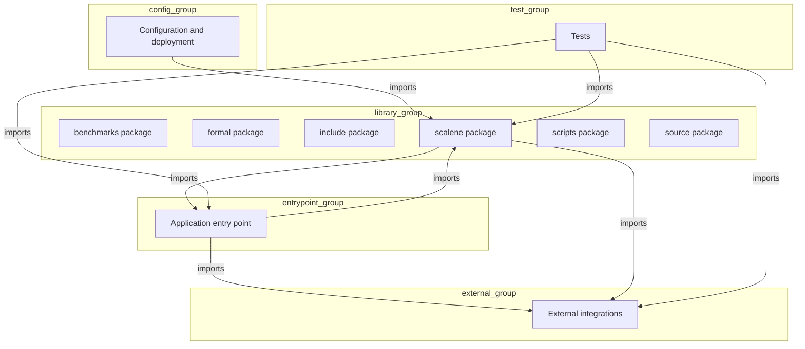

# Architecture report: plasma-umass/scalene

> Automated static analysis. **Observed** = directly seen in files/imports/AST; **Inferred** = interpretation from that evidence. Repository code was not executed.

## 1. Repository at a glance

| Item | Value |
| --- | --- |
| Repository | plasma-umass/scalene |
| Description | Scalene: a high-performance, high-precision CPU, GPU, and memory profiler for Python with AI-powered optimization proposals |
| Language | Python |
| Stars | 13560 |
| Licence | Apache-2.0 |
| Analysed commit / branch | 37951a9611f772b8b400e4b6f4964d0baf69a35e / master |
| Framework(s) | Flask |
| Files analysed | 511 |
| Components | 10 |

## 2. Architecture in one minute

plasma-umass/scalene - Scalene: a high-performance, high-precision CPU, GPU, and memory profiler for Python with AI-powered optimization proposals. This repository was analysed statically from 511 file(s) (325 Python). Detected technologies (observed from imports/manifests): GitHub Actions, Flask, AWS (boto3), NumPy, pandas, Pydantic. Files are grouped into 10 component(s): benchmarks package, Configuration and deployment, Application entry point, External integrations, formal package, include package, scalene package, scripts package. Observed entry point(s): benchmarks/bench_torch_memory.py, benchmarks/julia1_nopil.py, benchmarks/measure_profiler_memory.py. Findings below distinguish observed facts from inferred interpretation.

## 3. High-level block diagram

## 4. Main components

### benchmarks package (`benchmarks`)

- **Kind:** library
- **Status:** Observed
- **Confidence:** 0.85
- **Responsibility:** Groups 1 file(s) under benchmarks package (observed from repository paths and static analysis).
- **Paths:** `benchmarks/benchmark.py`
- **Evidence:** [benchmarks/benchmark.py](https://github.com/plasma-umass/scalene/blob/37951a9611f772b8b400e4b6f4964d0baf69a35e/benchmarks/benchmark.py)

### Configuration and deployment (`config`)

- **Kind:** config
- **Status:** Observed
- **Confidence:** 0.85
- **Responsibility:** Groups 17 file(s) under configuration and deployment (observed from repository paths and static analysis). Observed top-level classes: BuildExtCommand, EggInfoCommand. Observed top-level functions: bdist_wheel_options, build_gui_bundle, cmake_available, compiler_archs, dll_suffix, extra_compile_args.
- **Paths:** `MANIFEST.in`, `Pipfile`, `formal/lean/lake-manifest.json`, `formal/lean/lakefile.toml`, `formal/tla/Deadlock.cfg`, `formal/tla/SignalSafety_Bug.cfg`, `formal/tla/SignalSafety_Fix.cfg`, `mypy.ini`, `pyproject.toml`, `pyrightconfig.json`, `pytest.ini`, `requirements.txt`, `ruff.toml`, `scalene/scalene-gui/package.json`, `scalene/scalene-gui/profile.json`, `scalene/scalene-gui/tsconfig.json`, `setup.py`
- **Evidence:** [MANIFEST.in](https://github.com/plasma-umass/scalene/blob/37951a9611f772b8b400e4b6f4964d0baf69a35e/MANIFEST.in); [Pipfile](https://github.com/plasma-umass/scalene/blob/37951a9611f772b8b400e4b6f4964d0baf69a35e/Pipfile); [formal/lean/lake-manifest.json](https://github.com/plasma-umass/scalene/blob/37951a9611f772b8b400e4b6f4964d0baf69a35e/formal/lean/lake-manifest.json); [formal/lean/lakefile.toml](https://github.com/plasma-umass/scalene/blob/37951a9611f772b8b400e4b6f4964d0baf69a35e/formal/lean/lakefile.toml); [formal/tla/Deadlock.cfg](https://github.com/plasma-umass/scalene/blob/37951a9611f772b8b400e4b6f4964d0baf69a35e/formal/tla/Deadlock.cfg); [formal/tla/SignalSafety_Bug.cfg](https://github.com/plasma-umass/scalene/blob/37951a9611f772b8b400e4b6f4964d0baf69a35e/formal/tla/SignalSafety_Bug.cfg); [formal/tla/SignalSafety_Fix.cfg](https://github.com/plasma-umass/scalene/blob/37951a9611f772b8b400e4b6f4964d0baf69a35e/formal/tla/SignalSafety_Fix.cfg); [mypy.ini](https://github.com/plasma-umass/scalene/blob/37951a9611f772b8b400e4b6f4964d0baf69a35e/mypy.ini)

### Application entry point (`entrypoint`)

- **Kind:** entrypoint
- **Status:** Observed
- **Confidence:** 0.85
- **Responsibility:** Groups 13 file(s) under application entry point (observed from repository paths and static analysis). Observed top-level classes: CustomHandler, NeuronMonitor, RSSMonitor, Record, Scalene, ScaleneAppleGPU. Observed top-level functions: Func1, Func2, Func3, Proc0, Proc1, Proc2.
- **Paths:** `benchmarks/bench_torch_memory.py`, `benchmarks/julia1_nopil.py`, `benchmarks/measure_profiler_memory.py`, `benchmarks/new_benchmark.py`, `benchmarks/pystone.py`, `demo_torch_jit.py`, `scalene/__main__.py`, `scalene/launchbrowser.py`, `scalene/merge_scalene_neuron_profiles.py`, `scalene/scalene_apple_gpu.py`, `scalene/scalene_neuron.py`, `scalene/scalene_profiler.py`, `scalene/set_nvidia_gpu_modes.py`
- **Evidence:** [benchmarks/bench_torch_memory.py:34](https://github.com/plasma-umass/scalene/blob/37951a9611f772b8b400e4b6f4964d0baf69a35e/benchmarks/bench_torch_memory.py#L34); [benchmarks/julia1_nopil.py:34](https://github.com/plasma-umass/scalene/blob/37951a9611f772b8b400e4b6f4964d0baf69a35e/benchmarks/julia1_nopil.py#L34); [benchmarks/measure_profiler_memory.py:42](https://github.com/plasma-umass/scalene/blob/37951a9611f772b8b400e4b6f4964d0baf69a35e/benchmarks/measure_profiler_memory.py#L42); [benchmarks/new_benchmark.py:42](https://github.com/plasma-umass/scalene/blob/37951a9611f772b8b400e4b6f4964d0baf69a35e/benchmarks/new_benchmark.py#L42); [benchmarks/pystone.py:44](https://github.com/plasma-umass/scalene/blob/37951a9611f772b8b400e4b6f4964d0baf69a35e/benchmarks/pystone.py#L44); [demo_torch_jit.py:6](https://github.com/plasma-umass/scalene/blob/37951a9611f772b8b400e4b6f4964d0baf69a35e/demo_torch_jit.py#L6); [scalene/__main__.py:5](https://github.com/plasma-umass/scalene/blob/37951a9611f772b8b400e4b6f4964d0baf69a35e/scalene/__main__.py#L5); [scalene/launchbrowser.py:20](https://github.com/plasma-umass/scalene/blob/37951a9611f772b8b400e4b6f4964d0baf69a35e/scalene/launchbrowser.py#L20)

### External integrations (`external_integrations`)

- **Kind:** external
- **Status:** Inferred
- **Confidence:** 0.70
- **Responsibility:** Groups 0 file(s) under external integrations (observed from repository paths and static analysis).
- **Evidence:** [scalene/launchbrowser.py:8](https://github.com/plasma-umass/scalene/blob/37951a9611f772b8b400e4b6f4964d0baf69a35e/scalene/launchbrowser.py#L8); [scalene/scalene-gui/list-amazon-models.py:1](https://github.com/plasma-umass/scalene/blob/37951a9611f772b8b400e4b6f4964d0baf69a35e/scalene/scalene-gui/list-amazon-models.py#L1); [scalene/scalene_jupyter.py:1](https://github.com/plasma-umass/scalene/blob/37951a9611f772b8b400e4b6f4964d0baf69a35e/scalene/scalene_jupyter.py#L1); [test/testflask-driver.py:5](https://github.com/plasma-umass/scalene/blob/37951a9611f772b8b400e4b6f4964d0baf69a35e/test/testflask-driver.py#L5); [tests/test_coverup_117.py:8](https://github.com/plasma-umass/scalene/blob/37951a9611f772b8b400e4b6f4964d0baf69a35e/tests/test_coverup_117.py#L8); [tests/test_coverup_12.py:6](https://github.com/plasma-umass/scalene/blob/37951a9611f772b8b400e4b6f4964d0baf69a35e/tests/test_coverup_12.py#L6)

### formal package (`formal`)

- **Kind:** library
- **Status:** Observed
- **Confidence:** 0.85
- **Responsibility:** Groups 1 file(s) under formal package (observed from repository paths and static analysis). Observed top-level classes: List_cons, List_nil, isFalse, isTrue. Observed top-level functions: bump, c_time_ns, drop_first_with_count, footprint_delta, has_key, min_count.
- **Paths:** `formal/extract/scalene_verified_core.py`
- **Evidence:** [formal/extract/scalene_verified_core.py:28](https://github.com/plasma-umass/scalene/blob/37951a9611f772b8b400e4b6f4964d0baf69a35e/formal/extract/scalene_verified_core.py#L28)

### include package (`include`)

- **Kind:** library
- **Status:** Observed
- **Confidence:** 0.85
- **Responsibility:** Groups 1 file(s) under include package (observed from repository paths and static analysis).
- **Paths:** `src/include/pyptr.h`
- **Evidence:** [src/include/pyptr.h](https://github.com/plasma-umass/scalene/blob/37951a9611f772b8b400e4b6f4964d0baf69a35e/src/include/pyptr.h)

### scalene package (`scalene`)

- **Kind:** library
- **Status:** Observed
- **Confidence:** 0.85
- **Responsibility:** Groups 78 file(s) under scalene package (observed from repository paths and static analysis). Observed top-level classes: Adaptive, AsyncStatistics, CPUStatistics, ChildArgSpec, ChromeTraceProfiler, CombinedStackFrame. Observed top-level functions: _apply_trace_compatibility_fix, _caller_future_flags, _canonical_path, _collect_alloc_lines, _colorize_help_for_rich, _create.
- **Paths:** `scalene/__init__.py`, `scalene/adaptive.py`, `scalene/find_browser.py`, `scalene/get_module_details.py`, `scalene/hyperloglog.py`, `scalene/profile.py`, `scalene/redirect_python.py`, `scalene/replacement_asyncio.py`, `scalene/replacement_exec.py`, `scalene/replacement_exit.py`, `scalene/replacement_fork.py`, `scalene/replacement_get_context.py`, `scalene/replacement_lock.py`, `scalene/replacement_mp_lock.py`, `scalene/replacement_pjoin.py`, `scalene/replacement_poll_selector.py`, `scalene/replacement_sem_lock.py`, `scalene/replacement_signal_fns.py`, `scalene/replacement_thread_join.py`, `scalene/replacement_thread_start.py`, `scalene/runningstats.py`, `scalene/scalene-gui/amazon.ts`, `scalene/scalene-gui/anthropic.ts`, `scalene/scalene-gui/azure.ts`, `scalene/scalene-gui/gemini.ts`, `scalene/scalene-gui/gui-elements.ts`, `scalene/scalene-gui/list-amazon-models.py`, `scalene/scalene-gui/model-recovery.ts`, `scalene/scalene-gui/models.ts`, `scalene/scalene-gui/ollama.ts`, `scalene/scalene-gui/openai.ts`, `scalene/scalene-gui/optimizations.ts`, `scalene/scalene-gui/persistence.ts`, `scalene/scalene-gui/prism.d.ts`, `scalene/scalene-gui/prism.js`, `scalene/scalene-gui/scalene-demo.ts`, `scalene/scalene-gui/scalene-fetch.ts`, `scalene/scalene-gui/scalene-gui.ts`, `scalene/scalene-gui/tablesort.d.ts`, `scalene/scalene-gui/tablesort.js`, `scalene/scalene-gui/utils.ts`, `scalene/scalene_accelerator.py`, `scalene/scalene_analysis.py`, `scalene/scalene_arguments.py`, `scalene/scalene_async.py`, `scalene/scalene_client_timer.py`, `scalene/scalene_config.py`, `scalene/scalene_cpu_profiler.py`, `scalene/scalene_funcutils.py`, `scalene/scalene_jax.py`, `scalene/scalene_json.py`, `scalene/scalene_jupyter.py`, `scalene/scalene_leak_analysis.py`, `scalene/scalene_library_profiler.py`, `scalene/scalene_library_registry.py`, `scalene/scalene_lifecycle.py`, `scalene/scalene_mac_sampler.py`, `scalene/scalene_magics.py`, `scalene/scalene_mapfile.py`, `scalene/scalene_memory_profiler.py`, `scalene/scalene_nvidia_gpu.py`, `scalene/scalene_output.py`, `scalene/scalene_parseargs.py`, `scalene/scalene_preload.py`, `scalene/scalene_signal_manager.py`, `scalene/scalene_signals.py`, `scalene/scalene_sigqueue.py`, `scalene/scalene_statistics.py`, `scalene/scalene_tensorflow.py`, `scalene/scalene_torch.py`, `scalene/scalene_tracer.py`, `scalene/scalene_tracing.py`, `scalene/scalene_utility.py`, `scalene/scalene_windows.py`, `scalene/sorted_reservoir.py`, `scalene/sparkline.py`, `scalene/syntaxline.py`, `scalene/time_info.py`
- **Evidence:** [scalene/__init__.py](https://github.com/plasma-umass/scalene/blob/37951a9611f772b8b400e4b6f4964d0baf69a35e/scalene/__init__.py); [scalene/adaptive.py:4](https://github.com/plasma-umass/scalene/blob/37951a9611f772b8b400e4b6f4964d0baf69a35e/scalene/adaptive.py#L4); [scalene/find_browser.py:5](https://github.com/plasma-umass/scalene/blob/37951a9611f772b8b400e4b6f4964d0baf69a35e/scalene/find_browser.py#L5); [scalene/get_module_details.py:12](https://github.com/plasma-umass/scalene/blob/37951a9611f772b8b400e4b6f4964d0baf69a35e/scalene/get_module_details.py#L12); [scalene/hyperloglog.py:24](https://github.com/plasma-umass/scalene/blob/37951a9611f772b8b400e4b6f4964d0baf69a35e/scalene/hyperloglog.py#L24); [scalene/profile.py](https://github.com/plasma-umass/scalene/blob/37951a9611f772b8b400e4b6f4964d0baf69a35e/scalene/profile.py); [scalene/redirect_python.py:7](https://github.com/plasma-umass/scalene/blob/37951a9611f772b8b400e4b6f4964d0baf69a35e/scalene/redirect_python.py#L7); [scalene/replacement_asyncio.py:12](https://github.com/plasma-umass/scalene/blob/37951a9611f772b8b400e4b6f4964d0baf69a35e/scalene/replacement_asyncio.py#L12)

### scripts package (`scripts`)

- **Kind:** library
- **Status:** Observed
- **Confidence:** 0.85
- **Responsibility:** Groups 1 file(s) under scripts package (observed from repository paths and static analysis).
- **Paths:** `scripts/update_models.mjs`
- **Evidence:** [scripts/update_models.mjs](https://github.com/plasma-umass/scalene/blob/37951a9611f772b8b400e4b6f4964d0baf69a35e/scripts/update_models.mjs)

### source package (`source`)

- **Kind:** library
- **Status:** Observed
- **Confidence:** 0.85
- **Responsibility:** Groups 6 file(s) under source package (observed from repository paths and static analysis).
- **Paths:** `src/source/get_line_atomic.cpp`, `src/source/libscalene.cpp`, `src/source/libscalene_windows.cpp`, `src/source/native_unwind.cpp`, `src/source/pywhere.cpp`, `src/source/traceconfig.cpp`
- **Evidence:** [src/source/get_line_atomic.cpp](https://github.com/plasma-umass/scalene/blob/37951a9611f772b8b400e4b6f4964d0baf69a35e/src/source/get_line_atomic.cpp); [src/source/libscalene.cpp](https://github.com/plasma-umass/scalene/blob/37951a9611f772b8b400e4b6f4964d0baf69a35e/src/source/libscalene.cpp); [src/source/libscalene_windows.cpp](https://github.com/plasma-umass/scalene/blob/37951a9611f772b8b400e4b6f4964d0baf69a35e/src/source/libscalene_windows.cpp); [src/source/native_unwind.cpp](https://github.com/plasma-umass/scalene/blob/37951a9611f772b8b400e4b6f4964d0baf69a35e/src/source/native_unwind.cpp); [src/source/pywhere.cpp](https://github.com/plasma-umass/scalene/blob/37951a9611f772b8b400e4b6f4964d0baf69a35e/src/source/pywhere.cpp); [src/source/traceconfig.cpp](https://github.com/plasma-umass/scalene/blob/37951a9611f772b8b400e4b6f4964d0baf69a35e/src/source/traceconfig.cpp)

### Tests (`tests`)

- **Kind:** test
- **Status:** Observed
- **Confidence:** 0.85
- **Responsibility:** Groups 313 file(s) under tests (observed from repository paths and static analysis). Observed application object created via Flask. Observed routes: ROUTE /<page>, PATCH scalene.scalene_profiler.ScaleneMapFile. Observed top-level classes: A, Array2D, ArrayList, AsyncTree, Battle, Bitfield. Observed top-level functions: FFT_bitreverse, FFT_inverse, FFT_num_flops, FFT_transform, FFT_transform_internal, LU.
- **Paths:** `test/automatic/README.md`, `test/automatic/dataframe/README.md`, `test/automatic/dataframe/dataframe-select-optimized.py`, `test/automatic/dataframe/dataframe-select-original.py`, `test/automatic/svm/README.md`, `test/automatic/svm/svm-optimized.py`, `test/automatic/svm/svm-original.py`, `test/expensive_benchmarks/README.md`, `test/expensive_benchmarks/bm_async_tree_io.py`, `test/expensive_benchmarks/bm_docutils.py`, `test/expensive_benchmarks/bm_fannukh.py`, `test/expensive_benchmarks/bm_mdp.py`, `test/expensive_benchmarks/bm_pprint.py`, `test/expensive_benchmarks/bm_raytrace.py`, `test/expensive_benchmarks/bm_sympy.py`, `test/expensive_benchmarks/docutils_data/docs/api/publisher.txt`, `test/expensive_benchmarks/docutils_data/docs/api/runtime-settings.txt`, `test/expensive_benchmarks/docutils_data/docs/api/transforms.txt`, `test/expensive_benchmarks/docutils_data/docs/dev/distributing.txt`, `test/expensive_benchmarks/docutils_data/docs/dev/enthought-plan.txt`, `test/expensive_benchmarks/docutils_data/docs/dev/enthought-rfp.txt`, `test/expensive_benchmarks/docutils_data/docs/dev/hacking.txt`, `test/expensive_benchmarks/docutils_data/docs/dev/policies.txt`, `test/expensive_benchmarks/docutils_data/docs/dev/pysource.txt`, `test/expensive_benchmarks/docutils_data/docs/dev/release.txt`, `test/expensive_benchmarks/docutils_data/docs/dev/repository.txt`, `test/expensive_benchmarks/docutils_data/docs/dev/rst/alternatives.txt`, `test/expensive_benchmarks/docutils_data/docs/dev/rst/problems.txt`, `test/expensive_benchmarks/docutils_data/docs/dev/runtime-settings-processing.txt`, `test/expensive_benchmarks/docutils_data/docs/dev/semantics.txt`, `test/expensive_benchmarks/docutils_data/docs/dev/testing.txt`, `test/expensive_benchmarks/docutils_data/docs/dev/todo.txt`, `test/expensive_benchmarks/docutils_data/docs/dev/website.txt`, `test/expensive_benchmarks/docutils_data/docs/howto/cmdline-tool.txt`, `test/expensive_benchmarks/docutils_data/docs/howto/html-stylesheets.txt`, `test/expensive_benchmarks/docutils_data/docs/howto/i18n.txt`, `test/expensive_benchmarks/docutils_data/docs/howto/rst-directives.txt`, `test/expensive_benchmarks/docutils_data/docs/howto/rst-roles.txt`, `test/expensive_benchmarks/docutils_data/docs/howto/security.txt`, `test/expensive_benchmarks/docutils_data/docs/index.txt`, `test/expensive_benchmarks/docutils_data/docs/peps/pep-0256.txt`, `test/expensive_benchmarks/docutils_data/docs/peps/pep-0257.txt`, `test/expensive_benchmarks/docutils_data/docs/peps/pep-0258.txt`, `test/expensive_benchmarks/docutils_data/docs/peps/pep-0287.txt`, `test/expensive_benchmarks/docutils_data/docs/ref/doctree.txt`, `test/expensive_benchmarks/docutils_data/docs/ref/rst/definitions.txt`, `test/expensive_benchmarks/docutils_data/docs/ref/rst/directives.txt`, `test/expensive_benchmarks/docutils_data/docs/ref/rst/introduction.txt`, `test/expensive_benchmarks/docutils_data/docs/ref/rst/mathematics.txt`, `test/expensive_benchmarks/docutils_data/docs/ref/rst/restructuredtext.txt`, `test/expensive_benchmarks/docutils_data/docs/ref/rst/roles.txt`, `test/expensive_benchmarks/docutils_data/docs/user/config.txt`, `test/expensive_benchmarks/docutils_data/docs/user/emacs.txt`, `test/expensive_benchmarks/docutils_data/docs/user/html.txt`, `test/expensive_benchmarks/docutils_data/docs/user/images/rsp.svg`, `test/expensive_benchmarks/docutils_data/docs/user/images/s5-files.svg`, `test/expensive_benchmarks/docutils_data/docs/user/latex.txt`, `test/expensive_benchmarks/docutils_data/docs/user/links.txt`, `test/expensive_benchmarks/docutils_data/docs/user/mailing-lists.txt`, `test/expensive_benchmarks/docutils_data/docs/user/manpage.txt`, `test/expensive_benchmarks/docutils_data/docs/user/odt.txt`, `test/expensive_benchmarks/docutils_data/docs/user/rst/cheatsheet.txt`, `test/expensive_benchmarks/docutils_data/docs/user/rst/demo.txt`, `test/expensive_benchmarks/docutils_data/docs/user/rst/images/biohazard-bitmap-scaling.svg`, `test/expensive_benchmarks/docutils_data/docs/user/rst/images/biohazard-bitmap.svg`, `test/expensive_benchmarks/docutils_data/docs/user/rst/images/biohazard-scaling.svg`, `test/expensive_benchmarks/docutils_data/docs/user/rst/images/biohazard.svg`, `test/expensive_benchmarks/docutils_data/docs/user/rst/images/biohazard.swf`, `test/expensive_benchmarks/docutils_data/docs/user/rst/images/title-scaling.svg`, `test/expensive_benchmarks/docutils_data/docs/user/rst/images/title.svg`, `test/expensive_benchmarks/docutils_data/docs/user/rst/quickstart.txt`, `test/expensive_benchmarks/docutils_data/docs/user/smartquotes.txt`, `test/expensive_benchmarks/docutils_data/docs/user/tools.txt`, `test/issue_659_workload.py`, `test/issues/test-issue124.py`, `test/issues/test-issue126.py`, `test/issues/test-issue130.py`, `test/issues/test-issue156.py`, `test/issues/test-issue167.py`, `test/issues/test-issue193.py`, `test/issues/test-issue244.py`, `test/issues/test-issue256.py`, `test/issues/test-issue266.py`, `test/issues/test-issue31.py`, `test/issues/test-issue379.py`, `test/issues/test-issue691.py`, `test/issues/test-issue74.py`, `test/issues/test-issue914.py`, `test/line_attribution_tests/arithmetic_smear.py`, `test/line_attribution_tests/bigmem_driver.py`, `test/line_attribution_tests/line_after_final_alloc.py`, `test/line_attribution_tests/loop_below_threshold.py`, `test/line_attribution_tests/loop_with_multiple_lines.py`, `test/line_attribution_tests/loop_with_one_alloc.py`, `test/line_attribution_tests/loop_with_two_allocs.py`, `test/line_attribution_tests/mt_gil_release_worker.py`, `test/line_attribution_tests/mt_two_workers.py`, `test/line_attribution_tests/nested_allocator.py`, `test/line_attribution_tests/st_python_vs_c.py`, `test/line_attribution_tests/st_two_allocators.py`, `test/multiprocessing_test.py`, `test/native_thread_alloc.c`, `test/new_mp_test.py`, `test/optimized/bm_pyflate.py`, `test/optimized/bm_raytrace.py`, `test/optimized/bm_richards.py`, `test/optimized/bm_scimark.py`, `test/optimized/bm_spectral_norm.py`, `test/original/bm_mdp.py`, `test/original/bm_pyflate.py`, `test/original/bm_raytrace.py`, `test/original/bm_richards.py`, `test/original/bm_scimark.py`, `test/original/bm_spectral_norm.py`, `test/original/bm_sympy.py`, `test/pool-test.py`, `test/pool_spawn_test.py`, `test/profile_annotation_test.py`, `test/signal_test.py`, `test/small_mp_test.py`, `test/smoketest.py`, `test/smoketest_issue_1022.py`, `test/smoketest_issue_659.py`, `test/smoketest_line_invalidation.py`, `test/smoketest_pool_spawn.py`, `test/smoketest_profile_decorator.py`, `test/test-martinheinz.py`, `test/test-memory.py`, `test/test-native-thread-alloc-ctypes.py`, `test/test-native-thread-alloc.py`, `test/test-pprofile.py`, `test/test-size.py`, `test/test-torch-thread-alloc.py`, `test/test_async_demo.py`, `test/test_freethreaded_parity.py`, `test/test_sparkline.py`, `test/test_timers.py`, `test/test_tracer.py`, `test/testflask-driver.py`, `test/testflask.py`, `test/testme.py`, `test/testpyt.py`, `test/testtf.py`, `test/threads-test.py`, `test/timeline_view_demo.py`, `test/torchtest.py`, `tests/_scalene_subprocess.py`, `tests/conftest.py`, `tests/test_async_profiling.py`, `tests/test_child_cmdline.py`, `tests/test_classifier_soundness.py`, `tests/test_cli_leak_velocity_zero_elapsed.py`, `tests/test_combined_stacks_gui.py`, `tests/test_coverup_1.py`, `tests/test_coverup_106.py`, `tests/test_coverup_107.py`, `tests/test_coverup_109.py`, `tests/test_coverup_11.py`, `tests/test_coverup_110.py`, `tests/test_coverup_112.py`, `tests/test_coverup_113.py`, `tests/test_coverup_115.py`, `tests/test_coverup_116.py`, `tests/test_coverup_117.py`, `tests/test_coverup_118.py`, `tests/test_coverup_12.py`, `tests/test_coverup_121.py`, `tests/test_coverup_122.py`, `tests/test_coverup_123.py`, `tests/test_coverup_125.py`, `tests/test_coverup_128.py`, `tests/test_coverup_13.py`, `tests/test_coverup_131.py`, `tests/test_coverup_132.py`, `tests/test_coverup_133.py`, `tests/test_coverup_136.py`, `tests/test_coverup_137.py`, `tests/test_coverup_139.py`, `tests/test_coverup_14.py`, `tests/test_coverup_15.py`, `tests/test_coverup_16.py`, `tests/test_coverup_17.py`, `tests/test_coverup_19.py`, `tests/test_coverup_2.py`, `tests/test_coverup_20.py`, `tests/test_coverup_21.py`, `tests/test_coverup_22.py`, `tests/test_coverup_23.py`, `tests/test_coverup_24.py`, `tests/test_coverup_25.py`, `tests/test_coverup_26.py`, `tests/test_coverup_28.py`, `tests/test_coverup_29.py`, `tests/test_coverup_3.py`, `tests/test_coverup_30.py`, `tests/test_coverup_31.py`, `tests/test_coverup_32.py`, `tests/test_coverup_33.py`, `tests/test_coverup_34.py`, `tests/test_coverup_36.py`, `tests/test_coverup_37.py`, `tests/test_coverup_38.py`, `tests/test_coverup_39.py`, `tests/test_coverup_4.py`, `tests/test_coverup_40.py`, `tests/test_coverup_41.py`, `tests/test_coverup_44.py`, `tests/test_coverup_45.py`, `tests/test_coverup_46.py`, `tests/test_coverup_47.py`, `tests/test_coverup_5.py`, `tests/test_coverup_50.py`, `tests/test_coverup_52.py`, `tests/test_coverup_53.py`, `tests/test_coverup_54.py`, `tests/test_coverup_55.py`, `tests/test_coverup_56.py`, `tests/test_coverup_59.py`, `tests/test_coverup_60.py`, `tests/test_coverup_61.py`, `tests/test_coverup_62.py`, `tests/test_coverup_63.py`, `tests/test_coverup_64.py`, `tests/test_coverup_65.py`, `tests/test_coverup_66.py`, `tests/test_coverup_68.py`, `tests/test_coverup_69.py`, `tests/test_coverup_7.py`, `tests/test_coverup_71.py`, `tests/test_coverup_72.py`, `tests/test_coverup_73.py`, `tests/test_coverup_74.py`, `tests/test_coverup_75.py`, `tests/test_coverup_77.py`, `tests/test_coverup_78.py`, `tests/test_coverup_79.py`, `tests/test_coverup_8.py`, `tests/test_coverup_80.py`, `tests/test_coverup_81.py`, `tests/test_coverup_82.py`, `tests/test_coverup_83.py`, `tests/test_coverup_84.py`, `tests/test_coverup_85.py`, `tests/test_coverup_87.py`, `tests/test_coverup_88.py`, `tests/test_coverup_89.py`, `tests/test_coverup_9.py`, `tests/test_coverup_90.py`, `tests/test_coverup_91.py`, `tests/test_coverup_92.py`, `tests/test_coverup_93.py`, `tests/test_coverup_94.py`, `tests/test_coverup_96.py`, `tests/test_coverup_97.py`, `tests/test_coverup_98.py`, `tests/test_coverup_99.py`, `tests/test_cpu_attribution.py`, `tests/test_cpu_handler_interval.py`, `tests/test_eintr_retry.py`, `tests/test_get_line_atomic_bounds.py`, `tests/test_html_credential_security.py`, `tests/test_hyperloglog.py`, `tests/test_issue1032_core_utilization_clamp.py`, `tests/test_issue1063_non_ascii_profile_only.py`, `tests/test_issue1086_non_ascii_paths.py`, `tests/test_issue1091_bom.py`, `tests/test_issue1109_non_python_source.py`, `tests/test_issue1122_sample_log.py`, `tests/test_issue1131_function_totals.py`, `tests/test_issue1132_line_peak.py`, `tests/test_issue1134_child_sigalrm.py`, `tests/test_issue999_wallclock.py`, `tests/test_jax_profiler.py`, `tests/test_jupyter_display_import.py`, `tests/test_launchbrowser_serve_dir.py`, `tests/test_leak_velocity_zero_elapsed.py`, `tests/test_line_attribution_nested.py`, `tests/test_mac_sampler.py`, `tests/test_magics_utf8.py`, `tests/test_malloc_recursion_guard.py`, `tests/test_memory_arithmetic_smear.py`, `tests/test_memory_multithreaded.py`, `tests/test_memory_multithreaded_gil_release.py`, `tests/test_memory_multithreaded_stacks.py`, `tests/test_memory_python_vs_c.py`, `tests/test_memory_sample_processing.py`, `tests/test_memory_stack_leaf_singlethread.py`, `tests/test_memory_stacks_bigmem.py`, `tests/test_memory_two_allocators.py`, `tests/test_model_registry.py`, `tests/test_multiprocessing_pool_spawn.py`, `tests/test_multiprocessing_spawn.py`, `tests/test_native_stacks.py`, `tests/test_nested_package_relative_import.py`, `tests/test_no_imports_in_signal_handlers.py`, `tests/test_on_off_windows.py`, `tests/test_perthread_stack_stitching.py`, `tests/test_run_unknown_options.py`, `tests/test_runningstats.py`, `tests/test_samplefile_bounds.py`, `tests/test_scalene_json.py`, `tests/test_schema_combined_stacks.py`, `tests/test_signal_all_threads_cap.py`, `tests/test_signal_handler_recursion_guard.py`, `tests/test_stacks_zero_cpu_samples.py`, `tests/test_sysmon_tool_id_conflict.py`, `tests/test_tensorflow_profiler.py`, `tests/test_torch_profiler.py`, `tests/test_traceconfig_refcount.py`, `tests/test_tracing_resolve_cost.py`, `tests/test_update_models.py`, `tests/test_verified_space_saving.py`, `tests/test_windows_native_cpu_timer.py`
- **Evidence:** [test/automatic/README.md](https://github.com/plasma-umass/scalene/blob/37951a9611f772b8b400e4b6f4964d0baf69a35e/test/automatic/README.md); [test/automatic/dataframe/README.md](https://github.com/plasma-umass/scalene/blob/37951a9611f772b8b400e4b6f4964d0baf69a35e/test/automatic/dataframe/README.md); [test/automatic/dataframe/dataframe-select-optimized.py:15](https://github.com/plasma-umass/scalene/blob/37951a9611f772b8b400e4b6f4964d0baf69a35e/test/automatic/dataframe/dataframe-select-optimized.py#L15); [test/automatic/dataframe/dataframe-select-original.py:15](https://github.com/plasma-umass/scalene/blob/37951a9611f772b8b400e4b6f4964d0baf69a35e/test/automatic/dataframe/dataframe-select-original.py#L15); [test/automatic/svm/README.md](https://github.com/plasma-umass/scalene/blob/37951a9611f772b8b400e4b6f4964d0baf69a35e/test/automatic/svm/README.md); [test/automatic/svm/svm-optimized.py:9](https://github.com/plasma-umass/scalene/blob/37951a9611f772b8b400e4b6f4964d0baf69a35e/test/automatic/svm/svm-optimized.py#L9); [test/automatic/svm/svm-original.py:9](https://github.com/plasma-umass/scalene/blob/37951a9611f772b8b400e4b6f4964d0baf69a35e/test/automatic/svm/svm-original.py#L9); [test/expensive_benchmarks/README.md](https://github.com/plasma-umass/scalene/blob/37951a9611f772b8b400e4b6f4964d0baf69a35e/test/expensive_benchmarks/README.md)

## 5. Execution flow

**Observed** entry point(s):

- [benchmarks/bench_torch_memory.py:63](https://github.com/plasma-umass/scalene/blob/37951a9611f772b8b400e4b6f4964d0baf69a35e/benchmarks/bench_torch_memory.py#L63)
- [benchmarks/julia1_nopil.py:92](https://github.com/plasma-umass/scalene/blob/37951a9611f772b8b400e4b6f4964d0baf69a35e/benchmarks/julia1_nopil.py#L92)
- [benchmarks/measure_profiler_memory.py:214](https://github.com/plasma-umass/scalene/blob/37951a9611f772b8b400e4b6f4964d0baf69a35e/benchmarks/measure_profiler_memory.py#L214)
- [benchmarks/new_benchmark.py:110](https://github.com/plasma-umass/scalene/blob/37951a9611f772b8b400e4b6f4964d0baf69a35e/benchmarks/new_benchmark.py#L110)
- [benchmarks/pystone.py:272](https://github.com/plasma-umass/scalene/blob/37951a9611f772b8b400e4b6f4964d0baf69a35e/benchmarks/pystone.py#L272)
- [demo_torch_jit.py:31](https://github.com/plasma-umass/scalene/blob/37951a9611f772b8b400e4b6f4964d0baf69a35e/demo_torch_jit.py#L31)
- [scalene/__main__.py](https://github.com/plasma-umass/scalene/blob/37951a9611f772b8b400e4b6f4964d0baf69a35e/scalene/__main__.py)
- [scalene/launchbrowser.py:282](https://github.com/plasma-umass/scalene/blob/37951a9611f772b8b400e4b6f4964d0baf69a35e/scalene/launchbrowser.py#L282)
- [scalene/merge_scalene_neuron_profiles.py:356](https://github.com/plasma-umass/scalene/blob/37951a9611f772b8b400e4b6f4964d0baf69a35e/scalene/merge_scalene_neuron_profiles.py#L356)
- [scalene/scalene_apple_gpu.py:235](https://github.com/plasma-umass/scalene/blob/37951a9611f772b8b400e4b6f4964d0baf69a35e/scalene/scalene_apple_gpu.py#L235)
- [scalene/scalene_neuron.py:200](https://github.com/plasma-umass/scalene/blob/37951a9611f772b8b400e4b6f4964d0baf69a35e/scalene/scalene_neuron.py#L200)
- [scalene/scalene_profiler.py:2221](https://github.com/plasma-umass/scalene/blob/37951a9611f772b8b400e4b6f4964d0baf69a35e/scalene/scalene_profiler.py#L2221)

**Observed** routes (from decorators):

- `ROUTE /<page>` -> `index` in `test/testflask.py:9`
- `PATCH scalene.scalene_profiler.ScaleneMapFile` -> `test_scalene_cpu_count` in `tests/test_coverup_30.py:34`

Representative flow (derived from observed entry points and the import graph; steps beyond the entry point are **Inferred**):

1. Execution starts at an observed entry point listed above, if present.
2. `config` imports `scalene` (Configuration and deployment -> scalene package).
3. `entrypoint` imports `external_integrations` (Application entry point -> External integrations).
4. `entrypoint` imports `scalene` (Application entry point -> scalene package).
5. `scalene` imports `entrypoint` (scalene package -> Application entry point).
6. `scalene` imports `external_integrations` (scalene package -> External integrations).
7. `tests` imports `entrypoint` (Tests -> Application entry point).
8. `tests` imports `external_integrations` (Tests -> External integrations).
9. `tests` imports `scalene` (Tests -> scalene package).

## 6. Project structure

### `(root)`

- `.gitignore` - other (3338 bytes)
- `.readthedocs.yaml` - config (1033 bytes)
- `CITATION.cff` - other (1097 bytes)
- `CLAUDE.md` - docs (32213 bytes)
- `CMakeLists.txt` - docs (8231 bytes)
- `CODE_OF_CONDUCT.md` - docs (3354 bytes)
- `GNUmakefile` - other (4132 bytes)
- `LICENSE` - docs (11358 bytes)
- `MANIFEST.in` - manifest (122 bytes)
- `Makefile` - other (1409 bytes)
- `Pipfile` - manifest (213 bytes)
- `README.md` - docs (29051 bytes)
- `Scalene-Agents.md` - docs (5988 bytes)
- `Scalene-Debugging.md` - docs (2409 bytes)
- `Scalene-GUI.md` - docs (2784 bytes)
- `demo_torch_jit.py` - source, Python (980 bytes)
- `index.rst` - docs (25272 bytes)
- `mypy.ini` - config (1093 bytes)
- `pyproject.toml` - manifest (2819 bytes)
- `pyrightconfig.json` - config (149 bytes)
- `pytest.ini` - config (38 bytes)
- `refactoring_todo.md` - docs (2070 bytes)
- `requirements.txt` - manifest (586 bytes)
- `ruff.toml` - config (226 bytes)
- `setup.py` - manifest, Python (21955 bytes)

### `.github`

- `.github/FUNDING.yml` - config (83 bytes)
- `.github/ISSUE_TEMPLATE/bug_report.md` - docs (888 bytes)
- `.github/ISSUE_TEMPLATE/feature_request.md` - docs (595 bytes)
- `.github/workflows/build-and-upload.yml` - ci, YAML (10529 bytes)
- `.github/workflows/build-wheels.yml` - ci, YAML (15888 bytes)
- `.github/workflows/codeql.yml` - ci, YAML (1056 bytes)
- `.github/workflows/run-linters.yml` - ci, YAML (2017 bytes)
- `.github/workflows/test-smoketests.yml` - ci, YAML (5665 bytes)
- `.github/workflows/tests.yml` - ci, YAML (11245 bytes)
- `.github/workflows/update-models.yml` - ci, YAML (3125 bytes)

### `.vscode`

- `.vscode/c_cpp_properties.json` - config (735 bytes)

### `agents`

- `agents/windows-memory-profiling-port.md` - docs (20421 bytes)

### `benchmarks`

- `benchmarks/bench_torch_memory.py` - source, Python (1907 bytes)
- `benchmarks/benchmark.py` - source, Python (8296 bytes)
- `benchmarks/julia1_nopil.py` - source, Python (2802 bytes)
- `benchmarks/measure_profiler_memory.py` - source, Python (7128 bytes)
- `benchmarks/new_benchmark.py` - source, Python (4781 bytes)
- `benchmarks/pystone.py` - source, Python (7457 bytes)

### `docs`

- `docs/scalene-demo.ipynb` - docs (27943 bytes)

### `formal`

- `formal/HANDOFF.md` - docs (20664 bytes)
- `formal/README.md` - docs (48752 bytes)
- `formal/STATUS.md` - docs (11727 bytes)
- `formal/extract/ScaleneExtract.lean` - other (4596 bytes)
- `formal/extract/scalene_verified_core.py` - source, Python (6024 bytes)
- `formal/lean/.gitignore` - other (154 bytes)
- `formal/lean/Scalene.lean` - other (680 bytes)
- `formal/lean/Scalene/Attribution.lean` - other (9117 bytes)
- `formal/lean/Scalene/ClassifierAccuracy.lean` - other (13190 bytes)
- `formal/lean/Scalene/CopyVolumeWiring.lean` - other (12035 bytes)
- `formal/lean/Scalene/ExponentialSampler.lean` - other (5722 bytes)
- `formal/lean/Scalene/ExtractMirror.lean` - other (3865 bytes)
- `formal/lean/Scalene/LeakTrackerAudit.lean` - other (7060 bytes)
- `formal/lean/Scalene/LeakTrackerConcurrency.lean` - other (10144 bytes)
- `formal/lean/Scalene/MallocFootprintWiring.lean` - other (16520 bytes)
- `formal/lean/Scalene/MemorySampler.lean` - other (14070 bytes)
- `formal/lean/Scalene/MetricCorrectness.lean` - other (9806 bytes)
- `formal/lean/Scalene/PerLineAttribution.lean` - other (5236 bytes)
- `formal/lean/Scalene/PerLineMallocAttribution.lean` - other (9083 bytes)
- `formal/lean/Scalene/PoissonArrivals.lean` - other (6935 bytes)
- `formal/lean/Scalene/ProfilerCorrectness.lean` - other (21458 bytes)
- `formal/lean/Scalene/PythonNativeClassifier.lean` - other (15133 bytes)
- `formal/lean/Scalene/SignalSafety.lean` - other (4763 bytes)
- `formal/lean/Scalene/SpaceSaving.lean` - other (10328 bytes)
- `formal/lean/lake-manifest.json` - config (3141 bytes)
- `formal/lean/lakefile.toml` - config (338 bytes)
- `formal/lean/lean-toolchain` - other (25 bytes)
- `formal/tla/Deadlock.cfg` - config (385 bytes)
- `formal/tla/Deadlock.tla` - other (8662 bytes)
- `formal/tla/SignalSafety.tla` - other (6904 bytes)
- `formal/tla/SignalSafety_Bug.cfg` - config (416 bytes)
- `formal/tla/SignalSafety_Fix.cfg` - config (331 bytes)

### `scalene`

- `scalene/README.md` - docs (2536 bytes)
- `scalene/__init__.py` - source, Python (171 bytes)
- `scalene/__main__.py` - source, Python (383 bytes)
- `scalene/adaptive.py` - source, Python (1573 bytes)
- `scalene/find_browser.py` - source, Python (1236 bytes)
- `scalene/get_module_details.py` - source, Python (3360 bytes)
- `scalene/hyperloglog.py` - source, Python (4308 bytes)
- `scalene/launchbrowser.py` - source, Python (9600 bytes)
- `scalene/merge_scalene_neuron_profiles.py` - source, Python (14789 bytes)
- `scalene/profile.py` - source, Python (1071 bytes)
- `scalene/redirect_python.py` - source, Python (2018 bytes)
- `scalene/replacement_asyncio.py` - source, Python (1053 bytes)
- `scalene/replacement_exec.py` - source, Python (7862 bytes)
- `scalene/replacement_exit.py` - source, Python (434 bytes)
- `scalene/replacement_fork.py` - source, Python (578 bytes)
- `scalene/replacement_get_context.py` - source, Python (445 bytes)
- `scalene/replacement_lock.py` - source, Python (2117 bytes)
- `scalene/replacement_mp_lock.py` - source, Python (562 bytes)
- `scalene/replacement_pjoin.py` - source, Python (1906 bytes)
- `scalene/replacement_poll_selector.py` - source, Python (1386 bytes)
- `scalene/replacement_sem_lock.py` - source, Python (2582 bytes)
- `scalene/replacement_signal_fns.py` - source, Python (9517 bytes)
- `scalene/replacement_thread_join.py` - source, Python (1066 bytes)
- `scalene/replacement_thread_start.py` - source, Python (1328 bytes)
- `scalene/runningstats.py` - source, Python (1529 bytes)
- `scalene/scalene-gui/README.md` - docs (1008 bytes)
- `scalene/scalene-gui/TODO-TypeScript.md` - docs (3845 bytes)
- `scalene/scalene-gui/amazon.ts` - source, TypeScript (3976 bytes)
- `scalene/scalene-gui/anthropic.ts` - source, TypeScript (3975 bytes)
- `scalene/scalene-gui/azure.ts` - source, TypeScript (2178 bytes)
- `scalene/scalene-gui/gemini.ts` - source, TypeScript (4726 bytes)
- `scalene/scalene-gui/gui-elements.ts` - source, TypeScript (21976 bytes)
- `scalene/scalene-gui/index.html` - other (5913 bytes)
- `scalene/scalene-gui/index.html.template` - other (21668 bytes)
- `scalene/scalene-gui/list-amazon-models.py` - source, Python (247 bytes)
- `scalene/scalene-gui/model-recovery.ts` - source, TypeScript (3010 bytes)
- `scalene/scalene-gui/models.ts` - source, TypeScript (13111 bytes)
- `scalene/scalene-gui/ollama.ts` - source, TypeScript (2850 bytes)
- `scalene/scalene-gui/openai.ts` - source, TypeScript (7661 bytes)
- `scalene/scalene-gui/optimizations.ts` - source, TypeScript (19951 bytes)
- `scalene/scalene-gui/package.json` - manifest (1108 bytes)
- `scalene/scalene-gui/persistence.ts` - source, TypeScript (4967 bytes)
- `scalene/scalene-gui/prism.css` - other (2478 bytes)
- `scalene/scalene-gui/prism.d.ts` - source, TypeScript (226 bytes)
- `scalene/scalene-gui/prism.js` - source, JavaScript (64677 bytes)
- `scalene/scalene-gui/profile.json` - config (68005 bytes)
- `scalene/scalene-gui/profiler.html` - other (2300 bytes)
- `scalene/scalene-gui/scalene-demo.ts` - source, TypeScript (208 bytes)
- `scalene/scalene-gui/scalene-fetch.ts` - source, TypeScript (50 bytes)
- `scalene/scalene-gui/scalene-gui.ts` - source, TypeScript (117526 bytes)
- `scalene/scalene-gui/tablesort.d.ts` - source, TypeScript (195 bytes)
- `scalene/scalene-gui/tablesort.js` - source, JavaScript (5542 bytes)
- `scalene/scalene-gui/tsconfig.json` - config (619 bytes)
- `scalene/scalene-gui/utils.ts` - source, TypeScript (1633 bytes)
- `scalene/scalene-usage.txt` - docs (3058 bytes)
- `scalene/scalene_accelerator.py` - source, Python (491 bytes)
- `scalene/scalene_analysis.py` - source, Python (10460 bytes)
- `scalene/scalene_apple_gpu.py` - source, Python (9172 bytes)
- `scalene/scalene_arguments.py` - source, Python (6202 bytes)
- `scalene/scalene_async.py` - source, Python (12191 bytes)
- `scalene/scalene_client_timer.py` - source, Python (1909 bytes)
- `scalene/scalene_config.py` - source, Python (703 bytes)
- `scalene/scalene_cpu_profiler.py` - source, Python (24087 bytes)
- `scalene/scalene_funcutils.py` - source, Python (7377 bytes)
- `scalene/scalene_jax.py` - source, Python (3062 bytes)
- `scalene/scalene_json.py` - source, Python (61673 bytes)
- `scalene/scalene_jupyter.py` - source, Python (4233 bytes)
- `scalene/scalene_leak_analysis.py` - source, Python (1671 bytes)
- `scalene/scalene_library_profiler.py` - source, Python (11148 bytes)
- `scalene/scalene_library_registry.py` - source, Python (3578 bytes)
- `scalene/scalene_lifecycle.py` - source, Python (6520 bytes)
- `scalene/scalene_mac_sampler.py` - source, Python (6569 bytes)
- `scalene/scalene_magics.py` - source, Python (5378 bytes)
- `scalene/scalene_mapfile.py` - source, Python (13933 bytes)
- `scalene/scalene_memory_profiler.py` - source, Python (18466 bytes)
- `scalene/scalene_neuron.py` - source, Python (7310 bytes)
- `scalene/scalene_nvidia_gpu.py` - source, Python (5695 bytes)
- `scalene/scalene_output.py` - source, Python (28568 bytes)
- `scalene/scalene_parseargs.py` - source, Python (51693 bytes)
- `scalene/scalene_preload.py` - source, Python (6814 bytes)
- `scalene/scalene_profiler.py` - source, Python (93138 bytes)
- `scalene/scalene_signal_manager.py` - source, Python (22275 bytes)
- `scalene/scalene_signals.py` - source, Python (3192 bytes)
- `scalene/scalene_sigqueue.py` - source, Python (1656 bytes)
- `scalene/scalene_statistics.py` - source, Python (44562 bytes)
- `scalene/scalene_tensorflow.py` - source, Python (7187 bytes)
- `scalene/scalene_torch.py` - source, Python (10874 bytes)
- `scalene/scalene_tracer.py` - source, Python (15134 bytes)
- `scalene/scalene_tracing.py` - source, Python (14065 bytes)
- `scalene/scalene_utility.py` - source, Python (47331 bytes)
- `scalene/scalene_windows.py` - source, Python (10414 bytes)
- `scalene/set_nvidia_gpu_modes.py` - source, Python (1374 bytes)
- `scalene/sorted_reservoir.py` - source, Python (2635 bytes)
- `scalene/sparkline.py` - source, Python (2210 bytes)
- `scalene/syntaxline.py` - source, Python (336 bytes)
- `scalene/time_info.py` - source, Python (1880 bytes)

### `scripts`

- `scripts/update_models.mjs` - source, JavaScript (13622 bytes)

### `src`

- `src/include/common.hpp` - other (823 bytes)
- `src/include/common_win.hpp` - other (1466 bytes)
- `src/include/eintr_retry.hpp` - other (14281 bytes)
- `src/include/lowdiscrepancy.hpp` - other (1241 bytes)
- `src/include/mallocrecursionguard.hpp` - other (6581 bytes)
- `src/include/mallocrecursionguard_win.hpp` - other (2467 bytes)
- `src/include/memcpysampler.hpp` - other (9333 bytes)
- `src/include/poissonsampler.hpp` - other (2684 bytes)
- `src/include/pyptr.h` - source, C/C++ (890 bytes)
- `src/include/pywhere.hpp` - other (3296 bytes)
- `src/include/samplefile.hpp` - other (7058 bytes)
- `src/include/samplefile_win.hpp` - other (6661 bytes)
- `src/include/sampleheap.hpp` - other (14300 bytes)
- `src/include/sampleheap_win.hpp` - other (8121 bytes)
- `src/include/sampler.hpp` - other (2139 bytes)
- `src/include/scaleneheader.hpp` - other (2201 bytes)
- `src/include/sharded_size_map.hpp` - other (4708 bytes)
- `src/include/thresholdsampler.hpp` - other (2305 bytes)
- `src/include/traceconfig.hpp` - other (11161 bytes)
- `src/source/get_line_atomic.cpp` - source, C++ (10568 bytes)
- `src/source/libscalene.cpp` - source, C++ (12016 bytes)
- `src/source/libscalene_windows.cpp` - source, C++ (31534 bytes)
- `src/source/native_unwind.cpp` - source, C++ (40362 bytes)
- `src/source/pywhere.cpp` - source, C++ (41649 bytes)
- `src/source/traceconfig.cpp` - source, C++ (68 bytes)

### `test`

- `test/automatic/README.md` - test (105 bytes)
- `test/automatic/dataframe/README.md` - test (271 bytes)
- `test/automatic/dataframe/dataframe-select-optimized.py` - test, Python (936 bytes)
- `test/automatic/dataframe/dataframe-select-original.py` - test, Python (594 bytes)
- `test/automatic/svm/README.md` - test (247 bytes)
- `test/automatic/svm/svm-optimized.py` - test, Python (5876 bytes)
- `test/automatic/svm/svm-original.py` - test, Python (4425 bytes)
- `test/expensive_benchmarks/README.md` - test (616 bytes)
- `test/expensive_benchmarks/bm_async_tree_io.py` - test, Python (5482 bytes)
- `test/expensive_benchmarks/bm_docutils.py` - test, Python (1637 bytes)
- `test/expensive_benchmarks/bm_fannukh.py` - test, Python (1317 bytes)
- `test/expensive_benchmarks/bm_mdp.py` - test, Python (8852 bytes)
- `test/expensive_benchmarks/bm_pprint.py` - test, Python (551 bytes)
- `test/expensive_benchmarks/bm_raytrace.py` - test, Python (11888 bytes)
- `test/expensive_benchmarks/bm_sympy.py` - test, Python (1272 bytes)
- `test/expensive_benchmarks/docutils_data/docs/api/publisher.txt` - test (10569 bytes)
- `test/expensive_benchmarks/docutils_data/docs/api/runtime-settings.txt` - test (6216 bytes)
- `test/expensive_benchmarks/docutils_data/docs/api/transforms.txt` - test (6334 bytes)
- `test/expensive_benchmarks/docutils_data/docs/dev/distributing.txt` - test (4530 bytes)
- `test/expensive_benchmarks/docutils_data/docs/dev/enthought-plan.txt` - test (16986 bytes)
- `test/expensive_benchmarks/docutils_data/docs/dev/enthought-rfp.txt` - test (4531 bytes)
- `test/expensive_benchmarks/docutils_data/docs/dev/hacking.txt` - test (9172 bytes)
- `test/expensive_benchmarks/docutils_data/docs/dev/policies.txt` - test (25780 bytes)
- `test/expensive_benchmarks/docutils_data/docs/dev/pysource.txt` - test (4380 bytes)
- `test/expensive_benchmarks/docutils_data/docs/dev/release.txt` - test (3497 bytes)
- `test/expensive_benchmarks/docutils_data/docs/dev/repository.txt` - test (9439 bytes)
- `test/expensive_benchmarks/docutils_data/docs/dev/rst/alternatives.txt` - test (113263 bytes)
- `test/expensive_benchmarks/docutils_data/docs/dev/rst/problems.txt` - test (35463 bytes)
- `test/expensive_benchmarks/docutils_data/docs/dev/runtime-settings-processing.txt` - test (10664 bytes)
- `test/expensive_benchmarks/docutils_data/docs/dev/semantics.txt` - test (4511 bytes)
- `test/expensive_benchmarks/docutils_data/docs/dev/testing.txt` - test (9504 bytes)
- `test/expensive_benchmarks/docutils_data/docs/dev/todo.txt` - test (98603 bytes)
- `test/expensive_benchmarks/docutils_data/docs/dev/website.txt` - test (3274 bytes)
- `test/expensive_benchmarks/docutils_data/docs/howto/cmdline-tool.txt` - test (2219 bytes)
- `test/expensive_benchmarks/docutils_data/docs/howto/html-stylesheets.txt` - test (3417 bytes)
- `test/expensive_benchmarks/docutils_data/docs/howto/i18n.txt` - test (6869 bytes)
- `test/expensive_benchmarks/docutils_data/docs/howto/rst-directives.txt` - test (16349 bytes)
- `test/expensive_benchmarks/docutils_data/docs/howto/rst-roles.txt` - test (8907 bytes)
- `test/expensive_benchmarks/docutils_data/docs/howto/security.txt` - test (6972 bytes)
- `test/expensive_benchmarks/docutils_data/docs/index.txt` - test (8264 bytes)
- `test/expensive_benchmarks/docutils_data/docs/peps/pep-0256.txt` - test (10437 bytes)
- `test/expensive_benchmarks/docutils_data/docs/peps/pep-0257.txt` - test (11684 bytes)
- `test/expensive_benchmarks/docutils_data/docs/peps/pep-0258.txt` - test (36399 bytes)
- `test/expensive_benchmarks/docutils_data/docs/peps/pep-0287.txt` - test (32543 bytes)
- `test/expensive_benchmarks/docutils_data/docs/ref/doctree.txt` - test (132076 bytes)
- `test/expensive_benchmarks/docutils_data/docs/ref/rst/definitions.txt` - test (7613 bytes)
- `test/expensive_benchmarks/docutils_data/docs/ref/rst/directives.txt` - test (66717 bytes)
- `test/expensive_benchmarks/docutils_data/docs/ref/rst/introduction.txt` - test (13914 bytes)
- `test/expensive_benchmarks/docutils_data/docs/ref/rst/mathematics.txt` - test (51188 bytes)
- `test/expensive_benchmarks/docutils_data/docs/ref/rst/restructuredtext.txt` - test (117454 bytes)
- `test/expensive_benchmarks/docutils_data/docs/ref/rst/roles.txt` - test (10658 bytes)
- `test/expensive_benchmarks/docutils_data/docs/user/config.txt` - test (64502 bytes)
- `test/expensive_benchmarks/docutils_data/docs/user/emacs.txt` - test (31991 bytes)
- `test/expensive_benchmarks/docutils_data/docs/user/html.txt` - test (8318 bytes)
- `test/expensive_benchmarks/docutils_data/docs/user/images/rsp.svg` - test (0 bytes)
- `test/expensive_benchmarks/docutils_data/docs/user/images/s5-files.svg` - test (0 bytes)
- `test/expensive_benchmarks/docutils_data/docs/user/latex.txt` - test (62611 bytes)
- `test/expensive_benchmarks/docutils_data/docs/user/links.txt` - test (15571 bytes)
- `test/expensive_benchmarks/docutils_data/docs/user/mailing-lists.txt` - test (5543 bytes)
- `test/expensive_benchmarks/docutils_data/docs/user/manpage.txt` - test (5202 bytes)
- `test/expensive_benchmarks/docutils_data/docs/user/odt.txt` - test (38313 bytes)
- `test/expensive_benchmarks/docutils_data/docs/user/rst/cheatsheet.txt` - test (7097 bytes)
- `test/expensive_benchmarks/docutils_data/docs/user/rst/demo.txt` - test (15080 bytes)
- `test/expensive_benchmarks/docutils_data/docs/user/rst/images/biohazard-bitmap-scaling.svg` - test (0 bytes)
- `test/expensive_benchmarks/docutils_data/docs/user/rst/images/biohazard-bitmap.svg` - test (0 bytes)
- `test/expensive_benchmarks/docutils_data/docs/user/rst/images/biohazard-scaling.svg` - test (0 bytes)
- `test/expensive_benchmarks/docutils_data/docs/user/rst/images/biohazard.svg` - test (0 bytes)
- `test/expensive_benchmarks/docutils_data/docs/user/rst/images/biohazard.swf` - test (0 bytes)
- `test/expensive_benchmarks/docutils_data/docs/user/rst/images/title-scaling.svg` - test (0 bytes)
- `test/expensive_benchmarks/docutils_data/docs/user/rst/images/title.svg` - test (0 bytes)
- `test/expensive_benchmarks/docutils_data/docs/user/rst/quickstart.txt` - test (11268 bytes)
- `test/expensive_benchmarks/docutils_data/docs/user/smartquotes.txt` - test (12042 bytes)
- `test/expensive_benchmarks/docutils_data/docs/user/tools.txt` - test (17347 bytes)
- `test/issue_659_workload.py` - test, Python (1314 bytes)
- `test/issues/test-issue124.py` - test, Python (110 bytes)
- `test/issues/test-issue126.py` - test, Python (223 bytes)
- `test/issues/test-issue130.py` - test, Python (67 bytes)
- `test/issues/test-issue156.py` - test, Python (190 bytes)
- `test/issues/test-issue167.py` - test, Python (1848 bytes)
- `test/issues/test-issue193.py` - test, Python (152 bytes)
- `test/issues/test-issue244.py` - test, Python (247 bytes)
- `test/issues/test-issue256.py` - test, Python (84 bytes)
- `test/issues/test-issue266.py` - test, Python (240 bytes)
- `test/issues/test-issue31.py` - test, Python (312 bytes)
- `test/issues/test-issue379.py` - test, Python (277 bytes)
- `test/issues/test-issue691.py` - test, Python (364 bytes)
- `test/issues/test-issue74.py` - test, Python (249 bytes)
- `test/issues/test-issue914.py` - test, Python (311 bytes)
- `test/line_attribution_tests/arithmetic_smear.py` - test, Python (2377 bytes)
- `test/line_attribution_tests/bigmem_driver.py` - test, Python (1381 bytes)
- `test/line_attribution_tests/line_after_final_alloc.py` - test, Python (191 bytes)
- `test/line_attribution_tests/loop_below_threshold.py` - test, Python (210 bytes)
- `test/line_attribution_tests/loop_with_multiple_lines.py` - test, Python (223 bytes)
- `test/line_attribution_tests/loop_with_one_alloc.py` - test, Python (202 bytes)
- `test/line_attribution_tests/loop_with_two_allocs.py` - test, Python (246 bytes)
- `test/line_attribution_tests/mt_gil_release_worker.py` - test, Python (1136 bytes)
- `test/line_attribution_tests/mt_two_workers.py` - test, Python (1770 bytes)
- `test/line_attribution_tests/nested_allocator.py` - test, Python (1923 bytes)
- `test/line_attribution_tests/st_python_vs_c.py` - test, Python (1368 bytes)
- `test/line_attribution_tests/st_two_allocators.py` - test, Python (1312 bytes)
- `test/multiprocessing_test.py` - test, Python (1557 bytes)
- `test/native_thread_alloc.c` - test, C (1611 bytes)
- `test/new_mp_test.py` - test, Python (1210 bytes)
- `test/optimized/bm_pyflate.py` - test, Python (21107 bytes)
- `test/optimized/bm_raytrace.py` - test, Python (12266 bytes)
- `test/optimized/bm_richards.py` - test, Python (9730 bytes)
- `test/optimized/bm_scimark.py` - test, Python (10391 bytes)
- `test/optimized/bm_spectral_norm.py` - test, Python (1998 bytes)
- `test/original/bm_mdp.py` - test, Python (9284 bytes)
- `test/original/bm_pyflate.py` - test, Python (20837 bytes)
- `test/original/bm_raytrace.py` - test, Python (12056 bytes)
- `test/original/bm_richards.py` - test, Python (9638 bytes)
- `test/original/bm_scimark.py` - test, Python (10312 bytes)
- `test/original/bm_spectral_norm.py` - test, Python (1778 bytes)
- `test/original/bm_sympy.py` - test, Python (1482 bytes)
- `test/pool-test.py` - test, Python (359 bytes)
- `test/pool_spawn_test.py` - test, Python (509 bytes)
- `test/profile_annotation_test.py` - test, Python (1641 bytes)
- `test/signal_test.py` - test, Python (882 bytes)
- `test/small_mp_test.py` - test, Python (403 bytes)
- `test/smoketest.py` - test, Python (2522 bytes)
- `test/smoketest_issue_1022.py` - test, Python (4243 bytes)
- `test/smoketest_issue_659.py` - test, Python (7854 bytes)
- `test/smoketest_line_invalidation.py` - test, Python (4060 bytes)
- `test/smoketest_pool_spawn.py` - test, Python (5943 bytes)
- `test/smoketest_profile_decorator.py` - test, Python (1921 bytes)
- `test/test-martinheinz.py` - test, Python (1359 bytes)
- `test/test-memory.py` - test, Python (689 bytes)
- `test/test-native-thread-alloc-ctypes.py` - test, Python (1568 bytes)
- `test/test-native-thread-alloc.py` - test, Python (1410 bytes)
- `test/test-pprofile.py` - test, Python (1499 bytes)
- `test/test-size.py` - test, Python (2061 bytes)
- `test/test-torch-thread-alloc.py` - test, Python (1489 bytes)
- `test/test_async_demo.py` - test, Python (874 bytes)
- `test/test_freethreaded_parity.py` - test, Python (21448 bytes)
- `test/test_sparkline.py` - test, Python (1827 bytes)
- `test/test_timers.py` - test, Python (755 bytes)
- `test/test_tracer.py` - test, Python (10976 bytes)
- `test/testflask-driver.py` - test, Python (171 bytes)
- `test/testflask.py` - test, Python (244 bytes)
- `test/testme.py` - test, Python (925 bytes)
- `test/testpyt.py` - test, Python (2339 bytes)
- `test/testtf.py` - test, Python (1097 bytes)
- `test/threads-test.py` - test, Python (1008 bytes)
- `test/timeline_view_demo.py` - test, Python (3283 bytes)
- `test/torchtest.py` - test, Python (2770 bytes)

### `tests`

- `tests/_scalene_subprocess.py` - test, Python (3908 bytes)
- `tests/conftest.py` - test, Python (1367 bytes)
- `tests/test_async_profiling.py` - test, Python (12932 bytes)
- `tests/test_child_cmdline.py` - test, Python (7512 bytes)
- `tests/test_classifier_soundness.py` - test, Python (11595 bytes)
- `tests/test_cli_leak_velocity_zero_elapsed.py` - test, Python (3192 bytes)
- `tests/test_combined_stacks_gui.py` - test, Python (15643 bytes)
- `tests/test_coverup_1.py` - test, Python (1568 bytes)
- `tests/test_coverup_106.py` - test, Python (1012 bytes)
- `tests/test_coverup_107.py` - test, Python (827 bytes)
- `tests/test_coverup_109.py` - test, Python (1678 bytes)
- `tests/test_coverup_11.py` - test, Python (899 bytes)
- `tests/test_coverup_110.py` - test, Python (875 bytes)
- `tests/test_coverup_112.py` - test, Python (501 bytes)
- `tests/test_coverup_113.py` - test, Python (1082 bytes)
- `tests/test_coverup_115.py` - test, Python (1329 bytes)
- `tests/test_coverup_116.py` - test, Python (1277 bytes)
- `tests/test_coverup_117.py` - test, Python (1136 bytes)
- `tests/test_coverup_118.py` - test, Python (1616 bytes)
- `tests/test_coverup_12.py` - test, Python (1239 bytes)
- `tests/test_coverup_121.py` - test, Python (1587 bytes)
- `tests/test_coverup_122.py` - test, Python (2887 bytes)
- `tests/test_coverup_123.py` - test, Python (1174 bytes)
- `tests/test_coverup_125.py` - test, Python (1285 bytes)
- `tests/test_coverup_128.py` - test, Python (1565 bytes)
- `tests/test_coverup_13.py` - test, Python (969 bytes)
- `tests/test_coverup_131.py` - test, Python (762 bytes)
- `tests/test_coverup_132.py` - test, Python (1248 bytes)
- `tests/test_coverup_133.py` - test, Python (1205 bytes)
- `tests/test_coverup_136.py` - test, Python (825 bytes)
- `tests/test_coverup_137.py` - test, Python (1285 bytes)
- `tests/test_coverup_139.py` - test, Python (875 bytes)
- `tests/test_coverup_14.py` - test, Python (929 bytes)
- `tests/test_coverup_15.py` - test, Python (2057 bytes)
- `tests/test_coverup_16.py` - test, Python (1095 bytes)
- `tests/test_coverup_17.py` - test, Python (1994 bytes)
- `tests/test_coverup_19.py` - test, Python (1633 bytes)
- `tests/test_coverup_2.py` - test, Python (2295 bytes)
- `tests/test_coverup_20.py` - test, Python (2050 bytes)
- `tests/test_coverup_21.py` - test, Python (1564 bytes)
- `tests/test_coverup_22.py` - test, Python (1314 bytes)
- `tests/test_coverup_23.py` - test, Python (744 bytes)
- `tests/test_coverup_24.py` - test, Python (1506 bytes)
- `tests/test_coverup_25.py` - test, Python (564 bytes)
- `tests/test_coverup_26.py` - test, Python (433 bytes)
- `tests/test_coverup_28.py` - test, Python (656 bytes)
- `tests/test_coverup_29.py` - test, Python (393 bytes)
- `tests/test_coverup_3.py` - test, Python (1361 bytes)
- `tests/test_coverup_30.py` - test, Python (1763 bytes)
- `tests/test_coverup_31.py` - test, Python (570 bytes)
- `tests/test_coverup_32.py` - test, Python (1685 bytes)
- `tests/test_coverup_33.py` - test, Python (427 bytes)
- `tests/test_coverup_34.py` - test, Python (444 bytes)
- `tests/test_coverup_36.py` - test, Python (560 bytes)
- `tests/test_coverup_37.py` - test, Python (1232 bytes)
- `tests/test_coverup_38.py` - test, Python (381 bytes)
- `tests/test_coverup_39.py` - test, Python (343 bytes)
- `tests/test_coverup_4.py` - test, Python (926 bytes)
- `tests/test_coverup_40.py` - test, Python (340 bytes)
- `tests/test_coverup_41.py` - test, Python (542 bytes)
- `tests/test_coverup_44.py` - test, Python (429 bytes)
- `tests/test_coverup_45.py` - test, Python (540 bytes)
- `tests/test_coverup_46.py` - test, Python (848 bytes)
- `tests/test_coverup_47.py` - test, Python (832 bytes)
- `tests/test_coverup_5.py` - test, Python (2116 bytes)
- `tests/test_coverup_50.py` - test, Python (2143 bytes)
- `tests/test_coverup_52.py` - test, Python (1281 bytes)
- `tests/test_coverup_53.py` - test, Python (2476 bytes)
- `tests/test_coverup_54.py` - test, Python (1486 bytes)
- `tests/test_coverup_55.py` - test, Python (1289 bytes)
- `tests/test_coverup_56.py` - test, Python (2120 bytes)
- `tests/test_coverup_59.py` - test, Python (2087 bytes)
- `tests/test_coverup_60.py` - test, Python (490 bytes)
- `tests/test_coverup_61.py` - test, Python (554 bytes)
- `tests/test_coverup_62.py` - test, Python (4090 bytes)
- `tests/test_coverup_63.py` - test, Python (4500 bytes)
- `tests/test_coverup_64.py` - test, Python (695 bytes)
- `tests/test_coverup_65.py` - test, Python (514 bytes)
- `tests/test_coverup_66.py` - test, Python (2124 bytes)
- `tests/test_coverup_68.py` - test, Python (929 bytes)
- `tests/test_coverup_69.py` - test, Python (639 bytes)
- `tests/test_coverup_7.py` - test, Python (1318 bytes)
- `tests/test_coverup_71.py` - test, Python (1310 bytes)
- `tests/test_coverup_72.py` - test, Python (980 bytes)
- `tests/test_coverup_73.py` - test, Python (508 bytes)
- `tests/test_coverup_74.py` - test, Python (3558 bytes)
- `tests/test_coverup_75.py` - test, Python (919 bytes)
- `tests/test_coverup_77.py` - test, Python (605 bytes)
- `tests/test_coverup_78.py` - test, Python (1671 bytes)
- `tests/test_coverup_79.py` - test, Python (1762 bytes)
- `tests/test_coverup_8.py` - test, Python (866 bytes)
- `tests/test_coverup_80.py` - test, Python (958 bytes)
- `tests/test_coverup_81.py` - test, Python (934 bytes)
- `tests/test_coverup_82.py` - test, Python (646 bytes)
- `tests/test_coverup_83.py` - test, Python (2561 bytes)
- `tests/test_coverup_84.py` - test, Python (1118 bytes)
- `tests/test_coverup_85.py` - test, Python (1039 bytes)
- `tests/test_coverup_87.py` - test, Python (2878 bytes)
- `tests/test_coverup_88.py` - test, Python (666 bytes)
- `tests/test_coverup_89.py` - test, Python (725 bytes)
- `tests/test_coverup_9.py` - test, Python (1208 bytes)
- `tests/test_coverup_90.py` - test, Python (609 bytes)
- `tests/test_coverup_91.py` - test, Python (962 bytes)
- `tests/test_coverup_92.py` - test, Python (1077 bytes)
- `tests/test_coverup_93.py` - test, Python (801 bytes)
- `tests/test_coverup_94.py` - test, Python (1081 bytes)
- `tests/test_coverup_96.py` - test, Python (622 bytes)
- `tests/test_coverup_97.py` - test, Python (693 bytes)
- `tests/test_coverup_98.py` - test, Python (1267 bytes)
- `tests/test_coverup_99.py` - test, Python (574 bytes)
- `tests/test_cpu_attribution.py` - test, Python (27966 bytes)
- `tests/test_cpu_handler_interval.py` - test, Python (1693 bytes)
- `tests/test_eintr_retry.py` - test, Python (11786 bytes)
- `tests/test_get_line_atomic_bounds.py` - test, Python (11582 bytes)
- `tests/test_html_credential_security.py` - test, Python (5508 bytes)
- `tests/test_hyperloglog.py` - test, Python (3178 bytes)
- `tests/test_issue1032_core_utilization_clamp.py` - test, Python (3694 bytes)
- `tests/test_issue1063_non_ascii_profile_only.py` - test, Python (1944 bytes)
- `tests/test_issue1086_non_ascii_paths.py` - test, Python (7849 bytes)
- `tests/test_issue1091_bom.py` - test, Python (1338 bytes)
- `tests/test_issue1109_non_python_source.py` - test, Python (2674 bytes)
- `tests/test_issue1122_sample_log.py` - test, Python (5492 bytes)
- `tests/test_issue1131_function_totals.py` - test, Python (1842 bytes)
- `tests/test_issue1132_line_peak.py` - test, Python (1522 bytes)
- `tests/test_issue1134_child_sigalrm.py` - test, Python (2379 bytes)
- `tests/test_issue999_wallclock.py` - test, Python (19331 bytes)
- `tests/test_jax_profiler.py` - test, Python (23354 bytes)
- `tests/test_jupyter_display_import.py` - test, Python (5357 bytes)
- `tests/test_launchbrowser_serve_dir.py` - test, Python (3137 bytes)
- `tests/test_leak_velocity_zero_elapsed.py` - test, Python (3062 bytes)
- `tests/test_line_attribution_nested.py` - test, Python (8352 bytes)
- `tests/test_mac_sampler.py` - test, Python (5835 bytes)
- `tests/test_magics_utf8.py` - test, Python (1978 bytes)
- `tests/test_malloc_recursion_guard.py` - test, Python (2319 bytes)
- `tests/test_memory_arithmetic_smear.py` - test, Python (11800 bytes)
- `tests/test_memory_multithreaded.py` - test, Python (4710 bytes)
- `tests/test_memory_multithreaded_gil_release.py` - test, Python (3799 bytes)
- `tests/test_memory_multithreaded_stacks.py` - test, Python (3663 bytes)
- `tests/test_memory_python_vs_c.py` - test, Python (2844 bytes)
- `tests/test_memory_sample_processing.py` - test, Python (5887 bytes)
- `tests/test_memory_stack_leaf_singlethread.py` - test, Python (3230 bytes)
- `tests/test_memory_stacks_bigmem.py` - test, Python (8333 bytes)
- `tests/test_memory_two_allocators.py` - test, Python (3492 bytes)
- `tests/test_model_registry.py` - test, Python (10072 bytes)
- `tests/test_multiprocessing_pool_spawn.py` - test, Python (3925 bytes)
- `tests/test_multiprocessing_spawn.py` - test, Python (5916 bytes)
- `tests/test_native_stacks.py` - test, Python (61770 bytes)
- `tests/test_nested_package_relative_import.py` - test, Python (2195 bytes)
- `tests/test_no_imports_in_signal_handlers.py` - test, Python (3989 bytes)
- `tests/test_on_off_windows.py` - test, Python (22306 bytes)
- `tests/test_perthread_stack_stitching.py` - test, Python (14697 bytes)
- `tests/test_run_unknown_options.py` - test, Python (2513 bytes)
- `tests/test_runningstats.py` - test, Python (954 bytes)
- `tests/test_samplefile_bounds.py` - test, Python (4675 bytes)
- `tests/test_scalene_json.py` - test, Python (2082 bytes)
- `tests/test_schema_combined_stacks.py` - test, Python (6617 bytes)
- `tests/test_signal_all_threads_cap.py` - test, Python (9430 bytes)
- `tests/test_signal_handler_recursion_guard.py` - test, Python (2803 bytes)
- `tests/test_stacks_zero_cpu_samples.py` - test, Python (4810 bytes)
- `tests/test_sysmon_tool_id_conflict.py` - test, Python (10586 bytes)
- `tests/test_tensorflow_profiler.py` - test, Python (26394 bytes)
- `tests/test_torch_profiler.py` - test, Python (14466 bytes)
- `tests/test_traceconfig_refcount.py` - test, Python (1573 bytes)
- `tests/test_tracing_resolve_cost.py` - test, Python (1931 bytes)
- `tests/test_update_models.py` - test, Python (6690 bytes)
- `tests/test_verified_space_saving.py` - test, Python (6330 bytes)
- `tests/test_windows_native_cpu_timer.py` - test, Python (3633 bytes)

## 7. Key dependencies and integrations

| Name | Category | Status | Confidence | Evidence |
| --- | --- | --- | --- | --- |
| GitHub Actions | ci | Observed | 0.90 | [.github/workflows/build-and-upload.yml](https://github.com/plasma-umass/scalene/blob/37951a9611f772b8b400e4b6f4964d0baf69a35e/.github/workflows/build-and-upload.yml); [.github/workflows/build-wheels.yml](https://github.com/plasma-umass/scalene/blob/37951a9611f772b8b400e4b6f4964d0baf69a35e/.github/workflows/build-wheels.yml); [.github/workflows/codeql.yml](https://github.com/plasma-umass/scalene/blob/37951a9611f772b8b400e4b6f4964d0baf69a35e/.github/workflows/codeql.yml); [.github/workflows/run-linters.yml](https://github.com/plasma-umass/scalene/blob/37951a9611f772b8b400e4b6f4964d0baf69a35e/.github/workflows/run-linters.yml) |
| Flask | framework | Observed | 0.90 | [test/testflask.py:1](https://github.com/plasma-umass/scalene/blob/37951a9611f772b8b400e4b6f4964d0baf69a35e/test/testflask.py#L1) |
| AWS (boto3) | library | Observed | 0.90 | [scalene/scalene-gui/list-amazon-models.py:1](https://github.com/plasma-umass/scalene/blob/37951a9611f772b8b400e4b6f4964d0baf69a35e/scalene/scalene-gui/list-amazon-models.py#L1) |
| NumPy | library | Observed | 0.95 | [Pipfile:7](https://github.com/plasma-umass/scalene/blob/37951a9611f772b8b400e4b6f4964d0baf69a35e/Pipfile#L7); [pyproject.toml:43](https://github.com/plasma-umass/scalene/blob/37951a9611f772b8b400e4b6f4964d0baf69a35e/pyproject.toml#L43); [requirements.txt:7](https://github.com/plasma-umass/scalene/blob/37951a9611f772b8b400e4b6f4964d0baf69a35e/requirements.txt#L7); [test/automatic/dataframe/dataframe-select-optimized.py:2](https://github.com/plasma-umass/scalene/blob/37951a9611f772b8b400e4b6f4964d0baf69a35e/test/automatic/dataframe/dataframe-select-optimized.py#L2) |
| pandas | library | Observed | 0.95 | [test/automatic/dataframe/dataframe-select-optimized.py:1](https://github.com/plasma-umass/scalene/blob/37951a9611f772b8b400e4b6f4964d0baf69a35e/test/automatic/dataframe/dataframe-select-optimized.py#L1); [test/automatic/dataframe/dataframe-select-original.py:1](https://github.com/plasma-umass/scalene/blob/37951a9611f772b8b400e4b6f4964d0baf69a35e/test/automatic/dataframe/dataframe-select-original.py#L1); [test/issues/test-issue167.py:3](https://github.com/plasma-umass/scalene/blob/37951a9611f772b8b400e4b6f4964d0baf69a35e/test/issues/test-issue167.py#L3); [test/issues/test-issue266.py:1](https://github.com/plasma-umass/scalene/blob/37951a9611f772b8b400e4b6f4964d0baf69a35e/test/issues/test-issue266.py#L1) |
| Pydantic | library | Observed | 0.95 | [pyproject.toml:46](https://github.com/plasma-umass/scalene/blob/37951a9611f772b8b400e4b6f4964d0baf69a35e/pyproject.toml#L46); [requirements.txt:11](https://github.com/plasma-umass/scalene/blob/37951a9611f772b8b400e4b6f4964d0baf69a35e/requirements.txt#L11); [scalene/scalene_json.py:13](https://github.com/plasma-umass/scalene/blob/37951a9611f772b8b400e4b6f4964d0baf69a35e/scalene/scalene_json.py#L13); [scalene/scalene_statistics.py:22](https://github.com/plasma-umass/scalene/blob/37951a9611f772b8b400e4b6f4964d0baf69a35e/scalene/scalene_statistics.py#L22) |
| requests | library | Observed | 0.90 | [test/testflask-driver.py:5](https://github.com/plasma-umass/scalene/blob/37951a9611f772b8b400e4b6f4964d0baf69a35e/test/testflask-driver.py#L5) |
| Poetry | packaging | Observed | 0.85 | [pyproject.toml](https://github.com/plasma-umass/scalene/blob/37951a9611f772b8b400e4b6f4964d0baf69a35e/pyproject.toml) |
| setuptools | packaging | Observed | 0.95 | [pyproject.toml:74](https://github.com/plasma-umass/scalene/blob/37951a9611f772b8b400e4b6f4964d0baf69a35e/pyproject.toml#L74); [requirements.txt:15](https://github.com/plasma-umass/scalene/blob/37951a9611f772b8b400e4b6f4964d0baf69a35e/requirements.txt#L15); [setup.py:6](https://github.com/plasma-umass/scalene/blob/37951a9611f772b8b400e4b6f4964d0baf69a35e/setup.py#L6); [setup.py:7](https://github.com/plasma-umass/scalene/blob/37951a9611f772b8b400e4b6f4964d0baf69a35e/setup.py#L7) |
| pytest | tooling | Observed | 0.95 | [.github/workflows/test-smoketests.yml:82](https://github.com/plasma-umass/scalene/blob/37951a9611f772b8b400e4b6f4964d0baf69a35e/.github/workflows/test-smoketests.yml#L82); [.github/workflows/tests.yml:28](https://github.com/plasma-umass/scalene/blob/37951a9611f772b8b400e4b6f4964d0baf69a35e/.github/workflows/tests.yml#L28); [.github/workflows/update-models.yml:73](https://github.com/plasma-umass/scalene/blob/37951a9611f772b8b400e4b6f4964d0baf69a35e/.github/workflows/update-models.yml#L73); [Pipfile:9](https://github.com/plasma-umass/scalene/blob/37951a9611f772b8b400e4b6f4964d0baf69a35e/Pipfile#L9) |
| TypeScript | tooling | Observed | 0.85 | [scalene/scalene-gui/package.json:18](https://github.com/plasma-umass/scalene/blob/37951a9611f772b8b400e4b6f4964d0baf69a35e/scalene/scalene-gui/package.json#L18) |
| unittest | tooling | Observed | 0.95 | [test/test_tracer.py:12](https://github.com/plasma-umass/scalene/blob/37951a9611f772b8b400e4b6f4964d0baf69a35e/test/test_tracer.py#L12); [tests/test_async_profiling.py:5](https://github.com/plasma-umass/scalene/blob/37951a9611f772b8b400e4b6f4964d0baf69a35e/tests/test_async_profiling.py#L5); [tests/test_coverup_1.py:7](https://github.com/plasma-umass/scalene/blob/37951a9611f772b8b400e4b6f4964d0baf69a35e/tests/test_coverup_1.py#L7); [tests/test_coverup_113.py:7](https://github.com/plasma-umass/scalene/blob/37951a9611f772b8b400e4b6f4964d0baf69a35e/tests/test_coverup_113.py#L7) |

## 8. Data and state

No database, cache, queue, or persistent-state usage was observed in the analysed files. State handling, if any, may be in-memory or in files that were not analysed.

## 9. Configuration and deployment clues

- `.github/FUNDING.yml` (config)
- `.github/workflows/build-and-upload.yml` (ci)
- `.github/workflows/build-wheels.yml` (ci)
- `.github/workflows/codeql.yml` (ci)
- `.github/workflows/run-linters.yml` (ci)
- `.github/workflows/test-smoketests.yml` (ci)
- `.github/workflows/tests.yml` (ci)
- `.github/workflows/update-models.yml` (ci)
- `.readthedocs.yaml` (config)
- `.vscode/c_cpp_properties.json` (config)
- `MANIFEST.in` (manifest)
- `Pipfile` (manifest)
- `formal/lean/lake-manifest.json` (config)
- `formal/lean/lakefile.toml` (config)
- `formal/tla/Deadlock.cfg` (config)
- `formal/tla/SignalSafety_Bug.cfg` (config)
- `formal/tla/SignalSafety_Fix.cfg` (config)
- `mypy.ini` (config)
- `pyproject.toml` (manifest)
- `pyrightconfig.json` (config)
- `pytest.ini` (config)
- `requirements.txt` (manifest)
- `ruff.toml` (config)
- `scalene/scalene-gui/package.json` (manifest)
- `scalene/scalene-gui/profile.json` (config)
- `scalene/scalene-gui/tsconfig.json` (config)
- `setup.py` (manifest)

Console scripts declared in packaging metadata (**Observed**):

- `scalene` -> `scalene.__main__:main`

## 10. Design observations

- An entry/API layer is separated from other code (Inferred from paths and decorators).
- Tests are present alongside source code (Observed from test file paths).
- External integrations appear isolated behind a boundary component (Inferred from imports/paths).

These observations are interpretations (**Inferred**) of the observed structure, not guarantees about runtime design.

## 11. Limitations and unknowns

- Static analysis only: repository code was not executed, installed, or imported at runtime.
- Components and relationships are inferred from file paths, imports, and AST structure; runtime behaviour, dynamic imports, and reflection may not be visible.
- 3 file(s) were skipped during inventory (1 x generated/minified file excluded; 2 x lockfile excluded).
- Repository text was treated as untrusted data; no instructions found in repository files were followed, and likely secret values were redacted/excluded.

## 12. Source references

- [.github/workflows/build-and-upload.yml](https://github.com/plasma-umass/scalene/blob/37951a9611f772b8b400e4b6f4964d0baf69a35e/.github/workflows/build-and-upload.yml)
- [.github/workflows/build-wheels.yml](https://github.com/plasma-umass/scalene/blob/37951a9611f772b8b400e4b6f4964d0baf69a35e/.github/workflows/build-wheels.yml)
- [.github/workflows/codeql.yml](https://github.com/plasma-umass/scalene/blob/37951a9611f772b8b400e4b6f4964d0baf69a35e/.github/workflows/codeql.yml)
- [.github/workflows/run-linters.yml](https://github.com/plasma-umass/scalene/blob/37951a9611f772b8b400e4b6f4964d0baf69a35e/.github/workflows/run-linters.yml)
- [.github/workflows/test-smoketests.yml](https://github.com/plasma-umass/scalene/blob/37951a9611f772b8b400e4b6f4964d0baf69a35e/.github/workflows/test-smoketests.yml)
- [.github/workflows/test-smoketests.yml:82](https://github.com/plasma-umass/scalene/blob/37951a9611f772b8b400e4b6f4964d0baf69a35e/.github/workflows/test-smoketests.yml#L82)
- [.github/workflows/tests.yml](https://github.com/plasma-umass/scalene/blob/37951a9611f772b8b400e4b6f4964d0baf69a35e/.github/workflows/tests.yml)
- [.github/workflows/tests.yml:28](https://github.com/plasma-umass/scalene/blob/37951a9611f772b8b400e4b6f4964d0baf69a35e/.github/workflows/tests.yml#L28)
- [.github/workflows/update-models.yml](https://github.com/plasma-umass/scalene/blob/37951a9611f772b8b400e4b6f4964d0baf69a35e/.github/workflows/update-models.yml)
- [.github/workflows/update-models.yml:73](https://github.com/plasma-umass/scalene/blob/37951a9611f772b8b400e4b6f4964d0baf69a35e/.github/workflows/update-models.yml#L73)
- [MANIFEST.in](https://github.com/plasma-umass/scalene/blob/37951a9611f772b8b400e4b6f4964d0baf69a35e/MANIFEST.in)
- [Pipfile](https://github.com/plasma-umass/scalene/blob/37951a9611f772b8b400e4b6f4964d0baf69a35e/Pipfile)
- [Pipfile:7](https://github.com/plasma-umass/scalene/blob/37951a9611f772b8b400e4b6f4964d0baf69a35e/Pipfile#L7)
- [Pipfile:9](https://github.com/plasma-umass/scalene/blob/37951a9611f772b8b400e4b6f4964d0baf69a35e/Pipfile#L9)
- [benchmarks/bench_torch_memory.py:34](https://github.com/plasma-umass/scalene/blob/37951a9611f772b8b400e4b6f4964d0baf69a35e/benchmarks/bench_torch_memory.py#L34)
- [benchmarks/bench_torch_memory.py:63](https://github.com/plasma-umass/scalene/blob/37951a9611f772b8b400e4b6f4964d0baf69a35e/benchmarks/bench_torch_memory.py#L63)
- [benchmarks/benchmark.py](https://github.com/plasma-umass/scalene/blob/37951a9611f772b8b400e4b6f4964d0baf69a35e/benchmarks/benchmark.py)
- [benchmarks/julia1_nopil.py:34](https://github.com/plasma-umass/scalene/blob/37951a9611f772b8b400e4b6f4964d0baf69a35e/benchmarks/julia1_nopil.py#L34)
- [benchmarks/julia1_nopil.py:92](https://github.com/plasma-umass/scalene/blob/37951a9611f772b8b400e4b6f4964d0baf69a35e/benchmarks/julia1_nopil.py#L92)
- [benchmarks/measure_profiler_memory.py:42](https://github.com/plasma-umass/scalene/blob/37951a9611f772b8b400e4b6f4964d0baf69a35e/benchmarks/measure_profiler_memory.py#L42)
- [benchmarks/measure_profiler_memory.py:214](https://github.com/plasma-umass/scalene/blob/37951a9611f772b8b400e4b6f4964d0baf69a35e/benchmarks/measure_profiler_memory.py#L214)
- [benchmarks/new_benchmark.py:42](https://github.com/plasma-umass/scalene/blob/37951a9611f772b8b400e4b6f4964d0baf69a35e/benchmarks/new_benchmark.py#L42)
- [benchmarks/new_benchmark.py:110](https://github.com/plasma-umass/scalene/blob/37951a9611f772b8b400e4b6f4964d0baf69a35e/benchmarks/new_benchmark.py#L110)
- [benchmarks/pystone.py:44](https://github.com/plasma-umass/scalene/blob/37951a9611f772b8b400e4b6f4964d0baf69a35e/benchmarks/pystone.py#L44)
- [benchmarks/pystone.py:272](https://github.com/plasma-umass/scalene/blob/37951a9611f772b8b400e4b6f4964d0baf69a35e/benchmarks/pystone.py#L272)
- [demo_torch_jit.py:6](https://github.com/plasma-umass/scalene/blob/37951a9611f772b8b400e4b6f4964d0baf69a35e/demo_torch_jit.py#L6)
- [demo_torch_jit.py:31](https://github.com/plasma-umass/scalene/blob/37951a9611f772b8b400e4b6f4964d0baf69a35e/demo_torch_jit.py#L31)
- [formal/extract/scalene_verified_core.py:28](https://github.com/plasma-umass/scalene/blob/37951a9611f772b8b400e4b6f4964d0baf69a35e/formal/extract/scalene_verified_core.py#L28)
- [formal/lean/lake-manifest.json](https://github.com/plasma-umass/scalene/blob/37951a9611f772b8b400e4b6f4964d0baf69a35e/formal/lean/lake-manifest.json)
- [formal/lean/lakefile.toml](https://github.com/plasma-umass/scalene/blob/37951a9611f772b8b400e4b6f4964d0baf69a35e/formal/lean/lakefile.toml)
- [formal/tla/Deadlock.cfg](https://github.com/plasma-umass/scalene/blob/37951a9611f772b8b400e4b6f4964d0baf69a35e/formal/tla/Deadlock.cfg)
- [formal/tla/SignalSafety_Bug.cfg](https://github.com/plasma-umass/scalene/blob/37951a9611f772b8b400e4b6f4964d0baf69a35e/formal/tla/SignalSafety_Bug.cfg)
- [formal/tla/SignalSafety_Fix.cfg](https://github.com/plasma-umass/scalene/blob/37951a9611f772b8b400e4b6f4964d0baf69a35e/formal/tla/SignalSafety_Fix.cfg)
- [mypy.ini](https://github.com/plasma-umass/scalene/blob/37951a9611f772b8b400e4b6f4964d0baf69a35e/mypy.ini)
- [pyproject.toml](https://github.com/plasma-umass/scalene/blob/37951a9611f772b8b400e4b6f4964d0baf69a35e/pyproject.toml)
- [pyproject.toml:43](https://github.com/plasma-umass/scalene/blob/37951a9611f772b8b400e4b6f4964d0baf69a35e/pyproject.toml#L43)
- [pyproject.toml:46](https://github.com/plasma-umass/scalene/blob/37951a9611f772b8b400e4b6f4964d0baf69a35e/pyproject.toml#L46)
- [pyproject.toml:54](https://github.com/plasma-umass/scalene/blob/37951a9611f772b8b400e4b6f4964d0baf69a35e/pyproject.toml#L54)
- [pyproject.toml:74](https://github.com/plasma-umass/scalene/blob/37951a9611f772b8b400e4b6f4964d0baf69a35e/pyproject.toml#L74)
- [requirements.txt:7](https://github.com/plasma-umass/scalene/blob/37951a9611f772b8b400e4b6f4964d0baf69a35e/requirements.txt#L7)
- [requirements.txt:11](https://github.com/plasma-umass/scalene/blob/37951a9611f772b8b400e4b6f4964d0baf69a35e/requirements.txt#L11)
- [requirements.txt:15](https://github.com/plasma-umass/scalene/blob/37951a9611f772b8b400e4b6f4964d0baf69a35e/requirements.txt#L15)
- [scalene/__init__.py](https://github.com/plasma-umass/scalene/blob/37951a9611f772b8b400e4b6f4964d0baf69a35e/scalene/__init__.py)
- [scalene/__main__.py](https://github.com/plasma-umass/scalene/blob/37951a9611f772b8b400e4b6f4964d0baf69a35e/scalene/__main__.py)
- [scalene/__main__.py:5](https://github.com/plasma-umass/scalene/blob/37951a9611f772b8b400e4b6f4964d0baf69a35e/scalene/__main__.py#L5)
- [scalene/adaptive.py:4](https://github.com/plasma-umass/scalene/blob/37951a9611f772b8b400e4b6f4964d0baf69a35e/scalene/adaptive.py#L4)
- [scalene/find_browser.py:5](https://github.com/plasma-umass/scalene/blob/37951a9611f772b8b400e4b6f4964d0baf69a35e/scalene/find_browser.py#L5)
- [scalene/get_module_details.py:12](https://github.com/plasma-umass/scalene/blob/37951a9611f772b8b400e4b6f4964d0baf69a35e/scalene/get_module_details.py#L12)
- [scalene/hyperloglog.py:24](https://github.com/plasma-umass/scalene/blob/37951a9611f772b8b400e4b6f4964d0baf69a35e/scalene/hyperloglog.py#L24)
- [scalene/launchbrowser.py:8](https://github.com/plasma-umass/scalene/blob/37951a9611f772b8b400e4b6f4964d0baf69a35e/scalene/launchbrowser.py#L8)
- [scalene/launchbrowser.py:20](https://github.com/plasma-umass/scalene/blob/37951a9611f772b8b400e4b6f4964d0baf69a35e/scalene/launchbrowser.py#L20)
- [scalene/launchbrowser.py:282](https://github.com/plasma-umass/scalene/blob/37951a9611f772b8b400e4b6f4964d0baf69a35e/scalene/launchbrowser.py#L282)
- [scalene/merge_scalene_neuron_profiles.py:356](https://github.com/plasma-umass/scalene/blob/37951a9611f772b8b400e4b6f4964d0baf69a35e/scalene/merge_scalene_neuron_profiles.py#L356)
- [scalene/profile.py](https://github.com/plasma-umass/scalene/blob/37951a9611f772b8b400e4b6f4964d0baf69a35e/scalene/profile.py)
- [scalene/redirect_python.py:7](https://github.com/plasma-umass/scalene/blob/37951a9611f772b8b400e4b6f4964d0baf69a35e/scalene/redirect_python.py#L7)
- [scalene/replacement_asyncio.py:12](https://github.com/plasma-umass/scalene/blob/37951a9611f772b8b400e4b6f4964d0baf69a35e/scalene/replacement_asyncio.py#L12)
- [scalene/scalene-gui/list-amazon-models.py:1](https://github.com/plasma-umass/scalene/blob/37951a9611f772b8b400e4b6f4964d0baf69a35e/scalene/scalene-gui/list-amazon-models.py#L1)
- [scalene/scalene-gui/package.json:18](https://github.com/plasma-umass/scalene/blob/37951a9611f772b8b400e4b6f4964d0baf69a35e/scalene/scalene-gui/package.json#L18)
- [scalene/scalene_apple_gpu.py:235](https://github.com/plasma-umass/scalene/blob/37951a9611f772b8b400e4b6f4964d0baf69a35e/scalene/scalene_apple_gpu.py#L235)
- [scalene/scalene_json.py:13](https://github.com/plasma-umass/scalene/blob/37951a9611f772b8b400e4b6f4964d0baf69a35e/scalene/scalene_json.py#L13)
- [scalene/scalene_jupyter.py:1](https://github.com/plasma-umass/scalene/blob/37951a9611f772b8b400e4b6f4964d0baf69a35e/scalene/scalene_jupyter.py#L1)
- [scalene/scalene_neuron.py:200](https://github.com/plasma-umass/scalene/blob/37951a9611f772b8b400e4b6f4964d0baf69a35e/scalene/scalene_neuron.py#L200)
- [scalene/scalene_profiler.py:2221](https://github.com/plasma-umass/scalene/blob/37951a9611f772b8b400e4b6f4964d0baf69a35e/scalene/scalene_profiler.py#L2221)
- [scalene/scalene_statistics.py:22](https://github.com/plasma-umass/scalene/blob/37951a9611f772b8b400e4b6f4964d0baf69a35e/scalene/scalene_statistics.py#L22)
- [scripts/update_models.mjs](https://github.com/plasma-umass/scalene/blob/37951a9611f772b8b400e4b6f4964d0baf69a35e/scripts/update_models.mjs)
- [setup.py:6](https://github.com/plasma-umass/scalene/blob/37951a9611f772b8b400e4b6f4964d0baf69a35e/setup.py#L6)
- [setup.py:7](https://github.com/plasma-umass/scalene/blob/37951a9611f772b8b400e4b6f4964d0baf69a35e/setup.py#L7)
- [setup.py:186](https://github.com/plasma-umass/scalene/blob/37951a9611f772b8b400e4b6f4964d0baf69a35e/setup.py#L186)
- [setup.py:269](https://github.com/plasma-umass/scalene/blob/37951a9611f772b8b400e4b6f4964d0baf69a35e/setup.py#L269)
- [setup.py:334](https://github.com/plasma-umass/scalene/blob/37951a9611f772b8b400e4b6f4964d0baf69a35e/setup.py#L334)
- [src/include/pyptr.h](https://github.com/plasma-umass/scalene/blob/37951a9611f772b8b400e4b6f4964d0baf69a35e/src/include/pyptr.h)
- [src/source/get_line_atomic.cpp](https://github.com/plasma-umass/scalene/blob/37951a9611f772b8b400e4b6f4964d0baf69a35e/src/source/get_line_atomic.cpp)
- [src/source/libscalene.cpp](https://github.com/plasma-umass/scalene/blob/37951a9611f772b8b400e4b6f4964d0baf69a35e/src/source/libscalene.cpp)
- [src/source/libscalene_windows.cpp](https://github.com/plasma-umass/scalene/blob/37951a9611f772b8b400e4b6f4964d0baf69a35e/src/source/libscalene_windows.cpp)
- [src/source/native_unwind.cpp](https://github.com/plasma-umass/scalene/blob/37951a9611f772b8b400e4b6f4964d0baf69a35e/src/source/native_unwind.cpp)
- [src/source/pywhere.cpp](https://github.com/plasma-umass/scalene/blob/37951a9611f772b8b400e4b6f4964d0baf69a35e/src/source/pywhere.cpp)
- [src/source/traceconfig.cpp](https://github.com/plasma-umass/scalene/blob/37951a9611f772b8b400e4b6f4964d0baf69a35e/src/source/traceconfig.cpp)
- [test/automatic/README.md](https://github.com/plasma-umass/scalene/blob/37951a9611f772b8b400e4b6f4964d0baf69a35e/test/automatic/README.md)
- [test/automatic/dataframe/README.md](https://github.com/plasma-umass/scalene/blob/37951a9611f772b8b400e4b6f4964d0baf69a35e/test/automatic/dataframe/README.md)
- [test/automatic/dataframe/dataframe-select-optimized.py:1](https://github.com/plasma-umass/scalene/blob/37951a9611f772b8b400e4b6f4964d0baf69a35e/test/automatic/dataframe/dataframe-select-optimized.py#L1)
- [test/automatic/dataframe/dataframe-select-optimized.py:2](https://github.com/plasma-umass/scalene/blob/37951a9611f772b8b400e4b6f4964d0baf69a35e/test/automatic/dataframe/dataframe-select-optimized.py#L2)
- [test/automatic/dataframe/dataframe-select-optimized.py:15](https://github.com/plasma-umass/scalene/blob/37951a9611f772b8b400e4b6f4964d0baf69a35e/test/automatic/dataframe/dataframe-select-optimized.py#L15)
- [test/automatic/dataframe/dataframe-select-original.py:1](https://github.com/plasma-umass/scalene/blob/37951a9611f772b8b400e4b6f4964d0baf69a35e/test/automatic/dataframe/dataframe-select-original.py#L1)
- [test/automatic/dataframe/dataframe-select-original.py:2](https://github.com/plasma-umass/scalene/blob/37951a9611f772b8b400e4b6f4964d0baf69a35e/test/automatic/dataframe/dataframe-select-original.py#L2)
- [test/automatic/dataframe/dataframe-select-original.py:15](https://github.com/plasma-umass/scalene/blob/37951a9611f772b8b400e4b6f4964d0baf69a35e/test/automatic/dataframe/dataframe-select-original.py#L15)
- [test/automatic/svm/README.md](https://github.com/plasma-umass/scalene/blob/37951a9611f772b8b400e4b6f4964d0baf69a35e/test/automatic/svm/README.md)
- [test/automatic/svm/svm-optimized.py:3](https://github.com/plasma-umass/scalene/blob/37951a9611f772b8b400e4b6f4964d0baf69a35e/test/automatic/svm/svm-optimized.py#L3)
- [test/automatic/svm/svm-optimized.py:4](https://github.com/plasma-umass/scalene/blob/37951a9611f772b8b400e4b6f4964d0baf69a35e/test/automatic/svm/svm-optimized.py#L4)
- [test/automatic/svm/svm-optimized.py:9](https://github.com/plasma-umass/scalene/blob/37951a9611f772b8b400e4b6f4964d0baf69a35e/test/automatic/svm/svm-optimized.py#L9)
- [test/automatic/svm/svm-original.py:3](https://github.com/plasma-umass/scalene/blob/37951a9611f772b8b400e4b6f4964d0baf69a35e/test/automatic/svm/svm-original.py#L3)
- [test/automatic/svm/svm-original.py:9](https://github.com/plasma-umass/scalene/blob/37951a9611f772b8b400e4b6f4964d0baf69a35e/test/automatic/svm/svm-original.py#L9)
- [test/expensive_benchmarks/README.md](https://github.com/plasma-umass/scalene/blob/37951a9611f772b8b400e4b6f4964d0baf69a35e/test/expensive_benchmarks/README.md)
- [test/issues/test-issue167.py:3](https://github.com/plasma-umass/scalene/blob/37951a9611f772b8b400e4b6f4964d0baf69a35e/test/issues/test-issue167.py#L3)
- [test/issues/test-issue266.py:1](https://github.com/plasma-umass/scalene/blob/37951a9611f772b8b400e4b6f4964d0baf69a35e/test/issues/test-issue266.py#L1)
- [test/test_sparkline.py:1](https://github.com/plasma-umass/scalene/blob/37951a9611f772b8b400e4b6f4964d0baf69a35e/test/test_sparkline.py#L1)
- [test/test_tracer.py:12](https://github.com/plasma-umass/scalene/blob/37951a9611f772b8b400e4b6f4964d0baf69a35e/test/test_tracer.py#L12)
- [test/testflask-driver.py:5](https://github.com/plasma-umass/scalene/blob/37951a9611f772b8b400e4b6f4964d0baf69a35e/test/testflask-driver.py#L5)
- [test/testflask.py:1](https://github.com/plasma-umass/scalene/blob/37951a9611f772b8b400e4b6f4964d0baf69a35e/test/testflask.py#L1)
- [tests/_scalene_subprocess.py:19](https://github.com/plasma-umass/scalene/blob/37951a9611f772b8b400e4b6f4964d0baf69a35e/tests/_scalene_subprocess.py#L19)
- [tests/test_async_profiling.py:5](https://github.com/plasma-umass/scalene/blob/37951a9611f772b8b400e4b6f4964d0baf69a35e/tests/test_async_profiling.py#L5)
- [tests/test_async_profiling.py:7](https://github.com/plasma-umass/scalene/blob/37951a9611f772b8b400e4b6f4964d0baf69a35e/tests/test_async_profiling.py#L7)
- [tests/test_coverup_1.py:7](https://github.com/plasma-umass/scalene/blob/37951a9611f772b8b400e4b6f4964d0baf69a35e/tests/test_coverup_1.py#L7)
- [tests/test_coverup_113.py:7](https://github.com/plasma-umass/scalene/blob/37951a9611f772b8b400e4b6f4964d0baf69a35e/tests/test_coverup_113.py#L7)
- [tests/test_coverup_117.py:8](https://github.com/plasma-umass/scalene/blob/37951a9611f772b8b400e4b6f4964d0baf69a35e/tests/test_coverup_117.py#L8)
- [tests/test_coverup_118.py:9](https://github.com/plasma-umass/scalene/blob/37951a9611f772b8b400e4b6f4964d0baf69a35e/tests/test_coverup_118.py#L9)
- [tests/test_coverup_12.py:6](https://github.com/plasma-umass/scalene/blob/37951a9611f772b8b400e4b6f4964d0baf69a35e/tests/test_coverup_12.py#L6)
- [tests/test_coverup_121.py:7](https://github.com/plasma-umass/scalene/blob/37951a9611f772b8b400e4b6f4964d0baf69a35e/tests/test_coverup_121.py#L7)
- [tests/test_coverup_122.py:8](https://github.com/plasma-umass/scalene/blob/37951a9611f772b8b400e4b6f4964d0baf69a35e/tests/test_coverup_122.py#L8)
- [tests/test_coverup_123.py:8](https://github.com/plasma-umass/scalene/blob/37951a9611f772b8b400e4b6f4964d0baf69a35e/tests/test_coverup_123.py#L8)
- [tests/test_schema_combined_stacks.py:17](https://github.com/plasma-umass/scalene/blob/37951a9611f772b8b400e4b6f4964d0baf69a35e/tests/test_schema_combined_stacks.py#L17)
