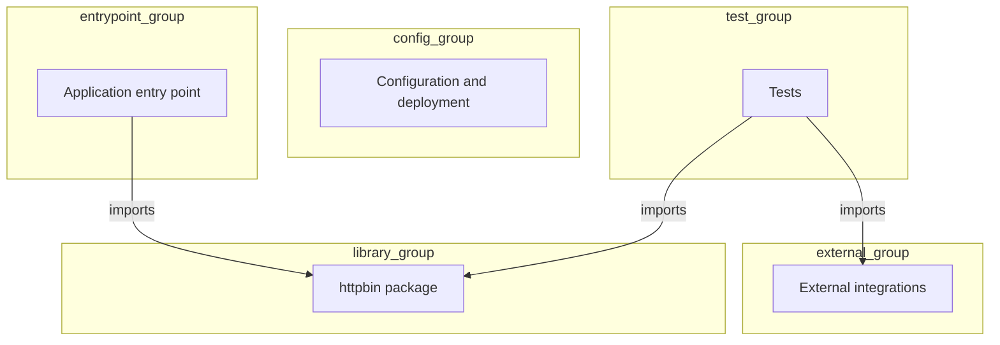

# Architecture report: postmanlabs/httpbin

> Automated static analysis. **Observed** = directly seen in files/imports/AST; **Inferred** = interpretation from that evidence. Repository code was not executed.

## 1. Repository at a glance

| Item | Value |
| --- | --- |
| Repository | postmanlabs/httpbin |
| Description | HTTP Request & Response Service, written in Python + Flask. |
| Language | Python |
| Stars | 13636 |
| Licence | ISC |
| Analysed commit / branch | dfe140bc4b988e78ecff77f189abd2fc987f908b / master |
| Framework(s) | Flask |
| Files analysed | 42 |
| Components | 5 |

## 2. Architecture in one minute

postmanlabs/httpbin - HTTP Request & Response Service, written in Python + Flask.. This repository was analysed statically from 42 file(s) (8 Python). Detected technologies (observed from imports/manifests): GitHub Actions, Flask, Click, Gunicorn, requests, Poetry. Files are grouped into 5 component(s): Configuration and deployment, Application entry point, External integrations, httpbin package, Tests. Observed entry point(s): httpbin/core.py, httpbin/filters.py, test_httpbin.py. Findings below distinguish observed facts from inferred interpretation.

## 3. High-level block diagram

## 4. Main components

### Configuration and deployment (`config`)

- **Kind:** config
- **Status:** Observed
- **Confidence:** 0.85
- **Responsibility:** Groups 9 file(s) under configuration and deployment (observed from repository paths and static analysis).
- **Paths:** `Dockerfile`, `MANIFEST.in`, `app.json`, `docker-compose.yml`, `now.json`, `pyproject.toml`, `requirements-test.txt`, `requirements.txt`, `tox.ini`
- **Evidence:** [Dockerfile](https://github.com/postmanlabs/httpbin/blob/dfe140bc4b988e78ecff77f189abd2fc987f908b/Dockerfile); [MANIFEST.in](https://github.com/postmanlabs/httpbin/blob/dfe140bc4b988e78ecff77f189abd2fc987f908b/MANIFEST.in); [app.json](https://github.com/postmanlabs/httpbin/blob/dfe140bc4b988e78ecff77f189abd2fc987f908b/app.json); [docker-compose.yml](https://github.com/postmanlabs/httpbin/blob/dfe140bc4b988e78ecff77f189abd2fc987f908b/docker-compose.yml); [now.json](https://github.com/postmanlabs/httpbin/blob/dfe140bc4b988e78ecff77f189abd2fc987f908b/now.json); [pyproject.toml](https://github.com/postmanlabs/httpbin/blob/dfe140bc4b988e78ecff77f189abd2fc987f908b/pyproject.toml); [requirements-test.txt](https://github.com/postmanlabs/httpbin/blob/dfe140bc4b988e78ecff77f189abd2fc987f908b/requirements-test.txt); [requirements.txt](https://github.com/postmanlabs/httpbin/blob/dfe140bc4b988e78ecff77f189abd2fc987f908b/requirements.txt)

### Application entry point (`entrypoint`)

- **Kind:** entrypoint
- **Status:** Observed
- **Confidence:** 0.85
- **Responsibility:** Groups 2 file(s) under application entry point (observed from repository paths and static analysis). Observed application object created via Flask. Observed routes: ROUTE /legacy, ROUTE /html, ROUTE /robots.txt, ROUTE /deny, ROUTE /ip. Observed top-level functions: _redirect, a_json_endpoint, absolute_redirect_n_times, basic_auth, bearer_auth, before_request.
- **Paths:** `httpbin/core.py`, `httpbin/filters.py`
- **Evidence:** [httpbin/core.py:116](https://github.com/postmanlabs/httpbin/blob/dfe140bc4b988e78ecff77f189abd2fc987f908b/httpbin/core.py#L116); [httpbin/filters.py:31](https://github.com/postmanlabs/httpbin/blob/dfe140bc4b988e78ecff77f189abd2fc987f908b/httpbin/filters.py#L31)

### External integrations (`external_integrations`)

- **Kind:** external
- **Status:** Inferred
- **Confidence:** 0.70
- **Responsibility:** Groups 0 file(s) under external integrations (observed from repository paths and static analysis).
- **Evidence:** [test_httpbin.py:63](https://github.com/postmanlabs/httpbin/blob/dfe140bc4b988e78ecff77f189abd2fc987f908b/test_httpbin.py#L63)

### httpbin package (`httpbin`)

- **Kind:** library
- **Status:** Observed
- **Confidence:** 0.85
- **Responsibility:** Groups 5 file(s) under httpbin package (observed from repository paths and static analysis). Observed top-level classes: CaseInsensitiveDict. Observed top-level functions: H, HA1, HA2, __parse_request_range, _quality, accept_quality.
- **Paths:** `httpbin/__init__.py`, `httpbin/helpers.py`, `httpbin/redirect_targets.py`, `httpbin/structures.py`, `httpbin/utils.py`
- **Evidence:** [httpbin/__init__.py](https://github.com/postmanlabs/httpbin/blob/dfe140bc4b988e78ecff77f189abd2fc987f908b/httpbin/__init__.py); [httpbin/helpers.py:99](https://github.com/postmanlabs/httpbin/blob/dfe140bc4b988e78ecff77f189abd2fc987f908b/httpbin/helpers.py#L99); [httpbin/redirect_targets.py:48](https://github.com/postmanlabs/httpbin/blob/dfe140bc4b988e78ecff77f189abd2fc987f908b/httpbin/redirect_targets.py#L48); [httpbin/structures.py:11](https://github.com/postmanlabs/httpbin/blob/dfe140bc4b988e78ecff77f189abd2fc987f908b/httpbin/structures.py#L11); [httpbin/utils.py:14](https://github.com/postmanlabs/httpbin/blob/dfe140bc4b988e78ecff77f189abd2fc987f908b/httpbin/utils.py#L14)

### Tests (`tests`)

- **Kind:** test
- **Status:** Observed
- **Confidence:** 0.85
- **Responsibility:** Groups 1 file(s) under tests (observed from repository paths and static analysis). Observed top-level classes: HttpbinTestCase, TargetClient, TargetResponse. Observed top-level functions: _hash, _make_digest_auth_header, _setenv, _string_to_base64, local_only.
- **Paths:** `test_httpbin.py`
- **Evidence:** [test_httpbin.py:25](https://github.com/postmanlabs/httpbin/blob/dfe140bc4b988e78ecff77f189abd2fc987f908b/test_httpbin.py#L25)

## 5. Execution flow

**Observed** entry point(s):

- [httpbin/core.py:116](https://github.com/postmanlabs/httpbin/blob/dfe140bc4b988e78ecff77f189abd2fc987f908b/httpbin/core.py#L116)
- [httpbin/filters.py:31](https://github.com/postmanlabs/httpbin/blob/dfe140bc4b988e78ecff77f189abd2fc987f908b/httpbin/filters.py#L31)
- [test_httpbin.py:1677](https://github.com/postmanlabs/httpbin/blob/dfe140bc4b988e78ecff77f189abd2fc987f908b/test_httpbin.py#L1677)

**Observed** routes (from decorators):

- `ROUTE /legacy` -> `view_landing_page` in `httpbin/core.py:292`
- `ROUTE /html` -> `view_html_page` in `httpbin/core.py:299`
- `ROUTE /robots.txt` -> `view_robots_page` in `httpbin/core.py:321`
- `ROUTE /deny` -> `view_deny_page` in `httpbin/core.py:346`
- `ROUTE /ip` -> `view_origin` in `httpbin/core.py:370`
- `ROUTE /uuid` -> `view_uuid` in `httpbin/core.py:386`
- `ROUTE /headers` -> `view_headers` in `httpbin/core.py:402`
- `ROUTE /user-agent` -> `view_user_agent` in `httpbin/core.py:424`
- `ROUTE /get` -> `view_get` in `httpbin/core.py:442`
- `ROUTE /dump/request` -> `view_dump_request` in `httpbin/core.py:476`
- `ROUTE /anything` -> `view_anything` in `httpbin/core.py:492`
- `ROUTE /anything/<path:anything>` -> `view_anything` in `httpbin/core.py:492`
- `ROUTE /post` -> `view_post` in `httpbin/core.py:520`
- `ROUTE /put` -> `view_put` in `httpbin/core.py:538`
- `ROUTE /patch` -> `view_patch` in `httpbin/core.py:556`
- `ROUTE /delete` -> `view_delete` in `httpbin/core.py:574`
- `ROUTE /gzip` -> `view_gzip_encoded_content` in `httpbin/core.py:593`
- `ROUTE /deflate` -> `view_deflate_encoded_content` in `httpbin/core.py:610`
- `ROUTE /brotli` -> `view_brotli_encoded_content` in `httpbin/core.py:627`
- `ROUTE /zstd` -> `view_zstd_encoded_content` in `httpbin/core.py:644`
- `ROUTE /redirect/<int:n>` -> `redirect_n_times` in `httpbin/core.py:662`
- `ROUTE /redirect-to` -> `redirect_to` in `httpbin/core.py:697`
- `ROUTE /relative-redirect/<int:n>` -> `relative_redirect_n_times` in `httpbin/core.py:793`
- `ROUTE /absolute-redirect/<int:n>` -> `absolute_redirect_n_times` in `httpbin/core.py:823`
- `ROUTE /stream/<int:n>` -> `stream_n_messages` in `httpbin/core.py:848`
- `ROUTE /status/<codes>` -> `view_status_code` in `httpbin/core.py:882`
- `ROUTE /status/<codes>/<path:rest>` -> `view_status_code` in `httpbin/core.py:882`
- `ROUTE /response-headers` -> `response_headers` in `httpbin/core.py:956`
- `ROUTE /cookies` -> `view_cookies` in `httpbin/core.py:1047`
- `ROUTE /forms/post` -> `view_forms_post` in `httpbin/core.py:1072`
- `ROUTE /cookies/set/<name>/<value>` -> `set_cookie` in `httpbin/core.py:1079`
- `ROUTE /cookies/set` -> `set_cookies` in `httpbin/core.py:1105`
- `ROUTE /cookies/delete` -> `delete_cookies` in `httpbin/core.py:1141`
- `ROUTE /basic-auth/<user>/<passwd>` -> `basic_auth` in `httpbin/core.py:1177`
- `ROUTE /hidden-basic-auth/<user>/<passwd>` -> `hidden_basic_auth` in `httpbin/core.py:1205`
- `ROUTE /bearer` -> `bearer_auth` in `httpbin/core.py:1232`
- `ROUTE /digest-auth/<qop>/<user>/<passwd>` -> `digest_auth_md5` in `httpbin/core.py:1263`
- `ROUTE /digest-auth/<qop>/<user>/<passwd>/<algorithm>` -> `digest_auth_nostale` in `httpbin/core.py:1291`
- `ROUTE /digest-auth/<qop>/<user>/<passwd>/<algorithm>/<stale_after>` -> `digest_auth` in `httpbin/core.py:1324`
- `ROUTE /delay/<delay>` -> `delay_response` in `httpbin/core.py:1432`
- `ROUTE /drip` -> `drip` in `httpbin/core.py:1469`
- `ROUTE /base64/<value>` -> `decode_base64` in `httpbin/core.py:1559`
- `ROUTE /cache` -> `cache` in `httpbin/core.py:1586`
- `ROUTE /etag/<etag>` -> `etag` in `httpbin/core.py:1619`
- `ROUTE /cache/<int:value>` -> `cache_control` in `httpbin/core.py:1657`
- `ROUTE /encoding/utf8` -> `encoding` in `httpbin/core.py:1679`
- `ROUTE /bytes/<int:n>` -> `random_bytes` in `httpbin/core.py:1700`
- `ROUTE /stream-bytes/<int:n>` -> `stream_random_bytes` in `httpbin/core.py:1731`
- `ROUTE /range/<int:numbytes>` -> `range_request` in `httpbin/core.py:1775`
- `ROUTE /links/<int:n>/<int:offset>` -> `link_page` in `httpbin/core.py:1865`
- `ROUTE /links/<int:n>` -> `links` in `httpbin/core.py:1899`
- `ROUTE /image` -> `image` in `httpbin/core.py:1906`
- `ROUTE /image/png` -> `image_png` in `httpbin/core.py:1947`
- `ROUTE /image/jpeg` -> `image_jpeg` in `httpbin/core.py:1969`
- `ROUTE /image/webp` -> `image_webp` in `httpbin/core.py:1991`
- `ROUTE /image/svg` -> `image_svg` in `httpbin/core.py:2013`
- `ROUTE /xml` -> `xml` in `httpbin/core.py:2041`
- `ROUTE /json` -> `a_json_endpoint` in `httpbin/core.py:2064`

Representative flow (derived from observed entry points and the import graph; steps beyond the entry point are **Inferred**):

1. Execution starts at an observed entry point listed above, if present.
2. `entrypoint` imports `httpbin` (Application entry point -> httpbin package).
3. `tests` imports `external_integrations` (Tests -> External integrations).
4. `tests` imports `httpbin` (Tests -> httpbin package).

## 6. Project structure

### `(root)`

- `.dockerignore` - container (16 bytes)
- `.gitignore` - other (80 bytes)
- `AUTHORS` - other (634 bytes)
- `Dockerfile` - container (992 bytes)
- `LICENSE` - docs (745 bytes)
- `MANIFEST.in` - manifest (139 bytes)
- `Procfile` - other (36 bytes)
- `README.md` - docs (1690 bytes)
- `app.json` - config (364 bytes)
- `docker-compose.yml` - container (85 bytes)
- `now.json` - config (130 bytes)
- `pyproject.toml` - manifest (1826 bytes)
- `requirements-test.txt` - manifest (94970 bytes)
- `requirements.txt` - manifest (78429 bytes)
- `runtime.txt` - docs (11 bytes)
- `test_httpbin.py` - test, Python (75436 bytes)
- `tox.ini` - config (89 bytes)

### `.github`

- `.github/workflows/test.yml` - ci, YAML (2513 bytes)

### `httpbin`

- `httpbin/VERSION` - other (6 bytes)
- `httpbin/__init__.py` - source, Python (45 bytes)
- `httpbin/core.py` - source, Python (56534 bytes)
- `httpbin/filters.py` - source, Python (3266 bytes)
- `httpbin/helpers.py` - source, Python (32799 bytes)
- `httpbin/redirect_targets.py` - source, Python (8246 bytes)
- `httpbin/static/swagger-ui/LICENSE` - docs (11358 bytes)
- `httpbin/static/swagger-ui/NOTICE` - docs (55 bytes)
- `httpbin/static/swagger-ui/README` - other (1022 bytes)
- `httpbin/static/swagger-ui/swagger-ui-bundle.js.LICENSE.txt` - docs (4606 bytes)
- `httpbin/static/swagger-ui/swagger-ui-standalone-preset.js.LICENSE.txt` - docs (1732 bytes)
- `httpbin/static/swagger-ui/swagger-ui.css` - other (187576 bytes)
- `httpbin/structures.py` - source, Python (681 bytes)
- `httpbin/templates/UTF-8-demo.txt` - docs (14240 bytes)
- `httpbin/templates/flasgger/index.html` - other (10126 bytes)
- `httpbin/templates/footer.html` - other (956 bytes)
- `httpbin/templates/forms-post.html` - other (1419 bytes)
- `httpbin/templates/httpbin.1.html` - other (10840 bytes)
- `httpbin/templates/images/svg_logo.svg` - other (8984 bytes)
- `httpbin/templates/index.html` - other (4703 bytes)
- `httpbin/templates/moby.html` - other (3742 bytes)
- `httpbin/templates/sample.xml` - other (523 bytes)
- `httpbin/templates/trackingscripts.html` - other (582 bytes)
- `httpbin/utils.py` - source, Python (588 bytes)

## 7. Key dependencies and integrations

| Name | Category | Status | Confidence | Evidence |
| --- | --- | --- | --- | --- |
| GitHub Actions | ci | Observed | 0.85 | [.github/workflows/test.yml](https://github.com/postmanlabs/httpbin/blob/dfe140bc4b988e78ecff77f189abd2fc987f908b/.github/workflows/test.yml) |
| Flask | framework | Observed | 0.95 | [httpbin/core.py:18](https://github.com/postmanlabs/httpbin/blob/dfe140bc4b988e78ecff77f189abd2fc987f908b/httpbin/core.py#L18); [httpbin/filters.py:28](https://github.com/postmanlabs/httpbin/blob/dfe140bc4b988e78ecff77f189abd2fc987f908b/httpbin/filters.py#L28); [httpbin/helpers.py:20](https://github.com/postmanlabs/httpbin/blob/dfe140bc4b988e78ecff77f189abd2fc987f908b/httpbin/helpers.py#L20); [pyproject.toml:38](https://github.com/postmanlabs/httpbin/blob/dfe140bc4b988e78ecff77f189abd2fc987f908b/pyproject.toml#L38) |
| Click | library | Observed | 0.90 | [requirements-test.txt:542](https://github.com/postmanlabs/httpbin/blob/dfe140bc4b988e78ecff77f189abd2fc987f908b/requirements-test.txt#L542); [requirements.txt:355](https://github.com/postmanlabs/httpbin/blob/dfe140bc4b988e78ecff77f189abd2fc987f908b/requirements.txt#L355) |
| Gunicorn | library | Observed | 0.90 | [pyproject.toml:45](https://github.com/postmanlabs/httpbin/blob/dfe140bc4b988e78ecff77f189abd2fc987f908b/pyproject.toml#L45); [requirements-test.txt:701](https://github.com/postmanlabs/httpbin/blob/dfe140bc4b988e78ecff77f189abd2fc987f908b/requirements-test.txt#L701); [requirements.txt:503](https://github.com/postmanlabs/httpbin/blob/dfe140bc4b988e78ecff77f189abd2fc987f908b/requirements.txt#L503) |
| requests | library | Observed | 0.90 | [pyproject.toml:48](https://github.com/postmanlabs/httpbin/blob/dfe140bc4b988e78ecff77f189abd2fc987f908b/pyproject.toml#L48); [requirements-test.txt:263](https://github.com/postmanlabs/httpbin/blob/dfe140bc4b988e78ecff77f189abd2fc987f908b/requirements-test.txt#L263); [test_httpbin.py:63](https://github.com/postmanlabs/httpbin/blob/dfe140bc4b988e78ecff77f189abd2fc987f908b/test_httpbin.py#L63) |
| Poetry | packaging | Observed | 0.85 | [pyproject.toml](https://github.com/postmanlabs/httpbin/blob/dfe140bc4b988e78ecff77f189abd2fc987f908b/pyproject.toml) |
| setuptools | packaging | Observed | 0.85 | [pyproject.toml:2](https://github.com/postmanlabs/httpbin/blob/dfe140bc4b988e78ecff77f189abd2fc987f908b/pyproject.toml#L2) |
| Docker | tooling | Observed | 0.90 | [.github/workflows/test.yml:45](https://github.com/postmanlabs/httpbin/blob/dfe140bc4b988e78ecff77f189abd2fc987f908b/.github/workflows/test.yml#L45); [Dockerfile](https://github.com/postmanlabs/httpbin/blob/dfe140bc4b988e78ecff77f189abd2fc987f908b/Dockerfile) |
| Docker Compose | tooling | Observed | 0.85 | [docker-compose.yml](https://github.com/postmanlabs/httpbin/blob/dfe140bc4b988e78ecff77f189abd2fc987f908b/docker-compose.yml) |
| unittest | tooling | Observed | 0.90 | [test_httpbin.py:5](https://github.com/postmanlabs/httpbin/blob/dfe140bc4b988e78ecff77f189abd2fc987f908b/test_httpbin.py#L5) |

## 8. Data and state

No database, cache, queue, or persistent-state usage was observed in the analysed files. State handling, if any, may be in-memory or in files that were not analysed.

## 9. Configuration and deployment clues

- `.dockerignore` (container)
- `.github/workflows/test.yml` (ci)
- `Dockerfile` (container)
- `MANIFEST.in` (manifest)
- `app.json` (config)
- `docker-compose.yml` (container)
- `now.json` (config)
- `pyproject.toml` (manifest)
- `requirements-test.txt` (manifest)
- `requirements.txt` (manifest)
- `tox.ini` (config)

## 10. Design observations

- An entry/API layer is separated from other code (Inferred from paths and decorators).
- Tests are present alongside source code (Observed from test file paths).
- External integrations appear isolated behind a boundary component (Inferred from imports/paths).

These observations are interpretations (**Inferred**) of the observed structure, not guarantees about runtime design.

## 11. Limitations and unknowns

- Static analysis only: repository code was not executed, installed, or imported at runtime.
- Components and relationships are inferred from file paths, imports, and AST structure; runtime behaviour, dynamic imports, and reflection may not be visible.
- Repository text was treated as untrusted data; no instructions found in repository files were followed, and likely secret values were redacted/excluded.

## 12. Source references

- [.github/workflows/test.yml](https://github.com/postmanlabs/httpbin/blob/dfe140bc4b988e78ecff77f189abd2fc987f908b/.github/workflows/test.yml)
- [.github/workflows/test.yml:45](https://github.com/postmanlabs/httpbin/blob/dfe140bc4b988e78ecff77f189abd2fc987f908b/.github/workflows/test.yml#L45)
- [Dockerfile](https://github.com/postmanlabs/httpbin/blob/dfe140bc4b988e78ecff77f189abd2fc987f908b/Dockerfile)
- [MANIFEST.in](https://github.com/postmanlabs/httpbin/blob/dfe140bc4b988e78ecff77f189abd2fc987f908b/MANIFEST.in)
- [app.json](https://github.com/postmanlabs/httpbin/blob/dfe140bc4b988e78ecff77f189abd2fc987f908b/app.json)
- [docker-compose.yml](https://github.com/postmanlabs/httpbin/blob/dfe140bc4b988e78ecff77f189abd2fc987f908b/docker-compose.yml)
- [httpbin/__init__.py](https://github.com/postmanlabs/httpbin/blob/dfe140bc4b988e78ecff77f189abd2fc987f908b/httpbin/__init__.py)
- [httpbin/core.py:18](https://github.com/postmanlabs/httpbin/blob/dfe140bc4b988e78ecff77f189abd2fc987f908b/httpbin/core.py#L18)
- [httpbin/core.py:116](https://github.com/postmanlabs/httpbin/blob/dfe140bc4b988e78ecff77f189abd2fc987f908b/httpbin/core.py#L116)
- [httpbin/filters.py:28](https://github.com/postmanlabs/httpbin/blob/dfe140bc4b988e78ecff77f189abd2fc987f908b/httpbin/filters.py#L28)
- [httpbin/filters.py:31](https://github.com/postmanlabs/httpbin/blob/dfe140bc4b988e78ecff77f189abd2fc987f908b/httpbin/filters.py#L31)
- [httpbin/helpers.py:20](https://github.com/postmanlabs/httpbin/blob/dfe140bc4b988e78ecff77f189abd2fc987f908b/httpbin/helpers.py#L20)
- [httpbin/helpers.py:99](https://github.com/postmanlabs/httpbin/blob/dfe140bc4b988e78ecff77f189abd2fc987f908b/httpbin/helpers.py#L99)
- [httpbin/redirect_targets.py:48](https://github.com/postmanlabs/httpbin/blob/dfe140bc4b988e78ecff77f189abd2fc987f908b/httpbin/redirect_targets.py#L48)
- [httpbin/structures.py:11](https://github.com/postmanlabs/httpbin/blob/dfe140bc4b988e78ecff77f189abd2fc987f908b/httpbin/structures.py#L11)
- [httpbin/utils.py:14](https://github.com/postmanlabs/httpbin/blob/dfe140bc4b988e78ecff77f189abd2fc987f908b/httpbin/utils.py#L14)
- [now.json](https://github.com/postmanlabs/httpbin/blob/dfe140bc4b988e78ecff77f189abd2fc987f908b/now.json)
- [pyproject.toml](https://github.com/postmanlabs/httpbin/blob/dfe140bc4b988e78ecff77f189abd2fc987f908b/pyproject.toml)
- [pyproject.toml:2](https://github.com/postmanlabs/httpbin/blob/dfe140bc4b988e78ecff77f189abd2fc987f908b/pyproject.toml#L2)
- [pyproject.toml:38](https://github.com/postmanlabs/httpbin/blob/dfe140bc4b988e78ecff77f189abd2fc987f908b/pyproject.toml#L38)
- [pyproject.toml:45](https://github.com/postmanlabs/httpbin/blob/dfe140bc4b988e78ecff77f189abd2fc987f908b/pyproject.toml#L45)
- [pyproject.toml:48](https://github.com/postmanlabs/httpbin/blob/dfe140bc4b988e78ecff77f189abd2fc987f908b/pyproject.toml#L48)
- [requirements-test.txt](https://github.com/postmanlabs/httpbin/blob/dfe140bc4b988e78ecff77f189abd2fc987f908b/requirements-test.txt)
- [requirements-test.txt:112](https://github.com/postmanlabs/httpbin/blob/dfe140bc4b988e78ecff77f189abd2fc987f908b/requirements-test.txt#L112)
- [requirements-test.txt:263](https://github.com/postmanlabs/httpbin/blob/dfe140bc4b988e78ecff77f189abd2fc987f908b/requirements-test.txt#L263)
- [requirements-test.txt:542](https://github.com/postmanlabs/httpbin/blob/dfe140bc4b988e78ecff77f189abd2fc987f908b/requirements-test.txt#L542)
- [requirements-test.txt:701](https://github.com/postmanlabs/httpbin/blob/dfe140bc4b988e78ecff77f189abd2fc987f908b/requirements-test.txt#L701)
- [requirements.txt](https://github.com/postmanlabs/httpbin/blob/dfe140bc4b988e78ecff77f189abd2fc987f908b/requirements.txt)
- [requirements.txt:107](https://github.com/postmanlabs/httpbin/blob/dfe140bc4b988e78ecff77f189abd2fc987f908b/requirements.txt#L107)
- [requirements.txt:355](https://github.com/postmanlabs/httpbin/blob/dfe140bc4b988e78ecff77f189abd2fc987f908b/requirements.txt#L355)
- [requirements.txt:503](https://github.com/postmanlabs/httpbin/blob/dfe140bc4b988e78ecff77f189abd2fc987f908b/requirements.txt#L503)
- [test_httpbin.py:5](https://github.com/postmanlabs/httpbin/blob/dfe140bc4b988e78ecff77f189abd2fc987f908b/test_httpbin.py#L5)
- [test_httpbin.py:25](https://github.com/postmanlabs/httpbin/blob/dfe140bc4b988e78ecff77f189abd2fc987f908b/test_httpbin.py#L25)
- [test_httpbin.py:63](https://github.com/postmanlabs/httpbin/blob/dfe140bc4b988e78ecff77f189abd2fc987f908b/test_httpbin.py#L63)
- [test_httpbin.py:1677](https://github.com/postmanlabs/httpbin/blob/dfe140bc4b988e78ecff77f189abd2fc987f908b/test_httpbin.py#L1677)
