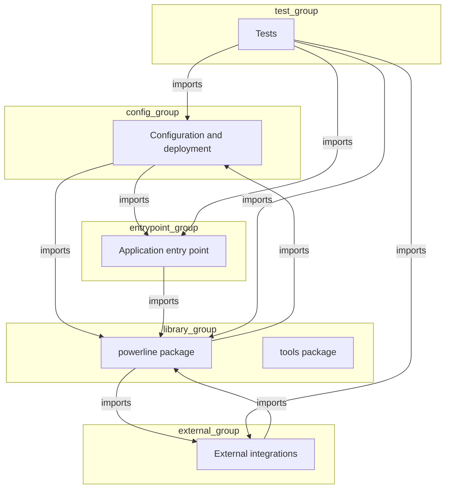

# Architecture report: powerline/powerline

> Automated static analysis. **Observed** = directly seen in files/imports/AST; **Inferred** = interpretation from that evidence. Repository code was not executed.

## 1. Repository at a glance

| Item | Value |
| --- | --- |
| Repository | powerline/powerline |
| Description | Powerline is a statusline plugin for vim, and provides statuslines and prompts for several other applications, including zsh, bash, tmux, IPython, Awesome and Qtile. |
| Language | Python |
| Stars | 14844 |
| Licence | Other |
| Analysed commit / branch | 11808cbe5c16e4621edcaefa916b5add81eab799 / develop |
| Framework(s) | None detected |
| Files analysed | 366 |
| Components | 6 |

## 2. Architecture in one minute

powerline/powerline - Powerline is a statusline plugin for vim, and provides statuslines and prompts for several other applications, including zsh, bash, tmux, IPython, Awesome and Qtile.. This repository was analysed statically from 366 file(s) (177 Python). Detected technologies (observed from imports/manifests): GitHub Actions, setuptools, unittest. Files are grouped into 6 component(s): Configuration and deployment, Application entry point, External integrations, powerline package, Tests, tools package. Observed entry point(s): powerline/bindings/awesome/powerline-awesome.py, powerline/bindings/bar/powerline-bar.py, powerline/bindings/i3/powerline-i3.py. Findings below distinguish observed facts from inferred interpretation.

## 3. High-level block diagram

## 4. Main components

### Configuration and deployment (`config`)

- **Kind:** config
- **Status:** Observed
- **Confidence:** 0.85
- **Responsibility:** Groups 52 file(s) under configuration and deployment (observed from repository paths and static analysis). Observed top-level classes: ConfigArgParser, ConfigLoader, DeferredWatcher, DummyWatcher, EmptyArgs, StrFunction. Observed top-level functions: check_command, compile_client, create_powerline_logger, deduce_command, get_argparser, get_main_config.
- **Paths:** `MANIFEST.in`, `powerline/bindings/config.py`, `powerline/commands/config.py`, `powerline/config.py`, `powerline/config_files/colors.json`, `powerline/config_files/colorschemes/default.json`, `powerline/config_files/colorschemes/ipython/__main__.json`, `powerline/config_files/colorschemes/pdb/__main__.json`, `powerline/config_files/colorschemes/pdb/default.json`, `powerline/config_files/colorschemes/pdb/solarized.json`, `powerline/config_files/colorschemes/shell/__main__.json`, `powerline/config_files/colorschemes/shell/default.json`, `powerline/config_files/colorschemes/shell/solarized.json`, `powerline/config_files/colorschemes/solarized.json`, `powerline/config_files/colorschemes/tmux/default.json`, `powerline/config_files/colorschemes/tmux/solarized.json`, `powerline/config_files/colorschemes/vim/__main__.json`, `powerline/config_files/colorschemes/vim/default.json`, `powerline/config_files/colorschemes/vim/solarized.json`, `powerline/config_files/colorschemes/vim/solarizedlight.json`, `powerline/config_files/config.json`, `powerline/config_files/themes/ascii.json`, `powerline/config_files/themes/ipython/in.json`, `powerline/config_files/themes/ipython/in2.json`, `powerline/config_files/themes/ipython/out.json`, `powerline/config_files/themes/ipython/rewrite.json`, `powerline/config_files/themes/pdb/default.json`, `powerline/config_files/themes/powerline.json`, `powerline/config_files/themes/powerline_terminus.json`, `powerline/config_files/themes/powerline_unicode7.json`, `powerline/config_files/themes/shell/__main__.json`, `powerline/config_files/themes/shell/continuation.json`, `powerline/config_files/themes/shell/default.json`, `powerline/config_files/themes/shell/default_leftonly.json`, `powerline/config_files/themes/shell/select.json`, `powerline/config_files/themes/tmux/default.json`, `powerline/config_files/themes/unicode.json`, `powerline/config_files/themes/unicode_terminus.json`, `powerline/config_files/themes/unicode_terminus_condensed.json`, `powerline/config_files/themes/vim/__main__.json`, `powerline/config_files/themes/vim/cmdwin.json`, `powerline/config_files/themes/vim/default.json`, `powerline/config_files/themes/vim/help.json`, `powerline/config_files/themes/vim/plugin_commandt.json`, `powerline/config_files/themes/vim/plugin_gundo-preview.json`, `powerline/config_files/themes/vim/plugin_gundo.json`, `powerline/config_files/themes/vim/plugin_nerdtree.json`, `powerline/config_files/themes/vim/quickfix.json`, `powerline/config_files/themes/vim/tabline.json`, `powerline/config_files/themes/wm/default.json`, `powerline/lib/config.py`, `setup.py`
- **Evidence:** [MANIFEST.in](https://github.com/powerline/powerline/blob/11808cbe5c16e4621edcaefa916b5add81eab799/MANIFEST.in); [powerline/bindings/config.py:35](https://github.com/powerline/powerline/blob/11808cbe5c16e4621edcaefa916b5add81eab799/powerline/bindings/config.py#L35); [powerline/commands/config.py:9](https://github.com/powerline/powerline/blob/11808cbe5c16e4621edcaefa916b5add81eab799/powerline/commands/config.py#L9); [powerline/config.py](https://github.com/powerline/powerline/blob/11808cbe5c16e4621edcaefa916b5add81eab799/powerline/config.py); [powerline/config_files/colors.json](https://github.com/powerline/powerline/blob/11808cbe5c16e4621edcaefa916b5add81eab799/powerline/config_files/colors.json); [powerline/config_files/colorschemes/default.json](https://github.com/powerline/powerline/blob/11808cbe5c16e4621edcaefa916b5add81eab799/powerline/config_files/colorschemes/default.json); [powerline/config_files/colorschemes/ipython/__main__.json](https://github.com/powerline/powerline/blob/11808cbe5c16e4621edcaefa916b5add81eab799/powerline/config_files/colorschemes/ipython/__main__.json); [powerline/config_files/colorschemes/pdb/__main__.json](https://github.com/powerline/powerline/blob/11808cbe5c16e4621edcaefa916b5add81eab799/powerline/config_files/colorschemes/pdb/__main__.json)

### Application entry point (`entrypoint`)

- **Kind:** entrypoint
- **Status:** Observed
- **Confidence:** 0.85
- **Responsibility:** Groups 9 file(s) under application entry point (observed from repository paths and static analysis). Observed top-level classes: I3Powerline. Observed top-level functions: color, compute_steps, create_ebuilds, create_release, dec_scale_generator, find_color.
- **Paths:** `powerline/bindings/awesome/powerline-awesome.py`, `powerline/bindings/bar/powerline-bar.py`, `powerline/bindings/i3/powerline-i3.py`, `powerline/bindings/lemonbar/powerline-lemonbar.py`, `powerline/bindings/pdb/__main__.py`, `powerline/commands/main.py`, `scripts/powerline-release.py`, `tools/generate_gradients.py`, `tools/purge-PRs.py`
- **Evidence:** [powerline/bindings/awesome/powerline-awesome.py:11](https://github.com/powerline/powerline/blob/11808cbe5c16e4621edcaefa916b5add81eab799/powerline/bindings/awesome/powerline-awesome.py#L11); [powerline/bindings/bar/powerline-bar.py](https://github.com/powerline/powerline/blob/11808cbe5c16e4621edcaefa916b5add81eab799/powerline/bindings/bar/powerline-bar.py); [powerline/bindings/i3/powerline-i3.py:16](https://github.com/powerline/powerline/blob/11808cbe5c16e4621edcaefa916b5add81eab799/powerline/bindings/i3/powerline-i3.py#L16); [powerline/bindings/lemonbar/powerline-lemonbar.py](https://github.com/powerline/powerline/blob/11808cbe5c16e4621edcaefa916b5add81eab799/powerline/bindings/lemonbar/powerline-lemonbar.py); [powerline/bindings/pdb/__main__.py](https://github.com/powerline/powerline/blob/11808cbe5c16e4621edcaefa916b5add81eab799/powerline/bindings/pdb/__main__.py); [powerline/commands/main.py:27](https://github.com/powerline/powerline/blob/11808cbe5c16e4621edcaefa916b5add81eab799/powerline/commands/main.py#L27); [scripts/powerline-release.py:21](https://github.com/powerline/powerline/blob/11808cbe5c16e4621edcaefa916b5add81eab799/scripts/powerline-release.py#L21); [tools/generate_gradients.py:22](https://github.com/powerline/powerline/blob/11808cbe5c16e4621edcaefa916b5add81eab799/tools/generate_gradients.py#L22)

### External integrations (`external_integrations`)

- **Kind:** external
- **Status:** Observed
- **Confidence:** 0.85
- **Responsibility:** Groups 3 file(s) under external integrations (observed from repository paths and static analysis). Observed top-level functions: eintr_retry_call, tobytes.
- **Paths:** `client/powerline.c`, `client/powerline.py`, `client/powerline.sh`
- **Evidence:** [client/powerline.c](https://github.com/powerline/powerline/blob/11808cbe5c16e4621edcaefa916b5add81eab799/client/powerline.c); [client/powerline.py:42](https://github.com/powerline/powerline/blob/11808cbe5c16e4621edcaefa916b5add81eab799/client/powerline.py#L42); [client/powerline.sh](https://github.com/powerline/powerline/blob/11808cbe5c16e4621edcaefa916b5add81eab799/client/powerline.sh)

### powerline package (`powerline`)

- **Kind:** library
- **Status:** Observed
- **Confidence:** 0.85
- **Responsibility:** Groups 129 file(s) under powerline package (observed from repository paths and static analysis). Observed top-level classes: AliasEvent, Args, AwesomeThread, BaseConstructor, BaseDirChanged, BaseResolver. Observed top-level functions: _clear_special_values, _config_loader_condition, _convert_seconds, _convert_state, _external_ip, _fetch_battery_info.
- **Paths:** `powerline/__init__.py`, `powerline/bindings/__init__.py`, `powerline/bindings/bash/powerline.sh`, `powerline/bindings/ipython/__init__.py`, `powerline/bindings/ipython/post_0_11.py`, `powerline/bindings/ipython/pre_0_11.py`, `powerline/bindings/ipython/since_5.py`, `powerline/bindings/ipython/since_7.py`, `powerline/bindings/pdb/__init__.py`, `powerline/bindings/qtile/__init__.py`, `powerline/bindings/qtile/widget.py`, `powerline/bindings/shell/powerline.sh`, `powerline/bindings/tmux/__init__.py`, `powerline/bindings/vim/__init__.py`, `powerline/bindings/wm/__init__.py`, `powerline/bindings/wm/awesome.py`, `powerline/bindings/zsh/__init__.py`, `powerline/colorscheme.py`, `powerline/commands/__init__.py`, `powerline/commands/daemon.py`, `powerline/commands/lemonbar.py`, `powerline/commands/lint.py`, `powerline/ipython.py`, `powerline/lemonbar.py`, `powerline/lib/__init__.py`, `powerline/lib/debug.py`, `powerline/lib/dict.py`, `powerline/lib/encoding.py`, `powerline/lib/humanize_bytes.py`, `powerline/lib/inotify.py`, `powerline/lib/memoize.py`, `powerline/lib/monotonic.py`, `powerline/lib/overrides.py`, `powerline/lib/path.py`, `powerline/lib/shell.py`, `powerline/lib/threaded.py`, `powerline/lib/unicode.py`, `powerline/lib/url.py`, `powerline/lib/vcs/__init__.py`, `powerline/lib/vcs/bzr.py`, `powerline/lib/vcs/git.py`, `powerline/lib/vcs/mercurial.py`, `powerline/lib/watcher/__init__.py`, `powerline/lib/watcher/inotify.py`, `powerline/lib/watcher/stat.py`, `powerline/lib/watcher/tree.py`, `powerline/lib/watcher/uv.py`, `powerline/lint/__init__.py`, `powerline/lint/checks.py`, `powerline/lint/context.py`, `powerline/lint/imp.py`, `powerline/lint/inspect.py`, `powerline/lint/markedjson/__init__.py`, `powerline/lint/markedjson/composer.py`, `powerline/lint/markedjson/constructor.py`, `powerline/lint/markedjson/error.py`, `powerline/lint/markedjson/events.py`, `powerline/lint/markedjson/loader.py`, `powerline/lint/markedjson/markedvalue.py`, `powerline/lint/markedjson/nodes.py`, `powerline/lint/markedjson/parser.py`, `powerline/lint/markedjson/reader.py`, `powerline/lint/markedjson/resolver.py`, `powerline/lint/markedjson/scanner.py`, `powerline/lint/markedjson/tokens.py`, `powerline/lint/selfcheck.py`, `powerline/lint/spec.py`, `powerline/listers/__init__.py`, `powerline/listers/i3wm.py`, `powerline/listers/pdb.py`, `powerline/listers/vim.py`, `powerline/matchers/__init__.py`, `powerline/matchers/vim/__init__.py`, `powerline/matchers/vim/plugin/__init__.py`, `powerline/matchers/vim/plugin/commandt.py`, `powerline/matchers/vim/plugin/gundo.py`, `powerline/matchers/vim/plugin/nerdtree.py`, `powerline/pdb.py`, `powerline/renderer.py`, `powerline/renderers/__init__.py`, `powerline/renderers/i3bar.py`, `powerline/renderers/ipython/__init__.py`, `powerline/renderers/ipython/pre_5.py`, `powerline/renderers/ipython/since_5.py`, `powerline/renderers/ipython/since_7.py`, `powerline/renderers/lemonbar.py`, `powerline/renderers/pango_markup.py`, `powerline/renderers/pdb.py`, `powerline/renderers/shell/__init__.py`, `powerline/renderers/shell/bash.py`, `powerline/renderers/shell/ksh.py`, `powerline/renderers/shell/rcsh.py`, `powerline/renderers/shell/readline.py`, `powerline/renderers/shell/tcsh.py`, `powerline/renderers/shell/zsh.py`, `powerline/renderers/tmux.py`, `powerline/renderers/vim.py`, `powerline/segment.py`, `powerline/segments/__init__.py`, `powerline/segments/common/__init__.py`, `powerline/segments/common/bat.py`, `powerline/segments/common/env.py`, `powerline/segments/common/mail.py`, `powerline/segments/common/net.py`, `powerline/segments/common/players.py`, `powerline/segments/common/sys.py`, `powerline/segments/common/time.py`, `powerline/segments/common/vcs.py`, `powerline/segments/common/wthr.py`, `powerline/segments/i3wm.py`, `powerline/segments/ipython.py`, `powerline/segments/pdb.py`, `powerline/segments/shell.py`, `powerline/segments/tmux.py`, `powerline/segments/vim/__init__.py`, `powerline/segments/vim/plugin/__init__.py`, `powerline/segments/vim/plugin/ale.py`, `powerline/segments/vim/plugin/capslock.py`, `powerline/segments/vim/plugin/coc.py`, `powerline/segments/vim/plugin/commandt.py`, `powerline/segments/vim/plugin/nerdtree.py`, `powerline/segments/vim/plugin/syntastic.py`, `powerline/segments/vim/plugin/tagbar.py`, `powerline/selectors/__init__.py`, `powerline/selectors/vim.py`, `powerline/shell.py`, `powerline/theme.py`, `powerline/version.py`, `powerline/vim.py`
- **Evidence:** [powerline/__init__.py:19](https://github.com/powerline/powerline/blob/11808cbe5c16e4621edcaefa916b5add81eab799/powerline/__init__.py#L19); [powerline/bindings/__init__.py](https://github.com/powerline/powerline/blob/11808cbe5c16e4621edcaefa916b5add81eab799/powerline/bindings/__init__.py); [powerline/bindings/bash/powerline.sh](https://github.com/powerline/powerline/blob/11808cbe5c16e4621edcaefa916b5add81eab799/powerline/bindings/bash/powerline.sh); [powerline/bindings/ipython/__init__.py](https://github.com/powerline/powerline/blob/11808cbe5c16e4621edcaefa916b5add81eab799/powerline/bindings/ipython/__init__.py); [powerline/bindings/ipython/post_0_11.py:22](https://github.com/powerline/powerline/blob/11808cbe5c16e4621edcaefa916b5add81eab799/powerline/bindings/ipython/post_0_11.py#L22); [powerline/bindings/ipython/pre_0_11.py:16](https://github.com/powerline/powerline/blob/11808cbe5c16e4621edcaefa916b5add81eab799/powerline/bindings/ipython/pre_0_11.py#L16); [powerline/bindings/ipython/since_5.py:14](https://github.com/powerline/powerline/blob/11808cbe5c16e4621edcaefa916b5add81eab799/powerline/bindings/ipython/since_5.py#L14); [powerline/bindings/ipython/since_7.py:13](https://github.com/powerline/powerline/blob/11808cbe5c16e4621edcaefa916b5add81eab799/powerline/bindings/ipython/since_7.py#L13)

### Tests (`tests`)

- **Kind:** test
- **Status:** Observed
- **Confidence:** 0.85
- **Responsibility:** Groups 98 file(s) under tests (observed from repository paths and static analysis). Observed top-level classes: Args, AttrReplace, CTypesFunction, CTypesLibraryFuncsCollection, EvenSimplerRenderer, ExpectProcess. Observed top-level functions: _b, _bw, _close, _construct_result, _edit, _emul_bufname.
- **Paths:** `tests/__init__.py`, `tests/install.sh`, `tests/modules/__init__.py`, `tests/modules/lib/__init__.py`, `tests/modules/lib/config_mock.py`, `tests/modules/lib/fsconfig.py`, `tests/modules/lib/terminal.py`, `tests/modules/lib/vterm.py`, `tests/modules/matchers.py`, `tests/modules/vim.py`, `tests/shlib/common.sh`, `tests/shlib/vim.sh`, `tests/shlib/vterm.sh`, `tests/test.sh`, `tests/test_awesome/path/awesome-client`, `tests/test_awesome/powerline/config.json`, `tests/test_awesome/powerline/themes/wm/default.json`, `tests/test_awesome/powerline/themes/wm/dvi.json`, `tests/test_awesome/test.sh`, `tests/test_bar/path/lemonbar`, `tests/test_bar/path/xrandr`, `tests/test_bar/powerline/config.json`, `tests/test_bar/powerline/themes/wm/default.json`, `tests/test_bar/powerline/themes/wm/dvi.json`, `tests/test_bar/test.sh`, `tests/test_daemon/test.sh`, `tests/test_in_vterm/shell/inits/dash`, `tests/test_in_vterm/test.sh`, `tests/test_in_vterm/test_shells.py`, `tests/test_in_vterm/test_shells.sh`, `tests/test_in_vterm/test_tmux.py`, `tests/test_in_vterm/test_tmux.sh`, `tests/test_in_vterm/test_vim.py`, `tests/test_in_vterm/test_vim.sh`, `tests/test_lint/test.sh`, `tests/test_python/empty`, `tests/test_python/test.sh`, `tests/test_python/test_cmdline.py`, `tests/test_python/test_config_merging.py`, `tests/test_python/test_config_reload.py`, `tests/test_python/test_configuration.py`, `tests/test_python/test_lib.py`, `tests/test_python/test_lib_config.py`, `tests/test_python/test_listers.py`, `tests/test_python/test_logging.py`, `tests/test_python/test_provided_config_files.py`, `tests/test_python/test_segments.py`, `tests/test_python/test_selectors.py`, `tests/test_python/test_watcher.py`, `tests/test_shells/bgscript.sh`, `tests/test_shells/inputs/bash`, `tests/test_shells/inputs/busybox`, `tests/test_shells/inputs/dash`, `tests/test_shells/inputs/fish`, `tests/test_shells/inputs/ipython`, `tests/test_shells/inputs/mksh`, `tests/test_shells/inputs/pdb`, `tests/test_shells/inputs/rc`, `tests/test_shells/inputs/tcsh`, `tests/test_shells/inputs/zsh`, `tests/test_shells/ipython_home/profile_default/ipython_config.py`, `tests/test_shells/outputs/bash.daemon.ok`, `tests/test_shells/outputs/bash.nodaemon.ok`, `tests/test_shells/outputs/busybox.daemon.ok`, `tests/test_shells/outputs/busybox.nodaemon.ok`, `tests/test_shells/outputs/dash.daemon.ok`, `tests/test_shells/outputs/dash.nodaemon.ok`, `tests/test_shells/outputs/fish.ok`, `tests/test_shells/outputs/ipython.ok`, `tests/test_shells/outputs/mksh.daemon.ok`, `tests/test_shells/outputs/mksh.nodaemon.ok`, `tests/test_shells/outputs/pdb.module.ok`, `tests/test_shells/outputs/pdb.subclass.ok`, `tests/test_shells/outputs/rc.daemon.ok`, `tests/test_shells/outputs/rc.nodaemon.ok`, `tests/test_shells/outputs/tcsh.ok`, `tests/test_shells/outputs/zsh.daemon.ok`, `tests/test_shells/outputs/zsh.nodaemon.ok`, `tests/test_shells/outputs/zsh.zpython.ok`, `tests/test_shells/pdb-main.py`, `tests/test_shells/pdb-script.py`, `tests/test_shells/postproc.py`, `tests/test_shells/run_script.py`, `tests/test_shells/test.sh`, `tests/test_shells/waitpid.sh`, `tests/test_shells/zsh_test_script.zsh`, `tests/test_vim/pyfiles/setup_statusline_catcher.py`, `tests/test_vim/test.sh`, `tests/test_vim/tests/commandt_plugin.vim`, `tests/test_vim/tests/empty_encoding.old.vim`, `tests/test_vim/tests/foreign_stl_override.vim`, `tests/test_vim/tests/invalid_unicode.vim`, `tests/test_vim/tests/local_overrides.vim`, `tests/test_vim/tests/nerdtree_plugin.vim`, `tests/test_vim/tests/plugin_file.vim`, `tests/test_vim/tests/tabline.vim`, `tests/test_vim/vim_utils.vim`, `tests/vim_sys_path/vim.py`
- **Evidence:** [tests/__init__.py](https://github.com/powerline/powerline/blob/11808cbe5c16e4621edcaefa916b5add81eab799/tests/__init__.py); [tests/install.sh](https://github.com/powerline/powerline/blob/11808cbe5c16e4621edcaefa916b5add81eab799/tests/install.sh); [tests/modules/__init__.py:19](https://github.com/powerline/powerline/blob/11808cbe5c16e4621edcaefa916b5add81eab799/tests/modules/__init__.py#L19); [tests/modules/lib/__init__.py:8](https://github.com/powerline/powerline/blob/11808cbe5c16e4621edcaefa916b5add81eab799/tests/modules/lib/__init__.py#L8); [tests/modules/lib/config_mock.py:22](https://github.com/powerline/powerline/blob/11808cbe5c16e4621edcaefa916b5add81eab799/tests/modules/lib/config_mock.py#L22); [tests/modules/lib/fsconfig.py:17](https://github.com/powerline/powerline/blob/11808cbe5c16e4621edcaefa916b5add81eab799/tests/modules/lib/fsconfig.py#L17); [tests/modules/lib/terminal.py:19](https://github.com/powerline/powerline/blob/11808cbe5c16e4621edcaefa916b5add81eab799/tests/modules/lib/terminal.py#L19); [tests/modules/lib/vterm.py:14](https://github.com/powerline/powerline/blob/11808cbe5c16e4621edcaefa916b5add81eab799/tests/modules/lib/vterm.py#L14)

### tools package (`tools`)

- **Kind:** library
- **Status:** Observed
- **Confidence:** 0.85
- **Responsibility:** Groups 1 file(s) under tools package (observed from repository paths and static analysis). Observed top-level functions: find_color, get_lab, get_rgb, get_upscaled_values, lab_to_csi.
- **Paths:** `tools/colors_find.py`
- **Evidence:** [tools/colors_find.py:13](https://github.com/powerline/powerline/blob/11808cbe5c16e4621edcaefa916b5add81eab799/tools/colors_find.py#L13)

## 5. Execution flow

**Observed** entry point(s):

- [powerline/bindings/awesome/powerline-awesome.py:19](https://github.com/powerline/powerline/blob/11808cbe5c16e4621edcaefa916b5add81eab799/powerline/bindings/awesome/powerline-awesome.py#L19)
- [powerline/bindings/bar/powerline-bar.py:17](https://github.com/powerline/powerline/blob/11808cbe5c16e4621edcaefa916b5add81eab799/powerline/bindings/bar/powerline-bar.py#L17)
- [powerline/bindings/i3/powerline-i3.py:24](https://github.com/powerline/powerline/blob/11808cbe5c16e4621edcaefa916b5add81eab799/powerline/bindings/i3/powerline-i3.py#L24)
- [powerline/bindings/lemonbar/powerline-lemonbar.py:16](https://github.com/powerline/powerline/blob/11808cbe5c16e4621edcaefa916b5add81eab799/powerline/bindings/lemonbar/powerline-lemonbar.py#L16)
- [powerline/bindings/pdb/__main__.py:8](https://github.com/powerline/powerline/blob/11808cbe5c16e4621edcaefa916b5add81eab799/powerline/bindings/pdb/__main__.py#L8)
- [scripts/powerline-release.py:233](https://github.com/powerline/powerline/blob/11808cbe5c16e4621edcaefa916b5add81eab799/scripts/powerline-release.py#L233)
- [tools/generate_gradients.py:176](https://github.com/powerline/powerline/blob/11808cbe5c16e4621edcaefa916b5add81eab799/tools/generate_gradients.py#L176)
- [tools/purge-PRs.py:16](https://github.com/powerline/powerline/blob/11808cbe5c16e4621edcaefa916b5add81eab799/tools/purge-PRs.py#L16)

Representative flow (derived from observed entry points and the import graph; steps beyond the entry point are **Inferred**):

1. Execution starts at an observed entry point listed above, if present.
2. `config` imports `entrypoint` (Configuration and deployment -> Application entry point).
3. `config` imports `powerline` (Configuration and deployment -> powerline package).
4. `entrypoint` imports `powerline` (Application entry point -> powerline package).
5. `external_integrations` imports `powerline` (External integrations -> powerline package).
6. `powerline` imports `config` (powerline package -> Configuration and deployment).
7. `powerline` imports `external_integrations` (powerline package -> External integrations).
8. `tests` imports `config` (Tests -> Configuration and deployment).
9. `tests` imports `entrypoint` (Tests -> Application entry point).

## 6. Project structure

### `(root)`

- `.editorconfig` - config (565 bytes)
- `.gitattributes` - other (31 bytes)
- `.gitignore` - other (115 bytes)
- `.local.vimrc` - other (501 bytes)
- `.travis.yml` - ci, YAML (604 bytes)
- `CONTRIBUTING.rst` - docs (4904 bytes)
- `LICENSE` - docs (1132 bytes)
- `MANIFEST.in` - manifest (276 bytes)
- `README.rst` - docs (5729 bytes)
- `setup.py` - manifest, Python (3995 bytes)

### `.github`

- `.github/workflows/main.yaml` - ci, YAML (1042 bytes)

### `client`

- `client/powerline.c` - source, C (3795 bytes)
- `client/powerline.py` - source, Python (2170 bytes)
- `client/powerline.sh` - source, Shell (1055 bytes)

### `docs`

- `docs/.gitignore` - docs (7 bytes)
- `docs/Makefile` - docs (1134 bytes)
- `docs/source/_static/css/theme_overrides.css` - docs (157 bytes)
- `docs/source/commands.rst` - docs (174 bytes)
- `docs/source/commands/config.rst` - docs (179 bytes)
- `docs/source/commands/daemon.rst` - docs (179 bytes)
- `docs/source/commands/lint.rst` - docs (232 bytes)
- `docs/source/commands/main.rst` - docs (195 bytes)
- `docs/source/conf.py` - docs (1918 bytes)
- `docs/source/configuration.rst` - docs (6103 bytes)
- `docs/source/configuration/listers.rst` - docs (1004 bytes)
- `docs/source/configuration/local.rst` - docs (11501 bytes)
- `docs/source/configuration/reference.rst` - docs (24602 bytes)
- `docs/source/configuration/segments.rst` - docs (745 bytes)
- `docs/source/configuration/segments/common.rst` - docs (822 bytes)
- `docs/source/configuration/segments/i3wm.rst` - docs (96 bytes)
- `docs/source/configuration/segments/pdb.rst` - docs (93 bytes)
- `docs/source/configuration/segments/shell.rst` - docs (100 bytes)
- `docs/source/configuration/segments/tmux.rst` - docs (96 bytes)
- `docs/source/configuration/segments/vim.rst` - docs (822 bytes)
- `docs/source/configuration/selectors.rst` - docs (380 bytes)
- `docs/source/configuration/selectors/vim.rst` - docs (96 bytes)
- `docs/source/develop.rst` - docs (201 bytes)
- `docs/source/develop/extensions.rst` - docs (2138 bytes)
- `docs/source/develop/listers.rst` - docs (2020 bytes)
- `docs/source/develop/local-themes.rst` - docs (3261 bytes)
- `docs/source/develop/segments.rst` - docs (20823 bytes)
- `docs/source/develop/tips-and-tricks.rst` - docs (743 bytes)
- `docs/source/index.rst` - docs (332 bytes)
- `docs/source/installation.rst` - docs (4951 bytes)
- `docs/source/installation/linux.rst` - docs (4379 bytes)
- `docs/source/installation/osx.rst` - docs (2319 bytes)
- `docs/source/license-and-credits.rst` - docs (1069 bytes)
- `docs/source/overview.rst` - docs (2737 bytes)
- `docs/source/powerline_autodoc.py` - docs (1826 bytes)
- `docs/source/powerline_automan.py` - docs (11625 bytes)
- `docs/source/tips-and-tricks.rst` - docs (3399 bytes)
- `docs/source/troubleshooting.rst` - docs (14375 bytes)
- `docs/source/troubleshooting/linux.rst` - docs (3346 bytes)
- `docs/source/troubleshooting/osx.rst` - docs (3097 bytes)
- `docs/source/usage.rst` - docs (3696 bytes)
- `docs/source/usage/other.rst` - docs (7876 bytes)
- `docs/source/usage/shell-prompts.rst` - docs (5707 bytes)
- `docs/source/usage/wm-widgets.rst` - docs (2626 bytes)

### `font`

- `font/10-powerline-symbols.conf` - other (2821 bytes)

### `powerline`

- `powerline/__init__.py` - source, Python (31784 bytes)
- `powerline/bindings/__init__.py` - source, Python (0 bytes)
- `powerline/bindings/awesome/powerline-awesome.py` - source, Python (424 bytes)
- `powerline/bindings/awesome/powerline.lua` - other (436 bytes)
- `powerline/bindings/bar/powerline-bar.py` - source, Python (1501 bytes)
- `powerline/bindings/bash/powerline.sh` - source, Shell (4183 bytes)
- `powerline/bindings/config.py` - source, Python (10073 bytes)
- `powerline/bindings/fish/powerline-setup.fish` - other (3144 bytes)
- `powerline/bindings/i3/powerline-i3.py` - source, Python (1067 bytes)
- `powerline/bindings/ipython/__init__.py` - source, Python (0 bytes)
- `powerline/bindings/ipython/post_0_11.py` - source, Python (3475 bytes)
- `powerline/bindings/ipython/pre_0_11.py` - source, Python (3856 bytes)
- `powerline/bindings/ipython/since_5.py` - source, Python (2645 bytes)
- `powerline/bindings/ipython/since_7.py` - source, Python (2891 bytes)
- `powerline/bindings/lemonbar/powerline-lemonbar.py` - source, Python (1633 bytes)
- `powerline/bindings/pdb/__init__.py` - source, Python (4750 bytes)
- `powerline/bindings/pdb/__main__.py` - source, Python (215 bytes)
- `powerline/bindings/qtile/__init__.py` - source, Python (0 bytes)
- `powerline/bindings/qtile/widget.py` - source, Python (1638 bytes)
- `powerline/bindings/rc/powerline.rc` - other (2345 bytes)
- `powerline/bindings/shell/powerline.sh` - source, Shell (6429 bytes)
- `powerline/bindings/tcsh/powerline.tcsh` - other (2869 bytes)
- `powerline/bindings/tmux/__init__.py` - source, Python (2255 bytes)
- `powerline/bindings/tmux/powerline-base.conf` - other (1003 bytes)
- `powerline/bindings/tmux/powerline.conf` - other (114 bytes)
- `powerline/bindings/tmux/powerline_tmux_1.7_plus.conf` - other (438 bytes)
- `powerline/bindings/tmux/powerline_tmux_1.8.conf` - other (243 bytes)
- `powerline/bindings/tmux/powerline_tmux_1.8_minus.conf` - other (670 bytes)
- `powerline/bindings/tmux/powerline_tmux_1.8_plus.conf` - other (674 bytes)
- `powerline/bindings/tmux/powerline_tmux_1.9_plus.conf` - other (716 bytes)
- `powerline/bindings/tmux/powerline_tmux_2.1_plus.conf` - other (875 bytes)
- `powerline/bindings/vim/__init__.py` - source, Python (11453 bytes)
- `powerline/bindings/vim/autoload/powerline/debug.vim` - other (507 bytes)
- `powerline/bindings/vim/plugin/powerline.vim` - other (7008 bytes)
- `powerline/bindings/wm/__init__.py` - source, Python (1537 bytes)
- `powerline/bindings/wm/awesome.py` - source, Python (1773 bytes)
- `powerline/bindings/zsh/__init__.py` - source, Python (5470 bytes)
- `powerline/bindings/zsh/powerline.zsh` - other (6692 bytes)
- `powerline/colorscheme.py` - source, Python (6356 bytes)
- `powerline/commands/__init__.py` - source, Python (0 bytes)
- `powerline/commands/config.py` - source, Python (3943 bytes)
- `powerline/commands/daemon.py` - source, Python (1069 bytes)
- `powerline/commands/lemonbar.py` - source, Python (960 bytes)
- `powerline/commands/lint.py` - source, Python (782 bytes)
- `powerline/commands/main.py` - source, Python (7103 bytes)
- `powerline/config.py` - source, Python (378 bytes)
- `powerline/config_files/colors.json` - config (13825 bytes)
- `powerline/config_files/colorschemes/default.json` - config (4089 bytes)
- `powerline/config_files/colorschemes/ipython/__main__.json` - config (108 bytes)
- `powerline/config_files/colorschemes/pdb/__main__.json` - config (204 bytes)
- `powerline/config_files/colorschemes/pdb/default.json` - config (90 bytes)
- `powerline/config_files/colorschemes/pdb/solarized.json` - config (110 bytes)
- `powerline/config_files/colorschemes/shell/__main__.json` - config (287 bytes)
- `powerline/config_files/colorschemes/shell/default.json` - config (526 bytes)
- `powerline/config_files/colorschemes/shell/solarized.json` - config (287 bytes)
- `powerline/config_files/colorschemes/solarized.json` - config (3234 bytes)
- `powerline/config_files/colorschemes/tmux/default.json` - config (827 bytes)
- `powerline/config_files/colorschemes/tmux/solarized.json` - config (975 bytes)
- `powerline/config_files/colorschemes/vim/__main__.json` - config (1935 bytes)
- `powerline/config_files/colorschemes/vim/default.json` - config (5751 bytes)
- `powerline/config_files/colorschemes/vim/solarized.json` - config (7308 bytes)
- `powerline/config_files/colorschemes/vim/solarizedlight.json` - config (7370 bytes)
- `powerline/config_files/config.json` - config (1085 bytes)
- `powerline/config_files/themes/ascii.json` - config (2802 bytes)
- `powerline/config_files/themes/ipython/in.json` - config (441 bytes)
- `powerline/config_files/themes/ipython/in2.json` - config (146 bytes)
- `powerline/config_files/themes/ipython/out.json` - config (412 bytes)
- `powerline/config_files/themes/ipython/rewrite.json` - config (390 bytes)
- `powerline/config_files/themes/pdb/default.json` - config (428 bytes)
- `powerline/config_files/themes/powerline.json` - config (2787 bytes)
- `powerline/config_files/themes/powerline_terminus.json` - config (2793 bytes)
- `powerline/config_files/themes/powerline_unicode7.json` - config (3473 bytes)
- `powerline/config_files/themes/shell/__main__.json` - config (147 bytes)
- `powerline/config_files/themes/shell/continuation.json` - config (144 bytes)
- `powerline/config_files/themes/shell/default.json` - config (796 bytes)
- `powerline/config_files/themes/shell/default_leftonly.json` - config (635 bytes)
- `powerline/config_files/themes/shell/select.json` - config (192 bytes)
- `powerline/config_files/themes/tmux/default.json` - config (498 bytes)
- `powerline/config_files/themes/unicode.json` - config (2786 bytes)
- `powerline/config_files/themes/unicode_terminus.json` - config (2785 bytes)
- `powerline/config_files/themes/unicode_terminus_condensed.json` - config (2667 bytes)
- `powerline/config_files/themes/vim/__main__.json` - config (106 bytes)
- `powerline/config_files/themes/vim/cmdwin.json` - config (297 bytes)
- `powerline/config_files/themes/vim/default.json` - config (2475 bytes)
- `powerline/config_files/themes/vim/help.json` - config (618 bytes)
- `powerline/config_files/themes/vim/plugin_commandt.json` - config (474 bytes)
- `powerline/config_files/themes/vim/plugin_gundo-preview.json` - config (328 bytes)
- `powerline/config_files/themes/vim/plugin_gundo.json` - config (328 bytes)
- `powerline/config_files/themes/vim/plugin_nerdtree.json` - config (293 bytes)
- `powerline/config_files/themes/vim/quickfix.json` - config (700 bytes)
- `powerline/config_files/themes/vim/tabline.json` - config (1701 bytes)
- `powerline/config_files/themes/wm/default.json` - config (253 bytes)
- `powerline/ipython.py` - source, Python (1687 bytes)
- `powerline/lemonbar.py` - source, Python (560 bytes)
- `powerline/lib/__init__.py` - source, Python (596 bytes)
- `powerline/lib/config.py` - source, Python (6210 bytes)
- `powerline/lib/debug.py` - source, Python (3024 bytes)
- `powerline/lib/dict.py` - source, Python (1943 bytes)
- `powerline/lib/encoding.py` - source, Python (3243 bytes)
- `powerline/lib/humanize_bytes.py` - source, Python (808 bytes)
- `powerline/lib/inotify.py` - source, Python (6081 bytes)
- `powerline/lib/memoize.py` - source, Python (1235 bytes)
- `powerline/lib/monotonic.py` - source, Python (2721 bytes)
- `powerline/lib/overrides.py` - source, Python (1815 bytes)
- `powerline/lib/path.py` - source, Python (421 bytes)
- `powerline/lib/shell.py` - source, Python (4164 bytes)
- `powerline/lib/threaded.py` - source, Python (7276 bytes)
- `powerline/lib/unicode.py` - source, Python (9268 bytes)
- `powerline/lib/url.py` - source, Python (514 bytes)
- `powerline/lib/vcs/__init__.py` - source, Python (7621 bytes)
- `powerline/lib/vcs/bzr.py` - source, Python (2999 bytes)
- `powerline/lib/vcs/git.py` - source, Python (6049 bytes)
- `powerline/lib/vcs/mercurial.py` - source, Python (2678 bytes)
- `powerline/lib/watcher/__init__.py` - source, Python (2796 bytes)
- `powerline/lib/watcher/inotify.py` - source, Python (7925 bytes)
- `powerline/lib/watcher/stat.py` - source, Python (956 bytes)
- `powerline/lib/watcher/tree.py` - source, Python (2572 bytes)
- `powerline/lib/watcher/uv.py` - source, Python (4854 bytes)
- `powerline/lint/__init__.py` - source, Python (21366 bytes)
- `powerline/lint/checks.py` - source, Python (29244 bytes)
- `powerline/lint/context.py` - source, Python (2046 bytes)
- `powerline/lint/imp.py` - source, Python (1876 bytes)
- `powerline/lint/inspect.py` - source, Python (2742 bytes)
- `powerline/lint/markedjson/__init__.py` - source, Python (552 bytes)
- `powerline/lint/markedjson/composer.py` - source, Python (3589 bytes)
- `powerline/lint/markedjson/constructor.py` - source, Python (7771 bytes)
- `powerline/lint/markedjson/error.py` - source, Python (6948 bytes)
- `powerline/lint/markedjson/events.py` - source, Python (2157 bytes)
- `powerline/lint/markedjson/loader.py` - source, Python (879 bytes)
- `powerline/lint/markedjson/markedvalue.py` - source, Python (3548 bytes)
- `powerline/lint/markedjson/nodes.py` - source, Python (1309 bytes)
- `powerline/lint/markedjson/parser.py` - source, Python (8124 bytes)
- `powerline/lint/markedjson/reader.py` - source, Python (4047 bytes)
- `powerline/lint/markedjson/resolver.py` - source, Python (3880 bytes)
- `powerline/lint/markedjson/scanner.py` - source, Python (14220 bytes)
- `powerline/lint/markedjson/tokens.py` - source, Python (1319 bytes)
- `powerline/lint/selfcheck.py` - source, Python (606 bytes)
- `powerline/lint/spec.py` - source, Python (23513 bytes)
- `powerline/listers/__init__.py` - source, Python (0 bytes)
- `powerline/listers/i3wm.py` - source, Python (1745 bytes)
- `powerline/listers/pdb.py` - source, Python (984 bytes)
- `powerline/listers/vim.py` - source, Python (3819 bytes)
- `powerline/matchers/__init__.py` - source, Python (192 bytes)
- `powerline/matchers/vim/__init__.py` - source, Python (495 bytes)
- `powerline/matchers/vim/plugin/__init__.py` - source, Python (192 bytes)
- `powerline/matchers/vim/plugin/commandt.py` - source, Python (383 bytes)
- `powerline/matchers/vim/plugin/gundo.py` - source, Python (424 bytes)
- `powerline/matchers/vim/plugin/nerdtree.py` - source, Python (355 bytes)
- `powerline/pdb.py` - source, Python (1475 bytes)
- `powerline/renderer.py` - source, Python (21043 bytes)
- `powerline/renderers/__init__.py` - source, Python (0 bytes)
- `powerline/renderers/i3bar.py` - source, Python (910 bytes)
- `powerline/renderers/ipython/__init__.py` - source, Python (903 bytes)
- `powerline/renderers/ipython/pre_5.py` - source, Python (1875 bytes)
- `powerline/renderers/ipython/since_5.py` - source, Python (3395 bytes)
- `powerline/renderers/ipython/since_7.py` - source, Python (2742 bytes)
- `powerline/renderers/lemonbar.py` - source, Python (1820 bytes)
- `powerline/renderers/pango_markup.py` - source, Python (1261 bytes)
- `powerline/renderers/pdb.py` - source, Python (1431 bytes)
- `powerline/renderers/shell/__init__.py` - source, Python (5275 bytes)
- `powerline/renderers/shell/bash.py` - source, Python (2603 bytes)
- `powerline/renderers/shell/ksh.py` - source, Python (473 bytes)
- `powerline/renderers/shell/rcsh.py` - source, Python (210 bytes)
- `powerline/renderers/shell/readline.py` - source, Python (354 bytes)
- `powerline/renderers/shell/tcsh.py` - source, Python (1119 bytes)
- `powerline/renderers/shell/zsh.py` - source, Python (445 bytes)
- `powerline/renderers/tmux.py` - source, Python (2292 bytes)
- `powerline/renderers/vim.py` - source, Python (5795 bytes)
- `powerline/segment.py` - source, Python (13488 bytes)
- `powerline/segments/__init__.py` - source, Python (1687 bytes)
- `powerline/segments/common/__init__.py` - source, Python (0 bytes)
- `powerline/segments/common/bat.py` - source, Python (10782 bytes)
- `powerline/segments/common/env.py` - source, Python (6034 bytes)
- `powerline/segments/common/mail.py` - source, Python (3235 bytes)
- `powerline/segments/common/net.py` - source, Python (9864 bytes)
- `powerline/segments/common/players.py` - source, Python (18367 bytes)
- `powerline/segments/common/sys.py` - source, Python (5725 bytes)
- `powerline/segments/common/time.py` - source, Python (3682 bytes)
- `powerline/segments/common/vcs.py` - source, Python (2758 bytes)
- `powerline/segments/common/wthr.py` - source, Python (6589 bytes)
- `powerline/segments/i3wm.py` - source, Python (10085 bytes)
- `powerline/segments/ipython.py` - source, Python (277 bytes)
- `powerline/segments/pdb.py` - source, Python (1611 bytes)
- `powerline/segments/shell.py` - source, Python (6142 bytes)
- `powerline/segments/tmux.py` - source, Python (799 bytes)
- `powerline/segments/vim/__init__.py` - source, Python (24412 bytes)
- `powerline/segments/vim/plugin/__init__.py` - source, Python (192 bytes)
- `powerline/segments/vim/plugin/ale.py` - source, Python (1558 bytes)
- `powerline/segments/vim/plugin/capslock.py` - source, Python (940 bytes)
- `powerline/segments/vim/plugin/coc.py` - source, Python (1475 bytes)
- `powerline/segments/vim/plugin/commandt.py` - source, Python (2624 bytes)
- `powerline/segments/vim/plugin/nerdtree.py` - source, Python (645 bytes)
- `powerline/segments/vim/plugin/syntastic.py` - source, Python (1361 bytes)
- `powerline/segments/vim/plugin/tagbar.py` - source, Python (1423 bytes)
- `powerline/selectors/__init__.py` - source, Python (0 bytes)
- `powerline/selectors/vim.py` - source, Python (294 bytes)
- `powerline/shell.py` - source, Python (1103 bytes)
- `powerline/theme.py` - source, Python (5429 bytes)
- `powerline/version.py` - source, Python (396 bytes)
- `powerline/vim.py` - source, Python (11693 bytes)

### `scripts`

- `scripts/.gitignore` - other (10 bytes)
- `scripts/powerline-config` - other (585 bytes)
- `scripts/powerline-daemon` - other (12811 bytes)
- `scripts/powerline-lint` - other (346 bytes)
- `scripts/powerline-release.py` - source, Python (8426 bytes)
- `scripts/powerline-render` - other (889 bytes)

### `tests`

- `tests/__init__.py` - test, Python (0 bytes)
- `tests/install.sh` - test, Shell (2471 bytes)
- `tests/modules/__init__.py` - test, Python (2508 bytes)
- `tests/modules/lib/__init__.py` - test, Python (11448 bytes)
- `tests/modules/lib/config_mock.py` - test, Python (5318 bytes)
- `tests/modules/lib/fsconfig.py` - test, Python (1949 bytes)
- `tests/modules/lib/terminal.py` - test, Python (8799 bytes)
- `tests/modules/lib/vterm.py` - test, Python (4791 bytes)
- `tests/modules/matchers.py` - test, Python (161 bytes)
- `tests/modules/vim.py` - test, Python (19104 bytes)
- `tests/shlib/common.sh` - test, Shell (3392 bytes)
- `tests/shlib/vim.sh` - test, Shell (1114 bytes)
- `tests/shlib/vterm.sh` - test, Shell (279 bytes)
- `tests/test.sh` - test, Shell (1166 bytes)
- `tests/test_awesome/path/awesome-client` - test (86 bytes)
- `tests/test_awesome/powerline/config.json` - test (57 bytes)
- `tests/test_awesome/powerline/themes/wm/default.json` - test (251 bytes)
- `tests/test_awesome/powerline/themes/wm/dvi.json` - test (243 bytes)
- `tests/test_awesome/test.sh` - test, Shell (5349 bytes)
- `tests/test_bar/path/lemonbar` - test (248 bytes)
- `tests/test_bar/path/xrandr` - test (1019 bytes)
- `tests/test_bar/powerline/config.json` - test (78 bytes)
- `tests/test_bar/powerline/themes/wm/default.json` - test (251 bytes)
- `tests/test_bar/powerline/themes/wm/dvi.json` - test (243 bytes)
- `tests/test_bar/test.sh` - test, Shell (5343 bytes)
- `tests/test_daemon/test.sh` - test, Shell (1115 bytes)
- `tests/test_in_vterm/shell/inits/dash` - test (437 bytes)
- `tests/test_in_vterm/test.sh` - test, Shell (239 bytes)
- `tests/test_in_vterm/test_shells.py` - test, Python (4003 bytes)
- `tests/test_in_vterm/test_shells.sh` - test, Shell (3586 bytes)
- `tests/test_in_vterm/test_tmux.py` - test, Python (7611 bytes)
- `tests/test_in_vterm/test_tmux.sh` - test, Shell (1108 bytes)
- `tests/test_in_vterm/test_vim.py` - test, Python (1495 bytes)
- `tests/test_in_vterm/test_vim.sh` - test, Shell (862 bytes)
- `tests/test_lint/test.sh` - test, Shell (208 bytes)
- `tests/test_python/empty` - test (0 bytes)
- `tests/test_python/test.sh` - test, Shell (270 bytes)
- `tests/test_python/test_cmdline.py` - test, Python (4957 bytes)
- `tests/test_python/test_config_merging.py` - test, Python (5109 bytes)
- `tests/test_python/test_config_reload.py` - test, Python (13644 bytes)
- `tests/test_python/test_configuration.py` - test, Python (29791 bytes)
- `tests/test_python/test_lib.py` - test, Python (23361 bytes)
- `tests/test_python/test_lib_config.py` - test, Python (1141 bytes)
- `tests/test_python/test_listers.py` - test, Python (3860 bytes)
- `tests/test_python/test_logging.py` - test, Python (15428 bytes)
- `tests/test_python/test_provided_config_files.py` - test, Python (7231 bytes)
- `tests/test_python/test_segments.py` - test, Python (95529 bytes)
- `tests/test_python/test_selectors.py` - test, Python (871 bytes)
- `tests/test_python/test_watcher.py` - test, Python (7483 bytes)
- `tests/test_shells/bgscript.sh` - test, Shell (57 bytes)
- `tests/test_shells/inputs/bash` - test (1881 bytes)
- `tests/test_shells/inputs/busybox` - test (868 bytes)
- `tests/test_shells/inputs/dash` - test (868 bytes)
- `tests/test_shells/inputs/fish` - test (1599 bytes)
- `tests/test_shells/inputs/ipython` - test (110 bytes)
- `tests/test_shells/inputs/mksh` - test (875 bytes)
- `tests/test_shells/inputs/pdb` - test (94 bytes)
- `tests/test_shells/inputs/rc` - test (831 bytes)
- `tests/test_shells/inputs/tcsh` - test (637 bytes)
- `tests/test_shells/inputs/zsh` - test (1977 bytes)
- `tests/test_shells/ipython_home/profile_default/ipython_config.py` - test, Python (552 bytes)
- `tests/test_shells/outputs/bash.daemon.ok` - test (14643 bytes)
- `tests/test_shells/outputs/bash.nodaemon.ok` - test (14451 bytes)
- `tests/test_shells/outputs/busybox.daemon.ok` - test (8521 bytes)
- `tests/test_shells/outputs/busybox.nodaemon.ok` - test (8329 bytes)
- `tests/test_shells/outputs/dash.daemon.ok` - test (8476 bytes)
- `tests/test_shells/outputs/dash.nodaemon.ok` - test (8284 bytes)
- `tests/test_shells/outputs/fish.ok` - test (14164 bytes)
- `tests/test_shells/outputs/ipython.ok` - test (975 bytes)
- `tests/test_shells/outputs/mksh.daemon.ok` - test (8763 bytes)
- `tests/test_shells/outputs/mksh.nodaemon.ok` - test (8571 bytes)
- `tests/test_shells/outputs/pdb.module.ok` - test (32548 bytes)
- `tests/test_shells/outputs/pdb.subclass.ok` - test (37640 bytes)
- `tests/test_shells/outputs/rc.daemon.ok` - test (9316 bytes)
- `tests/test_shells/outputs/rc.nodaemon.ok` - test (9160 bytes)
- `tests/test_shells/outputs/tcsh.ok` - test (7332 bytes)
- `tests/test_shells/outputs/zsh.daemon.ok` - test (17722 bytes)
- `tests/test_shells/outputs/zsh.nodaemon.ok` - test (17498 bytes)
- `tests/test_shells/outputs/zsh.zpython.ok` - test (17722 bytes)
- `tests/test_shells/pdb-main.py` - test, Python (454 bytes)
- `tests/test_shells/pdb-script.py` - test, Python (385 bytes)
- `tests/test_shells/postproc.py` - test, Python (3676 bytes)
- `tests/test_shells/run_script.py` - test, Python (3653 bytes)
- `tests/test_shells/test.sh` - test, Shell (14065 bytes)
- `tests/test_shells/waitpid.sh` - test, Shell (52 bytes)
- `tests/test_shells/zsh_test_script.zsh` - test (400 bytes)
- `tests/test_vim/pyfiles/setup_statusline_catcher.py` - test, Python (380 bytes)
- `tests/test_vim/test.sh` - test, Shell (1351 bytes)
- `tests/test_vim/tests/commandt_plugin.vim` - test (881 bytes)
- `tests/test_vim/tests/empty_encoding.old.vim` - test (790 bytes)
- `tests/test_vim/tests/foreign_stl_override.vim` - test (561 bytes)
- `tests/test_vim/tests/invalid_unicode.vim` - test (505 bytes)
- `tests/test_vim/tests/local_overrides.vim` - test (1549 bytes)
- `tests/test_vim/tests/nerdtree_plugin.vim` - test (423 bytes)
- `tests/test_vim/tests/plugin_file.vim` - test (444 bytes)
- `tests/test_vim/tests/tabline.vim` - test (2625 bytes)
- `tests/test_vim/vim_utils.vim` - test (2630 bytes)
- `tests/vim_sys_path/vim.py` - test, Python (180 bytes)

### `tools`

- `tools/colors_find.py` - source, Python (1671 bytes)
- `tools/generate_gradients.py` - source, Python (5996 bytes)
- `tools/purge-PRs.py` - source, Python (965 bytes)

## 7. Key dependencies and integrations

| Name | Category | Status | Confidence | Evidence |
| --- | --- | --- | --- | --- |
| GitHub Actions | ci | Observed | 0.85 | [.github/workflows/main.yaml](https://github.com/powerline/powerline/blob/11808cbe5c16e4621edcaefa916b5add81eab799/.github/workflows/main.yaml) |
| setuptools | packaging | Observed | 0.90 | [setup.py:11](https://github.com/powerline/powerline/blob/11808cbe5c16e4621edcaefa916b5add81eab799/setup.py#L11) |
| unittest | tooling | Observed | 0.95 | [tests/modules/__init__.py:12](https://github.com/powerline/powerline/blob/11808cbe5c16e4621edcaefa916b5add81eab799/tests/modules/__init__.py#L12); [tests/modules/__init__.py:13](https://github.com/powerline/powerline/blob/11808cbe5c16e4621edcaefa916b5add81eab799/tests/modules/__init__.py#L13); [tests/modules/__init__.py:14](https://github.com/powerline/powerline/blob/11808cbe5c16e4621edcaefa916b5add81eab799/tests/modules/__init__.py#L14) |

## 8. Data and state

No database, cache, queue, or persistent-state usage was observed in the analysed files. State handling, if any, may be in-memory or in files that were not analysed.

## 9. Configuration and deployment clues

- `.editorconfig` (config)
- `.github/workflows/main.yaml` (ci)
- `.travis.yml` (ci)
- `MANIFEST.in` (manifest)
- `powerline/config_files/colors.json` (config)
- `powerline/config_files/colorschemes/default.json` (config)
- `powerline/config_files/colorschemes/ipython/__main__.json` (config)
- `powerline/config_files/colorschemes/pdb/__main__.json` (config)
- `powerline/config_files/colorschemes/pdb/default.json` (config)
- `powerline/config_files/colorschemes/pdb/solarized.json` (config)
- `powerline/config_files/colorschemes/shell/__main__.json` (config)
- `powerline/config_files/colorschemes/shell/default.json` (config)
- `powerline/config_files/colorschemes/shell/solarized.json` (config)
- `powerline/config_files/colorschemes/solarized.json` (config)
- `powerline/config_files/colorschemes/tmux/default.json` (config)
- `powerline/config_files/colorschemes/tmux/solarized.json` (config)
- `powerline/config_files/colorschemes/vim/__main__.json` (config)
- `powerline/config_files/colorschemes/vim/default.json` (config)
- `powerline/config_files/colorschemes/vim/solarized.json` (config)
- `powerline/config_files/colorschemes/vim/solarizedlight.json` (config)
- `powerline/config_files/config.json` (config)
- `powerline/config_files/themes/ascii.json` (config)
- `powerline/config_files/themes/ipython/in.json` (config)
- `powerline/config_files/themes/ipython/in2.json` (config)
- `powerline/config_files/themes/ipython/out.json` (config)
- `powerline/config_files/themes/ipython/rewrite.json` (config)
- `powerline/config_files/themes/pdb/default.json` (config)
- `powerline/config_files/themes/powerline.json` (config)
- `powerline/config_files/themes/powerline_terminus.json` (config)
- `powerline/config_files/themes/powerline_unicode7.json` (config)
- `powerline/config_files/themes/shell/__main__.json` (config)
- `powerline/config_files/themes/shell/continuation.json` (config)
- `powerline/config_files/themes/shell/default.json` (config)
- `powerline/config_files/themes/shell/default_leftonly.json` (config)
- `powerline/config_files/themes/shell/select.json` (config)
- `powerline/config_files/themes/tmux/default.json` (config)
- `powerline/config_files/themes/unicode.json` (config)
- `powerline/config_files/themes/unicode_terminus.json` (config)
- `powerline/config_files/themes/unicode_terminus_condensed.json` (config)
- `powerline/config_files/themes/vim/__main__.json` (config)
- `powerline/config_files/themes/vim/cmdwin.json` (config)
- `powerline/config_files/themes/vim/default.json` (config)
- `powerline/config_files/themes/vim/help.json` (config)
- `powerline/config_files/themes/vim/plugin_commandt.json` (config)
- `powerline/config_files/themes/vim/plugin_gundo-preview.json` (config)
- `powerline/config_files/themes/vim/plugin_gundo.json` (config)
- `powerline/config_files/themes/vim/plugin_nerdtree.json` (config)
- `powerline/config_files/themes/vim/quickfix.json` (config)
- `powerline/config_files/themes/vim/tabline.json` (config)
- `powerline/config_files/themes/wm/default.json` (config)
- `setup.py` (manifest)

## 10. Design observations

- An entry/API layer is separated from other code (Inferred from paths and decorators).
- Tests are present alongside source code (Observed from test file paths).
- External integrations appear isolated behind a boundary component (Inferred from imports/paths).

These observations are interpretations (**Inferred**) of the observed structure, not guarantees about runtime design.

## 11. Limitations and unknowns

- Static analysis only: repository code was not executed, installed, or imported at runtime.
- Components and relationships are inferred from file paths, imports, and AST structure; runtime behaviour, dynamic imports, and reflection may not be visible.
- 1 file(s) were skipped during inventory (1 x vendored/generated directory excluded).
- Repository text was treated as untrusted data; no instructions found in repository files were followed, and likely secret values were redacted/excluded.

## 12. Source references

- [.github/workflows/main.yaml](https://github.com/powerline/powerline/blob/11808cbe5c16e4621edcaefa916b5add81eab799/.github/workflows/main.yaml)
- [MANIFEST.in](https://github.com/powerline/powerline/blob/11808cbe5c16e4621edcaefa916b5add81eab799/MANIFEST.in)
- [client/powerline.c](https://github.com/powerline/powerline/blob/11808cbe5c16e4621edcaefa916b5add81eab799/client/powerline.c)
- [client/powerline.py:42](https://github.com/powerline/powerline/blob/11808cbe5c16e4621edcaefa916b5add81eab799/client/powerline.py#L42)
- [client/powerline.sh](https://github.com/powerline/powerline/blob/11808cbe5c16e4621edcaefa916b5add81eab799/client/powerline.sh)
- [powerline/__init__.py:19](https://github.com/powerline/powerline/blob/11808cbe5c16e4621edcaefa916b5add81eab799/powerline/__init__.py#L19)
- [powerline/bindings/__init__.py](https://github.com/powerline/powerline/blob/11808cbe5c16e4621edcaefa916b5add81eab799/powerline/bindings/__init__.py)
- [powerline/bindings/awesome/powerline-awesome.py:11](https://github.com/powerline/powerline/blob/11808cbe5c16e4621edcaefa916b5add81eab799/powerline/bindings/awesome/powerline-awesome.py#L11)
- [powerline/bindings/awesome/powerline-awesome.py:19](https://github.com/powerline/powerline/blob/11808cbe5c16e4621edcaefa916b5add81eab799/powerline/bindings/awesome/powerline-awesome.py#L19)
- [powerline/bindings/bar/powerline-bar.py](https://github.com/powerline/powerline/blob/11808cbe5c16e4621edcaefa916b5add81eab799/powerline/bindings/bar/powerline-bar.py)
- [powerline/bindings/bar/powerline-bar.py:17](https://github.com/powerline/powerline/blob/11808cbe5c16e4621edcaefa916b5add81eab799/powerline/bindings/bar/powerline-bar.py#L17)
- [powerline/bindings/bash/powerline.sh](https://github.com/powerline/powerline/blob/11808cbe5c16e4621edcaefa916b5add81eab799/powerline/bindings/bash/powerline.sh)
- [powerline/bindings/config.py:35](https://github.com/powerline/powerline/blob/11808cbe5c16e4621edcaefa916b5add81eab799/powerline/bindings/config.py#L35)
- [powerline/bindings/i3/powerline-i3.py:16](https://github.com/powerline/powerline/blob/11808cbe5c16e4621edcaefa916b5add81eab799/powerline/bindings/i3/powerline-i3.py#L16)
- [powerline/bindings/i3/powerline-i3.py:24](https://github.com/powerline/powerline/blob/11808cbe5c16e4621edcaefa916b5add81eab799/powerline/bindings/i3/powerline-i3.py#L24)
- [powerline/bindings/ipython/__init__.py](https://github.com/powerline/powerline/blob/11808cbe5c16e4621edcaefa916b5add81eab799/powerline/bindings/ipython/__init__.py)
- [powerline/bindings/ipython/post_0_11.py:22](https://github.com/powerline/powerline/blob/11808cbe5c16e4621edcaefa916b5add81eab799/powerline/bindings/ipython/post_0_11.py#L22)
- [powerline/bindings/ipython/pre_0_11.py:16](https://github.com/powerline/powerline/blob/11808cbe5c16e4621edcaefa916b5add81eab799/powerline/bindings/ipython/pre_0_11.py#L16)
- [powerline/bindings/ipython/since_5.py:14](https://github.com/powerline/powerline/blob/11808cbe5c16e4621edcaefa916b5add81eab799/powerline/bindings/ipython/since_5.py#L14)
- [powerline/bindings/ipython/since_7.py:13](https://github.com/powerline/powerline/blob/11808cbe5c16e4621edcaefa916b5add81eab799/powerline/bindings/ipython/since_7.py#L13)
- [powerline/bindings/lemonbar/powerline-lemonbar.py](https://github.com/powerline/powerline/blob/11808cbe5c16e4621edcaefa916b5add81eab799/powerline/bindings/lemonbar/powerline-lemonbar.py)
- [powerline/bindings/lemonbar/powerline-lemonbar.py:16](https://github.com/powerline/powerline/blob/11808cbe5c16e4621edcaefa916b5add81eab799/powerline/bindings/lemonbar/powerline-lemonbar.py#L16)
- [powerline/bindings/pdb/__main__.py](https://github.com/powerline/powerline/blob/11808cbe5c16e4621edcaefa916b5add81eab799/powerline/bindings/pdb/__main__.py)
- [powerline/bindings/pdb/__main__.py:8](https://github.com/powerline/powerline/blob/11808cbe5c16e4621edcaefa916b5add81eab799/powerline/bindings/pdb/__main__.py#L8)
- [powerline/commands/config.py:9](https://github.com/powerline/powerline/blob/11808cbe5c16e4621edcaefa916b5add81eab799/powerline/commands/config.py#L9)
- [powerline/commands/main.py:27](https://github.com/powerline/powerline/blob/11808cbe5c16e4621edcaefa916b5add81eab799/powerline/commands/main.py#L27)
- [powerline/config.py](https://github.com/powerline/powerline/blob/11808cbe5c16e4621edcaefa916b5add81eab799/powerline/config.py)
- [powerline/config_files/colors.json](https://github.com/powerline/powerline/blob/11808cbe5c16e4621edcaefa916b5add81eab799/powerline/config_files/colors.json)
- [powerline/config_files/colorschemes/default.json](https://github.com/powerline/powerline/blob/11808cbe5c16e4621edcaefa916b5add81eab799/powerline/config_files/colorschemes/default.json)
- [powerline/config_files/colorschemes/ipython/__main__.json](https://github.com/powerline/powerline/blob/11808cbe5c16e4621edcaefa916b5add81eab799/powerline/config_files/colorschemes/ipython/__main__.json)
- [powerline/config_files/colorschemes/pdb/__main__.json](https://github.com/powerline/powerline/blob/11808cbe5c16e4621edcaefa916b5add81eab799/powerline/config_files/colorschemes/pdb/__main__.json)
- [scripts/powerline-release.py:21](https://github.com/powerline/powerline/blob/11808cbe5c16e4621edcaefa916b5add81eab799/scripts/powerline-release.py#L21)
- [scripts/powerline-release.py:233](https://github.com/powerline/powerline/blob/11808cbe5c16e4621edcaefa916b5add81eab799/scripts/powerline-release.py#L233)
- [setup.py:11](https://github.com/powerline/powerline/blob/11808cbe5c16e4621edcaefa916b5add81eab799/setup.py#L11)
- [tests/__init__.py](https://github.com/powerline/powerline/blob/11808cbe5c16e4621edcaefa916b5add81eab799/tests/__init__.py)
- [tests/install.sh](https://github.com/powerline/powerline/blob/11808cbe5c16e4621edcaefa916b5add81eab799/tests/install.sh)
- [tests/modules/__init__.py:12](https://github.com/powerline/powerline/blob/11808cbe5c16e4621edcaefa916b5add81eab799/tests/modules/__init__.py#L12)
- [tests/modules/__init__.py:13](https://github.com/powerline/powerline/blob/11808cbe5c16e4621edcaefa916b5add81eab799/tests/modules/__init__.py#L13)
- [tests/modules/__init__.py:14](https://github.com/powerline/powerline/blob/11808cbe5c16e4621edcaefa916b5add81eab799/tests/modules/__init__.py#L14)
- [tests/modules/__init__.py:19](https://github.com/powerline/powerline/blob/11808cbe5c16e4621edcaefa916b5add81eab799/tests/modules/__init__.py#L19)
- [tests/modules/lib/__init__.py:8](https://github.com/powerline/powerline/blob/11808cbe5c16e4621edcaefa916b5add81eab799/tests/modules/lib/__init__.py#L8)
- [tests/modules/lib/config_mock.py:22](https://github.com/powerline/powerline/blob/11808cbe5c16e4621edcaefa916b5add81eab799/tests/modules/lib/config_mock.py#L22)
- [tests/modules/lib/fsconfig.py:17](https://github.com/powerline/powerline/blob/11808cbe5c16e4621edcaefa916b5add81eab799/tests/modules/lib/fsconfig.py#L17)
- [tests/modules/lib/terminal.py:19](https://github.com/powerline/powerline/blob/11808cbe5c16e4621edcaefa916b5add81eab799/tests/modules/lib/terminal.py#L19)
- [tests/modules/lib/vterm.py:14](https://github.com/powerline/powerline/blob/11808cbe5c16e4621edcaefa916b5add81eab799/tests/modules/lib/vterm.py#L14)
- [tools/colors_find.py:13](https://github.com/powerline/powerline/blob/11808cbe5c16e4621edcaefa916b5add81eab799/tools/colors_find.py#L13)
- [tools/generate_gradients.py:22](https://github.com/powerline/powerline/blob/11808cbe5c16e4621edcaefa916b5add81eab799/tools/generate_gradients.py#L22)
- [tools/generate_gradients.py:176](https://github.com/powerline/powerline/blob/11808cbe5c16e4621edcaefa916b5add81eab799/tools/generate_gradients.py#L176)
- [tools/purge-PRs.py:16](https://github.com/powerline/powerline/blob/11808cbe5c16e4621edcaefa916b5add81eab799/tools/purge-PRs.py#L16)
