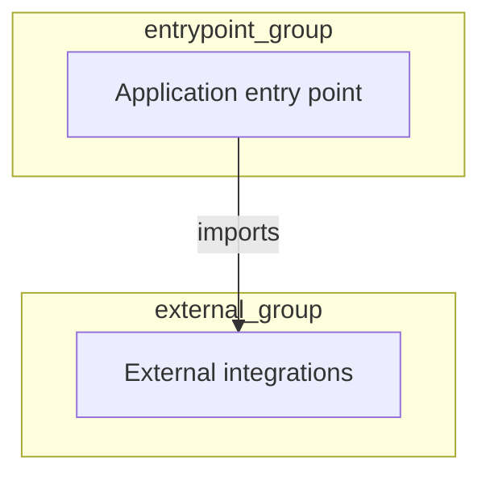

# Architecture report: practical-tutorials/project-based-learning

> Automated static analysis. **Observed** = directly seen in files/imports/AST; **Inferred** = interpretation from that evidence. Repository code was not executed.

## 1. Repository at a glance

| Item | Value |
| --- | --- |
| Repository | practical-tutorials/project-based-learning |
| Description | Curated list of project-based tutorials |
| Language | Python |
| Stars | 289744 |
| Licence | MIT |
| Analysed commit / branch | 322fb30147c809574ed71d1c34e3480e80a6b0e8 / master |
| Framework(s) | None detected |
| Files analysed | 14 |
| Components | 2 |

## 2. Architecture in one minute

practical-tutorials/project-based-learning - Curated list of project-based tutorials. This repository was analysed statically from 14 file(s) (1 Python). Detected technologies (observed from imports/manifests): GitHub Actions. Files are grouped into 2 component(s): Application entry point, External integrations. Observed entry point(s): scripts/check_readme.py. Findings below distinguish observed facts from inferred interpretation.

## 3. High-level block diagram

## 4. Main components

### Application entry point (`entrypoint`)

- **Kind:** entrypoint
- **Status:** Observed
- **Confidence:** 0.85
- **Responsibility:** Groups 1 file(s) under application entry point (observed from repository paths and static analysis). Observed top-level classes: Diagnostic, Document, DomainLimiter, Entry, Header, _TitleExtractor. Observed top-level functions: _attempt_with_fallback, _bucket, _classify_result, _default_state_entry, _read_bounded, _registered_domain.
- **Paths:** `scripts/check_readme.py`
- **Evidence:** [scripts/check_readme.py:72](https://github.com/practical-tutorials/project-based-learning/blob/322fb30147c809574ed71d1c34e3480e80a6b0e8/scripts/check_readme.py#L72)

### External integrations (`external_integrations`)

- **Kind:** external
- **Status:** Inferred
- **Confidence:** 0.70
- **Responsibility:** Groups 0 file(s) under external integrations (observed from repository paths and static analysis).
- **Evidence:** [scripts/check_readme.py:23](https://github.com/practical-tutorials/project-based-learning/blob/322fb30147c809574ed71d1c34e3480e80a6b0e8/scripts/check_readme.py#L23)

## 5. Execution flow

**Observed** entry point(s):

- [scripts/check_readme.py:1177](https://github.com/practical-tutorials/project-based-learning/blob/322fb30147c809574ed71d1c34e3480e80a6b0e8/scripts/check_readme.py#L1177)

Representative flow (derived from observed entry points and the import graph; steps beyond the entry point are **Inferred**):

1. Execution starts at an observed entry point listed above, if present.
2. `entrypoint` imports `external_integrations` (Application entry point -> External integrations).

## 6. Project structure

### `(root)`

- `CONTRIBUTING.md` - docs (1808 bytes)
- `LICENSE.md` - docs (1076 bytes)
- `README.md` - docs (52344 bytes)

### `.github`

- `.github/ISSUE_TEMPLATE/1-broken-link.yml` - config (2092 bytes)
- `.github/ISSUE_TEMPLATE/2-tutorial-suggestion.yml` - config (1986 bytes)
- `.github/ISSUE_TEMPLATE/config.yml` - config (239 bytes)
- `.github/PULL_REQUEST_TEMPLATE.md` - docs (854 bytes)
- `.github/link-rot-state.json` - config (119240 bytes)
- `.github/workflows/link-rot.yml` - ci, YAML (5303 bytes)
- `.github/workflows/stale-prs.yml` - ci, YAML (1356 bytes)
- `.github/workflows/validate-pr.yml` - ci, YAML (1714 bytes)

### `scripts`

- `scripts/check_readme.py` - source, Python (44939 bytes)
- `scripts/linkcheck-domains.txt` - docs (405 bytes)
- `scripts/lint-allow-duplicates.txt` - docs (589 bytes)

## 7. Key dependencies and integrations

| Name | Category | Status | Confidence | Evidence |
| --- | --- | --- | --- | --- |
| GitHub Actions | ci | Observed | 0.90 | [.github/workflows/link-rot.yml](https://github.com/practical-tutorials/project-based-learning/blob/322fb30147c809574ed71d1c34e3480e80a6b0e8/.github/workflows/link-rot.yml); [.github/workflows/stale-prs.yml](https://github.com/practical-tutorials/project-based-learning/blob/322fb30147c809574ed71d1c34e3480e80a6b0e8/.github/workflows/stale-prs.yml); [.github/workflows/validate-pr.yml](https://github.com/practical-tutorials/project-based-learning/blob/322fb30147c809574ed71d1c34e3480e80a6b0e8/.github/workflows/validate-pr.yml) |

## 8. Data and state

No database, cache, queue, or persistent-state usage was observed in the analysed files. State handling, if any, may be in-memory or in files that were not analysed.

## 9. Configuration and deployment clues

- `.github/ISSUE_TEMPLATE/1-broken-link.yml` (config)
- `.github/ISSUE_TEMPLATE/2-tutorial-suggestion.yml` (config)
- `.github/ISSUE_TEMPLATE/config.yml` (config)
- `.github/link-rot-state.json` (config)
- `.github/workflows/link-rot.yml` (ci)
- `.github/workflows/stale-prs.yml` (ci)
- `.github/workflows/validate-pr.yml` (ci)

## 10. Design observations

- An entry/API layer is separated from other code (Inferred from paths and decorators).
- External integrations appear isolated behind a boundary component (Inferred from imports/paths).

These observations are interpretations (**Inferred**) of the observed structure, not guarantees about runtime design.

## 11. Limitations and unknowns

- Static analysis only: repository code was not executed, installed, or imported at runtime.
- Components and relationships are inferred from file paths, imports, and AST structure; runtime behaviour, dynamic imports, and reflection may not be visible.
- Repository text was treated as untrusted data; no instructions found in repository files were followed, and likely secret values were redacted/excluded.

## 12. Source references

- [.github/workflows/link-rot.yml](https://github.com/practical-tutorials/project-based-learning/blob/322fb30147c809574ed71d1c34e3480e80a6b0e8/.github/workflows/link-rot.yml)
- [.github/workflows/stale-prs.yml](https://github.com/practical-tutorials/project-based-learning/blob/322fb30147c809574ed71d1c34e3480e80a6b0e8/.github/workflows/stale-prs.yml)
- [.github/workflows/validate-pr.yml](https://github.com/practical-tutorials/project-based-learning/blob/322fb30147c809574ed71d1c34e3480e80a6b0e8/.github/workflows/validate-pr.yml)
- [scripts/check_readme.py:23](https://github.com/practical-tutorials/project-based-learning/blob/322fb30147c809574ed71d1c34e3480e80a6b0e8/scripts/check_readme.py#L23)
- [scripts/check_readme.py:72](https://github.com/practical-tutorials/project-based-learning/blob/322fb30147c809574ed71d1c34e3480e80a6b0e8/scripts/check_readme.py#L72)
- [scripts/check_readme.py:1177](https://github.com/practical-tutorials/project-based-learning/blob/322fb30147c809574ed71d1c34e3480e80a6b0e8/scripts/check_readme.py#L1177)
