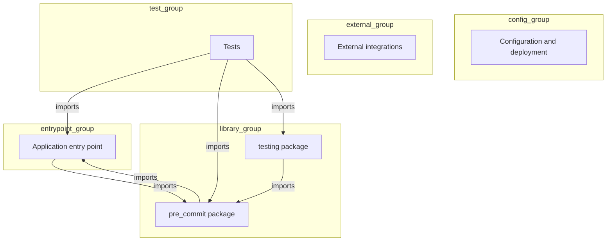

# Architecture report: pre-commit/pre-commit

> Automated static analysis. **Observed** = directly seen in files/imports/AST; **Inferred** = interpretation from that evidence. Repository code was not executed.

## 1. Repository at a glance

| Item | Value |
| --- | --- |
| Repository | pre-commit/pre-commit |
| Description | A framework for managing and maintaining multi-language pre-commit hooks. |
| Language | Python |
| Stars | 15696 |
| Licence | MIT |
| Analysed commit / branch | ba5c4209a6d561b0dff5db24620778d2133d068e / main |
| Framework(s) | None detected |
| Files analysed | 197 |
| Components | 6 |

## 2. Architecture in one minute

pre-commit/pre-commit - A framework for managing and maintaining multi-language pre-commit hooks.. This repository was analysed statically from 197 file(s) (134 Python). Detected technologies (observed from imports/manifests): GitHub Actions, SQLite, setuptools, Docker, pytest, unittest. Files are grouped into 6 component(s): Configuration and deployment, Application entry point, External integrations, pre_commit package, testing package, Tests. Observed entry point(s): pre_commit/__main__.py, pre_commit/commands/hazmat.py, pre_commit/languages/pygrep.py. Findings below distinguish observed facts from inferred interpretation.

## 3. High-level block diagram

## 4. Main components

### Configuration and deployment (`config`)

- **Kind:** config
- **Status:** Observed
- **Confidence:** 0.85
- **Responsibility:** Groups 22 file(s) under configuration and deployment (observed from repository paths and static analysis).
- **Paths:** `pre_commit/resources/empty_template_Cargo.toml`, `pre_commit/resources/empty_template_environment.yml`, `pre_commit/resources/empty_template_pubspec.yaml`, `requirements-dev.txt`, `setup.cfg`, `setup.py`, `testing/resources/arbitrary_bytes_repo/.pre-commit-hooks.yaml`, `testing/resources/arg_per_line_hooks_repo/.pre-commit-hooks.yaml`, `testing/resources/exclude_types_repo/.pre-commit-hooks.yaml`, `testing/resources/failing_hook_repo/.pre-commit-hooks.yaml`, `testing/resources/logfile_repo/.pre-commit-hooks.yaml`, `testing/resources/modified_file_returns_zero_repo/.pre-commit-hooks.yaml`, `testing/resources/not_found_exe/.pre-commit-hooks.yaml`, `testing/resources/prints_cwd_repo/.pre-commit-hooks.yaml`, `testing/resources/python_hooks_repo/.pre-commit-hooks.yaml`, `testing/resources/python_hooks_repo/setup.py`, `testing/resources/script_hooks_repo/.pre-commit-hooks.yaml`, `testing/resources/stdout_stderr_repo/.pre-commit-hooks.yaml`, `testing/resources/types_or_repo/.pre-commit-hooks.yaml`, `testing/resources/types_repo/.pre-commit-hooks.yaml`, `testing/zipapp/Dockerfile`, `tox.ini`
- **Evidence:** [pre_commit/resources/empty_template_Cargo.toml](https://github.com/pre-commit/pre-commit/blob/ba5c4209a6d561b0dff5db24620778d2133d068e/pre_commit/resources/empty_template_Cargo.toml); [pre_commit/resources/empty_template_environment.yml](https://github.com/pre-commit/pre-commit/blob/ba5c4209a6d561b0dff5db24620778d2133d068e/pre_commit/resources/empty_template_environment.yml); [pre_commit/resources/empty_template_pubspec.yaml](https://github.com/pre-commit/pre-commit/blob/ba5c4209a6d561b0dff5db24620778d2133d068e/pre_commit/resources/empty_template_pubspec.yaml); [requirements-dev.txt](https://github.com/pre-commit/pre-commit/blob/ba5c4209a6d561b0dff5db24620778d2133d068e/requirements-dev.txt); [setup.cfg](https://github.com/pre-commit/pre-commit/blob/ba5c4209a6d561b0dff5db24620778d2133d068e/setup.cfg); [setup.py](https://github.com/pre-commit/pre-commit/blob/ba5c4209a6d561b0dff5db24620778d2133d068e/setup.py); [testing/resources/arbitrary_bytes_repo/.pre-commit-hooks.yaml](https://github.com/pre-commit/pre-commit/blob/ba5c4209a6d561b0dff5db24620778d2133d068e/testing/resources/arbitrary_bytes_repo/.pre-commit-hooks.yaml); [testing/resources/arg_per_line_hooks_repo/.pre-commit-hooks.yaml](https://github.com/pre-commit/pre-commit/blob/ba5c4209a6d561b0dff5db24620778d2133d068e/testing/resources/arg_per_line_hooks_repo/.pre-commit-hooks.yaml)

### Application entry point (`entrypoint`)

- **Kind:** entrypoint
- **Status:** Observed
- **Confidence:** 0.85
- **Responsibility:** Groups 8 file(s) under application entry point (observed from repository paths and static analysis). Observed top-level classes: Choice, Classifier. Observed top-level functions: _add_config_option, _add_hook_type_option, _add_run_options, _adjust_args_and_chdir, _all_filenames, _cmd_filenames.
- **Paths:** `pre_commit/__main__.py`, `pre_commit/commands/hazmat.py`, `pre_commit/commands/run.py`, `pre_commit/languages/pygrep.py`, `pre_commit/main.py`, `pre_commit/meta_hooks/check_hooks_apply.py`, `pre_commit/meta_hooks/check_useless_excludes.py`, `pre_commit/meta_hooks/identity.py`
- **Evidence:** [pre_commit/__main__.py](https://github.com/pre-commit/pre-commit/blob/ba5c4209a6d561b0dff5db24620778d2133d068e/pre_commit/__main__.py); [pre_commit/commands/hazmat.py:10](https://github.com/pre-commit/pre-commit/blob/ba5c4209a6d561b0dff5db24620778d2133d068e/pre_commit/commands/hazmat.py#L10); [pre_commit/commands/run.py:36](https://github.com/pre-commit/pre-commit/blob/ba5c4209a6d561b0dff5db24620778d2133d068e/pre_commit/commands/run.py#L36); [pre_commit/languages/pygrep.py:22](https://github.com/pre-commit/pre-commit/blob/ba5c4209a6d561b0dff5db24620778d2133d068e/pre_commit/languages/pygrep.py#L22); [pre_commit/main.py:50](https://github.com/pre-commit/pre-commit/blob/ba5c4209a6d561b0dff5db24620778d2133d068e/pre_commit/main.py#L50); [pre_commit/meta_hooks/check_hooks_apply.py:14](https://github.com/pre-commit/pre-commit/blob/ba5c4209a6d561b0dff5db24620778d2133d068e/pre_commit/meta_hooks/check_hooks_apply.py#L14); [pre_commit/meta_hooks/check_useless_excludes.py:17](https://github.com/pre-commit/pre-commit/blob/ba5c4209a6d561b0dff5db24620778d2133d068e/pre_commit/meta_hooks/check_useless_excludes.py#L17); [pre_commit/meta_hooks/identity.py:9](https://github.com/pre-commit/pre-commit/blob/ba5c4209a6d561b0dff5db24620778d2133d068e/pre_commit/meta_hooks/identity.py#L9)

### External integrations (`external_integrations`)

- **Kind:** external
- **Status:** Inferred
- **Confidence:** 0.70
- **Responsibility:** Groups 0 file(s) under external integrations (observed from repository paths and static analysis).
- **Evidence:** [pre_commit/store.py:6](https://github.com/pre-commit/pre-commit/blob/ba5c4209a6d561b0dff5db24620778d2133d068e/pre_commit/store.py#L6); [tests/store_test.py:7](https://github.com/pre-commit/pre-commit/blob/ba5c4209a6d561b0dff5db24620778d2133d068e/tests/store_test.py#L7)

### pre_commit package (`pre_commit`)

- **Kind:** library
- **Status:** Observed
- **Confidence:** 0.85
- **Responsibility:** Groups 61 file(s) under pre_commit package (observed from repository paths and static analysis). Observed top-level classes: ArgumentTooLongError, CalledProcessError, DeprecatedDefaultStagesWarning, DeprecatedStagesWarning, ExecutableNotFoundError, ExtractAll. Observed top-level functions: _add_dependencies, _check_args_length, _check_hooks_still_exist_at_rev, _cloned_repository_hooks, _cmd_from_hook, _command_length.
- **Paths:** `pre_commit/__init__.py`, `pre_commit/all_languages.py`, `pre_commit/clientlib.py`, `pre_commit/color.py`, `pre_commit/commands/__init__.py`, `pre_commit/commands/autoupdate.py`, `pre_commit/commands/clean.py`, `pre_commit/commands/gc.py`, `pre_commit/commands/hook_impl.py`, `pre_commit/commands/init_templatedir.py`, `pre_commit/commands/install_uninstall.py`, `pre_commit/commands/migrate_config.py`, `pre_commit/commands/sample_config.py`, `pre_commit/commands/try_repo.py`, `pre_commit/commands/validate_config.py`, `pre_commit/commands/validate_manifest.py`, `pre_commit/constants.py`, `pre_commit/envcontext.py`, `pre_commit/error_handler.py`, `pre_commit/errors.py`, `pre_commit/file_lock.py`, `pre_commit/git.py`, `pre_commit/hook.py`, `pre_commit/lang_base.py`, `pre_commit/languages/__init__.py`, `pre_commit/languages/conda.py`, `pre_commit/languages/coursier.py`, `pre_commit/languages/dart.py`, `pre_commit/languages/docker.py`, `pre_commit/languages/docker_image.py`, `pre_commit/languages/dotnet.py`, `pre_commit/languages/fail.py`, `pre_commit/languages/golang.py`, `pre_commit/languages/haskell.py`, `pre_commit/languages/julia.py`, `pre_commit/languages/lua.py`, `pre_commit/languages/node.py`, `pre_commit/languages/perl.py`, `pre_commit/languages/python.py`, `pre_commit/languages/r.py`, `pre_commit/languages/ruby.py`, `pre_commit/languages/rust.py`, `pre_commit/languages/swift.py`, `pre_commit/languages/unsupported.py`, `pre_commit/languages/unsupported_script.py`, `pre_commit/logging_handler.py`, `pre_commit/meta_hooks/__init__.py`, `pre_commit/output.py`, `pre_commit/parse_shebang.py`, `pre_commit/prefix.py`, `pre_commit/repository.py`, `pre_commit/resources/__init__.py`, `pre_commit/resources/empty_template_main.go`, `pre_commit/resources/empty_template_main.rs`, `pre_commit/resources/empty_template_setup.py`, `pre_commit/staged_files_only.py`, `pre_commit/store.py`, `pre_commit/util.py`, `pre_commit/xargs.py`, `pre_commit/yaml.py`, `pre_commit/yaml_rewrite.py`
- **Evidence:** [pre_commit/__init__.py](https://github.com/pre-commit/pre-commit/blob/ba5c4209a6d561b0dff5db24620778d2133d068e/pre_commit/__init__.py); [pre_commit/all_languages.py](https://github.com/pre-commit/pre-commit/blob/ba5c4209a6d561b0dff5db24620778d2133d068e/pre_commit/all_languages.py); [pre_commit/clientlib.py:42](https://github.com/pre-commit/pre-commit/blob/ba5c4209a6d561b0dff5db24620778d2133d068e/pre_commit/clientlib.py#L42); [pre_commit/color.py:67](https://github.com/pre-commit/pre-commit/blob/ba5c4209a6d561b0dff5db24620778d2133d068e/pre_commit/color.py#L67); [pre_commit/commands/__init__.py](https://github.com/pre-commit/pre-commit/blob/ba5c4209a6d561b0dff5db24620778d2133d068e/pre_commit/commands/__init__.py); [pre_commit/commands/autoupdate.py:28](https://github.com/pre-commit/pre-commit/blob/ba5c4209a6d561b0dff5db24620778d2133d068e/pre_commit/commands/autoupdate.py#L28); [pre_commit/commands/clean.py:10](https://github.com/pre-commit/pre-commit/blob/ba5c4209a6d561b0dff5db24620778d2133d068e/pre_commit/commands/clean.py#L10); [pre_commit/commands/gc.py:18](https://github.com/pre-commit/pre-commit/blob/ba5c4209a6d561b0dff5db24620778d2133d068e/pre_commit/commands/gc.py#L18)

### testing package (`testing`)

- **Kind:** library
- **Status:** Observed
- **Confidence:** 0.85
- **Responsibility:** Groups 19 file(s) under testing package (observed from repository paths and static analysis). Observed top-level functions: add_config_to_repo, auto_namedtuple, cmd_output_mocked_pre_commit_home, copy_tree_to_path, get_resource_path, git_commit.
- **Paths:** `testing/__init__.py`, `testing/auto_namedtuple.py`, `testing/fixtures.py`, `testing/get-coursier.sh`, `testing/get-dart.sh`, `testing/language_helpers.py`, `testing/resources/arbitrary_bytes_repo/hook.sh`, `testing/resources/arg_per_line_hooks_repo/bin/hook.sh`, `testing/resources/exclude_types_repo/bin/hook.sh`, `testing/resources/failing_hook_repo/bin/hook.sh`, `testing/resources/logfile_repo/bin/hook.sh`, `testing/resources/modified_file_returns_zero_repo/bin/hook.sh`, `testing/resources/modified_file_returns_zero_repo/bin/hook2.sh`, `testing/resources/modified_file_returns_zero_repo/bin/hook3.sh`, `testing/resources/python_hooks_repo/foo.py`, `testing/resources/script_hooks_repo/bin/hook.sh`, `testing/resources/types_or_repo/bin/hook.sh`, `testing/resources/types_repo/bin/hook.sh`, `testing/util.py`
- **Evidence:** [testing/__init__.py](https://github.com/pre-commit/pre-commit/blob/ba5c4209a6d561b0dff5db24620778d2133d068e/testing/__init__.py); [testing/auto_namedtuple.py:6](https://github.com/pre-commit/pre-commit/blob/ba5c4209a6d561b0dff5db24620778d2133d068e/testing/auto_namedtuple.py#L6); [testing/fixtures.py:21](https://github.com/pre-commit/pre-commit/blob/ba5c4209a6d561b0dff5db24620778d2133d068e/testing/fixtures.py#L21); [testing/get-coursier.sh](https://github.com/pre-commit/pre-commit/blob/ba5c4209a6d561b0dff5db24620778d2133d068e/testing/get-coursier.sh); [testing/get-dart.sh](https://github.com/pre-commit/pre-commit/blob/ba5c4209a6d561b0dff5db24620778d2133d068e/testing/get-dart.sh); [testing/language_helpers.py:10](https://github.com/pre-commit/pre-commit/blob/ba5c4209a6d561b0dff5db24620778d2133d068e/testing/language_helpers.py#L10); [testing/resources/arbitrary_bytes_repo/hook.sh](https://github.com/pre-commit/pre-commit/blob/ba5c4209a6d561b0dff5db24620778d2133d068e/testing/resources/arbitrary_bytes_repo/hook.sh); [testing/resources/arg_per_line_hooks_repo/bin/hook.sh](https://github.com/pre-commit/pre-commit/blob/ba5c4209a6d561b0dff5db24620778d2133d068e/testing/resources/arg_per_line_hooks_repo/bin/hook.sh)

### Tests (`tests`)

- **Kind:** test
- **Status:** Observed
- **Confidence:** 0.85
- **Responsibility:** Groups 59 file(s) under tests (observed from repository paths and static analysis). Observed top-level classes: Fixture. Observed top-level functions: _add_test_file, _args, _avoid_cache, _config_count, _create_repo_with_tags, _csproj.
- **Paths:** `tests/__init__.py`, `tests/clientlib_test.py`, `tests/color_test.py`, `tests/commands/__init__.py`, `tests/commands/autoupdate_test.py`, `tests/commands/clean_test.py`, `tests/commands/gc_test.py`, `tests/commands/hazmat_test.py`, `tests/commands/hook_impl_test.py`, `tests/commands/init_templatedir_test.py`, `tests/commands/install_uninstall_test.py`, `tests/commands/migrate_config_test.py`, `tests/commands/run_test.py`, `tests/commands/sample_config_test.py`, `tests/commands/try_repo_test.py`, `tests/commands/validate_config_test.py`, `tests/commands/validate_manifest_test.py`, `tests/conftest.py`, `tests/envcontext_test.py`, `tests/error_handler_test.py`, `tests/git_test.py`, `tests/lang_base_test.py`, `tests/languages/__init__.py`, `tests/languages/conda_test.py`, `tests/languages/coursier_test.py`, `tests/languages/dart_test.py`, `tests/languages/docker_image_test.py`, `tests/languages/docker_test.py`, `tests/languages/dotnet_test.py`, `tests/languages/fail_test.py`, `tests/languages/golang_test.py`, `tests/languages/haskell_test.py`, `tests/languages/julia_test.py`, `tests/languages/lua_test.py`, `tests/languages/node_test.py`, `tests/languages/perl_test.py`, `tests/languages/pygrep_test.py`, `tests/languages/python_test.py`, `tests/languages/r_test.py`, `tests/languages/ruby_test.py`, `tests/languages/rust_test.py`, `tests/languages/swift_test.py`, `tests/languages/unsupported_script_test.py`, `tests/languages/unsupported_test.py`, `tests/logging_handler_test.py`, `tests/main_test.py`, `tests/meta_hooks/__init__.py`, `tests/meta_hooks/check_hooks_apply_test.py`, `tests/meta_hooks/check_useless_excludes_test.py`, `tests/meta_hooks/identity_test.py`, `tests/output_test.py`, `tests/parse_shebang_test.py`, `tests/prefix_test.py`, `tests/repository_test.py`, `tests/staged_files_only_test.py`, `tests/store_test.py`, `tests/util_test.py`, `tests/xargs_test.py`, `tests/yaml_rewrite_test.py`
- **Evidence:** [tests/__init__.py](https://github.com/pre-commit/pre-commit/blob/ba5c4209a6d561b0dff5db24620778d2133d068e/tests/__init__.py); [tests/clientlib_test.py:26](https://github.com/pre-commit/pre-commit/blob/ba5c4209a6d561b0dff5db24620778d2133d068e/tests/clientlib_test.py#L26); [tests/color_test.py:20](https://github.com/pre-commit/pre-commit/blob/ba5c4209a6d561b0dff5db24620778d2133d068e/tests/color_test.py#L20); [tests/commands/__init__.py](https://github.com/pre-commit/pre-commit/blob/ba5c4209a6d561b0dff5db24620778d2133d068e/tests/commands/__init__.py); [tests/commands/autoupdate_test.py:29](https://github.com/pre-commit/pre-commit/blob/ba5c4209a6d561b0dff5db24620778d2133d068e/tests/commands/autoupdate_test.py#L29); [tests/commands/clean_test.py:12](https://github.com/pre-commit/pre-commit/blob/ba5c4209a6d561b0dff5db24620778d2133d068e/tests/commands/clean_test.py#L12); [tests/commands/gc_test.py:21](https://github.com/pre-commit/pre-commit/blob/ba5c4209a6d561b0dff5db24620778d2133d068e/tests/commands/gc_test.py#L21); [tests/commands/hazmat_test.py:12](https://github.com/pre-commit/pre-commit/blob/ba5c4209a6d561b0dff5db24620778d2133d068e/tests/commands/hazmat_test.py#L12)

## 5. Execution flow

**Observed** entry point(s):

- [pre_commit/__main__.py:6](https://github.com/pre-commit/pre-commit/blob/ba5c4209a6d561b0dff5db24620778d2133d068e/pre_commit/__main__.py#L6)
- [pre_commit/commands/hazmat.py:94](https://github.com/pre-commit/pre-commit/blob/ba5c4209a6d561b0dff5db24620778d2133d068e/pre_commit/commands/hazmat.py#L94)
- [pre_commit/languages/pygrep.py:132](https://github.com/pre-commit/pre-commit/blob/ba5c4209a6d561b0dff5db24620778d2133d068e/pre_commit/languages/pygrep.py#L132)
- [pre_commit/main.py:453](https://github.com/pre-commit/pre-commit/blob/ba5c4209a6d561b0dff5db24620778d2133d068e/pre_commit/main.py#L453)
- [pre_commit/meta_hooks/check_hooks_apply.py:42](https://github.com/pre-commit/pre-commit/blob/ba5c4209a6d561b0dff5db24620778d2133d068e/pre_commit/meta_hooks/check_hooks_apply.py#L42)
- [pre_commit/meta_hooks/check_useless_excludes.py:82](https://github.com/pre-commit/pre-commit/blob/ba5c4209a6d561b0dff5db24620778d2133d068e/pre_commit/meta_hooks/check_useless_excludes.py#L82)
- [pre_commit/meta_hooks/identity.py:16](https://github.com/pre-commit/pre-commit/blob/ba5c4209a6d561b0dff5db24620778d2133d068e/pre_commit/meta_hooks/identity.py#L16)

Representative flow (derived from observed entry points and the import graph; steps beyond the entry point are **Inferred**):

1. Execution starts at an observed entry point listed above, if present.
2. `entrypoint` imports `pre_commit` (Application entry point -> pre_commit package).
3. `pre_commit` imports `entrypoint` (pre_commit package -> Application entry point).
4. `testing` imports `pre_commit` (testing package -> pre_commit package).
5. `tests` imports `entrypoint` (Tests -> Application entry point).
6. `tests` imports `pre_commit` (Tests -> pre_commit package).
7. `tests` imports `testing` (Tests -> testing package).

## 6. Project structure

### `(root)`

- `.gitignore` - other (52 bytes)
- `.pre-commit-config.yaml` - config (1260 bytes)
- `.pre-commit-hooks.yaml` - config (239 bytes)
- `CHANGELOG.md` - docs (73113 bytes)
- `CONTRIBUTING.md` - docs (5378 bytes)
- `LICENSE` - docs (1092 bytes)
- `README.md` - docs (480 bytes)
- `requirements-dev.txt` - manifest (62 bytes)
- `setup.cfg` - manifest (1391 bytes)
- `setup.py` - manifest, Python (73 bytes)
- `tox.ini` - config (660 bytes)

### `.github`

- `.github/ISSUE_TEMPLATE/00_bug.yaml` - config (1554 bytes)
- `.github/ISSUE_TEMPLATE/01_feature.yaml` - config (1122 bytes)
- `.github/ISSUE_TEMPLATE/config.yml` - config (263 bytes)
- `.github/actions/pre-test/action.yml` - config (198 bytes)
- `.github/workflows/languages.yaml` - ci, YAML (2702 bytes)
- `.github/workflows/main.yml` - ci, YAML (504 bytes)

### `pre_commit`

- `pre_commit/__init__.py` - source, Python (0 bytes)
- `pre_commit/__main__.py` - source, Python (127 bytes)
- `pre_commit/all_languages.py` - source, Python (1463 bytes)
- `pre_commit/clientlib.py` - source, Python (16815 bytes)
- `pre_commit/color.py` - source, Python (3219 bytes)
- `pre_commit/commands/__init__.py` - source, Python (0 bytes)
- `pre_commit/commands/autoupdate.py` - source, Python (7407 bytes)
- `pre_commit/commands/clean.py` - source, Python (429 bytes)
- `pre_commit/commands/gc.py` - source, Python (3042 bytes)
- `pre_commit/commands/hazmat.py` - source, Python (2573 bytes)
- `pre_commit/commands/hook_impl.py` - source, Python (9519 bytes)
- `pre_commit/commands/init_templatedir.py` - source, Python (1135 bytes)
- `pre_commit/commands/install_uninstall.py` - source, Python (5341 bytes)
- `pre_commit/commands/migrate_config.py` - source, Python (4163 bytes)
- `pre_commit/commands/run.py` - source, Python (14163 bytes)
- `pre_commit/commands/sample_config.py` - source, Python (453 bytes)
- `pre_commit/commands/try_repo.py` - source, Python (2578 bytes)
- `pre_commit/commands/validate_config.py` - source, Python (371 bytes)
- `pre_commit/commands/validate_manifest.py` - source, Python (377 bytes)
- `pre_commit/constants.py` - source, Python (282 bytes)
- `pre_commit/envcontext.py` - source, Python (1593 bytes)
- `pre_commit/error_handler.py` - source, Python (2621 bytes)
- `pre_commit/errors.py` - source, Python (78 bytes)
- `pre_commit/file_lock.py` - source, Python (2351 bytes)
- `pre_commit/git.py` - source, Python (8544 bytes)
- `pre_commit/hook.py` - source, Python (1513 bytes)
- `pre_commit/lang_base.py` - source, Python (5384 bytes)
- `pre_commit/languages/__init__.py` - source, Python (0 bytes)
- `pre_commit/languages/conda.py` - source, Python (2421 bytes)
- `pre_commit/languages/coursier.py` - source, Python (2508 bytes)
- `pre_commit/languages/dart.py` - source, Python (3118 bytes)
- `pre_commit/languages/docker.py` - source, Python (5412 bytes)
- `pre_commit/languages/docker_image.py` - source, Python (847 bytes)
- `pre_commit/languages/dotnet.py` - source, Python (3463 bytes)
- `pre_commit/languages/fail.py` - source, Python (685 bytes)
- `pre_commit/languages/golang.py` - source, Python (4636 bytes)
- `pre_commit/languages/haskell.py` - source, Python (1662 bytes)
- `pre_commit/languages/julia.py` - source, Python (4947 bytes)
- `pre_commit/languages/lua.py` - source, Python (2535 bytes)
- `pre_commit/languages/node.py` - source, Python (3632 bytes)
- `pre_commit/languages/perl.py` - source, Python (1491 bytes)
- `pre_commit/languages/pygrep.py` - source, Python (3816 bytes)
- `pre_commit/languages/python.py` - source, Python (7320 bytes)
- `pre_commit/languages/r.py` - source, Python (7901 bytes)
- `pre_commit/languages/ruby.py` - source, Python (4636 bytes)
- `pre_commit/languages/rust.py` - source, Python (5492 bytes)
- `pre_commit/languages/swift.py` - source, Python (1605 bytes)
- `pre_commit/languages/unsupported.py` - source, Python (300 bytes)
- `pre_commit/languages/unsupported_script.py` - source, Python (786 bytes)
- `pre_commit/logging_handler.py` - source, Python (1019 bytes)
- `pre_commit/main.py` - source, Python (15933 bytes)
- `pre_commit/meta_hooks/__init__.py` - source, Python (0 bytes)
- `pre_commit/meta_hooks/check_hooks_apply.py` - source, Python (1207 bytes)
- `pre_commit/meta_hooks/check_useless_excludes.py` - source, Python (2553 bytes)
- `pre_commit/meta_hooks/identity.py` - source, Python (346 bytes)
- `pre_commit/output.py` - source, Python (911 bytes)
- `pre_commit/parse_shebang.py` - source, Python (2481 bytes)
- `pre_commit/prefix.py` - source, Python (495 bytes)
- `pre_commit/repository.py` - source, Python (7608 bytes)
- `pre_commit/resources/__init__.py` - source, Python (0 bytes)
- `pre_commit/resources/empty_template_Cargo.toml` - config (96 bytes)
- `pre_commit/resources/empty_template_LICENSE.renv` - other (1052 bytes)
- `pre_commit/resources/empty_template_Makefile.PL` - other (104 bytes)
- `pre_commit/resources/empty_template_activate.R` - other (12037 bytes)
- `pre_commit/resources/empty_template_environment.yml` - config (302 bytes)
- `pre_commit/resources/empty_template_go.mod` - other (43 bytes)
- `pre_commit/resources/empty_template_main.go` - source, Go (29 bytes)
- `pre_commit/resources/empty_template_main.rs` - source, Rust (13 bytes)
- `pre_commit/resources/empty_template_pre-commit-package-dev-1.rockspec` - other (212 bytes)
- `pre_commit/resources/empty_template_pre_commit_placeholder_package.gemspec` - other (195 bytes)
- `pre_commit/resources/empty_template_pubspec.yaml` - config (78 bytes)
- `pre_commit/resources/empty_template_renv.lock` - other (351 bytes)
- `pre_commit/resources/empty_template_setup.py` - source, Python (108 bytes)
- `pre_commit/resources/hook-tmpl` - other (528 bytes)
- `pre_commit/staged_files_only.py` - source, Python (4155 bytes)
- `pre_commit/store.py` - source, Python (8440 bytes)
- `pre_commit/util.py` - source, Python (7047 bytes)
- `pre_commit/xargs.py` - source, Python (5550 bytes)
- `pre_commit/yaml.py` - source, Python (561 bytes)
- `pre_commit/yaml_rewrite.py` - source, Python (1337 bytes)

### `testing`

- `testing/__init__.py` - source, Python (0 bytes)
- `testing/auto_namedtuple.py` - source, Python (374 bytes)
- `testing/fixtures.py` - source, Python (4559 bytes)
- `testing/get-coursier.sh` - source, Shell (917 bytes)
- `testing/get-dart.sh` - source, Shell (546 bytes)
- `testing/language_helpers.py` - source, Python (1165 bytes)
- `testing/languages` - other (2367 bytes)
- `testing/make-archives` - other (2641 bytes)
- `testing/resources/arbitrary_bytes_repo/.pre-commit-hooks.yaml` - config (87 bytes)
- `testing/resources/arbitrary_bytes_repo/hook.sh` - source, Shell (250 bytes)
- `testing/resources/arg_per_line_hooks_repo/.pre-commit-hooks.yaml` - config (133 bytes)
- `testing/resources/arg_per_line_hooks_repo/bin/hook.sh` - source, Shell (63 bytes)
- `testing/resources/exclude_types_repo/.pre-commit-hooks.yaml` - config (137 bytes)
- `testing/resources/exclude_types_repo/bin/hook.sh` - source, Shell (37 bytes)
- `testing/resources/failing_hook_repo/.pre-commit-hooks.yaml` - config (101 bytes)
- `testing/resources/failing_hook_repo/bin/hook.sh` - source, Shell (49 bytes)
- `testing/resources/logfile_repo/.pre-commit-hooks.yaml` - config (134 bytes)
- `testing/resources/logfile_repo/bin/hook.sh` - source, Shell (91 bytes)
- `testing/resources/modified_file_returns_zero_repo/.pre-commit-hooks.yaml` - config (304 bytes)
- `testing/resources/modified_file_returns_zero_repo/bin/hook.sh` - source, Shell (119 bytes)
- `testing/resources/modified_file_returns_zero_repo/bin/hook2.sh` - source, Shell (30 bytes)
- `testing/resources/modified_file_returns_zero_repo/bin/hook3.sh` - source, Shell (94 bytes)
- `testing/resources/not_found_exe/.pre-commit-hooks.yaml` - config (109 bytes)
- `testing/resources/prints_cwd_repo/.pre-commit-hooks.yaml` - config (93 bytes)
- `testing/resources/python_hooks_repo/.pre-commit-hooks.yaml` - config (79 bytes)
- `testing/resources/python_hooks_repo/foo.py` - source, Python (129 bytes)
- `testing/resources/python_hooks_repo/setup.py` - manifest, Python (194 bytes)
- `testing/resources/script_hooks_repo/.pre-commit-hooks.yaml` - config (96 bytes)
- `testing/resources/script_hooks_repo/bin/hook.sh` - source, Shell (50 bytes)
- `testing/resources/stdout_stderr_repo/.pre-commit-hooks.yaml` - config (188 bytes)
- `testing/resources/stdout_stderr_repo/stdout-stderr-entry` - other (77 bytes)
- `testing/resources/stdout_stderr_repo/tty-check-entry` - other (150 bytes)
- `testing/resources/types_or_repo/.pre-commit-hooks.yaml` - config (155 bytes)
- `testing/resources/types_or_repo/bin/hook.sh` - source, Shell (37 bytes)
- `testing/resources/types_repo/.pre-commit-hooks.yaml` - config (108 bytes)
- `testing/resources/types_repo/bin/hook.sh` - source, Shell (37 bytes)
- `testing/util.py` - source, Python (2876 bytes)
- `testing/zipapp/Dockerfile` - container (360 bytes)
- `testing/zipapp/entry` - other (1920 bytes)
- `testing/zipapp/make` - other (3544 bytes)
- `testing/zipapp/python` - other (1451 bytes)

### `tests`

- `tests/__init__.py` - test, Python (0 bytes)
- `tests/clientlib_test.py` - test, Python (18600 bytes)
- `tests/color_test.py` - test, Python (1911 bytes)
- `tests/commands/__init__.py` - test, Python (0 bytes)
- `tests/commands/autoupdate_test.py` - test, Python (17101 bytes)
- `tests/commands/clean_test.py` - test, Python (855 bytes)
- `tests/commands/gc_test.py` - test, Python (5890 bytes)
- `tests/commands/hazmat_test.py` - test, Python (2630 bytes)
- `tests/commands/hook_impl_test.py` - test, Python (12436 bytes)
- `tests/commands/init_templatedir_test.py` - test, Python (4725 bytes)
- `tests/commands/install_uninstall_test.py` - test, Python (39112 bytes)
- `tests/commands/migrate_config_test.py` - test, Python (7075 bytes)
- `tests/commands/run_test.py` - test, Python (37586 bytes)
- `tests/commands/sample_config_test.py` - test, Python (553 bytes)
- `tests/commands/try_repo_test.py` - test, Python (5126 bytes)
- `tests/commands/validate_config_test.py` - test, Python (1685 bytes)
- `tests/commands/validate_manifest_test.py` - test, Python (519 bytes)
- `tests/conftest.py` - test, Python (6900 bytes)
- `tests/envcontext_test.py` - test, Python (2418 bytes)
- `tests/error_handler_test.py` - test, Python (6899 bytes)
- `tests/git_test.py` - test, Python (8941 bytes)
- `tests/lang_base_test.py` - test, Python (5108 bytes)
- `tests/languages/__init__.py` - test, Python (0 bytes)
- `tests/languages/conda_test.py` - test, Python (1723 bytes)
- `tests/languages/coursier_test.py` - test, Python (1179 bytes)
- `tests/languages/dart_test.py` - test, Python (1441 bytes)
- `tests/languages/docker_image_test.py` - test, Python (1569 bytes)
- `tests/languages/docker_test.py` - test, Python (24971 bytes)
- `tests/languages/dotnet_test.py` - test, Python (6187 bytes)
- `tests/languages/fail_test.py` - test, Python (329 bytes)
- `tests/languages/golang_test.py` - test, Python (5908 bytes)
- `tests/languages/haskell_test.py` - test, Python (1350 bytes)
- `tests/languages/julia_test.py` - test, Python (3602 bytes)
- `tests/languages/lua_test.py` - test, Python (1329 bytes)
- `tests/languages/node_test.py` - test, Python (6274 bytes)
- `tests/languages/perl_test.py` - test, Python (1559 bytes)
- `tests/languages/pygrep_test.py` - test, Python (4231 bytes)
- `tests/languages/python_test.py` - test, Python (11128 bytes)
- `tests/languages/r_test.py` - test, Python (7736 bytes)
- `tests/languages/ruby_test.py` - test, Python (4052 bytes)
- `tests/languages/rust_test.py` - test, Python (3421 bytes)
- `tests/languages/swift_test.py` - test, Python (846 bytes)
- `tests/languages/unsupported_script_test.py` - test, Python (479 bytes)
- `tests/languages/unsupported_test.py` - test, Python (316 bytes)
- `tests/logging_handler_test.py` - test, Python (639 bytes)
- `tests/main_test.py` - test, Python (7357 bytes)
- `tests/meta_hooks/__init__.py` - test, Python (0 bytes)
- `tests/meta_hooks/check_hooks_apply_test.py` - test, Python (3977 bytes)
- `tests/meta_hooks/check_useless_excludes_test.py` - test, Python (3615 bytes)
- `tests/meta_hooks/identity_test.py` - test, Python (195 bytes)
- `tests/output_test.py` - test, Python (224 bytes)
- `tests/parse_shebang_test.py` - test, Python (4674 bytes)
- `tests/prefix_test.py` - test, Python (1155 bytes)
- `tests/repository_test.py` - test, Python (16510 bytes)
- `tests/staged_files_only_test.py` - test, Python (13960 bytes)
- `tests/store_test.py` - test, Python (10580 bytes)
- `tests/util_test.py` - test, Python (3004 bytes)
- `tests/xargs_test.py` - test, Python (6909 bytes)
- `tests/yaml_rewrite_test.py` - test, Python (1290 bytes)

## 7. Key dependencies and integrations

| Name | Category | Status | Confidence | Evidence |
| --- | --- | --- | --- | --- |
| GitHub Actions | ci | Observed | 0.90 | [.github/workflows/languages.yaml](https://github.com/pre-commit/pre-commit/blob/ba5c4209a6d561b0dff5db24620778d2133d068e/.github/workflows/languages.yaml); [.github/workflows/main.yml](https://github.com/pre-commit/pre-commit/blob/ba5c4209a6d561b0dff5db24620778d2133d068e/.github/workflows/main.yml) |
| SQLite | database | Observed | 0.95 | [pre_commit/store.py:6](https://github.com/pre-commit/pre-commit/blob/ba5c4209a6d561b0dff5db24620778d2133d068e/pre_commit/store.py#L6); [tests/store_test.py:7](https://github.com/pre-commit/pre-commit/blob/ba5c4209a6d561b0dff5db24620778d2133d068e/tests/store_test.py#L7) |
| setuptools | packaging | Observed | 0.95 | [pre_commit/resources/empty_template_setup.py:1](https://github.com/pre-commit/pre-commit/blob/ba5c4209a6d561b0dff5db24620778d2133d068e/pre_commit/resources/empty_template_setup.py#L1); [setup.py:3](https://github.com/pre-commit/pre-commit/blob/ba5c4209a6d561b0dff5db24620778d2133d068e/setup.py#L3); [testing/resources/python_hooks_repo/setup.py:3](https://github.com/pre-commit/pre-commit/blob/ba5c4209a6d561b0dff5db24620778d2133d068e/testing/resources/python_hooks_repo/setup.py#L3) |
| Docker | tooling | Observed | 0.85 | [testing/zipapp/Dockerfile](https://github.com/pre-commit/pre-commit/blob/ba5c4209a6d561b0dff5db24620778d2133d068e/testing/zipapp/Dockerfile) |
| pytest | tooling | Observed | 0.95 | [.github/workflows/languages.yaml:77](https://github.com/pre-commit/pre-commit/blob/ba5c4209a6d561b0dff5db24620778d2133d068e/.github/workflows/languages.yaml#L77); [requirements-dev.txt:4](https://github.com/pre-commit/pre-commit/blob/ba5c4209a6d561b0dff5db24620778d2133d068e/requirements-dev.txt#L4); [testing/util.py:7](https://github.com/pre-commit/pre-commit/blob/ba5c4209a6d561b0dff5db24620778d2133d068e/testing/util.py#L7); [tests/clientlib_test.py:7](https://github.com/pre-commit/pre-commit/blob/ba5c4209a6d561b0dff5db24620778d2133d068e/tests/clientlib_test.py#L7) |
| unittest | tooling | Observed | 0.95 | [tests/color_test.py:4](https://github.com/pre-commit/pre-commit/blob/ba5c4209a6d561b0dff5db24620778d2133d068e/tests/color_test.py#L4); [tests/commands/autoupdate_test.py:4](https://github.com/pre-commit/pre-commit/blob/ba5c4209a6d561b0dff5db24620778d2133d068e/tests/commands/autoupdate_test.py#L4); [tests/commands/clean_test.py:4](https://github.com/pre-commit/pre-commit/blob/ba5c4209a6d561b0dff5db24620778d2133d068e/tests/commands/clean_test.py#L4); [tests/commands/hook_impl_test.py:6](https://github.com/pre-commit/pre-commit/blob/ba5c4209a6d561b0dff5db24620778d2133d068e/tests/commands/hook_impl_test.py#L6) |

## 8. Data and state

- **SQLite** (Observed, confidence 0.95) - evidence: [pre_commit/store.py:6](https://github.com/pre-commit/pre-commit/blob/ba5c4209a6d561b0dff5db24620778d2133d068e/pre_commit/store.py#L6); [tests/store_test.py:7](https://github.com/pre-commit/pre-commit/blob/ba5c4209a6d561b0dff5db24620778d2133d068e/tests/store_test.py#L7)

## 9. Configuration and deployment clues

- `.github/ISSUE_TEMPLATE/00_bug.yaml` (config)
- `.github/ISSUE_TEMPLATE/01_feature.yaml` (config)
- `.github/ISSUE_TEMPLATE/config.yml` (config)
- `.github/actions/pre-test/action.yml` (config)
- `.github/workflows/languages.yaml` (ci)
- `.github/workflows/main.yml` (ci)
- `.pre-commit-config.yaml` (config)
- `.pre-commit-hooks.yaml` (config)
- `pre_commit/resources/empty_template_Cargo.toml` (config)
- `pre_commit/resources/empty_template_environment.yml` (config)
- `pre_commit/resources/empty_template_pubspec.yaml` (config)
- `requirements-dev.txt` (manifest)
- `setup.cfg` (manifest)
- `setup.py` (manifest)
- `testing/resources/arbitrary_bytes_repo/.pre-commit-hooks.yaml` (config)
- `testing/resources/arg_per_line_hooks_repo/.pre-commit-hooks.yaml` (config)
- `testing/resources/exclude_types_repo/.pre-commit-hooks.yaml` (config)
- `testing/resources/failing_hook_repo/.pre-commit-hooks.yaml` (config)
- `testing/resources/logfile_repo/.pre-commit-hooks.yaml` (config)
- `testing/resources/modified_file_returns_zero_repo/.pre-commit-hooks.yaml` (config)
- `testing/resources/not_found_exe/.pre-commit-hooks.yaml` (config)
- `testing/resources/prints_cwd_repo/.pre-commit-hooks.yaml` (config)
- `testing/resources/python_hooks_repo/.pre-commit-hooks.yaml` (config)
- `testing/resources/python_hooks_repo/setup.py` (manifest)
- `testing/resources/script_hooks_repo/.pre-commit-hooks.yaml` (config)
- `testing/resources/stdout_stderr_repo/.pre-commit-hooks.yaml` (config)
- `testing/resources/types_or_repo/.pre-commit-hooks.yaml` (config)
- `testing/resources/types_repo/.pre-commit-hooks.yaml` (config)
- `testing/zipapp/Dockerfile` (container)
- `tox.ini` (config)

Console scripts declared in packaging metadata (**Observed**):

- `foo` -> `foo:main`

## 10. Design observations

- An entry/API layer is separated from other code (Inferred from paths and decorators).
- Tests are present alongside source code (Observed from test file paths).
- External integrations appear isolated behind a boundary component (Inferred from imports/paths).

These observations are interpretations (**Inferred**) of the observed structure, not guarantees about runtime design.

## 11. Limitations and unknowns

- Static analysis only: repository code was not executed, installed, or imported at runtime.
- Components and relationships are inferred from file paths, imports, and AST structure; runtime behaviour, dynamic imports, and reflection may not be visible.
- Repository text was treated as untrusted data; no instructions found in repository files were followed, and likely secret values were redacted/excluded.

## 12. Source references

- [.github/workflows/languages.yaml](https://github.com/pre-commit/pre-commit/blob/ba5c4209a6d561b0dff5db24620778d2133d068e/.github/workflows/languages.yaml)
- [.github/workflows/languages.yaml:77](https://github.com/pre-commit/pre-commit/blob/ba5c4209a6d561b0dff5db24620778d2133d068e/.github/workflows/languages.yaml#L77)
- [.github/workflows/main.yml](https://github.com/pre-commit/pre-commit/blob/ba5c4209a6d561b0dff5db24620778d2133d068e/.github/workflows/main.yml)
- [pre_commit/__init__.py](https://github.com/pre-commit/pre-commit/blob/ba5c4209a6d561b0dff5db24620778d2133d068e/pre_commit/__init__.py)
- [pre_commit/__main__.py](https://github.com/pre-commit/pre-commit/blob/ba5c4209a6d561b0dff5db24620778d2133d068e/pre_commit/__main__.py)
- [pre_commit/__main__.py:6](https://github.com/pre-commit/pre-commit/blob/ba5c4209a6d561b0dff5db24620778d2133d068e/pre_commit/__main__.py#L6)
- [pre_commit/all_languages.py](https://github.com/pre-commit/pre-commit/blob/ba5c4209a6d561b0dff5db24620778d2133d068e/pre_commit/all_languages.py)
- [pre_commit/clientlib.py:42](https://github.com/pre-commit/pre-commit/blob/ba5c4209a6d561b0dff5db24620778d2133d068e/pre_commit/clientlib.py#L42)
- [pre_commit/color.py:67](https://github.com/pre-commit/pre-commit/blob/ba5c4209a6d561b0dff5db24620778d2133d068e/pre_commit/color.py#L67)
- [pre_commit/commands/__init__.py](https://github.com/pre-commit/pre-commit/blob/ba5c4209a6d561b0dff5db24620778d2133d068e/pre_commit/commands/__init__.py)
- [pre_commit/commands/autoupdate.py:28](https://github.com/pre-commit/pre-commit/blob/ba5c4209a6d561b0dff5db24620778d2133d068e/pre_commit/commands/autoupdate.py#L28)
- [pre_commit/commands/clean.py:10](https://github.com/pre-commit/pre-commit/blob/ba5c4209a6d561b0dff5db24620778d2133d068e/pre_commit/commands/clean.py#L10)
- [pre_commit/commands/gc.py:18](https://github.com/pre-commit/pre-commit/blob/ba5c4209a6d561b0dff5db24620778d2133d068e/pre_commit/commands/gc.py#L18)
- [pre_commit/commands/hazmat.py:10](https://github.com/pre-commit/pre-commit/blob/ba5c4209a6d561b0dff5db24620778d2133d068e/pre_commit/commands/hazmat.py#L10)
- [pre_commit/commands/hazmat.py:94](https://github.com/pre-commit/pre-commit/blob/ba5c4209a6d561b0dff5db24620778d2133d068e/pre_commit/commands/hazmat.py#L94)
- [pre_commit/commands/run.py:36](https://github.com/pre-commit/pre-commit/blob/ba5c4209a6d561b0dff5db24620778d2133d068e/pre_commit/commands/run.py#L36)
- [pre_commit/languages/pygrep.py:22](https://github.com/pre-commit/pre-commit/blob/ba5c4209a6d561b0dff5db24620778d2133d068e/pre_commit/languages/pygrep.py#L22)
- [pre_commit/languages/pygrep.py:132](https://github.com/pre-commit/pre-commit/blob/ba5c4209a6d561b0dff5db24620778d2133d068e/pre_commit/languages/pygrep.py#L132)
- [pre_commit/main.py:50](https://github.com/pre-commit/pre-commit/blob/ba5c4209a6d561b0dff5db24620778d2133d068e/pre_commit/main.py#L50)
- [pre_commit/main.py:453](https://github.com/pre-commit/pre-commit/blob/ba5c4209a6d561b0dff5db24620778d2133d068e/pre_commit/main.py#L453)
- [pre_commit/meta_hooks/check_hooks_apply.py:14](https://github.com/pre-commit/pre-commit/blob/ba5c4209a6d561b0dff5db24620778d2133d068e/pre_commit/meta_hooks/check_hooks_apply.py#L14)
- [pre_commit/meta_hooks/check_hooks_apply.py:42](https://github.com/pre-commit/pre-commit/blob/ba5c4209a6d561b0dff5db24620778d2133d068e/pre_commit/meta_hooks/check_hooks_apply.py#L42)
- [pre_commit/meta_hooks/check_useless_excludes.py:17](https://github.com/pre-commit/pre-commit/blob/ba5c4209a6d561b0dff5db24620778d2133d068e/pre_commit/meta_hooks/check_useless_excludes.py#L17)
- [pre_commit/meta_hooks/check_useless_excludes.py:82](https://github.com/pre-commit/pre-commit/blob/ba5c4209a6d561b0dff5db24620778d2133d068e/pre_commit/meta_hooks/check_useless_excludes.py#L82)
- [pre_commit/meta_hooks/identity.py:9](https://github.com/pre-commit/pre-commit/blob/ba5c4209a6d561b0dff5db24620778d2133d068e/pre_commit/meta_hooks/identity.py#L9)
- [pre_commit/meta_hooks/identity.py:16](https://github.com/pre-commit/pre-commit/blob/ba5c4209a6d561b0dff5db24620778d2133d068e/pre_commit/meta_hooks/identity.py#L16)
- [pre_commit/resources/empty_template_Cargo.toml](https://github.com/pre-commit/pre-commit/blob/ba5c4209a6d561b0dff5db24620778d2133d068e/pre_commit/resources/empty_template_Cargo.toml)
- [pre_commit/resources/empty_template_environment.yml](https://github.com/pre-commit/pre-commit/blob/ba5c4209a6d561b0dff5db24620778d2133d068e/pre_commit/resources/empty_template_environment.yml)
- [pre_commit/resources/empty_template_pubspec.yaml](https://github.com/pre-commit/pre-commit/blob/ba5c4209a6d561b0dff5db24620778d2133d068e/pre_commit/resources/empty_template_pubspec.yaml)
- [pre_commit/resources/empty_template_setup.py:1](https://github.com/pre-commit/pre-commit/blob/ba5c4209a6d561b0dff5db24620778d2133d068e/pre_commit/resources/empty_template_setup.py#L1)
- [pre_commit/store.py:6](https://github.com/pre-commit/pre-commit/blob/ba5c4209a6d561b0dff5db24620778d2133d068e/pre_commit/store.py#L6)
- [requirements-dev.txt](https://github.com/pre-commit/pre-commit/blob/ba5c4209a6d561b0dff5db24620778d2133d068e/requirements-dev.txt)
- [requirements-dev.txt:4](https://github.com/pre-commit/pre-commit/blob/ba5c4209a6d561b0dff5db24620778d2133d068e/requirements-dev.txt#L4)
- [setup.cfg](https://github.com/pre-commit/pre-commit/blob/ba5c4209a6d561b0dff5db24620778d2133d068e/setup.cfg)
- [setup.py](https://github.com/pre-commit/pre-commit/blob/ba5c4209a6d561b0dff5db24620778d2133d068e/setup.py)
- [setup.py:3](https://github.com/pre-commit/pre-commit/blob/ba5c4209a6d561b0dff5db24620778d2133d068e/setup.py#L3)
- [testing/__init__.py](https://github.com/pre-commit/pre-commit/blob/ba5c4209a6d561b0dff5db24620778d2133d068e/testing/__init__.py)
- [testing/auto_namedtuple.py:6](https://github.com/pre-commit/pre-commit/blob/ba5c4209a6d561b0dff5db24620778d2133d068e/testing/auto_namedtuple.py#L6)
- [testing/fixtures.py:21](https://github.com/pre-commit/pre-commit/blob/ba5c4209a6d561b0dff5db24620778d2133d068e/testing/fixtures.py#L21)
- [testing/get-coursier.sh](https://github.com/pre-commit/pre-commit/blob/ba5c4209a6d561b0dff5db24620778d2133d068e/testing/get-coursier.sh)
- [testing/get-dart.sh](https://github.com/pre-commit/pre-commit/blob/ba5c4209a6d561b0dff5db24620778d2133d068e/testing/get-dart.sh)
- [testing/language_helpers.py:10](https://github.com/pre-commit/pre-commit/blob/ba5c4209a6d561b0dff5db24620778d2133d068e/testing/language_helpers.py#L10)
- [testing/resources/arbitrary_bytes_repo/.pre-commit-hooks.yaml](https://github.com/pre-commit/pre-commit/blob/ba5c4209a6d561b0dff5db24620778d2133d068e/testing/resources/arbitrary_bytes_repo/.pre-commit-hooks.yaml)
- [testing/resources/arbitrary_bytes_repo/hook.sh](https://github.com/pre-commit/pre-commit/blob/ba5c4209a6d561b0dff5db24620778d2133d068e/testing/resources/arbitrary_bytes_repo/hook.sh)
- [testing/resources/arg_per_line_hooks_repo/.pre-commit-hooks.yaml](https://github.com/pre-commit/pre-commit/blob/ba5c4209a6d561b0dff5db24620778d2133d068e/testing/resources/arg_per_line_hooks_repo/.pre-commit-hooks.yaml)
- [testing/resources/arg_per_line_hooks_repo/bin/hook.sh](https://github.com/pre-commit/pre-commit/blob/ba5c4209a6d561b0dff5db24620778d2133d068e/testing/resources/arg_per_line_hooks_repo/bin/hook.sh)
- [testing/resources/python_hooks_repo/setup.py:3](https://github.com/pre-commit/pre-commit/blob/ba5c4209a6d561b0dff5db24620778d2133d068e/testing/resources/python_hooks_repo/setup.py#L3)
- [testing/util.py:7](https://github.com/pre-commit/pre-commit/blob/ba5c4209a6d561b0dff5db24620778d2133d068e/testing/util.py#L7)
- [testing/zipapp/Dockerfile](https://github.com/pre-commit/pre-commit/blob/ba5c4209a6d561b0dff5db24620778d2133d068e/testing/zipapp/Dockerfile)
- [tests/__init__.py](https://github.com/pre-commit/pre-commit/blob/ba5c4209a6d561b0dff5db24620778d2133d068e/tests/__init__.py)
- [tests/clientlib_test.py:7](https://github.com/pre-commit/pre-commit/blob/ba5c4209a6d561b0dff5db24620778d2133d068e/tests/clientlib_test.py#L7)
- [tests/clientlib_test.py:26](https://github.com/pre-commit/pre-commit/blob/ba5c4209a6d561b0dff5db24620778d2133d068e/tests/clientlib_test.py#L26)
- [tests/color_test.py:4](https://github.com/pre-commit/pre-commit/blob/ba5c4209a6d561b0dff5db24620778d2133d068e/tests/color_test.py#L4)
- [tests/color_test.py:6](https://github.com/pre-commit/pre-commit/blob/ba5c4209a6d561b0dff5db24620778d2133d068e/tests/color_test.py#L6)
- [tests/color_test.py:20](https://github.com/pre-commit/pre-commit/blob/ba5c4209a6d561b0dff5db24620778d2133d068e/tests/color_test.py#L20)
- [tests/commands/__init__.py](https://github.com/pre-commit/pre-commit/blob/ba5c4209a6d561b0dff5db24620778d2133d068e/tests/commands/__init__.py)
- [tests/commands/autoupdate_test.py:4](https://github.com/pre-commit/pre-commit/blob/ba5c4209a6d561b0dff5db24620778d2133d068e/tests/commands/autoupdate_test.py#L4)
- [tests/commands/autoupdate_test.py:6](https://github.com/pre-commit/pre-commit/blob/ba5c4209a6d561b0dff5db24620778d2133d068e/tests/commands/autoupdate_test.py#L6)
- [tests/commands/autoupdate_test.py:29](https://github.com/pre-commit/pre-commit/blob/ba5c4209a6d561b0dff5db24620778d2133d068e/tests/commands/autoupdate_test.py#L29)
- [tests/commands/clean_test.py:4](https://github.com/pre-commit/pre-commit/blob/ba5c4209a6d561b0dff5db24620778d2133d068e/tests/commands/clean_test.py#L4)
- [tests/commands/clean_test.py:6](https://github.com/pre-commit/pre-commit/blob/ba5c4209a6d561b0dff5db24620778d2133d068e/tests/commands/clean_test.py#L6)
- [tests/commands/clean_test.py:12](https://github.com/pre-commit/pre-commit/blob/ba5c4209a6d561b0dff5db24620778d2133d068e/tests/commands/clean_test.py#L12)
- [tests/commands/gc_test.py:21](https://github.com/pre-commit/pre-commit/blob/ba5c4209a6d561b0dff5db24620778d2133d068e/tests/commands/gc_test.py#L21)
- [tests/commands/hazmat_test.py:6](https://github.com/pre-commit/pre-commit/blob/ba5c4209a6d561b0dff5db24620778d2133d068e/tests/commands/hazmat_test.py#L6)
- [tests/commands/hazmat_test.py:12](https://github.com/pre-commit/pre-commit/blob/ba5c4209a6d561b0dff5db24620778d2133d068e/tests/commands/hazmat_test.py#L12)
- [tests/commands/hook_impl_test.py:6](https://github.com/pre-commit/pre-commit/blob/ba5c4209a6d561b0dff5db24620778d2133d068e/tests/commands/hook_impl_test.py#L6)
- [tests/commands/init_templatedir_test.py:5](https://github.com/pre-commit/pre-commit/blob/ba5c4209a6d561b0dff5db24620778d2133d068e/tests/commands/init_templatedir_test.py#L5)
- [tests/commands/migrate_config_test.py:3](https://github.com/pre-commit/pre-commit/blob/ba5c4209a6d561b0dff5db24620778d2133d068e/tests/commands/migrate_config_test.py#L3)
- [tests/commands/run_test.py:9](https://github.com/pre-commit/pre-commit/blob/ba5c4209a6d561b0dff5db24620778d2133d068e/tests/commands/run_test.py#L9)
- [tests/commands/try_repo_test.py:7](https://github.com/pre-commit/pre-commit/blob/ba5c4209a6d561b0dff5db24620778d2133d068e/tests/commands/try_repo_test.py#L7)
- [tests/store_test.py:7](https://github.com/pre-commit/pre-commit/blob/ba5c4209a6d561b0dff5db24620778d2133d068e/tests/store_test.py#L7)
