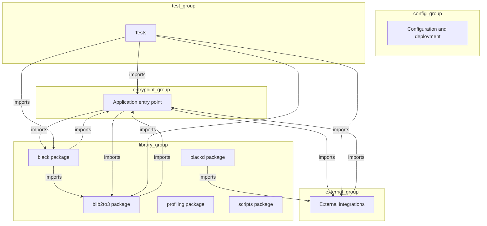

# Architecture report: psf/black

> Automated static analysis. **Observed** = directly seen in files/imports/AST; **Inferred** = interpretation from that evidence. Repository code was not executed.

## 1. Repository at a glance

| Item | Value |
| --- | --- |
| Repository | psf/black |
| Description | The uncompromising Python code formatter |
| Language | Python |
| Stars | 42172 |
| Licence | MIT |
| Analysed commit / branch | b10cbe43b8169e688ab86989ddcc8ad2a53ff2cd / main |
| Framework(s) | None detected |
| Files analysed | 572 |
| Components | 9 |

## 2. Architecture in one minute

psf/black - The uncompromising Python code formatter. This repository was analysed statically from 572 file(s) (437 Python). Detected technologies (observed from imports/manifests): GitHub Actions, aiohttp, Click, pandas, Poetry, setuptools. Files are grouped into 9 component(s): black package, blackd package, blib2to3 package, Configuration and deployment, Application entry point, External integrations, profiling package, scripts package. Observed entry point(s): scripts/diff_shades_gha_helper.py, scripts/fuzz.py, scripts/generate_schema.py. Findings below distinguish observed facts from inferred interpretation.

## 3. High-level block diagram

## 4. Main components

### black package (`black`)

- **Kind:** library
- **Status:** Observed
- **Confidence:** 0.85
- **Responsibility:** Groups 23 file(s) under black package (observed from repository paths and static analysis). Observed top-level classes: ASTSafetyError, BaseStringSplitter, BracketMatchError, BracketTracker, Cache, CannotSplit. Observed top-level functions: TErr, _atom_has_inner_comments, _atom_has_magic_trailing_comma, _cached_compile, _cached_resolve, _calculate_lines_mappings.
- **Paths:** `src/black/_width_table.py`, `src/black/brackets.py`, `src/black/cache.py`, `src/black/comments.py`, `src/black/concurrency.py`, `src/black/const.py`, `src/black/debug.py`, `src/black/files.py`, `src/black/handle_ipynb_magics.py`, `src/black/linegen.py`, `src/black/lines.py`, `src/black/mode.py`, `src/black/nodes.py`, `src/black/numerics.py`, `src/black/output.py`, `src/black/parsing.py`, `src/black/ranges.py`, `src/black/report.py`, `src/black/resources/__init__.py`, `src/black/rusty.py`, `src/black/schema.py`, `src/black/strings.py`, `src/black/trans.py`
- **Evidence:** [src/black/_width_table.py](https://github.com/psf/black/blob/b10cbe43b8169e688ab86989ddcc8ad2a53ff2cd/src/black/_width_table.py); [src/black/brackets.py:55](https://github.com/psf/black/blob/b10cbe43b8169e688ab86989ddcc8ad2a53ff2cd/src/black/brackets.py#L55); [src/black/cache.py:19](https://github.com/psf/black/blob/b10cbe43b8169e688ab86989ddcc8ad2a53ff2cd/src/black/cache.py#L19); [src/black/comments.py:42](https://github.com/psf/black/blob/b10cbe43b8169e688ab86989ddcc8ad2a53ff2cd/src/black/comments.py#L42); [src/black/concurrency.py:32](https://github.com/psf/black/blob/b10cbe43b8169e688ab86989ddcc8ad2a53ff2cd/src/black/concurrency.py#L32); [src/black/const.py](https://github.com/psf/black/blob/b10cbe43b8169e688ab86989ddcc8ad2a53ff2cd/src/black/const.py); [src/black/debug.py:16](https://github.com/psf/black/blob/b10cbe43b8169e688ab86989ddcc8ad2a53ff2cd/src/black/debug.py#L16); [src/black/files.py:26](https://github.com/psf/black/blob/b10cbe43b8169e688ab86989ddcc8ad2a53ff2cd/src/black/files.py#L26)

### blackd package (`blackd`)

- **Kind:** library
- **Status:** Observed
- **Confidence:** 0.85
- **Responsibility:** Groups 1 file(s) under blackd package (observed from repository paths and static analysis). Observed top-level functions: cors.
- **Paths:** `src/blackd/middlewares.py`
- **Evidence:** [src/blackd/middlewares.py:12](https://github.com/psf/black/blob/b10cbe43b8169e688ab86989ddcc8ad2a53ff2cd/src/blackd/middlewares.py#L12)

### blib2to3 package (`blib2to3`)

- **Kind:** library
- **Status:** Observed
- **Confidence:** 0.85
- **Responsibility:** Groups 8 file(s) under blib2to3 package (observed from repository paths and static analysis). Observed top-level classes: Base, DFAState, Grammar, Leaf, NFAState, Node. Observed top-level functions: convert, generate_grammar, initialize, lam_sub, stack_copy, type_repr.
- **Paths:** `src/blib2to3/__init__.py`, `src/blib2to3/pgen2/__init__.py`, `src/blib2to3/pgen2/grammar.py`, `src/blib2to3/pgen2/parse.py`, `src/blib2to3/pgen2/pgen.py`, `src/blib2to3/pgen2/token.py`, `src/blib2to3/pygram.py`, `src/blib2to3/pytree.py`
- **Evidence:** [src/blib2to3/__init__.py](https://github.com/psf/black/blob/b10cbe43b8169e688ab86989ddcc8ad2a53ff2cd/src/blib2to3/__init__.py); [src/blib2to3/pgen2/__init__.py](https://github.com/psf/black/blob/b10cbe43b8169e688ab86989ddcc8ad2a53ff2cd/src/blib2to3/pgen2/__init__.py); [src/blib2to3/pgen2/grammar.py:31](https://github.com/psf/black/blob/b10cbe43b8169e688ab86989ddcc8ad2a53ff2cd/src/blib2to3/pgen2/grammar.py#L31); [src/blib2to3/pgen2/parse.py:32](https://github.com/psf/black/blob/b10cbe43b8169e688ab86989ddcc8ad2a53ff2cd/src/blib2to3/pgen2/parse.py#L32); [src/blib2to3/pgen2/pgen.py:14](https://github.com/psf/black/blob/b10cbe43b8169e688ab86989ddcc8ad2a53ff2cd/src/blib2to3/pgen2/pgen.py#L14); [src/blib2to3/pgen2/token.py](https://github.com/psf/black/blob/b10cbe43b8169e688ab86989ddcc8ad2a53ff2cd/src/blib2to3/pgen2/token.py); [src/blib2to3/pygram.py:15](https://github.com/psf/black/blob/b10cbe43b8169e688ab86989ddcc8ad2a53ff2cd/src/blib2to3/pygram.py#L15); [src/blib2to3/pytree.py:26](https://github.com/psf/black/blob/b10cbe43b8169e688ab86989ddcc8ad2a53ff2cd/src/blib2to3/pytree.py#L26)

### Configuration and deployment (`config`)

- **Kind:** config
- **Status:** Observed
- **Confidence:** 0.85
- **Responsibility:** Groups 5 file(s) under configuration and deployment (observed from repository paths and static analysis).
- **Paths:** `Dockerfile`, `action.yml`, `pyproject.toml`, `src/black/resources/black.schema.json`, `tox.ini`
- **Evidence:** [Dockerfile](https://github.com/psf/black/blob/b10cbe43b8169e688ab86989ddcc8ad2a53ff2cd/Dockerfile); [action.yml](https://github.com/psf/black/blob/b10cbe43b8169e688ab86989ddcc8ad2a53ff2cd/action.yml); [pyproject.toml](https://github.com/psf/black/blob/b10cbe43b8169e688ab86989ddcc8ad2a53ff2cd/pyproject.toml); [src/black/resources/black.schema.json](https://github.com/psf/black/blob/b10cbe43b8169e688ab86989ddcc8ad2a53ff2cd/src/black/resources/black.schema.json); [tox.ini](https://github.com/psf/black/blob/b10cbe43b8169e688ab86989ddcc8ad2a53ff2cd/tox.ini)

### Application entry point (`entrypoint`)

- **Kind:** entrypoint
- **Status:** Observed
- **Confidence:** 0.85
- **Responsibility:** Groups 13 file(s) under application entry point (observed from repository paths and static analysis). Observed top-level classes: Driver, HeaderError, InvalidVariantHeader, NoGitTagsError, ReleaseRange, SourceFiles. Observed top-level functions: _black_info, _contains_asexpr, _declared_encoding, _echo_stdin_unchanged, _format_str_once, _generate_pickle_name.
- **Paths:** `action/main.py`, `scripts/diff_shades_gha_helper.py`, `scripts/fuzz.py`, `scripts/generate_schema.py`, `scripts/make_width_table.py`, `scripts/release.py`, `src/black/__init__.py`, `src/black/__main__.py`, `src/blackd/__init__.py`, `src/blackd/__main__.py`, `src/blib2to3/pgen2/driver.py`, `src/blib2to3/pgen2/literals.py`, `src/blib2to3/pgen2/tokenize.py`
- **Evidence:** [action/main.py:30](https://github.com/psf/black/blob/b10cbe43b8169e688ab86989ddcc8ad2a53ff2cd/action/main.py#L30); [scripts/diff_shades_gha_helper.py:42](https://github.com/psf/black/blob/b10cbe43b8169e688ab86989ddcc8ad2a53ff2cd/scripts/diff_shades_gha_helper.py#L42); [scripts/fuzz.py:38](https://github.com/psf/black/blob/b10cbe43b8169e688ab86989ddcc8ad2a53ff2cd/scripts/fuzz.py#L38); [scripts/generate_schema.py:9](https://github.com/psf/black/blob/b10cbe43b8169e688ab86989ddcc8ad2a53ff2cd/scripts/generate_schema.py#L9); [scripts/make_width_table.py:26](https://github.com/psf/black/blob/b10cbe43b8169e688ab86989ddcc8ad2a53ff2cd/scripts/make_width_table.py#L26); [scripts/release.py:73](https://github.com/psf/black/blob/b10cbe43b8169e688ab86989ddcc8ad2a53ff2cd/scripts/release.py#L73); [src/black/__init__.py:96](https://github.com/psf/black/blob/b10cbe43b8169e688ab86989ddcc8ad2a53ff2cd/src/black/__init__.py#L96); [src/black/__main__.py](https://github.com/psf/black/blob/b10cbe43b8169e688ab86989ddcc8ad2a53ff2cd/src/black/__main__.py)

### External integrations (`external_integrations`)

- **Kind:** external
- **Status:** Observed
- **Confidence:** 0.85
- **Responsibility:** Groups 1 file(s) under external integrations (observed from repository paths and static analysis). Observed top-level classes: BlackDClient.
- **Paths:** `src/blackd/client.py`
- **Evidence:** [src/blackd/client.py:9](https://github.com/psf/black/blob/b10cbe43b8169e688ab86989ddcc8ad2a53ff2cd/src/blackd/client.py#L9)

### profiling package (`profiling`)

- **Kind:** library
- **Status:** Observed
- **Confidence:** 0.85
- **Responsibility:** Groups 3 file(s) under profiling package (observed from repository paths and static analysis).
- **Paths:** `profiling/list_big.py`, `profiling/mix_big.py`, `profiling/mix_small.py`
- **Evidence:** [profiling/list_big.py](https://github.com/psf/black/blob/b10cbe43b8169e688ab86989ddcc8ad2a53ff2cd/profiling/list_big.py); [profiling/mix_big.py](https://github.com/psf/black/blob/b10cbe43b8169e688ab86989ddcc8ad2a53ff2cd/profiling/mix_big.py); [profiling/mix_small.py](https://github.com/psf/black/blob/b10cbe43b8169e688ab86989ddcc8ad2a53ff2cd/profiling/mix_small.py)

### scripts package (`scripts`)

- **Kind:** library
- **Status:** Observed
- **Confidence:** 0.85
- **Responsibility:** Groups 1 file(s) under scripts package (observed from repository paths and static analysis).
- **Paths:** `scripts/__init__.py`
- **Evidence:** [scripts/__init__.py](https://github.com/psf/black/blob/b10cbe43b8169e688ab86989ddcc8ad2a53ff2cd/scripts/__init__.py)

### Tests (`tests`)

- **Kind:** test
- **Status:** Observed
- **Confidence:** 0.85
- **Responsibility:** Groups 426 file(s) under tests (observed from repository paths and static analysis). Observed routes: PATCH release.get_git_tags, PATCH release.get_git_tags, PATCH release.datetime, PATCH release.get_git_tags, PATCH release.datetime. Observed top-level classes: A, ALonelyClass, After, AfterDecoratedFunc, AfterOverloadGroup, AfterOverloadGroup2. Observed top-level functions: A, SimplePyFn, __await__, _assert_format_equal, _assert_format_inner, _get_dark_style.
- **Paths:** `scripts/release_tests.py`, `tests/__init__.py`, `tests/conftest.py`, `tests/data/cases/allow_empty_first_line.py`, `tests/data/cases/annotated_assignment_target_parens.py`, `tests/data/cases/annotations.py`, `tests/data/cases/async_stmts.py`, `tests/data/cases/attribute_access_on_number_literals.py`, `tests/data/cases/backslash_before_indent.py`, `tests/data/cases/backslash_only_lines.py`, `tests/data/cases/backslash_only_lines_fstring.py`, `tests/data/cases/backslash_only_lines_tstring.py`, `tests/data/cases/beginning_backslash.py`, `tests/data/cases/blank_line_after_stub_method.py`, `tests/data/cases/bracketmatch.py`, `tests/data/cases/bytes_docstring.py`, `tests/data/cases/cantfit.py`, `tests/data/cases/class_blank_parentheses.py`, `tests/data/cases/class_methods_new_line.py`, `tests/data/cases/collections.py`, `tests/data/cases/comment_after_escaped_newline.py`, `tests/data/cases/comment_in_subscript_annotation.py`, `tests/data/cases/comment_type_hint.py`, `tests/data/cases/comments.py`, `tests/data/cases/comments2.py`, `tests/data/cases/comments3.py`, `tests/data/cases/comments4.py`, `tests/data/cases/comments5.py`, `tests/data/cases/comments6.py`, `tests/data/cases/comments8.py`, `tests/data/cases/comments9.py`, `tests/data/cases/comments_in_blocks.py`, `tests/data/cases/comments_in_comprehensions.py`, `tests/data/cases/comments_in_double_parens.py`, `tests/data/cases/comments_in_lambda_default.py`, `tests/data/cases/comments_in_lambda_parameters.py`, `tests/data/cases/comments_non_breaking_space.py`, `tests/data/cases/composition.py`, `tests/data/cases/composition_no_trailing_comma.py`, `tests/data/cases/conditional_expression.py`, `tests/data/cases/context_managers_38.py`, `tests/data/cases/context_managers_39.py`, `tests/data/cases/context_managers_autodetect_310.py`, `tests/data/cases/context_managers_autodetect_311.py`, `tests/data/cases/context_managers_autodetect_38.py`, `tests/data/cases/context_managers_autodetect_39.py`, `tests/data/cases/docstring.py`, `tests/data/cases/docstring2.py`, `tests/data/cases/docstring_newline.py`, `tests/data/cases/docstring_no_extra_empty_line_before_eof.py`, `tests/data/cases/docstring_no_string_normalization.py`, `tests/data/cases/docstring_tabs.py`, `tests/data/cases/dummy_implementations.py`, `tests/data/cases/empty_lines.py`, `tests/data/cases/expression.diff`, `tests/data/cases/expression.py`, `tests/data/cases/f_docstring.py`, `tests/data/cases/fmtonoff.py`, `tests/data/cases/fmtonoff2.py`, `tests/data/cases/fmtonoff3.py`, `tests/data/cases/fmtonoff4.py`, `tests/data/cases/fmtonoff5.py`, `tests/data/cases/fmtonoff6.py`, `tests/data/cases/fmtonoff9.py`, `tests/data/cases/fmtonoff_before_trailing_comma.py`, `tests/data/cases/fmtonoff_comment_only_async.py`, `tests/data/cases/fmtonoff_comment_only_tuple_target.py`, `tests/data/cases/fmtonoff_comment_only_with.py`, `tests/data/cases/fmtonoff_comments_before_fmt_on.py`, `tests/data/cases/fmtonoff_in_fstring_expression.py`, `tests/data/cases/fmtpass_imports.py`, `tests/data/cases/fmtskip.py`, `tests/data/cases/fmtskip10.py`, `tests/data/cases/fmtskip11.py`, `tests/data/cases/fmtskip12.py`, `tests/data/cases/fmtskip13.py`, `tests/data/cases/fmtskip2.py`, `tests/data/cases/fmtskip3.py`, `tests/data/cases/fmtskip4.py`, `tests/data/cases/fmtskip5.py`, `tests/data/cases/fmtskip6.py`, `tests/data/cases/fmtskip7.py`, `tests/data/cases/fmtskip8.py`, `tests/data/cases/fmtskip9.py`, `tests/data/cases/fmtskip_after_bracket_with_comment.py`, `tests/data/cases/fmtskip_after_fmtoff_in_brackets.py`, `tests/data/cases/fmtskip_after_multiline_call.py`, `tests/data/cases/fmtskip_after_multiline_import.py`, `tests/data/cases/fmtskip_class_header.py`, `tests/data/cases/fmtskip_class_header_base.py`, `tests/data/cases/fmtskip_compound_body_own_line.py`, `tests/data/cases/fmtskip_conditional_in_brackets.py`, `tests/data/cases/fmtskip_consecutive_statements.py`, `tests/data/cases/fmtskip_header_after_comment_only_fmt_off.py`, `tests/data/cases/fmtskip_header_bracket_5402.py`, `tests/data/cases/fmtskip_header_stub_body.py`, `tests/data/cases/fmtskip_in_clause.py`, `tests/data/cases/fmtskip_in_parens.py`, `tests/data/cases/fmtskip_leaf_bracket_depth.py`, `tests/data/cases/fmtskip_line_closes_earlier_bracket.py`, `tests/data/cases/fmtskip_multiple_in_clause.py`, `tests/data/cases/fmtskip_multiple_strings.py`, `tests/data/cases/fmtskip_one_liner_bare_name.py`, `tests/data/cases/fmtskip_one_liner_later_clause.py`, `tests/data/cases/fmtskip_opening_bracket_conditional.py`, `tests/data/cases/fmtskip_opening_bracket_operand.py`, `tests/data/cases/fmtskip_opening_bracket_split.py`, `tests/data/cases/fmtskip_opening_bracket_split_short_line.py`, `tests/data/cases/fmtskip_opening_bracket_twice.py`, `tests/data/cases/fmtskip_own_line_between_statements.py`, `tests/data/cases/fmtskip_paired_header.py`, `tests/data/cases/fmtskip_type_ignore.py`, `tests/data/cases/fmtskip_type_params.py`, `tests/data/cases/fmtskip_with_fmt_off_in_same_comment.py`, `tests/data/cases/form_feeds.py`, `tests/data/cases/format_unicode_escape_seq.py`, `tests/data/cases/fstring.py`, `tests/data/cases/fstring_quotations.py`, `tests/data/cases/funcdef_return_type_trailing_comma.py`, `tests/data/cases/function.py`, `tests/data/cases/function2.py`, `tests/data/cases/function_trailing_comma.py`, `tests/data/cases/generics_wrapping.py`, `tests/data/cases/if_guard_inside_case.py`, `tests/data/cases/ignore_pyi.py`, `tests/data/cases/import_line_collapse.py`, `tests/data/cases/import_spacing.py`, `tests/data/cases/is_simple_lookup_for_doublestar_expression.py`, `tests/data/cases/jupytext_markdown_fmt.py`, `tests/data/cases/keep_newline_after_match.py`, `tests/data/cases/line_ranges_async_stub_body.py`, `tests/data/cases/line_ranges_backslash_only_line.py`, `tests/data/cases/line_ranges_basic.py`, `tests/data/cases/line_ranges_decorator_edge_case.py`, `tests/data/cases/line_ranges_diff_edge_case.py`, `tests/data/cases/line_ranges_exceeding_end.py`, `tests/data/cases/line_ranges_fmt_off.py`, `tests/data/cases/line_ranges_fmt_off_comment_only.py`, `tests/data/cases/line_ranges_fmt_off_comment_only_blank_lines.py`, `tests/data/cases/line_ranges_fmt_off_comment_only_header.py`, `tests/data/cases/line_ranges_fmt_off_decorator.py`, `tests/data/cases/line_ranges_fmt_off_overlap.py`, `tests/data/cases/line_ranges_fmt_skip_in_brackets.py`, `tests/data/cases/line_ranges_format_selected_prefix_comment.py`, `tests/data/cases/line_ranges_imports.py`, `tests/data/cases/line_ranges_indentation.py`, `tests/data/cases/line_ranges_one_line_clauses.py`, `tests/data/cases/line_ranges_outside_source.py`, `tests/data/cases/line_ranges_preserve_blank_lines_before_comments.py`, `tests/data/cases/line_ranges_preserve_outside_prefix.py`, `tests/data/cases/line_ranges_stacked_decorators.py`, `tests/data/cases/line_ranges_two_passes.py`, `tests/data/cases/line_ranges_unwrapping.py`, `tests/data/cases/linelength6.py`, `tests/data/cases/long_strings__overloaded_operators.py`, `tests/data/cases/long_strings__type_annotations.py`, `tests/data/cases/long_strings_flag_disabled.py`, `tests/data/cases/module_docstring_1.py`, `tests/data/cases/module_docstring_2.py`, `tests/data/cases/module_docstring_3.py`, `tests/data/cases/module_docstring_4.py`, `tests/data/cases/module_docstring_after_comment.py`, `tests/data/cases/module_docstring_followed_by_class.py`, `tests/data/cases/module_docstring_followed_by_function.py`, `tests/data/cases/multiline_consecutive_open_parentheses_ignore.py`, `tests/data/cases/multiline_strings.py`, `tests/data/cases/nested_stub.py`, `tests/data/cases/no_blank_line_before_docstring.py`, `tests/data/cases/numeric_literals.py`, `tests/data/cases/numeric_literals_skip_underscores.py`, `tests/data/cases/one_element_subscript.py`, `tests/data/cases/parenthesized_context_managers.py`, `tests/data/cases/pattern_matching_case_case_small_line_length.py`, `tests/data/cases/pattern_matching_complex.py`, `tests/data/cases/pattern_matching_extras.py`, `tests/data/cases/pattern_matching_generic.py`, `tests/data/cases/pattern_matching_long.py`, `tests/data/cases/pattern_matching_simple.py`, `tests/data/cases/pattern_matching_style.py`, `tests/data/cases/pattern_matching_trailing_comma.py`, `tests/data/cases/pattern_matching_with_if_stmt.py`, `tests/data/cases/pep604_union_types_line_breaks.py`, `tests/data/cases/pep646_typed_star_arg_type_var_tuple.py`, `tests/data/cases/pep_570.py`, `tests/data/cases/pep_572.py`, `tests/data/cases/pep_572_do_not_remove_parens.py`, `tests/data/cases/pep_572_py310.py`, `tests/data/cases/pep_572_py39.py`, `tests/data/cases/pep_572_remove_parens.py`, `tests/data/cases/pep_572_slices.py`, `tests/data/cases/pep_604.py`, `tests/data/cases/pep_646.py`, `tests/data/cases/pep_654.py`, `tests/data/cases/pep_654_style.py`, `tests/data/cases/pep_701.py`, `tests/data/cases/pep_750.py`, `tests/data/cases/pep_750_nested_quotes.py`, `tests/data/cases/percent_precedence.py`, `tests/data/cases/power_op_newline.py`, `tests/data/cases/power_op_spacing.py`, `tests/data/cases/power_op_spacing_long.py`, `tests/data/cases/prefer_rhs_split.py`, `tests/data/cases/prefer_rhs_split_reformatted.py`, `tests/data/cases/preview_avoid_parens_for_unbreakable_rhs_in_assignments.py`, `tests/data/cases/preview_cantfit_string.py`, `tests/data/cases/preview_comments7.py`, `tests/data/cases/preview_fmt_off_class_blank_lines.py`, `tests/data/cases/preview_fmtonoff_without_fmt_on_in_brackets.py`, `tests/data/cases/preview_fmtonoff_without_fmt_on_in_type_params.py`, `tests/data/cases/preview_fstring.py`, `tests/data/cases/preview_hug_comparator.py`, `tests/data/cases/preview_hug_parens_with_braces_and_square_brackets.py`, `tests/data/cases/preview_hug_parens_with_braces_and_square_brackets_no_ll1.py`, `tests/data/cases/preview_hug_parens_with_type_ignore.py`, `tests/data/cases/preview_keep_commented_expressions_together.py`, `tests/data/cases/preview_keep_dict_keys_with_operators.py`, `tests/data/cases/preview_keep_trailers_on_bracket_comment_overflow.py`, `tests/data/cases/preview_long_dict_values.py`, `tests/data/cases/preview_long_strings.py`, `tests/data/cases/preview_long_strings__duplicate_comments.py`, `tests/data/cases/preview_long_strings__east_asian_width.py`, `tests/data/cases/preview_long_strings__edge_case.py`, `tests/data/cases/preview_long_strings__overloaded_operators.py`, `tests/data/cases/preview_long_strings__raw_backslash_continuation.py`, `tests/data/cases/preview_long_strings__regression.py`, `tests/data/cases/preview_long_strings__small_line_length.py`, `tests/data/cases/preview_magic_trailing_comma_trailer_split.py`, `tests/data/cases/preview_parenthesize_expressions_with_comments.py`, `tests/data/cases/preview_parenthesize_one_item_sequence_patterns.py`, `tests/data/cases/preview_prefer_rhs_split_indexed_assignment.py`, `tests/data/cases/preview_raw_string_boundary.py`, `tests/data/cases/preview_raw_string_merge.py`, `tests/data/cases/preview_raw_string_width.py`, `tests/data/cases/preview_redundant_comparison_parentheses.py`, `tests/data/cases/preview_redundant_generator_parentheses.py`, `tests/data/cases/preview_redundant_generator_parentheses_skip_mtc.py`, `tests/data/cases/preview_redundant_list_parentheses.py`, `tests/data/cases/preview_redundant_subscript_parentheses.py`, `tests/data/cases/preview_redundant_yield_parentheses.py`, `tests/data/cases/preview_remove_multiline_lone_list_item_parens.py`, `tests/data/cases/preview_return_annotation_brackets_string.py`, `tests/data/cases/preview_simplify_power_operator_hugging.py`, `tests/data/cases/preview_simplify_power_operator_hugging_long.py`, `tests/data/cases/preview_split_implicit_string_concatenations.py`, `tests/data/cases/preview_symmetric_list_concatenation.py`, `tests/data/cases/preview_symmetric_list_concatenation_line_length.py`, `tests/data/cases/preview_symmetric_list_concatenation_skip_magic.py`, `tests/data/cases/preview_top_level_parentheses.py`, `tests/data/cases/preview_tstrings.py`, `tests/data/cases/preview_type_param_defaults_string_split.py`, `tests/data/cases/preview_unpacking_parens.py`, `tests/data/cases/preview_unpacking_parens_multiline.py`, `tests/data/cases/preview_walrus_in_subscript_py310.py`, `tests/data/cases/preview_walrus_in_subscript_py38.py`, `tests/data/cases/preview_wrap_comprehension_in.py`, `tests/data/cases/py310_pep572.py`, `tests/data/cases/pyi_decorated_class_blank_line.py`, `tests/data/cases/pyi_docstring_blank_lines.py`, `tests/data/cases/pyi_docstring_blank_lines_no_preview.py`, `tests/data/cases/pyi_overload_groups.py`, `tests/data/cases/pyi_overload_groups_fmt_skip.py`, `tests/data/cases/python315.py`, `tests/data/cases/python37.py`, `tests/data/cases/python38.py`, `tests/data/cases/python39.py`, `tests/data/cases/raw_docstring.py`, `tests/data/cases/raw_docstring_no_string_normalization.py`, `tests/data/cases/remove_await_parens.py`, `tests/data/cases/remove_except_parens.py`, `tests/data/cases/remove_except_types_parens.py`, `tests/data/cases/remove_except_types_parens_pre_py314.py`, `tests/data/cases/remove_for_brackets.py`, `tests/data/cases/remove_lone_list_item_parens.py`, `tests/data/cases/remove_newline_after_code_block_open.py`, `tests/data/cases/remove_parens.py`, `tests/data/cases/remove_parens_from_lhs.py`, `tests/data/cases/remove_redundant_parens_in_case_guard.py`, `tests/data/cases/remove_with_brackets.py`, `tests/data/cases/return_annotation_brackets.py`, `tests/data/cases/single_line_format_skip_with_multiple_comments.py`, `tests/data/cases/skip_magic_trailing_comma.py`, `tests/data/cases/skip_magic_trailing_comma_generic_wrap.py`, `tests/data/cases/slices.py`, `tests/data/cases/split_delimiter_comments.py`, `tests/data/cases/stable_parenthesize_expressions_with_comments.py`, `tests/data/cases/stable_symmetric_list_concatenation.py`, `tests/data/cases/standardize_type_comments.py`, `tests/data/cases/starred_for_target.py`, `tests/data/cases/string_prefixes.py`, `tests/data/cases/string_quotes_escaped_trailing_quote.py`, `tests/data/cases/stub.py`, `tests/data/cases/t_docstring.py`, `tests/data/cases/target_version_flag.py`, `tests/data/cases/torture.py`, `tests/data/cases/trailing_comma.py`, `tests/data/cases/trailing_comma_optional_parens1.py`, `tests/data/cases/trailing_comma_optional_parens2.py`, `tests/data/cases/trailing_comma_optional_parens3.py`, `tests/data/cases/trailing_commas_in_leading_parts.py`, `tests/data/cases/trailing_comment_after_optional_parens.py`, `tests/data/cases/tricky_unicode_symbols.py`, `tests/data/cases/tstring_prefix_preview.py`, `tests/data/cases/tstring_prefix_skip.py`, `tests/data/cases/tstring_prefix_stable.py`, `tests/data/cases/tuple_with_stmt.py`, `tests/data/cases/tupleassign.py`, `tests/data/cases/type_aliases.py`, `tests/data/cases/type_comment_syntax_error.py`, `tests/data/cases/type_expansion.py`, `tests/data/cases/type_ignore_after_other_comment.py`, `tests/data/cases/type_ignore_attribute_chain.py`, `tests/data/cases/type_ignore_attribute_chain_unstable.py`, `tests/data/cases/type_ignore_attribute_chain_with_comment.py`, `tests/data/cases/type_ignore_parenthesized_expression.py`, `tests/data/cases/type_ignore_with_other_comment.py`, `tests/data/cases/type_param_defaults.py`, `tests/data/cases/type_params.py`, `tests/data/cases/typed_params_trailing_comma.py`, `tests/data/cases/unstable_comment_on_optional_parens.py`, `tests/data/cases/walrus_in_dict.py`, `tests/data/cases/walrus_in_set_py310.py`, `tests/data/cases/walrus_in_set_py38.py`, `tests/data/cases/walrus_in_set_py39.py`, `tests/data/cases/whitespace.py`, `tests/data/cases/yield_singleton_tuple.py`, `tests/data/cases/yield_singleton_tuple_stable.py`, `tests/data/empty_pyproject.toml`, `tests/data/gitignore_used_on_multiple_sources/.gitignore`, `tests/data/gitignore_used_on_multiple_sources/dir1/a.py`, `tests/data/gitignore_used_on_multiple_sources/dir1/b.py`, `tests/data/gitignore_used_on_multiple_sources/dir2/a.py`, `tests/data/gitignore_used_on_multiple_sources/dir2/b.py`, `tests/data/ignore_directory_gitignore_tests/.gitignore`, `tests/data/ignore_directory_gitignore_tests/abc.py`, `tests/data/ignore_directory_gitignore_tests/large_ignored_dir_two/a.py`, `tests/data/ignore_directory_gitignore_tests/large_ignored_dir_two/inner/b.py`, `tests/data/ignore_directory_gitignore_tests/large_ignored_dir_two/inner2/c.py`, `tests/data/ignore_directory_gitignore_tests/large_ignored_dir_two/inner3/d.py`, `tests/data/ignore_directory_gitignore_tests/z.py`, `tests/data/ignore_subfolders_gitignore_tests/a.py`, `tests/data/ignore_subfolders_gitignore_tests/subdir/.gitignore`, `tests/data/ignore_subfolders_gitignore_tests/subdir/b.py`, `tests/data/ignore_subfolders_gitignore_tests/subdir/subdir/c.py`, `tests/data/include_exclude_tests/.gitignore`, `tests/data/include_exclude_tests/b/.definitely_exclude/a.pie`, `tests/data/include_exclude_tests/b/.definitely_exclude/a.py`, `tests/data/include_exclude_tests/b/.definitely_exclude/a.pyi`, `tests/data/include_exclude_tests/b/dont_exclude/a.pie`, `tests/data/include_exclude_tests/b/dont_exclude/a.py`, `tests/data/include_exclude_tests/b/dont_exclude/a.pyi`, `tests/data/include_exclude_tests/b/exclude/a.pie`, `tests/data/include_exclude_tests/b/exclude/a.py`, `tests/data/include_exclude_tests/b/exclude/a.pyi`, `tests/data/include_exclude_tests/b/exclude/still_exclude/a.pie`, `tests/data/include_exclude_tests/b/exclude/still_exclude/a.py`, `tests/data/include_exclude_tests/b/exclude/still_exclude/a.pyi`, `tests/data/include_exclude_tests/pyproject.toml`, `tests/data/incorrect_spelling.toml`, `tests/data/invalid_gitignore_tests/.gitignore`, `tests/data/invalid_gitignore_tests/a.py`, `tests/data/invalid_gitignore_tests/pyproject.toml`, `tests/data/invalid_line_ranges.toml`, `tests/data/invalid_nested_gitignore_tests/a.py`, `tests/data/invalid_nested_gitignore_tests/a/.gitignore`, `tests/data/invalid_nested_gitignore_tests/a/a.py`, `tests/data/invalid_nested_gitignore_tests/pyproject.toml`, `tests/data/jupyter/non_python_notebook.ipynb`, `tests/data/jupyter/notebook_empty_metadata.ipynb`, `tests/data/jupyter/notebook_no_trailing_newline.ipynb`, `tests/data/jupyter/notebook_trailing_newline.ipynb`, `tests/data/jupyter/notebook_which_cant_be_parsed.ipynb`, `tests/data/jupyter/notebook_without_changes.ipynb`, `tests/data/line_ranges_formatted/basic.py`, `tests/data/line_ranges_formatted/fmt_off_comment_only.py`, `tests/data/line_ranges_formatted/fmt_off_comment_only_blank_lines.py`, `tests/data/line_ranges_formatted/fmt_skip_in_brackets.py`, `tests/data/line_ranges_formatted/function_docstring.py`, `tests/data/line_ranges_formatted/pattern_matching.py`, `tests/data/miscellaneous/async_as_identifier.py`, `tests/data/miscellaneous/blackd_diff.diff`, `tests/data/miscellaneous/blackd_diff.py`, `tests/data/miscellaneous/debug_visitor.out`, `tests/data/miscellaneous/debug_visitor.py`, `tests/data/miscellaneous/decorators.py`, `tests/data/miscellaneous/expression_skip_magic_trailing_comma.diff`, `tests/data/miscellaneous/fmtonoff_without_fmt_on_before_single_item.py`, `tests/data/miscellaneous/force_py36.py`, `tests/data/miscellaneous/force_pyi.py`, `tests/data/miscellaneous/invalid_header.py`, `tests/data/miscellaneous/missing_final_newline.diff`, `tests/data/miscellaneous/missing_final_newline.py`, `tests/data/miscellaneous/pattern_matching_invalid.py`, `tests/data/miscellaneous/python2_detection.py`, `tests/data/miscellaneous/string_quotes.py`, `tests/data/nested_gitignore_tests/pyproject.toml`, `tests/data/nested_gitignore_tests/root/.gitignore`, `tests/data/nested_gitignore_tests/root/a.py`, `tests/data/nested_gitignore_tests/root/b.py`, `tests/data/nested_gitignore_tests/root/c.py`, `tests/data/nested_gitignore_tests/root/child/.gitignore`, `tests/data/nested_gitignore_tests/root/child/a.py`, `tests/data/nested_gitignore_tests/root/child/b.py`, `tests/data/nested_gitignore_tests/root/child/c.py`, `tests/data/nested_gitignore_tests/x.py`, `tests/data/project_metadata/both_pyproject.toml`, `tests/data/project_metadata/neither_pyproject.toml`, `tests/data/project_metadata/only_black_pyproject.toml`, `tests/data/project_metadata/only_metadata_pyproject.toml`, `tests/empty.toml`, `tests/optional.py`, `tests/test.toml`, `tests/test_action.py`, `tests/test_black.py`, `tests/test_blackd.py`, `tests/test_concurrency_manager_shutdown.py`, `tests/test_docs.py`, `tests/test_format.py`, `tests/test_github_action.py`, `tests/test_ipynb.py`, `tests/test_no_ipynb.py`, `tests/test_ranges.py`, `tests/test_schedule_formatting.py`, `tests/test_schema.py`, `tests/test_tokenize.py`, `tests/test_trans.py`, `tests/util.py`
- **Evidence:** [scripts/release_tests.py:13](https://github.com/psf/black/blob/b10cbe43b8169e688ab86989ddcc8ad2a53ff2cd/scripts/release_tests.py#L13); [tests/__init__.py](https://github.com/psf/black/blob/b10cbe43b8169e688ab86989ddcc8ad2a53ff2cd/tests/__init__.py); [tests/conftest.py:9](https://github.com/psf/black/blob/b10cbe43b8169e688ab86989ddcc8ad2a53ff2cd/tests/conftest.py#L9); [tests/data/cases/allow_empty_first_line.py:1](https://github.com/psf/black/blob/b10cbe43b8169e688ab86989ddcc8ad2a53ff2cd/tests/data/cases/allow_empty_first_line.py#L1); [tests/data/cases/annotated_assignment_target_parens.py:13](https://github.com/psf/black/blob/b10cbe43b8169e688ab86989ddcc8ad2a53ff2cd/tests/data/cases/annotated_assignment_target_parens.py#L13); [tests/data/cases/annotations.py:2](https://github.com/psf/black/blob/b10cbe43b8169e688ab86989ddcc8ad2a53ff2cd/tests/data/cases/annotations.py#L2); [tests/data/cases/async_stmts.py:1](https://github.com/psf/black/blob/b10cbe43b8169e688ab86989ddcc8ad2a53ff2cd/tests/data/cases/async_stmts.py#L1); [tests/data/cases/attribute_access_on_number_literals.py](https://github.com/psf/black/blob/b10cbe43b8169e688ab86989ddcc8ad2a53ff2cd/tests/data/cases/attribute_access_on_number_literals.py)

## 5. Execution flow

**Observed** entry point(s):

- [scripts/diff_shades_gha_helper.py:112](https://github.com/psf/black/blob/b10cbe43b8169e688ab86989ddcc8ad2a53ff2cd/scripts/diff_shades_gha_helper.py#L112)
- [scripts/fuzz.py:55](https://github.com/psf/black/blob/b10cbe43b8169e688ab86989ddcc8ad2a53ff2cd/scripts/fuzz.py#L55)
- [scripts/generate_schema.py:50](https://github.com/psf/black/blob/b10cbe43b8169e688ab86989ddcc8ad2a53ff2cd/scripts/generate_schema.py#L50)
- [scripts/make_width_table.py:65](https://github.com/psf/black/blob/b10cbe43b8169e688ab86989ddcc8ad2a53ff2cd/scripts/make_width_table.py#L65)
- [scripts/release.py:323](https://github.com/psf/black/blob/b10cbe43b8169e688ab86989ddcc8ad2a53ff2cd/scripts/release.py#L323)
- [scripts/release_tests.py:103](https://github.com/psf/black/blob/b10cbe43b8169e688ab86989ddcc8ad2a53ff2cd/scripts/release_tests.py#L103)
- [src/black/__init__.py](https://github.com/psf/black/blob/b10cbe43b8169e688ab86989ddcc8ad2a53ff2cd/src/black/__init__.py)
- [src/blackd/__init__.py](https://github.com/psf/black/blob/b10cbe43b8169e688ab86989ddcc8ad2a53ff2cd/src/blackd/__init__.py)
- [src/blib2to3/pgen2/driver.py:312](https://github.com/psf/black/blob/b10cbe43b8169e688ab86989ddcc8ad2a53ff2cd/src/blib2to3/pgen2/driver.py#L312)
- [src/blib2to3/pgen2/literals.py:64](https://github.com/psf/black/blob/b10cbe43b8169e688ab86989ddcc8ad2a53ff2cd/src/blib2to3/pgen2/literals.py#L64)
- [src/blib2to3/pgen2/tokenize.py:278](https://github.com/psf/black/blob/b10cbe43b8169e688ab86989ddcc8ad2a53ff2cd/src/blib2to3/pgen2/tokenize.py#L278)

**Observed** routes (from decorators):

- `PATCH release.get_git_tags` -> `test_get_current_version` in `scripts/release_tests.py:35`
- `PATCH release.get_git_tags` -> `test_get_next_version` in `scripts/release_tests.py:41`
- `PATCH release.datetime` -> `test_get_next_version` in `scripts/release_tests.py:41`
- `PATCH release.get_git_tags` -> `test_get_prerelease_version` in `scripts/release_tests.py:69`
- `PATCH release.datetime` -> `test_get_prerelease_version` in `scripts/release_tests.py:69`
- `GET /path/` -> `foo` in `tests/data/cases/pep604_union_types_line_breaks.py:69`
- `GET /path/` -> `foo` in `tests/data/cases/pep604_union_types_line_breaks.py:189`
- `PATCH black.dump_to_file` -> `test_one_empty_line` in `tests/test_black.py:264`
- `PATCH black.dump_to_file` -> `test_string_quotes` in `tests/test_black.py:503`
- `PATCH black.dump_to_file` -> `test_python37` in `tests/test_black.py:609`
- `PATCH black.dump_to_file` -> `test_python315` in `tests/test_black.py:620`
- `PATCH tests.conftest.PRINT_FULL_TREE` -> `test_assertFormatEqual_print_full_tree` in `tests/test_black.py:1283`
- `PATCH tests.conftest.PRINT_TREE_DIFF` -> `test_assertFormatEqual_print_full_tree` in `tests/test_black.py:1283`
- `PATCH tests.conftest.PRINT_FULL_TREE` -> `test_assertFormatEqual_print_tree_diff` in `tests/test_black.py:1305`
- `PATCH tests.conftest.PRINT_TREE_DIFF` -> `test_assertFormatEqual_print_tree_diff` in `tests/test_black.py:1305`
- `PATCH concurrent.futures.ProcessPoolExecutor` -> `test_works_in_mono_process_only_environment` in `tests/test_black.py:1327`
- `PATCH black.files.find_user_pyproject_toml` -> `test_find_pyproject_toml_no_common_parent` in `tests/test_black.py:2241`
- `PATCH black.files.find_user_pyproject_toml` -> `test_no_common_parent_warns_and_formats` in `tests/test_black.py:2264`
- `PATCH black.files.find_project_root` -> `test_no_common_parent_warns_and_formats` in `tests/test_black.py:2264`
- `PATCH black.find_project_root` -> `test_no_common_parent_warns_and_formats` in `tests/test_black.py:2264`
- `PATCH black.files.find_user_pyproject_toml` -> `test_find_pyproject_toml` in `tests/test_black.py:2312`
- `PATCH black.files.find_user_pyproject_toml` -> `test_find_user_pyproject_toml_linux` in `tests/test_black.py:2328`
- `PATCH black.find_project_root` -> `test_exclude_for_issue_1572` in `tests/test_black.py:3777`

Representative flow (derived from observed entry points and the import graph; steps beyond the entry point are **Inferred**):

1. Execution starts at an observed entry point listed above, if present.
2. `black` imports `blib2to3` (black package -> blib2to3 package).
3. `black` imports `entrypoint` (black package -> Application entry point).
4. `blackd` imports `external_integrations` (blackd package -> External integrations).
5. `blib2to3` imports `entrypoint` (blib2to3 package -> Application entry point).
6. `entrypoint` imports `black` (Application entry point -> black package).
7. `entrypoint` imports `blib2to3` (Application entry point -> blib2to3 package).
8. `entrypoint` imports `external_integrations` (Application entry point -> External integrations).
9. `external_integrations` imports `entrypoint` (External integrations -> Application entry point).

## 6. Project structure

### `(root)`

- `.flake8` - other (307 bytes)
- `.git_archival.txt` - docs (124 bytes)
- `.gitattributes` - other (49 bytes)
- `.gitignore` - other (308 bytes)
- `.pre-commit-config.yaml` - config (1407 bytes)
- `.pre-commit-hooks.yaml` - config (681 bytes)
- `.prettierrc.yaml` - config (188 bytes)
- `.readthedocs.yaml` - config (245 bytes)
- `AUTHORS.md` - docs (8194 bytes)
- `CHANGES.md` - docs (110775 bytes)
- `CITATION.cff` - other (933 bytes)
- `CONTRIBUTING.md` - docs (519 bytes)
- `Dockerfile` - container (888 bytes)
- `LICENSE` - docs (1080 bytes)
- `README.md` - docs (9879 bytes)
- `SECURITY.md` - docs (289 bytes)
- `action.yml` - config (3277 bytes)
- `pyproject.toml` - manifest (7463 bytes)
- `tox.ini` - config (1706 bytes)

### `.github`

- `.github/CODE_OF_CONDUCT.md` - docs (554 bytes)
- `.github/ISSUE_TEMPLATE/bug_report.md` - docs (1559 bytes)
- `.github/ISSUE_TEMPLATE/config.yml` - config (540 bytes)
- `.github/ISSUE_TEMPLATE/docs-issue.md` - docs (692 bytes)
- `.github/ISSUE_TEMPLATE/feature_request.md` - docs (649 bytes)
- `.github/ISSUE_TEMPLATE/style_issue.md` - docs (734 bytes)
- `.github/PULL_REQUEST_TEMPLATE.md` - docs (1997 bytes)
- `.github/dependabot.yml` - config (606 bytes)
- `.github/workflows/changelog.yml` - ci, YAML (810 bytes)
- `.github/workflows/cut_release.yml` - ci, YAML (7042 bytes)
- `.github/workflows/diff_shades.yml` - ci, YAML (8386 bytes)
- `.github/workflows/diff_shades_comment.yml` - ci, YAML (4497 bytes)
- `.github/workflows/docker.yml` - ci, YAML (3744 bytes)
- `.github/workflows/docs.yml` - ci, YAML (986 bytes)
- `.github/workflows/fuzz.yml` - ci, YAML (3316 bytes)
- `.github/workflows/lint.yml` - ci, YAML (1524 bytes)
- `.github/workflows/prepare_release.yml` - ci, YAML (3736 bytes)
- `.github/workflows/pypi_upload.yml` - ci, YAML (5860 bytes)
- `.github/workflows/release_tests.yml` - ci, YAML (1338 bytes)
- `.github/workflows/test.yml` - ci, YAML (3589 bytes)
- `.github/workflows/zizmor.yml` - ci, YAML (635 bytes)
- `.github/zizmor.yml` - config (398 bytes)

### `action`

- `action/main.py` - source, Python (6710 bytes)

### `autoload`

- `autoload/black.vim` - other (9421 bytes)

### `docs`

- `docs/Makefile` - docs (602 bytes)
- `docs/_static/license.svg` - docs (950 bytes)
- `docs/_static/pypi_template.svg` - docs (954 bytes)
- `docs/authors.md` - docs (32 bytes)
- `docs/change_log.md` - docs (32 bytes)
- `docs/compatible_configs/flake8/.flake8` - docs (56 bytes)
- `docs/compatible_configs/flake8/setup.cfg` - manifest (56 bytes)
- `docs/compatible_configs/flake8/tox.ini` - config (56 bytes)
- `docs/compatible_configs/isort/.editorconfig` - config (23 bytes)
- `docs/compatible_configs/isort/.isort.cfg` - config (27 bytes)
- `docs/compatible_configs/isort/pyproject.toml` - manifest (31 bytes)
- `docs/compatible_configs/isort/setup.cfg` - manifest (24 bytes)
- `docs/compatible_configs/pycodestyle/.flake8` - docs (54 bytes)
- `docs/compatible_configs/pycodestyle/setup.cfg` - manifest (54 bytes)
- `docs/compatible_configs/pycodestyle/tox.ini` - config (54 bytes)
- `docs/compatible_configs/pylint/pylintrc` - docs (30 bytes)
- `docs/compatible_configs/pylint/pyproject.toml` - manifest (44 bytes)
- `docs/compatible_configs/pylint/setup.cfg` - manifest (30 bytes)
- `docs/conf.py` - docs (7298 bytes)
- `docs/contributing/gauging_changes.md` - docs (2721 bytes)
- `docs/contributing/index.md` - docs (1318 bytes)
- `docs/contributing/issue_triage.md` - docs (9586 bytes)
- `docs/contributing/release_process.md` - docs (11313 bytes)
- `docs/contributing/the_basics.md` - docs (6352 bytes)
- `docs/faq.md` - docs (6503 bytes)
- `docs/getting_started.md` - docs (1993 bytes)
- `docs/guides/index.md` - docs (389 bytes)
- `docs/guides/introducing_black_to_your_project.md` - docs (4775 bytes)
- `docs/guides/using_black_with_jupyter_notebooks.md` - docs (3290 bytes)
- `docs/guides/using_black_with_other_tools.md` - docs (7976 bytes)
- `docs/index.md` - docs (3589 bytes)
- `docs/integrations/doctest_formatting.md` - docs (2550 bytes)
- `docs/integrations/editors.md` - docs (14060 bytes)
- `docs/integrations/github_actions.md` - docs (4709 bytes)
- `docs/integrations/index.md` - docs (1009 bytes)
- `docs/integrations/pre-commit.md` - docs (3329 bytes)
- `docs/license.md` - docs (62 bytes)
- `docs/make.bat` - docs (803 bytes)
- `docs/the_black_code_style/current_style.md` - docs (20756 bytes)
- `docs/the_black_code_style/future_style.md` - docs (26872 bytes)
- `docs/the_black_code_style/index.md` - docs (2346 bytes)
- `docs/usage_and_configuration/black_as_a_server.md` - docs (5374 bytes)
- `docs/usage_and_configuration/black_docker_image.md` - docs (2173 bytes)
- `docs/usage_and_configuration/file_collection_and_discovery.md` - docs (2437 bytes)
- `docs/usage_and_configuration/index.md` - docs (969 bytes)
- `docs/usage_and_configuration/the_basics.md` - docs (22532 bytes)

### `plugin`

- `plugin/black.vim` - other (2423 bytes)

### `profiling`

- `profiling/list_big.py` - source, Python (159994 bytes)
- `profiling/mix_big.py` - source, Python (184224 bytes)
- `profiling/mix_small.py` - source, Python (18306 bytes)

### `scripts`

- `scripts/__init__.py` - source, Python (0 bytes)
- `scripts/diff_shades_gha_helper.py` - source, Python (8040 bytes)
- `scripts/fuzz.py` - source, Python (2714 bytes)
- `scripts/generate_schema.py` - source, Python (2423 bytes)
- `scripts/make_width_table.py` - source, Python (2356 bytes)
- `scripts/release.py` - source, Python (10178 bytes)
- `scripts/release_tests.py` - test, Python (3748 bytes)

### `src`

- `src/_black_version.pyi` - other (13 bytes)
- `src/black/__init__.py` - source, Python (66084 bytes)
- `src/black/__main__.py` - source, Python (47 bytes)
- `src/black/_width_table.py` - source, Python (3096 bytes)
- `src/black/brackets.py` - source, Python (15291 bytes)
- `src/black/cache.py` - source, Python (4872 bytes)
- `src/black/comments.py` - source, Python (48068 bytes)
- `src/black/concurrency.py` - source, Python (10214 bytes)
- `src/black/const.py` - source, Python (321 bytes)
- `src/black/debug.py` - source, Python (1922 bytes)
- `src/black/files.py` - source, Python (16045 bytes)
- `src/black/handle_ipynb_magics.py` - source, Python (17171 bytes)
- `src/black/linegen.py` - source, Python (125573 bytes)
- `src/black/lines.py` - source, Python (75529 bytes)
- `src/black/mode.py` - source, Python (12667 bytes)
- `src/black/nodes.py` - source, Python (35249 bytes)
- `src/black/numerics.py` - source, Python (1753 bytes)
- `src/black/output.py` - source, Python (4204 bytes)
- `src/black/parsing.py` - source, Python (10051 bytes)
- `src/black/py.typed` - other (0 bytes)
- `src/black/ranges.py` - source, Python (31674 bytes)
- `src/black/report.py` - source, Python (4527 bytes)
- `src/black/resources/__init__.py` - source, Python (0 bytes)
- `src/black/resources/black.schema.json` - config (8795 bytes)
- `src/black/rusty.py` - source, Python (557 bytes)
- `src/black/schema.py` - source, Python (431 bytes)
- `src/black/strings.py` - source, Python (16933 bytes)
- `src/black/trans.py` - source, Python (110806 bytes)
- `src/blackd/__init__.py` - source, Python (10972 bytes)
- `src/blackd/__main__.py` - source, Python (37 bytes)
- `src/blackd/client.py` - source, Python (4319 bytes)
- `src/blackd/middlewares.py` - source, Python (1487 bytes)
- `src/blib2to3/Grammar.txt` - docs (12095 bytes)
- `src/blib2to3/LICENSE` - docs (12762 bytes)
- `src/blib2to3/PatternGrammar.txt` - docs (807 bytes)
- `src/blib2to3/README` - other (1074 bytes)
- `src/blib2to3/__init__.py` - source, Python (8 bytes)
- `src/blib2to3/pgen2/__init__.py` - source, Python (143 bytes)
- `src/blib2to3/pgen2/driver.py` - source, Python (10437 bytes)
- `src/blib2to3/pgen2/grammar.py` - source, Python (6836 bytes)
- `src/blib2to3/pgen2/literals.py` - source, Python (1580 bytes)
- `src/blib2to3/pgen2/parse.py` - source, Python (15355 bytes)
- `src/blib2to3/pgen2/pgen.py` - source, Python (14131 bytes)
- `src/blib2to3/pgen2/token.py` - source, Python (1810 bytes)
- `src/blib2to3/pgen2/tokenize.py` - source, Python (9367 bytes)
- `src/blib2to3/pygram.py` - source, Python (4838 bytes)
- `src/blib2to3/pytree.py` - source, Python (18842 bytes)

### `tests`

- `tests/__init__.py` - test, Python (0 bytes)
- `tests/conftest.py` - test, Python (727 bytes)
- `tests/data/cases/allow_empty_first_line.py` - test, Python (1794 bytes)
- `tests/data/cases/annotated_assignment_target_parens.py` - test, Python (1363 bytes)
- `tests/data/cases/annotations.py` - test, Python (699 bytes)
- `tests/data/cases/async_stmts.py` - test, Python (279 bytes)
- `tests/data/cases/attribute_access_on_number_literals.py` - test, Python (907 bytes)
- `tests/data/cases/backslash_before_indent.py` - test, Python (187 bytes)
- `tests/data/cases/backslash_only_lines.py` - test, Python (474 bytes)
- `tests/data/cases/backslash_only_lines_fstring.py` - test, Python (278 bytes)
- `tests/data/cases/backslash_only_lines_tstring.py` - test, Python (166 bytes)
- `tests/data/cases/beginning_backslash.py` - test, Python (63 bytes)
- `tests/data/cases/blank_line_after_stub_method.py` - test, Python (588 bytes)
- `tests/data/cases/bracketmatch.py` - test, Python (333 bytes)
- `tests/data/cases/bytes_docstring.py` - test, Python (511 bytes)
- `tests/data/cases/cantfit.py` - test, Python (3523 bytes)
- `tests/data/cases/class_blank_parentheses.py` - test, Python (1092 bytes)
- `tests/data/cases/class_methods_new_line.py` - test, Python (4318 bytes)
- `tests/data/cases/collections.py` - test, Python (3294 bytes)
- `tests/data/cases/comment_after_escaped_newline.py` - test, Python (216 bytes)
- `tests/data/cases/comment_in_subscript_annotation.py` - test, Python (812 bytes)
- `tests/data/cases/comment_type_hint.py` - test, Python (174 bytes)
- `tests/data/cases/comments.py` - test, Python (1909 bytes)
- `tests/data/cases/comments2.py` - test, Python (7640 bytes)
- `tests/data/cases/comments3.py` - test, Python (1573 bytes)
- `tests/data/cases/comments4.py` - test, Python (3532 bytes)
- `tests/data/cases/comments5.py` - test, Python (1011 bytes)
- `tests/data/cases/comments6.py` - test, Python (2479 bytes)
- `tests/data/cases/comments8.py` - test, Python (298 bytes)
- `tests/data/cases/comments9.py` - test, Python (5279 bytes)
- `tests/data/cases/comments_in_blocks.py` - test, Python (2150 bytes)
- `tests/data/cases/comments_in_comprehensions.py` - test, Python (1544 bytes)
- `tests/data/cases/comments_in_double_parens.py` - test, Python (1142 bytes)
- `tests/data/cases/comments_in_lambda_default.py` - test, Python (879 bytes)
- `tests/data/cases/comments_in_lambda_parameters.py` - test, Python (777 bytes)
- `tests/data/cases/comments_non_breaking_space.py` - test, Python (994 bytes)
- `tests/data/cases/composition.py` - test, Python (5574 bytes)
- `tests/data/cases/composition_no_trailing_comma.py` - test, Python (11174 bytes)
- `tests/data/cases/conditional_expression.py` - test, Python (4910 bytes)
- `tests/data/cases/context_managers_38.py` - test, Python (1140 bytes)
- `tests/data/cases/context_managers_39.py` - test, Python (3560 bytes)
- `tests/data/cases/context_managers_autodetect_310.py` - test, Python (595 bytes)
- `tests/data/cases/context_managers_autodetect_311.py` - test, Python (553 bytes)
- `tests/data/cases/context_managers_autodetect_38.py` - test, Python (1058 bytes)
- `tests/data/cases/context_managers_autodetect_39.py` - test, Python (623 bytes)
- `tests/data/cases/docstring.py` - test, Python (8160 bytes)
- `tests/data/cases/docstring2.py` - test, Python (3518 bytes)
- `tests/data/cases/docstring_newline.py` - test, Python (99 bytes)
- `tests/data/cases/docstring_no_extra_empty_line_before_eof.py` - test, Python (140 bytes)
- `tests/data/cases/docstring_no_string_normalization.py` - test, Python (3638 bytes)
- `tests/data/cases/docstring_tabs.py` - test, Python (378 bytes)
- `tests/data/cases/dummy_implementations.py` - test, Python (3384 bytes)
- `tests/data/cases/empty_lines.py` - test, Python (4597 bytes)
- `tests/data/cases/expression.diff` - test (15801 bytes)
- `tests/data/cases/expression.py` - test, Python (18624 bytes)
- `tests/data/cases/f_docstring.py` - test, Python (234 bytes)
- `tests/data/cases/fmtonoff.py` - test, Python (11187 bytes)
- `tests/data/cases/fmtonoff2.py` - test, Python (604 bytes)
- `tests/data/cases/fmtonoff3.py` - test, Python (251 bytes)
- `tests/data/cases/fmtonoff4.py` - test, Python (278 bytes)
- `tests/data/cases/fmtonoff5.py` - test, Python (3619 bytes)
- `tests/data/cases/fmtonoff6.py` - test, Python (1245 bytes)
- `tests/data/cases/fmtonoff9.py` - test, Python (409 bytes)
- `tests/data/cases/fmtonoff_before_trailing_comma.py` - test, Python (1089 bytes)
- `tests/data/cases/fmtonoff_comment_only_async.py` - test, Python (878 bytes)
- `tests/data/cases/fmtonoff_comment_only_tuple_target.py` - test, Python (648 bytes)
- `tests/data/cases/fmtonoff_comment_only_with.py` - test, Python (504 bytes)
- `tests/data/cases/fmtonoff_comments_before_fmt_on.py` - test, Python (2135 bytes)
- `tests/data/cases/fmtonoff_in_fstring_expression.py` - test, Python (536 bytes)
- `tests/data/cases/fmtpass_imports.py` - test, Python (277 bytes)
- `tests/data/cases/fmtskip.py` - test, Python (40 bytes)
- `tests/data/cases/fmtskip10.py` - test, Python (866 bytes)
- `tests/data/cases/fmtskip11.py` - test, Python (769 bytes)
- `tests/data/cases/fmtskip12.py` - test, Python (671 bytes)
- `tests/data/cases/fmtskip13.py` - test, Python (1398 bytes)
- `tests/data/cases/fmtskip2.py` - test, Python (708 bytes)
- `tests/data/cases/fmtskip3.py` - test, Python (362 bytes)
- `tests/data/cases/fmtskip4.py` - test, Python (92 bytes)
- `tests/data/cases/fmtskip5.py` - test, Python (301 bytes)
- `tests/data/cases/fmtskip6.py` - test, Python (235 bytes)
- `tests/data/cases/fmtskip7.py` - test, Python (395 bytes)
- `tests/data/cases/fmtskip8.py` - test, Python (1705 bytes)
- `tests/data/cases/fmtskip9.py` - test, Python (94 bytes)
- `tests/data/cases/fmtskip_after_bracket_with_comment.py` - test, Python (465 bytes)
- `tests/data/cases/fmtskip_after_fmtoff_in_brackets.py` - test, Python (459 bytes)
- `tests/data/cases/fmtskip_after_multiline_call.py` - test, Python (943 bytes)
- `tests/data/cases/fmtskip_after_multiline_import.py` - test, Python (728 bytes)
- `tests/data/cases/fmtskip_class_header.py` - test, Python (844 bytes)
- `tests/data/cases/fmtskip_class_header_base.py` - test, Python (488 bytes)
- `tests/data/cases/fmtskip_compound_body_own_line.py` - test, Python (1491 bytes)
- `tests/data/cases/fmtskip_conditional_in_brackets.py` - test, Python (792 bytes)
- `tests/data/cases/fmtskip_consecutive_statements.py` - test, Python (1115 bytes)
- `tests/data/cases/fmtskip_header_after_comment_only_fmt_off.py` - test, Python (1211 bytes)
- `tests/data/cases/fmtskip_header_bracket_5402.py` - test, Python (867 bytes)
- `tests/data/cases/fmtskip_header_stub_body.py` - test, Python (454 bytes)
- `tests/data/cases/fmtskip_in_clause.py` - test, Python (845 bytes)
- `tests/data/cases/fmtskip_in_parens.py` - test, Python (1183 bytes)
- `tests/data/cases/fmtskip_leaf_bracket_depth.py` - test, Python (662 bytes)
- `tests/data/cases/fmtskip_line_closes_earlier_bracket.py` - test, Python (803 bytes)
- `tests/data/cases/fmtskip_multiple_in_clause.py` - test, Python (871 bytes)
- `tests/data/cases/fmtskip_multiple_strings.py` - test, Python (1567 bytes)
- `tests/data/cases/fmtskip_one_liner_bare_name.py` - test, Python (766 bytes)
- `tests/data/cases/fmtskip_one_liner_later_clause.py` - test, Python (1308 bytes)
- `tests/data/cases/fmtskip_opening_bracket_conditional.py` - test, Python (967 bytes)
- `tests/data/cases/fmtskip_opening_bracket_operand.py` - test, Python (1367 bytes)
- `tests/data/cases/fmtskip_opening_bracket_split.py` - test, Python (991 bytes)
- `tests/data/cases/fmtskip_opening_bracket_split_short_line.py` - test, Python (594 bytes)
- `tests/data/cases/fmtskip_opening_bracket_twice.py` - test, Python (1195 bytes)
- `tests/data/cases/fmtskip_own_line_between_statements.py` - test, Python (635 bytes)
- `tests/data/cases/fmtskip_paired_header.py` - test, Python (1215 bytes)
- `tests/data/cases/fmtskip_type_ignore.py` - test, Python (41 bytes)
- `tests/data/cases/fmtskip_type_params.py` - test, Python (526 bytes)
- `tests/data/cases/fmtskip_with_fmt_off_in_same_comment.py` - test, Python (395 bytes)
- `tests/data/cases/form_feeds.py` - test, Python (1933 bytes)
- `tests/data/cases/format_unicode_escape_seq.py` - test, Python (803 bytes)
- `tests/data/cases/fstring.py` - test, Python (989 bytes)
- `tests/data/cases/fstring_quotations.py` - test, Python (1664 bytes)
- `tests/data/cases/funcdef_return_type_trailing_comma.py` - test, Python (5745 bytes)
- `tests/data/cases/function.py` - test, Python (6408 bytes)
- `tests/data/cases/function2.py` - test, Python (2419 bytes)
- `tests/data/cases/function_trailing_comma.py` - test, Python (5318 bytes)
- `tests/data/cases/generics_wrapping.py` - test, Python (3888 bytes)
- `tests/data/cases/if_guard_inside_case.py` - test, Python (675 bytes)
- `tests/data/cases/ignore_pyi.py` - test, Python (520 bytes)
- `tests/data/cases/import_line_collapse.py` - test, Python (2392 bytes)
- `tests/data/cases/import_spacing.py` - test, Python (2542 bytes)
- `tests/data/cases/is_simple_lookup_for_doublestar_expression.py` - test, Python (546 bytes)
- `tests/data/cases/jupytext_markdown_fmt.py` - test, Python (345 bytes)
- `tests/data/cases/keep_newline_after_match.py` - test, Python (516 bytes)
- `tests/data/cases/line_ranges_async_stub_body.py` - test, Python (418 bytes)
- `tests/data/cases/line_ranges_backslash_only_line.py` - test, Python (162 bytes)
- `tests/data/cases/line_ranges_basic.py` - test, Python (3519 bytes)
- `tests/data/cases/line_ranges_decorator_edge_case.py` - test, Python (108 bytes)
- `tests/data/cases/line_ranges_diff_edge_case.py` - test, Python (956 bytes)
- `tests/data/cases/line_ranges_exceeding_end.py` - test, Python (1276 bytes)
- `tests/data/cases/line_ranges_fmt_off.py` - test, Python (1373 bytes)
- `tests/data/cases/line_ranges_fmt_off_comment_only.py` - test, Python (1384 bytes)
- `tests/data/cases/line_ranges_fmt_off_comment_only_blank_lines.py` - test, Python (1098 bytes)
- `tests/data/cases/line_ranges_fmt_off_comment_only_header.py` - test, Python (1953 bytes)
- `tests/data/cases/line_ranges_fmt_off_decorator.py` - test, Python (998 bytes)
- `tests/data/cases/line_ranges_fmt_off_overlap.py` - test, Python (1155 bytes)
- `tests/data/cases/line_ranges_fmt_skip_in_brackets.py` - test, Python (1117 bytes)
- `tests/data/cases/line_ranges_format_selected_prefix_comment.py` - test, Python (204 bytes)
- `tests/data/cases/line_ranges_imports.py` - test, Python (346 bytes)
- `tests/data/cases/line_ranges_indentation.py` - test, Python (633 bytes)
- `tests/data/cases/line_ranges_one_line_clauses.py` - test, Python (1599 bytes)
- `tests/data/cases/line_ranges_outside_source.py` - test, Python (619 bytes)
- `tests/data/cases/line_ranges_preserve_blank_lines_before_comments.py` - test, Python (230 bytes)
- `tests/data/cases/line_ranges_preserve_outside_prefix.py` - test, Python (942 bytes)
- `tests/data/cases/line_ranges_stacked_decorators.py` - test, Python (506 bytes)
- `tests/data/cases/line_ranges_two_passes.py` - test, Python (1065 bytes)
- `tests/data/cases/line_ranges_unwrapping.py` - test, Python (591 bytes)
- `tests/data/cases/linelength6.py` - test, Python (126 bytes)
- `tests/data/cases/long_strings__overloaded_operators.py` - test, Python (2251 bytes)
- `tests/data/cases/long_strings__type_annotations.py` - test, Python (1075 bytes)
- `tests/data/cases/long_strings_flag_disabled.py` - test, Python (11608 bytes)
- `tests/data/cases/module_docstring_1.py` - test, Python (329 bytes)
- `tests/data/cases/module_docstring_2.py` - test, Python (2135 bytes)
- `tests/data/cases/module_docstring_3.py` - test, Python (181 bytes)
- `tests/data/cases/module_docstring_4.py` - test, Python (182 bytes)
- `tests/data/cases/module_docstring_after_comment.py` - test, Python (217 bytes)
- `tests/data/cases/module_docstring_followed_by_class.py` - test, Python (180 bytes)
- `tests/data/cases/module_docstring_followed_by_function.py` - test, Python (196 bytes)
- `tests/data/cases/multiline_consecutive_open_parentheses_ignore.py` - test, Python (644 bytes)
- `tests/data/cases/multiline_strings.py` - test, Python (9985 bytes)
- `tests/data/cases/nested_stub.py` - test, Python (1243 bytes)
- `tests/data/cases/no_blank_line_before_docstring.py` - test, Python (987 bytes)
- `tests/data/cases/numeric_literals.py` - test, Python (544 bytes)
- `tests/data/cases/numeric_literals_skip_underscores.py` - test, Python (215 bytes)
- `tests/data/cases/one_element_subscript.py` - test, Python (674 bytes)
- `tests/data/cases/parenthesized_context_managers.py` - test, Python (765 bytes)
- `tests/data/cases/pattern_matching_case_case_small_line_length.py` - test, Python (150 bytes)
- `tests/data/cases/pattern_matching_complex.py` - test, Python (2933 bytes)
- `tests/data/cases/pattern_matching_extras.py` - test, Python (1764 bytes)
- `tests/data/cases/pattern_matching_generic.py` - test, Python (3066 bytes)
- `tests/data/cases/pattern_matching_long.py` - test, Python (660 bytes)
- `tests/data/cases/pattern_matching_simple.py` - test, Python (2641 bytes)
- `tests/data/cases/pattern_matching_style.py` - test, Python (1061 bytes)
- `tests/data/cases/pattern_matching_trailing_comma.py` - test, Python (516 bytes)
- `tests/data/cases/pattern_matching_with_if_stmt.py` - test, Python (2148 bytes)
- `tests/data/cases/pep604_union_types_line_breaks.py` - test, Python (5395 bytes)
- `tests/data/cases/pep646_typed_star_arg_type_var_tuple.py` - test, Python (68 bytes)
- `tests/data/cases/pep_570.py` - test, Python (680 bytes)
- `tests/data/cases/pep_572.py` - test, Python (970 bytes)
- `tests/data/cases/pep_572_do_not_remove_parens.py` - test, Python (514 bytes)
- `tests/data/cases/pep_572_py310.py` - test, Python (611 bytes)
- `tests/data/cases/pep_572_py39.py` - test, Python (251 bytes)
- `tests/data/cases/pep_572_remove_parens.py` - test, Python (1888 bytes)
- `tests/data/cases/pep_572_slices.py` - test, Python (60 bytes)
- `tests/data/cases/pep_604.py` - test, Python (583 bytes)
- `tests/data/cases/pep_646.py` - test, Python (2114 bytes)
- `tests/data/cases/pep_654.py` - test, Python (972 bytes)
- `tests/data/cases/pep_654_style.py` - test, Python (2033 bytes)
- `tests/data/cases/pep_701.py` - test, Python (5007 bytes)
- `tests/data/cases/pep_750.py` - test, Python (1126 bytes)
- `tests/data/cases/pep_750_nested_quotes.py` - test, Python (1279 bytes)
- `tests/data/cases/percent_precedence.py` - test, Python (485 bytes)
- `tests/data/cases/power_op_newline.py` - test, Python (94 bytes)
- `tests/data/cases/power_op_spacing.py` - test, Python (3533 bytes)
- `tests/data/cases/power_op_spacing_long.py` - test, Python (2500 bytes)
- `tests/data/cases/prefer_rhs_split.py` - test, Python (3708 bytes)
- `tests/data/cases/prefer_rhs_split_reformatted.py` - test, Python (2119 bytes)
- `tests/data/cases/preview_avoid_parens_for_unbreakable_rhs_in_assignments.py` - test, Python (2725 bytes)
- `tests/data/cases/preview_cantfit_string.py` - test, Python (829 bytes)
- `tests/data/cases/preview_comments7.py` - test, Python (9458 bytes)
- `tests/data/cases/preview_fmt_off_class_blank_lines.py` - test, Python (189 bytes)
- `tests/data/cases/preview_fmtonoff_without_fmt_on_in_brackets.py` - test, Python (1347 bytes)
- `tests/data/cases/preview_fmtonoff_without_fmt_on_in_type_params.py` - test, Python (616 bytes)
- `tests/data/cases/preview_fstring.py` - test, Python (37 bytes)
- `tests/data/cases/preview_hug_comparator.py` - test, Python (4038 bytes)
- `tests/data/cases/preview_hug_parens_with_braces_and_square_brackets.py` - test, Python (5823 bytes)
- `tests/data/cases/preview_hug_parens_with_braces_and_square_brackets_no_ll1.py` - test, Python (4093 bytes)
- `tests/data/cases/preview_hug_parens_with_type_ignore.py` - test, Python (1235 bytes)
- `tests/data/cases/preview_keep_commented_expressions_together.py` - test, Python (2145 bytes)
- `tests/data/cases/preview_keep_dict_keys_with_operators.py` - test, Python (3036 bytes)
- `tests/data/cases/preview_keep_trailers_on_bracket_comment_overflow.py` - test, Python (1139 bytes)
- `tests/data/cases/preview_long_dict_values.py` - test, Python (11234 bytes)
- `tests/data/cases/preview_long_strings.py` - test, Python (37898 bytes)
- `tests/data/cases/preview_long_strings__duplicate_comments.py` - test, Python (284 bytes)
- `tests/data/cases/preview_long_strings__east_asian_width.py` - test, Python (3183 bytes)
- `tests/data/cases/preview_long_strings__edge_case.py` - test, Python (7304 bytes)
- `tests/data/cases/preview_long_strings__overloaded_operators.py` - test, Python (4928 bytes)
- `tests/data/cases/preview_long_strings__raw_backslash_continuation.py` - test, Python (440 bytes)
- `tests/data/cases/preview_long_strings__regression.py` - test, Python (52863 bytes)
- `tests/data/cases/preview_long_strings__small_line_length.py` - test, Python (342 bytes)
- `tests/data/cases/preview_magic_trailing_comma_trailer_split.py` - test, Python (248 bytes)
- `tests/data/cases/preview_parenthesize_expressions_with_comments.py` - test, Python (2968 bytes)
- `tests/data/cases/preview_parenthesize_one_item_sequence_patterns.py` - test, Python (564 bytes)
- `tests/data/cases/preview_prefer_rhs_split_indexed_assignment.py` - test, Python (3679 bytes)
- `tests/data/cases/preview_raw_string_boundary.py` - test, Python (303 bytes)
- `tests/data/cases/preview_raw_string_merge.py` - test, Python (993 bytes)
- `tests/data/cases/preview_raw_string_width.py` - test, Python (556 bytes)
- `tests/data/cases/preview_redundant_comparison_parentheses.py` - test, Python (4813 bytes)
- `tests/data/cases/preview_redundant_generator_parentheses.py` - test, Python (3449 bytes)
- `tests/data/cases/preview_redundant_generator_parentheses_skip_mtc.py` - test, Python (1593 bytes)
- `tests/data/cases/preview_redundant_list_parentheses.py` - test, Python (1809 bytes)
- `tests/data/cases/preview_redundant_subscript_parentheses.py` - test, Python (1427 bytes)
- `tests/data/cases/preview_redundant_yield_parentheses.py` - test, Python (1749 bytes)
- `tests/data/cases/preview_remove_multiline_lone_list_item_parens.py` - test, Python (5456 bytes)
- `tests/data/cases/preview_return_annotation_brackets_string.py` - test, Python (1814 bytes)
- `tests/data/cases/preview_simplify_power_operator_hugging.py` - test, Python (3763 bytes)
- `tests/data/cases/preview_simplify_power_operator_hugging_long.py` - test, Python (2667 bytes)
- `tests/data/cases/preview_split_implicit_string_concatenations.py` - test, Python (2855 bytes)
- `tests/data/cases/preview_symmetric_list_concatenation.py` - test, Python (10235 bytes)
- `tests/data/cases/preview_symmetric_list_concatenation_line_length.py` - test, Python (286 bytes)
- `tests/data/cases/preview_symmetric_list_concatenation_skip_magic.py` - test, Python (398 bytes)
- `tests/data/cases/preview_top_level_parentheses.py` - test, Python (3801 bytes)
- `tests/data/cases/preview_tstrings.py` - test, Python (290 bytes)
- `tests/data/cases/preview_type_param_defaults_string_split.py` - test, Python (1277 bytes)
- `tests/data/cases/preview_unpacking_parens.py` - test, Python (2460 bytes)
- `tests/data/cases/preview_unpacking_parens_multiline.py` - test, Python (965 bytes)
- `tests/data/cases/preview_walrus_in_subscript_py310.py` - test, Python (500 bytes)
- `tests/data/cases/preview_walrus_in_subscript_py38.py` - test, Python (543 bytes)
- `tests/data/cases/preview_wrap_comprehension_in.py` - test, Python (7983 bytes)
- `tests/data/cases/py310_pep572.py` - test, Python (141 bytes)
- `tests/data/cases/pyi_decorated_class_blank_line.py` - test, Python (1621 bytes)
- `tests/data/cases/pyi_docstring_blank_lines.py` - test, Python (3892 bytes)
- `tests/data/cases/pyi_docstring_blank_lines_no_preview.py` - test, Python (285 bytes)
- `tests/data/cases/pyi_overload_groups.py` - test, Python (23105 bytes)
- `tests/data/cases/pyi_overload_groups_fmt_skip.py` - test, Python (944 bytes)
- `tests/data/cases/python315.py` - test, Python (993 bytes)
- `tests/data/cases/python37.py` - test, Python (1173 bytes)
- `tests/data/cases/python38.py` - test, Python (780 bytes)
- `tests/data/cases/python39.py` - test, Python (630 bytes)
- `tests/data/cases/raw_docstring.py` - test, Python (292 bytes)
- `tests/data/cases/raw_docstring_no_string_normalization.py` - test, Python (394 bytes)
- `tests/data/cases/remove_await_parens.py` - test, Python (3538 bytes)
- `tests/data/cases/remove_except_parens.py` - test, Python (2025 bytes)
- `tests/data/cases/remove_except_types_parens.py` - test, Python (3386 bytes)
- `tests/data/cases/remove_except_types_parens_pre_py314.py` - test, Python (2930 bytes)
- `tests/data/cases/remove_for_brackets.py` - test, Python (1460 bytes)
- `tests/data/cases/remove_lone_list_item_parens.py` - test, Python (3417 bytes)
- `tests/data/cases/remove_newline_after_code_block_open.py` - test, Python (3218 bytes)
- `tests/data/cases/remove_parens.py` - test, Python (3493 bytes)
- `tests/data/cases/remove_parens_from_lhs.py` - test, Python (3376 bytes)
- `tests/data/cases/remove_redundant_parens_in_case_guard.py` - test, Python (1463 bytes)
- `tests/data/cases/remove_with_brackets.py` - test, Python (2869 bytes)
- `tests/data/cases/return_annotation_brackets.py` - test, Python (5207 bytes)
- `tests/data/cases/single_line_format_skip_with_multiple_comments.py` - test, Python (646 bytes)
- `tests/data/cases/skip_magic_trailing_comma.py` - test, Python (3807 bytes)
- `tests/data/cases/skip_magic_trailing_comma_generic_wrap.py` - test, Python (2150 bytes)
- `tests/data/cases/slices.py` - test, Python (787 bytes)
- `tests/data/cases/split_delimiter_comments.py` - test, Python (1708 bytes)
- `tests/data/cases/stable_parenthesize_expressions_with_comments.py` - test, Python (2781 bytes)
- `tests/data/cases/stable_symmetric_list_concatenation.py` - test, Python (212 bytes)
- `tests/data/cases/standardize_type_comments.py` - test, Python (396 bytes)
- `tests/data/cases/starred_for_target.py` - test, Python (380 bytes)
- `tests/data/cases/string_prefixes.py` - test, Python (845 bytes)
- `tests/data/cases/string_quotes_escaped_trailing_quote.py` - test, Python (687 bytes)
- `tests/data/cases/stub.py` - test, Python (2281 bytes)
- `tests/data/cases/t_docstring.py` - test, Python (871 bytes)
- `tests/data/cases/target_version_flag.py` - test, Python (265 bytes)
- `tests/data/cases/torture.py` - test, Python (2279 bytes)
- `tests/data/cases/trailing_comma.py` - test, Python (655 bytes)
- `tests/data/cases/trailing_comma_optional_parens1.py` - test, Python (1615 bytes)
- `tests/data/cases/trailing_comma_optional_parens2.py` - test, Python (248 bytes)
- `tests/data/cases/trailing_comma_optional_parens3.py` - test, Python (967 bytes)
- `tests/data/cases/trailing_commas_in_leading_parts.py` - test, Python (2123 bytes)
- `tests/data/cases/trailing_comment_after_optional_parens.py` - test, Python (1649 bytes)
- `tests/data/cases/tricky_unicode_symbols.py` - test, Python (80 bytes)
- `tests/data/cases/tstring_prefix_preview.py` - test, Python (448 bytes)
- `tests/data/cases/tstring_prefix_skip.py` - test, Python (476 bytes)
- `tests/data/cases/tstring_prefix_stable.py` - test, Python (438 bytes)
- `tests/data/cases/tuple_with_stmt.py` - test, Python (555 bytes)
- `tests/data/cases/tupleassign.py` - test, Python (510 bytes)
- `tests/data/cases/type_aliases.py` - test, Python (458 bytes)
- `tests/data/cases/type_comment_syntax_error.py` - test, Python (93 bytes)
- `tests/data/cases/type_expansion.py` - test, Python (666 bytes)
- `tests/data/cases/type_ignore_after_other_comment.py` - test, Python (773 bytes)
- `tests/data/cases/type_ignore_attribute_chain.py` - test, Python (472 bytes)
- `tests/data/cases/type_ignore_attribute_chain_unstable.py` - test, Python (494 bytes)
- `tests/data/cases/type_ignore_attribute_chain_with_comment.py` - test, Python (993 bytes)
- `tests/data/cases/type_ignore_parenthesized_expression.py` - test, Python (2563 bytes)
- `tests/data/cases/type_ignore_with_other_comment.py` - test, Python (643 bytes)
- `tests/data/cases/type_param_defaults.py` - test, Python (1705 bytes)
- `tests/data/cases/type_params.py` - test, Python (1763 bytes)
- `tests/data/cases/typed_params_trailing_comma.py` - test, Python (525 bytes)
- `tests/data/cases/unstable_comment_on_optional_parens.py` - test, Python (1058 bytes)
- `tests/data/cases/walrus_in_dict.py` - test, Python (120 bytes)
- `tests/data/cases/walrus_in_set_py310.py` - test, Python (450 bytes)
- `tests/data/cases/walrus_in_set_py38.py` - test, Python (569 bytes)
- `tests/data/cases/walrus_in_set_py39.py` - test, Python (497 bytes)
- `tests/data/cases/whitespace.py` - test, Python (27 bytes)
- `tests/data/cases/yield_singleton_tuple.py` - test, Python (79 bytes)
- `tests/data/cases/yield_singleton_tuple_stable.py` - test, Python (57 bytes)
- `tests/data/empty_pyproject.toml` - test (99 bytes)
- `tests/data/gitignore_used_on_multiple_sources/.gitignore` - test (5 bytes)
- `tests/data/gitignore_used_on_multiple_sources/dir1/a.py` - test, Python (0 bytes)
- `tests/data/gitignore_used_on_multiple_sources/dir1/b.py` - test, Python (0 bytes)
- `tests/data/gitignore_used_on_multiple_sources/dir2/a.py` - test, Python (0 bytes)
- `tests/data/gitignore_used_on_multiple_sources/dir2/b.py` - test, Python (0 bytes)
- `tests/data/ignore_directory_gitignore_tests/.gitignore` - test (48 bytes)
- `tests/data/ignore_directory_gitignore_tests/abc.py` - test, Python (0 bytes)
- `tests/data/ignore_directory_gitignore_tests/large_ignored_dir_two/a.py` - test, Python (0 bytes)
- `tests/data/ignore_directory_gitignore_tests/large_ignored_dir_two/inner/b.py` - test, Python (0 bytes)
- `tests/data/ignore_directory_gitignore_tests/large_ignored_dir_two/inner2/c.py` - test, Python (0 bytes)
- `tests/data/ignore_directory_gitignore_tests/large_ignored_dir_two/inner3/d.py` - test, Python (0 bytes)
- `tests/data/ignore_directory_gitignore_tests/z.py` - test, Python (0 bytes)
- `tests/data/ignore_subfolders_gitignore_tests/a.py` - test, Python (0 bytes)
- `tests/data/ignore_subfolders_gitignore_tests/subdir/.gitignore` - test (4 bytes)
- `tests/data/ignore_subfolders_gitignore_tests/subdir/b.py` - test, Python (0 bytes)
- `tests/data/ignore_subfolders_gitignore_tests/subdir/subdir/c.py` - test, Python (0 bytes)
- `tests/data/include_exclude_tests/.gitignore` - test (14 bytes)
- `tests/data/include_exclude_tests/b/.definitely_exclude/a.pie` - test (0 bytes)
- `tests/data/include_exclude_tests/b/.definitely_exclude/a.py` - test, Python (0 bytes)
- `tests/data/include_exclude_tests/b/.definitely_exclude/a.pyi` - test (0 bytes)
- `tests/data/include_exclude_tests/b/dont_exclude/a.pie` - test (0 bytes)
- `tests/data/include_exclude_tests/b/dont_exclude/a.py` - test, Python (0 bytes)
- `tests/data/include_exclude_tests/b/dont_exclude/a.pyi` - test (0 bytes)
- `tests/data/include_exclude_tests/b/exclude/a.pie` - test (0 bytes)
- `tests/data/include_exclude_tests/b/exclude/a.py` - test, Python (0 bytes)
- `tests/data/include_exclude_tests/b/exclude/a.pyi` - test (0 bytes)
- `tests/data/include_exclude_tests/b/exclude/still_exclude/a.pie` - test (0 bytes)
- `tests/data/include_exclude_tests/b/exclude/still_exclude/a.py` - test, Python (0 bytes)
- `tests/data/include_exclude_tests/b/exclude/still_exclude/a.pyi` - test (0 bytes)
- `tests/data/include_exclude_tests/pyproject.toml` - test (114 bytes)
- `tests/data/incorrect_spelling.toml` - test (88 bytes)
- `tests/data/invalid_gitignore_tests/.gitignore` - test (2 bytes)
- `tests/data/invalid_gitignore_tests/a.py` - test, Python (0 bytes)
- `tests/data/invalid_gitignore_tests/pyproject.toml` - test (89 bytes)
- `tests/data/invalid_line_ranges.toml` - test (33 bytes)
- `tests/data/invalid_nested_gitignore_tests/a.py` - test, Python (0 bytes)
- `tests/data/invalid_nested_gitignore_tests/a/.gitignore` - test (2 bytes)
- `tests/data/invalid_nested_gitignore_tests/a/a.py` - test, Python (0 bytes)
- `tests/data/invalid_nested_gitignore_tests/pyproject.toml` - test (89 bytes)
- `tests/data/jupyter/non_python_notebook.ipynb` - test (436 bytes)
- `tests/data/jupyter/notebook_empty_metadata.ipynb` - test (369 bytes)
- `tests/data/jupyter/notebook_no_trailing_newline.ipynb` - test (638 bytes)
- `tests/data/jupyter/notebook_trailing_newline.ipynb` - test (639 bytes)
- `tests/data/jupyter/notebook_which_cant_be_parsed.ipynb` - test (4 bytes)
- `tests/data/jupyter/notebook_without_changes.ipynb` - test (762 bytes)
- `tests/data/line_ranges_formatted/basic.py` - test, Python (852 bytes)
- `tests/data/line_ranges_formatted/fmt_off_comment_only.py` - test, Python (329 bytes)
- `tests/data/line_ranges_formatted/fmt_off_comment_only_blank_lines.py` - test, Python (238 bytes)
- `tests/data/line_ranges_formatted/fmt_skip_in_brackets.py` - test, Python (207 bytes)
- `tests/data/line_ranges_formatted/function_docstring.py` - test, Python (70 bytes)
- `tests/data/line_ranges_formatted/pattern_matching.py` - test, Python (503 bytes)
- `tests/data/miscellaneous/async_as_identifier.py` - test, Python (495 bytes)
- `tests/data/miscellaneous/blackd_diff.diff` - test (255 bytes)
- `tests/data/miscellaneous/blackd_diff.py` - test, Python (98 bytes)
- `tests/data/miscellaneous/debug_visitor.out` - test (18753 bytes)
- `tests/data/miscellaneous/debug_visitor.py` - test, Python (1193 bytes)
- `tests/data/miscellaneous/decorators.py` - test, Python (1774 bytes)
- `tests/data/miscellaneous/expression_skip_magic_trailing_comma.diff` - test (15711 bytes)
- `tests/data/miscellaneous/fmtonoff_without_fmt_on_before_single_item.py` - test, Python (734 bytes)
- `tests/data/miscellaneous/force_py36.py` - test, Python (600 bytes)
- `tests/data/miscellaneous/force_pyi.py` - test, Python (808 bytes)
- `tests/data/miscellaneous/invalid_header.py` - test, Python (59 bytes)
- `tests/data/miscellaneous/missing_final_newline.diff` - test (293 bytes)
- `tests/data/miscellaneous/missing_final_newline.py` - test, Python (145 bytes)
- `tests/data/miscellaneous/pattern_matching_invalid.py` - test, Python (279 bytes)
- `tests/data/miscellaneous/python2_detection.py` - test, Python (758 bytes)
- `tests/data/miscellaneous/string_quotes.py` - test, Python (2363 bytes)
- `tests/data/nested_gitignore_tests/pyproject.toml` - test (114 bytes)
- `tests/data/nested_gitignore_tests/root/.gitignore` - test (5 bytes)
- `tests/data/nested_gitignore_tests/root/a.py` - test, Python (39 bytes)
- `tests/data/nested_gitignore_tests/root/b.py` - test, Python (21 bytes)
- `tests/data/nested_gitignore_tests/root/c.py` - test, Python (21 bytes)
- `tests/data/nested_gitignore_tests/root/child/.gitignore` - test (5 bytes)
- `tests/data/nested_gitignore_tests/root/child/a.py` - test, Python (39 bytes)
- `tests/data/nested_gitignore_tests/root/child/b.py` - test, Python (40 bytes)
- `tests/data/nested_gitignore_tests/root/child/c.py` - test, Python (21 bytes)
- `tests/data/nested_gitignore_tests/x.py` - test, Python (0 bytes)
- `tests/data/project_metadata/both_pyproject.toml` - test (132 bytes)
- `tests/data/project_metadata/neither_pyproject.toml` - test (73 bytes)
- `tests/data/project_metadata/only_black_pyproject.toml` - test (100 bytes)
- `tests/data/project_metadata/only_metadata_pyproject.toml` - test (105 bytes)
- `tests/empty.toml` - test (89 bytes)
- `tests/optional.py` - test, Python (4696 bytes)
- `tests/test.toml` - test (388 bytes)
- `tests/test_action.py` - test, Python (2684 bytes)
- `tests/test_black.py` - test, Python (187717 bytes)
- `tests/test_blackd.py` - test, Python (22561 bytes)
- `tests/test_concurrency_manager_shutdown.py` - test, Python (5187 bytes)
- `tests/test_docs.py` - test, Python (2522 bytes)
- `tests/test_format.py` - test, Python (3478 bytes)
- `tests/test_github_action.py` - test, Python (3845 bytes)
- `tests/test_ipynb.py` - test, Python (22244 bytes)
- `tests/test_no_ipynb.py` - test, Python (1247 bytes)
- `tests/test_ranges.py` - test, Python (6976 bytes)
- `tests/test_schedule_formatting.py` - test, Python (2706 bytes)
- `tests/test_schema.py` - test, Python (347 bytes)
- `tests/test_tokenize.py` - test, Python (3571 bytes)
- `tests/test_trans.py` - test, Python (3088 bytes)
- `tests/util.py` - test, Python (12188 bytes)

## 7. Key dependencies and integrations

| Name | Category | Status | Confidence | Evidence |
| --- | --- | --- | --- | --- |
| GitHub Actions | ci | Observed | 0.90 | [.github/workflows/changelog.yml](https://github.com/psf/black/blob/b10cbe43b8169e688ab86989ddcc8ad2a53ff2cd/.github/workflows/changelog.yml); [.github/workflows/cut_release.yml](https://github.com/psf/black/blob/b10cbe43b8169e688ab86989ddcc8ad2a53ff2cd/.github/workflows/cut_release.yml); [.github/workflows/diff_shades.yml](https://github.com/psf/black/blob/b10cbe43b8169e688ab86989ddcc8ad2a53ff2cd/.github/workflows/diff_shades.yml); [.github/workflows/diff_shades_comment.yml](https://github.com/psf/black/blob/b10cbe43b8169e688ab86989ddcc8ad2a53ff2cd/.github/workflows/diff_shades_comment.yml) |
| aiohttp | library | Observed | 0.95 | [pyproject.toml:71](https://github.com/psf/black/blob/b10cbe43b8169e688ab86989ddcc8ad2a53ff2cd/pyproject.toml#L71); [src/blackd/__init__.py:10](https://github.com/psf/black/blob/b10cbe43b8169e688ab86989ddcc8ad2a53ff2cd/src/blackd/__init__.py#L10); [src/blackd/client.py:1](https://github.com/psf/black/blob/b10cbe43b8169e688ab86989ddcc8ad2a53ff2cd/src/blackd/client.py#L1); [src/blackd/client.py:2](https://github.com/psf/black/blob/b10cbe43b8169e688ab86989ddcc8ad2a53ff2cd/src/blackd/client.py#L2) |
| Click | library | Observed | 0.95 | [pyproject.toml:56](https://github.com/psf/black/blob/b10cbe43b8169e688ab86989ddcc8ad2a53ff2cd/pyproject.toml#L56); [scripts/diff_shades_gha_helper.py:28](https://github.com/psf/black/blob/b10cbe43b8169e688ab86989ddcc8ad2a53ff2cd/scripts/diff_shades_gha_helper.py#L28); [scripts/generate_schema.py:4](https://github.com/psf/black/blob/b10cbe43b8169e688ab86989ddcc8ad2a53ff2cd/scripts/generate_schema.py#L4); [src/black/__init__.py:24](https://github.com/psf/black/blob/b10cbe43b8169e688ab86989ddcc8ad2a53ff2cd/src/black/__init__.py#L24) |
| pandas | library | Observed | 0.95 | [tests/data/cases/type_ignore_with_other_comment.py:1](https://github.com/psf/black/blob/b10cbe43b8169e688ab86989ddcc8ad2a53ff2cd/tests/data/cases/type_ignore_with_other_comment.py#L1); [tests/data/cases/type_ignore_with_other_comment.py:16](https://github.com/psf/black/blob/b10cbe43b8169e688ab86989ddcc8ad2a53ff2cd/tests/data/cases/type_ignore_with_other_comment.py#L16) |
| Poetry | packaging | Observed | 0.90 | [docs/compatible_configs/isort/pyproject.toml](https://github.com/psf/black/blob/b10cbe43b8169e688ab86989ddcc8ad2a53ff2cd/docs/compatible_configs/isort/pyproject.toml); [docs/compatible_configs/pylint/pyproject.toml](https://github.com/psf/black/blob/b10cbe43b8169e688ab86989ddcc8ad2a53ff2cd/docs/compatible_configs/pylint/pyproject.toml); [pyproject.toml](https://github.com/psf/black/blob/b10cbe43b8169e688ab86989ddcc8ad2a53ff2cd/pyproject.toml); [tests/data/include_exclude_tests/pyproject.toml](https://github.com/psf/black/blob/b10cbe43b8169e688ab86989ddcc8ad2a53ff2cd/tests/data/include_exclude_tests/pyproject.toml) |
| setuptools | packaging | Observed | 0.90 | [tests/data/include_exclude_tests/pyproject.toml:2](https://github.com/psf/black/blob/b10cbe43b8169e688ab86989ddcc8ad2a53ff2cd/tests/data/include_exclude_tests/pyproject.toml#L2); [tests/data/nested_gitignore_tests/pyproject.toml:2](https://github.com/psf/black/blob/b10cbe43b8169e688ab86989ddcc8ad2a53ff2cd/tests/data/nested_gitignore_tests/pyproject.toml#L2) |
| Docker | tooling | Observed | 0.90 | [.github/workflows/docker.yml:1](https://github.com/psf/black/blob/b10cbe43b8169e688ab86989ddcc8ad2a53ff2cd/.github/workflows/docker.yml#L1); [Dockerfile](https://github.com/psf/black/blob/b10cbe43b8169e688ab86989ddcc8ad2a53ff2cd/Dockerfile) |
| pytest | tooling | Observed | 0.95 | [tests/conftest.py:1](https://github.com/psf/black/blob/b10cbe43b8169e688ab86989ddcc8ad2a53ff2cd/tests/conftest.py#L1); [tests/data/cases/fmtonoff2.py:1](https://github.com/psf/black/blob/b10cbe43b8169e688ab86989ddcc8ad2a53ff2cd/tests/data/cases/fmtonoff2.py#L1); [tests/optional.py:23](https://github.com/psf/black/blob/b10cbe43b8169e688ab86989ddcc8ad2a53ff2cd/tests/optional.py#L23); [tests/optional.py:24](https://github.com/psf/black/blob/b10cbe43b8169e688ab86989ddcc8ad2a53ff2cd/tests/optional.py#L24) |
| unittest | tooling | Observed | 0.95 | [scripts/release_tests.py:3](https://github.com/psf/black/blob/b10cbe43b8169e688ab86989ddcc8ad2a53ff2cd/scripts/release_tests.py#L3); [scripts/release_tests.py:8](https://github.com/psf/black/blob/b10cbe43b8169e688ab86989ddcc8ad2a53ff2cd/scripts/release_tests.py#L8); [tests/test_black.py:28](https://github.com/psf/black/blob/b10cbe43b8169e688ab86989ddcc8ad2a53ff2cd/tests/test_black.py#L28); [tests/test_blackd.py:9](https://github.com/psf/black/blob/b10cbe43b8169e688ab86989ddcc8ad2a53ff2cd/tests/test_blackd.py#L9) |

## 8. Data and state

No database, cache, queue, or persistent-state usage was observed in the analysed files. State handling, if any, may be in-memory or in files that were not analysed.

## 9. Configuration and deployment clues

- `.github/ISSUE_TEMPLATE/config.yml` (config)
- `.github/dependabot.yml` (config)
- `.github/workflows/changelog.yml` (ci)
- `.github/workflows/cut_release.yml` (ci)
- `.github/workflows/diff_shades.yml` (ci)
- `.github/workflows/diff_shades_comment.yml` (ci)
- `.github/workflows/docker.yml` (ci)
- `.github/workflows/docs.yml` (ci)
- `.github/workflows/fuzz.yml` (ci)
- `.github/workflows/lint.yml` (ci)
- `.github/workflows/prepare_release.yml` (ci)
- `.github/workflows/pypi_upload.yml` (ci)
- `.github/workflows/release_tests.yml` (ci)
- `.github/workflows/test.yml` (ci)
- `.github/workflows/zizmor.yml` (ci)
- `.github/zizmor.yml` (config)
- `.pre-commit-config.yaml` (config)
- `.pre-commit-hooks.yaml` (config)
- `.prettierrc.yaml` (config)
- `.readthedocs.yaml` (config)
- `Dockerfile` (container)
- `action.yml` (config)
- `docs/compatible_configs/flake8/setup.cfg` (manifest)
- `docs/compatible_configs/flake8/tox.ini` (config)
- `docs/compatible_configs/isort/.editorconfig` (config)
- `docs/compatible_configs/isort/.isort.cfg` (config)
- `docs/compatible_configs/isort/pyproject.toml` (manifest)
- `docs/compatible_configs/isort/setup.cfg` (manifest)
- `docs/compatible_configs/pycodestyle/setup.cfg` (manifest)
- `docs/compatible_configs/pycodestyle/tox.ini` (config)
- `docs/compatible_configs/pylint/pyproject.toml` (manifest)
- `docs/compatible_configs/pylint/setup.cfg` (manifest)
- `pyproject.toml` (manifest)
- `src/black/resources/black.schema.json` (config)
- `tox.ini` (config)

Console scripts declared in packaging metadata (**Observed**):

- `black` -> `black:patched_main`
- `blackd` -> `blackd:patched_main [d]`

## 10. Design observations

- An entry/API layer is separated from other code (Inferred from paths and decorators).
- Tests are present alongside source code (Observed from test file paths).
- External integrations appear isolated behind a boundary component (Inferred from imports/paths).

These observations are interpretations (**Inferred**) of the observed structure, not guarantees about runtime design.

## 11. Limitations and unknowns

- Static analysis only: repository code was not executed, installed, or imported at runtime.
- Components and relationships are inferred from file paths, imports, and AST structure; runtime behaviour, dynamic imports, and reflection may not be visible.
- File tests/data/cases/pep_572_do_not_remove_parens.py could not be parsed as Python (possible SyntaxError) and was skipped for AST analysis.
- File tests/data/cases/python315.py could not be parsed as Python (possible SyntaxError) and was skipped for AST analysis.
- File tests/data/miscellaneous/async_as_identifier.py could not be parsed as Python (possible SyntaxError) and was skipped for AST analysis.
- File tests/data/miscellaneous/invalid_header.py could not be parsed as Python (possible SyntaxError) and was skipped for AST analysis.
- File tests/data/miscellaneous/pattern_matching_invalid.py could not be parsed as Python (possible SyntaxError) and was skipped for AST analysis.
- File tests/data/miscellaneous/python2_detection.py could not be parsed as Python (possible SyntaxError) and was skipped for AST analysis.
- Repository text was treated as untrusted data; no instructions found in repository files were followed, and likely secret values were redacted/excluded.

## 12. Source references

- [.github/workflows/changelog.yml](https://github.com/psf/black/blob/b10cbe43b8169e688ab86989ddcc8ad2a53ff2cd/.github/workflows/changelog.yml)
- [.github/workflows/cut_release.yml](https://github.com/psf/black/blob/b10cbe43b8169e688ab86989ddcc8ad2a53ff2cd/.github/workflows/cut_release.yml)
- [.github/workflows/diff_shades.yml](https://github.com/psf/black/blob/b10cbe43b8169e688ab86989ddcc8ad2a53ff2cd/.github/workflows/diff_shades.yml)
- [.github/workflows/diff_shades_comment.yml](https://github.com/psf/black/blob/b10cbe43b8169e688ab86989ddcc8ad2a53ff2cd/.github/workflows/diff_shades_comment.yml)
- [.github/workflows/docker.yml](https://github.com/psf/black/blob/b10cbe43b8169e688ab86989ddcc8ad2a53ff2cd/.github/workflows/docker.yml)
- [.github/workflows/docker.yml:1](https://github.com/psf/black/blob/b10cbe43b8169e688ab86989ddcc8ad2a53ff2cd/.github/workflows/docker.yml#L1)
- [.github/workflows/docs.yml](https://github.com/psf/black/blob/b10cbe43b8169e688ab86989ddcc8ad2a53ff2cd/.github/workflows/docs.yml)
- [.github/workflows/fuzz.yml](https://github.com/psf/black/blob/b10cbe43b8169e688ab86989ddcc8ad2a53ff2cd/.github/workflows/fuzz.yml)
- [.github/workflows/lint.yml](https://github.com/psf/black/blob/b10cbe43b8169e688ab86989ddcc8ad2a53ff2cd/.github/workflows/lint.yml)
- [Dockerfile](https://github.com/psf/black/blob/b10cbe43b8169e688ab86989ddcc8ad2a53ff2cd/Dockerfile)
- [action.yml](https://github.com/psf/black/blob/b10cbe43b8169e688ab86989ddcc8ad2a53ff2cd/action.yml)
- [action/main.py:30](https://github.com/psf/black/blob/b10cbe43b8169e688ab86989ddcc8ad2a53ff2cd/action/main.py#L30)
- [docs/compatible_configs/isort/pyproject.toml](https://github.com/psf/black/blob/b10cbe43b8169e688ab86989ddcc8ad2a53ff2cd/docs/compatible_configs/isort/pyproject.toml)
- [docs/compatible_configs/pylint/pyproject.toml](https://github.com/psf/black/blob/b10cbe43b8169e688ab86989ddcc8ad2a53ff2cd/docs/compatible_configs/pylint/pyproject.toml)
- [profiling/list_big.py](https://github.com/psf/black/blob/b10cbe43b8169e688ab86989ddcc8ad2a53ff2cd/profiling/list_big.py)
- [profiling/mix_big.py](https://github.com/psf/black/blob/b10cbe43b8169e688ab86989ddcc8ad2a53ff2cd/profiling/mix_big.py)
- [profiling/mix_small.py](https://github.com/psf/black/blob/b10cbe43b8169e688ab86989ddcc8ad2a53ff2cd/profiling/mix_small.py)
- [pyproject.toml](https://github.com/psf/black/blob/b10cbe43b8169e688ab86989ddcc8ad2a53ff2cd/pyproject.toml)
- [pyproject.toml:56](https://github.com/psf/black/blob/b10cbe43b8169e688ab86989ddcc8ad2a53ff2cd/pyproject.toml#L56)
- [pyproject.toml:71](https://github.com/psf/black/blob/b10cbe43b8169e688ab86989ddcc8ad2a53ff2cd/pyproject.toml#L71)
- [scripts/__init__.py](https://github.com/psf/black/blob/b10cbe43b8169e688ab86989ddcc8ad2a53ff2cd/scripts/__init__.py)
- [scripts/diff_shades_gha_helper.py:28](https://github.com/psf/black/blob/b10cbe43b8169e688ab86989ddcc8ad2a53ff2cd/scripts/diff_shades_gha_helper.py#L28)
- [scripts/diff_shades_gha_helper.py:42](https://github.com/psf/black/blob/b10cbe43b8169e688ab86989ddcc8ad2a53ff2cd/scripts/diff_shades_gha_helper.py#L42)
- [scripts/diff_shades_gha_helper.py:112](https://github.com/psf/black/blob/b10cbe43b8169e688ab86989ddcc8ad2a53ff2cd/scripts/diff_shades_gha_helper.py#L112)
- [scripts/fuzz.py:38](https://github.com/psf/black/blob/b10cbe43b8169e688ab86989ddcc8ad2a53ff2cd/scripts/fuzz.py#L38)
- [scripts/fuzz.py:55](https://github.com/psf/black/blob/b10cbe43b8169e688ab86989ddcc8ad2a53ff2cd/scripts/fuzz.py#L55)
- [scripts/generate_schema.py:4](https://github.com/psf/black/blob/b10cbe43b8169e688ab86989ddcc8ad2a53ff2cd/scripts/generate_schema.py#L4)
- [scripts/generate_schema.py:9](https://github.com/psf/black/blob/b10cbe43b8169e688ab86989ddcc8ad2a53ff2cd/scripts/generate_schema.py#L9)
- [scripts/generate_schema.py:50](https://github.com/psf/black/blob/b10cbe43b8169e688ab86989ddcc8ad2a53ff2cd/scripts/generate_schema.py#L50)
- [scripts/make_width_table.py:26](https://github.com/psf/black/blob/b10cbe43b8169e688ab86989ddcc8ad2a53ff2cd/scripts/make_width_table.py#L26)
- [scripts/make_width_table.py:65](https://github.com/psf/black/blob/b10cbe43b8169e688ab86989ddcc8ad2a53ff2cd/scripts/make_width_table.py#L65)
- [scripts/release.py:73](https://github.com/psf/black/blob/b10cbe43b8169e688ab86989ddcc8ad2a53ff2cd/scripts/release.py#L73)
- [scripts/release.py:323](https://github.com/psf/black/blob/b10cbe43b8169e688ab86989ddcc8ad2a53ff2cd/scripts/release.py#L323)
- [scripts/release_tests.py:3](https://github.com/psf/black/blob/b10cbe43b8169e688ab86989ddcc8ad2a53ff2cd/scripts/release_tests.py#L3)
- [scripts/release_tests.py:8](https://github.com/psf/black/blob/b10cbe43b8169e688ab86989ddcc8ad2a53ff2cd/scripts/release_tests.py#L8)
- [scripts/release_tests.py:13](https://github.com/psf/black/blob/b10cbe43b8169e688ab86989ddcc8ad2a53ff2cd/scripts/release_tests.py#L13)
- [scripts/release_tests.py:103](https://github.com/psf/black/blob/b10cbe43b8169e688ab86989ddcc8ad2a53ff2cd/scripts/release_tests.py#L103)
- [src/black/__init__.py](https://github.com/psf/black/blob/b10cbe43b8169e688ab86989ddcc8ad2a53ff2cd/src/black/__init__.py)
- [src/black/__init__.py:24](https://github.com/psf/black/blob/b10cbe43b8169e688ab86989ddcc8ad2a53ff2cd/src/black/__init__.py#L24)
- [src/black/__init__.py:25](https://github.com/psf/black/blob/b10cbe43b8169e688ab86989ddcc8ad2a53ff2cd/src/black/__init__.py#L25)
- [src/black/__init__.py:96](https://github.com/psf/black/blob/b10cbe43b8169e688ab86989ddcc8ad2a53ff2cd/src/black/__init__.py#L96)
- [src/black/__main__.py](https://github.com/psf/black/blob/b10cbe43b8169e688ab86989ddcc8ad2a53ff2cd/src/black/__main__.py)
- [src/black/_width_table.py](https://github.com/psf/black/blob/b10cbe43b8169e688ab86989ddcc8ad2a53ff2cd/src/black/_width_table.py)
- [src/black/brackets.py:55](https://github.com/psf/black/blob/b10cbe43b8169e688ab86989ddcc8ad2a53ff2cd/src/black/brackets.py#L55)
- [src/black/cache.py:19](https://github.com/psf/black/blob/b10cbe43b8169e688ab86989ddcc8ad2a53ff2cd/src/black/cache.py#L19)
- [src/black/comments.py:42](https://github.com/psf/black/blob/b10cbe43b8169e688ab86989ddcc8ad2a53ff2cd/src/black/comments.py#L42)
- [src/black/concurrency.py:22](https://github.com/psf/black/blob/b10cbe43b8169e688ab86989ddcc8ad2a53ff2cd/src/black/concurrency.py#L22)
- [src/black/concurrency.py:32](https://github.com/psf/black/blob/b10cbe43b8169e688ab86989ddcc8ad2a53ff2cd/src/black/concurrency.py#L32)
- [src/black/const.py](https://github.com/psf/black/blob/b10cbe43b8169e688ab86989ddcc8ad2a53ff2cd/src/black/const.py)
- [src/black/debug.py:16](https://github.com/psf/black/blob/b10cbe43b8169e688ab86989ddcc8ad2a53ff2cd/src/black/debug.py#L16)
- [src/black/files.py:26](https://github.com/psf/black/blob/b10cbe43b8169e688ab86989ddcc8ad2a53ff2cd/src/black/files.py#L26)
- [src/black/output.py:12](https://github.com/psf/black/blob/b10cbe43b8169e688ab86989ddcc8ad2a53ff2cd/src/black/output.py#L12)
- [src/black/resources/black.schema.json](https://github.com/psf/black/blob/b10cbe43b8169e688ab86989ddcc8ad2a53ff2cd/src/black/resources/black.schema.json)
- [src/blackd/__init__.py](https://github.com/psf/black/blob/b10cbe43b8169e688ab86989ddcc8ad2a53ff2cd/src/blackd/__init__.py)
- [src/blackd/__init__.py:10](https://github.com/psf/black/blob/b10cbe43b8169e688ab86989ddcc8ad2a53ff2cd/src/blackd/__init__.py#L10)
- [src/blackd/__init__.py:21](https://github.com/psf/black/blob/b10cbe43b8169e688ab86989ddcc8ad2a53ff2cd/src/blackd/__init__.py#L21)
- [src/blackd/client.py:1](https://github.com/psf/black/blob/b10cbe43b8169e688ab86989ddcc8ad2a53ff2cd/src/blackd/client.py#L1)
- [src/blackd/client.py:2](https://github.com/psf/black/blob/b10cbe43b8169e688ab86989ddcc8ad2a53ff2cd/src/blackd/client.py#L2)
- [src/blackd/client.py:9](https://github.com/psf/black/blob/b10cbe43b8169e688ab86989ddcc8ad2a53ff2cd/src/blackd/client.py#L9)
- [src/blackd/middlewares.py:3](https://github.com/psf/black/blob/b10cbe43b8169e688ab86989ddcc8ad2a53ff2cd/src/blackd/middlewares.py#L3)
- [src/blackd/middlewares.py:4](https://github.com/psf/black/blob/b10cbe43b8169e688ab86989ddcc8ad2a53ff2cd/src/blackd/middlewares.py#L4)
- [src/blackd/middlewares.py:5](https://github.com/psf/black/blob/b10cbe43b8169e688ab86989ddcc8ad2a53ff2cd/src/blackd/middlewares.py#L5)
- [src/blackd/middlewares.py:6](https://github.com/psf/black/blob/b10cbe43b8169e688ab86989ddcc8ad2a53ff2cd/src/blackd/middlewares.py#L6)
- [src/blackd/middlewares.py:12](https://github.com/psf/black/blob/b10cbe43b8169e688ab86989ddcc8ad2a53ff2cd/src/blackd/middlewares.py#L12)
- [src/blib2to3/__init__.py](https://github.com/psf/black/blob/b10cbe43b8169e688ab86989ddcc8ad2a53ff2cd/src/blib2to3/__init__.py)
- [src/blib2to3/pgen2/__init__.py](https://github.com/psf/black/blob/b10cbe43b8169e688ab86989ddcc8ad2a53ff2cd/src/blib2to3/pgen2/__init__.py)
- [src/blib2to3/pgen2/driver.py:312](https://github.com/psf/black/blob/b10cbe43b8169e688ab86989ddcc8ad2a53ff2cd/src/blib2to3/pgen2/driver.py#L312)
- [src/blib2to3/pgen2/grammar.py:31](https://github.com/psf/black/blob/b10cbe43b8169e688ab86989ddcc8ad2a53ff2cd/src/blib2to3/pgen2/grammar.py#L31)
- [src/blib2to3/pgen2/literals.py:64](https://github.com/psf/black/blob/b10cbe43b8169e688ab86989ddcc8ad2a53ff2cd/src/blib2to3/pgen2/literals.py#L64)
- [src/blib2to3/pgen2/parse.py:32](https://github.com/psf/black/blob/b10cbe43b8169e688ab86989ddcc8ad2a53ff2cd/src/blib2to3/pgen2/parse.py#L32)
- [src/blib2to3/pgen2/pgen.py:14](https://github.com/psf/black/blob/b10cbe43b8169e688ab86989ddcc8ad2a53ff2cd/src/blib2to3/pgen2/pgen.py#L14)
- [src/blib2to3/pgen2/token.py](https://github.com/psf/black/blob/b10cbe43b8169e688ab86989ddcc8ad2a53ff2cd/src/blib2to3/pgen2/token.py)
- [src/blib2to3/pgen2/tokenize.py:278](https://github.com/psf/black/blob/b10cbe43b8169e688ab86989ddcc8ad2a53ff2cd/src/blib2to3/pgen2/tokenize.py#L278)
- [src/blib2to3/pygram.py:15](https://github.com/psf/black/blob/b10cbe43b8169e688ab86989ddcc8ad2a53ff2cd/src/blib2to3/pygram.py#L15)
- [src/blib2to3/pytree.py:26](https://github.com/psf/black/blob/b10cbe43b8169e688ab86989ddcc8ad2a53ff2cd/src/blib2to3/pytree.py#L26)
- [tests/__init__.py](https://github.com/psf/black/blob/b10cbe43b8169e688ab86989ddcc8ad2a53ff2cd/tests/__init__.py)
- [tests/conftest.py:1](https://github.com/psf/black/blob/b10cbe43b8169e688ab86989ddcc8ad2a53ff2cd/tests/conftest.py#L1)
- [tests/conftest.py:9](https://github.com/psf/black/blob/b10cbe43b8169e688ab86989ddcc8ad2a53ff2cd/tests/conftest.py#L9)
- [tests/data/cases/allow_empty_first_line.py:1](https://github.com/psf/black/blob/b10cbe43b8169e688ab86989ddcc8ad2a53ff2cd/tests/data/cases/allow_empty_first_line.py#L1)
- [tests/data/cases/annotated_assignment_target_parens.py:13](https://github.com/psf/black/blob/b10cbe43b8169e688ab86989ddcc8ad2a53ff2cd/tests/data/cases/annotated_assignment_target_parens.py#L13)
- [tests/data/cases/annotations.py:2](https://github.com/psf/black/blob/b10cbe43b8169e688ab86989ddcc8ad2a53ff2cd/tests/data/cases/annotations.py#L2)
- [tests/data/cases/async_stmts.py:1](https://github.com/psf/black/blob/b10cbe43b8169e688ab86989ddcc8ad2a53ff2cd/tests/data/cases/async_stmts.py#L1)
- [tests/data/cases/attribute_access_on_number_literals.py](https://github.com/psf/black/blob/b10cbe43b8169e688ab86989ddcc8ad2a53ff2cd/tests/data/cases/attribute_access_on_number_literals.py)
- [tests/data/cases/fmtonoff2.py:1](https://github.com/psf/black/blob/b10cbe43b8169e688ab86989ddcc8ad2a53ff2cd/tests/data/cases/fmtonoff2.py#L1)
- [tests/data/cases/type_ignore_with_other_comment.py:1](https://github.com/psf/black/blob/b10cbe43b8169e688ab86989ddcc8ad2a53ff2cd/tests/data/cases/type_ignore_with_other_comment.py#L1)
- [tests/data/cases/type_ignore_with_other_comment.py:16](https://github.com/psf/black/blob/b10cbe43b8169e688ab86989ddcc8ad2a53ff2cd/tests/data/cases/type_ignore_with_other_comment.py#L16)
- [tests/data/include_exclude_tests/pyproject.toml](https://github.com/psf/black/blob/b10cbe43b8169e688ab86989ddcc8ad2a53ff2cd/tests/data/include_exclude_tests/pyproject.toml)
- [tests/data/include_exclude_tests/pyproject.toml:2](https://github.com/psf/black/blob/b10cbe43b8169e688ab86989ddcc8ad2a53ff2cd/tests/data/include_exclude_tests/pyproject.toml#L2)
- [tests/data/invalid_gitignore_tests/pyproject.toml](https://github.com/psf/black/blob/b10cbe43b8169e688ab86989ddcc8ad2a53ff2cd/tests/data/invalid_gitignore_tests/pyproject.toml)
- [tests/data/invalid_nested_gitignore_tests/pyproject.toml](https://github.com/psf/black/blob/b10cbe43b8169e688ab86989ddcc8ad2a53ff2cd/tests/data/invalid_nested_gitignore_tests/pyproject.toml)
- [tests/data/nested_gitignore_tests/pyproject.toml](https://github.com/psf/black/blob/b10cbe43b8169e688ab86989ddcc8ad2a53ff2cd/tests/data/nested_gitignore_tests/pyproject.toml)
- [tests/data/nested_gitignore_tests/pyproject.toml:2](https://github.com/psf/black/blob/b10cbe43b8169e688ab86989ddcc8ad2a53ff2cd/tests/data/nested_gitignore_tests/pyproject.toml#L2)
- [tests/optional.py:23](https://github.com/psf/black/blob/b10cbe43b8169e688ab86989ddcc8ad2a53ff2cd/tests/optional.py#L23)
- [tests/optional.py:24](https://github.com/psf/black/blob/b10cbe43b8169e688ab86989ddcc8ad2a53ff2cd/tests/optional.py#L24)
- [tests/test_action.py:9](https://github.com/psf/black/blob/b10cbe43b8169e688ab86989ddcc8ad2a53ff2cd/tests/test_action.py#L9)
- [tests/test_black.py:28](https://github.com/psf/black/blob/b10cbe43b8169e688ab86989ddcc8ad2a53ff2cd/tests/test_black.py#L28)
- [tests/test_black.py:31](https://github.com/psf/black/blob/b10cbe43b8169e688ab86989ddcc8ad2a53ff2cd/tests/test_black.py#L31)
- [tests/test_blackd.py:9](https://github.com/psf/black/blob/b10cbe43b8169e688ab86989ddcc8ad2a53ff2cd/tests/test_blackd.py#L9)
- [tests/test_blackd.py:11](https://github.com/psf/black/blob/b10cbe43b8169e688ab86989ddcc8ad2a53ff2cd/tests/test_blackd.py#L11)
- [tests/test_concurrency_manager_shutdown.py:10](https://github.com/psf/black/blob/b10cbe43b8169e688ab86989ddcc8ad2a53ff2cd/tests/test_concurrency_manager_shutdown.py#L10)
- [tests/test_format.py:5](https://github.com/psf/black/blob/b10cbe43b8169e688ab86989ddcc8ad2a53ff2cd/tests/test_format.py#L5)
- [tests/test_github_action.py:5](https://github.com/psf/black/blob/b10cbe43b8169e688ab86989ddcc8ad2a53ff2cd/tests/test_github_action.py#L5)
- [tests/test_ipynb.py:6](https://github.com/psf/black/blob/b10cbe43b8169e688ab86989ddcc8ad2a53ff2cd/tests/test_ipynb.py#L6)
- [tests/util.py:6](https://github.com/psf/black/blob/b10cbe43b8169e688ab86989ddcc8ad2a53ff2cd/tests/util.py#L6)
- [tox.ini](https://github.com/psf/black/blob/b10cbe43b8169e688ab86989ddcc8ad2a53ff2cd/tox.ini)
