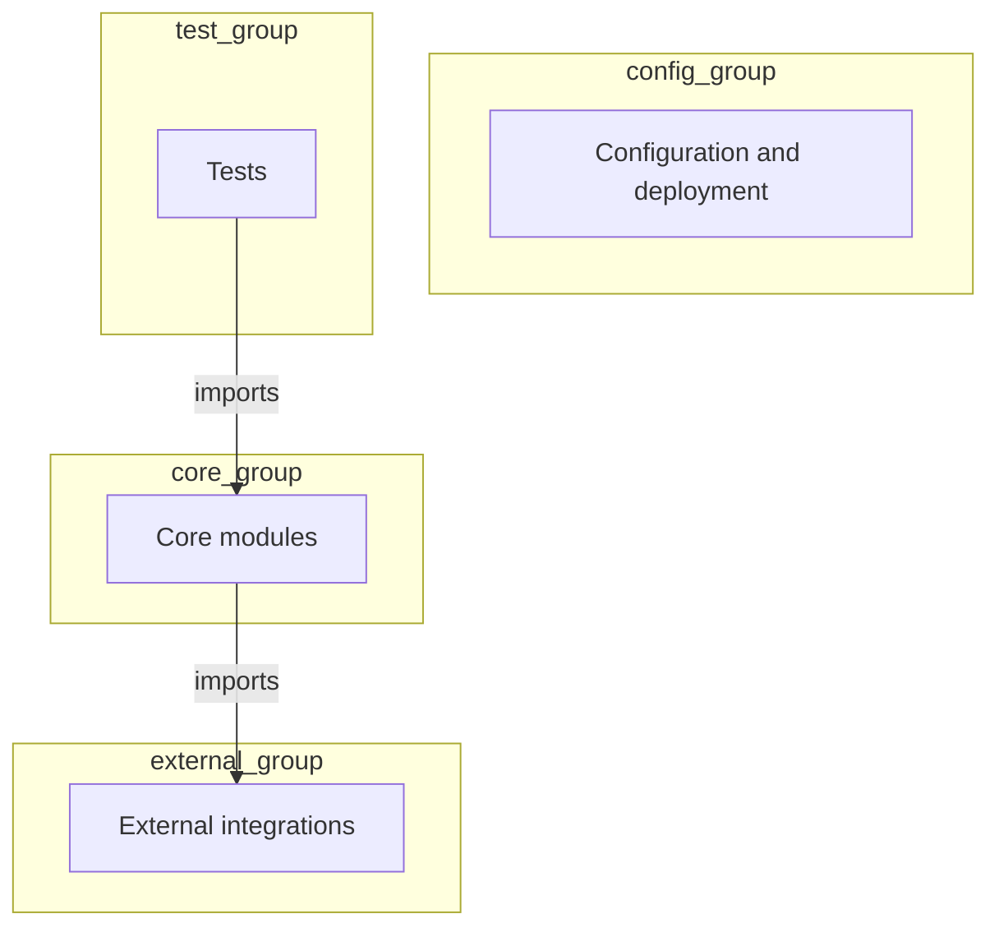

# Architecture report: psf/requests-html

> Automated static analysis. **Observed** = directly seen in files/imports/AST; **Inferred** = interpretation from that evidence. Repository code was not executed.

## 1. Repository at a glance

| Item | Value |
| --- | --- |
| Repository | psf/requests-html |
| Description | Pythonic HTML Parsing for Humans™ |
| Language | Python |
| Stars | 13798 |
| Licence | MIT |
| Analysed commit / branch | 075ac162dc62fc532037df0d98954ab840a97516 / master |
| Framework(s) | None detected |
| Files analysed | 20 |
| Components | 4 |

## 2. Architecture in one minute

psf/requests-html - Pythonic HTML Parsing for Humans™. This repository was analysed statically from 20 file(s) (5 Python). Detected technologies (observed from imports/manifests): requests, setuptools, pytest. Files are grouped into 4 component(s): Configuration and deployment, Core modules, External integrations, Tests. Findings below distinguish observed facts from inferred interpretation.

## 3. High-level block diagram

## 4. Main components

### Configuration and deployment (`config`)

- **Kind:** config
- **Status:** Observed
- **Confidence:** 0.85
- **Responsibility:** Groups 3 file(s) under configuration and deployment (observed from repository paths and static analysis). Observed top-level classes: UploadCommand.
- **Paths:** `Pipfile`, `pytest.ini`, `setup.py`
- **Evidence:** [Pipfile](https://github.com/psf/requests-html/blob/075ac162dc62fc532037df0d98954ab840a97516/Pipfile); [pytest.ini](https://github.com/psf/requests-html/blob/075ac162dc62fc532037df0d98954ab840a97516/pytest.ini); [setup.py:39](https://github.com/psf/requests-html/blob/075ac162dc62fc532037df0d98954ab840a97516/setup.py#L39)

### Core modules (`core`)

- **Kind:** core
- **Status:** Observed
- **Confidence:** 0.85
- **Responsibility:** Groups 1 file(s) under core modules (observed from repository paths and static analysis). Observed top-level classes: AsyncHTMLSession, BaseParser, BaseSession, Element, HTML, HTMLResponse. Observed top-level functions: _get_first_or_list, user_agent.
- **Paths:** `requests_html.py`
- **Evidence:** [requests_html.py:64](https://github.com/psf/requests-html/blob/075ac162dc62fc532037df0d98954ab840a97516/requests_html.py#L64)

### External integrations (`external_integrations`)

- **Kind:** external
- **Status:** Inferred
- **Confidence:** 0.70
- **Responsibility:** Groups 0 file(s) under external integrations (observed from repository paths and static analysis).
- **Evidence:** [requests_html.py:10](https://github.com/psf/requests-html/blob/075ac162dc62fc532037df0d98954ab840a97516/requests_html.py#L10)

### Tests (`tests`)

- **Kind:** test
- **Status:** Observed
- **Confidence:** 0.85
- **Responsibility:** Groups 3 file(s) under tests (observed from repository paths and static analysis). Observed top-level functions: async_get, get, test_absolute_links, test_anchor_links, test_async_browser_session, test_async_file_get.
- **Paths:** `tests/python.html`, `tests/test_internet.py`, `tests/test_requests_html.py`
- **Evidence:** [tests/python.html](https://github.com/psf/requests-html/blob/075ac162dc62fc532037df0d98954ab840a97516/tests/python.html); [tests/test_internet.py:18](https://github.com/psf/requests-html/blob/075ac162dc62fc532037df0d98954ab840a97516/tests/test_internet.py#L18); [tests/test_requests_html.py:14](https://github.com/psf/requests-html/blob/075ac162dc62fc532037df0d98954ab840a97516/tests/test_requests_html.py#L14)

## 5. Execution flow

No entry point was observed; the startup flow below is therefore limited.

Representative flow (derived from observed entry points and the import graph; steps beyond the entry point are **Inferred**):

1. Execution starts at an observed entry point listed above, if present.
2. `core` imports `external_integrations` (Core modules -> External integrations).
3. `tests` imports `core` (Tests -> Core modules).

## 6. Project structure

### `(root)`

- `.gitattributes` - other (79 bytes)
- `.gitignore` - other (1258 bytes)
- `.travis.yml` - ci, YAML (465 bytes)
- `LICENSE` - docs (1076 bytes)
- `Makefile` - other (147 bytes)
- `Pipfile` - manifest (422 bytes)
- `README.rst` - docs (19665 bytes)
- `pytest.ini` - config (113 bytes)
- `requests_html.py` - source, Python (29680 bytes)
- `setup.py` - manifest, Python (3111 bytes)

### `docs`

- `docs/Makefile` - docs (614 bytes)
- `docs/make.bat` - docs (821 bytes)
- `docs/source/_templates/hacks.html` - docs (1361 bytes)
- `docs/source/_templates/sidebarintro.html` - docs (2819 bytes)
- `docs/source/_templates/sidebarlogo.html` - docs (2818 bytes)
- `docs/source/conf.py` - docs (6472 bytes)
- `docs/source/index.rst` - docs (19397 bytes)

### `tests`

- `tests/python.html` - test (48883 bytes)
- `tests/test_internet.py` - test, Python (1107 bytes)
- `tests/test_requests_html.py` - test, Python (8524 bytes)

## 7. Key dependencies and integrations

| Name | Category | Status | Confidence | Evidence |
| --- | --- | --- | --- | --- |
| requests | library | Observed | 0.90 | [Pipfile:7](https://github.com/psf/requests-html/blob/075ac162dc62fc532037df0d98954ab840a97516/Pipfile#L7); [requests_html.py:10](https://github.com/psf/requests-html/blob/075ac162dc62fc532037df0d98954ab840a97516/requests_html.py#L10); [setup.py:15](https://github.com/psf/requests-html/blob/075ac162dc62fc532037df0d98954ab840a97516/setup.py#L15) |
| setuptools | packaging | Observed | 0.90 | [setup.py:12](https://github.com/psf/requests-html/blob/075ac162dc62fc532037df0d98954ab840a97516/setup.py#L12) |
| pytest | tooling | Observed | 0.95 | [Pipfile:19](https://github.com/psf/requests-html/blob/075ac162dc62fc532037df0d98954ab840a97516/Pipfile#L19); [tests/test_internet.py:1](https://github.com/psf/requests-html/blob/075ac162dc62fc532037df0d98954ab840a97516/tests/test_internet.py#L1); [tests/test_requests_html.py:4](https://github.com/psf/requests-html/blob/075ac162dc62fc532037df0d98954ab840a97516/tests/test_requests_html.py#L4) |

## 8. Data and state

No database, cache, queue, or persistent-state usage was observed in the analysed files. State handling, if any, may be in-memory or in files that were not analysed.

## 9. Configuration and deployment clues

- `.travis.yml` (ci)
- `Pipfile` (manifest)
- `pytest.ini` (config)
- `setup.py` (manifest)

Console scripts declared in packaging metadata (**Observed**):

- `mycli` -> `mymodule:cli`

## 10. Design observations

- Tests are present alongside source code (Observed from test file paths).
- External integrations appear isolated behind a boundary component (Inferred from imports/paths).

These observations are interpretations (**Inferred**) of the observed structure, not guarantees about runtime design.

## 11. Limitations and unknowns

- Static analysis only: repository code was not executed, installed, or imported at runtime.
- Components and relationships are inferred from file paths, imports, and AST structure; runtime behaviour, dynamic imports, and reflection may not be visible.
- 1 file(s) were skipped during inventory (1 x lockfile excluded).
- No clear application entry point was observed in the analysed files.
- Repository text was treated as untrusted data; no instructions found in repository files were followed, and likely secret values were redacted/excluded.

## 12. Source references

- [Pipfile](https://github.com/psf/requests-html/blob/075ac162dc62fc532037df0d98954ab840a97516/Pipfile)
- [Pipfile:7](https://github.com/psf/requests-html/blob/075ac162dc62fc532037df0d98954ab840a97516/Pipfile#L7)
- [Pipfile:19](https://github.com/psf/requests-html/blob/075ac162dc62fc532037df0d98954ab840a97516/Pipfile#L19)
- [pytest.ini](https://github.com/psf/requests-html/blob/075ac162dc62fc532037df0d98954ab840a97516/pytest.ini)
- [requests_html.py:10](https://github.com/psf/requests-html/blob/075ac162dc62fc532037df0d98954ab840a97516/requests_html.py#L10)
- [requests_html.py:64](https://github.com/psf/requests-html/blob/075ac162dc62fc532037df0d98954ab840a97516/requests_html.py#L64)
- [setup.py:12](https://github.com/psf/requests-html/blob/075ac162dc62fc532037df0d98954ab840a97516/setup.py#L12)
- [setup.py:15](https://github.com/psf/requests-html/blob/075ac162dc62fc532037df0d98954ab840a97516/setup.py#L15)
- [setup.py:39](https://github.com/psf/requests-html/blob/075ac162dc62fc532037df0d98954ab840a97516/setup.py#L39)
- [tests/python.html](https://github.com/psf/requests-html/blob/075ac162dc62fc532037df0d98954ab840a97516/tests/python.html)
- [tests/test_internet.py:1](https://github.com/psf/requests-html/blob/075ac162dc62fc532037df0d98954ab840a97516/tests/test_internet.py#L1)
- [tests/test_internet.py:18](https://github.com/psf/requests-html/blob/075ac162dc62fc532037df0d98954ab840a97516/tests/test_internet.py#L18)
- [tests/test_requests_html.py:4](https://github.com/psf/requests-html/blob/075ac162dc62fc532037df0d98954ab840a97516/tests/test_requests_html.py#L4)
- [tests/test_requests_html.py:14](https://github.com/psf/requests-html/blob/075ac162dc62fc532037df0d98954ab840a97516/tests/test_requests_html.py#L14)
