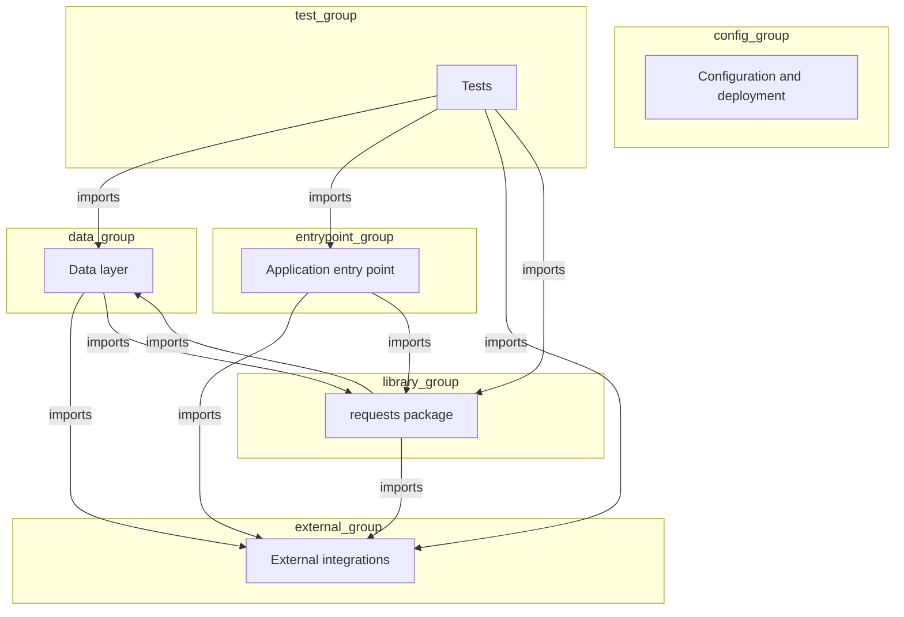

# Architecture report: psf/requests

> Automated static analysis. **Observed** = directly seen in files/imports/AST; **Inferred** = interpretation from that evidence. Repository code was not executed.

## 1. Repository at a glance

| Item | Value |
| --- | --- |
| Repository | psf/requests |
| Description | A simple, yet elegant, HTTP library. |
| Language | Python |
| Stars | 54700 |
| Licence | Apache-2.0 |
| Analysed commit / branch | 3c7baaa05ab4aa49cc819ce3a819d260de19c157 / main |
| Framework(s) | None detected |
| Files analysed | 114 |
| Components | 6 |

## 2. Architecture in one minute

psf/requests - A simple, yet elegant, HTTP library.. This repository was analysed statically from 114 file(s) (37 Python). Detected technologies (observed from imports/manifests): GitHub Actions, requests, Poetry, setuptools, pytest, unittest. Files are grouped into 6 component(s): Configuration and deployment, Data layer, Application entry point, External integrations, requests package, Tests. Observed entry point(s): src/requests/certs.py, src/requests/help.py. Findings below distinguish observed facts from inferred interpretation.

## 3. High-level block diagram

## 4. Main components

### Configuration and deployment (`config`)

- **Kind:** config
- **Status:** Observed
- **Confidence:** 0.85
- **Responsibility:** Groups 5 file(s) under configuration and deployment (observed from repository paths and static analysis).
- **Paths:** `MANIFEST.in`, `pyproject.toml`, `requirements-dev.txt`, `setup.py`, `tox.ini`
- **Evidence:** [MANIFEST.in](https://github.com/psf/requests/blob/3c7baaa05ab4aa49cc819ce3a819d260de19c157/MANIFEST.in); [pyproject.toml](https://github.com/psf/requests/blob/3c7baaa05ab4aa49cc819ce3a819d260de19c157/pyproject.toml); [requirements-dev.txt](https://github.com/psf/requests/blob/3c7baaa05ab4aa49cc819ce3a819d260de19c157/requirements-dev.txt); [setup.py](https://github.com/psf/requests/blob/3c7baaa05ab4aa49cc819ce3a819d260de19c157/setup.py); [tox.ini](https://github.com/psf/requests/blob/3c7baaa05ab4aa49cc819ce3a819d260de19c157/tox.ini)

### Data layer (`data_layer`)

- **Kind:** data
- **Status:** Observed
- **Confidence:** 0.85
- **Responsibility:** Groups 1 file(s) under data layer (observed from repository paths and static analysis). Observed top-level classes: PreparedRequest, Request, RequestEncodingMixin, RequestHooksMixin, Response.
- **Paths:** `src/requests/models.py`
- **Evidence:** [src/requests/models.py:108](https://github.com/psf/requests/blob/3c7baaa05ab4aa49cc819ce3a819d260de19c157/src/requests/models.py#L108)

### Application entry point (`entrypoint`)

- **Kind:** entrypoint
- **Status:** Observed
- **Confidence:** 0.85
- **Responsibility:** Groups 2 file(s) under application entry point (observed from repository paths and static analysis). Observed top-level functions: _implementation, info, main.
- **Paths:** `src/requests/certs.py`, `src/requests/help.py`
- **Evidence:** [src/requests/certs.py](https://github.com/psf/requests/blob/3c7baaa05ab4aa49cc819ce3a819d260de19c157/src/requests/certs.py); [src/requests/help.py:35](https://github.com/psf/requests/blob/3c7baaa05ab4aa49cc819ce3a819d260de19c157/src/requests/help.py#L35)

### External integrations (`external_integrations`)

- **Kind:** external
- **Status:** Inferred
- **Confidence:** 0.70
- **Responsibility:** Groups 0 file(s) under external integrations (observed from repository paths and static analysis).
- **Evidence:** [docs/conf.py:27](https://github.com/psf/requests/blob/3c7baaa05ab4aa49cc819ce3a819d260de19c157/docs/conf.py#L27); [src/requests/__init__.py:45](https://github.com/psf/requests/blob/3c7baaa05ab4aa49cc819ce3a819d260de19c157/src/requests/__init__.py#L45); [src/requests/__init__.py:136](https://github.com/psf/requests/blob/3c7baaa05ab4aa49cc819ce3a819d260de19c157/src/requests/__init__.py#L136); [src/requests/__init__.py:150](https://github.com/psf/requests/blob/3c7baaa05ab4aa49cc819ce3a819d260de19c157/src/requests/__init__.py#L150); [src/requests/adapters.py:12](https://github.com/psf/requests/blob/3c7baaa05ab4aa49cc819ce3a819d260de19c157/src/requests/adapters.py#L12); [src/requests/adapters.py:17](https://github.com/psf/requests/blob/3c7baaa05ab4aa49cc819ce3a819d260de19c157/src/requests/adapters.py#L17)

### requests package (`requests`)

- **Kind:** library
- **Status:** Observed
- **Confidence:** 0.85
- **Responsibility:** Groups 16 file(s) under requests package (observed from repository paths and static analysis). Observed top-level classes: AuthBase, BaseAdapter, CaseInsensitiveDict, ChunkedEncodingError, ConnectTimeout, ConnectionError. Observed top-level functions: _basic_auth_str, _check_cryptography, _copy_cookie_jar, _init, _parse_content_type_header, _resolve_char_detection.
- **Paths:** `src/requests/__init__.py`, `src/requests/__version__.py`, `src/requests/_internal_utils.py`, `src/requests/_types.py`, `src/requests/adapters.py`, `src/requests/api.py`, `src/requests/auth.py`, `src/requests/compat.py`, `src/requests/cookies.py`, `src/requests/exceptions.py`, `src/requests/hooks.py`, `src/requests/packages.py`, `src/requests/sessions.py`, `src/requests/status_codes.py`, `src/requests/structures.py`, `src/requests/utils.py`
- **Evidence:** [src/requests/__init__.py:60](https://github.com/psf/requests/blob/3c7baaa05ab4aa49cc819ce3a819d260de19c157/src/requests/__init__.py#L60); [src/requests/__version__.py](https://github.com/psf/requests/blob/3c7baaa05ab4aa49cc819ce3a819d260de19c157/src/requests/__version__.py); [src/requests/_internal_utils.py:26](https://github.com/psf/requests/blob/3c7baaa05ab4aa49cc819ce3a819d260de19c157/src/requests/_internal_utils.py#L26); [src/requests/_types.py:28](https://github.com/psf/requests/blob/3c7baaa05ab4aa49cc819ce3a819d260de19c157/src/requests/_types.py#L28); [src/requests/adapters.py:85](https://github.com/psf/requests/blob/3c7baaa05ab4aa49cc819ce3a819d260de19c157/src/requests/adapters.py#L85); [src/requests/api.py:24](https://github.com/psf/requests/blob/3c7baaa05ab4aa49cc819ce3a819d260de19c157/src/requests/api.py#L24); [src/requests/auth.py:34](https://github.com/psf/requests/blob/3c7baaa05ab4aa49cc819ce3a819d260de19c157/src/requests/auth.py#L34); [src/requests/compat.py:36](https://github.com/psf/requests/blob/3c7baaa05ab4aa49cc819ce3a819d260de19c157/src/requests/compat.py#L36)

### Tests (`tests`)

- **Kind:** test
- **Status:** Observed
- **Confidence:** 0.85
- **Responsibility:** Groups 33 file(s) under tests (observed from repository paths and static analysis). Observed top-level classes: RedirectSession, Server, TLSServer, TestAddressInNetwork, TestCaseInsensitiveDict, TestContentEncodingDetection. Observed top-level functions: clean_proxy_environ, consume_socket_content, echo_response_handler, hook, httpbin, httpbin_secure.
- **Paths:** `tests/__init__.py`, `tests/certs/README.md`, `tests/certs/expired/Makefile`, `tests/certs/expired/README.md`, `tests/certs/expired/ca/Makefile`, `tests/certs/expired/ca/ca.cnf`, `tests/certs/expired/ca/ca.crt`, `tests/certs/expired/ca/ca.srl`, `tests/certs/expired/server/Makefile`, `tests/certs/expired/server/cert.cnf`, `tests/certs/expired/server/server.csr`, `tests/certs/mtls/Makefile`, `tests/certs/mtls/README.md`, `tests/certs/mtls/client/Makefile`, `tests/certs/mtls/client/cert.cnf`, `tests/certs/mtls/client/client.csr`, `tests/certs/valid/server/Makefile`, `tests/certs/valid/server/cert.cnf`, `tests/certs/valid/server/server.csr`, `tests/compat.py`, `tests/conftest.py`, `tests/test_adapters.py`, `tests/test_help.py`, `tests/test_hooks.py`, `tests/test_lowlevel.py`, `tests/test_packages.py`, `tests/test_requests.py`, `tests/test_structures.py`, `tests/test_testserver.py`, `tests/test_utils.py`, `tests/testserver/__init__.py`, `tests/testserver/server.py`, `tests/utils.py`
- **Evidence:** [tests/__init__.py](https://github.com/psf/requests/blob/3c7baaa05ab4aa49cc819ce3a819d260de19c157/tests/__init__.py); [tests/certs/README.md](https://github.com/psf/requests/blob/3c7baaa05ab4aa49cc819ce3a819d260de19c157/tests/certs/README.md); [tests/certs/expired/Makefile](https://github.com/psf/requests/blob/3c7baaa05ab4aa49cc819ce3a819d260de19c157/tests/certs/expired/Makefile); [tests/certs/expired/README.md](https://github.com/psf/requests/blob/3c7baaa05ab4aa49cc819ce3a819d260de19c157/tests/certs/expired/README.md); [tests/certs/expired/ca/Makefile](https://github.com/psf/requests/blob/3c7baaa05ab4aa49cc819ce3a819d260de19c157/tests/certs/expired/ca/Makefile); [tests/certs/expired/ca/ca.cnf](https://github.com/psf/requests/blob/3c7baaa05ab4aa49cc819ce3a819d260de19c157/tests/certs/expired/ca/ca.cnf); [tests/certs/expired/ca/ca.crt](https://github.com/psf/requests/blob/3c7baaa05ab4aa49cc819ce3a819d260de19c157/tests/certs/expired/ca/ca.crt); [tests/certs/expired/ca/ca.srl](https://github.com/psf/requests/blob/3c7baaa05ab4aa49cc819ce3a819d260de19c157/tests/certs/expired/ca/ca.srl)

## 5. Execution flow

**Observed** entry point(s):

- [src/requests/certs.py:17](https://github.com/psf/requests/blob/3c7baaa05ab4aa49cc819ce3a819d260de19c157/src/requests/certs.py#L17)
- [src/requests/help.py:131](https://github.com/psf/requests/blob/3c7baaa05ab4aa49cc819ce3a819d260de19c157/src/requests/help.py#L131)

Representative flow (derived from observed entry points and the import graph; steps beyond the entry point are **Inferred**):

1. Execution starts at an observed entry point listed above, if present.
2. `data_layer` imports `external_integrations` (Data layer -> External integrations).
3. `data_layer` imports `requests` (Data layer -> requests package).
4. `entrypoint` imports `external_integrations` (Application entry point -> External integrations).
5. `entrypoint` imports `requests` (Application entry point -> requests package).
6. `requests` imports `data_layer` (requests package -> Data layer).
7. `requests` imports `external_integrations` (requests package -> External integrations).
8. `tests` imports `data_layer` (Tests -> Data layer).
9. `tests` imports `entrypoint` (Tests -> Application entry point).

## 6. Project structure

### `(root)`

- `.coveragerc` - other (33 bytes)
- `.git-blame-ignore-revs` - other (234 bytes)
- `.gitignore` - other (321 bytes)
- `.pre-commit-config.yaml` - config (484 bytes)
- `.readthedocs.yaml` - config (738 bytes)
- `AUTHORS.rst` - docs (8025 bytes)
- `HISTORY.md` - docs (64563 bytes)
- `LICENSE` - docs (10142 bytes)
- `MANIFEST.in` - manifest (126 bytes)
- `Makefile` - other (834 bytes)
- `NOTICE` - docs (38 bytes)
- `README.md` - docs (2906 bytes)
- `pyproject.toml` - manifest (3404 bytes)
- `requirements-dev.txt` - manifest (93 bytes)
- `setup.py` - manifest, Python (179 bytes)
- `tox.ini` - config (285 bytes)

### `.github`

- `.github/AI_POLICY.md` - docs (4464 bytes)
- `.github/CODEOWNERS` - other (367 bytes)
- `.github/CODE_OF_CONDUCT.md` - docs (346 bytes)
- `.github/CONTRIBUTING.md` - docs (3441 bytes)
- `.github/FUNDING.yml` - config (52 bytes)
- `.github/ISSUE_TEMPLATE.md` - docs (394 bytes)
- `.github/ISSUE_TEMPLATE/Bug_report.md` - docs (548 bytes)
- `.github/ISSUE_TEMPLATE/Custom.md` - docs (249 bytes)
- `.github/ISSUE_TEMPLATE/Feature_request.md` - docs (194 bytes)
- `.github/SECURITY.md` - docs (3944 bytes)
- `.github/dependabot.yml` - config (705 bytes)
- `.github/workflows/close-issues.yml` - ci, YAML (1165 bytes)
- `.github/workflows/codeql-analysis.yml` - ci, YAML (2672 bytes)
- `.github/workflows/lint.yml` - ci, YAML (588 bytes)
- `.github/workflows/lock-issues.yml` - ci, YAML (389 bytes)
- `.github/workflows/publish.yml` - ci, YAML (2495 bytes)
- `.github/workflows/run-tests.yml` - ci, YAML (2305 bytes)
- `.github/workflows/typecheck.yml` - ci, YAML (736 bytes)
- `.github/workflows/zizmor.yml` - ci, YAML (592 bytes)

### `docs`

- `docs/.nojekyll` - docs (1 bytes)
- `docs/Makefile` - docs (7669 bytes)
- `docs/_static/custom.css` - docs (287 bytes)
- `docs/_templates/sidebar.html` - docs (1361 bytes)
- `docs/_themes/.gitignore` - docs (22 bytes)
- `docs/_themes/LICENSE` - docs (1861 bytes)
- `docs/_themes/flask_theme_support.py` - docs (4875 bytes)
- `docs/api.rst` - docs (7333 bytes)
- `docs/community/faq.rst` - docs (3745 bytes)
- `docs/community/out-there.rst` - docs (621 bytes)
- `docs/community/recommended.rst` - docs (2174 bytes)
- `docs/community/release-process.rst` - docs (2066 bytes)
- `docs/community/support.rst` - docs (846 bytes)
- `docs/community/updates.rst` - docs (322 bytes)
- `docs/community/vulnerabilities.rst` - docs (213 bytes)
- `docs/conf.py` - docs (12148 bytes)
- `docs/dev/authors.rst` - docs (48 bytes)
- `docs/dev/contributing.rst` - docs (6584 bytes)
- `docs/index.rst` - docs (3635 bytes)
- `docs/make.bat` - docs (7258 bytes)
- `docs/requirements.txt` - manifest (87 bytes)
- `docs/user/advanced.rst` - docs (41903 bytes)
- `docs/user/authentication.rst` - docs (5854 bytes)
- `docs/user/install.rst` - docs (1038 bytes)
- `docs/user/quickstart.rst` - docs (19213 bytes)

### `ext`

- `ext/LICENSE` - docs (51 bytes)

### `src`

- `src/requests/__init__.py` - source, Python (5637 bytes)
- `src/requests/__version__.py` - source, Python (435 bytes)
- `src/requests/_internal_utils.py` - source, Python (1542 bytes)
- `src/requests/_types.py` - source, Python (6041 bytes)
- `src/requests/adapters.py` - source, Python (27992 bytes)
- `src/requests/api.py` - source, Python (7152 bytes)
- `src/requests/auth.py` - source, Python (12107 bytes)
- `src/requests/certs.py` - source, Python (430 bytes)
- `src/requests/compat.py` - source, Python (2494 bytes)
- `src/requests/cookies.py` - source, Python (21504 bytes)
- `src/requests/exceptions.py` - source, Python (4564 bytes)
- `src/requests/help.py` - source, Python (4068 bytes)
- `src/requests/hooks.py` - source, Python (1138 bytes)
- `src/requests/models.py` - source, Python (41462 bytes)
- `src/requests/packages.py` - source, Python (904 bytes)
- `src/requests/py.typed` - other (0 bytes)
- `src/requests/sessions.py` - source, Python (34072 bytes)
- `src/requests/status_codes.py` - source, Python (4351 bytes)
- `src/requests/structures.py` - source, Python (4134 bytes)
- `src/requests/utils.py` - source, Python (36061 bytes)

### `tests`

- `tests/__init__.py` - test, Python (469 bytes)
- `tests/certs/README.md` - test (343 bytes)
- `tests/certs/expired/Makefile` - test (138 bytes)
- `tests/certs/expired/README.md` - test (228 bytes)
- `tests/certs/expired/ca/Makefile` - test (297 bytes)
- `tests/certs/expired/ca/ca.cnf` - test (463 bytes)
- `tests/certs/expired/ca/ca.crt` - test (1322 bytes)
- `tests/certs/expired/ca/ca.srl` - test (41 bytes)
- `tests/certs/expired/server/Makefile` - test (382 bytes)
- `tests/certs/expired/server/cert.cnf` - test (457 bytes)
- `tests/certs/expired/server/server.csr` - test (1159 bytes)
- `tests/certs/mtls/Makefile` - test (74 bytes)
- `tests/certs/mtls/README.md` - test (180 bytes)
- `tests/certs/mtls/client/Makefile` - test (381 bytes)
- `tests/certs/mtls/client/cert.cnf` - test (696 bytes)
- `tests/certs/mtls/client/client.csr` - test (1500 bytes)
- `tests/certs/valid/server/Makefile` - test (421 bytes)
- `tests/certs/valid/server/cert.cnf` - test (722 bytes)
- `tests/certs/valid/server/server.csr` - test (1175 bytes)
- `tests/compat.py` - test, Python (480 bytes)
- `tests/conftest.py` - test, Python (1934 bytes)
- `tests/test_adapters.py` - test, Python (314 bytes)
- `tests/test_help.py` - test, Python (839 bytes)
- `tests/test_hooks.py` - test, Python (424 bytes)
- `tests/test_lowlevel.py` - test, Python (15343 bytes)
- `tests/test_packages.py` - test, Python (229 bytes)
- `tests/test_requests.py` - test, Python (108534 bytes)
- `tests/test_structures.py` - test, Python (2757 bytes)
- `tests/test_testserver.py` - test, Python (5547 bytes)
- `tests/test_utils.py` - test, Python (31454 bytes)
- `tests/testserver/__init__.py` - test, Python (0 bytes)
- `tests/testserver/server.py` - test, Python (5147 bytes)
- `tests/utils.py` - test, Python (366 bytes)

## 7. Key dependencies and integrations

| Name | Category | Status | Confidence | Evidence |
| --- | --- | --- | --- | --- |
| GitHub Actions | ci | Observed | 0.90 | [.github/workflows/close-issues.yml](https://github.com/psf/requests/blob/3c7baaa05ab4aa49cc819ce3a819d260de19c157/.github/workflows/close-issues.yml); [.github/workflows/codeql-analysis.yml](https://github.com/psf/requests/blob/3c7baaa05ab4aa49cc819ce3a819d260de19c157/.github/workflows/codeql-analysis.yml); [.github/workflows/lint.yml](https://github.com/psf/requests/blob/3c7baaa05ab4aa49cc819ce3a819d260de19c157/.github/workflows/lint.yml); [.github/workflows/lock-issues.yml](https://github.com/psf/requests/blob/3c7baaa05ab4aa49cc819ce3a819d260de19c157/.github/workflows/lock-issues.yml) |
| requests | library | Observed | 0.95 | [docs/conf.py:27](https://github.com/psf/requests/blob/3c7baaa05ab4aa49cc819ce3a819d260de19c157/docs/conf.py#L27); [tests/conftest.py:12](https://github.com/psf/requests/blob/3c7baaa05ab4aa49cc819ce3a819d260de19c157/tests/conftest.py#L12); [tests/test_adapters.py:1](https://github.com/psf/requests/blob/3c7baaa05ab4aa49cc819ce3a819d260de19c157/tests/test_adapters.py#L1); [tests/test_help.py:3](https://github.com/psf/requests/blob/3c7baaa05ab4aa49cc819ce3a819d260de19c157/tests/test_help.py#L3) |
| Poetry | packaging | Observed | 0.85 | [pyproject.toml](https://github.com/psf/requests/blob/3c7baaa05ab4aa49cc819ce3a819d260de19c157/pyproject.toml) |
| setuptools | packaging | Observed | 0.90 | [pyproject.toml:2](https://github.com/psf/requests/blob/3c7baaa05ab4aa49cc819ce3a819d260de19c157/pyproject.toml#L2); [setup.py:7](https://github.com/psf/requests/blob/3c7baaa05ab4aa49cc819ce3a819d260de19c157/setup.py#L7) |
| pytest | tooling | Observed | 0.95 | [requirements-dev.txt:2](https://github.com/psf/requests/blob/3c7baaa05ab4aa49cc819ce3a819d260de19c157/requirements-dev.txt#L2); [tests/conftest.py:10](https://github.com/psf/requests/blob/3c7baaa05ab4aa49cc819ce3a819d260de19c157/tests/conftest.py#L10); [tests/test_hooks.py:1](https://github.com/psf/requests/blob/3c7baaa05ab4aa49cc819ce3a819d260de19c157/tests/test_hooks.py#L1); [tests/test_lowlevel.py:3](https://github.com/psf/requests/blob/3c7baaa05ab4aa49cc819ce3a819d260de19c157/tests/test_lowlevel.py#L3) |
| unittest | tooling | Observed | 0.95 | [tests/test_help.py:1](https://github.com/psf/requests/blob/3c7baaa05ab4aa49cc819ce3a819d260de19c157/tests/test_help.py#L1); [tests/test_requests.py:13](https://github.com/psf/requests/blob/3c7baaa05ab4aa49cc819ce3a819d260de19c157/tests/test_requests.py#L13); [tests/test_utils.py:8](https://github.com/psf/requests/blob/3c7baaa05ab4aa49cc819ce3a819d260de19c157/tests/test_utils.py#L8) |

## 8. Data and state

- Data component `data_layer` (Observed): Groups 1 file(s) under data layer (observed from repository paths and static analysis). Observed top-level classes: PreparedRequest, Request, RequestEncodingMixin, RequestHooksMixin, Response.

## 9. Configuration and deployment clues

- `.github/FUNDING.yml` (config)
- `.github/dependabot.yml` (config)
- `.github/workflows/close-issues.yml` (ci)
- `.github/workflows/codeql-analysis.yml` (ci)
- `.github/workflows/lint.yml` (ci)
- `.github/workflows/lock-issues.yml` (ci)
- `.github/workflows/publish.yml` (ci)
- `.github/workflows/run-tests.yml` (ci)
- `.github/workflows/typecheck.yml` (ci)
- `.github/workflows/zizmor.yml` (ci)
- `.pre-commit-config.yaml` (config)
- `.readthedocs.yaml` (config)
- `MANIFEST.in` (manifest)
- `docs/requirements.txt` (manifest)
- `pyproject.toml` (manifest)
- `requirements-dev.txt` (manifest)
- `setup.py` (manifest)
- `tox.ini` (config)

## 10. Design observations

- An entry/API layer is separated from other code (Inferred from paths and decorators).
- Data-related code is grouped separately, suggesting a data-layer boundary (Inferred).
- Tests are present alongside source code (Observed from test file paths).
- External integrations appear isolated behind a boundary component (Inferred from imports/paths).

These observations are interpretations (**Inferred**) of the observed structure, not guarantees about runtime design.

## 11. Limitations and unknowns

- Static analysis only: repository code was not executed, installed, or imported at runtime.
- Components and relationships are inferred from file paths, imports, and AST structure; runtime behaviour, dynamic imports, and reflection may not be visible.
- 7 file(s) were skipped during inventory (7 x likely secret file excluded).
- Repository text was treated as untrusted data; no instructions found in repository files were followed, and likely secret values were redacted/excluded.

## 12. Source references

- [.github/workflows/close-issues.yml](https://github.com/psf/requests/blob/3c7baaa05ab4aa49cc819ce3a819d260de19c157/.github/workflows/close-issues.yml)
- [.github/workflows/codeql-analysis.yml](https://github.com/psf/requests/blob/3c7baaa05ab4aa49cc819ce3a819d260de19c157/.github/workflows/codeql-analysis.yml)
- [.github/workflows/lint.yml](https://github.com/psf/requests/blob/3c7baaa05ab4aa49cc819ce3a819d260de19c157/.github/workflows/lint.yml)
- [.github/workflows/lock-issues.yml](https://github.com/psf/requests/blob/3c7baaa05ab4aa49cc819ce3a819d260de19c157/.github/workflows/lock-issues.yml)
- [.github/workflows/publish.yml](https://github.com/psf/requests/blob/3c7baaa05ab4aa49cc819ce3a819d260de19c157/.github/workflows/publish.yml)
- [.github/workflows/run-tests.yml](https://github.com/psf/requests/blob/3c7baaa05ab4aa49cc819ce3a819d260de19c157/.github/workflows/run-tests.yml)
- [.github/workflows/typecheck.yml](https://github.com/psf/requests/blob/3c7baaa05ab4aa49cc819ce3a819d260de19c157/.github/workflows/typecheck.yml)
- [.github/workflows/zizmor.yml](https://github.com/psf/requests/blob/3c7baaa05ab4aa49cc819ce3a819d260de19c157/.github/workflows/zizmor.yml)
- [MANIFEST.in](https://github.com/psf/requests/blob/3c7baaa05ab4aa49cc819ce3a819d260de19c157/MANIFEST.in)
- [docs/conf.py:27](https://github.com/psf/requests/blob/3c7baaa05ab4aa49cc819ce3a819d260de19c157/docs/conf.py#L27)
- [pyproject.toml](https://github.com/psf/requests/blob/3c7baaa05ab4aa49cc819ce3a819d260de19c157/pyproject.toml)
- [pyproject.toml:2](https://github.com/psf/requests/blob/3c7baaa05ab4aa49cc819ce3a819d260de19c157/pyproject.toml#L2)
- [requirements-dev.txt](https://github.com/psf/requests/blob/3c7baaa05ab4aa49cc819ce3a819d260de19c157/requirements-dev.txt)
- [requirements-dev.txt:2](https://github.com/psf/requests/blob/3c7baaa05ab4aa49cc819ce3a819d260de19c157/requirements-dev.txt#L2)
- [setup.py](https://github.com/psf/requests/blob/3c7baaa05ab4aa49cc819ce3a819d260de19c157/setup.py)
- [setup.py:7](https://github.com/psf/requests/blob/3c7baaa05ab4aa49cc819ce3a819d260de19c157/setup.py#L7)
- [src/requests/__init__.py:45](https://github.com/psf/requests/blob/3c7baaa05ab4aa49cc819ce3a819d260de19c157/src/requests/__init__.py#L45)
- [src/requests/__init__.py:60](https://github.com/psf/requests/blob/3c7baaa05ab4aa49cc819ce3a819d260de19c157/src/requests/__init__.py#L60)
- [src/requests/__init__.py:136](https://github.com/psf/requests/blob/3c7baaa05ab4aa49cc819ce3a819d260de19c157/src/requests/__init__.py#L136)
- [src/requests/__init__.py:150](https://github.com/psf/requests/blob/3c7baaa05ab4aa49cc819ce3a819d260de19c157/src/requests/__init__.py#L150)
- [src/requests/__version__.py](https://github.com/psf/requests/blob/3c7baaa05ab4aa49cc819ce3a819d260de19c157/src/requests/__version__.py)
- [src/requests/_internal_utils.py:26](https://github.com/psf/requests/blob/3c7baaa05ab4aa49cc819ce3a819d260de19c157/src/requests/_internal_utils.py#L26)
- [src/requests/_types.py:28](https://github.com/psf/requests/blob/3c7baaa05ab4aa49cc819ce3a819d260de19c157/src/requests/_types.py#L28)
- [src/requests/adapters.py:12](https://github.com/psf/requests/blob/3c7baaa05ab4aa49cc819ce3a819d260de19c157/src/requests/adapters.py#L12)
- [src/requests/adapters.py:17](https://github.com/psf/requests/blob/3c7baaa05ab4aa49cc819ce3a819d260de19c157/src/requests/adapters.py#L17)
- [src/requests/adapters.py:85](https://github.com/psf/requests/blob/3c7baaa05ab4aa49cc819ce3a819d260de19c157/src/requests/adapters.py#L85)
- [src/requests/api.py:24](https://github.com/psf/requests/blob/3c7baaa05ab4aa49cc819ce3a819d260de19c157/src/requests/api.py#L24)
- [src/requests/auth.py:34](https://github.com/psf/requests/blob/3c7baaa05ab4aa49cc819ce3a819d260de19c157/src/requests/auth.py#L34)
- [src/requests/certs.py](https://github.com/psf/requests/blob/3c7baaa05ab4aa49cc819ce3a819d260de19c157/src/requests/certs.py)
- [src/requests/certs.py:17](https://github.com/psf/requests/blob/3c7baaa05ab4aa49cc819ce3a819d260de19c157/src/requests/certs.py#L17)
- [src/requests/compat.py:36](https://github.com/psf/requests/blob/3c7baaa05ab4aa49cc819ce3a819d260de19c157/src/requests/compat.py#L36)
- [src/requests/help.py:35](https://github.com/psf/requests/blob/3c7baaa05ab4aa49cc819ce3a819d260de19c157/src/requests/help.py#L35)
- [src/requests/help.py:131](https://github.com/psf/requests/blob/3c7baaa05ab4aa49cc819ce3a819d260de19c157/src/requests/help.py#L131)
- [src/requests/models.py:108](https://github.com/psf/requests/blob/3c7baaa05ab4aa49cc819ce3a819d260de19c157/src/requests/models.py#L108)
- [tests/__init__.py](https://github.com/psf/requests/blob/3c7baaa05ab4aa49cc819ce3a819d260de19c157/tests/__init__.py)
- [tests/certs/README.md](https://github.com/psf/requests/blob/3c7baaa05ab4aa49cc819ce3a819d260de19c157/tests/certs/README.md)
- [tests/certs/expired/Makefile](https://github.com/psf/requests/blob/3c7baaa05ab4aa49cc819ce3a819d260de19c157/tests/certs/expired/Makefile)
- [tests/certs/expired/README.md](https://github.com/psf/requests/blob/3c7baaa05ab4aa49cc819ce3a819d260de19c157/tests/certs/expired/README.md)
- [tests/certs/expired/ca/Makefile](https://github.com/psf/requests/blob/3c7baaa05ab4aa49cc819ce3a819d260de19c157/tests/certs/expired/ca/Makefile)
- [tests/certs/expired/ca/ca.cnf](https://github.com/psf/requests/blob/3c7baaa05ab4aa49cc819ce3a819d260de19c157/tests/certs/expired/ca/ca.cnf)
- [tests/certs/expired/ca/ca.crt](https://github.com/psf/requests/blob/3c7baaa05ab4aa49cc819ce3a819d260de19c157/tests/certs/expired/ca/ca.crt)
- [tests/certs/expired/ca/ca.srl](https://github.com/psf/requests/blob/3c7baaa05ab4aa49cc819ce3a819d260de19c157/tests/certs/expired/ca/ca.srl)
- [tests/conftest.py:10](https://github.com/psf/requests/blob/3c7baaa05ab4aa49cc819ce3a819d260de19c157/tests/conftest.py#L10)
- [tests/conftest.py:12](https://github.com/psf/requests/blob/3c7baaa05ab4aa49cc819ce3a819d260de19c157/tests/conftest.py#L12)
- [tests/test_adapters.py:1](https://github.com/psf/requests/blob/3c7baaa05ab4aa49cc819ce3a819d260de19c157/tests/test_adapters.py#L1)
- [tests/test_help.py:1](https://github.com/psf/requests/blob/3c7baaa05ab4aa49cc819ce3a819d260de19c157/tests/test_help.py#L1)
- [tests/test_help.py:3](https://github.com/psf/requests/blob/3c7baaa05ab4aa49cc819ce3a819d260de19c157/tests/test_help.py#L3)
- [tests/test_hooks.py:1](https://github.com/psf/requests/blob/3c7baaa05ab4aa49cc819ce3a819d260de19c157/tests/test_hooks.py#L1)
- [tests/test_hooks.py:3](https://github.com/psf/requests/blob/3c7baaa05ab4aa49cc819ce3a819d260de19c157/tests/test_hooks.py#L3)
- [tests/test_lowlevel.py:3](https://github.com/psf/requests/blob/3c7baaa05ab4aa49cc819ce3a819d260de19c157/tests/test_lowlevel.py#L3)
- [tests/test_lowlevel.py:5](https://github.com/psf/requests/blob/3c7baaa05ab4aa49cc819ce3a819d260de19c157/tests/test_lowlevel.py#L5)
- [tests/test_lowlevel.py:6](https://github.com/psf/requests/blob/3c7baaa05ab4aa49cc819ce3a819d260de19c157/tests/test_lowlevel.py#L6)
- [tests/test_packages.py:1](https://github.com/psf/requests/blob/3c7baaa05ab4aa49cc819ce3a819d260de19c157/tests/test_packages.py#L1)
- [tests/test_requests.py:13](https://github.com/psf/requests/blob/3c7baaa05ab4aa49cc819ce3a819d260de19c157/tests/test_requests.py#L13)
- [tests/test_requests.py:15](https://github.com/psf/requests/blob/3c7baaa05ab4aa49cc819ce3a819d260de19c157/tests/test_requests.py#L15)
- [tests/test_structures.py:1](https://github.com/psf/requests/blob/3c7baaa05ab4aa49cc819ce3a819d260de19c157/tests/test_structures.py#L1)
- [tests/test_testserver.py:5](https://github.com/psf/requests/blob/3c7baaa05ab4aa49cc819ce3a819d260de19c157/tests/test_testserver.py#L5)
- [tests/test_utils.py:8](https://github.com/psf/requests/blob/3c7baaa05ab4aa49cc819ce3a819d260de19c157/tests/test_utils.py#L8)
- [tests/test_utils.py:10](https://github.com/psf/requests/blob/3c7baaa05ab4aa49cc819ce3a819d260de19c157/tests/test_utils.py#L10)
- [tox.ini](https://github.com/psf/requests/blob/3c7baaa05ab4aa49cc819ce3a819d260de19c157/tox.ini)
