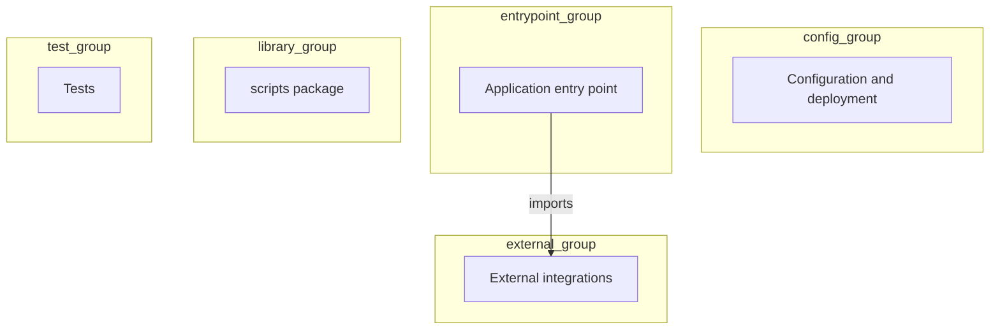

# Architecture report: public-apis/public-apis

> Automated static analysis. **Observed** = directly seen in files/imports/AST; **Inferred** = interpretation from that evidence. Repository code was not executed.

## 1. Repository at a glance

| Item | Value |
| --- | --- |
| Repository | public-apis/public-apis |
| Description | A collective list of free APIs |
| Language | Python |
| Stars | 498993 |
| Licence | MIT |
| Analysed commit / branch | 51bc64abb499c7c532619d89c3f3a083899d3c61 / master |
| Framework(s) | None detected |
| Files analysed | 12 |
| Components | 5 |

## 2. Architecture in one minute

public-apis/public-apis - A collective list of free APIs. This repository was analysed statically from 12 file(s) (6 Python). Detected technologies (observed from imports/manifests): requests, unittest. Files are grouped into 5 component(s): Configuration and deployment, Application entry point, External integrations, scripts package, Tests. Observed entry point(s): scripts/validate/format.py, scripts/validate/links.py. Findings below distinguish observed facts from inferred interpretation.

## 3. High-level block diagram

## 4. Main components

### Configuration and deployment (`config`)

- **Kind:** config
- **Status:** Observed
- **Confidence:** 0.85
- **Responsibility:** Groups 1 file(s) under configuration and deployment (observed from repository paths and static analysis).
- **Paths:** `scripts/requirements.txt`
- **Evidence:** [scripts/requirements.txt](https://github.com/public-apis/public-apis/blob/51bc64abb499c7c532619d89c3f3a083899d3c61/scripts/requirements.txt)

### Application entry point (`entrypoint`)

- **Kind:** entrypoint
- **Status:** Observed
- **Confidence:** 0.85
- **Responsibility:** Groups 2 file(s) under application entry point (observed from repository paths and static analysis). Observed top-level functions: check_alphabetical_order, check_auth, check_cors, check_description, check_duplicate_links, check_entry.
- **Paths:** `scripts/validate/format.py`, `scripts/validate/links.py`
- **Evidence:** [scripts/validate/format.py:37](https://github.com/public-apis/public-apis/blob/51bc64abb499c7c532619d89c3f3a083899d3c61/scripts/validate/format.py#L37); [scripts/validate/links.py:12](https://github.com/public-apis/public-apis/blob/51bc64abb499c7c532619d89c3f3a083899d3c61/scripts/validate/links.py#L12)

### External integrations (`external_integrations`)

- **Kind:** external
- **Status:** Inferred
- **Confidence:** 0.70
- **Responsibility:** Groups 0 file(s) under external integrations (observed from repository paths and static analysis).
- **Evidence:** [scripts/validate/links.py:8](https://github.com/public-apis/public-apis/blob/51bc64abb499c7c532619d89c3f3a083899d3c61/scripts/validate/links.py#L8); [scripts/validate/links.py:9](https://github.com/public-apis/public-apis/blob/51bc64abb499c7c532619d89c3f3a083899d3c61/scripts/validate/links.py#L9)

### scripts package (`scripts`)

- **Kind:** library
- **Status:** Observed
- **Confidence:** 0.85
- **Responsibility:** Groups 2 file(s) under scripts package (observed from repository paths and static analysis).
- **Paths:** `scripts/github_pull_request.sh`, `scripts/validate/__init__.py`
- **Evidence:** [scripts/github_pull_request.sh](https://github.com/public-apis/public-apis/blob/51bc64abb499c7c532619d89c3f3a083899d3c61/scripts/github_pull_request.sh); [scripts/validate/__init__.py](https://github.com/public-apis/public-apis/blob/51bc64abb499c7c532619d89c3f3a083899d3c61/scripts/validate/__init__.py)

### Tests (`tests`)

- **Kind:** test
- **Status:** Observed
- **Confidence:** 0.85
- **Responsibility:** Groups 3 file(s) under tests (observed from repository paths and static analysis). Observed top-level classes: FakeResponse, TestValidadeFormat, TestValidateLinks.
- **Paths:** `scripts/tests/__init__.py`, `scripts/tests/test_validate_format.py`, `scripts/tests/test_validate_links.py`
- **Evidence:** [scripts/tests/__init__.py](https://github.com/public-apis/public-apis/blob/51bc64abb499c7c532619d89c3f3a083899d3c61/scripts/tests/__init__.py); [scripts/tests/test_validate_format.py:17](https://github.com/public-apis/public-apis/blob/51bc64abb499c7c532619d89c3f3a083899d3c61/scripts/tests/test_validate_format.py#L17); [scripts/tests/test_validate_links.py:12](https://github.com/public-apis/public-apis/blob/51bc64abb499c7c532619d89c3f3a083899d3c61/scripts/tests/test_validate_links.py#L12)

## 5. Execution flow

**Observed** entry point(s):

- [scripts/validate/format.py:267](https://github.com/public-apis/public-apis/blob/51bc64abb499c7c532619d89c3f3a083899d3c61/scripts/validate/format.py#L267)
- [scripts/validate/links.py:256](https://github.com/public-apis/public-apis/blob/51bc64abb499c7c532619d89c3f3a083899d3c61/scripts/validate/links.py#L256)

Representative flow (derived from observed entry points and the import graph; steps beyond the entry point are **Inferred**):

1. Execution starts at an observed entry point listed above, if present.
2. `entrypoint` imports `external_integrations` (Application entry point -> External integrations).

## 6. Project structure

### `(root)`

- `.gitattributes` - other (133 bytes)
- `.gitignore` - other (1806 bytes)
- `CONTRIBUTING.md` - docs (8117 bytes)
- `LICENSE` - docs (1068 bytes)

### `scripts`

- `scripts/github_pull_request.sh` - source, Shell (1352 bytes)
- `scripts/requirements.txt` - manifest (89 bytes)
- `scripts/tests/__init__.py` - test, Python (24 bytes)
- `scripts/tests/test_validate_format.py` - test, Python (18154 bytes)
- `scripts/tests/test_validate_links.py` - test, Python (5725 bytes)
- `scripts/validate/__init__.py` - source, Python (80 bytes)
- `scripts/validate/format.py` - source, Python (8464 bytes)
- `scripts/validate/links.py` - source, Python (8060 bytes)

## 7. Key dependencies and integrations

| Name | Category | Status | Confidence | Evidence |
| --- | --- | --- | --- | --- |
| requests | library | Observed | 0.95 | [scripts/requirements.txt:4](https://github.com/public-apis/public-apis/blob/51bc64abb499c7c532619d89c3f3a083899d3c61/scripts/requirements.txt#L4); [scripts/validate/links.py:8](https://github.com/public-apis/public-apis/blob/51bc64abb499c7c532619d89c3f3a083899d3c61/scripts/validate/links.py#L8); [scripts/validate/links.py:9](https://github.com/public-apis/public-apis/blob/51bc64abb499c7c532619d89c3f3a083899d3c61/scripts/validate/links.py#L9) |
| unittest | tooling | Observed | 0.95 | [scripts/tests/test_validate_format.py:3](https://github.com/public-apis/public-apis/blob/51bc64abb499c7c532619d89c3f3a083899d3c61/scripts/tests/test_validate_format.py#L3); [scripts/tests/test_validate_links.py:3](https://github.com/public-apis/public-apis/blob/51bc64abb499c7c532619d89c3f3a083899d3c61/scripts/tests/test_validate_links.py#L3) |

## 8. Data and state

No database, cache, queue, or persistent-state usage was observed in the analysed files. State handling, if any, may be in-memory or in files that were not analysed.

## 9. Configuration and deployment clues

- `scripts/requirements.txt` (manifest)

## 10. Design observations

- An entry/API layer is separated from other code (Inferred from paths and decorators).
- Tests are present alongside source code (Observed from test file paths).
- External integrations appear isolated behind a boundary component (Inferred from imports/paths).

These observations are interpretations (**Inferred**) of the observed structure, not guarantees about runtime design.

## 11. Limitations and unknowns

- Static analysis only: repository code was not executed, installed, or imported at runtime.
- Components and relationships are inferred from file paths, imports, and AST structure; runtime behaviour, dynamic imports, and reflection may not be visible.
- Repository text was treated as untrusted data; no instructions found in repository files were followed, and likely secret values were redacted/excluded.

## 12. Source references

- [scripts/github_pull_request.sh](https://github.com/public-apis/public-apis/blob/51bc64abb499c7c532619d89c3f3a083899d3c61/scripts/github_pull_request.sh)
- [scripts/requirements.txt](https://github.com/public-apis/public-apis/blob/51bc64abb499c7c532619d89c3f3a083899d3c61/scripts/requirements.txt)
- [scripts/requirements.txt:4](https://github.com/public-apis/public-apis/blob/51bc64abb499c7c532619d89c3f3a083899d3c61/scripts/requirements.txt#L4)
- [scripts/tests/__init__.py](https://github.com/public-apis/public-apis/blob/51bc64abb499c7c532619d89c3f3a083899d3c61/scripts/tests/__init__.py)
- [scripts/tests/test_validate_format.py:3](https://github.com/public-apis/public-apis/blob/51bc64abb499c7c532619d89c3f3a083899d3c61/scripts/tests/test_validate_format.py#L3)
- [scripts/tests/test_validate_format.py:17](https://github.com/public-apis/public-apis/blob/51bc64abb499c7c532619d89c3f3a083899d3c61/scripts/tests/test_validate_format.py#L17)
- [scripts/tests/test_validate_links.py:3](https://github.com/public-apis/public-apis/blob/51bc64abb499c7c532619d89c3f3a083899d3c61/scripts/tests/test_validate_links.py#L3)
- [scripts/tests/test_validate_links.py:12](https://github.com/public-apis/public-apis/blob/51bc64abb499c7c532619d89c3f3a083899d3c61/scripts/tests/test_validate_links.py#L12)
- [scripts/validate/__init__.py](https://github.com/public-apis/public-apis/blob/51bc64abb499c7c532619d89c3f3a083899d3c61/scripts/validate/__init__.py)
- [scripts/validate/format.py:37](https://github.com/public-apis/public-apis/blob/51bc64abb499c7c532619d89c3f3a083899d3c61/scripts/validate/format.py#L37)
- [scripts/validate/format.py:267](https://github.com/public-apis/public-apis/blob/51bc64abb499c7c532619d89c3f3a083899d3c61/scripts/validate/format.py#L267)
- [scripts/validate/links.py:8](https://github.com/public-apis/public-apis/blob/51bc64abb499c7c532619d89c3f3a083899d3c61/scripts/validate/links.py#L8)
- [scripts/validate/links.py:9](https://github.com/public-apis/public-apis/blob/51bc64abb499c7c532619d89c3f3a083899d3c61/scripts/validate/links.py#L9)
- [scripts/validate/links.py:12](https://github.com/public-apis/public-apis/blob/51bc64abb499c7c532619d89c3f3a083899d3c61/scripts/validate/links.py#L12)
- [scripts/validate/links.py:256](https://github.com/public-apis/public-apis/blob/51bc64abb499c7c532619d89c3f3a083899d3c61/scripts/validate/links.py#L256)
