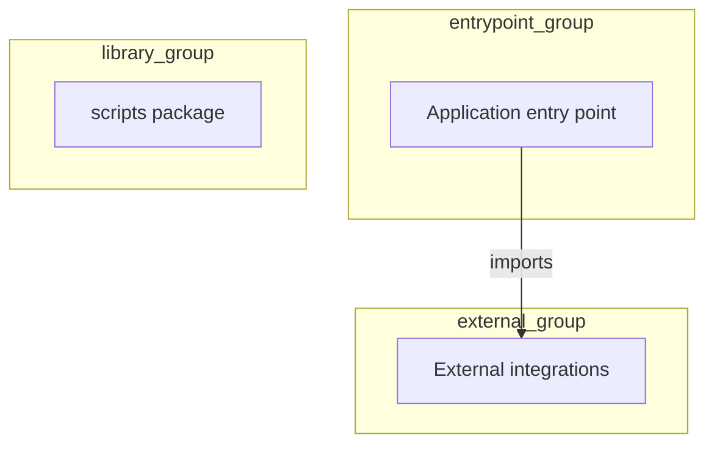

# Architecture report: pwxcoo/chinese-xinhua

> Automated static analysis. **Observed** = directly seen in files/imports/AST; **Inferred** = interpretation from that evidence. Repository code was not executed.

## 1. Repository at a glance

| Item | Value |
| --- | --- |
| Repository | pwxcoo/chinese-xinhua |
| Description | :orange_book: 中华新华字典数据库。包括歇后语，成语，词语，汉字。 |
| Language | Python |
| Stars | 11770 |
| Licence | MIT |
| Analysed commit / branch | fe6d6c2e8baa82187f4c96bbe042e43f96c05666 / master |
| Framework(s) | None detected |
| Files analysed | 10 |
| Components | 3 |

## 2. Architecture in one minute

pwxcoo/chinese-xinhua - :orange_book: 中华新华字典数据库。包括歇后语，成语，词语，汉字。. This repository was analysed statically from 10 file(s) (5 Python). Detected technologies (observed from imports/manifests): pandas, requests. Files are grouped into 3 component(s): Application entry point, External integrations, scripts package. Observed entry point(s): scripts/chengyu.py, scripts/ci.py, scripts/word.py. Findings below distinguish observed facts from inferred interpretation.

## 3. High-level block diagram

## 4. Main components

### Application entry point (`entrypoint`)

- **Kind:** entrypoint
- **Status:** Observed
- **Confidence:** 0.85
- **Responsibility:** Groups 4 file(s) under application entry point (observed from repository paths and static analysis). Observed top-level functions: downloader.
- **Paths:** `scripts/chengyu.py`, `scripts/ci.py`, `scripts/word.py`, `scripts/xiehouyu.py`
- **Evidence:** [scripts/chengyu.py:14](https://github.com/pwxcoo/chinese-xinhua/blob/fe6d6c2e8baa82187f4c96bbe042e43f96c05666/scripts/chengyu.py#L14); [scripts/ci.py:14](https://github.com/pwxcoo/chinese-xinhua/blob/fe6d6c2e8baa82187f4c96bbe042e43f96c05666/scripts/ci.py#L14); [scripts/word.py:14](https://github.com/pwxcoo/chinese-xinhua/blob/fe6d6c2e8baa82187f4c96bbe042e43f96c05666/scripts/word.py#L14); [scripts/xiehouyu.py:17](https://github.com/pwxcoo/chinese-xinhua/blob/fe6d6c2e8baa82187f4c96bbe042e43f96c05666/scripts/xiehouyu.py#L17)

### External integrations (`external_integrations`)

- **Kind:** external
- **Status:** Inferred
- **Confidence:** 0.70
- **Responsibility:** Groups 0 file(s) under external integrations (observed from repository paths and static analysis).
- **Evidence:** [scripts/chengyu.py:11](https://github.com/pwxcoo/chinese-xinhua/blob/fe6d6c2e8baa82187f4c96bbe042e43f96c05666/scripts/chengyu.py#L11); [scripts/ci.py:9](https://github.com/pwxcoo/chinese-xinhua/blob/fe6d6c2e8baa82187f4c96bbe042e43f96c05666/scripts/ci.py#L9); [scripts/word.py:11](https://github.com/pwxcoo/chinese-xinhua/blob/fe6d6c2e8baa82187f4c96bbe042e43f96c05666/scripts/word.py#L11); [scripts/xiehouyu.py:11](https://github.com/pwxcoo/chinese-xinhua/blob/fe6d6c2e8baa82187f4c96bbe042e43f96c05666/scripts/xiehouyu.py#L11)

### scripts package (`scripts`)

- **Kind:** library
- **Status:** Observed
- **Confidence:** 0.85
- **Responsibility:** Groups 1 file(s) under scripts package (observed from repository paths and static analysis). Observed top-level functions: abbreviation.
- **Paths:** `scripts/addAbbreviation.py`
- **Evidence:** [scripts/addAbbreviation.py:7](https://github.com/pwxcoo/chinese-xinhua/blob/fe6d6c2e8baa82187f4c96bbe042e43f96c05666/scripts/addAbbreviation.py#L7)

## 5. Execution flow

**Observed** entry point(s):

- [scripts/chengyu.py:48](https://github.com/pwxcoo/chinese-xinhua/blob/fe6d6c2e8baa82187f4c96bbe042e43f96c05666/scripts/chengyu.py#L48)
- [scripts/ci.py:59](https://github.com/pwxcoo/chinese-xinhua/blob/fe6d6c2e8baa82187f4c96bbe042e43f96c05666/scripts/ci.py#L59)
- [scripts/word.py:52](https://github.com/pwxcoo/chinese-xinhua/blob/fe6d6c2e8baa82187f4c96bbe042e43f96c05666/scripts/word.py#L52)
- [scripts/xiehouyu.py:30](https://github.com/pwxcoo/chinese-xinhua/blob/fe6d6c2e8baa82187f4c96bbe042e43f96c05666/scripts/xiehouyu.py#L30)

Representative flow (derived from observed entry points and the import graph; steps beyond the entry point are **Inferred**):

1. Execution starts at an observed entry point listed above, if present.
2. `entrypoint` imports `external_integrations` (Application entry point -> External integrations).

## 6. Project structure

### `(root)`

- `.gitignore` - other (30 bytes)
- `LICENSE` - docs (1063 bytes)
- `README.md` - docs (3568 bytes)

### `scripts`

- `scripts/README.md` - docs (337 bytes)
- `scripts/addAbbreviation.py` - source, Python (491 bytes)
- `scripts/chengyu.py` - source, Python (1791 bytes)
- `scripts/ci.py` - source, Python (2285 bytes)
- `scripts/clean.ipynb` - other (2314 bytes)
- `scripts/word.py` - source, Python (1824 bytes)
- `scripts/xiehouyu.py` - source, Python (1064 bytes)

## 7. Key dependencies and integrations

| Name | Category | Status | Confidence | Evidence |
| --- | --- | --- | --- | --- |
| pandas | library | Observed | 0.90 | [scripts/addAbbreviation.py:1](https://github.com/pwxcoo/chinese-xinhua/blob/fe6d6c2e8baa82187f4c96bbe042e43f96c05666/scripts/addAbbreviation.py#L1) |
| requests | library | Observed | 0.95 | [scripts/chengyu.py:11](https://github.com/pwxcoo/chinese-xinhua/blob/fe6d6c2e8baa82187f4c96bbe042e43f96c05666/scripts/chengyu.py#L11); [scripts/ci.py:9](https://github.com/pwxcoo/chinese-xinhua/blob/fe6d6c2e8baa82187f4c96bbe042e43f96c05666/scripts/ci.py#L9); [scripts/word.py:11](https://github.com/pwxcoo/chinese-xinhua/blob/fe6d6c2e8baa82187f4c96bbe042e43f96c05666/scripts/word.py#L11); [scripts/xiehouyu.py:11](https://github.com/pwxcoo/chinese-xinhua/blob/fe6d6c2e8baa82187f4c96bbe042e43f96c05666/scripts/xiehouyu.py#L11) |

## 8. Data and state

No database, cache, queue, or persistent-state usage was observed in the analysed files. State handling, if any, may be in-memory or in files that were not analysed.

## 9. Configuration and deployment clues

No configuration, manifest, CI, or container files were observed.

## 10. Design observations

- An entry/API layer is separated from other code (Inferred from paths and decorators).
- External integrations appear isolated behind a boundary component (Inferred from imports/paths).

These observations are interpretations (**Inferred**) of the observed structure, not guarantees about runtime design.

## 11. Limitations and unknowns

- Static analysis only: repository code was not executed, installed, or imported at runtime.
- Components and relationships are inferred from file paths, imports, and AST structure; runtime behaviour, dynamic imports, and reflection may not be visible.
- Repository text was treated as untrusted data; no instructions found in repository files were followed, and likely secret values were redacted/excluded.

## 12. Source references

- [scripts/addAbbreviation.py:1](https://github.com/pwxcoo/chinese-xinhua/blob/fe6d6c2e8baa82187f4c96bbe042e43f96c05666/scripts/addAbbreviation.py#L1)
- [scripts/addAbbreviation.py:7](https://github.com/pwxcoo/chinese-xinhua/blob/fe6d6c2e8baa82187f4c96bbe042e43f96c05666/scripts/addAbbreviation.py#L7)
- [scripts/chengyu.py:11](https://github.com/pwxcoo/chinese-xinhua/blob/fe6d6c2e8baa82187f4c96bbe042e43f96c05666/scripts/chengyu.py#L11)
- [scripts/chengyu.py:14](https://github.com/pwxcoo/chinese-xinhua/blob/fe6d6c2e8baa82187f4c96bbe042e43f96c05666/scripts/chengyu.py#L14)
- [scripts/chengyu.py:48](https://github.com/pwxcoo/chinese-xinhua/blob/fe6d6c2e8baa82187f4c96bbe042e43f96c05666/scripts/chengyu.py#L48)
- [scripts/ci.py:9](https://github.com/pwxcoo/chinese-xinhua/blob/fe6d6c2e8baa82187f4c96bbe042e43f96c05666/scripts/ci.py#L9)
- [scripts/ci.py:14](https://github.com/pwxcoo/chinese-xinhua/blob/fe6d6c2e8baa82187f4c96bbe042e43f96c05666/scripts/ci.py#L14)
- [scripts/ci.py:59](https://github.com/pwxcoo/chinese-xinhua/blob/fe6d6c2e8baa82187f4c96bbe042e43f96c05666/scripts/ci.py#L59)
- [scripts/word.py:11](https://github.com/pwxcoo/chinese-xinhua/blob/fe6d6c2e8baa82187f4c96bbe042e43f96c05666/scripts/word.py#L11)
- [scripts/word.py:14](https://github.com/pwxcoo/chinese-xinhua/blob/fe6d6c2e8baa82187f4c96bbe042e43f96c05666/scripts/word.py#L14)
- [scripts/word.py:52](https://github.com/pwxcoo/chinese-xinhua/blob/fe6d6c2e8baa82187f4c96bbe042e43f96c05666/scripts/word.py#L52)
- [scripts/xiehouyu.py:11](https://github.com/pwxcoo/chinese-xinhua/blob/fe6d6c2e8baa82187f4c96bbe042e43f96c05666/scripts/xiehouyu.py#L11)
- [scripts/xiehouyu.py:17](https://github.com/pwxcoo/chinese-xinhua/blob/fe6d6c2e8baa82187f4c96bbe042e43f96c05666/scripts/xiehouyu.py#L17)
- [scripts/xiehouyu.py:30](https://github.com/pwxcoo/chinese-xinhua/blob/fe6d6c2e8baa82187f4c96bbe042e43f96c05666/scripts/xiehouyu.py#L30)
