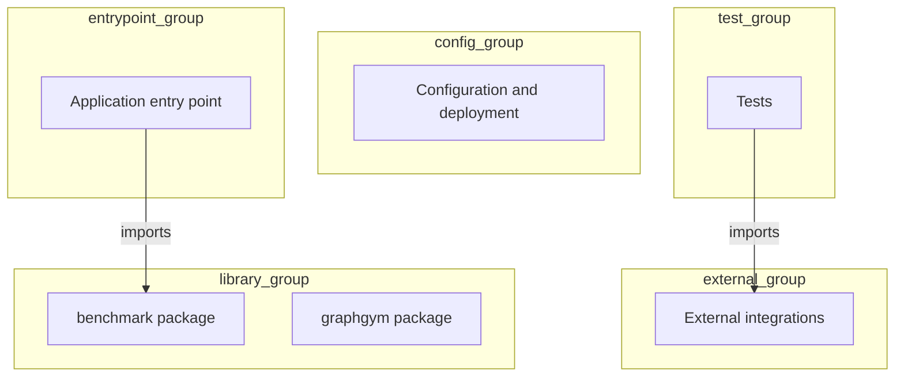

# Architecture report: pyg-team/pytorch_geometric

> Automated static analysis. **Observed** = directly seen in files/imports/AST; **Inferred** = interpretation from that evidence. Repository code was not executed.

## 1. Repository at a glance

| Item | Value |
| --- | --- |
| Repository | pyg-team/pytorch_geometric |
| Description | Graph Neural Network Library for PyTorch |
| Language | Python |
| Stars | 24142 |
| Licence | MIT |
| Analysed commit / branch | d1f2f8642387b6e0563d6aee227c39130746c738 / master |
| Framework(s) | None detected |
| Files analysed | 800 |
| Components | 6 |

## 2. Architecture in one minute

pyg-team/pytorch_geometric - Graph Neural Network Library for PyTorch. This repository was analysed statically from 800 file(s) (623 Python). Detected technologies (observed from imports/manifests): GitHub Actions, aiohttp, Click, NumPy, pandas, requests. Files are grouped into 6 component(s): benchmark package, Configuration and deployment, Application entry point, External integrations, graphgym package, Tests. Observed entry point(s): benchmark/inference/inference_benchmark.py, benchmark/loader/neighbor_loader.py, benchmark/multi_gpu/training/training_benchmark_cuda.py. Findings below distinguish observed facts from inferred interpretation.

## 3. High-level block diagram

## 4. Main components

### benchmark package (`benchmark`)

- **Kind:** library
- **Status:** Observed
- **Confidence:** 0.85
- **Responsibility:** Groups 53 file(s) under benchmark package (observed from repository paths and static analysis). Observed top-level classes: ASAP, Block, DiffPool, EdgePool, GAT, GATConv. Observed top-level functions: create_mask_per_rank, cross_validation_with_val_set, eval_acc, eval_loss, evaluate, get_dataset.
- **Paths:** `benchmark/citation/__init__.py`, `benchmark/citation/appnp.py`, `benchmark/citation/arma.py`, `benchmark/citation/cheb.py`, `benchmark/citation/datasets.py`, `benchmark/citation/gat.py`, `benchmark/citation/gcn.py`, `benchmark/citation/inference.sh`, `benchmark/citation/run.sh`, `benchmark/citation/sgc.py`, `benchmark/citation/statistics.py`, `benchmark/citation/train_eval.py`, `benchmark/kernel/__init__.py`, `benchmark/kernel/asap.py`, `benchmark/kernel/datasets.py`, `benchmark/kernel/diff_pool.py`, `benchmark/kernel/edge_pool.py`, `benchmark/kernel/gcn.py`, `benchmark/kernel/gin.py`, `benchmark/kernel/global_attention.py`, `benchmark/kernel/graclus.py`, `benchmark/kernel/graph_sage.py`, `benchmark/kernel/main_performance.py`, `benchmark/kernel/sag_pool.py`, `benchmark/kernel/set2set.py`, `benchmark/kernel/sort_pool.py`, `benchmark/kernel/statistics.py`, `benchmark/kernel/top_k.py`, `benchmark/kernel/train_eval.py`, `benchmark/multi_gpu/training/common.py`, `benchmark/points/__init__.py`, `benchmark/points/datasets.py`, `benchmark/points/edge_cnn.py`, `benchmark/points/mpnn.py`, `benchmark/points/point_cnn.py`, `benchmark/points/point_net.py`, `benchmark/points/spline_cnn.py`, `benchmark/points/statistics.py`, `benchmark/points/train_eval.py`, `benchmark/runtime/__init__.py`, `benchmark/runtime/dgl/gat.py`, `benchmark/runtime/dgl/gcn.py`, `benchmark/runtime/dgl/hidden.py`, `benchmark/runtime/dgl/rgcn.py`, `benchmark/runtime/dgl/train.py`, `benchmark/runtime/gat.py`, `benchmark/runtime/gcn.py`, `benchmark/runtime/rgcn.py`, `benchmark/runtime/train.py`, `benchmark/utils/__init__.py`, `benchmark/utils/hetero_gat.py`, `benchmark/utils/hetero_sage.py`, `benchmark/utils/utils.py`
- **Evidence:** [benchmark/citation/__init__.py](https://github.com/pyg-team/pytorch_geometric/blob/d1f2f8642387b6e0563d6aee227c39130746c738/benchmark/citation/__init__.py); [benchmark/citation/appnp.py:31](https://github.com/pyg-team/pytorch_geometric/blob/d1f2f8642387b6e0563d6aee227c39130746c738/benchmark/citation/appnp.py#L31); [benchmark/citation/arma.py:32](https://github.com/pyg-team/pytorch_geometric/blob/d1f2f8642387b6e0563d6aee227c39130746c738/benchmark/citation/arma.py#L32); [benchmark/citation/cheb.py:29](https://github.com/pyg-team/pytorch_geometric/blob/d1f2f8642387b6e0563d6aee227c39130746c738/benchmark/citation/cheb.py#L29); [benchmark/citation/datasets.py:7](https://github.com/pyg-team/pytorch_geometric/blob/d1f2f8642387b6e0563d6aee227c39130746c738/benchmark/citation/datasets.py#L7); [benchmark/citation/gat.py:30](https://github.com/pyg-team/pytorch_geometric/blob/d1f2f8642387b6e0563d6aee227c39130746c738/benchmark/citation/gat.py#L30); [benchmark/citation/gcn.py:28](https://github.com/pyg-team/pytorch_geometric/blob/d1f2f8642387b6e0563d6aee227c39130746c738/benchmark/citation/gcn.py#L28); [benchmark/citation/inference.sh](https://github.com/pyg-team/pytorch_geometric/blob/d1f2f8642387b6e0563d6aee227c39130746c738/benchmark/citation/inference.sh)

### Configuration and deployment (`config`)

- **Kind:** config
- **Status:** Observed
- **Confidence:** 0.85
- **Responsibility:** Groups 12 file(s) under configuration and deployment (observed from repository paths and static analysis). Observed top-level functions: set_cfg_example.
- **Paths:** `benchmark/setup.py`, `codecov.yml`, `docker/Dockerfile`, `docker/Dockerfile.xpu`, `graphgym/configs/example.yaml`, `graphgym/configs/pyg/example_graph.yaml`, `graphgym/configs/pyg/example_link.yaml`, `graphgym/configs/pyg/example_node.yaml`, `graphgym/custom_graphgym/config/__init__.py`, `graphgym/custom_graphgym/config/example.py`, `pyproject.toml`, `readthedocs.yml`
- **Evidence:** [benchmark/setup.py](https://github.com/pyg-team/pytorch_geometric/blob/d1f2f8642387b6e0563d6aee227c39130746c738/benchmark/setup.py); [codecov.yml](https://github.com/pyg-team/pytorch_geometric/blob/d1f2f8642387b6e0563d6aee227c39130746c738/codecov.yml); [docker/Dockerfile](https://github.com/pyg-team/pytorch_geometric/blob/d1f2f8642387b6e0563d6aee227c39130746c738/docker/Dockerfile); [docker/Dockerfile.xpu](https://github.com/pyg-team/pytorch_geometric/blob/d1f2f8642387b6e0563d6aee227c39130746c738/docker/Dockerfile.xpu); [graphgym/configs/example.yaml](https://github.com/pyg-team/pytorch_geometric/blob/d1f2f8642387b6e0563d6aee227c39130746c738/graphgym/configs/example.yaml); [graphgym/configs/pyg/example_graph.yaml](https://github.com/pyg-team/pytorch_geometric/blob/d1f2f8642387b6e0563d6aee227c39130746c738/graphgym/configs/pyg/example_graph.yaml); [graphgym/configs/pyg/example_link.yaml](https://github.com/pyg-team/pytorch_geometric/blob/d1f2f8642387b6e0563d6aee227c39130746c738/graphgym/configs/pyg/example_link.yaml); [graphgym/configs/pyg/example_node.yaml](https://github.com/pyg-team/pytorch_geometric/blob/d1f2f8642387b6e0563d6aee227c39130746c738/graphgym/configs/pyg/example_node.yaml)

### Application entry point (`entrypoint`)

- **Kind:** entrypoint
- **Status:** Observed
- **Confidence:** 0.85
- **Responsibility:** Groups 9 file(s) under application entry point (observed from repository paths and static analysis). Observed top-level functions: custom_optimizer, full_batch_inference, get_dist_params, logger, run, run_cuda.
- **Paths:** `benchmark/inference/inference_benchmark.py`, `benchmark/kernel/main.py`, `benchmark/loader/neighbor_loader.py`, `benchmark/multi_gpu/training/training_benchmark_cuda.py`, `benchmark/multi_gpu/training/training_benchmark_xpu.py`, `benchmark/runtime/dgl/main.py`, `benchmark/runtime/main.py`, `benchmark/training/training_benchmark.py`, `graphgym/main.py`
- **Evidence:** [benchmark/inference/inference_benchmark.py:35](https://github.com/pyg-team/pytorch_geometric/blob/d1f2f8642387b6e0563d6aee227c39130746c738/benchmark/inference/inference_benchmark.py#L35); [benchmark/kernel/main.py:51](https://github.com/pyg-team/pytorch_geometric/blob/d1f2f8642387b6e0563d6aee227c39130746c738/benchmark/kernel/main.py#L51); [benchmark/loader/neighbor_loader.py:16](https://github.com/pyg-team/pytorch_geometric/blob/d1f2f8642387b6e0563d6aee227c39130746c738/benchmark/loader/neighbor_loader.py#L16); [benchmark/multi_gpu/training/training_benchmark_cuda.py:18](https://github.com/pyg-team/pytorch_geometric/blob/d1f2f8642387b6e0563d6aee227c39130746c738/benchmark/multi_gpu/training/training_benchmark_cuda.py#L18); [benchmark/multi_gpu/training/training_benchmark_xpu.py:16](https://github.com/pyg-team/pytorch_geometric/blob/d1f2f8642387b6e0563d6aee227c39130746c738/benchmark/multi_gpu/training/training_benchmark_xpu.py#L16); [benchmark/runtime/dgl/main.py](https://github.com/pyg-team/pytorch_geometric/blob/d1f2f8642387b6e0563d6aee227c39130746c738/benchmark/runtime/dgl/main.py); [benchmark/runtime/main.py](https://github.com/pyg-team/pytorch_geometric/blob/d1f2f8642387b6e0563d6aee227c39130746c738/benchmark/runtime/main.py); [benchmark/training/training_benchmark.py:46](https://github.com/pyg-team/pytorch_geometric/blob/d1f2f8642387b6e0563d6aee227c39130746c738/benchmark/training/training_benchmark.py#L46)

### External integrations (`external_integrations`)

- **Kind:** external
- **Status:** Inferred
- **Confidence:** 0.70
- **Responsibility:** Groups 0 file(s) under external integrations (observed from repository paths and static analysis).
- **Evidence:** [test/distributed/test_dist_link_neighbor_loader.py:1](https://github.com/pyg-team/pytorch_geometric/blob/d1f2f8642387b6e0563d6aee227c39130746c738/test/distributed/test_dist_link_neighbor_loader.py#L1); [test/distributed/test_dist_link_neighbor_sampler.py:2](https://github.com/pyg-team/pytorch_geometric/blob/d1f2f8642387b6e0563d6aee227c39130746c738/test/distributed/test_dist_link_neighbor_sampler.py#L2); [test/distributed/test_dist_neighbor_loader.py:1](https://github.com/pyg-team/pytorch_geometric/blob/d1f2f8642387b6e0563d6aee227c39130746c738/test/distributed/test_dist_neighbor_loader.py#L1); [test/distributed/test_dist_neighbor_sampler.py:2](https://github.com/pyg-team/pytorch_geometric/blob/d1f2f8642387b6e0563d6aee227c39130746c738/test/distributed/test_dist_neighbor_sampler.py#L2); [test/distributed/test_rpc.py:1](https://github.com/pyg-team/pytorch_geometric/blob/d1f2f8642387b6e0563d6aee227c39130746c738/test/distributed/test_rpc.py#L1)

### graphgym package (`graphgym`)

- **Kind:** library
- **Status:** Observed
- **Confidence:** 0.85
- **Responsibility:** Groups 29 file(s) under graphgym package (observed from repository paths and static analysis). Observed top-level classes: ExampleConv1, ExampleConv2, ExampleConv2Layer, ExampleEdgeEncoder, ExampleGNN, ExampleNodeEncoder. Observed top-level functions: GNNLayer, adagrad_optimizer, eval_epoch, exclude_list_id, gen_grid, gen_grid_sample.
- **Paths:** `graphgym/agg_batch.py`, `graphgym/configs_gen.py`, `graphgym/custom_graphgym/__init__.py`, `graphgym/custom_graphgym/act/__init__.py`, `graphgym/custom_graphgym/act/example.py`, `graphgym/custom_graphgym/encoder/__init__.py`, `graphgym/custom_graphgym/encoder/example.py`, `graphgym/custom_graphgym/head/__init__.py`, `graphgym/custom_graphgym/head/example.py`, `graphgym/custom_graphgym/layer/__init__.py`, `graphgym/custom_graphgym/layer/example.py`, `graphgym/custom_graphgym/loader/__init__.py`, `graphgym/custom_graphgym/loader/example.py`, `graphgym/custom_graphgym/loss/__init__.py`, `graphgym/custom_graphgym/loss/example.py`, `graphgym/custom_graphgym/network/__init__.py`, `graphgym/custom_graphgym/network/example.py`, `graphgym/custom_graphgym/optimizer/__init__.py`, `graphgym/custom_graphgym/optimizer/example.py`, `graphgym/custom_graphgym/pooling/__init__.py`, `graphgym/custom_graphgym/pooling/example.py`, `graphgym/custom_graphgym/stage/__init__.py`, `graphgym/custom_graphgym/stage/example.py`, `graphgym/custom_graphgym/train/__init__.py`, `graphgym/custom_graphgym/train/example.py`, `graphgym/custom_graphgym/transform/__init__.py`, `graphgym/parallel.sh`, `graphgym/run_batch.sh`, `graphgym/run_single.sh`
- **Evidence:** [graphgym/agg_batch.py:6](https://github.com/pyg-team/pytorch_geometric/blob/d1f2f8642387b6e0563d6aee227c39130746c738/graphgym/agg_batch.py#L6); [graphgym/configs_gen.py:19](https://github.com/pyg-team/pytorch_geometric/blob/d1f2f8642387b6e0563d6aee227c39130746c738/graphgym/configs_gen.py#L19); [graphgym/custom_graphgym/__init__.py](https://github.com/pyg-team/pytorch_geometric/blob/d1f2f8642387b6e0563d6aee227c39130746c738/graphgym/custom_graphgym/__init__.py); [graphgym/custom_graphgym/act/__init__.py](https://github.com/pyg-team/pytorch_geometric/blob/d1f2f8642387b6e0563d6aee227c39130746c738/graphgym/custom_graphgym/act/__init__.py); [graphgym/custom_graphgym/act/example.py:10](https://github.com/pyg-team/pytorch_geometric/blob/d1f2f8642387b6e0563d6aee227c39130746c738/graphgym/custom_graphgym/act/example.py#L10); [graphgym/custom_graphgym/encoder/__init__.py](https://github.com/pyg-team/pytorch_geometric/blob/d1f2f8642387b6e0563d6aee227c39130746c738/graphgym/custom_graphgym/encoder/__init__.py); [graphgym/custom_graphgym/encoder/example.py:11](https://github.com/pyg-team/pytorch_geometric/blob/d1f2f8642387b6e0563d6aee227c39130746c738/graphgym/custom_graphgym/encoder/example.py#L11); [graphgym/custom_graphgym/head/__init__.py](https://github.com/pyg-team/pytorch_geometric/blob/d1f2f8642387b6e0563d6aee227c39130746c738/graphgym/custom_graphgym/head/__init__.py)

### Tests (`tests`)

- **Kind:** test
- **Status:** Observed
- **Confidence:** 0.85
- **Responsibility:** Groups 387 file(s) under tests (observed from repository paths and static analysis). Observed routes: PATCH torch_geometric.profile.nvtx.torch.cuda, PATCH torch_geometric.profile.nvtx.torch.cuda, PATCH torch_geometric.profile.nvtx.torch.cuda, PATCH torch_geometric.profile.nvtx.torch.cuda, PATCH torch_geometric.is_compiling. Observed top-level classes: AttentionGNN, Base, CompoundModule, CustomConv, Dataclass, DummyBatch. Observed top-level functions: _check_data, _check_hetero_data_edges, _check_hetero_data_nodes, _check_homo_data_edges, _check_homo_data_nodes, _collate_fn.
- **Paths:** `graphgym/results/example_node_grid_example/agg/test_best.csv`, `graphgym/results/example_node_grid_example/agg/test_bestepoch.csv`, `test/conftest.py`, `test/contrib/explain/test_pgm_explainer.py`, `test/contrib/nn/models/test_mgnan.py`, `test/contrib/nn/models/test_rbcd_attack.py`, `test/contrib/utils/test_relbench.py`, `test/data/lightning/test_datamodule.py`, `test/data/test_batch.py`, `test/data/test_data.py`, `test/data/test_database.py`, `test/data/test_datapipes.py`, `test/data/test_dataset.py`, `test/data/test_dataset_summary.py`, `test/data/test_feature_store.py`, `test/data/test_graph_store.py`, `test/data/test_hetero_data.py`, `test/data/test_hypergraph_data.py`, `test/data/test_inherit.py`, `test/data/test_on_disk_dataset.py`, `test/data/test_remote_backend_utils.py`, `test/data/test_storage.py`, `test/data/test_temporal.py`, `test/data/test_view.py`, `test/datasets/graph_generator/test_ba_graph.py`, `test/datasets/graph_generator/test_er_graph.py`, `test/datasets/graph_generator/test_grid_graph.py`, `test/datasets/graph_generator/test_tree_graph.py`, `test/datasets/motif_generator/test_custom_motif.py`, `test/datasets/motif_generator/test_cycle_motif.py`, `test/datasets/motif_generator/test_grid_motif.py`, `test/datasets/motif_generator/test_house_motif.py`, `test/datasets/test_ba_shapes.py`, `test/datasets/test_bzr.py`, `test/datasets/test_elliptic.py`, `test/datasets/test_enzymes.py`, `test/datasets/test_explainer_dataset.py`, `test/datasets/test_fake.py`, `test/datasets/test_git_mol_dataset.py`, `test/datasets/test_graphland.py`, `test/datasets/test_imdb_binary.py`, `test/datasets/test_infection_dataset.py`, `test/datasets/test_karate.py`, `test/datasets/test_medshapenet.py`, `test/datasets/test_molecule_gpt_dataset.py`, `test/datasets/test_mutag.py`, `test/datasets/test_planetoid.py`, `test/datasets/test_protein_mpnn_dataset.py`, `test/datasets/test_snap_dataset.py`, `test/datasets/test_suite_sparse.py`, `test/datasets/test_tag_dataset.py`, `test/datasets/test_teeth3ds.py`, `test/datasets/test_web_qsp_dataset.py`, `test/distributed/test_dist_link_neighbor_loader.py`, `test/distributed/test_dist_link_neighbor_sampler.py`, `test/distributed/test_dist_neighbor_loader.py`, `test/distributed/test_dist_neighbor_sampler.py`, `test/distributed/test_dist_utils.py`, `test/distributed/test_local_feature_store.py`, `test/distributed/test_local_graph_store.py`, `test/distributed/test_partition.py`, `test/distributed/test_rpc.py`, `test/explain/algorithm/test_attention_explainer.py`, `test/explain/algorithm/test_captum.py`, `test/explain/algorithm/test_captum_explainer.py`, `test/explain/algorithm/test_captum_hetero.py`, `test/explain/algorithm/test_explain_algorithm_utils.py`, `test/explain/algorithm/test_gnn_explainer.py`, `test/explain/algorithm/test_graphmask_explainer.py`, `test/explain/algorithm/test_pg_explainer.py`, `test/explain/conftest.py`, `test/explain/metric/test_basic_metric.py`, `test/explain/metric/test_faithfulness.py`, `test/explain/metric/test_fidelity.py`, `test/explain/test_explain_config.py`, `test/explain/test_explainer.py`, `test/explain/test_explanation.py`, `test/explain/test_hetero_explainer.py`, `test/explain/test_hetero_explanation.py`, `test/graphgym/example_node.yml`, `test/graphgym/test_config.py`, `test/graphgym/test_graphgym.py`, `test/graphgym/test_logger.py`, `test/graphgym/test_register.py`, `test/io/example1.off`, `test/io/example2.off`, `test/io/test_fs.py`, `test/io/test_off.py`, `test/llm/conftest.py`, `test/llm/models/test_g_retriever.py`, `test/llm/models/test_git_mol.py`, `test/llm/models/test_glem.py`, `test/llm/models/test_llm.py`, `test/llm/models/test_llm_judge.py`, `test/llm/models/test_molecule_gpt.py`, `test/llm/models/test_protein_mpnn.py`, `test/llm/models/test_sentence_transformer.py`, `test/llm/models/test_txt2kg.py`, `test/llm/models/test_vision_transformer.py`, `test/llm/test_large_graph_indexer.py`, `test/llm/test_rag_loader.py`, `test/llm/test_txt2qa.py`, `test/llm/utils/test_rag_backend_utils.py`, `test/llm/utils/test_rag_feature_store.py`, `test/llm/utils/test_rag_graph_store.py`, `test/llm/utils/test_vectorrag.py`, `test/loader/test_cache.py`, `test/loader/test_cluster.py`, `test/loader/test_dataloader.py`, `test/loader/test_dynamic_batch_sampler.py`, `test/loader/test_graph_saint.py`, `test/loader/test_hgt_loader.py`, `test/loader/test_ibmb_loader.py`, `test/loader/test_imbalanced_sampler.py`, `test/loader/test_link_neighbor_loader.py`, `test/loader/test_mixin.py`, `test/loader/test_neighbor_loader.py`, `test/loader/test_neighbor_sampler.py`, `test/loader/test_prefetch.py`, `test/loader/test_random_node_loader.py`, `test/loader/test_shadow.py`, `test/loader/test_temporal_dataloader.py`, `test/loader/test_utils.py`, `test/loader/test_zip_loader.py`, `test/metrics/test_link_pred_metric.py`, `test/my_config.yaml`, `test/nn/aggr/test_aggr_utils.py`, `test/nn/aggr/test_attention.py`, `test/nn/aggr/test_basic.py`, `test/nn/aggr/test_deep_sets.py`, `test/nn/aggr/test_equilibrium.py`, `test/nn/aggr/test_fused.py`, `test/nn/aggr/test_gmt.py`, `test/nn/aggr/test_gru.py`, `test/nn/aggr/test_lcm.py`, `test/nn/aggr/test_lstm.py`, `test/nn/aggr/test_mlp_aggr.py`, `test/nn/aggr/test_multi.py`, `test/nn/aggr/test_patch_transformer.py`, `test/nn/aggr/test_quantile.py`, `test/nn/aggr/test_scaler.py`, `test/nn/aggr/test_set2set.py`, `test/nn/aggr/test_set_transformer.py`, `test/nn/aggr/test_sort.py`, `test/nn/aggr/test_variance_preserving.py`, `test/nn/attention/test_performer_attention.py`, `test/nn/attention/test_polynormer_attention.py`, `test/nn/attention/test_qformer.py`, `test/nn/conv/cugraph/test_cugraph_gat_conv.py`, `test/nn/conv/cugraph/test_cugraph_rgcn_conv.py`, `test/nn/conv/cugraph/test_cugraph_sage_conv.py`, `test/nn/conv/test_agnn_conv.py`, `test/nn/conv/test_antisymmetric_conv.py`, `test/nn/conv/test_appnp.py`, `test/nn/conv/test_arma_conv.py`, `test/nn/conv/test_cg_conv.py`, `test/nn/conv/test_cheb_conv.py`, `test/nn/conv/test_cluster_gcn_conv.py`, `test/nn/conv/test_create_gnn.py`, `test/nn/conv/test_dir_gnn_conv.py`, `test/nn/conv/test_dna_conv.py`, `test/nn/conv/test_edge_conv.py`, `test/nn/conv/test_eg_conv.py`, `test/nn/conv/test_fa_conv.py`, `test/nn/conv/test_feast_conv.py`, `test/nn/conv/test_film_conv.py`, `test/nn/conv/test_fused_gat_conv.py`, `test/nn/conv/test_gat_conv.py`, `test/nn/conv/test_gated_graph_conv.py`, `test/nn/conv/test_gatv2_conv.py`, `test/nn/conv/test_gcn2_conv.py`, `test/nn/conv/test_gcn_conv.py`, `test/nn/conv/test_gen_conv.py`, `test/nn/conv/test_general_conv.py`, `test/nn/conv/test_gin_conv.py`, `test/nn/conv/test_gmm_conv.py`, `test/nn/conv/test_gps_conv.py`, `test/nn/conv/test_graph_conv.py`, `test/nn/conv/test_gravnet_conv.py`, `test/nn/conv/test_han_conv.py`, `test/nn/conv/test_heat_conv.py`, `test/nn/conv/test_hetero_conv.py`, `test/nn/conv/test_hgt_conv.py`, `test/nn/conv/test_hypergraph_conv.py`, `test/nn/conv/test_le_conv.py`, `test/nn/conv/test_lg_conv.py`, `test/nn/conv/test_meshcnn_conv.py`, `test/nn/conv/test_message_passing.py`, `test/nn/conv/test_mf_conv.py`, `test/nn/conv/test_mixhop_conv.py`, `test/nn/conv/test_nn_conv.py`, `test/nn/conv/test_pan_conv.py`, `test/nn/conv/test_pdn_conv.py`, `test/nn/conv/test_pna_conv.py`, `test/nn/conv/test_point_conv.py`, `test/nn/conv/test_point_gnn_conv.py`, `test/nn/conv/test_point_transformer_conv.py`, `test/nn/conv/test_ppf_conv.py`, `test/nn/conv/test_res_gated_graph_conv.py`, `test/nn/conv/test_rgat_conv.py`, `test/nn/conv/test_rgcn_conv.py`, `test/nn/conv/test_sage_conv.py`, `test/nn/conv/test_sg_conv.py`, `test/nn/conv/test_signed_conv.py`, `test/nn/conv/test_simple_conv.py`, `test/nn/conv/test_spline_conv.py`, `test/nn/conv/test_ssg_conv.py`, `test/nn/conv/test_static_graph.py`, `test/nn/conv/test_supergat_conv.py`, `test/nn/conv/test_tag_conv.py`, `test/nn/conv/test_transformer_conv.py`, `test/nn/conv/test_wl_conv.py`, `test/nn/conv/test_wl_conv_continuous.py`, `test/nn/conv/test_x_conv.py`, `test/nn/conv/utils/test_gnn_cheatsheet.py`, `test/nn/dense/test_dense_gat_conv.py`, `test/nn/dense/test_dense_gcn_conv.py`, `test/nn/dense/test_dense_gin_conv.py`, `test/nn/dense/test_dense_graph_conv.py`, `test/nn/dense/test_dense_sage_conv.py`, `test/nn/dense/test_diff_pool.py`, `test/nn/dense/test_dmon_pool.py`, `test/nn/dense/test_linear.py`, `test/nn/dense/test_mincut_pool.py`, `test/nn/functional/test_bro.py`, `test/nn/functional/test_gini.py`, `test/nn/kge/test_complex.py`, `test/nn/kge/test_distmult.py`, `test/nn/kge/test_rotate.py`, `test/nn/kge/test_transe.py`, `test/nn/models/test_attentive_fp.py`, `test/nn/models/test_attract_repel.py`, `test/nn/models/test_autoencoder.py`, `test/nn/models/test_basic_gnn.py`, `test/nn/models/test_correct_and_smooth.py`, `test/nn/models/test_deep_graph_infomax.py`, `test/nn/models/test_deepgcn.py`, `test/nn/models/test_dimenet.py`, `test/nn/models/test_gnnff.py`, `test/nn/models/test_gpse.py`, `test/nn/models/test_graph_mixer.py`, `test/nn/models/test_graph_unet.py`, `test/nn/models/test_jumping_knowledge.py`, `test/nn/models/test_label_prop.py`, `test/nn/models/test_lightgcn.py`, `test/nn/models/test_linkx.py`, `test/nn/models/test_lpformer.py`, `test/nn/models/test_mask_label.py`, `test/nn/models/test_meta.py`, `test/nn/models/test_metapath2vec.py`, `test/nn/models/test_mlp.py`, `test/nn/models/test_neural_fingerprint.py`, `test/nn/models/test_node2vec.py`, `test/nn/models/test_pmlp.py`, `test/nn/models/test_polynormer.py`, `test/nn/models/test_re_net.py`, `test/nn/models/test_rect.py`, `test/nn/models/test_rev_gnn.py`, `test/nn/models/test_schnet.py`, `test/nn/models/test_sgformer.py`, `test/nn/models/test_signed_gcn.py`, `test/nn/models/test_tgn.py`, `test/nn/models/test_visnet.py`, `test/nn/norm/test_batch_norm.py`, `test/nn/norm/test_diff_group_norm.py`, `test/nn/norm/test_graph_norm.py`, `test/nn/norm/test_graph_size_norm.py`, `test/nn/norm/test_instance_norm.py`, `test/nn/norm/test_layer_norm.py`, `test/nn/norm/test_mean_subtraction_norm.py`, `test/nn/norm/test_msg_norm.py`, `test/nn/norm/test_pair_norm.py`, `test/nn/pool/connect/test_filter_edges.py`, `test/nn/pool/select/test_select_topk.py`, `test/nn/pool/test_approx_knn.py`, `test/nn/pool/test_asap.py`, `test/nn/pool/test_avg_pool.py`, `test/nn/pool/test_cluster_pool.py`, `test/nn/pool/test_consecutive.py`, `test/nn/pool/test_decimation.py`, `test/nn/pool/test_edge_pool.py`, `test/nn/pool/test_glob.py`, `test/nn/pool/test_graclus.py`, `test/nn/pool/test_knn.py`, `test/nn/pool/test_max_pool.py`, `test/nn/pool/test_mem_pool.py`, `test/nn/pool/test_pan_pool.py`, `test/nn/pool/test_pool.py`, `test/nn/pool/test_sag_pool.py`, `test/nn/pool/test_topk_pool.py`, `test/nn/pool/test_voxel_grid.py`, `test/nn/test_compile_basic.py`, `test/nn/test_compile_conv.py`, `test/nn/test_compile_dynamic.py`, `test/nn/test_data_parallel.py`, `test/nn/test_encoding.py`, `test/nn/test_fvcore.py`, `test/nn/test_fx.py`, `test/nn/test_inits.py`, `test/nn/test_model_hub.py`, `test/nn/test_model_summary.py`, `test/nn/test_module_dict.py`, `test/nn/test_parameter_dict.py`, `test/nn/test_reshape.py`, `test/nn/test_resolver.py`, `test/nn/test_sequential.py`, `test/nn/test_to_fixed_size_transformer.py`, `test/nn/test_to_hetero_module.py`, `test/nn/test_to_hetero_transformer.py`, `test/nn/test_to_hetero_with_bases_transformer.py`, `test/nn/unpool/test_knn_interpolate.py`, `test/profile/test_benchmark.py`, `test/profile/test_nvtx.py`, `test/profile/test_profile.py`, `test/profile/test_profile_utils.py`, `test/profile/test_profiler.py`, `test/sampler/test_sampler_base.py`, `test/sampler/test_sampler_neighbor_sampler.py`, `test/test_config_mixin.py`, `test/test_config_store.py`, `test/test_debug.py`, `test/test_edge_index.py`, `test/test_experimental.py`, `test/test_hash_tensor.py`, `test/test_home.py`, `test/test_index.py`, `test/test_inspector.py`, `test/test_isinstance.py`, `test/test_onnx.py`, `test/test_seed.py`, `test/test_typing.py`, `test/test_warnings.py`, `test/testing/test_decorators.py`, `test/transforms/test_add_gpse.py`, `test/transforms/test_add_metapaths.py`, `test/transforms/test_add_positional_encoding.py`, `test/transforms/test_add_remaining_self_loops.py`, `test/transforms/test_add_self_loops.py`, `test/transforms/test_cartesian.py`, `test/transforms/test_center.py`, `test/transforms/test_compose.py`, `test/transforms/test_constant.py`, `test/transforms/test_delaunay.py`, `test/transforms/test_distance.py`, `test/transforms/test_face_to_edge.py`, `test/transforms/test_feature_propagation.py`, `test/transforms/test_fixed_points.py`, `test/transforms/test_gcn_norm.py`, `test/transforms/test_gdc.py`, `test/transforms/test_generate_mesh_normals.py`, `test/transforms/test_grid_sampling.py`, `test/transforms/test_half_hop.py`, `test/transforms/test_knn_graph.py`, `test/transforms/test_laplacian_lambda_max.py`, `test/transforms/test_largest_connected_components.py`, `test/transforms/test_line_graph.py`, `test/transforms/test_linear_transformation.py`, `test/transforms/test_local_cartesian.py`, `test/transforms/test_local_degree_profile.py`, `test/transforms/test_mask_transform.py`, `test/transforms/test_node_property_split.py`, `test/transforms/test_normalize_features.py`, `test/transforms/test_normalize_rotation.py`, `test/transforms/test_normalize_scale.py`, `test/transforms/test_one_hot_degree.py`, `test/transforms/test_pad.py`, `test/transforms/test_point_pair_features.py`, `test/transforms/test_polar.py`, `test/transforms/test_radius_graph.py`, `test/transforms/test_random_flip.py`, `test/transforms/test_random_jitter.py`, `test/transforms/test_random_link_split.py`, `test/transforms/test_random_node_split.py`, `test/transforms/test_random_rotate.py`, `test/transforms/test_random_scale.py`, `test/transforms/test_random_shear.py`, `test/transforms/test_remove_duplicated_edges.py`, `test/transforms/test_remove_isolated_nodes.py`, `test/transforms/test_remove_self_loops.py`, `test/transforms/test_remove_training_classes.py`, `test/transforms/test_rooted_subgraph.py`, `test/transforms/test_sample_points.py`, `test/transforms/test_sign.py`, `test/transforms/test_spherical.py`, `test/transforms/test_svd_feature_reduction.py`, `test/transforms/test_target_indegree.py`, `test/transforms/test_to_dense.py`
- **Evidence:** [graphgym/results/example_node_grid_example/agg/test_best.csv](https://github.com/pyg-team/pytorch_geometric/blob/d1f2f8642387b6e0563d6aee227c39130746c738/graphgym/results/example_node_grid_example/agg/test_best.csv); [graphgym/results/example_node_grid_example/agg/test_bestepoch.csv](https://github.com/pyg-team/pytorch_geometric/blob/d1f2f8642387b6e0563d6aee227c39130746c738/graphgym/results/example_node_grid_example/agg/test_bestepoch.csv); [test/conftest.py:14](https://github.com/pyg-team/pytorch_geometric/blob/d1f2f8642387b6e0563d6aee227c39130746c738/test/conftest.py#L14); [test/contrib/explain/test_pgm_explainer.py:12](https://github.com/pyg-team/pytorch_geometric/blob/d1f2f8642387b6e0563d6aee227c39130746c738/test/contrib/explain/test_pgm_explainer.py#L12); [test/contrib/nn/models/test_mgnan.py:8](https://github.com/pyg-team/pytorch_geometric/blob/d1f2f8642387b6e0563d6aee227c39130746c738/test/contrib/nn/models/test_mgnan.py#L8); [test/contrib/nn/models/test_rbcd_attack.py:10](https://github.com/pyg-team/pytorch_geometric/blob/d1f2f8642387b6e0563d6aee227c39130746c738/test/contrib/nn/models/test_rbcd_attack.py#L10); [test/contrib/utils/test_relbench.py:8](https://github.com/pyg-team/pytorch_geometric/blob/d1f2f8642387b6e0563d6aee227c39130746c738/test/contrib/utils/test_relbench.py#L8); [test/data/lightning/test_datamodule.py:34](https://github.com/pyg-team/pytorch_geometric/blob/d1f2f8642387b6e0563d6aee227c39130746c738/test/data/lightning/test_datamodule.py#L34)

## 5. Execution flow

**Observed** entry point(s):

- [benchmark/inference/inference_benchmark.py:298](https://github.com/pyg-team/pytorch_geometric/blob/d1f2f8642387b6e0563d6aee227c39130746c738/benchmark/inference/inference_benchmark.py#L298)
- [benchmark/loader/neighbor_loader.py:106](https://github.com/pyg-team/pytorch_geometric/blob/d1f2f8642387b6e0563d6aee227c39130746c738/benchmark/loader/neighbor_loader.py#L106)
- [benchmark/multi_gpu/training/training_benchmark_cuda.py:26](https://github.com/pyg-team/pytorch_geometric/blob/d1f2f8642387b6e0563d6aee227c39130746c738/benchmark/multi_gpu/training/training_benchmark_cuda.py#L26)
- [benchmark/multi_gpu/training/training_benchmark_xpu.py:40](https://github.com/pyg-team/pytorch_geometric/blob/d1f2f8642387b6e0563d6aee227c39130746c738/benchmark/multi_gpu/training/training_benchmark_xpu.py#L40)
- [benchmark/training/training_benchmark.py:341](https://github.com/pyg-team/pytorch_geometric/blob/d1f2f8642387b6e0563d6aee227c39130746c738/benchmark/training/training_benchmark.py#L341)
- [graphgym/main.py:23](https://github.com/pyg-team/pytorch_geometric/blob/d1f2f8642387b6e0563d6aee227c39130746c738/graphgym/main.py#L23)

**Observed** routes (from decorators):

- `PATCH torch_geometric.profile.nvtx.torch.cuda` -> `test_nvtxit_base` in `test/profile/test_nvtx.py:14`
- `PATCH torch_geometric.profile.nvtx.torch.cuda` -> `test_nvtxit_rename` in `test/profile/test_nvtx.py:48`
- `PATCH torch_geometric.profile.nvtx.torch.cuda` -> `test_nvtxit_iters` in `test/profile/test_nvtx.py:82`
- `PATCH torch_geometric.profile.nvtx.torch.cuda` -> `test_nvtxit_warmups` in `test/profile/test_nvtx.py:111`
- `PATCH torch_geometric.is_compiling` -> `test_no_warn_if_compiling` in `test/test_warnings.py:15`

Representative flow (derived from observed entry points and the import graph; steps beyond the entry point are **Inferred**):

1. Execution starts at an observed entry point listed above, if present.
2. `entrypoint` imports `benchmark` (Application entry point -> benchmark package).
3. `tests` imports `external_integrations` (Tests -> External integrations).

## 6. Project structure

### `(root)`

- `.gitignore` - other (370 bytes)
- `.pre-commit-config.yaml` - config (2430 bytes)
- `CHANGELOG.md` - docs (139254 bytes)
- `CITATION.cff` - other (1178 bytes)
- `LICENSE` - docs (1067 bytes)
- `README.md` - docs (60641 bytes)
- `codecov.yml` - config (253 bytes)
- `pyproject.toml` - manifest (6357 bytes)
- `readthedocs.yml` - config (231 bytes)

### `.github`

- `.github/CODEOWNERS` - other (585 bytes)
- `.github/CONTRIBUTING.md` - docs (5390 bytes)
- `.github/ISSUE_TEMPLATE/bug-report.yml` - config (2423 bytes)
- `.github/ISSUE_TEMPLATE/config.yml` - config (348 bytes)
- `.github/ISSUE_TEMPLATE/documentation.yml` - config (503 bytes)
- `.github/ISSUE_TEMPLATE/feature-request.yml` - config (865 bytes)
- `.github/ISSUE_TEMPLATE/installation.yml` - config (1468 bytes)
- `.github/ISSUE_TEMPLATE/refactor.yml` - config (615 bytes)
- `.github/actions/setup/action.yml` - config (3906 bytes)
- `.github/dependabot.yml` - config (421 bytes)
- `.github/labeler.yml` - config (1616 bytes)
- `.github/workflows/_testing.yml` - ci, YAML (1748 bytes)
- `.github/workflows/auto-merge.yml` - ci, YAML (888 bytes)
- `.github/workflows/building_nightly.yml` - ci, YAML (1287 bytes)
- `.github/workflows/changelog.yml` - ci, YAML (359 bytes)
- `.github/workflows/documentation.yml` - ci, YAML (1301 bytes)
- `.github/workflows/examples.yml` - ci, YAML (1061 bytes)
- `.github/workflows/labeler.yml` - ci, YAML (788 bytes)
- `.github/workflows/linting.yml` - ci, YAML (1242 bytes)
- `.github/workflows/testing.yml` - ci, YAML (3605 bytes)
- `.github/workflows/testing_rag.yml` - ci, YAML (1566 bytes)

### `benchmark`

- `benchmark/README.md` - docs (773 bytes)
- `benchmark/citation/README.md` - docs (985 bytes)
- `benchmark/citation/__init__.py` - source, Python (183 bytes)
- `benchmark/citation/appnp.py` - source, Python (2469 bytes)
- `benchmark/citation/arma.py` - source, Python (2751 bytes)
- `benchmark/citation/cheb.py` - source, Python (2311 bytes)
- `benchmark/citation/datasets.py` - source, Python (596 bytes)
- `benchmark/citation/gat.py` - source, Python (2600 bytes)
- `benchmark/citation/gcn.py` - source, Python (2222 bytes)
- `benchmark/citation/inference.sh` - source, Shell (5840 bytes)
- `benchmark/citation/run.sh` - source, Shell (2452 bytes)
- `benchmark/citation/sgc.py` - source, Python (2001 bytes)
- `benchmark/citation/statistics.py` - source, Python (459 bytes)
- `benchmark/citation/train_eval.py` - source, Python (5957 bytes)
- `benchmark/inference/README.md` - docs (1772 bytes)
- `benchmark/inference/inference_benchmark.py` - source, Python (15806 bytes)
- `benchmark/kernel/README.md` - docs (1810 bytes)
- `benchmark/kernel/__init__.py` - source, Python (159 bytes)
- `benchmark/kernel/asap.py` - source, Python (2105 bytes)
- `benchmark/kernel/datasets.py` - source, Python (2090 bytes)
- `benchmark/kernel/diff_pool.py` - source, Python (3118 bytes)
- `benchmark/kernel/edge_pool.py` - source, Python (1869 bytes)
- `benchmark/kernel/gcn.py` - source, Python (2606 bytes)
- `benchmark/kernel/gin.py` - source, Python (7178 bytes)
- `benchmark/kernel/global_attention.py` - source, Python (1339 bytes)
- `benchmark/kernel/graclus.py` - source, Python (1866 bytes)
- `benchmark/kernel/graph_sage.py` - source, Python (2620 bytes)
- `benchmark/kernel/main.py` - source, Python (2529 bytes)
- `benchmark/kernel/main_performance.py` - source, Python (5544 bytes)
- `benchmark/kernel/sag_pool.py` - source, Python (1943 bytes)
- `benchmark/kernel/set2set.py` - source, Python (1326 bytes)
- `benchmark/kernel/sort_pool.py` - source, Python (1492 bytes)
- `benchmark/kernel/statistics.py` - source, Python (570 bytes)
- `benchmark/kernel/top_k.py` - source, Python (1942 bytes)
- `benchmark/kernel/train_eval.py` - source, Python (5452 bytes)
- `benchmark/loader/neighbor_loader.py` - source, Python (6313 bytes)
- `benchmark/multi_gpu/training/README.md` - docs (2911 bytes)
- `benchmark/multi_gpu/training/common.py` - source, Python (9114 bytes)
- `benchmark/multi_gpu/training/training_benchmark_cuda.py` - source, Python (1537 bytes)
- `benchmark/multi_gpu/training/training_benchmark_xpu.py` - source, Python (1959 bytes)
- `benchmark/points/README.md` - docs (730 bytes)
- `benchmark/points/__init__.py` - source, Python (107 bytes)
- `benchmark/points/datasets.py` - source, Python (636 bytes)
- `benchmark/points/edge_cnn.py` - source, Python (2288 bytes)
- `benchmark/points/mpnn.py` - source, Python (3031 bytes)
- `benchmark/points/point_cnn.py` - source, Python (2588 bytes)
- `benchmark/points/point_net.py` - source, Python (2761 bytes)
- `benchmark/points/spline_cnn.py` - source, Python (2995 bytes)
- `benchmark/points/statistics.py` - source, Python (751 bytes)
- `benchmark/points/train_eval.py` - source, Python (4068 bytes)
- `benchmark/runtime/README.md` - docs (148 bytes)
- `benchmark/runtime/__init__.py` - source, Python (69 bytes)
- `benchmark/runtime/dgl/gat.py` - source, Python (4635 bytes)
- `benchmark/runtime/dgl/gcn.py` - source, Python (2439 bytes)
- `benchmark/runtime/dgl/hidden.py` - source, Python (326 bytes)
- `benchmark/runtime/dgl/main.py` - source, Python (2262 bytes)
- `benchmark/runtime/dgl/rgcn.py` - source, Python (4986 bytes)
- `benchmark/runtime/dgl/train.py` - source, Python (1136 bytes)
- `benchmark/runtime/gat.py` - source, Python (635 bytes)
- `benchmark/runtime/gcn.py` - source, Python (562 bytes)
- `benchmark/runtime/main.py` - source, Python (1378 bytes)
- `benchmark/runtime/rgcn.py` - source, Python (651 bytes)
- `benchmark/runtime/train.py` - source, Python (1004 bytes)
- `benchmark/setup.py` - manifest, Python (363 bytes)
- `benchmark/training/README.md` - docs (1755 bytes)
- `benchmark/training/training_benchmark.py` - source, Python (16565 bytes)
- `benchmark/utils/__init__.py` - source, Python (421 bytes)
- `benchmark/utils/hetero_gat.py` - source, Python (1739 bytes)
- `benchmark/utils/hetero_sage.py` - source, Python (1683 bytes)
- `benchmark/utils/utils.py` - source, Python (6967 bytes)

### `docker`

- `docker/Dockerfile` - container (788 bytes)
- `docker/Dockerfile.xpu` - container (1398 bytes)
- `docker/README.md` - docs (3708 bytes)
- `docker/singularity` - other (1938 bytes)

### `docs`

- `docs/Makefile` - docs (215 bytes)
- `docs/README.md` - docs (521 bytes)
- `docs/requirements.txt` - manifest (161 bytes)
- `docs/source/.gitignore` - docs (11 bytes)
- `docs/source/_figures/.gitignore` - docs (18 bytes)
- `docs/source/_figures/architecture.svg` - docs (138913 bytes)
- `docs/source/_figures/build.sh` - docs (149 bytes)
- `docs/source/_figures/graph.svg` - docs (10065 bytes)
- `docs/source/_figures/graph.tex` - docs (359 bytes)
- `docs/source/_figures/hg_example.svg` - docs (54275 bytes)
- `docs/source/_figures/hg_example.tex` - docs (962 bytes)
- `docs/source/_figures/meshcnn_edge_adjacency.svg` - docs (39859 bytes)
- `docs/source/_figures/to_hetero.svg` - docs (67894 bytes)
- `docs/source/_figures/to_hetero.tex` - docs (3068 bytes)
- `docs/source/_figures/to_hetero_with_bases.svg` - docs (81552 bytes)
- `docs/source/_figures/to_hetero_with_bases.tex` - docs (3578 bytes)
- `docs/source/_static/js/version_alert.js` - docs (749 bytes)
- `docs/source/_templates/autosummary/class.rst` - docs (133 bytes)
- `docs/source/_templates/autosummary/inherited_class.rst` - docs (198 bytes)
- `docs/source/_templates/autosummary/metrics.rst` - docs (156 bytes)
- `docs/source/_templates/autosummary/nn.rst` - docs (432 bytes)
- `docs/source/_templates/autosummary/only_class.rst` - docs (120 bytes)
- `docs/source/advanced/batching.rst` - docs (12408 bytes)
- `docs/source/advanced/compile.rst` - docs (6798 bytes)
- `docs/source/advanced/cpu_affinity.rst` - docs (13189 bytes)
- `docs/source/advanced/graphgym.rst` - docs (13029 bytes)
- `docs/source/advanced/hgam.rst` - docs (8736 bytes)
- `docs/source/advanced/jit.rst` - docs (4446 bytes)
- `docs/source/advanced/remote.rst` - docs (12450 bytes)
- `docs/source/advanced/sparse_tensor.rst` - docs (8988 bytes)
- `docs/source/cheatsheet/data_cheatsheet.rst` - docs (4957 bytes)
- `docs/source/cheatsheet/gnn_cheatsheet.rst` - docs (5587 bytes)
- `docs/source/conf.py` - docs (2839 bytes)
- `docs/source/external/resources.rst` - docs (6449 bytes)
- `docs/source/get_started/colabs.rst` - docs (7778 bytes)
- `docs/source/get_started/introduction.rst` - docs (16606 bytes)
- `docs/source/index.rst` - docs (2261 bytes)
- `docs/source/install/installation.rst` - docs (12846 bytes)
- `docs/source/install/quick-start.html` - docs (3463 bytes)
- `docs/source/modules/contrib.rst` - docs (2090 bytes)
- `docs/source/modules/data.rst` - docs (1390 bytes)
- `docs/source/modules/datasets.rst` - docs (1832 bytes)
- `docs/source/modules/distributed.rst` - docs (634 bytes)
- `docs/source/modules/explain.rst` - docs (2882 bytes)
- `docs/source/modules/graphgym.rst` - docs (986 bytes)
- `docs/source/modules/llm.rst` - docs (693 bytes)
- `docs/source/modules/loader.rst` - docs (261 bytes)
- `docs/source/modules/metrics.rst` - docs (373 bytes)
- `docs/source/modules/nn.rst` - docs (11236 bytes)
- `docs/source/modules/profile.rst` - docs (290 bytes)
- `docs/source/modules/root.rst` - docs (522 bytes)
- `docs/source/modules/sampler.rst` - docs (419 bytes)
- `docs/source/modules/transforms.rst` - docs (1734 bytes)
- `docs/source/modules/utils.rst` - docs (260 bytes)
- `docs/source/notes/batching.rst` - docs (48 bytes)
- `docs/source/notes/cheatsheet.rst` - docs (5337 bytes)
- `docs/source/notes/colabs.rst` - docs (49 bytes)
- `docs/source/notes/create_dataset.rst` - docs (54 bytes)
- `docs/source/notes/create_gnn.rst` - docs (50 bytes)
- `docs/source/notes/data_cheatsheet.rst` - docs (4967 bytes)
- `docs/source/notes/explain.rst` - docs (47 bytes)
- `docs/source/notes/graphgym.rst` - docs (48 bytes)
- `docs/source/notes/heterogeneous.rst` - docs (53 bytes)
- `docs/source/notes/installation.rst` - docs (161 bytes)
- `docs/source/notes/introduction.rst` - docs (55 bytes)
- `docs/source/notes/jit.rst` - docs (43 bytes)
- `docs/source/notes/load_csv.rst` - docs (48 bytes)
- `docs/source/notes/remote.rst` - docs (46 bytes)
- `docs/source/notes/resources.rst` - docs (49 bytes)
- `docs/source/notes/sparse_tensor.rst` - docs (53 bytes)
- `docs/source/tutorial/application.rst` - docs (188 bytes)
- `docs/source/tutorial/compile.rst` - docs (47 bytes)
- `docs/source/tutorial/create_dataset.rst` - docs (9032 bytes)
- `docs/source/tutorial/create_gnn.rst` - docs (13226 bytes)
- `docs/source/tutorial/dataset.rst` - docs (150 bytes)
- `docs/source/tutorial/dataset_splitting.rst` - docs (7330 bytes)
- `docs/source/tutorial/distributed.rst` - docs (185 bytes)
- `docs/source/tutorial/distributed_pyg.rst` - docs (18361 bytes)
- `docs/source/tutorial/explain.rst` - docs (9402 bytes)
- `docs/source/tutorial/gnn_design.rst` - docs (137 bytes)
- `docs/source/tutorial/graph_transformer.rst` - docs (13640 bytes)
- `docs/source/tutorial/heterogeneous.rst` - docs (24705 bytes)
- `docs/source/tutorial/load_csv.rst` - docs (10712 bytes)
- `docs/source/tutorial/multi_gpu_vanilla.rst` - docs (9559 bytes)
- `docs/source/tutorial/multi_node_multi_gpu_vanilla.rst` - docs (6582 bytes)
- `docs/source/tutorial/neighbor_loader.rst` - docs (12674 bytes)
- `docs/source/tutorial/point_cloud.rst` - docs (13272 bytes)
- `docs/source/tutorial/shallow_node_embeddings.rst` - docs (8880 bytes)

### `examples`

- `examples/README.md` - docs (5295 bytes)
- `examples/agnn.py` - source, Python (1957 bytes)
- `examples/ar_link_pred.py` - source, Python (7078 bytes)
- `examples/argva_node_clustering.py` - source, Python (4419 bytes)
- `examples/arma.py` - source, Python (2347 bytes)
- `examples/attentive_fp.py` - source, Python (5407 bytes)
- `examples/autoencoder.py` - source, Python (3995 bytes)
- `examples/cluster_gcn_ppi.py` - source, Python (3278 bytes)
- `examples/cluster_gcn_reddit.py` - source, Python (3672 bytes)
- `examples/colors_topk_pool.py` - source, Python (3825 bytes)
- `examples/compile/gcn.py` - source, Python (2740 bytes)
- `examples/compile/gin.py` - source, Python (3147 bytes)
- `examples/contrib/README.md` - docs (1393 bytes)
- `examples/contrib/pgm_explainer_graph_classification.py` - source, Python (4040 bytes)
- `examples/contrib/pgm_explainer_node_classification.py` - source, Python (2392 bytes)
- `examples/contrib/rbcd_attack.py` - source, Python (7759 bytes)
- `examples/contrib/rbcd_attack_poisoning.py` - source, Python (4796 bytes)
- `examples/cora.py` - source, Python (1959 bytes)
- `examples/correct_and_smooth.py` - source, Python (2936 bytes)
- `examples/cpp/CMakeLists.txt` - docs (950 bytes)
- `examples/cpp/README.md` - docs (1187 bytes)
- `examples/cpp/main.cpp` - source, C++ (807 bytes)
- `examples/cpp/save_model.py` - source, Python (1381 bytes)
- `examples/datapipe.py` - source, Python (4425 bytes)
- `examples/dgcnn_classification.py` - source, Python (4569 bytes)
- `examples/dgcnn_segmentation.py` - source, Python (4062 bytes)
- `examples/dir_gnn.py` - source, Python (2781 bytes)
- `examples/distributed/README.md` - docs (436 bytes)
- `examples/distributed/graphlearn_for_pytorch/README.md` - docs (4820 bytes)
- `examples/distributed/graphlearn_for_pytorch/dist_train_sage_sup_config.yml` - config (937 bytes)
- `examples/distributed/graphlearn_for_pytorch/dist_train_sage_supervised.py` - source, Python (10273 bytes)
- `examples/distributed/graphlearn_for_pytorch/launch.py` - source, Python (3439 bytes)
- `examples/distributed/graphlearn_for_pytorch/partition_ogbn_dataset.py` - source, Python (4779 bytes)
- `examples/distributed/kuzu/README.md` - docs (2265 bytes)
- `examples/distributed/kuzu/papers_100M/README.md` - docs (1056 bytes)
- `examples/distributed/kuzu/papers_100M/prepare_data.py` - source, Python (1980 bytes)
- `examples/distributed/kuzu/papers_100M/train.py` - source, Python (4065 bytes)
- `examples/distributed/pyg/README.md` - docs (310 bytes)
- `examples/dna.py` - source, Python (3322 bytes)
- `examples/egc.py` - source, Python (4317 bytes)
- `examples/equilibrium_median.py` - source, Python (1131 bytes)
- `examples/explain/README.md` - docs (2526 bytes)
- `examples/explain/captum_explainer.py` - source, Python (2008 bytes)
- `examples/explain/captum_explainer_hetero_link.py` - source, Python (3789 bytes)
- `examples/explain/gnn_explainer.py` - source, Python (1920 bytes)
- `examples/explain/gnn_explainer_ba_shapes.py` - source, Python (3238 bytes)
- `examples/explain/gnn_explainer_link_pred.py` - source, Python (3673 bytes)
- `examples/explain/graphmask_explainer.py` - source, Python (3047 bytes)
- `examples/explain/mgnan_graph_mutagenicity.py` - source, Python (9605 bytes)
- `examples/faust.py` - source, Python (2830 bytes)
- `examples/film.py` - source, Python (3026 bytes)
- `examples/gat.py` - source, Python (3074 bytes)
- `examples/gcn.py` - source, Python (3518 bytes)
- `examples/gcn2_cora.py` - source, Python (2965 bytes)
- `examples/gcn2_ppi.py` - source, Python (3381 bytes)
- `examples/geniepath.py` - source, Python (4942 bytes)
- `examples/glnn.py` - source, Python (3571 bytes)
- `examples/gpse.py` - source, Python (10239 bytes)
- `examples/graph_gps.py` - source, Python (5064 bytes)
- `examples/graph_sage_unsup.py` - source, Python (2259 bytes)
- `examples/graph_sage_unsup_ppi.py` - source, Python (3387 bytes)
- `examples/graph_saint.py` - source, Python (3684 bytes)
- `examples/graph_unet.py` - source, Python (1923 bytes)
- `examples/graphland.py` - source, Python (4406 bytes)
- `examples/hetero/README.md` - docs (2975 bytes)
- `examples/hetero/bipartite_sage.py` - source, Python (5451 bytes)
- `examples/hetero/bipartite_sage_unsup.py` - source, Python (7516 bytes)
- `examples/hetero/dmgi_unsup.py` - source, Python (4147 bytes)
- `examples/hetero/han_imdb.py` - source, Python (2851 bytes)
- `examples/hetero/hetero_conv_dblp.py` - source, Python (2538 bytes)
- `examples/hetero/hetero_link_pred.py` - source, Python (4123 bytes)
- `examples/hetero/hgt_dblp.py` - source, Python (2673 bytes)
- `examples/hetero/hierarchical_sage.py` - source, Python (4244 bytes)
- `examples/hetero/load_csv.py` - source, Python (4188 bytes)
- `examples/hetero/metapath2vec.py` - source, Python (2246 bytes)
- `examples/hetero/recommender_system.py` - source, Python (7028 bytes)
- `examples/hetero/temporal_link_pred.py` - source, Python (4818 bytes)
- `examples/hetero/to_hetero_mag.py` - source, Python (3456 bytes)
- `examples/hierarchical_sampling.py` - source, Python (1710 bytes)
- `examples/infomax_inductive.py` - source, Python (2996 bytes)
- `examples/infomax_transductive.py` - source, Python (1827 bytes)
- `examples/jit/README.md` - docs (701 bytes)
- `examples/jit/film.py` - source, Python (2957 bytes)
- `examples/jit/gat.py` - source, Python (1926 bytes)
- `examples/jit/gcn.py` - source, Python (2216 bytes)
- `examples/jit/gin.py` - source, Python (3190 bytes)
- `examples/kge_fb15k_237.py` - source, Python (2584 bytes)
- `examples/label_prop.py` - source, Python (931 bytes)
- `examples/lcm_aggr_2nd_min.py` - source, Python (4471 bytes)
- `examples/lightgcn.py` - source, Python (3574 bytes)
- `examples/link_pred.py` - source, Python (3343 bytes)
- `examples/linkx.py` - source, Python (1658 bytes)
- `examples/llm/README.md` - docs (9066 bytes)
- `examples/llm/g_retriever.py` - source, Python (4945 bytes)
- `examples/llm/git_mol.py` - source, Python (4726 bytes)
- `examples/llm/glem.py` - source, Python (19498 bytes)
- `examples/llm/molecule_gpt.py` - source, Python (6924 bytes)
- `examples/llm/protein_mpnn.py` - source, Python (10507 bytes)
- `examples/llm/relbench_gretriever.py` - source, Python (9949 bytes)
- `examples/llm/txt2kg_rag.py` - source, Python (32866 bytes)
- `examples/llm/txt2qa.py` - source, Python (47283 bytes)
- `examples/llm/txt2qa_config/text_config_nim.yaml` - config (2879 bytes)
- `examples/llm/txt2qa_config/text_config_vllm.yaml` - config (3269 bytes)
- `examples/lpformer.py` - source, Python (7351 bytes)
- `examples/mem_pool.py` - source, Python (3781 bytes)
- `examples/mixhop.py` - source, Python (2619 bytes)
- `examples/mnist_graclus.py` - source, Python (3124 bytes)
- `examples/mnist_nn_conv.py` - source, Python (3379 bytes)
- `examples/mnist_voxel_grid.py` - source, Python (3139 bytes)
- `examples/multi_gpu/README.md` - docs (3864 bytes)
- `examples/multi_gpu/distributed_batching.py` - source, Python (5639 bytes)
- `examples/multi_gpu/distributed_sampling.py` - source, Python (4763 bytes)
- `examples/multi_gpu/distributed_sampling_multinode.py` - source, Python (5563 bytes)
- `examples/multi_gpu/distributed_sampling_multinode.sbatch` - other (1688 bytes)
- `examples/multi_gpu/distributed_sampling_xpu.py` - source, Python (7388 bytes)
- `examples/multi_gpu/mag240m_graphsage.py` - source, Python (9543 bytes)
- `examples/multi_gpu/model_parallel.py` - source, Python (2278 bytes)
- `examples/multi_gpu/papers100m_gcn.py` - source, Python (7915 bytes)
- `examples/multi_gpu/papers100m_gcn_multinode.py` - source, Python (5171 bytes)
- `examples/multi_gpu/pcqm4m_ogb.py` - source, Python (23468 bytes)
- `examples/multi_gpu/taobao.py` - source, Python (9824 bytes)
- `examples/mutag_gin.py` - source, Python (3540 bytes)
- `examples/node2vec.py` - source, Python (1971 bytes)
- `examples/ogbn_proteins_deepgcn.py` - source, Python (4582 bytes)
- `examples/ogbn_train.py` - source, Python (9057 bytes)
- `examples/ogc.py` - source, Python (4488 bytes)
- `examples/pmlp.py` - source, Python (1577 bytes)
- `examples/pna.py` - source, Python (3884 bytes)
- `examples/point_transformer_classification.py` - source, Python (6275 bytes)
- `examples/point_transformer_segmentation.py` - source, Python (8248 bytes)
- `examples/pointnet2_classification.py` - source, Python (3541 bytes)
- `examples/pointnet2_segmentation.py` - source, Python (5053 bytes)
- `examples/ppi.py` - source, Python (2518 bytes)
- `examples/proteins_diff_pool.py` - source, Python (4848 bytes)
- `examples/proteins_dmon_pool.py` - source, Python (3699 bytes)
- `examples/proteins_gmt.py` - source, Python (2719 bytes)
- `examples/proteins_mincut_pool.py` - source, Python (4001 bytes)
- `examples/proteins_topk_pool.py` - source, Python (3057 bytes)
- `examples/pytorch_ignite/README.md` - docs (437 bytes)
- `examples/pytorch_ignite/gin.py` - source, Python (5969 bytes)
- `examples/pytorch_lightning/README.md` - docs (849 bytes)
- `examples/pytorch_lightning/gin.py` - source, Python (3221 bytes)
- `examples/pytorch_lightning/graph_sage.py` - source, Python (2976 bytes)
- `examples/pytorch_lightning/relational_gnn.py` - source, Python (4637 bytes)
- `examples/qm9_nn_conv.py` - source, Python (4529 bytes)
- `examples/qm9_pretrained_dimenet.py` - source, Python (1604 bytes)
- `examples/qm9_pretrained_schnet.py` - source, Python (1254 bytes)
- `examples/quiver/README.md` - docs (1279 bytes)
- `examples/quiver/multi_gpu_quiver.py` - source, Python (5641 bytes)
- `examples/quiver/single_gpu_quiver.py` - source, Python (5901 bytes)
- `examples/randlanet_classification.py` - source, Python (8256 bytes)
- `examples/randlanet_segmentation.py` - source, Python (6696 bytes)
- `examples/rdl.py` - source, Python (25723 bytes)
- `examples/rect.py` - source, Python (2735 bytes)
- `examples/reddit.py` - source, Python (4263 bytes)
- `examples/relbench_example.py` - source, Python (5284 bytes)
- `examples/renet.py` - source, Python (3061 bytes)
- `examples/rev_gnn.py` - source, Python (6366 bytes)
- `examples/rgat.py` - source, Python (2075 bytes)
- `examples/rgcn.py` - source, Python (3110 bytes)
- `examples/rgcn_link_pred.py` - source, Python (6606 bytes)
- `examples/seal_link_pred.py` - source, Python (8898 bytes)
- `examples/sgc.py` - source, Python (1813 bytes)
- `examples/shadow.py` - source, Python (2974 bytes)
- `examples/sign.py` - source, Python (2743 bytes)
- `examples/signed_gcn.py` - source, Python (1832 bytes)
- `examples/super_gat.py` - source, Python (2453 bytes)
- `examples/tagcn.py` - source, Python (1917 bytes)
- `examples/tensorboard_logging.py` - source, Python (2390 bytes)
- `examples/tgn.py` - source, Python (6623 bytes)
- `examples/triangles_sag_pool.py` - source, Python (3965 bytes)
- `examples/unimp_arxiv.py` - source, Python (3283 bytes)
- `examples/upfd.py` - source, Python (3811 bytes)
- `examples/wl_kernel.py` - source, Python (2271 bytes)

### `graphgym`

- `graphgym/agg_batch.py` - source, Python (611 bytes)
- `graphgym/configs/example.yaml` - config (602 bytes)
- `graphgym/configs/pyg/example_graph.yaml` - config (627 bytes)
- `graphgym/configs/pyg/example_link.yaml` - config (629 bytes)
- `graphgym/configs/pyg/example_node.yaml` - config (617 bytes)
- `graphgym/configs_gen.py` - source, Python (9065 bytes)
- `graphgym/custom_graphgym/__init__.py` - source, Python (389 bytes)
- `graphgym/custom_graphgym/act/__init__.py` - source, Python (221 bytes)
- `graphgym/custom_graphgym/act/example.py` - source, Python (604 bytes)
- `graphgym/custom_graphgym/config/__init__.py` - source, Python (221 bytes)
- `graphgym/custom_graphgym/config/example.py` - source, Python (702 bytes)
- `graphgym/custom_graphgym/encoder/__init__.py` - source, Python (221 bytes)
- `graphgym/custom_graphgym/encoder/example.py` - source, Python (1512 bytes)
- `graphgym/custom_graphgym/head/__init__.py` - source, Python (221 bytes)
- `graphgym/custom_graphgym/head/example.py` - source, Python (771 bytes)
- `graphgym/custom_graphgym/layer/__init__.py` - source, Python (221 bytes)
- `graphgym/custom_graphgym/layer/example.py` - source, Python (2826 bytes)
- `graphgym/custom_graphgym/loader/__init__.py` - source, Python (221 bytes)
- `graphgym/custom_graphgym/loader/example.py` - source, Python (355 bytes)
- `graphgym/custom_graphgym/loss/__init__.py` - source, Python (221 bytes)
- `graphgym/custom_graphgym/loss/example.py` - source, Python (325 bytes)
- `graphgym/custom_graphgym/network/__init__.py` - source, Python (221 bytes)
- `graphgym/custom_graphgym/network/example.py` - source, Python (1532 bytes)
- `graphgym/custom_graphgym/optimizer/__init__.py` - source, Python (221 bytes)
- `graphgym/custom_graphgym/optimizer/example.py` - source, Python (681 bytes)
- `graphgym/custom_graphgym/pooling/__init__.py` - source, Python (221 bytes)
- `graphgym/custom_graphgym/pooling/example.py` - source, Python (307 bytes)
- `graphgym/custom_graphgym/stage/__init__.py` - source, Python (221 bytes)
- `graphgym/custom_graphgym/stage/example.py` - source, Python (947 bytes)
- `graphgym/custom_graphgym/train/__init__.py` - source, Python (221 bytes)
- `graphgym/custom_graphgym/train/example.py` - source, Python (2697 bytes)
- `graphgym/custom_graphgym/transform/__init__.py` - source, Python (221 bytes)
- `graphgym/grids/example.txt` - docs (611 bytes)
- `graphgym/grids/pyg/example.txt` - docs (428 bytes)
- `graphgym/main.py` - source, Python (1796 bytes)
- `graphgym/parallel.sh` - source, Shell (394 bytes)
- `graphgym/results/example_node_grid_example/agg/test.csv` - data (2854 bytes)
- `graphgym/results/example_node_grid_example/agg/test_best.csv` - test (2829 bytes)
- `graphgym/results/example_node_grid_example/agg/test_bestepoch.csv` - test (2843 bytes)
- `graphgym/results/example_node_grid_example/agg/train.csv` - data (2640 bytes)
- `graphgym/results/example_node_grid_example/agg/train_best.csv` - data (2627 bytes)
- `graphgym/results/example_node_grid_example/agg/train_bestepoch.csv` - data (2592 bytes)
- `graphgym/results/example_node_grid_example/agg/val.csv` - data (2867 bytes)
- `graphgym/results/example_node_grid_example/agg/val_best.csv` - data (2817 bytes)
- `graphgym/results/example_node_grid_example/agg/val_bestepoch.csv` - data (2830 bytes)
- `graphgym/run_batch.sh` - source, Shell (1049 bytes)
- `graphgym/run_single.sh` - source, Shell (363 bytes)
- `graphgym/sample/dimensions.txt` - docs (61 bytes)
- `graphgym/sample/dimensionsatt.txt` - docs (5 bytes)

### `test`

- `test/conftest.py` - test, Python (3354 bytes)
- `test/contrib/explain/test_pgm_explainer.py` - test, Python (3769 bytes)
- `test/contrib/nn/models/test_mgnan.py` - test, Python (4762 bytes)
- `test/contrib/nn/models/test_rbcd_attack.py` - test, Python (3671 bytes)
- `test/contrib/utils/test_relbench.py` - test, Python (4356 bytes)
- `test/data/lightning/test_datamodule.py` - test, Python (19065 bytes)
- `test/data/test_batch.py` - test, Python (22581 bytes)
- `test/data/test_data.py` - test, Python (22696 bytes)
- `test/data/test_database.py` - test, Python (8866 bytes)
- `test/data/test_datapipes.py` - test, Python (1612 bytes)
- `test/data/test_dataset.py` - test, Python (15741 bytes)
- `test/data/test_dataset_summary.py` - test, Python (3447 bytes)
- `test/data/test_feature_store.py` - test, Python (3907 bytes)
- `test/data/test_graph_store.py` - test, Python (3808 bytes)
- `test/data/test_hetero_data.py` - test, Python (34699 bytes)
- `test/data/test_hypergraph_data.py` - test, Python (5918 bytes)
- `test/data/test_inherit.py` - test, Python (1439 bytes)
- `test/data/test_on_disk_dataset.py` - test, Python (3354 bytes)
- `test/data/test_remote_backend_utils.py` - test, Python (1245 bytes)
- `test/data/test_storage.py` - test, Python (3085 bytes)
- `test/data/test_temporal.py` - test, Python (4647 bytes)
- `test/data/test_view.py` - test, Python (1143 bytes)
- `test/datasets/graph_generator/test_ba_graph.py` - test, Python (345 bytes)
- `test/datasets/graph_generator/test_er_graph.py` - test, Python (400 bytes)
- `test/datasets/graph_generator/test_grid_graph.py` - test, Python (331 bytes)
- `test/datasets/graph_generator/test_tree_graph.py` - test, Python (825 bytes)
- `test/datasets/motif_generator/test_custom_motif.py` - test, Python (978 bytes)
- `test/datasets/motif_generator/test_cycle_motif.py` - test, Python (428 bytes)
- `test/datasets/motif_generator/test_grid_motif.py` - test, Python (513 bytes)
- `test/datasets/motif_generator/test_house_motif.py` - test, Python (351 bytes)
- `test/datasets/test_ba_shapes.py` - test, Python (543 bytes)
- `test/datasets/test_bzr.py` - test, Python (686 bytes)
- `test/datasets/test_elliptic.py` - test, Python (1087 bytes)
- `test/datasets/test_enzymes.py` - test, Python (2431 bytes)
- `test/datasets/test_explainer_dataset.py` - test, Python (1839 bytes)
- `test/datasets/test_fake.py` - test, Python (2893 bytes)
- `test/datasets/test_git_mol_dataset.py` - test, Python (602 bytes)
- `test/datasets/test_graphland.py` - test, Python (2060 bytes)
- `test/datasets/test_imdb_binary.py` - test, Python (495 bytes)
- `test/datasets/test_infection_dataset.py` - test, Python (2087 bytes)
- `test/datasets/test_karate.py` - test, Python (490 bytes)
- `test/datasets/test_medshapenet.py` - test, Python (699 bytes)
- `test/datasets/test_molecule_gpt_dataset.py` - test, Python (490 bytes)
- `test/datasets/test_mutag.py` - test, Python (492 bytes)
- `test/datasets/test_planetoid.py` - test, Python (2259 bytes)
- `test/datasets/test_protein_mpnn_dataset.py` - test, Python (625 bytes)
- `test/datasets/test_snap_dataset.py` - test, Python (1364 bytes)
- `test/datasets/test_suite_sparse.py` - test, Python (661 bytes)
- `test/datasets/test_tag_dataset.py` - test, Python (671 bytes)
- `test/datasets/test_teeth3ds.py` - test, Python (520 bytes)
- `test/datasets/test_web_qsp_dataset.py` - test, Python (6089 bytes)
- `test/distributed/test_dist_link_neighbor_loader.py` - test, Python (6736 bytes)
- `test/distributed/test_dist_link_neighbor_sampler.py` - test, Python (20099 bytes)
- `test/distributed/test_dist_neighbor_loader.py` - test, Python (7067 bytes)
- `test/distributed/test_dist_neighbor_sampler.py` - test, Python (18010 bytes)
- `test/distributed/test_dist_utils.py` - test, Python (1216 bytes)
- `test/distributed/test_local_feature_store.py` - test, Python (4237 bytes)
- `test/distributed/test_local_graph_store.py` - test, Python (4016 bytes)
- `test/distributed/test_partition.py` - test, Python (13018 bytes)
- `test/distributed/test_rpc.py` - test, Python (3848 bytes)
- `test/explain/algorithm/test_attention_explainer.py` - test, Python (10730 bytes)
- `test/explain/algorithm/test_captum.py` - test, Python (8114 bytes)
- `test/explain/algorithm/test_captum_explainer.py` - test, Python (7533 bytes)
- `test/explain/algorithm/test_captum_hetero.py` - test, Python (3990 bytes)
- `test/explain/algorithm/test_explain_algorithm_utils.py` - test, Python (2568 bytes)
- `test/explain/algorithm/test_gnn_explainer.py` - test, Python (10254 bytes)
- `test/explain/algorithm/test_graphmask_explainer.py` - test, Python (7286 bytes)
- `test/explain/algorithm/test_pg_explainer.py` - test, Python (15487 bytes)
- `test/explain/conftest.py` - test, Python (11093 bytes)
- `test/explain/metric/test_basic_metric.py` - test, Python (1500 bytes)
- `test/explain/metric/test_faithfulness.py` - test, Python (1790 bytes)
- `test/explain/metric/test_fidelity.py` - test, Python (2077 bytes)
- `test/explain/test_explain_config.py` - test, Python (1471 bytes)
- `test/explain/test_explainer.py` - test, Python (4117 bytes)
- `test/explain/test_explanation.py` - test, Python (4980 bytes)
- `test/explain/test_hetero_explainer.py` - test, Python (4469 bytes)
- `test/explain/test_hetero_explanation.py` - test, Python (7087 bytes)
- `test/graphgym/example_node.yml` - test (694 bytes)
- `test/graphgym/test_config.py` - test, Python (613 bytes)
- `test/graphgym/test_graphgym.py` - test, Python (7267 bytes)
- `test/graphgym/test_logger.py` - test, Python (562 bytes)
- `test/graphgym/test_register.py` - test, Python (650 bytes)
- `test/io/example1.off` - test (74 bytes)
- `test/io/example2.off` - test (68 bytes)
- `test/io/test_fs.py` - test, Python (3527 bytes)
- `test/io/test_off.py` - test, Python (1103 bytes)
- `test/llm/conftest.py` - test, Python (245 bytes)
- `test/llm/models/test_g_retriever.py` - test, Python (5411 bytes)
- `test/llm/models/test_git_mol.py` - test, Python (1249 bytes)
- `test/llm/models/test_glem.py` - test, Python (3439 bytes)
- `test/llm/models/test_llm.py` - test, Python (3609 bytes)
- `test/llm/models/test_llm_judge.py` - test, Python (329 bytes)
- `test/llm/models/test_molecule_gpt.py` - test, Python (1799 bytes)
- `test/llm/models/test_protein_mpnn.py` - test, Python (757 bytes)
- `test/llm/models/test_sentence_transformer.py` - test, Python (1958 bytes)
- `test/llm/models/test_txt2kg.py` - test, Python (13756 bytes)
- `test/llm/models/test_vision_transformer.py` - test, Python (740 bytes)
- `test/llm/test_large_graph_indexer.py` - test, Python (6417 bytes)
- `test/llm/test_rag_loader.py` - test, Python (9596 bytes)
- `test/llm/test_txt2qa.py` - test, Python (6273 bytes)
- `test/llm/utils/test_rag_backend_utils.py` - test, Python (8382 bytes)
- `test/llm/utils/test_rag_feature_store.py` - test, Python (5216 bytes)
- `test/llm/utils/test_rag_graph_store.py` - test, Python (2600 bytes)
- `test/llm/utils/test_vectorrag.py` - test, Python (1735 bytes)
- `test/loader/test_cache.py` - test, Python (2061 bytes)
- `test/loader/test_cluster.py` - test, Python (6198 bytes)
- `test/loader/test_dataloader.py` - test, Python (10295 bytes)
- `test/loader/test_dynamic_batch_sampler.py` - test, Python (1253 bytes)
- `test/loader/test_graph_saint.py` - test, Python (3274 bytes)
- `test/loader/test_hgt_loader.py` - test, Python (9249 bytes)
- `test/loader/test_ibmb_loader.py` - test, Python (2207 bytes)
- `test/loader/test_imbalanced_sampler.py` - test, Python (3650 bytes)
- `test/loader/test_link_neighbor_loader.py` - test, Python (22002 bytes)
- `test/loader/test_mixin.py` - test, Python (1899 bytes)
- `test/loader/test_neighbor_loader.py` - test, Python (34883 bytes)
- `test/loader/test_neighbor_sampler.py` - test, Python (3970 bytes)
- `test/loader/test_prefetch.py` - test, Python (1579 bytes)
- `test/loader/test_random_node_loader.py` - test, Python (1726 bytes)
- `test/loader/test_shadow.py` - test, Python (2431 bytes)
- `test/loader/test_temporal_dataloader.py` - test, Python (934 bytes)
- `test/loader/test_utils.py` - test, Python (458 bytes)
- `test/loader/test_zip_loader.py` - test, Python (1647 bytes)
- `test/metrics/test_link_pred_metric.py` - test, Python (11659 bytes)
- `test/my_config.yaml` - test (278 bytes)
- `test/nn/aggr/test_aggr_utils.py` - test, Python (2707 bytes)
- `test/nn/aggr/test_attention.py` - test, Python (1114 bytes)
- `test/nn/aggr/test_basic.py` - test, Python (3953 bytes)
- `test/nn/aggr/test_deep_sets.py` - test, Python (551 bytes)
- `test/nn/aggr/test_equilibrium.py` - test, Python (1413 bytes)
- `test/nn/aggr/test_fused.py` - test, Python (2864 bytes)
- `test/nn/aggr/test_gmt.py` - test, Python (620 bytes)
- `test/nn/aggr/test_gru.py` - test, Python (305 bytes)
- `test/nn/aggr/test_lcm.py` - test, Python (2024 bytes)
- `test/nn/aggr/test_lstm.py` - test, Python (433 bytes)
- `test/nn/aggr/test_mlp_aggr.py` - test, Python (423 bytes)
- `test/nn/aggr/test_multi.py` - test, Python (1772 bytes)
- `test/nn/aggr/test_patch_transformer.py` - test, Python (822 bytes)
- `test/nn/aggr/test_quantile.py` - test, Python (3125 bytes)
- `test/nn/aggr/test_scaler.py` - test, Python (825 bytes)
- `test/nn/aggr/test_set2set.py` - test, Python (860 bytes)
- `test/nn/aggr/test_set_transformer.py` - test, Python (986 bytes)
- `test/nn/aggr/test_sort.py` - test, Python (2106 bytes)
- `test/nn/aggr/test_variance_preserving.py` - test, Python (1013 bytes)
- `test/nn/attention/test_performer_attention.py` - test, Python (413 bytes)
- `test/nn/attention/test_polynormer_attention.py` - test, Python (373 bytes)
- `test/nn/attention/test_qformer.py` - test, Python (341 bytes)
- `test/nn/conv/cugraph/test_cugraph_gat_conv.py` - test, Python (2681 bytes)
- `test/nn/conv/cugraph/test_cugraph_rgcn_conv.py` - test, Python (2333 bytes)
- `test/nn/conv/cugraph/test_cugraph_sage_conv.py` - test, Python (2355 bytes)
- `test/nn/conv/test_agnn_conv.py` - test, Python (1150 bytes)
- `test/nn/conv/test_antisymmetric_conv.py` - test, Python (1245 bytes)
- `test/nn/conv/test_appnp.py` - test, Python (2317 bytes)
- `test/nn/conv/test_arma_conv.py` - test, Python (1901 bytes)
- `test/nn/conv/test_cg_conv.py` - test, Python (3289 bytes)
- `test/nn/conv/test_cheb_conv.py` - test, Python (2703 bytes)
- `test/nn/conv/test_cluster_gcn_conv.py` - test, Python (1086 bytes)
- `test/nn/conv/test_create_gnn.py` - test, Python (1059 bytes)
- `test/nn/conv/test_dir_gnn_conv.py` - test, Python (582 bytes)
- `test/nn/conv/test_dna_conv.py` - test, Python (3440 bytes)
- `test/nn/conv/test_edge_conv.py` - test, Python (3557 bytes)
- `test/nn/conv/test_eg_conv.py` - test, Python (2368 bytes)
- `test/nn/conv/test_fa_conv.py` - test, Python (4372 bytes)
- `test/nn/conv/test_feast_conv.py` - test, Python (1755 bytes)
- `test/nn/conv/test_film_conv.py` - test, Python (2963 bytes)
- `test/nn/conv/test_fused_gat_conv.py` - test, Python (1350 bytes)
- `test/nn/conv/test_gat_conv.py` - test, Python (7528 bytes)
- `test/nn/conv/test_gated_graph_conv.py` - test, Python (1622 bytes)
- `test/nn/conv/test_gatv2_conv.py` - test, Python (5677 bytes)
- `test/nn/conv/test_gcn2_conv.py` - test, Python (2114 bytes)
- `test/nn/conv/test_gcn_conv.py` - test, Python (4633 bytes)
- `test/nn/conv/test_gen_conv.py` - test, Python (6176 bytes)
- `test/nn/conv/test_general_conv.py` - test, Python (1314 bytes)
- `test/nn/conv/test_gin_conv.py` - test, Python (6074 bytes)
- `test/nn/conv/test_gmm_conv.py` - test, Python (3781 bytes)
- `test/nn/conv/test_gps_conv.py` - test, Python (1413 bytes)
- `test/nn/conv/test_graph_conv.py` - test, Python (5594 bytes)
- `test/nn/conv/test_gravnet_conv.py` - test, Python (1000 bytes)
- `test/nn/conv/test_han_conv.py` - test, Python (4987 bytes)
- `test/nn/conv/test_heat_conv.py` - test, Python (1458 bytes)
- `test/nn/conv/test_hetero_conv.py` - test, Python (8660 bytes)
- `test/nn/conv/test_hgt_conv.py` - test, Python (9432 bytes)
- `test/nn/conv/test_hypergraph_conv.py` - test, Python (2090 bytes)
- `test/nn/conv/test_le_conv.py` - test, Python (992 bytes)
- `test/nn/conv/test_lg_conv.py` - test, Python (1543 bytes)
- `test/nn/conv/test_meshcnn_conv.py` - test, Python (1970 bytes)
- `test/nn/conv/test_message_passing.py` - test, Python (24948 bytes)
- `test/nn/conv/test_mf_conv.py` - test, Python (2041 bytes)
- `test/nn/conv/test_mixhop_conv.py` - test, Python (1631 bytes)
- `test/nn/conv/test_nn_conv.py` - test, Python (3401 bytes)
- `test/nn/conv/test_pan_conv.py` - test, Python (1066 bytes)
- `test/nn/conv/test_pdn_conv.py` - test, Python (1900 bytes)
- `test/nn/conv/test_pna_conv.py` - test, Python (2853 bytes)
- `test/nn/conv/test_point_conv.py` - test, Python (2706 bytes)
- `test/nn/conv/test_point_gnn_conv.py` - test, Python (1404 bytes)
- `test/nn/conv/test_point_transformer_conv.py` - test, Python (2554 bytes)
- `test/nn/conv/test_ppf_conv.py` - test, Python (3000 bytes)
- `test/nn/conv/test_res_gated_graph_conv.py` - test, Python (2185 bytes)
- `test/nn/conv/test_rgat_conv.py` - test, Python (2623 bytes)
- `test/nn/conv/test_rgcn_conv.py` - test, Python (5286 bytes)
- `test/nn/conv/test_sage_conv.py` - test, Python (4800 bytes)
- `test/nn/conv/test_sg_conv.py` - test, Python (1910 bytes)
- `test/nn/conv/test_signed_conv.py` - test, Python (3197 bytes)
- `test/nn/conv/test_simple_conv.py` - test, Python (2111 bytes)
- `test/nn/conv/test_spline_conv.py` - test, Python (3170 bytes)
- `test/nn/conv/test_ssg_conv.py` - test, Python (1936 bytes)
- `test/nn/conv/test_static_graph.py` - test, Python (872 bytes)
- `test/nn/conv/test_supergat_conv.py` - test, Python (1652 bytes)
- `test/nn/conv/test_tag_conv.py` - test, Python (1806 bytes)
- `test/nn/conv/test_transformer_conv.py` - test, Python (5722 bytes)
- `test/nn/conv/test_wl_conv.py` - test, Python (1076 bytes)
- `test/nn/conv/test_wl_conv_continuous.py` - test, Python (1967 bytes)
- `test/nn/conv/test_x_conv.py` - test, Python (802 bytes)
- `test/nn/conv/utils/test_gnn_cheatsheet.py` - test, Python (1499 bytes)
- `test/nn/dense/test_dense_gat_conv.py` - test, Python (2076 bytes)
- `test/nn/dense/test_dense_gcn_conv.py` - test, Python (1939 bytes)
- `test/nn/dense/test_dense_gin_conv.py` - test, Python (2263 bytes)
- `test/nn/dense/test_dense_graph_conv.py` - test, Python (3012 bytes)
- `test/nn/dense/test_dense_sage_conv.py` - test, Python (1984 bytes)
- `test/nn/dense/test_diff_pool.py` - test, Python (2136 bytes)
- `test/nn/dense/test_dmon_pool.py` - test, Python (795 bytes)
- `test/nn/dense/test_linear.py` - test, Python (11323 bytes)
- `test/nn/dense/test_mincut_pool.py` - test, Python (1026 bytes)
- `test/nn/functional/test_bro.py` - test, Python (679 bytes)
- `test/nn/functional/test_gini.py` - test, Python (196 bytes)
- `test/nn/kge/test_complex.py` - test, Python (1464 bytes)
- `test/nn/kge/test_distmult.py` - test, Python (762 bytes)
- `test/nn/kge/test_rotate.py` - test, Python (754 bytes)
- `test/nn/kge/test_transe.py` - test, Python (754 bytes)
- `test/nn/models/test_attentive_fp.py` - test, Python (812 bytes)
- `test/nn/models/test_attract_repel.py` - test, Python (1345 bytes)
- `test/nn/models/test_autoencoder.py` - test, Python (3252 bytes)
- `test/nn/models/test_basic_gnn.py` - test, Python (14320 bytes)
- `test/nn/models/test_correct_and_smooth.py` - test, Python (1922 bytes)
- `test/nn/models/test_deep_graph_infomax.py` - test, Python (2134 bytes)
- `test/nn/models/test_deepgcn.py` - test, Python (716 bytes)
- `test/nn/models/test_dimenet.py` - test, Python (1896 bytes)
- `test/nn/models/test_gnnff.py` - test, Python (612 bytes)
- `test/nn/models/test_gpse.py` - test, Python (2182 bytes)
- `test/nn/models/test_graph_mixer.py` - test, Python (2448 bytes)
- `test/nn/models/test_graph_unet.py` - test, Python (638 bytes)
- `test/nn/models/test_jumping_knowledge.py` - test, Python (2902 bytes)
- `test/nn/models/test_label_prop.py` - test, Python (1067 bytes)
- `test/nn/models/test_lightgcn.py` - test, Python (2755 bytes)
- `test/nn/models/test_linkx.py` - test, Python (1850 bytes)
- `test/nn/models/test_lpformer.py` - test, Python (1179 bytes)
- `test/nn/models/test_mask_label.py` - test, Python (720 bytes)
- `test/nn/models/test_meta.py` - test, Python (4108 bytes)
- `test/nn/models/test_metapath2vec.py` - test, Python (1885 bytes)
- `test/nn/models/test_mlp.py` - test, Python (2024 bytes)
- `test/nn/models/test_neural_fingerprint.py` - test, Python (968 bytes)
- `test/nn/models/test_node2vec.py` - test, Python (1236 bytes)
- `test/nn/models/test_pmlp.py` - test, Python (590 bytes)
- `test/nn/models/test_polynormer.py` - test, Python (938 bytes)
- `test/nn/models/test_re_net.py` - test, Python (2042 bytes)
- `test/nn/models/test_rect.py` - test, Python (1689 bytes)
- `test/nn/models/test_rev_gnn.py` - test, Python (3147 bytes)
- `test/nn/models/test_schnet.py` - test, Python (1857 bytes)
- `test/nn/models/test_sgformer.py` - test, Python (467 bytes)
- `test/nn/models/test_signed_gcn.py` - test, Python (1430 bytes)
- `test/nn/models/test_tgn.py` - test, Python (2854 bytes)
- `test/nn/models/test_visnet.py` - test, Python (707 bytes)
- `test/nn/norm/test_batch_norm.py` - test, Python (2596 bytes)
- `test/nn/norm/test_diff_group_norm.py` - test, Python (1027 bytes)
- `test/nn/norm/test_graph_norm.py` - test, Python (1044 bytes)
- `test/nn/norm/test_graph_size_norm.py` - test, Python (487 bytes)
- `test/nn/norm/test_instance_norm.py` - test, Python (1701 bytes)
- `test/nn/norm/test_layer_norm.py` - test, Python (2485 bytes)
- `test/nn/norm/test_mean_subtraction_norm.py` - test, Python (681 bytes)
- `test/nn/norm/test_msg_norm.py` - test, Python (814 bytes)
- `test/nn/norm/test_pair_norm.py` - test, Python (696 bytes)
- `test/nn/pool/connect/test_filter_edges.py` - test, Python (1090 bytes)
- `test/nn/pool/select/test_select_topk.py` - test, Python (2646 bytes)
- `test/nn/pool/test_approx_knn.py` - test, Python (1698 bytes)
- `test/nn/pool/test_asap.py` - test, Python (1573 bytes)
- `test/nn/pool/test_avg_pool.py` - test, Python (3070 bytes)
- `test/nn/pool/test_cluster_pool.py` - test, Python (989 bytes)
- `test/nn/pool/test_consecutive.py` - test, Python (306 bytes)
- `test/nn/pool/test_decimation.py` - test, Python (1147 bytes)
- `test/nn/pool/test_edge_pool.py` - test, Python (4045 bytes)
- `test/nn/pool/test_glob.py` - test, Python (2129 bytes)
- `test/nn/pool/test_graclus.py` - test, Python (245 bytes)
- `test/nn/pool/test_knn.py` - test, Python (3974 bytes)
- `test/nn/pool/test_max_pool.py` - test, Python (3070 bytes)
- `test/nn/pool/test_mem_pool.py` - test, Python (802 bytes)
- `test/nn/pool/test_pan_pool.py` - test, Python (1173 bytes)
- `test/nn/pool/test_pool.py` - test, Python (651 bytes)
- `test/nn/pool/test_sag_pool.py` - test, Python (1889 bytes)
- `test/nn/pool/test_topk_pool.py` - test, Python (2169 bytes)
- `test/nn/pool/test_voxel_grid.py` - test, Python (1515 bytes)
- `test/nn/test_compile_basic.py` - test, Python (5230 bytes)
- `test/nn/test_compile_conv.py` - test, Python (3498 bytes)
- `test/nn/test_compile_dynamic.py` - test, Python (1313 bytes)
- `test/nn/test_data_parallel.py` - test, Python (859 bytes)
- `test/nn/test_encoding.py` - test, Python (623 bytes)
- `test/nn/test_fvcore.py` - test, Python (778 bytes)
- `test/nn/test_fx.py` - test, Python (609 bytes)
- `test/nn/test_inits.py` - test, Python (1326 bytes)
- `test/nn/test_model_hub.py` - test, Python (3583 bytes)
- `test/nn/test_model_summary.py` - test, Python (11802 bytes)
- `test/nn/test_module_dict.py` - test, Python (2223 bytes)
- `test/nn/test_parameter_dict.py` - test, Python (2561 bytes)
- `test/nn/test_reshape.py` - test, Python (261 bytes)
- `test/nn/test_resolver.py` - test, Python (4227 bytes)
- `test/nn/test_sequential.py` - test, Python (5399 bytes)
- `test/nn/test_to_fixed_size_transformer.py` - test, Python (590 bytes)
- `test/nn/test_to_hetero_module.py` - test, Python (1954 bytes)
- `test/nn/test_to_hetero_transformer.py` - test, Python (18344 bytes)
- `test/nn/test_to_hetero_with_bases_transformer.py` - test, Python (11716 bytes)
- `test/nn/unpool/test_knn_interpolate.py` - test, Python (722 bytes)
- `test/profile/test_benchmark.py` - test, Python (491 bytes)
- `test/profile/test_nvtx.py` - test, Python (5233 bytes)
- `test/profile/test_profile.py` - test, Python (5344 bytes)
- `test/profile/test_profile_utils.py` - test, Python (2228 bytes)
- `test/profile/test_profiler.py` - test, Python (974 bytes)
- `test/sampler/test_sampler_base.py` - test, Python (15367 bytes)
- `test/sampler/test_sampler_neighbor_sampler.py` - test, Python (26527 bytes)
- `test/test_config_mixin.py` - test, Python (5393 bytes)
- `test/test_config_store.py` - test, Python (6242 bytes)
- `test/test_debug.py` - test, Python (792 bytes)
- `test/test_edge_index.py` - test, Python (51094 bytes)
- `test/test_experimental.py` - test, Python (983 bytes)
- `test/test_hash_tensor.py` - test, Python (17246 bytes)
- `test/test_home.py` - test, Python (489 bytes)
- `test/test_index.py` - test, Python (17486 bytes)
- `test/test_inspector.py` - test, Python (5142 bytes)
- `test/test_isinstance.py` - test, Python (422 bytes)
- `test/test_onnx.py` - test, Python (14328 bytes)
- `test/test_seed.py` - test, Python (414 bytes)
- `test/test_typing.py` - test, Python (1258 bytes)
- `test/test_warnings.py` - test, Python (767 bytes)
- `test/testing/test_decorators.py` - test, Python (910 bytes)
- `test/transforms/test_add_gpse.py` - test, Python (670 bytes)
- `test/transforms/test_add_metapaths.py` - test, Python (9249 bytes)
- `test/transforms/test_add_positional_encoding.py` - test, Python (3707 bytes)
- `test/transforms/test_add_remaining_self_loops.py` - test, Python (2967 bytes)
- `test/transforms/test_add_self_loops.py` - test, Python (2284 bytes)
- `test/transforms/test_cartesian.py` - test, Python (1126 bytes)
- `test/transforms/test_center.py` - test, Python (383 bytes)
- `test/transforms/test_compose.py` - test, Python (1849 bytes)
- `test/transforms/test_constant.py` - test, Python (1187 bytes)
- `test/transforms/test_delaunay.py` - test, Python (1688 bytes)
- `test/transforms/test_distance.py` - test, Python (1012 bytes)
- `test/transforms/test_face_to_edge.py` - test, Python (960 bytes)
- `test/transforms/test_feature_propagation.py` - test, Python (1041 bytes)
- `test/transforms/test_fixed_points.py` - test, Python (2006 bytes)
- `test/transforms/test_gcn_norm.py` - test, Python (1838 bytes)
- `test/transforms/test_gdc.py` - test, Python (3455 bytes)
- `test/transforms/test_generate_mesh_normals.py` - test, Python (744 bytes)
- `test/transforms/test_grid_sampling.py` - test, Python (719 bytes)
- `test/transforms/test_half_hop.py` - test, Python (1827 bytes)
- `test/transforms/test_knn_graph.py` - test, Python (807 bytes)
- `test/transforms/test_laplacian_lambda_max.py` - test, Python (1457 bytes)
- `test/transforms/test_largest_connected_components.py` - test, Python (1763 bytes)
- `test/transforms/test_line_graph.py` - test, Python (1177 bytes)
- `test/transforms/test_linear_transformation.py` - test, Python (729 bytes)
- `test/transforms/test_local_cartesian.py` - test, Python (1090 bytes)
- `test/transforms/test_local_degree_profile.py` - test, Python (837 bytes)
- `test/transforms/test_mask_transform.py` - test, Python (3146 bytes)
- `test/transforms/test_node_property_split.py` - test, Python (1206 bytes)
- `test/transforms/test_normalize_features.py` - test, Python (817 bytes)
- `test/transforms/test_normalize_rotation.py` - test, Python (1438 bytes)
- `test/transforms/test_normalize_scale.py` - test, Python (403 bytes)
- `test/transforms/test_one_hot_degree.py` - test, Python (1036 bytes)
- `test/transforms/test_pad.py` - test, Python (20807 bytes)
- `test/transforms/test_point_pair_features.py` - test, Python (1309 bytes)
- `test/transforms/test_polar.py` - test, Python (1050 bytes)
- `test/transforms/test_radius_graph.py` - test, Python (740 bytes)
- `test/transforms/test_random_flip.py` - test, Python (588 bytes)
- `test/transforms/test_random_jitter.py` - test, Python (789 bytes)
- `test/transforms/test_random_link_split.py` - test, Python (13931 bytes)
- `test/transforms/test_random_node_split.py` - test, Python (6824 bytes)
- `test/transforms/test_random_rotate.py` - test, Python (1428 bytes)
- `test/transforms/test_random_scale.py` - test, Python (561 bytes)
- `test/transforms/test_random_shear.py` - test, Python (519 bytes)
- `test/transforms/test_remove_duplicated_edges.py` - test, Python (699 bytes)
- `test/transforms/test_remove_isolated_nodes.py` - test, Python (1635 bytes)
- `test/transforms/test_remove_self_loops.py` - test, Python (1594 bytes)
- `test/transforms/test_remove_training_classes.py` - test, Python (591 bytes)
- `test/transforms/test_rooted_subgraph.py` - test, Python (2978 bytes)
- `test/transforms/test_sample_points.py` - test, Python (853 bytes)
- `test/transforms/test_sign.py` - test, Python (807 bytes)
- `test/transforms/test_spherical.py` - test, Python (1955 bytes)
- `test/transforms/test_svd_feature_reduction.py` - test, Python (540 bytes)
- `test/transforms/test_target_indegree.py` - test, Python (908 bytes)
- `test/transforms/test_to_dense.py` - test, Python (1832 bytes)

## 7. Key dependencies and integrations

| Name | Category | Status | Confidence | Evidence |
| --- | --- | --- | --- | --- |
| GitHub Actions | ci | Observed | 0.90 | [.github/workflows/_testing.yml](https://github.com/pyg-team/pytorch_geometric/blob/d1f2f8642387b6e0563d6aee227c39130746c738/.github/workflows/_testing.yml); [.github/workflows/auto-merge.yml](https://github.com/pyg-team/pytorch_geometric/blob/d1f2f8642387b6e0563d6aee227c39130746c738/.github/workflows/auto-merge.yml); [.github/workflows/building_nightly.yml](https://github.com/pyg-team/pytorch_geometric/blob/d1f2f8642387b6e0563d6aee227c39130746c738/.github/workflows/building_nightly.yml); [.github/workflows/changelog.yml](https://github.com/pyg-team/pytorch_geometric/blob/d1f2f8642387b6e0563d6aee227c39130746c738/.github/workflows/changelog.yml) |
| aiohttp | library | Observed | 0.85 | [pyproject.toml:34](https://github.com/pyg-team/pytorch_geometric/blob/d1f2f8642387b6e0563d6aee227c39130746c738/pyproject.toml#L34) |
| Click | library | Observed | 0.90 | [examples/distributed/graphlearn_for_pytorch/launch.py:3](https://github.com/pyg-team/pytorch_geometric/blob/d1f2f8642387b6e0563d6aee227c39130746c738/examples/distributed/graphlearn_for_pytorch/launch.py#L3) |
| NumPy | library | Observed | 0.95 | [docs/requirements.txt:2](https://github.com/pyg-team/pytorch_geometric/blob/d1f2f8642387b6e0563d6aee227c39130746c738/docs/requirements.txt#L2); [examples/distributed/kuzu/papers_100M/prepare_data.py:6](https://github.com/pyg-team/pytorch_geometric/blob/d1f2f8642387b6e0563d6aee227c39130746c738/examples/distributed/kuzu/papers_100M/prepare_data.py#L6); [examples/equilibrium_median.py:9](https://github.com/pyg-team/pytorch_geometric/blob/d1f2f8642387b6e0563d6aee227c39130746c738/examples/equilibrium_median.py#L9); [examples/graphland.py:3](https://github.com/pyg-team/pytorch_geometric/blob/d1f2f8642387b6e0563d6aee227c39130746c738/examples/graphland.py#L3) |
| pandas | library | Observed | 0.95 | [benchmark/utils/utils.py:145](https://github.com/pyg-team/pytorch_geometric/blob/d1f2f8642387b6e0563d6aee227c39130746c738/benchmark/utils/utils.py#L145); [examples/distributed/kuzu/papers_100M/train.py:5](https://github.com/pyg-team/pytorch_geometric/blob/d1f2f8642387b6e0563d6aee227c39130746c738/examples/distributed/kuzu/papers_100M/train.py#L5); [examples/hetero/load_csv.py:3](https://github.com/pyg-team/pytorch_geometric/blob/d1f2f8642387b6e0563d6aee227c39130746c738/examples/hetero/load_csv.py#L3); [examples/rdl.py:16](https://github.com/pyg-team/pytorch_geometric/blob/d1f2f8642387b6e0563d6aee227c39130746c738/examples/rdl.py#L16) |
| requests | library | Observed | 0.85 | [pyproject.toml:40](https://github.com/pyg-team/pytorch_geometric/blob/d1f2f8642387b6e0563d6aee227c39130746c738/pyproject.toml#L40) |
| Poetry | packaging | Observed | 0.85 | [pyproject.toml](https://github.com/pyg-team/pytorch_geometric/blob/d1f2f8642387b6e0563d6aee227c39130746c738/pyproject.toml) |
| setuptools | packaging | Observed | 0.90 | [benchmark/setup.py:1](https://github.com/pyg-team/pytorch_geometric/blob/d1f2f8642387b6e0563d6aee227c39130746c738/benchmark/setup.py#L1) |
| Docker | tooling | Observed | 0.90 | [docker/Dockerfile](https://github.com/pyg-team/pytorch_geometric/blob/d1f2f8642387b6e0563d6aee227c39130746c738/docker/Dockerfile); [docker/Dockerfile.xpu](https://github.com/pyg-team/pytorch_geometric/blob/d1f2f8642387b6e0563d6aee227c39130746c738/docker/Dockerfile.xpu) |
| pytest | tooling | Observed | 0.95 | [.github/workflows/_testing.yml:59](https://github.com/pyg-team/pytorch_geometric/blob/d1f2f8642387b6e0563d6aee227c39130746c738/.github/workflows/_testing.yml#L59); [.github/workflows/examples.yml:10](https://github.com/pyg-team/pytorch_geometric/blob/d1f2f8642387b6e0563d6aee227c39130746c738/.github/workflows/examples.yml#L10); [.github/workflows/testing.yml:59](https://github.com/pyg-team/pytorch_geometric/blob/d1f2f8642387b6e0563d6aee227c39130746c738/.github/workflows/testing.yml#L59); [.github/workflows/testing_rag.yml:23](https://github.com/pyg-team/pytorch_geometric/blob/d1f2f8642387b6e0563d6aee227c39130746c738/.github/workflows/testing_rag.yml#L23) |
| unittest | tooling | Observed | 0.95 | [test/llm/test_rag_loader.py:3](https://github.com/pyg-team/pytorch_geometric/blob/d1f2f8642387b6e0563d6aee227c39130746c738/test/llm/test_rag_loader.py#L3); [test/llm/utils/test_rag_feature_store.py:1](https://github.com/pyg-team/pytorch_geometric/blob/d1f2f8642387b6e0563d6aee227c39130746c738/test/llm/utils/test_rag_feature_store.py#L1); [test/llm/utils/test_rag_graph_store.py:1](https://github.com/pyg-team/pytorch_geometric/blob/d1f2f8642387b6e0563d6aee227c39130746c738/test/llm/utils/test_rag_graph_store.py#L1); [test/llm/utils/test_vectorrag.py:20](https://github.com/pyg-team/pytorch_geometric/blob/d1f2f8642387b6e0563d6aee227c39130746c738/test/llm/utils/test_vectorrag.py#L20) |

## 8. Data and state

No database, cache, queue, or persistent-state usage was observed in the analysed files. State handling, if any, may be in-memory or in files that were not analysed.

## 9. Configuration and deployment clues

- `.github/ISSUE_TEMPLATE/bug-report.yml` (config)
- `.github/ISSUE_TEMPLATE/config.yml` (config)
- `.github/ISSUE_TEMPLATE/documentation.yml` (config)
- `.github/ISSUE_TEMPLATE/feature-request.yml` (config)
- `.github/ISSUE_TEMPLATE/installation.yml` (config)
- `.github/ISSUE_TEMPLATE/refactor.yml` (config)
- `.github/actions/setup/action.yml` (config)
- `.github/dependabot.yml` (config)
- `.github/labeler.yml` (config)
- `.github/workflows/_testing.yml` (ci)
- `.github/workflows/auto-merge.yml` (ci)
- `.github/workflows/building_nightly.yml` (ci)
- `.github/workflows/changelog.yml` (ci)
- `.github/workflows/documentation.yml` (ci)
- `.github/workflows/examples.yml` (ci)
- `.github/workflows/labeler.yml` (ci)
- `.github/workflows/linting.yml` (ci)
- `.github/workflows/testing.yml` (ci)
- `.github/workflows/testing_rag.yml` (ci)
- `.pre-commit-config.yaml` (config)
- `benchmark/setup.py` (manifest)
- `codecov.yml` (config)
- `docker/Dockerfile` (container)
- `docker/Dockerfile.xpu` (container)
- `docs/requirements.txt` (manifest)
- `examples/distributed/graphlearn_for_pytorch/dist_train_sage_sup_config.yml` (config)
- `examples/llm/txt2qa_config/text_config_nim.yaml` (config)
- `examples/llm/txt2qa_config/text_config_vllm.yaml` (config)
- `graphgym/configs/example.yaml` (config)
- `graphgym/configs/pyg/example_graph.yaml` (config)
- `graphgym/configs/pyg/example_link.yaml` (config)
- `graphgym/configs/pyg/example_node.yaml` (config)
- `pyproject.toml` (manifest)
- `readthedocs.yml` (config)

## 10. Design observations

- An entry/API layer is separated from other code (Inferred from paths and decorators).
- Tests are present alongside source code (Observed from test file paths).
- External integrations appear isolated behind a boundary component (Inferred from imports/paths).

These observations are interpretations (**Inferred**) of the observed structure, not guarantees about runtime design.

## 11. Limitations and unknowns

- Static analysis only: repository code was not executed, installed, or imported at runtime.
- Components and relationships are inferred from file paths, imports, and AST structure; runtime behaviour, dynamic imports, and reflection may not be visible.
- Repository text was treated as untrusted data; no instructions found in repository files were followed, and likely secret values were redacted/excluded.

## 12. Source references

- [.github/workflows/_testing.yml](https://github.com/pyg-team/pytorch_geometric/blob/d1f2f8642387b6e0563d6aee227c39130746c738/.github/workflows/_testing.yml)
- [.github/workflows/_testing.yml:59](https://github.com/pyg-team/pytorch_geometric/blob/d1f2f8642387b6e0563d6aee227c39130746c738/.github/workflows/_testing.yml#L59)
- [.github/workflows/auto-merge.yml](https://github.com/pyg-team/pytorch_geometric/blob/d1f2f8642387b6e0563d6aee227c39130746c738/.github/workflows/auto-merge.yml)
- [.github/workflows/building_nightly.yml](https://github.com/pyg-team/pytorch_geometric/blob/d1f2f8642387b6e0563d6aee227c39130746c738/.github/workflows/building_nightly.yml)
- [.github/workflows/changelog.yml](https://github.com/pyg-team/pytorch_geometric/blob/d1f2f8642387b6e0563d6aee227c39130746c738/.github/workflows/changelog.yml)
- [.github/workflows/documentation.yml](https://github.com/pyg-team/pytorch_geometric/blob/d1f2f8642387b6e0563d6aee227c39130746c738/.github/workflows/documentation.yml)
- [.github/workflows/examples.yml](https://github.com/pyg-team/pytorch_geometric/blob/d1f2f8642387b6e0563d6aee227c39130746c738/.github/workflows/examples.yml)
- [.github/workflows/examples.yml:10](https://github.com/pyg-team/pytorch_geometric/blob/d1f2f8642387b6e0563d6aee227c39130746c738/.github/workflows/examples.yml#L10)
- [.github/workflows/labeler.yml](https://github.com/pyg-team/pytorch_geometric/blob/d1f2f8642387b6e0563d6aee227c39130746c738/.github/workflows/labeler.yml)
- [.github/workflows/linting.yml](https://github.com/pyg-team/pytorch_geometric/blob/d1f2f8642387b6e0563d6aee227c39130746c738/.github/workflows/linting.yml)
- [.github/workflows/testing.yml:59](https://github.com/pyg-team/pytorch_geometric/blob/d1f2f8642387b6e0563d6aee227c39130746c738/.github/workflows/testing.yml#L59)
- [.github/workflows/testing_rag.yml:23](https://github.com/pyg-team/pytorch_geometric/blob/d1f2f8642387b6e0563d6aee227c39130746c738/.github/workflows/testing_rag.yml#L23)
- [benchmark/citation/__init__.py](https://github.com/pyg-team/pytorch_geometric/blob/d1f2f8642387b6e0563d6aee227c39130746c738/benchmark/citation/__init__.py)
- [benchmark/citation/appnp.py:31](https://github.com/pyg-team/pytorch_geometric/blob/d1f2f8642387b6e0563d6aee227c39130746c738/benchmark/citation/appnp.py#L31)
- [benchmark/citation/arma.py:32](https://github.com/pyg-team/pytorch_geometric/blob/d1f2f8642387b6e0563d6aee227c39130746c738/benchmark/citation/arma.py#L32)
- [benchmark/citation/cheb.py:29](https://github.com/pyg-team/pytorch_geometric/blob/d1f2f8642387b6e0563d6aee227c39130746c738/benchmark/citation/cheb.py#L29)
- [benchmark/citation/datasets.py:7](https://github.com/pyg-team/pytorch_geometric/blob/d1f2f8642387b6e0563d6aee227c39130746c738/benchmark/citation/datasets.py#L7)
- [benchmark/citation/gat.py:30](https://github.com/pyg-team/pytorch_geometric/blob/d1f2f8642387b6e0563d6aee227c39130746c738/benchmark/citation/gat.py#L30)
- [benchmark/citation/gcn.py:28](https://github.com/pyg-team/pytorch_geometric/blob/d1f2f8642387b6e0563d6aee227c39130746c738/benchmark/citation/gcn.py#L28)
- [benchmark/citation/inference.sh](https://github.com/pyg-team/pytorch_geometric/blob/d1f2f8642387b6e0563d6aee227c39130746c738/benchmark/citation/inference.sh)
- [benchmark/inference/inference_benchmark.py:35](https://github.com/pyg-team/pytorch_geometric/blob/d1f2f8642387b6e0563d6aee227c39130746c738/benchmark/inference/inference_benchmark.py#L35)
- [benchmark/inference/inference_benchmark.py:298](https://github.com/pyg-team/pytorch_geometric/blob/d1f2f8642387b6e0563d6aee227c39130746c738/benchmark/inference/inference_benchmark.py#L298)
- [benchmark/kernel/main.py:51](https://github.com/pyg-team/pytorch_geometric/blob/d1f2f8642387b6e0563d6aee227c39130746c738/benchmark/kernel/main.py#L51)
- [benchmark/loader/neighbor_loader.py:16](https://github.com/pyg-team/pytorch_geometric/blob/d1f2f8642387b6e0563d6aee227c39130746c738/benchmark/loader/neighbor_loader.py#L16)
- [benchmark/loader/neighbor_loader.py:106](https://github.com/pyg-team/pytorch_geometric/blob/d1f2f8642387b6e0563d6aee227c39130746c738/benchmark/loader/neighbor_loader.py#L106)
- [benchmark/multi_gpu/training/training_benchmark_cuda.py:18](https://github.com/pyg-team/pytorch_geometric/blob/d1f2f8642387b6e0563d6aee227c39130746c738/benchmark/multi_gpu/training/training_benchmark_cuda.py#L18)
- [benchmark/multi_gpu/training/training_benchmark_cuda.py:26](https://github.com/pyg-team/pytorch_geometric/blob/d1f2f8642387b6e0563d6aee227c39130746c738/benchmark/multi_gpu/training/training_benchmark_cuda.py#L26)
- [benchmark/multi_gpu/training/training_benchmark_xpu.py:16](https://github.com/pyg-team/pytorch_geometric/blob/d1f2f8642387b6e0563d6aee227c39130746c738/benchmark/multi_gpu/training/training_benchmark_xpu.py#L16)
- [benchmark/multi_gpu/training/training_benchmark_xpu.py:40](https://github.com/pyg-team/pytorch_geometric/blob/d1f2f8642387b6e0563d6aee227c39130746c738/benchmark/multi_gpu/training/training_benchmark_xpu.py#L40)
- [benchmark/runtime/dgl/main.py](https://github.com/pyg-team/pytorch_geometric/blob/d1f2f8642387b6e0563d6aee227c39130746c738/benchmark/runtime/dgl/main.py)
- [benchmark/runtime/main.py](https://github.com/pyg-team/pytorch_geometric/blob/d1f2f8642387b6e0563d6aee227c39130746c738/benchmark/runtime/main.py)
- [benchmark/setup.py](https://github.com/pyg-team/pytorch_geometric/blob/d1f2f8642387b6e0563d6aee227c39130746c738/benchmark/setup.py)
- [benchmark/setup.py:1](https://github.com/pyg-team/pytorch_geometric/blob/d1f2f8642387b6e0563d6aee227c39130746c738/benchmark/setup.py#L1)
- [benchmark/training/training_benchmark.py:46](https://github.com/pyg-team/pytorch_geometric/blob/d1f2f8642387b6e0563d6aee227c39130746c738/benchmark/training/training_benchmark.py#L46)
- [benchmark/training/training_benchmark.py:341](https://github.com/pyg-team/pytorch_geometric/blob/d1f2f8642387b6e0563d6aee227c39130746c738/benchmark/training/training_benchmark.py#L341)
- [benchmark/utils/utils.py:145](https://github.com/pyg-team/pytorch_geometric/blob/d1f2f8642387b6e0563d6aee227c39130746c738/benchmark/utils/utils.py#L145)
- [codecov.yml](https://github.com/pyg-team/pytorch_geometric/blob/d1f2f8642387b6e0563d6aee227c39130746c738/codecov.yml)
- [docker/Dockerfile](https://github.com/pyg-team/pytorch_geometric/blob/d1f2f8642387b6e0563d6aee227c39130746c738/docker/Dockerfile)
- [docker/Dockerfile.xpu](https://github.com/pyg-team/pytorch_geometric/blob/d1f2f8642387b6e0563d6aee227c39130746c738/docker/Dockerfile.xpu)
- [docs/requirements.txt:2](https://github.com/pyg-team/pytorch_geometric/blob/d1f2f8642387b6e0563d6aee227c39130746c738/docs/requirements.txt#L2)
- [examples/distributed/graphlearn_for_pytorch/launch.py:3](https://github.com/pyg-team/pytorch_geometric/blob/d1f2f8642387b6e0563d6aee227c39130746c738/examples/distributed/graphlearn_for_pytorch/launch.py#L3)
- [examples/distributed/kuzu/papers_100M/prepare_data.py:6](https://github.com/pyg-team/pytorch_geometric/blob/d1f2f8642387b6e0563d6aee227c39130746c738/examples/distributed/kuzu/papers_100M/prepare_data.py#L6)
- [examples/distributed/kuzu/papers_100M/train.py:5](https://github.com/pyg-team/pytorch_geometric/blob/d1f2f8642387b6e0563d6aee227c39130746c738/examples/distributed/kuzu/papers_100M/train.py#L5)
- [examples/equilibrium_median.py:9](https://github.com/pyg-team/pytorch_geometric/blob/d1f2f8642387b6e0563d6aee227c39130746c738/examples/equilibrium_median.py#L9)
- [examples/graphland.py:3](https://github.com/pyg-team/pytorch_geometric/blob/d1f2f8642387b6e0563d6aee227c39130746c738/examples/graphland.py#L3)
- [examples/hetero/load_csv.py:3](https://github.com/pyg-team/pytorch_geometric/blob/d1f2f8642387b6e0563d6aee227c39130746c738/examples/hetero/load_csv.py#L3)
- [examples/llm/protein_mpnn.py:7](https://github.com/pyg-team/pytorch_geometric/blob/d1f2f8642387b6e0563d6aee227c39130746c738/examples/llm/protein_mpnn.py#L7)
- [examples/lpformer.py:5](https://github.com/pyg-team/pytorch_geometric/blob/d1f2f8642387b6e0563d6aee227c39130746c738/examples/lpformer.py#L5)
- [examples/rdl.py:15](https://github.com/pyg-team/pytorch_geometric/blob/d1f2f8642387b6e0563d6aee227c39130746c738/examples/rdl.py#L15)
- [examples/rdl.py:16](https://github.com/pyg-team/pytorch_geometric/blob/d1f2f8642387b6e0563d6aee227c39130746c738/examples/rdl.py#L16)
- [examples/seal_link_pred.py:6](https://github.com/pyg-team/pytorch_geometric/blob/d1f2f8642387b6e0563d6aee227c39130746c738/examples/seal_link_pred.py#L6)
- [graphgym/agg_batch.py:6](https://github.com/pyg-team/pytorch_geometric/blob/d1f2f8642387b6e0563d6aee227c39130746c738/graphgym/agg_batch.py#L6)
- [graphgym/configs/example.yaml](https://github.com/pyg-team/pytorch_geometric/blob/d1f2f8642387b6e0563d6aee227c39130746c738/graphgym/configs/example.yaml)
- [graphgym/configs/pyg/example_graph.yaml](https://github.com/pyg-team/pytorch_geometric/blob/d1f2f8642387b6e0563d6aee227c39130746c738/graphgym/configs/pyg/example_graph.yaml)
- [graphgym/configs/pyg/example_link.yaml](https://github.com/pyg-team/pytorch_geometric/blob/d1f2f8642387b6e0563d6aee227c39130746c738/graphgym/configs/pyg/example_link.yaml)
- [graphgym/configs/pyg/example_node.yaml](https://github.com/pyg-team/pytorch_geometric/blob/d1f2f8642387b6e0563d6aee227c39130746c738/graphgym/configs/pyg/example_node.yaml)
- [graphgym/configs_gen.py:19](https://github.com/pyg-team/pytorch_geometric/blob/d1f2f8642387b6e0563d6aee227c39130746c738/graphgym/configs_gen.py#L19)
- [graphgym/custom_graphgym/__init__.py](https://github.com/pyg-team/pytorch_geometric/blob/d1f2f8642387b6e0563d6aee227c39130746c738/graphgym/custom_graphgym/__init__.py)
- [graphgym/custom_graphgym/act/__init__.py](https://github.com/pyg-team/pytorch_geometric/blob/d1f2f8642387b6e0563d6aee227c39130746c738/graphgym/custom_graphgym/act/__init__.py)
- [graphgym/custom_graphgym/act/example.py:10](https://github.com/pyg-team/pytorch_geometric/blob/d1f2f8642387b6e0563d6aee227c39130746c738/graphgym/custom_graphgym/act/example.py#L10)
- [graphgym/custom_graphgym/encoder/__init__.py](https://github.com/pyg-team/pytorch_geometric/blob/d1f2f8642387b6e0563d6aee227c39130746c738/graphgym/custom_graphgym/encoder/__init__.py)
- [graphgym/custom_graphgym/encoder/example.py:11](https://github.com/pyg-team/pytorch_geometric/blob/d1f2f8642387b6e0563d6aee227c39130746c738/graphgym/custom_graphgym/encoder/example.py#L11)
- [graphgym/custom_graphgym/head/__init__.py](https://github.com/pyg-team/pytorch_geometric/blob/d1f2f8642387b6e0563d6aee227c39130746c738/graphgym/custom_graphgym/head/__init__.py)
- [graphgym/main.py:23](https://github.com/pyg-team/pytorch_geometric/blob/d1f2f8642387b6e0563d6aee227c39130746c738/graphgym/main.py#L23)
- [graphgym/results/example_node_grid_example/agg/test_best.csv](https://github.com/pyg-team/pytorch_geometric/blob/d1f2f8642387b6e0563d6aee227c39130746c738/graphgym/results/example_node_grid_example/agg/test_best.csv)
- [graphgym/results/example_node_grid_example/agg/test_bestepoch.csv](https://github.com/pyg-team/pytorch_geometric/blob/d1f2f8642387b6e0563d6aee227c39130746c738/graphgym/results/example_node_grid_example/agg/test_bestepoch.csv)
- [pyproject.toml](https://github.com/pyg-team/pytorch_geometric/blob/d1f2f8642387b6e0563d6aee227c39130746c738/pyproject.toml)
- [pyproject.toml:34](https://github.com/pyg-team/pytorch_geometric/blob/d1f2f8642387b6e0563d6aee227c39130746c738/pyproject.toml#L34)
- [pyproject.toml:40](https://github.com/pyg-team/pytorch_geometric/blob/d1f2f8642387b6e0563d6aee227c39130746c738/pyproject.toml#L40)
- [pyproject.toml:57](https://github.com/pyg-team/pytorch_geometric/blob/d1f2f8642387b6e0563d6aee227c39130746c738/pyproject.toml#L57)
- [pyproject.toml:80](https://github.com/pyg-team/pytorch_geometric/blob/d1f2f8642387b6e0563d6aee227c39130746c738/pyproject.toml#L80)
- [test/conftest.py:6](https://github.com/pyg-team/pytorch_geometric/blob/d1f2f8642387b6e0563d6aee227c39130746c738/test/conftest.py#L6)
- [test/conftest.py:14](https://github.com/pyg-team/pytorch_geometric/blob/d1f2f8642387b6e0563d6aee227c39130746c738/test/conftest.py#L14)
- [test/contrib/explain/test_pgm_explainer.py:2](https://github.com/pyg-team/pytorch_geometric/blob/d1f2f8642387b6e0563d6aee227c39130746c738/test/contrib/explain/test_pgm_explainer.py#L2)
- [test/contrib/explain/test_pgm_explainer.py:12](https://github.com/pyg-team/pytorch_geometric/blob/d1f2f8642387b6e0563d6aee227c39130746c738/test/contrib/explain/test_pgm_explainer.py#L12)
- [test/contrib/nn/models/test_mgnan.py:1](https://github.com/pyg-team/pytorch_geometric/blob/d1f2f8642387b6e0563d6aee227c39130746c738/test/contrib/nn/models/test_mgnan.py#L1)
- [test/contrib/nn/models/test_mgnan.py:8](https://github.com/pyg-team/pytorch_geometric/blob/d1f2f8642387b6e0563d6aee227c39130746c738/test/contrib/nn/models/test_mgnan.py#L8)
- [test/contrib/nn/models/test_rbcd_attack.py:10](https://github.com/pyg-team/pytorch_geometric/blob/d1f2f8642387b6e0563d6aee227c39130746c738/test/contrib/nn/models/test_rbcd_attack.py#L10)
- [test/contrib/utils/test_relbench.py:8](https://github.com/pyg-team/pytorch_geometric/blob/d1f2f8642387b6e0563d6aee227c39130746c738/test/contrib/utils/test_relbench.py#L8)
- [test/contrib/utils/test_relbench.py:9](https://github.com/pyg-team/pytorch_geometric/blob/d1f2f8642387b6e0563d6aee227c39130746c738/test/contrib/utils/test_relbench.py#L9)
- [test/contrib/utils/test_relbench.py:72](https://github.com/pyg-team/pytorch_geometric/blob/d1f2f8642387b6e0563d6aee227c39130746c738/test/contrib/utils/test_relbench.py#L72)
- [test/contrib/utils/test_relbench.py:104](https://github.com/pyg-team/pytorch_geometric/blob/d1f2f8642387b6e0563d6aee227c39130746c738/test/contrib/utils/test_relbench.py#L104)
- [test/data/lightning/test_datamodule.py:34](https://github.com/pyg-team/pytorch_geometric/blob/d1f2f8642387b6e0563d6aee227c39130746c738/test/data/lightning/test_datamodule.py#L34)
- [test/distributed/test_dist_link_neighbor_loader.py:1](https://github.com/pyg-team/pytorch_geometric/blob/d1f2f8642387b6e0563d6aee227c39130746c738/test/distributed/test_dist_link_neighbor_loader.py#L1)
- [test/distributed/test_dist_link_neighbor_sampler.py:2](https://github.com/pyg-team/pytorch_geometric/blob/d1f2f8642387b6e0563d6aee227c39130746c738/test/distributed/test_dist_link_neighbor_sampler.py#L2)
- [test/distributed/test_dist_neighbor_loader.py:1](https://github.com/pyg-team/pytorch_geometric/blob/d1f2f8642387b6e0563d6aee227c39130746c738/test/distributed/test_dist_neighbor_loader.py#L1)
- [test/distributed/test_dist_neighbor_sampler.py:2](https://github.com/pyg-team/pytorch_geometric/blob/d1f2f8642387b6e0563d6aee227c39130746c738/test/distributed/test_dist_neighbor_sampler.py#L2)
- [test/distributed/test_rpc.py:1](https://github.com/pyg-team/pytorch_geometric/blob/d1f2f8642387b6e0563d6aee227c39130746c738/test/distributed/test_rpc.py#L1)
- [test/llm/test_rag_loader.py:3](https://github.com/pyg-team/pytorch_geometric/blob/d1f2f8642387b6e0563d6aee227c39130746c738/test/llm/test_rag_loader.py#L3)
- [test/llm/utils/test_rag_feature_store.py:1](https://github.com/pyg-team/pytorch_geometric/blob/d1f2f8642387b6e0563d6aee227c39130746c738/test/llm/utils/test_rag_feature_store.py#L1)
- [test/llm/utils/test_rag_graph_store.py:1](https://github.com/pyg-team/pytorch_geometric/blob/d1f2f8642387b6e0563d6aee227c39130746c738/test/llm/utils/test_rag_graph_store.py#L1)
- [test/llm/utils/test_vectorrag.py:20](https://github.com/pyg-team/pytorch_geometric/blob/d1f2f8642387b6e0563d6aee227c39130746c738/test/llm/utils/test_vectorrag.py#L20)
- [test/nn/test_model_hub.py:3](https://github.com/pyg-team/pytorch_geometric/blob/d1f2f8642387b6e0563d6aee227c39130746c738/test/nn/test_model_hub.py#L3)
- [test/profile/test_nvtx.py:1](https://github.com/pyg-team/pytorch_geometric/blob/d1f2f8642387b6e0563d6aee227c39130746c738/test/profile/test_nvtx.py#L1)
- [test/test_onnx.py:5](https://github.com/pyg-team/pytorch_geometric/blob/d1f2f8642387b6e0563d6aee227c39130746c738/test/test_onnx.py#L5)
- [test/test_warnings.py:2](https://github.com/pyg-team/pytorch_geometric/blob/d1f2f8642387b6e0563d6aee227c39130746c738/test/test_warnings.py#L2)
