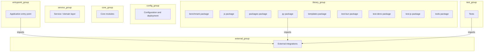

# Architecture report: pyodide/pyodide

> Automated static analysis. **Observed** = directly seen in files/imports/AST; **Inferred** = interpretation from that evidence. Repository code was not executed.

## 1. Repository at a glance

| Item | Value |
| --- | --- |
| Repository | pyodide/pyodide |
| Description | Pyodide is a Python distribution for the browser and Node.js based on WebAssembly |
| Language | Python |
| Stars | 14939 |
| Licence | MPL-2.0 |
| Analysed commit / branch | ebb528e4e7ddf8758764c10091d6613e5ce4f1c8 / main |
| Framework(s) | Express, Typer |
| Files analysed | 549 |
| Components | 15 |

## 2. Architecture in one minute

pyodide/pyodide - Pyodide is a Python distribution for the browser and Node.js based on WebAssembly. This repository was analysed statically from 549 file(s) (177 Python). Detected technologies (observed from imports/manifests): GitHub Actions, MySQL, PostgreSQL, Redis, Express, Typer. Files are grouped into 15 component(s): benchmark package, Configuration and deployment, Core modules, Application entry point, External integrations, js package, packages package, py package. Observed entry point(s): benchmark/benchmark.py, benchmark/node/helpers/pyperformance_native.py, cpython/adjust_sysconfig.py. Findings below distinguish observed facts from inferred interpretation.

## 3. High-level block diagram

## 4. Main components

### benchmark package (`benchmark`)

- **Kind:** library
- **Status:** Observed
- **Confidence:** 0.85
- **Responsibility:** Groups 47 file(s) under benchmark package (observed from repository paths and static analysis). Observed top-level classes: Record. Observed top-level functions: Func1, Func2, Func3, Proc0, Proc1, Proc2.
- **Paths:** `benchmark/benchmarks/numpy_benchmarks/allpairs_distances.py`, `benchmark/benchmarks/numpy_benchmarks/allpairs_distances_loops.py`, `benchmark/benchmarks/numpy_benchmarks/arc_distance.py`, `benchmark/benchmarks/numpy_benchmarks/check_mask.py`, `benchmark/benchmarks/numpy_benchmarks/create_grid.py`, `benchmark/benchmarks/numpy_benchmarks/cronbach.py`, `benchmark/benchmarks/numpy_benchmarks/diffusion.py`, `benchmark/benchmarks/numpy_benchmarks/evolve.py`, `benchmark/benchmarks/numpy_benchmarks/fdtd.py`, `benchmark/benchmarks/numpy_benchmarks/fft.py`, `benchmark/benchmarks/numpy_benchmarks/grayscott.py`, `benchmark/benchmarks/numpy_benchmarks/grouping.py`, `benchmark/benchmarks/numpy_benchmarks/growcut.py`, `benchmark/benchmarks/numpy_benchmarks/harris.py`, `benchmark/benchmarks/numpy_benchmarks/hasting.py`, `benchmark/benchmarks/numpy_benchmarks/hyantes.py`, `benchmark/benchmarks/numpy_benchmarks/julia.py`, `benchmark/benchmarks/numpy_benchmarks/l2norm.py`, `benchmark/benchmarks/numpy_benchmarks/large_decimal_list.py`, `benchmark/benchmarks/numpy_benchmarks/local_maxima.py`, `benchmark/benchmarks/numpy_benchmarks/log_likelihood.py`, `benchmark/benchmarks/numpy_benchmarks/lstsqr.py`, `benchmark/benchmarks/numpy_benchmarks/mandel.py`, `benchmark/benchmarks/numpy_benchmarks/multiple_sum.py`, `benchmark/benchmarks/numpy_benchmarks/pairwise_loop.py`, `benchmark/benchmarks/numpy_benchmarks/periodic_dist.py`, `benchmark/benchmarks/numpy_benchmarks/repeating.py`, `benchmark/benchmarks/numpy_benchmarks/reverse_cumsum.py`, `benchmark/benchmarks/numpy_benchmarks/rosen.py`, `benchmark/benchmarks/numpy_benchmarks/slowparts.py`, `benchmark/benchmarks/numpy_benchmarks/smoothing.py`, `benchmark/benchmarks/numpy_benchmarks/specialconvolve.py`, `benchmark/benchmarks/numpy_benchmarks/vibr_energy.py`, `benchmark/benchmarks/numpy_benchmarks/wave.py`, `benchmark/benchmarks/pystone_benchmarks/pystone.py`, `benchmark/node/helpers/pyperformance_child.mjs`, `benchmark/node/helpers/pyperformance_driver.py`, `benchmark/node/helpers/startup_child.mjs`, `benchmark/node/run.mjs`, `benchmark/node/suites/container_conversion.mjs`, `benchmark/node/suites/errors.mjs`, `benchmark/node/suites/ffi_calls.mjs`, `benchmark/node/suites/pyperformance.mjs`, `benchmark/node/suites/startup.mjs`, `benchmark/node/suites/string_conversion.mjs`, `benchmark/plot_benchmark.py`, `benchmark/stack_usage.py`
- **Evidence:** [benchmark/benchmarks/numpy_benchmarks/allpairs_distances.py:8](https://github.com/pyodide/pyodide/blob/ebb528e4e7ddf8758764c10091d6613e5ce4f1c8/benchmark/benchmarks/numpy_benchmarks/allpairs_distances.py#L8); [benchmark/benchmarks/numpy_benchmarks/allpairs_distances_loops.py:8](https://github.com/pyodide/pyodide/blob/ebb528e4e7ddf8758764c10091d6613e5ce4f1c8/benchmark/benchmarks/numpy_benchmarks/allpairs_distances_loops.py#L8); [benchmark/benchmarks/numpy_benchmarks/arc_distance.py:9](https://github.com/pyodide/pyodide/blob/ebb528e4e7ddf8758764c10091d6613e5ce4f1c8/benchmark/benchmarks/numpy_benchmarks/arc_distance.py#L9); [benchmark/benchmarks/numpy_benchmarks/check_mask.py:10](https://github.com/pyodide/pyodide/blob/ebb528e4e7ddf8758764c10091d6613e5ce4f1c8/benchmark/benchmarks/numpy_benchmarks/check_mask.py#L10); [benchmark/benchmarks/numpy_benchmarks/create_grid.py:8](https://github.com/pyodide/pyodide/blob/ebb528e4e7ddf8758764c10091d6613e5ce4f1c8/benchmark/benchmarks/numpy_benchmarks/create_grid.py#L8); [benchmark/benchmarks/numpy_benchmarks/cronbach.py:7](https://github.com/pyodide/pyodide/blob/ebb528e4e7ddf8758764c10091d6613e5ce4f1c8/benchmark/benchmarks/numpy_benchmarks/cronbach.py#L7); [benchmark/benchmarks/numpy_benchmarks/diffusion.py:7](https://github.com/pyodide/pyodide/blob/ebb528e4e7ddf8758764c10091d6613e5ce4f1c8/benchmark/benchmarks/numpy_benchmarks/diffusion.py#L7); [benchmark/benchmarks/numpy_benchmarks/evolve.py:11](https://github.com/pyodide/pyodide/blob/ebb528e4e7ddf8758764c10091d6613e5ce4f1c8/benchmark/benchmarks/numpy_benchmarks/evolve.py#L11)

### Configuration and deployment (`config`)

- **Kind:** config
- **Status:** Observed
- **Confidence:** 0.85
- **Responsibility:** Groups 68 file(s) under configuration and deployment (observed from repository paths and static analysis).
- **Paths:** `Dockerfile`, `biome.json`, `environment.yml`, `metadata/pyodide-cross-build-environments-debug-v2.json`, `metadata/pyodide-cross-build-environments-v1.json`, `metadata/pyodide-cross-build-environments-v2.json`, `packages/cffi/meta.yaml`, `packages/coverage/meta.yaml`, `packages/iniconfig/meta.yaml`, `packages/libboost/meta.yaml`, `packages/libf2c/meta.yaml`, `packages/libopenblas/meta.yaml`, `packages/libopenssl/meta.yaml`, `packages/micropip/meta.yaml`, `packages/numpy/meta.yaml`, `packages/packaging/meta.yaml`, `packages/pluggy/meta.yaml`, `packages/pycparser/meta.yaml`, `packages/pydoc_data/meta.yaml`, `packages/pydoc_data/src/pyproject.toml`, `packages/pyodide-tblib/meta.yaml`, `packages/pytest-asyncio/meta.yaml`, `packages/pytest/meta.yaml`, `packages/scipy/meta.yaml`, `packages/test-buffer/buffer-test/setup.py`, `packages/test-buffer/meta.yaml`, `packages/test-cpp-exceptions/meta.yaml`, `packages/test-cpp-exceptions2/meta.yaml`, `packages/test-cpp-exceptions2/src/setup.py`, `packages/test-dummy-nonpure/meta.yaml`, `packages/test-dummy-nonpure/src/setup.py`, `packages/test-dummy-unNormalized/meta.yaml`, `packages/test-dummy-unNormalized/src/pyproject.toml`, `packages/test-dummy-unvendoring/meta.yaml`, `packages/test-dummy-unvendoring/src/pyproject.toml`, `packages/test-dummy/meta.yaml`, `packages/test-dummy/src/pyproject.toml`, `packages/test-fpcast/fpcast-test/setup.py`, `packages/test-fpcast/meta.yaml`, `packages/test-pybind11/meta.yaml`, `packages/test-pybind11/src/pyproject.toml`, `packages/test-pybind11/src/setup.py`, `packages/test-rust-abi/meta.yaml`, `packages/test-rust-abi/src/Cargo.toml`, `packages/test-rust-abi/src/pyproject.toml`, `packages/test-rust-abi/src/setup.py`, `packages/test-rust-panic/meta.yaml`, `packages/test-rust-panic/src/Cargo.toml`, `packages/test-rust-panic/src/pyproject.toml`, `packages/test-rust-panic/src/setup.py`, `packages/test-sharedlib-py/meta.yaml`, `packages/test-sharedlib-py/src/setup.py`, `packages/test-sharedlib/meta.yaml`, `packages/test-simd/meta.yaml`, `packages/test-simd/src/setup.py`, `pyproject.toml`, `requirements-deploy.txt`, `requirements.txt`, `src/core/tsconfig.json`, `src/js/package.json`, `src/js/struct_info_generated.json`, `src/js/tsconfig.json`, `src/js/tsdoc.json`, `src/py/pyproject.toml`, `src/test-bun/package.json`, `src/test-deno/deno.json`, `src/test-js/package.json`, `src/test-js/tsconfig.json`
- **Evidence:** [Dockerfile](https://github.com/pyodide/pyodide/blob/ebb528e4e7ddf8758764c10091d6613e5ce4f1c8/Dockerfile); [biome.json](https://github.com/pyodide/pyodide/blob/ebb528e4e7ddf8758764c10091d6613e5ce4f1c8/biome.json); [environment.yml](https://github.com/pyodide/pyodide/blob/ebb528e4e7ddf8758764c10091d6613e5ce4f1c8/environment.yml); [metadata/pyodide-cross-build-environments-debug-v2.json](https://github.com/pyodide/pyodide/blob/ebb528e4e7ddf8758764c10091d6613e5ce4f1c8/metadata/pyodide-cross-build-environments-debug-v2.json); [metadata/pyodide-cross-build-environments-v1.json](https://github.com/pyodide/pyodide/blob/ebb528e4e7ddf8758764c10091d6613e5ce4f1c8/metadata/pyodide-cross-build-environments-v1.json); [metadata/pyodide-cross-build-environments-v2.json](https://github.com/pyodide/pyodide/blob/ebb528e4e7ddf8758764c10091d6613e5ce4f1c8/metadata/pyodide-cross-build-environments-v2.json); [packages/cffi/meta.yaml](https://github.com/pyodide/pyodide/blob/ebb528e4e7ddf8758764c10091d6613e5ce4f1c8/packages/cffi/meta.yaml); [packages/coverage/meta.yaml](https://github.com/pyodide/pyodide/blob/ebb528e4e7ddf8758764c10091d6613e5ce4f1c8/packages/coverage/meta.yaml)

### Core modules (`core`)

- **Kind:** core
- **Status:** Observed
- **Confidence:** 0.85
- **Responsibility:** Groups 1 file(s) under core modules (observed from repository paths and static analysis).
- **Paths:** `pyodide_env.sh`
- **Evidence:** [pyodide_env.sh](https://github.com/pyodide/pyodide/blob/ebb528e4e7ddf8758764c10091d6613e5ce4f1c8/pyodide_env.sh)

### Application entry point (`entrypoint`)

- **Kind:** entrypoint
- **Status:** Observed
- **Confidence:** 0.85
- **Responsibility:** Groups 21 file(s) under application entry point (observed from repository paths and static analysis). Observed application object created via Typer. Observed top-level classes: App, Changelog, ChangelogEntry, ChangelogParagraph, ChangelogSection, ChangelogVersion. Observed top-level functions: _check_unisolated_packages_match_dist, _copy_emcc_patches, _copy_wasm_libs, _copy_xbuild_files, _copy_xbuild_files_from_wheel, _find_wheel.
- **Paths:** `benchmark/benchmark.py`, `benchmark/node/helpers/pyperformance_native.py`, `cpython/adjust_sysconfig.py`, `tools/backport.py`, `tools/bump_version.py`, `tools/calculate_build_cache_key.py`, `tools/check_ccache.py`, `tools/check_compressed_size.py`, `tools/check_documented_functions.py`, `tools/create_lockfile_diff.py`, `tools/create_xbuildenv.py`, `tools/create_zipfile.py`, `tools/deploy_s3.py`, `tools/docker_image_tag.py`, `tools/fixup-type-definitions.py`, `tools/make_ghr_release.py`, `tools/make_test_list.py`, `tools/pytest_wrapper.py`, `tools/release_nightly_xbuildenv.py`, `tools/update_cross_build_releases.py`, `tools/update_emscripten.py`
- **Evidence:** [benchmark/benchmark.py:20](https://github.com/pyodide/pyodide/blob/ebb528e4e7ddf8758764c10091d6613e5ce4f1c8/benchmark/benchmark.py#L20); [benchmark/node/helpers/pyperformance_native.py:36](https://github.com/pyodide/pyodide/blob/ebb528e4e7ddf8758764c10091d6613e5ce4f1c8/benchmark/node/helpers/pyperformance_native.py#L36); [cpython/adjust_sysconfig.py:7](https://github.com/pyodide/pyodide/blob/ebb528e4e7ddf8758764c10091d6613e5ce4f1c8/cpython/adjust_sysconfig.py#L7); [tools/backport.py:42](https://github.com/pyodide/pyodide/blob/ebb528e4e7ddf8758764c10091d6613e5ce4f1c8/tools/backport.py#L42); [tools/bump_version.py:29](https://github.com/pyodide/pyodide/blob/ebb528e4e7ddf8758764c10091d6613e5ce4f1c8/tools/bump_version.py#L29); [tools/calculate_build_cache_key.py:10](https://github.com/pyodide/pyodide/blob/ebb528e4e7ddf8758764c10091d6613e5ce4f1c8/tools/calculate_build_cache_key.py#L10); [tools/check_ccache.py:6](https://github.com/pyodide/pyodide/blob/ebb528e4e7ddf8758764c10091d6613e5ce4f1c8/tools/check_ccache.py#L6); [tools/check_compressed_size.py:24](https://github.com/pyodide/pyodide/blob/ebb528e4e7ddf8758764c10091d6613e5ce4f1c8/tools/check_compressed_size.py#L24)

### External integrations (`external_integrations`)

- **Kind:** external
- **Status:** Inferred
- **Confidence:** 0.70
- **Responsibility:** Groups 0 file(s) under external integrations (observed from repository paths and static analysis).
- **Evidence:** [src/py/pyodide/webloop.py:802](https://github.com/pyodide/pyodide/blob/ebb528e4e7ddf8758764c10091d6613e5ce4f1c8/src/py/pyodide/webloop.py#L802); [src/py/pyodide/webloop.py:810](https://github.com/pyodide/pyodide/blob/ebb528e4e7ddf8758764c10091d6613e5ce4f1c8/src/py/pyodide/webloop.py#L810); [src/py/pyodide/webloop.py:825](https://github.com/pyodide/pyodide/blob/ebb528e4e7ddf8758764c10091d6613e5ce4f1c8/src/py/pyodide/webloop.py#L825); [src/py/pyodide/webloop.py:882](https://github.com/pyodide/pyodide/blob/ebb528e4e7ddf8758764c10091d6613e5ce4f1c8/src/py/pyodide/webloop.py#L882); [src/py/ssl.py:17](https://github.com/pyodide/pyodide/blob/ebb528e4e7ddf8758764c10091d6613e5ce4f1c8/src/py/ssl.py#L17); [src/tests/test_database_driver.py:45](https://github.com/pyodide/pyodide/blob/ebb528e4e7ddf8758764c10091d6613e5ce4f1c8/src/tests/test_database_driver.py#L45)

### js package (`js`)

- **Kind:** library
- **Status:** Observed
- **Confidence:** 0.85
- **Responsibility:** Groups 35 file(s) under js package (observed from repository paths and static analysis).
- **Paths:** `src/js/api.ts`, `src/js/canvas.ts`, `src/js/common/abortSignalAny.ts`, `src/js/common/contextManager.ts`, `src/js/common/literal-map.js`, `src/js/common/lock.ts`, `src/js/common/path.ts`, `src/js/common/resolveable.ts`, `src/js/common/warning.ts`, `src/js/compat.ts`, `src/js/constants.ts`, `src/js/dynload.ts`, `src/js/emscripten-settings.ts`, `src/js/environments.ts`, `src/js/esbuild.config.inner.mjs`, `src/js/esbuild.config.outer.mjs`, `src/js/esbuild.config.shared.mjs`, `src/js/ffi.ts`, `src/js/fs/nodesockfs.ts`, `src/js/fs/opfs.ts`, `src/js/fs/wintercg-sockets.ts`, `src/js/generated_struct_info32.json.d.ts`, `src/js/installer.ts`, `src/js/load-package.ts`, `src/js/memory-limit.ts`, `src/js/nativefs.ts`, `src/js/packaging-utils.ts`, `src/js/playwright.config.ts`, `src/js/pyodide.ts`, `src/js/pyodide.umd.ts`, `src/js/scheduler.ts`, `src/js/snapshot.ts`, `src/js/streams.ts`, `src/js/types.ts`, `src/js/version.ts`
- **Evidence:** [src/js/api.ts](https://github.com/pyodide/pyodide/blob/ebb528e4e7ddf8758764c10091d6613e5ce4f1c8/src/js/api.ts); [src/js/canvas.ts](https://github.com/pyodide/pyodide/blob/ebb528e4e7ddf8758764c10091d6613e5ce4f1c8/src/js/canvas.ts); [src/js/common/abortSignalAny.ts](https://github.com/pyodide/pyodide/blob/ebb528e4e7ddf8758764c10091d6613e5ce4f1c8/src/js/common/abortSignalAny.ts); [src/js/common/contextManager.ts](https://github.com/pyodide/pyodide/blob/ebb528e4e7ddf8758764c10091d6613e5ce4f1c8/src/js/common/contextManager.ts); [src/js/common/literal-map.js](https://github.com/pyodide/pyodide/blob/ebb528e4e7ddf8758764c10091d6613e5ce4f1c8/src/js/common/literal-map.js); [src/js/common/lock.ts](https://github.com/pyodide/pyodide/blob/ebb528e4e7ddf8758764c10091d6613e5ce4f1c8/src/js/common/lock.ts); [src/js/common/path.ts](https://github.com/pyodide/pyodide/blob/ebb528e4e7ddf8758764c10091d6613e5ce4f1c8/src/js/common/path.ts); [src/js/common/resolveable.ts](https://github.com/pyodide/pyodide/blob/ebb528e4e7ddf8758764c10091d6613e5ce4f1c8/src/js/common/resolveable.ts)

### packages package (`packages`)

- **Kind:** library
- **Status:** Observed
- **Confidence:** 0.85
- **Responsibility:** Groups 28 file(s) under packages package (observed from repository paths and static analysis). Observed top-level functions: async_coro, dummy, pytest_collection_modifyitems, pytest_configure, pytest_sessionfinish, test_asyncio_marker.
- **Paths:** `packages/pytest-asyncio/inner_test_pytest_asyncio.py`, `packages/scipy/cmdline_test_file.py`, `packages/scipy/scipy-conftest.py`, `packages/scipy/scipy-pytest.js`, `packages/test-buffer/buffer-test/buffer-test.c`, `packages/test-cpp-exceptions/src/catch.cpp`, `packages/test-cpp-exceptions/src/throw.cpp`, `packages/test-cpp-exceptions2/src/cpp_exceptions_test2.cpp`, `packages/test-cpp-exceptions2/src/cpp_exceptions_test2/__init__.py`, `packages/test-dummy-nonpure/src/dummy_nonpure.c`, `packages/test-dummy-unNormalized/src/dummy_unnormalized/__init__.py`, `packages/test-dummy-unvendoring/src/dummy_unvendoring/__init__.py`, `packages/test-dummy/src/dummy/__init__.py`, `packages/test-fpcast/fpcast-test/fpcast-test.c`, `packages/test-pybind11/src/pybind11_test.cpp`, `packages/test-rust-abi/src/src/lib.rs`, `packages/test-rust-panic/src/src/lib.rs`, `packages/test-sharedlib-py/src/sharedlib-test.c`, `packages/test-sharedlib/src/dep.c`, `packages/test-sharedlib/src/dep2.c`, `packages/test-sharedlib/src/include/sharedlibtest.h`, `packages/test-sharedlib/src/main.c`, `packages/test-simd/src/test_simd/__init__.py`, `packages/test-simd/src/test_simd/simd_avx.c`, `packages/test-simd/src/test_simd/simd_sse.c`, `packages/test-simd/src/test_simd/simd_sse2.c`, `packages/test-simd/src/test_simd/simd_wasm.c`, `packages/test-simd/src/test_simd/simd_wrapper.c`
- **Evidence:** [packages/pytest-asyncio/inner_test_pytest_asyncio.py:14](https://github.com/pyodide/pyodide/blob/ebb528e4e7ddf8758764c10091d6613e5ce4f1c8/packages/pytest-asyncio/inner_test_pytest_asyncio.py#L14); [packages/scipy/cmdline_test_file.py](https://github.com/pyodide/pyodide/blob/ebb528e4e7ddf8758764c10091d6613e5ce4f1c8/packages/scipy/cmdline_test_file.py); [packages/scipy/scipy-conftest.py:285](https://github.com/pyodide/pyodide/blob/ebb528e4e7ddf8758764c10091d6613e5ce4f1c8/packages/scipy/scipy-conftest.py#L285); [packages/scipy/scipy-pytest.js](https://github.com/pyodide/pyodide/blob/ebb528e4e7ddf8758764c10091d6613e5ce4f1c8/packages/scipy/scipy-pytest.js); [packages/test-buffer/buffer-test/buffer-test.c](https://github.com/pyodide/pyodide/blob/ebb528e4e7ddf8758764c10091d6613e5ce4f1c8/packages/test-buffer/buffer-test/buffer-test.c); [packages/test-cpp-exceptions/src/catch.cpp](https://github.com/pyodide/pyodide/blob/ebb528e4e7ddf8758764c10091d6613e5ce4f1c8/packages/test-cpp-exceptions/src/catch.cpp); [packages/test-cpp-exceptions/src/throw.cpp](https://github.com/pyodide/pyodide/blob/ebb528e4e7ddf8758764c10091d6613e5ce4f1c8/packages/test-cpp-exceptions/src/throw.cpp); [packages/test-cpp-exceptions2/src/cpp_exceptions_test2.cpp](https://github.com/pyodide/pyodide/blob/ebb528e4e7ddf8758764c10091d6613e5ce4f1c8/packages/test-cpp-exceptions2/src/cpp_exceptions_test2.cpp)

### py package (`py`)

- **Kind:** library
- **Status:** Observed
- **Confidence:** 0.85
- **Responsibility:** Groups 27 file(s) under py package (observed from repository paths and static analysis). Observed top-level classes: AbortError, BaseBrowser, BindClass, BodyUsedError, CodeRunner, Console. Observed top-level functions: DER_cert_to_PEM_cert, PEM_cert_to_DER_cert, RAND_add, RAND_bytes, RAND_status, _abort_on_cancel.
- **Paths:** `src/py/_pyodide/__init__.py`, `src/py/_pyodide/_base.py`, `src/py/_pyodide/_core_docs.py`, `src/py/_pyodide/_future_helper.py`, `src/py/_pyodide/_importhook.py`, `src/py/_pyodide/docs_argspec.py`, `src/py/_pyodide/docstring.py`, `src/py/_pyodide/jsbind.py`, `src/py/_ssl.py`, `src/py/pyodide/__init__.py`, `src/py/pyodide/_core.py`, `src/py/pyodide/_nodesock_transport.py`, `src/py/pyodide/_package_loader.py`, `src/py/pyodide/_run_js.py`, `src/py/pyodide/_state.py`, `src/py/pyodide/code.py`, `src/py/pyodide/common.py`, `src/py/pyodide/console.py`, `src/py/pyodide/ffi/__init__.py`, `src/py/pyodide/ffi/wrappers.py`, `src/py/pyodide/http/__init__.py`, `src/py/pyodide/http/_exceptions.py`, `src/py/pyodide/http/_pyfetch.py`, `src/py/pyodide/http/pyxhr.py`, `src/py/pyodide/webloop.py`, `src/py/ssl.py`, `src/py/webbrowser.py`
- **Evidence:** [src/py/_pyodide/__init__.py:15](https://github.com/pyodide/pyodide/blob/ebb528e4e7ddf8758764c10091d6613e5ce4f1c8/src/py/_pyodide/__init__.py#L15); [src/py/_pyodide/_base.py:21](https://github.com/pyodide/pyodide/blob/ebb528e4e7ddf8758764c10091d6613e5ce4f1c8/src/py/_pyodide/_base.py#L21); [src/py/_pyodide/_core_docs.py:54](https://github.com/pyodide/pyodide/blob/ebb528e4e7ddf8758764c10091d6613e5ce4f1c8/src/py/_pyodide/_core_docs.py#L54); [src/py/_pyodide/_future_helper.py:1](https://github.com/pyodide/pyodide/blob/ebb528e4e7ddf8758764c10091d6613e5ce4f1c8/src/py/_pyodide/_future_helper.py#L1); [src/py/_pyodide/_importhook.py:13](https://github.com/pyodide/pyodide/blob/ebb528e4e7ddf8758764c10091d6613e5ce4f1c8/src/py/_pyodide/_importhook.py#L13); [src/py/_pyodide/docs_argspec.py:7](https://github.com/pyodide/pyodide/blob/ebb528e4e7ddf8758764c10091d6613e5ce4f1c8/src/py/_pyodide/docs_argspec.py#L7); [src/py/_pyodide/docstring.py:4](https://github.com/pyodide/pyodide/blob/ebb528e4e7ddf8758764c10091d6613e5ce4f1c8/src/py/_pyodide/docstring.py#L4); [src/py/_pyodide/jsbind.py:33](https://github.com/pyodide/pyodide/blob/ebb528e4e7ddf8758764c10091d6613e5ce4f1c8/src/py/_pyodide/jsbind.py#L33)

### Service / domain layer (`service_layer`)

- **Kind:** service
- **Status:** Observed
- **Confidence:** 0.85
- **Responsibility:** Groups 44 file(s) under service / domain layer (observed from repository paths and static analysis).
- **Paths:** `src/core/_pyodide_core.c`, `src/core/docstring.c`, `src/core/docstring.h`, `src/core/error_handling.c`, `src/core/error_handling.h`, `src/core/error_handling.ts`, `src/core/hiwire.c`, `src/core/js2python.c`, `src/core/js2python.h`, `src/core/js2python.js`, `src/core/jsbind.c`, `src/core/jsbind.h`, `src/core/jslib.c`, `src/core/jslib.h`, `src/core/jsmemops.h`, `src/core/jsproxy.c`, `src/core/jsproxy.h`, `src/core/jsproxy_call.c`, `src/core/jsproxy_call.h`, `src/core/jsverror.ts`, `src/core/libjsverror.js`, `src/core/main.c`, `src/core/pre.js`, `src/core/print.c`, `src/core/print.h`, `src/core/pyodide_pre.c`, `src/core/pyproxy.c`, `src/core/pyproxy.h`, `src/core/pyproxy.ts`, `src/core/python2js.c`, `src/core/python2js.h`, `src/core/python2js_buffer.c`, `src/core/python2js_buffer.h`, `src/core/python2js_buffer.js`, `src/core/python_unexposed.h`, `src/core/socket_syscalls.c`, `src/core/stack_switching/esbuild.config.mjs`, `src/core/stack_switching/pystate.c`, `src/core/stack_switching/pystate_pycore.c`, `src/core/stack_switching/stack_state.mjs`, `src/core/stack_switching/stack_switching.mjs`, `src/core/stack_switching/suspenders.c`, `src/core/stack_switching/suspenders.mjs`, `src/core/types.h`
- **Evidence:** [src/core/_pyodide_core.c](https://github.com/pyodide/pyodide/blob/ebb528e4e7ddf8758764c10091d6613e5ce4f1c8/src/core/_pyodide_core.c); [src/core/docstring.c](https://github.com/pyodide/pyodide/blob/ebb528e4e7ddf8758764c10091d6613e5ce4f1c8/src/core/docstring.c); [src/core/docstring.h](https://github.com/pyodide/pyodide/blob/ebb528e4e7ddf8758764c10091d6613e5ce4f1c8/src/core/docstring.h); [src/core/error_handling.c](https://github.com/pyodide/pyodide/blob/ebb528e4e7ddf8758764c10091d6613e5ce4f1c8/src/core/error_handling.c); [src/core/error_handling.h](https://github.com/pyodide/pyodide/blob/ebb528e4e7ddf8758764c10091d6613e5ce4f1c8/src/core/error_handling.h); [src/core/error_handling.ts](https://github.com/pyodide/pyodide/blob/ebb528e4e7ddf8758764c10091d6613e5ce4f1c8/src/core/error_handling.ts); [src/core/hiwire.c](https://github.com/pyodide/pyodide/blob/ebb528e4e7ddf8758764c10091d6613e5ce4f1c8/src/core/hiwire.c); [src/core/js2python.c](https://github.com/pyodide/pyodide/blob/ebb528e4e7ddf8758764c10091d6613e5ce4f1c8/src/core/js2python.c)

### templates package (`templates`)

- **Kind:** library
- **Status:** Observed
- **Confidence:** 0.85
- **Responsibility:** Groups 3 file(s) under templates package (observed from repository paths and static analysis).
- **Paths:** `src/templates/makesnap.mjs`, `src/templates/python_cli_entry.mjs`, `src/templates/python_exe.go`
- **Evidence:** [src/templates/makesnap.mjs](https://github.com/pyodide/pyodide/blob/ebb528e4e7ddf8758764c10091d6613e5ce4f1c8/src/templates/makesnap.mjs); [src/templates/python_cli_entry.mjs](https://github.com/pyodide/pyodide/blob/ebb528e4e7ddf8758764c10091d6613e5ce4f1c8/src/templates/python_cli_entry.mjs); [src/templates/python_exe.go](https://github.com/pyodide/pyodide/blob/ebb528e4e7ddf8758764c10091d6613e5ce4f1c8/src/templates/python_exe.go)

### test-bun package (`test_bun`)

- **Kind:** library
- **Status:** Observed
- **Confidence:** 0.85
- **Responsibility:** Groups 1 file(s) under test-bun package (observed from repository paths and static analysis).
- **Paths:** `src/test-bun/smoke-test.js`
- **Evidence:** [src/test-bun/smoke-test.js](https://github.com/pyodide/pyodide/blob/ebb528e4e7ddf8758764c10091d6613e5ce4f1c8/src/test-bun/smoke-test.js)

### test-deno package (`test_deno`)

- **Kind:** library
- **Status:** Observed
- **Confidence:** 0.85
- **Responsibility:** Groups 1 file(s) under test-deno package (observed from repository paths and static analysis).
- **Paths:** `src/test-deno/smoke-test.ts`
- **Evidence:** [src/test-deno/smoke-test.ts](https://github.com/pyodide/pyodide/blob/ebb528e4e7ddf8758764c10091d6613e5ce4f1c8/src/test-deno/smoke-test.ts)

### test-js package (`test_js`)

- **Kind:** library
- **Status:** Observed
- **Confidence:** 0.85
- **Responsibility:** Groups 2 file(s) under test-js package (observed from repository paths and static analysis).
- **Paths:** `src/test-js/index.d.ts`, `src/test-js/index.test-d.ts`
- **Evidence:** [src/test-js/index.d.ts](https://github.com/pyodide/pyodide/blob/ebb528e4e7ddf8758764c10091d6613e5ce4f1c8/src/test-js/index.d.ts); [src/test-js/index.test-d.ts](https://github.com/pyodide/pyodide/blob/ebb528e4e7ddf8758764c10091d6613e5ce4f1c8/src/test-js/index.test-d.ts)

### Tests (`tests`)

- **Kind:** test
- **Status:** Observed
- **Confidence:** 0.85
- **Responsibility:** Groups 93 file(s) under tests (observed from repository paths and static analysis). Observed top-level classes: DummyDistribution, ImportTestCase, NoHypothesisUnpickler, TestPyxhr. Observed top-level functions: _check_syncify_no_suspender, _mypy_check, _sql_string_literal, _write_lockfile, assert_js_to_py_to_js, assert_no_error.
- **Paths:** `conftest.py`, `packages/_tests/test_packages_common.py`, `packages/cffi/test_cffi.py`, `packages/micropip/test_micropip.py`, `packages/numpy/test_numpy.py`, `packages/packaging/test_packaging.py`, `packages/pydoc_data/test_pydoc.py`, `packages/pytest-asyncio/test_pytest_asyncio.py`, `packages/pytest/test_pytest.py`, `packages/scipy/test_scipy.py`, `packages/test-buffer/test_buffer.py`, `packages/test-cpp-exceptions/test_cpp_exceptions.py`, `packages/test-dummy-unvendoring/src/dummy_unvendoring/test_dummy_unvendoring.py`, `packages/test-fpcast/test_fpcast_test.py`, `packages/test-pybind11/test_pybind11.py`, `packages/test-rust-abi/test_rust_abi.py`, `packages/test-rust-panic/test_rust_panic.py`, `packages/test-sharedlib-py/test_sharedlib.py`, `packages/test-simd/test_simd.py`, `packages/test/meta.yaml`, `packages/test/src/pyproject.toml`, `packages/test/test_test.py`, `src/js/test/integration/filesystem.test.js`, `src/js/test/integration/fixture.ts`, `src/js/test/integration/pyodide.test.js`, `src/js/test/integration/sanity.test.ts`, `src/js/test/unit/common/abortSignalAny.test.ts`, `src/js/test/unit/common/contextManager.test.ts`, `src/js/test/unit/common/lock.test.ts`, `src/js/test/unit/common/resolveable.test.ts`, `src/js/test/unit/common/warning.test.ts`, `src/js/test/unit/compat.test.ts`, `src/js/test/unit/installer.test.ts`, `src/js/test/unit/package-manager.test.ts`, `src/js/test/unit/packaging-utils.test.ts`, `src/js/test/unit/scheduler.test.ts`, `src/js/test/unit/test-helper.ts`, `src/templates/test_csp.html`, `src/tests/__init__.py`, `src/tests/blns.base64.json`, `src/tests/html_templates/test_commonjs.html`, `src/tests/python_tests.yaml`, `src/tests/test_asyncio.py`, `src/tests/test_browser_apis.py`, `src/tests/test_bz2.py`, `src/tests/test_canvas.py`, `src/tests/test_cmdline_runner.py`, `src/tests/test_common.py`, `src/tests/test_compat.py`, `src/tests/test_console.py`, `src/tests/test_core_python.py`, `src/tests/test_data/dlerror_test/README.md`, `src/tests/test_data/dlerror_test/main_func.c`, `src/tests/test_data/dlerror_test/side.c`, `src/tests/test_data/dlerror_test/side.h`, `src/tests/test_database_driver.py`, `src/tests/test_filesystem.py`, `src/tests/test_filesystem_mounting.py`, `src/tests/test_filesystem_webworker.py`, `src/tests/test_jsproxy.py`, `src/tests/test_package_loading.py`, `src/tests/test_pkg/__init__.py`, `src/tests/test_pkg/some_module.py`, `src/tests/test_pyodide.py`, `src/tests/test_pyodide_http.py`, `src/tests/test_pyproxy.py`, `src/tests/test_pytest_wrapper.py`, `src/tests/test_python.py`, `src/tests/test_python_esm.py`, `src/tests/test_python_socket.py`, `src/tests/test_snapshots.py`, `src/tests/test_ssl_stub.py`, `src/tests/test_stack_switching.py`, `src/tests/test_static_typing.py`, `src/tests/test_stdlib_fixes.py`, `src/tests/test_streams.py`, `src/tests/test_typeconversions.py`, `src/tests/test_webloop.py`, `src/tests/test_webloop_webworker.py`, `src/tests/test_webworker.py`, `tools/tests/test_backport.py`, `tools/tests/test_bump_version.py`, `tools/tests/test_create_lockfile_diff.py`, `tools/tests/test_create_xbuildenv.py`, `tools/tests/test_create_zipfile.py`, `tools/tests/test_cross_build_environments_metadata.py`, `tools/tests/test_deploy_s3.py`, `tools/tests/test_make_ghr_release.py`, `tools/tests/test_make_test_list.py`, `tools/tests/test_run_docker.py`, `tools/tests/test_update_cross_build_releases.py`, `tools/tests/testdata/pyodide-lock-0.27.7.json`, `tools/tests/testdata/pyodide-lock-0.28.0a3.json`
- **Evidence:** [conftest.py:26](https://github.com/pyodide/pyodide/blob/ebb528e4e7ddf8758764c10091d6613e5ce4f1c8/conftest.py#L26); [packages/_tests/test_packages_common.py:35](https://github.com/pyodide/pyodide/blob/ebb528e4e7ddf8758764c10091d6613e5ce4f1c8/packages/_tests/test_packages_common.py#L35); [packages/cffi/test_cffi.py:5](https://github.com/pyodide/pyodide/blob/ebb528e4e7ddf8758764c10091d6613e5ce4f1c8/packages/cffi/test_cffi.py#L5); [packages/micropip/test_micropip.py:18](https://github.com/pyodide/pyodide/blob/ebb528e4e7ddf8758764c10091d6613e5ce4f1c8/packages/micropip/test_micropip.py#L18); [packages/numpy/test_numpy.py:5](https://github.com/pyodide/pyodide/blob/ebb528e4e7ddf8758764c10091d6613e5ce4f1c8/packages/numpy/test_numpy.py#L5); [packages/packaging/test_packaging.py:5](https://github.com/pyodide/pyodide/blob/ebb528e4e7ddf8758764c10091d6613e5ce4f1c8/packages/packaging/test_packaging.py#L5); [packages/pydoc_data/test_pydoc.py:5](https://github.com/pyodide/pyodide/blob/ebb528e4e7ddf8758764c10091d6613e5ce4f1c8/packages/pydoc_data/test_pydoc.py#L5); [packages/pytest-asyncio/test_pytest_asyncio.py:7](https://github.com/pyodide/pyodide/blob/ebb528e4e7ddf8758764c10091d6613e5ce4f1c8/packages/pytest-asyncio/test_pytest_asyncio.py#L7)

### tools package (`tools`)

- **Kind:** library
- **Status:** Observed
- **Confidence:** 0.85
- **Responsibility:** Groups 7 file(s) under tools package (observed from repository paths and static analysis). Observed top-level functions: get_makefile_envs.
- **Paths:** `tools/check_build_trigger.sh`, `tools/common.py`, `tools/d8-test.mjs`, `tools/d8-test.sh`, `tools/dependency-check.sh`, `tools/deploy_to_npm.sh`, `tools/safari_cleanup.sh`
- **Evidence:** [tools/check_build_trigger.sh](https://github.com/pyodide/pyodide/blob/ebb528e4e7ddf8758764c10091d6613e5ce4f1c8/tools/check_build_trigger.sh); [tools/common.py:8](https://github.com/pyodide/pyodide/blob/ebb528e4e7ddf8758764c10091d6613e5ce4f1c8/tools/common.py#L8); [tools/d8-test.mjs](https://github.com/pyodide/pyodide/blob/ebb528e4e7ddf8758764c10091d6613e5ce4f1c8/tools/d8-test.mjs); [tools/d8-test.sh](https://github.com/pyodide/pyodide/blob/ebb528e4e7ddf8758764c10091d6613e5ce4f1c8/tools/d8-test.sh); [tools/dependency-check.sh](https://github.com/pyodide/pyodide/blob/ebb528e4e7ddf8758764c10091d6613e5ce4f1c8/tools/dependency-check.sh); [tools/deploy_to_npm.sh](https://github.com/pyodide/pyodide/blob/ebb528e4e7ddf8758764c10091d6613e5ce4f1c8/tools/deploy_to_npm.sh); [tools/safari_cleanup.sh](https://github.com/pyodide/pyodide/blob/ebb528e4e7ddf8758764c10091d6613e5ce4f1c8/tools/safari_cleanup.sh)

## 5. Execution flow

**Observed** entry point(s):

- [benchmark/benchmark.py:227](https://github.com/pyodide/pyodide/blob/ebb528e4e7ddf8758764c10091d6613e5ce4f1c8/benchmark/benchmark.py#L227)
- [benchmark/node/helpers/pyperformance_native.py:72](https://github.com/pyodide/pyodide/blob/ebb528e4e7ddf8758764c10091d6613e5ce4f1c8/benchmark/node/helpers/pyperformance_native.py#L72)
- [cpython/adjust_sysconfig.py:76](https://github.com/pyodide/pyodide/blob/ebb528e4e7ddf8758764c10091d6613e5ce4f1c8/cpython/adjust_sysconfig.py#L76)
- [tools/backport.py:855](https://github.com/pyodide/pyodide/blob/ebb528e4e7ddf8758764c10091d6613e5ce4f1c8/tools/backport.py#L855)
- [tools/bump_version.py:368](https://github.com/pyodide/pyodide/blob/ebb528e4e7ddf8758764c10091d6613e5ce4f1c8/tools/bump_version.py#L368)
- [tools/calculate_build_cache_key.py:55](https://github.com/pyodide/pyodide/blob/ebb528e4e7ddf8758764c10091d6613e5ce4f1c8/tools/calculate_build_cache_key.py#L55)
- [tools/check_ccache.py:25](https://github.com/pyodide/pyodide/blob/ebb528e4e7ddf8758764c10091d6613e5ce4f1c8/tools/check_ccache.py#L25)
- [tools/check_compressed_size.py:62](https://github.com/pyodide/pyodide/blob/ebb528e4e7ddf8758764c10091d6613e5ce4f1c8/tools/check_compressed_size.py#L62)
- [tools/check_documented_functions.py:91](https://github.com/pyodide/pyodide/blob/ebb528e4e7ddf8758764c10091d6613e5ce4f1c8/tools/check_documented_functions.py#L91)
- [tools/create_lockfile_diff.py:242](https://github.com/pyodide/pyodide/blob/ebb528e4e7ddf8758764c10091d6613e5ce4f1c8/tools/create_lockfile_diff.py#L242)
- [tools/create_xbuildenv.py:284](https://github.com/pyodide/pyodide/blob/ebb528e4e7ddf8758764c10091d6613e5ce4f1c8/tools/create_xbuildenv.py#L284)
- [tools/create_zipfile.py:174](https://github.com/pyodide/pyodide/blob/ebb528e4e7ddf8758764c10091d6613e5ce4f1c8/tools/create_zipfile.py#L174)

Representative flow (derived from observed entry points and the import graph; steps beyond the entry point are **Inferred**):

1. Execution starts at an observed entry point listed above, if present.
2. `entrypoint` imports `external_integrations` (Application entry point -> External integrations).
3. `py` imports `external_integrations` (py package -> External integrations).
4. `tests` imports `external_integrations` (Tests -> External integrations).

## 6. Project structure

### `(root)`

- `.clang-format` - other (3174 bytes)
- `.codecov.yml` - config (618 bytes)
- `.dockerignore` - container (79 bytes)
- `.editorconfig` - config (275 bytes)
- `.gitignore` - other (629 bytes)
- `.gitmodules` - other (98 bytes)
- `.pre-commit-config.yaml` - config (3451 bytes)
- `.readthedocs.yml` - config (450 bytes)
- `AGENTS.md` - docs (4659 bytes)
- `CODE-OF-CONDUCT.md` - docs (5162 bytes)
- `Dockerfile` - container (5079 bytes)
- `LICENSE` - docs (16725 bytes)
- `Makefile` - other (12545 bytes)
- `Makefile.envs` - other (8540 bytes)
- `README.md` - docs (5955 bytes)
- `biome.json` - config (1303 bytes)
- `conftest.py` - test, Python (12991 bytes)
- `environment.yml` - manifest (725 bytes)
- `pyodide_env.sh` - source, Shell (1205 bytes)
- `pyproject.toml` - manifest (4388 bytes)
- `repository-structure.md` - docs (1345 bytes)
- `requirements-deploy.txt` - manifest (46 bytes)
- `requirements.txt` - manifest (352 bytes)
- `run_docker` - other (4252 bytes)

### `.circleci`

- `.circleci/config.yml` - ci, YAML (30040 bytes)
- `.circleci/s3-website-config.json` - ci, YAML (132 bytes)

### `.devcontainer`

- `.devcontainer/conda/devcontainer.json` - config (559 bytes)
- `.devcontainer/devcontainer.json` - config (264 bytes)
- `.devcontainer/onCreate-conda.sh` - source, Shell (1554 bytes)
- `.devcontainer/onCreate-docker.sh` - source, Shell (563 bytes)

### `.github`

- `.github/FUNDING.yml` - config (41 bytes)
- `.github/ISSUE_TEMPLATE/bug_report.md` - docs (707 bytes)
- `.github/ISSUE_TEMPLATE/config.yml` - config (446 bytes)
- `.github/ISSUE_TEMPLATE/documentation.md` - docs (458 bytes)
- `.github/ISSUE_TEMPLATE/feature_request.md` - docs (729 bytes)
- `.github/ISSUE_TEMPLATE/improvement.md` - docs (537 bytes)
- `.github/PULL_REQUEST_TEMPLATE.md` - docs (757 bytes)
- `.github/codecov.yml` - config (100 bytes)
- `.github/dependabot.yml` - config (614 bytes)
- `.github/workflows/deploy_release.yml` - ci, YAML (1781 bytes)
- `.github/workflows/docker_image.yml` - ci, YAML (4679 bytes)
- `.github/workflows/main.yml` - ci, YAML (29383 bytes)
- `.github/workflows/pages.yml` - ci, YAML (2618 bytes)
- `.github/workflows/update_cross_build_releases.yml` - ci, YAML (3605 bytes)

### `benchmark`

- `benchmark/benchmark.py` - source, Python (6634 bytes)
- `benchmark/benchmarks/README.md` - docs (71 bytes)
- `benchmark/benchmarks/numpy_benchmarks/allpairs_distances.py` - source, Python (486 bytes)
- `benchmark/benchmarks/numpy_benchmarks/allpairs_distances_loops.py` - source, Python (458 bytes)
- `benchmark/benchmarks/numpy_benchmarks/arc_distance.py` - source, Python (659 bytes)
- `benchmark/benchmarks/numpy_benchmarks/check_mask.py` - source, Python (564 bytes)
- `benchmark/benchmarks/numpy_benchmarks/create_grid.py` - source, Python (406 bytes)
- `benchmark/benchmarks/numpy_benchmarks/cronbach.py` - source, Python (451 bytes)
- `benchmark/benchmarks/numpy_benchmarks/diffusion.py` - source, Python (672 bytes)
- `benchmark/benchmarks/numpy_benchmarks/evolve.py` - source, Python (683 bytes)
- `benchmark/benchmarks/numpy_benchmarks/fdtd.py` - source, Python (1074 bytes)
- `benchmark/benchmarks/numpy_benchmarks/fft.py` - source, Python (192 bytes)
- `benchmark/benchmarks/numpy_benchmarks/grayscott.py` - source, Python (1149 bytes)
- `benchmark/benchmarks/numpy_benchmarks/grouping.py` - source, Python (481 bytes)
- `benchmark/benchmarks/numpy_benchmarks/growcut.py` - source, Python (1960 bytes)
- `benchmark/benchmarks/numpy_benchmarks/harris.py` - source, Python (653 bytes)
- `benchmark/benchmarks/numpy_benchmarks/hasting.py` - source, Python (656 bytes)
- `benchmark/benchmarks/numpy_benchmarks/hyantes.py` - source, Python (810 bytes)
- `benchmark/benchmarks/numpy_benchmarks/julia.py` - source, Python (872 bytes)
- `benchmark/benchmarks/numpy_benchmarks/l2norm.py` - source, Python (319 bytes)
- `benchmark/benchmarks/numpy_benchmarks/large_decimal_list.py` - source, Python (243 bytes)
- `benchmark/benchmarks/numpy_benchmarks/local_maxima.py` - source, Python (965 bytes)
- `benchmark/benchmarks/numpy_benchmarks/log_likelihood.py` - source, Python (450 bytes)
- `benchmark/benchmarks/numpy_benchmarks/lstsqr.py` - source, Python (623 bytes)
- `benchmark/benchmarks/numpy_benchmarks/mandel.py` - source, Python (1014 bytes)
- `benchmark/benchmarks/numpy_benchmarks/multiple_sum.py` - source, Python (436 bytes)
- `benchmark/benchmarks/numpy_benchmarks/pairwise_loop.py` - source, Python (512 bytes)
- `benchmark/benchmarks/numpy_benchmarks/periodic_dist.py` - source, Python (1254 bytes)
- `benchmark/benchmarks/numpy_benchmarks/repeating.py` - source, Python (412 bytes)
- `benchmark/benchmarks/numpy_benchmarks/reverse_cumsum.py` - source, Python (300 bytes)
- `benchmark/benchmarks/numpy_benchmarks/rosen.py` - source, Python (245 bytes)
- `benchmark/benchmarks/numpy_benchmarks/slowparts.py` - source, Python (981 bytes)
- `benchmark/benchmarks/numpy_benchmarks/smoothing.py` - source, Python (462 bytes)
- `benchmark/benchmarks/numpy_benchmarks/specialconvolve.py` - source, Python (494 bytes)
- `benchmark/benchmarks/numpy_benchmarks/vibr_energy.py` - source, Python (409 bytes)
- `benchmark/benchmarks/numpy_benchmarks/wave.py` - source, Python (1452 bytes)
- `benchmark/benchmarks/pystone_benchmarks/pystone.py` - source, Python (7327 bytes)
- `benchmark/node/helpers/pyperformance_child.mjs` - source, JavaScript (2212 bytes)
- `benchmark/node/helpers/pyperformance_driver.py` - source, Python (3505 bytes)
- `benchmark/node/helpers/pyperformance_native.py` - source, Python (2392 bytes)
- `benchmark/node/helpers/startup_child.mjs` - source, JavaScript (1701 bytes)
- `benchmark/node/run.mjs` - source, JavaScript (11369 bytes)
- `benchmark/node/suites/container_conversion.mjs` - source, JavaScript (2838 bytes)
- `benchmark/node/suites/errors.mjs` - source, JavaScript (3727 bytes)
- `benchmark/node/suites/ffi_calls.mjs` - source, JavaScript (2728 bytes)
- `benchmark/node/suites/pyperformance.mjs` - source, JavaScript (5224 bytes)
- `benchmark/node/suites/startup.mjs` - source, JavaScript (2619 bytes)
- `benchmark/node/suites/string_conversion.mjs` - source, JavaScript (3378 bytes)
- `benchmark/plot_benchmark.py` - source, Python (936 bytes)
- `benchmark/stack_usage.py` - source, Python (2409 bytes)

### `cpython`

- `cpython/Makefile` - other (10745 bytes)
- `cpython/README.md` - docs (139 bytes)
- `cpython/Setup.local` - other (1313 bytes)
- `cpython/adjust_sysconfig.py` - source, Python (3135 bytes)
- `cpython/patches/0001-Public-pymain_run_python.patch` - other (721 bytes)
- `cpython/patches/0002-Fix-LONG_BIT-constant-to-be-always-32bit.patch` - other (1022 bytes)
- `cpython/patches/0003-Add-call-to-JsProxy_GetMethod-to-help-remove-tempora.patch` - other (1971 bytes)
- `cpython/patches/0004-Make-from-x-import-aware-of-jsproxy-modules.patch` - other (1183 bytes)
- `cpython/patches/0005-Remove-JSPI-related-parts-in-emscripten_syscalls.c.patch` - other (10616 bytes)
- `cpython/patches/0006-Teach-json-encoder.py-to-encode-jsnull.patch` - other (3417 bytes)
- `cpython/patches/0007-Warn-if-ZoneInfo-is-imported-without-tzdata.patch` - other (1087 bytes)
- `cpython/patches/0008-Export-_Py_emscripten_signal_clock-and-_Py_emscripte.patch` - other (1611 bytes)
- `cpython/patches/0009-Fix-Emscripten-trampoline-with-emcc-4.0.19.patch` - other (10013 bytes)
- `cpython/patches/0010-Remove-iOS-guard-for-wasm-gc-trampoline.patch` - other (1831 bytes)

### `docs`

- `docs/Makefile` - docs (588 bytes)
- `docs/_static/css/pyodide.css` - docs (1734 bytes)
- `docs/_static/img/pyodide-logo-dark.svg` - docs (3153 bytes)
- `docs/_static/img/pyodide-logo-light.svg` - docs (3155 bytes)
- `docs/_templates/layout.html` - docs (235 bytes)
- `docs/conf.py` - docs (13051 bytes)
- `docs/development/abi.md` - docs (5354 bytes)
- `docs/development/abi/312.md` - docs (1907 bytes)
- `docs/development/abi/313.md` - docs (4961 bytes)
- `docs/development/abi/314.md` - docs (2332 bytes)
- `docs/development/abi/315.md` - docs (3146 bytes)
- `docs/development/abi/flags.md` - docs (4129 bytes)
- `docs/development/building-from-sources.md` - docs (10055 bytes)
- `docs/development/building-packages.md` - docs (237 bytes)
- `docs/development/contributing.md` - docs (8601 bytes)
- `docs/development/core.md` - docs (15803 bytes)
- `docs/development/debugging.md` - docs (9832 bytes)
- `docs/development/maintainers.md` - docs (15755 bytes)
- `docs/development/testing.md` - docs (4517 bytes)
- `docs/expected_js_docs.txt` - docs (6008 bytes)
- `docs/index.rst` - docs (3664 bytes)
- `docs/make.bat` - docs (752 bytes)
- `docs/project/about.md` - docs (6224 bytes)
- `docs/project/changelog.md` - docs (130865 bytes)
- `docs/project/code-of-conduct.md` - docs (63 bytes)
- `docs/project/deprecation-timeline.md` - docs (2410 bytes)
- `docs/project/governance.md` - docs (4984 bytes)
- `docs/project/related-projects.md` - docs (6168 bytes)
- `docs/project/release-notes/v0.17.0.md` - docs (9619 bytes)
- `docs/project/roadmap.md` - docs (2248 bytes)
- `docs/requirements-doc.txt` - manifest (602 bytes)
- `docs/sphinx_pyodide/README.md` - docs (2889 bytes)
- `docs/sphinx_pyodide/sphinx_pyodide/__init__.py` - docs (3161 bytes)
- `docs/sphinx_pyodide/sphinx_pyodide/jsdoc.py` - docs (5208 bytes)
- `docs/sphinx_pyodide/sphinx_pyodide/lexers.py` - docs (1647 bytes)
- `docs/sphinx_pyodide/sphinx_pyodide/mdn_xrefs.py` - docs (7711 bytes)
- `docs/sphinx_pyodide/sphinx_pyodide/packages.py` - docs (3855 bytes)
- `docs/sphinx_pyodide/sphinx_pyodide/sphinxJsConfig.ts` - docs (1923 bytes)
- `docs/sphinx_pyodide/sphinx_pyodide/util.py` - docs (1567 bytes)
- `docs/usage/accessing-files.md` - docs (3159 bytes)
- `docs/usage/api-reference.md` - docs (199 bytes)
- `docs/usage/api/js-api.md` - docs (1527 bytes)
- `docs/usage/api/micropip-api.md` - docs (169 bytes)
- `docs/usage/api/pyodide-cli.md` - docs (476 bytes)
- `docs/usage/api/python-api.md` - docs (1433 bytes)
- `docs/usage/api/python-api/code.md` - docs (154 bytes)
- `docs/usage/api/python-api/console.md` - docs (163 bytes)
- `docs/usage/api/python-api/ffi.md` - docs (269 bytes)
- `docs/usage/api/python-api/http.md` - docs (2548 bytes)
- `docs/usage/api/python-api/webloop.md` - docs (163 bytes)
- `docs/usage/cli.md` - docs (1910 bytes)
- `docs/usage/downloading-and-deploying.md` - docs (8256 bytes)
- `docs/usage/examples.md` - docs (1450 bytes)
- `docs/usage/examples/black.html` - docs (2351 bytes)
- `docs/usage/examples/console_webworker.html` - docs (9563 bytes)
- `docs/usage/examples/console_webworker.js` - docs (3152 bytes)
- `docs/usage/examples/dom_events.html` - docs (650 bytes)
- `docs/usage/examples/examples.html.tmpl` - docs (434 bytes)
- `docs/usage/faq.md` - docs (15710 bytes)
- `docs/usage/file-system.md` - docs (3718 bytes)
- `docs/usage/index.md` - docs (3569 bytes)
- `docs/usage/keyboard-interrupts.md` - docs (3330 bytes)
- `docs/usage/loading-custom-python-code.md` - docs (3325 bytes)
- `docs/usage/loading-packages.md` - docs (6884 bytes)
- `docs/usage/packages-in-pyodide.md` - docs (463 bytes)
- `docs/usage/quickstart.md` - docs (5100 bytes)
- `docs/usage/sdl.md` - docs (2172 bytes)
- `docs/usage/service-worker.md` - docs (7774 bytes)
- `docs/usage/socket.md` - docs (2105 bytes)
- `docs/usage/streams.md` - docs (9395 bytes)
- `docs/usage/type-conversions.md` - docs (33527 bytes)
- `docs/usage/wasm-constraints.md` - docs (3907 bytes)
- `docs/usage/webworker.md` - docs (5027 bytes)
- `docs/usage/working-with-bundlers.md` - docs (4978 bytes)

### `emsdk`

- `emsdk/Makefile` - other (1380 bytes)
- `emsdk/patches/0001-Add-useful-error-when-symbol-resolution-fails.patch` - other (1825 bytes)
- `emsdk/patches/0002-Fix-promise-order.patch` - other (1341 bytes)
- `emsdk/patches/0003-dylink-Normalize-library-paths-to-prevent-duplicate-loading.patch` - other (1438 bytes)
- `emsdk/patches/0004-Append-pic-directory-when-SIDE_MODULE.patch` - other (1449 bytes)
- `emsdk/patches/0005-Don-t-bundle-the-LLVM-profile-runtime-into-libcompil.patch` - other (1938 bytes)

### `metadata`

- `metadata/pyodide-cross-build-environments-debug-v2.json` - config (4502 bytes)
- `metadata/pyodide-cross-build-environments-v1.json` - config (13487 bytes)
- `metadata/pyodide-cross-build-environments-v2.json` - config (19993 bytes)

### `packages`

- `packages/Makefile` - other (873 bytes)
- `packages/README.md` - docs (245 bytes)
- `packages/_tests/test_packages_common.py` - test, Python (2986 bytes)
- `packages/cffi/meta.yaml` - config (490 bytes)
- `packages/cffi/test_cffi.py` - test, Python (536 bytes)
- `packages/coverage/meta.yaml` - config (487 bytes)
- `packages/iniconfig/meta.yaml` - config (514 bytes)
- `packages/libboost/meta.yaml` - config (1461 bytes)
- `packages/libf2c/extras/make.inc` - other (2898 bytes)
- `packages/libf2c/meta.yaml` - config (1724 bytes)
- `packages/libf2c/patches/0001-fix-arith.h.patch` - other (970 bytes)
- `packages/libf2c/patches/0002-fix-f2clibs-build.patch` - other (1094 bytes)
- `packages/libf2c/patches/0003-remove-redundant-symbols.patch` - other (1113 bytes)
- `packages/libf2c/patches/0004-correct-return-types.patch` - other (2869 bytes)
- `packages/libf2c/patches/0005-Remove-symbols-defined-in-OpenBLAS.patch` - other (1179 bytes)
- `packages/libf2c/patches/0006-adjust-ld-ar-ranlib.patch` - other (972 bytes)
- `packages/libf2c/patches/0007-add-singlecomplex.patch` - other (333 bytes)
- `packages/libopenblas/meta.yaml` - config (2565 bytes)
- `packages/libopenblas/patches/0001-Add-Wno-return-type-flag.patch` - other (971 bytes)
- `packages/libopenblas/patches/0002-Align-xerbla_array-signature-with-scipy-expectation.patch` - other (885 bytes)
- `packages/libopenblas/patches/0003-Skip-linktest.patch` - other (3186 bytes)
- `packages/libopenssl/meta.yaml` - config (1228 bytes)
- `packages/micropip/meta.yaml` - config (384 bytes)
- `packages/micropip/test_micropip.py` - test, Python (5654 bytes)
- `packages/numpy/meta.yaml` - config (1268 bytes)
- `packages/numpy/test_numpy.py` - test, Python (10147 bytes)
- `packages/packaging/meta.yaml` - config (541 bytes)
- `packages/packaging/patches/0001-Add-backwards-compatibility-for-wheels-with-pyodide-.patch` - other (1125 bytes)
- `packages/packaging/test_packaging.py` - test, Python (379 bytes)
- `packages/pluggy/meta.yaml` - config (489 bytes)
- `packages/pycparser/meta.yaml` - config (429 bytes)
- `packages/pydoc_data/meta.yaml` - config (388 bytes)
- `packages/pydoc_data/src/pyproject.toml` - manifest (371 bytes)
- `packages/pydoc_data/test_pydoc.py` - test, Python (745 bytes)
- `packages/pyodide-tblib/meta.yaml` - config (530 bytes)
- `packages/pytest-asyncio/inner_test_pytest_asyncio.py` - source, Python (1304 bytes)
- `packages/pytest-asyncio/meta.yaml` - config (626 bytes)
- `packages/pytest-asyncio/test_pytest_asyncio.py` - test, Python (517 bytes)
- `packages/pytest/meta.yaml` - config (589 bytes)
- `packages/pytest/test_pytest.py` - test, Python (886 bytes)
- `packages/scipy/cmdline_test_file.py` - source, Python (179 bytes)
- `packages/scipy/info.md` - docs (2512 bytes)
- `packages/scipy/meta.yaml` - config (7212 bytes)
- `packages/scipy/patches/0001-gemm_-no-const.patch` - other (5948 bytes)
- `packages/scipy/patches/0002-make-int-return-values.patch` - other (8785 bytes)
- `packages/scipy/patches/0003-Fix-gees-calls.patch` - other (2364 bytes)
- `packages/scipy/patches/0004-Remove-chla_transtype.patch` - other (1572 bytes)
- `packages/scipy/patches/0005-Set-wrapper-return-type-to-int.patch` - other (1257 bytes)
- `packages/scipy/scipy-conftest.py` - source, Python (10738 bytes)
- `packages/scipy/scipy-pytest.js` - source, JavaScript (2820 bytes)
- `packages/scipy/test_scipy.py` - test, Python (5417 bytes)
- `packages/test-buffer/buffer-test/buffer-test.c` - source, C (2394 bytes)
- `packages/test-buffer/buffer-test/setup.py` - manifest, Python (491 bytes)
- `packages/test-buffer/meta.yaml` - config (144 bytes)
- `packages/test-buffer/test_buffer.py` - test, Python (3217 bytes)
- `packages/test-cpp-exceptions/meta.yaml` - config (743 bytes)
- `packages/test-cpp-exceptions/src/catch.cpp` - source, C++ (2585 bytes)
- `packages/test-cpp-exceptions/src/throw.cpp` - source, C++ (1303 bytes)
- `packages/test-cpp-exceptions/test_cpp_exceptions.py` - test, Python (3153 bytes)
- `packages/test-cpp-exceptions2/meta.yaml` - config (204 bytes)
- `packages/test-cpp-exceptions2/src/cpp_exceptions_test2.cpp` - source, C++ (300 bytes)
- `packages/test-cpp-exceptions2/src/cpp_exceptions_test2/__init__.py` - source, Python (0 bytes)
- `packages/test-cpp-exceptions2/src/setup.py` - manifest, Python (450 bytes)
- `packages/test-dummy-nonpure/meta.yaml` - config (132 bytes)
- `packages/test-dummy-nonpure/src/dummy_nonpure.c` - source, C (744 bytes)
- `packages/test-dummy-nonpure/src/setup.py` - manifest, Python (452 bytes)
- `packages/test-dummy-unNormalized/meta.yaml` - config (142 bytes)
- `packages/test-dummy-unNormalized/src/dummy_unnormalized/__init__.py` - source, Python (32 bytes)
- `packages/test-dummy-unNormalized/src/pyproject.toml` - manifest (394 bytes)
- `packages/test-dummy-unvendoring/meta.yaml` - config (140 bytes)
- `packages/test-dummy-unvendoring/src/dummy_unvendoring/__init__.py` - source, Python (32 bytes)
- `packages/test-dummy-unvendoring/src/dummy_unvendoring/test_dummy_unvendoring.py` - test, Python (33 bytes)
- `packages/test-dummy-unvendoring/src/pyproject.toml` - manifest (392 bytes)
- `packages/test-dummy/meta.yaml` - config (116 bytes)
- `packages/test-dummy/src/dummy/__init__.py` - source, Python (32 bytes)
- `packages/test-dummy/src/pyproject.toml` - manifest (368 bytes)
- `packages/test-fpcast/fpcast-test/fpcast-test.c` - source, C (4927 bytes)
- `packages/test-fpcast/fpcast-test/setup.py` - manifest, Python (1022 bytes)
- `packages/test-fpcast/meta.yaml` - config (170 bytes)
- `packages/test-fpcast/test_fpcast_test.py` - test, Python (934 bytes)
- `packages/test-pybind11/meta.yaml` - config (166 bytes)
- `packages/test-pybind11/src/pybind11_test.cpp` - source, C++ (3052 bytes)
- `packages/test-pybind11/src/pyproject.toml` - manifest (232 bytes)
- `packages/test-pybind11/src/setup.py` - manifest, Python (290 bytes)
- `packages/test-pybind11/test_pybind11.py` - test, Python (2939 bytes)
- `packages/test-rust-abi/meta.yaml` - config (216 bytes)
- `packages/test-rust-abi/src/Cargo.toml` - manifest (304 bytes)
- `packages/test-rust-abi/src/pyproject.toml` - manifest (109 bytes)
- `packages/test-rust-abi/src/setup.py` - manifest, Python (323 bytes)
- `packages/test-rust-abi/src/src/lib.rs` - source, Rust (321 bytes)
- `packages/test-rust-abi/test_rust_abi.py` - test, Python (406 bytes)
- `packages/test-rust-panic/meta.yaml` - config (220 bytes)
- `packages/test-rust-panic/src/Cargo.toml` - manifest (306 bytes)
- `packages/test-rust-panic/src/pyproject.toml` - manifest (109 bytes)
- `packages/test-rust-panic/src/setup.py` - manifest, Python (327 bytes)
- `packages/test-rust-panic/src/src/lib.rs` - source, Rust (426 bytes)
- `packages/test-rust-panic/test_rust_panic.py` - test, Python (349 bytes)
- `packages/test-sharedlib-py/meta.yaml` - config (424 bytes)
- `packages/test-sharedlib-py/src/setup.py` - manifest, Python (326 bytes)
- `packages/test-sharedlib-py/src/sharedlib-test.c` - source, C (1024 bytes)
- `packages/test-sharedlib-py/test_sharedlib.py` - test, Python (255 bytes)
- `packages/test-sharedlib/meta.yaml` - config (650 bytes)
- `packages/test-sharedlib/src/dep.c` - source, C (109 bytes)
- `packages/test-sharedlib/src/dep2.c` - source, C (84 bytes)
- `packages/test-sharedlib/src/include/sharedlibtest.h` - source, C/C++ (103 bytes)
- `packages/test-sharedlib/src/main.c` - source, C (116 bytes)
- `packages/test-simd/meta.yaml` - config (132 bytes)
- `packages/test-simd/src/setup.py` - manifest, Python (424 bytes)
- `packages/test-simd/src/test_simd/__init__.py` - source, Python (609 bytes)
- `packages/test-simd/src/test_simd/simd_avx.c` - source, C (1519 bytes)
- `packages/test-simd/src/test_simd/simd_sse.c` - source, C (997 bytes)
- `packages/test-simd/src/test_simd/simd_sse2.c` - source, C (647 bytes)
- `packages/test-simd/src/test_simd/simd_wasm.c` - source, C (1034 bytes)
- `packages/test-simd/src/test_simd/simd_wrapper.c` - source, C (5424 bytes)
- `packages/test-simd/test_simd.py` - test, Python (1165 bytes)
- `packages/test/meta.yaml` - test (3389 bytes)
- `packages/test/src/pyproject.toml` - test (396 bytes)
- `packages/test/test_test.py` - test, Python (195 bytes)

### `src`

- `src/core/README.md` - docs (1774 bytes)
- `src/core/_pyodide_core.c` - source, C (4026 bytes)
- `src/core/docstring.c` - source, C (1781 bytes)
- `src/core/docstring.h` - source, C/C++ (322 bytes)
- `src/core/error_handling.c` - source, C (8095 bytes)
- `src/core/error_handling.h` - source, C/C++ (13337 bytes)
- `src/core/error_handling.ts` - source, TypeScript (12125 bytes)
- `src/core/hiwire.c` - source, C (1480 bytes)
- `src/core/js2python.c` - source, C (1998 bytes)
- `src/core/js2python.h` - source, C/C++ (693 bytes)
- `src/core/js2python.js` - source, JavaScript (13135 bytes)
- `src/core/jsbind.c` - source, C (18700 bytes)
- `src/core/jsbind.h` - source, C/C++ (298 bytes)
- `src/core/jslib.c` - source, C (13471 bytes)
- `src/core/jslib.h` - source, C/C++ (5691 bytes)
- `src/core/jsmemops.h` - source, C/C++ (3188 bytes)
- `src/core/jsproxy.c` - source, C (134918 bytes)
- `src/core/jsproxy.h` - source, C/C++ (1579 bytes)
- `src/core/jsproxy_call.c` - source, C (14923 bytes)
- `src/core/jsproxy_call.h` - source, C/C++ (520 bytes)
- `src/core/jsverror.ts` - source, TypeScript (1671 bytes)
- `src/core/jsverror.wat` - other (1415 bytes)
- `src/core/libjsverror.js` - source, JavaScript (265 bytes)
- `src/core/main.c` - source, C (3524 bytes)
- `src/core/pre.js` - source, JavaScript (4324 bytes)
- `src/core/print.c` - source, C (251 bytes)
- `src/core/print.h` - source, C/C++ (70 bytes)
- `src/core/pyodide_pre.c` - source, C (317 bytes)
- `src/core/pyproxy.c` - source, C (50641 bytes)
- `src/core/pyproxy.h` - source, C/C++ (2259 bytes)
- `src/core/pyproxy.ts` - source, TypeScript (106601 bytes)
- `src/core/python2js.c` - source, C (36000 bytes)
- `src/core/python2js.h` - source, C/C++ (2079 bytes)
- `src/core/python2js_buffer.c` - source, C (1950 bytes)
- `src/core/python2js_buffer.h` - source, C/C++ (535 bytes)
- `src/core/python2js_buffer.js` - source, JavaScript (8871 bytes)
- `src/core/python_unexposed.h` - source, C/C++ (2032 bytes)
- `src/core/socket_syscalls.c` - source, C (7367 bytes)
- `src/core/stack_switching/esbuild.config.mjs` - source, JavaScript (1482 bytes)
- `src/core/stack_switching/pystate.c` - source, C (11204 bytes)
- `src/core/stack_switching/pystate_pycore.c` - source, C (1613 bytes)
- `src/core/stack_switching/stack_state.mjs` - source, JavaScript (7602 bytes)
- `src/core/stack_switching/stack_switching.mjs` - source, JavaScript (373 bytes)
- `src/core/stack_switching/suspenders.c` - source, C (2692 bytes)
- `src/core/stack_switching/suspenders.mjs` - source, JavaScript (897 bytes)
- `src/core/tsconfig.json` - config (242 bytes)
- `src/core/types.h` - source, C/C++ (444 bytes)
- `src/js/.gitignore` - other (97 bytes)
- `src/js/README.md` - docs (1867 bytes)
- `src/js/api.ts` - source, TypeScript (30803 bytes)
- `src/js/canvas.ts` - source, TypeScript (1861 bytes)
- `src/js/common/abortSignalAny.ts` - source, TypeScript (2259 bytes)
- `src/js/common/contextManager.ts` - source, TypeScript (1591 bytes)
- `src/js/common/literal-map.js` - source, JavaScript (1514 bytes)
- `src/js/common/lock.ts` - source, TypeScript (580 bytes)
- `src/js/common/path.ts` - source, TypeScript (226 bytes)
- `src/js/common/resolveable.ts` - source, TypeScript (635 bytes)
- `src/js/common/warning.ts` - source, TypeScript (739 bytes)
- `src/js/compat.ts` - source, TypeScript (10367 bytes)
- `src/js/constants.ts` - source, TypeScript (726 bytes)
- `src/js/dynload.ts` - source, TypeScript (3752 bytes)
- `src/js/emscripten-settings.ts` - source, TypeScript (8067 bytes)
- `src/js/environments.ts` - source, TypeScript (3678 bytes)
- `src/js/esbuild.config.inner.mjs` - source, JavaScript (279 bytes)
- `src/js/esbuild.config.outer.mjs` - source, JavaScript (1752 bytes)
- `src/js/esbuild.config.shared.mjs` - source, JavaScript (2991 bytes)
- `src/js/ffi.ts` - source, TypeScript (1494 bytes)
- `src/js/fs/nodesockfs.ts` - source, TypeScript (22523 bytes)
- `src/js/fs/opfs.ts` - source, TypeScript (5370 bytes)
- `src/js/fs/wintercg-sockets.ts` - source, TypeScript (7372 bytes)
- `src/js/generated_struct_info32.json.d.ts` - source, TypeScript (126 bytes)
- `src/js/installer.ts` - source, TypeScript (1623 bytes)
- `src/js/load-package.ts` - source, TypeScript (22748 bytes)
- `src/js/memory-limit.ts` - source, TypeScript (764 bytes)
- `src/js/nativefs.ts` - source, TypeScript (8410 bytes)
- `src/js/package.json` - manifest (2994 bytes)
- `src/js/packaging-utils.ts` - source, TypeScript (1879 bytes)
- `src/js/playwright.config.ts` - source, TypeScript (624 bytes)
- `src/js/pyodide.ts` - source, TypeScript (15718 bytes)
- `src/js/pyodide.umd.ts` - source, TypeScript (192 bytes)
- `src/js/scheduler.ts` - source, TypeScript (4107 bytes)
- `src/js/snapshot.ts` - source, TypeScript (10971 bytes)
- `src/js/streams.ts` - source, TypeScript (22202 bytes)
- `src/js/struct_info_generated.json` - config (32693 bytes)
- `src/js/test/integration/filesystem.test.js` - test, JavaScript (1676 bytes)
- `src/js/test/integration/fixture.ts` - test, TypeScript (922 bytes)
- `src/js/test/integration/pyodide.test.js` - test, JavaScript (1172 bytes)
- `src/js/test/integration/sanity.test.ts` - test, TypeScript (409 bytes)
- `src/js/test/unit/common/abortSignalAny.test.ts` - test, TypeScript (466 bytes)
- `src/js/test/unit/common/contextManager.test.ts` - test, TypeScript (5443 bytes)
- `src/js/test/unit/common/lock.test.ts` - test, TypeScript (960 bytes)
- `src/js/test/unit/common/resolveable.test.ts` - test, TypeScript (816 bytes)
- `src/js/test/unit/common/warning.test.ts` - test, TypeScript (524 bytes)
- `src/js/test/unit/compat.test.ts` - test, TypeScript (910 bytes)
- `src/js/test/unit/installer.test.ts` - test, TypeScript (1262 bytes)
- `src/js/test/unit/package-manager.test.ts` - test, TypeScript (7514 bytes)
- `src/js/test/unit/packaging-utils.test.ts` - test, TypeScript (3049 bytes)
- `src/js/test/unit/scheduler.test.ts` - test, TypeScript (717 bytes)
- `src/js/test/unit/test-helper.ts` - test, TypeScript (1195 bytes)
- `src/js/tsconfig.json` - config (733 bytes)
- `src/js/tsdoc.json` - config (554 bytes)
- `src/js/types.ts` - source, TypeScript (18220 bytes)
- `src/js/version.ts` - source, TypeScript (265 bytes)
- `src/py/README.md` - docs (1196 bytes)
- `src/py/_pyodide/__init__.py` - source, Python (1273 bytes)
- `src/py/_pyodide/_base.py` - source, Python (21776 bytes)
- `src/py/_pyodide/_core_docs.py` - source, Python (58943 bytes)
- `src/py/_pyodide/_future_helper.py` - source, Python (274 bytes)
- `src/py/_pyodide/_importhook.py` - source, Python (8900 bytes)
- `src/py/_pyodide/docs_argspec.py` - source, Python (865 bytes)
- `src/py/_pyodide/docstring.py` - source, Python (1769 bytes)
- `src/py/_pyodide/jsbind.py` - source, Python (9736 bytes)
- `src/py/_pyodide/py.typed` - other (0 bytes)
- `src/py/_ssl.py` - source, Python (5793 bytes)
- `src/py/js.pyi` - other (4541 bytes)
- `src/py/pyodide/__init__.py` - source, Python (842 bytes)
- `src/py/pyodide/_core.py` - source, Python (54 bytes)
- `src/py/pyodide/_nodesock_transport.py` - source, Python (6367 bytes)
- `src/py/pyodide/_package_loader.py` - source, Python (13858 bytes)
- `src/py/pyodide/_run_js.py` - source, Python (472 bytes)
- `src/py/pyodide/_state.py` - source, Python (1476 bytes)
- `src/py/pyodide/code.py` - source, Python (3216 bytes)
- `src/py/pyodide/common.py` - source, Python (1219 bytes)
- `src/py/pyodide/console.py` - source, Python (24830 bytes)
- `src/py/pyodide/ffi/__init__.py` - source, Python (1596 bytes)
- `src/py/pyodide/ffi/wrappers.py` - source, Python (4116 bytes)
- `src/py/pyodide/http/__init__.py` - source, Python (1543 bytes)
- `src/py/pyodide/http/_exceptions.py` - source, Python (1936 bytes)
- `src/py/pyodide/http/_pyfetch.py` - source, Python (12536 bytes)
- `src/py/pyodide/http/pyxhr.py` - source, Python (9442 bytes)
- `src/py/pyodide/py.typed` - other (0 bytes)
- `src/py/pyodide/webloop.py` - source, Python (41499 bytes)
- `src/py/pyproject.toml` - manifest (880 bytes)
- `src/py/ssl.py` - source, Python (26915 bytes)
- `src/py/webbrowser.py` - source, Python (2105 bytes)
- `src/templates/console-v2.html` - other (17093 bytes)
- `src/templates/console.html` - other (10057 bytes)
- `src/templates/makesnap.mjs` - source, JavaScript (334 bytes)
- `src/templates/module_static_import_test.html` - other (758 bytes)
- `src/templates/module_test.html` - other (668 bytes)
- `src/templates/python` - other (1678 bytes)
- `src/templates/python.bat` - other (3979 bytes)
- `src/templates/python_cli_entry.mjs` - source, JavaScript (10328 bytes)
- `src/templates/python_exe.go` - source, Go (3722 bytes)
- `src/templates/test.html` - other (691 bytes)
- `src/templates/test_csp.html` - test (717 bytes)
- `src/test-bun/package.json` - manifest (298 bytes)
- `src/test-bun/smoke-test.js` - source, JavaScript (308 bytes)
- `src/test-deno/README.md` - docs (1081 bytes)
- `src/test-deno/deno.json` - config (679 bytes)
- `src/test-deno/deno.lock` - other (1693 bytes)
- `src/test-deno/smoke-test.ts` - source, TypeScript (530 bytes)
- `src/test-js/index.d.ts` - source, TypeScript (91 bytes)
- `src/test-js/index.test-d.ts` - source, TypeScript (5535 bytes)
- `src/test-js/package.json` - manifest (189 bytes)
- `src/test-js/tsconfig.json` - config (153 bytes)
- `src/tests/__init__.py` - test, Python (0 bytes)
- `src/tests/blns.base64.json` - test (34028 bytes)
- `src/tests/html_templates/test_commonjs.html` - test (871 bytes)
- `src/tests/python_tests.yaml` - test (25385 bytes)
- `src/tests/test_asyncio.py` - test, Python (11433 bytes)
- `src/tests/test_browser_apis.py` - test, Python (7032 bytes)
- `src/tests/test_bz2.py` - test, Python (401 bytes)
- `src/tests/test_canvas.py` - test, Python (1070 bytes)
- `src/tests/test_cmdline_runner.py` - test, Python (17759 bytes)
- `src/tests/test_common.py` - test, Python (2016 bytes)
- `src/tests/test_compat.py` - test, Python (789 bytes)
- `src/tests/test_console.py` - test, Python (21114 bytes)
- `src/tests/test_core_python.py` - test, Python (5173 bytes)
- `src/tests/test_data/dlerror_test/README.md` - test (399 bytes)
- `src/tests/test_data/dlerror_test/main_func.c` - test, C (65 bytes)
- `src/tests/test_data/dlerror_test/side.c` - test, C (33 bytes)
- `src/tests/test_data/dlerror_test/side.h` - test, C/C++ (17 bytes)
- `src/tests/test_database_driver.py` - test, Python (32296 bytes)
- `src/tests/test_filesystem.py` - test, Python (12945 bytes)
- `src/tests/test_filesystem_mounting.py` - test, Python (4636 bytes)
- `src/tests/test_filesystem_webworker.py` - test, Python (11355 bytes)
- `src/tests/test_jsproxy.py` - test, Python (78817 bytes)
- `src/tests/test_package_loading.py` - test, Python (45093 bytes)
- `src/tests/test_pkg/__init__.py` - test, Python (52 bytes)
- `src/tests/test_pkg/some_module.py` - test, Python (72 bytes)
- `src/tests/test_pyodide.py` - test, Python (67949 bytes)
- `src/tests/test_pyodide_http.py` - test, Python (19257 bytes)
- `src/tests/test_pyproxy.py` - test, Python (78323 bytes)
- `src/tests/test_pytest_wrapper.py` - test, Python (393 bytes)
- `src/tests/test_python.py` - test, Python (7316 bytes)
- `src/tests/test_python_esm.py` - test, Python (590 bytes)
- `src/tests/test_python_socket.py` - test, Python (39877 bytes)
- `src/tests/test_snapshots.py` - test, Python (10383 bytes)
- `src/tests/test_ssl_stub.py` - test, Python (4535 bytes)
- `src/tests/test_stack_switching.py` - test, Python (56682 bytes)
- `src/tests/test_static_typing.py` - test, Python (1881 bytes)
- `src/tests/test_stdlib_fixes.py` - test, Python (4286 bytes)
- `src/tests/test_streams.py` - test, Python (17950 bytes)
- `src/tests/test_typeconversions.py` - test, Python (71710 bytes)
- `src/tests/test_webloop.py` - test, Python (20433 bytes)
- `src/tests/test_webloop_webworker.py` - test, Python (1338 bytes)
- `src/tests/test_webworker.py` - test, Python (2579 bytes)

### `tools`

- `tools/backport.py` - source, Python (28875 bytes)
- `tools/bump_version.py` - source, Python (10795 bytes)
- `tools/calculate_build_cache_key.py` - source, Python (1463 bytes)
- `tools/check_build_trigger.sh` - source, Shell (311 bytes)
- `tools/check_ccache.py` - source, Python (700 bytes)
- `tools/check_compressed_size.py` - source, Python (1492 bytes)
- `tools/check_documented_functions.py` - source, Python (2223 bytes)
- `tools/cmdline_runner_test/run` - other (683 bytes)
- `tools/cmdline_runner_test/run.bat` - other (1503 bytes)
- `tools/codespell_ignore_words.txt` - docs (99 bytes)
- `tools/common.py` - source, Python (821 bytes)
- `tools/constraints.txt` - docs (231 bytes)
- `tools/create_lockfile_diff.py` - source, Python (7802 bytes)
- `tools/create_xbuildenv.py` - source, Python (10157 bytes)
- `tools/create_zipfile.py` - source, Python (6355 bytes)
- `tools/d8-test.mjs` - source, JavaScript (242 bytes)
- `tools/d8-test.sh` - source, Shell (197 bytes)
- `tools/dependency-check.sh` - source, Shell (1990 bytes)
- `tools/deploy_s3.py` - source, Python (6346 bytes)
- `tools/deploy_to_npm.sh` - source, Shell (2456 bytes)
- `tools/docker_image_tag.py` - source, Python (1095 bytes)
- `tools/fixup-type-definitions.py` - source, Python (1691 bytes)
- `tools/make_ghr_release.py` - source, Python (4506 bytes)
- `tools/make_test_list.py` - source, Python (2672 bytes)
- `tools/pytest_wrapper.py` - source, Python (1460 bytes)
- `tools/release_nightly_xbuildenv.py` - source, Python (4153 bytes)
- `tools/safari_cleanup.sh` - source, Shell (2123 bytes)
- `tools/tests/test_backport.py` - test, Python (10213 bytes)
- `tools/tests/test_bump_version.py` - test, Python (13030 bytes)
- `tools/tests/test_create_lockfile_diff.py` - test, Python (541 bytes)
- `tools/tests/test_create_xbuildenv.py` - test, Python (3868 bytes)
- `tools/tests/test_create_zipfile.py` - test, Python (2259 bytes)
- `tools/tests/test_cross_build_environments_metadata.py` - test, Python (829 bytes)
- `tools/tests/test_deploy_s3.py` - test, Python (5730 bytes)
- `tools/tests/test_make_ghr_release.py` - test, Python (2902 bytes)
- `tools/tests/test_make_test_list.py` - test, Python (3433 bytes)
- `tools/tests/test_run_docker.py` - test, Python (591 bytes)
- `tools/tests/test_update_cross_build_releases.py` - test, Python (6249 bytes)
- `tools/tests/testdata/pyodide-lock-0.27.7.json` - test (135912 bytes)
- `tools/tests/testdata/pyodide-lock-0.28.0a3.json` - test (128317 bytes)
- `tools/update_cross_build_releases.py` - source, Python (6291 bytes)
- `tools/update_emscripten.py` - source, Python (3691 bytes)

## 7. Key dependencies and integrations

| Name | Category | Status | Confidence | Evidence |
| --- | --- | --- | --- | --- |
| GitHub Actions | ci | Observed | 0.90 | [.github/workflows/deploy_release.yml](https://github.com/pyodide/pyodide/blob/ebb528e4e7ddf8758764c10091d6613e5ce4f1c8/.github/workflows/deploy_release.yml); [.github/workflows/docker_image.yml](https://github.com/pyodide/pyodide/blob/ebb528e4e7ddf8758764c10091d6613e5ce4f1c8/.github/workflows/docker_image.yml); [.github/workflows/main.yml](https://github.com/pyodide/pyodide/blob/ebb528e4e7ddf8758764c10091d6613e5ce4f1c8/.github/workflows/main.yml); [.github/workflows/pages.yml](https://github.com/pyodide/pyodide/blob/ebb528e4e7ddf8758764c10091d6613e5ce4f1c8/.github/workflows/pages.yml) |
| MySQL | database | Observed | 0.95 | [src/tests/test_database_driver.py:45](https://github.com/pyodide/pyodide/blob/ebb528e4e7ddf8758764c10091d6613e5ce4f1c8/src/tests/test_database_driver.py#L45); [src/tests/test_database_driver.py:113](https://github.com/pyodide/pyodide/blob/ebb528e4e7ddf8758764c10091d6613e5ce4f1c8/src/tests/test_database_driver.py#L113); [src/tests/test_database_driver.py:354](https://github.com/pyodide/pyodide/blob/ebb528e4e7ddf8758764c10091d6613e5ce4f1c8/src/tests/test_database_driver.py#L354); [src/tests/test_database_driver.py:409](https://github.com/pyodide/pyodide/blob/ebb528e4e7ddf8758764c10091d6613e5ce4f1c8/src/tests/test_database_driver.py#L409) |
| PostgreSQL | database | Observed | 0.95 | [src/tests/test_database_driver.py:472](https://github.com/pyodide/pyodide/blob/ebb528e4e7ddf8758764c10091d6613e5ce4f1c8/src/tests/test_database_driver.py#L472); [src/tests/test_database_driver.py:541](https://github.com/pyodide/pyodide/blob/ebb528e4e7ddf8758764c10091d6613e5ce4f1c8/src/tests/test_database_driver.py#L541) |
| Redis | database | Observed | 0.95 | [src/tests/test_database_driver.py:781](https://github.com/pyodide/pyodide/blob/ebb528e4e7ddf8758764c10091d6613e5ce4f1c8/src/tests/test_database_driver.py#L781); [src/tests/test_database_driver.py:819](https://github.com/pyodide/pyodide/blob/ebb528e4e7ddf8758764c10091d6613e5ce4f1c8/src/tests/test_database_driver.py#L819) |
| Express | framework | Observed | 0.85 | [src/js/package.json:32](https://github.com/pyodide/pyodide/blob/ebb528e4e7ddf8758764c10091d6613e5ce4f1c8/src/js/package.json#L32) |
| Typer | framework | Observed | 0.90 | [requirements-deploy.txt:4](https://github.com/pyodide/pyodide/blob/ebb528e4e7ddf8758764c10091d6613e5ce4f1c8/requirements-deploy.txt#L4); [tools/deploy_s3.py:10](https://github.com/pyodide/pyodide/blob/ebb528e4e7ddf8758764c10091d6613e5ce4f1c8/tools/deploy_s3.py#L10) |
| AWS (boto3) | library | Observed | 0.95 | [requirements-deploy.txt:2](https://github.com/pyodide/pyodide/blob/ebb528e4e7ddf8758764c10091d6613e5ce4f1c8/requirements-deploy.txt#L2); [tools/deploy_s3.py:8](https://github.com/pyodide/pyodide/blob/ebb528e4e7ddf8758764c10091d6613e5ce4f1c8/tools/deploy_s3.py#L8); [tools/tests/test_deploy_s3.py:8](https://github.com/pyodide/pyodide/blob/ebb528e4e7ddf8758764c10091d6613e5ce4f1c8/tools/tests/test_deploy_s3.py#L8) |
| Click | library | Observed | 0.90 | [docs/requirements-doc.txt:6](https://github.com/pyodide/pyodide/blob/ebb528e4e7ddf8758764c10091d6613e5ce4f1c8/docs/requirements-doc.txt#L6); [requirements.txt:4](https://github.com/pyodide/pyodide/blob/ebb528e4e7ddf8758764c10091d6613e5ce4f1c8/requirements.txt#L4) |
| NumPy | library | Observed | 0.95 | [benchmark/benchmarks/numpy_benchmarks/allpairs_distances.py:5](https://github.com/pyodide/pyodide/blob/ebb528e4e7ddf8758764c10091d6613e5ce4f1c8/benchmark/benchmarks/numpy_benchmarks/allpairs_distances.py#L5); [benchmark/benchmarks/numpy_benchmarks/allpairs_distances_loops.py:5](https://github.com/pyodide/pyodide/blob/ebb528e4e7ddf8758764c10091d6613e5ce4f1c8/benchmark/benchmarks/numpy_benchmarks/allpairs_distances_loops.py#L5); [benchmark/benchmarks/numpy_benchmarks/arc_distance.py:6](https://github.com/pyodide/pyodide/blob/ebb528e4e7ddf8758764c10091d6613e5ce4f1c8/benchmark/benchmarks/numpy_benchmarks/arc_distance.py#L6); [benchmark/benchmarks/numpy_benchmarks/check_mask.py:7](https://github.com/pyodide/pyodide/blob/ebb528e4e7ddf8758764c10091d6613e5ce4f1c8/benchmark/benchmarks/numpy_benchmarks/check_mask.py#L7) |
| Pydantic | library | Observed | 0.85 | [docs/requirements-doc.txt:11](https://github.com/pyodide/pyodide/blob/ebb528e4e7ddf8758764c10091d6613e5ce4f1c8/docs/requirements-doc.txt#L11) |
| requests | library | Observed | 0.95 | [tools/docker_image_tag.py:12](https://github.com/pyodide/pyodide/blob/ebb528e4e7ddf8758764c10091d6613e5ce4f1c8/tools/docker_image_tag.py#L12); [tools/update_cross_build_releases.py:10](https://github.com/pyodide/pyodide/blob/ebb528e4e7ddf8758764c10091d6613e5ce4f1c8/tools/update_cross_build_releases.py#L10) |
| SQLAlchemy | library | Observed | 0.95 | [src/tests/test_database_driver.py:227](https://github.com/pyodide/pyodide/blob/ebb528e4e7ddf8758764c10091d6613e5ce4f1c8/src/tests/test_database_driver.py#L227); [src/tests/test_database_driver.py:228](https://github.com/pyodide/pyodide/blob/ebb528e4e7ddf8758764c10091d6613e5ce4f1c8/src/tests/test_database_driver.py#L228); [src/tests/test_database_driver.py:657](https://github.com/pyodide/pyodide/blob/ebb528e4e7ddf8758764c10091d6613e5ce4f1c8/src/tests/test_database_driver.py#L657); [src/tests/test_database_driver.py:658](https://github.com/pyodide/pyodide/blob/ebb528e4e7ddf8758764c10091d6613e5ce4f1c8/src/tests/test_database_driver.py#L658) |
| Poetry | packaging | Observed | 0.90 | [packages/pydoc_data/src/pyproject.toml](https://github.com/pyodide/pyodide/blob/ebb528e4e7ddf8758764c10091d6613e5ce4f1c8/packages/pydoc_data/src/pyproject.toml); [packages/test-dummy-unNormalized/src/pyproject.toml](https://github.com/pyodide/pyodide/blob/ebb528e4e7ddf8758764c10091d6613e5ce4f1c8/packages/test-dummy-unNormalized/src/pyproject.toml); [packages/test-dummy-unvendoring/src/pyproject.toml](https://github.com/pyodide/pyodide/blob/ebb528e4e7ddf8758764c10091d6613e5ce4f1c8/packages/test-dummy-unvendoring/src/pyproject.toml); [packages/test-dummy/src/pyproject.toml](https://github.com/pyodide/pyodide/blob/ebb528e4e7ddf8758764c10091d6613e5ce4f1c8/packages/test-dummy/src/pyproject.toml) |
| setuptools | packaging | Observed | 0.95 | [packages/test-buffer/buffer-test/setup.py:1](https://github.com/pyodide/pyodide/blob/ebb528e4e7ddf8758764c10091d6613e5ce4f1c8/packages/test-buffer/buffer-test/setup.py#L1); [packages/test-cpp-exceptions2/src/setup.py:1](https://github.com/pyodide/pyodide/blob/ebb528e4e7ddf8758764c10091d6613e5ce4f1c8/packages/test-cpp-exceptions2/src/setup.py#L1); [packages/test-dummy-nonpure/src/setup.py:1](https://github.com/pyodide/pyodide/blob/ebb528e4e7ddf8758764c10091d6613e5ce4f1c8/packages/test-dummy-nonpure/src/setup.py#L1); [packages/test-fpcast/fpcast-test/setup.py:3](https://github.com/pyodide/pyodide/blob/ebb528e4e7ddf8758764c10091d6613e5ce4f1c8/packages/test-fpcast/fpcast-test/setup.py#L3) |
| Docker | tooling | Observed | 0.90 | [.github/workflows/docker_image.yml:1](https://github.com/pyodide/pyodide/blob/ebb528e4e7ddf8758764c10091d6613e5ce4f1c8/.github/workflows/docker_image.yml#L1); [Dockerfile](https://github.com/pyodide/pyodide/blob/ebb528e4e7ddf8758764c10091d6613e5ce4f1c8/Dockerfile) |
| pytest | tooling | Observed | 0.95 | [.github/workflows/main.yml:103](https://github.com/pyodide/pyodide/blob/ebb528e4e7ddf8758764c10091d6613e5ce4f1c8/.github/workflows/main.yml#L103); [benchmark/stack_usage.py:1](https://github.com/pyodide/pyodide/blob/ebb528e4e7ddf8758764c10091d6613e5ce4f1c8/benchmark/stack_usage.py#L1); [conftest.py:13](https://github.com/pyodide/pyodide/blob/ebb528e4e7ddf8758764c10091d6613e5ce4f1c8/conftest.py#L13); [packages/_tests/test_packages_common.py:5](https://github.com/pyodide/pyodide/blob/ebb528e4e7ddf8758764c10091d6613e5ce4f1c8/packages/_tests/test_packages_common.py#L5) |
| TypeScript | tooling | Observed | 0.90 | [src/js/package.json:40](https://github.com/pyodide/pyodide/blob/ebb528e4e7ddf8758764c10091d6613e5ce4f1c8/src/js/package.json#L40); [src/test-bun/package.json:12](https://github.com/pyodide/pyodide/blob/ebb528e4e7ddf8758764c10091d6613e5ce4f1c8/src/test-bun/package.json#L12); [src/test-js/package.json:11](https://github.com/pyodide/pyodide/blob/ebb528e4e7ddf8758764c10091d6613e5ce4f1c8/src/test-js/package.json#L11) |
| unittest | tooling | Observed | 0.95 | [docs/conf.py:12](https://github.com/pyodide/pyodide/blob/ebb528e4e7ddf8758764c10091d6613e5ce4f1c8/docs/conf.py#L12); [src/tests/test_jsproxy.py:1022](https://github.com/pyodide/pyodide/blob/ebb528e4e7ddf8758764c10091d6613e5ce4f1c8/src/tests/test_jsproxy.py#L1022); [src/tests/test_jsproxy.py:1058](https://github.com/pyodide/pyodide/blob/ebb528e4e7ddf8758764c10091d6613e5ce4f1c8/src/tests/test_jsproxy.py#L1058); [src/tests/test_jsproxy.py:1244](https://github.com/pyodide/pyodide/blob/ebb528e4e7ddf8758764c10091d6613e5ce4f1c8/src/tests/test_jsproxy.py#L1244) |

## 8. Data and state

- **MySQL** (Observed, confidence 0.95) - evidence: [src/tests/test_database_driver.py:45](https://github.com/pyodide/pyodide/blob/ebb528e4e7ddf8758764c10091d6613e5ce4f1c8/src/tests/test_database_driver.py#L45); [src/tests/test_database_driver.py:113](https://github.com/pyodide/pyodide/blob/ebb528e4e7ddf8758764c10091d6613e5ce4f1c8/src/tests/test_database_driver.py#L113); [src/tests/test_database_driver.py:354](https://github.com/pyodide/pyodide/blob/ebb528e4e7ddf8758764c10091d6613e5ce4f1c8/src/tests/test_database_driver.py#L354); [src/tests/test_database_driver.py:409](https://github.com/pyodide/pyodide/blob/ebb528e4e7ddf8758764c10091d6613e5ce4f1c8/src/tests/test_database_driver.py#L409)
- **PostgreSQL** (Observed, confidence 0.95) - evidence: [src/tests/test_database_driver.py:472](https://github.com/pyodide/pyodide/blob/ebb528e4e7ddf8758764c10091d6613e5ce4f1c8/src/tests/test_database_driver.py#L472); [src/tests/test_database_driver.py:541](https://github.com/pyodide/pyodide/blob/ebb528e4e7ddf8758764c10091d6613e5ce4f1c8/src/tests/test_database_driver.py#L541)
- **Redis** (Observed, confidence 0.95) - evidence: [src/tests/test_database_driver.py:781](https://github.com/pyodide/pyodide/blob/ebb528e4e7ddf8758764c10091d6613e5ce4f1c8/src/tests/test_database_driver.py#L781); [src/tests/test_database_driver.py:819](https://github.com/pyodide/pyodide/blob/ebb528e4e7ddf8758764c10091d6613e5ce4f1c8/src/tests/test_database_driver.py#L819)

## 9. Configuration and deployment clues

- `.circleci/config.yml` (ci)
- `.circleci/s3-website-config.json` (ci)
- `.codecov.yml` (config)
- `.devcontainer/conda/devcontainer.json` (config)
- `.devcontainer/devcontainer.json` (config)
- `.dockerignore` (container)
- `.editorconfig` (config)
- `.github/FUNDING.yml` (config)
- `.github/ISSUE_TEMPLATE/config.yml` (config)
- `.github/codecov.yml` (config)
- `.github/dependabot.yml` (config)
- `.github/workflows/deploy_release.yml` (ci)
- `.github/workflows/docker_image.yml` (ci)
- `.github/workflows/main.yml` (ci)
- `.github/workflows/pages.yml` (ci)
- `.github/workflows/update_cross_build_releases.yml` (ci)
- `.pre-commit-config.yaml` (config)
- `.readthedocs.yml` (config)
- `Dockerfile` (container)
- `biome.json` (config)
- `docs/requirements-doc.txt` (manifest)
- `environment.yml` (manifest)
- `metadata/pyodide-cross-build-environments-debug-v2.json` (config)
- `metadata/pyodide-cross-build-environments-v1.json` (config)
- `metadata/pyodide-cross-build-environments-v2.json` (config)
- `packages/cffi/meta.yaml` (config)
- `packages/coverage/meta.yaml` (config)
- `packages/iniconfig/meta.yaml` (config)
- `packages/libboost/meta.yaml` (config)
- `packages/libf2c/meta.yaml` (config)
- `packages/libopenblas/meta.yaml` (config)
- `packages/libopenssl/meta.yaml` (config)
- `packages/micropip/meta.yaml` (config)
- `packages/numpy/meta.yaml` (config)
- `packages/packaging/meta.yaml` (config)
- `packages/pluggy/meta.yaml` (config)
- `packages/pycparser/meta.yaml` (config)
- `packages/pydoc_data/meta.yaml` (config)
- `packages/pydoc_data/src/pyproject.toml` (manifest)
- `packages/pyodide-tblib/meta.yaml` (config)
- `packages/pytest-asyncio/meta.yaml` (config)
- `packages/pytest/meta.yaml` (config)
- `packages/scipy/meta.yaml` (config)
- `packages/test-buffer/buffer-test/setup.py` (manifest)
- `packages/test-buffer/meta.yaml` (config)
- `packages/test-cpp-exceptions/meta.yaml` (config)
- `packages/test-cpp-exceptions2/meta.yaml` (config)
- `packages/test-cpp-exceptions2/src/setup.py` (manifest)
- `packages/test-dummy-nonpure/meta.yaml` (config)
- `packages/test-dummy-nonpure/src/setup.py` (manifest)
- `packages/test-dummy-unNormalized/meta.yaml` (config)
- `packages/test-dummy-unNormalized/src/pyproject.toml` (manifest)
- `packages/test-dummy-unvendoring/meta.yaml` (config)
- `packages/test-dummy-unvendoring/src/pyproject.toml` (manifest)
- `packages/test-dummy/meta.yaml` (config)
- `packages/test-dummy/src/pyproject.toml` (manifest)
- `packages/test-fpcast/fpcast-test/setup.py` (manifest)
- `packages/test-fpcast/meta.yaml` (config)
- `packages/test-pybind11/meta.yaml` (config)
- `packages/test-pybind11/src/pyproject.toml` (manifest)
- `packages/test-pybind11/src/setup.py` (manifest)
- `packages/test-rust-abi/meta.yaml` (config)
- `packages/test-rust-abi/src/Cargo.toml` (manifest)
- `packages/test-rust-abi/src/pyproject.toml` (manifest)
- `packages/test-rust-abi/src/setup.py` (manifest)
- `packages/test-rust-panic/meta.yaml` (config)
- `packages/test-rust-panic/src/Cargo.toml` (manifest)
- `packages/test-rust-panic/src/pyproject.toml` (manifest)
- `packages/test-rust-panic/src/setup.py` (manifest)
- `packages/test-sharedlib-py/meta.yaml` (config)
- `packages/test-sharedlib-py/src/setup.py` (manifest)
- `packages/test-sharedlib/meta.yaml` (config)
- `packages/test-simd/meta.yaml` (config)
- `packages/test-simd/src/setup.py` (manifest)
- `pyproject.toml` (manifest)
- `requirements-deploy.txt` (manifest)
- `requirements.txt` (manifest)
- `src/core/tsconfig.json` (config)
- `src/js/package.json` (manifest)
- `src/js/struct_info_generated.json` (config)
- `src/js/tsconfig.json` (config)
- `src/js/tsdoc.json` (config)
- `src/py/pyproject.toml` (manifest)
- `src/test-bun/package.json` (manifest)
- `src/test-deno/deno.json` (config)
- `src/test-js/package.json` (manifest)
- `src/test-js/tsconfig.json` (config)

## 10. Design observations

- An entry/API layer is separated from other code (Inferred from paths and decorators).
- Service/domain code is distinct from entry and data code, suggesting layered separation (Inferred).
- Tests are present alongside source code (Observed from test file paths).
- External integrations appear isolated behind a boundary component (Inferred from imports/paths).

These observations are interpretations (**Inferred**) of the observed structure, not guarantees about runtime design.

## 11. Limitations and unknowns

- Static analysis only: repository code was not executed, installed, or imported at runtime.
- Components and relationships are inferred from file paths, imports, and AST structure; runtime behaviour, dynamic imports, and reflection may not be visible.
- 4 file(s) were skipped during inventory (1 x lockfile excluded; 3 x vendored/generated directory excluded).
- Repository text was treated as untrusted data; no instructions found in repository files were followed, and likely secret values were redacted/excluded.

## 12. Source references

- [.github/workflows/deploy_release.yml](https://github.com/pyodide/pyodide/blob/ebb528e4e7ddf8758764c10091d6613e5ce4f1c8/.github/workflows/deploy_release.yml)
- [.github/workflows/docker_image.yml](https://github.com/pyodide/pyodide/blob/ebb528e4e7ddf8758764c10091d6613e5ce4f1c8/.github/workflows/docker_image.yml)
- [.github/workflows/docker_image.yml:1](https://github.com/pyodide/pyodide/blob/ebb528e4e7ddf8758764c10091d6613e5ce4f1c8/.github/workflows/docker_image.yml#L1)
- [.github/workflows/main.yml](https://github.com/pyodide/pyodide/blob/ebb528e4e7ddf8758764c10091d6613e5ce4f1c8/.github/workflows/main.yml)
- [.github/workflows/main.yml:103](https://github.com/pyodide/pyodide/blob/ebb528e4e7ddf8758764c10091d6613e5ce4f1c8/.github/workflows/main.yml#L103)
- [.github/workflows/pages.yml](https://github.com/pyodide/pyodide/blob/ebb528e4e7ddf8758764c10091d6613e5ce4f1c8/.github/workflows/pages.yml)
- [.github/workflows/update_cross_build_releases.yml](https://github.com/pyodide/pyodide/blob/ebb528e4e7ddf8758764c10091d6613e5ce4f1c8/.github/workflows/update_cross_build_releases.yml)
- [Dockerfile](https://github.com/pyodide/pyodide/blob/ebb528e4e7ddf8758764c10091d6613e5ce4f1c8/Dockerfile)
- [benchmark/benchmark.py:20](https://github.com/pyodide/pyodide/blob/ebb528e4e7ddf8758764c10091d6613e5ce4f1c8/benchmark/benchmark.py#L20)
- [benchmark/benchmark.py:227](https://github.com/pyodide/pyodide/blob/ebb528e4e7ddf8758764c10091d6613e5ce4f1c8/benchmark/benchmark.py#L227)
- [benchmark/benchmarks/numpy_benchmarks/allpairs_distances.py:5](https://github.com/pyodide/pyodide/blob/ebb528e4e7ddf8758764c10091d6613e5ce4f1c8/benchmark/benchmarks/numpy_benchmarks/allpairs_distances.py#L5)
- [benchmark/benchmarks/numpy_benchmarks/allpairs_distances.py:8](https://github.com/pyodide/pyodide/blob/ebb528e4e7ddf8758764c10091d6613e5ce4f1c8/benchmark/benchmarks/numpy_benchmarks/allpairs_distances.py#L8)
- [benchmark/benchmarks/numpy_benchmarks/allpairs_distances_loops.py:5](https://github.com/pyodide/pyodide/blob/ebb528e4e7ddf8758764c10091d6613e5ce4f1c8/benchmark/benchmarks/numpy_benchmarks/allpairs_distances_loops.py#L5)
- [benchmark/benchmarks/numpy_benchmarks/allpairs_distances_loops.py:8](https://github.com/pyodide/pyodide/blob/ebb528e4e7ddf8758764c10091d6613e5ce4f1c8/benchmark/benchmarks/numpy_benchmarks/allpairs_distances_loops.py#L8)
- [benchmark/benchmarks/numpy_benchmarks/arc_distance.py:6](https://github.com/pyodide/pyodide/blob/ebb528e4e7ddf8758764c10091d6613e5ce4f1c8/benchmark/benchmarks/numpy_benchmarks/arc_distance.py#L6)
- [benchmark/benchmarks/numpy_benchmarks/arc_distance.py:9](https://github.com/pyodide/pyodide/blob/ebb528e4e7ddf8758764c10091d6613e5ce4f1c8/benchmark/benchmarks/numpy_benchmarks/arc_distance.py#L9)
- [benchmark/benchmarks/numpy_benchmarks/check_mask.py:7](https://github.com/pyodide/pyodide/blob/ebb528e4e7ddf8758764c10091d6613e5ce4f1c8/benchmark/benchmarks/numpy_benchmarks/check_mask.py#L7)
- [benchmark/benchmarks/numpy_benchmarks/check_mask.py:10](https://github.com/pyodide/pyodide/blob/ebb528e4e7ddf8758764c10091d6613e5ce4f1c8/benchmark/benchmarks/numpy_benchmarks/check_mask.py#L10)
- [benchmark/benchmarks/numpy_benchmarks/create_grid.py:5](https://github.com/pyodide/pyodide/blob/ebb528e4e7ddf8758764c10091d6613e5ce4f1c8/benchmark/benchmarks/numpy_benchmarks/create_grid.py#L5)
- [benchmark/benchmarks/numpy_benchmarks/create_grid.py:8](https://github.com/pyodide/pyodide/blob/ebb528e4e7ddf8758764c10091d6613e5ce4f1c8/benchmark/benchmarks/numpy_benchmarks/create_grid.py#L8)
- [benchmark/benchmarks/numpy_benchmarks/cronbach.py:7](https://github.com/pyodide/pyodide/blob/ebb528e4e7ddf8758764c10091d6613e5ce4f1c8/benchmark/benchmarks/numpy_benchmarks/cronbach.py#L7)
- [benchmark/benchmarks/numpy_benchmarks/diffusion.py:7](https://github.com/pyodide/pyodide/blob/ebb528e4e7ddf8758764c10091d6613e5ce4f1c8/benchmark/benchmarks/numpy_benchmarks/diffusion.py#L7)
- [benchmark/benchmarks/numpy_benchmarks/evolve.py:8](https://github.com/pyodide/pyodide/blob/ebb528e4e7ddf8758764c10091d6613e5ce4f1c8/benchmark/benchmarks/numpy_benchmarks/evolve.py#L8)
- [benchmark/benchmarks/numpy_benchmarks/evolve.py:11](https://github.com/pyodide/pyodide/blob/ebb528e4e7ddf8758764c10091d6613e5ce4f1c8/benchmark/benchmarks/numpy_benchmarks/evolve.py#L11)
- [benchmark/benchmarks/numpy_benchmarks/fdtd.py:6](https://github.com/pyodide/pyodide/blob/ebb528e4e7ddf8758764c10091d6613e5ce4f1c8/benchmark/benchmarks/numpy_benchmarks/fdtd.py#L6)
- [benchmark/benchmarks/numpy_benchmarks/fft.py:6](https://github.com/pyodide/pyodide/blob/ebb528e4e7ddf8758764c10091d6613e5ce4f1c8/benchmark/benchmarks/numpy_benchmarks/fft.py#L6)
- [benchmark/node/helpers/pyperformance_native.py:36](https://github.com/pyodide/pyodide/blob/ebb528e4e7ddf8758764c10091d6613e5ce4f1c8/benchmark/node/helpers/pyperformance_native.py#L36)
- [benchmark/node/helpers/pyperformance_native.py:72](https://github.com/pyodide/pyodide/blob/ebb528e4e7ddf8758764c10091d6613e5ce4f1c8/benchmark/node/helpers/pyperformance_native.py#L72)
- [benchmark/stack_usage.py:1](https://github.com/pyodide/pyodide/blob/ebb528e4e7ddf8758764c10091d6613e5ce4f1c8/benchmark/stack_usage.py#L1)
- [biome.json](https://github.com/pyodide/pyodide/blob/ebb528e4e7ddf8758764c10091d6613e5ce4f1c8/biome.json)
- [conftest.py:13](https://github.com/pyodide/pyodide/blob/ebb528e4e7ddf8758764c10091d6613e5ce4f1c8/conftest.py#L13)
- [conftest.py:26](https://github.com/pyodide/pyodide/blob/ebb528e4e7ddf8758764c10091d6613e5ce4f1c8/conftest.py#L26)
- [cpython/adjust_sysconfig.py:7](https://github.com/pyodide/pyodide/blob/ebb528e4e7ddf8758764c10091d6613e5ce4f1c8/cpython/adjust_sysconfig.py#L7)
- [cpython/adjust_sysconfig.py:76](https://github.com/pyodide/pyodide/blob/ebb528e4e7ddf8758764c10091d6613e5ce4f1c8/cpython/adjust_sysconfig.py#L76)
- [docs/conf.py:12](https://github.com/pyodide/pyodide/blob/ebb528e4e7ddf8758764c10091d6613e5ce4f1c8/docs/conf.py#L12)
- [docs/requirements-doc.txt:6](https://github.com/pyodide/pyodide/blob/ebb528e4e7ddf8758764c10091d6613e5ce4f1c8/docs/requirements-doc.txt#L6)
- [docs/requirements-doc.txt:11](https://github.com/pyodide/pyodide/blob/ebb528e4e7ddf8758764c10091d6613e5ce4f1c8/docs/requirements-doc.txt#L11)
- [environment.yml](https://github.com/pyodide/pyodide/blob/ebb528e4e7ddf8758764c10091d6613e5ce4f1c8/environment.yml)
- [metadata/pyodide-cross-build-environments-debug-v2.json](https://github.com/pyodide/pyodide/blob/ebb528e4e7ddf8758764c10091d6613e5ce4f1c8/metadata/pyodide-cross-build-environments-debug-v2.json)
- [metadata/pyodide-cross-build-environments-v1.json](https://github.com/pyodide/pyodide/blob/ebb528e4e7ddf8758764c10091d6613e5ce4f1c8/metadata/pyodide-cross-build-environments-v1.json)
- [metadata/pyodide-cross-build-environments-v2.json](https://github.com/pyodide/pyodide/blob/ebb528e4e7ddf8758764c10091d6613e5ce4f1c8/metadata/pyodide-cross-build-environments-v2.json)
- [packages/_tests/test_packages_common.py:5](https://github.com/pyodide/pyodide/blob/ebb528e4e7ddf8758764c10091d6613e5ce4f1c8/packages/_tests/test_packages_common.py#L5)
- [packages/_tests/test_packages_common.py:35](https://github.com/pyodide/pyodide/blob/ebb528e4e7ddf8758764c10091d6613e5ce4f1c8/packages/_tests/test_packages_common.py#L35)
- [packages/cffi/meta.yaml](https://github.com/pyodide/pyodide/blob/ebb528e4e7ddf8758764c10091d6613e5ce4f1c8/packages/cffi/meta.yaml)
- [packages/cffi/test_cffi.py:5](https://github.com/pyodide/pyodide/blob/ebb528e4e7ddf8758764c10091d6613e5ce4f1c8/packages/cffi/test_cffi.py#L5)
- [packages/coverage/meta.yaml](https://github.com/pyodide/pyodide/blob/ebb528e4e7ddf8758764c10091d6613e5ce4f1c8/packages/coverage/meta.yaml)
- [packages/micropip/test_micropip.py:5](https://github.com/pyodide/pyodide/blob/ebb528e4e7ddf8758764c10091d6613e5ce4f1c8/packages/micropip/test_micropip.py#L5)
- [packages/micropip/test_micropip.py:18](https://github.com/pyodide/pyodide/blob/ebb528e4e7ddf8758764c10091d6613e5ce4f1c8/packages/micropip/test_micropip.py#L18)
- [packages/numpy/test_numpy.py:1](https://github.com/pyodide/pyodide/blob/ebb528e4e7ddf8758764c10091d6613e5ce4f1c8/packages/numpy/test_numpy.py#L1)
- [packages/numpy/test_numpy.py:5](https://github.com/pyodide/pyodide/blob/ebb528e4e7ddf8758764c10091d6613e5ce4f1c8/packages/numpy/test_numpy.py#L5)
- [packages/packaging/test_packaging.py:5](https://github.com/pyodide/pyodide/blob/ebb528e4e7ddf8758764c10091d6613e5ce4f1c8/packages/packaging/test_packaging.py#L5)
- [packages/pydoc_data/src/pyproject.toml](https://github.com/pyodide/pyodide/blob/ebb528e4e7ddf8758764c10091d6613e5ce4f1c8/packages/pydoc_data/src/pyproject.toml)
- [packages/pydoc_data/test_pydoc.py:5](https://github.com/pyodide/pyodide/blob/ebb528e4e7ddf8758764c10091d6613e5ce4f1c8/packages/pydoc_data/test_pydoc.py#L5)
- [packages/pytest-asyncio/inner_test_pytest_asyncio.py:8](https://github.com/pyodide/pyodide/blob/ebb528e4e7ddf8758764c10091d6613e5ce4f1c8/packages/pytest-asyncio/inner_test_pytest_asyncio.py#L8)
- [packages/pytest-asyncio/inner_test_pytest_asyncio.py:9](https://github.com/pyodide/pyodide/blob/ebb528e4e7ddf8758764c10091d6613e5ce4f1c8/packages/pytest-asyncio/inner_test_pytest_asyncio.py#L9)
- [packages/pytest-asyncio/inner_test_pytest_asyncio.py:14](https://github.com/pyodide/pyodide/blob/ebb528e4e7ddf8758764c10091d6613e5ce4f1c8/packages/pytest-asyncio/inner_test_pytest_asyncio.py#L14)
- [packages/pytest-asyncio/test_pytest_asyncio.py:7](https://github.com/pyodide/pyodide/blob/ebb528e4e7ddf8758764c10091d6613e5ce4f1c8/packages/pytest-asyncio/test_pytest_asyncio.py#L7)
- [packages/scipy/cmdline_test_file.py](https://github.com/pyodide/pyodide/blob/ebb528e4e7ddf8758764c10091d6613e5ce4f1c8/packages/scipy/cmdline_test_file.py)
- [packages/scipy/scipy-conftest.py:285](https://github.com/pyodide/pyodide/blob/ebb528e4e7ddf8758764c10091d6613e5ce4f1c8/packages/scipy/scipy-conftest.py#L285)
- [packages/scipy/scipy-pytest.js](https://github.com/pyodide/pyodide/blob/ebb528e4e7ddf8758764c10091d6613e5ce4f1c8/packages/scipy/scipy-pytest.js)
- [packages/test-buffer/buffer-test/buffer-test.c](https://github.com/pyodide/pyodide/blob/ebb528e4e7ddf8758764c10091d6613e5ce4f1c8/packages/test-buffer/buffer-test/buffer-test.c)
- [packages/test-buffer/buffer-test/setup.py:1](https://github.com/pyodide/pyodide/blob/ebb528e4e7ddf8758764c10091d6613e5ce4f1c8/packages/test-buffer/buffer-test/setup.py#L1)
- [packages/test-cpp-exceptions/src/catch.cpp](https://github.com/pyodide/pyodide/blob/ebb528e4e7ddf8758764c10091d6613e5ce4f1c8/packages/test-cpp-exceptions/src/catch.cpp)
- [packages/test-cpp-exceptions/src/throw.cpp](https://github.com/pyodide/pyodide/blob/ebb528e4e7ddf8758764c10091d6613e5ce4f1c8/packages/test-cpp-exceptions/src/throw.cpp)
- [packages/test-cpp-exceptions2/src/cpp_exceptions_test2.cpp](https://github.com/pyodide/pyodide/blob/ebb528e4e7ddf8758764c10091d6613e5ce4f1c8/packages/test-cpp-exceptions2/src/cpp_exceptions_test2.cpp)
- [packages/test-cpp-exceptions2/src/setup.py:1](https://github.com/pyodide/pyodide/blob/ebb528e4e7ddf8758764c10091d6613e5ce4f1c8/packages/test-cpp-exceptions2/src/setup.py#L1)
- [packages/test-dummy-nonpure/src/setup.py:1](https://github.com/pyodide/pyodide/blob/ebb528e4e7ddf8758764c10091d6613e5ce4f1c8/packages/test-dummy-nonpure/src/setup.py#L1)
- [packages/test-dummy-unNormalized/src/pyproject.toml](https://github.com/pyodide/pyodide/blob/ebb528e4e7ddf8758764c10091d6613e5ce4f1c8/packages/test-dummy-unNormalized/src/pyproject.toml)
- [packages/test-dummy-unvendoring/src/pyproject.toml](https://github.com/pyodide/pyodide/blob/ebb528e4e7ddf8758764c10091d6613e5ce4f1c8/packages/test-dummy-unvendoring/src/pyproject.toml)
- [packages/test-dummy/src/pyproject.toml](https://github.com/pyodide/pyodide/blob/ebb528e4e7ddf8758764c10091d6613e5ce4f1c8/packages/test-dummy/src/pyproject.toml)
- [packages/test-fpcast/fpcast-test/setup.py:3](https://github.com/pyodide/pyodide/blob/ebb528e4e7ddf8758764c10091d6613e5ce4f1c8/packages/test-fpcast/fpcast-test/setup.py#L3)
- [packages/test-pybind11/src/pyproject.toml](https://github.com/pyodide/pyodide/blob/ebb528e4e7ddf8758764c10091d6613e5ce4f1c8/packages/test-pybind11/src/pyproject.toml)
- [packages/test-pybind11/src/pyproject.toml:2](https://github.com/pyodide/pyodide/blob/ebb528e4e7ddf8758764c10091d6613e5ce4f1c8/packages/test-pybind11/src/pyproject.toml#L2)
- [packages/test-pybind11/src/setup.py:2](https://github.com/pyodide/pyodide/blob/ebb528e4e7ddf8758764c10091d6613e5ce4f1c8/packages/test-pybind11/src/setup.py#L2)
- [packages/test-rust-abi/src/pyproject.toml](https://github.com/pyodide/pyodide/blob/ebb528e4e7ddf8758764c10091d6613e5ce4f1c8/packages/test-rust-abi/src/pyproject.toml)
- [packages/test-rust-abi/src/pyproject.toml:2](https://github.com/pyodide/pyodide/blob/ebb528e4e7ddf8758764c10091d6613e5ce4f1c8/packages/test-rust-abi/src/pyproject.toml#L2)
- [packages/test-rust-abi/src/setup.py:1](https://github.com/pyodide/pyodide/blob/ebb528e4e7ddf8758764c10091d6613e5ce4f1c8/packages/test-rust-abi/src/setup.py#L1)
- [packages/test-rust-panic/src/pyproject.toml](https://github.com/pyodide/pyodide/blob/ebb528e4e7ddf8758764c10091d6613e5ce4f1c8/packages/test-rust-panic/src/pyproject.toml)
- [packages/test/src/pyproject.toml](https://github.com/pyodide/pyodide/blob/ebb528e4e7ddf8758764c10091d6613e5ce4f1c8/packages/test/src/pyproject.toml)
- [pyodide_env.sh](https://github.com/pyodide/pyodide/blob/ebb528e4e7ddf8758764c10091d6613e5ce4f1c8/pyodide_env.sh)
- [requirements-deploy.txt:2](https://github.com/pyodide/pyodide/blob/ebb528e4e7ddf8758764c10091d6613e5ce4f1c8/requirements-deploy.txt#L2)
- [requirements-deploy.txt:4](https://github.com/pyodide/pyodide/blob/ebb528e4e7ddf8758764c10091d6613e5ce4f1c8/requirements-deploy.txt#L4)
- [requirements.txt:4](https://github.com/pyodide/pyodide/blob/ebb528e4e7ddf8758764c10091d6613e5ce4f1c8/requirements.txt#L4)
- [src/core/_pyodide_core.c](https://github.com/pyodide/pyodide/blob/ebb528e4e7ddf8758764c10091d6613e5ce4f1c8/src/core/_pyodide_core.c)
- [src/core/docstring.c](https://github.com/pyodide/pyodide/blob/ebb528e4e7ddf8758764c10091d6613e5ce4f1c8/src/core/docstring.c)
- [src/core/docstring.h](https://github.com/pyodide/pyodide/blob/ebb528e4e7ddf8758764c10091d6613e5ce4f1c8/src/core/docstring.h)
- [src/core/error_handling.c](https://github.com/pyodide/pyodide/blob/ebb528e4e7ddf8758764c10091d6613e5ce4f1c8/src/core/error_handling.c)
- [src/core/error_handling.h](https://github.com/pyodide/pyodide/blob/ebb528e4e7ddf8758764c10091d6613e5ce4f1c8/src/core/error_handling.h)
- [src/core/error_handling.ts](https://github.com/pyodide/pyodide/blob/ebb528e4e7ddf8758764c10091d6613e5ce4f1c8/src/core/error_handling.ts)
- [src/core/hiwire.c](https://github.com/pyodide/pyodide/blob/ebb528e4e7ddf8758764c10091d6613e5ce4f1c8/src/core/hiwire.c)
- [src/core/js2python.c](https://github.com/pyodide/pyodide/blob/ebb528e4e7ddf8758764c10091d6613e5ce4f1c8/src/core/js2python.c)
- [src/js/api.ts](https://github.com/pyodide/pyodide/blob/ebb528e4e7ddf8758764c10091d6613e5ce4f1c8/src/js/api.ts)
- [src/js/canvas.ts](https://github.com/pyodide/pyodide/blob/ebb528e4e7ddf8758764c10091d6613e5ce4f1c8/src/js/canvas.ts)
- [src/js/common/abortSignalAny.ts](https://github.com/pyodide/pyodide/blob/ebb528e4e7ddf8758764c10091d6613e5ce4f1c8/src/js/common/abortSignalAny.ts)
- [src/js/common/contextManager.ts](https://github.com/pyodide/pyodide/blob/ebb528e4e7ddf8758764c10091d6613e5ce4f1c8/src/js/common/contextManager.ts)
- [src/js/common/literal-map.js](https://github.com/pyodide/pyodide/blob/ebb528e4e7ddf8758764c10091d6613e5ce4f1c8/src/js/common/literal-map.js)
- [src/js/common/lock.ts](https://github.com/pyodide/pyodide/blob/ebb528e4e7ddf8758764c10091d6613e5ce4f1c8/src/js/common/lock.ts)
- [src/js/common/path.ts](https://github.com/pyodide/pyodide/blob/ebb528e4e7ddf8758764c10091d6613e5ce4f1c8/src/js/common/path.ts)
- [src/js/common/resolveable.ts](https://github.com/pyodide/pyodide/blob/ebb528e4e7ddf8758764c10091d6613e5ce4f1c8/src/js/common/resolveable.ts)
- [src/js/package.json:32](https://github.com/pyodide/pyodide/blob/ebb528e4e7ddf8758764c10091d6613e5ce4f1c8/src/js/package.json#L32)
- [src/js/package.json:40](https://github.com/pyodide/pyodide/blob/ebb528e4e7ddf8758764c10091d6613e5ce4f1c8/src/js/package.json#L40)
- [src/py/_pyodide/__init__.py:15](https://github.com/pyodide/pyodide/blob/ebb528e4e7ddf8758764c10091d6613e5ce4f1c8/src/py/_pyodide/__init__.py#L15)
- [src/py/_pyodide/_base.py:21](https://github.com/pyodide/pyodide/blob/ebb528e4e7ddf8758764c10091d6613e5ce4f1c8/src/py/_pyodide/_base.py#L21)
- [src/py/_pyodide/_core_docs.py:54](https://github.com/pyodide/pyodide/blob/ebb528e4e7ddf8758764c10091d6613e5ce4f1c8/src/py/_pyodide/_core_docs.py#L54)
- [src/py/_pyodide/_future_helper.py:1](https://github.com/pyodide/pyodide/blob/ebb528e4e7ddf8758764c10091d6613e5ce4f1c8/src/py/_pyodide/_future_helper.py#L1)
- [src/py/_pyodide/_importhook.py:13](https://github.com/pyodide/pyodide/blob/ebb528e4e7ddf8758764c10091d6613e5ce4f1c8/src/py/_pyodide/_importhook.py#L13)
- [src/py/_pyodide/docs_argspec.py:7](https://github.com/pyodide/pyodide/blob/ebb528e4e7ddf8758764c10091d6613e5ce4f1c8/src/py/_pyodide/docs_argspec.py#L7)
- [src/py/_pyodide/docstring.py:4](https://github.com/pyodide/pyodide/blob/ebb528e4e7ddf8758764c10091d6613e5ce4f1c8/src/py/_pyodide/docstring.py#L4)
- [src/py/_pyodide/jsbind.py:33](https://github.com/pyodide/pyodide/blob/ebb528e4e7ddf8758764c10091d6613e5ce4f1c8/src/py/_pyodide/jsbind.py#L33)
- [src/py/pyodide/webloop.py:802](https://github.com/pyodide/pyodide/blob/ebb528e4e7ddf8758764c10091d6613e5ce4f1c8/src/py/pyodide/webloop.py#L802)
- [src/py/pyodide/webloop.py:810](https://github.com/pyodide/pyodide/blob/ebb528e4e7ddf8758764c10091d6613e5ce4f1c8/src/py/pyodide/webloop.py#L810)
- [src/py/pyodide/webloop.py:825](https://github.com/pyodide/pyodide/blob/ebb528e4e7ddf8758764c10091d6613e5ce4f1c8/src/py/pyodide/webloop.py#L825)
- [src/py/pyodide/webloop.py:882](https://github.com/pyodide/pyodide/blob/ebb528e4e7ddf8758764c10091d6613e5ce4f1c8/src/py/pyodide/webloop.py#L882)
- [src/py/ssl.py:17](https://github.com/pyodide/pyodide/blob/ebb528e4e7ddf8758764c10091d6613e5ce4f1c8/src/py/ssl.py#L17)
- [src/templates/makesnap.mjs](https://github.com/pyodide/pyodide/blob/ebb528e4e7ddf8758764c10091d6613e5ce4f1c8/src/templates/makesnap.mjs)
- [src/templates/python_cli_entry.mjs](https://github.com/pyodide/pyodide/blob/ebb528e4e7ddf8758764c10091d6613e5ce4f1c8/src/templates/python_cli_entry.mjs)
- [src/templates/python_exe.go](https://github.com/pyodide/pyodide/blob/ebb528e4e7ddf8758764c10091d6613e5ce4f1c8/src/templates/python_exe.go)
- [src/test-bun/package.json:12](https://github.com/pyodide/pyodide/blob/ebb528e4e7ddf8758764c10091d6613e5ce4f1c8/src/test-bun/package.json#L12)
- [src/test-bun/smoke-test.js](https://github.com/pyodide/pyodide/blob/ebb528e4e7ddf8758764c10091d6613e5ce4f1c8/src/test-bun/smoke-test.js)
- [src/test-deno/smoke-test.ts](https://github.com/pyodide/pyodide/blob/ebb528e4e7ddf8758764c10091d6613e5ce4f1c8/src/test-deno/smoke-test.ts)
- [src/test-js/index.d.ts](https://github.com/pyodide/pyodide/blob/ebb528e4e7ddf8758764c10091d6613e5ce4f1c8/src/test-js/index.d.ts)
- [src/test-js/index.test-d.ts](https://github.com/pyodide/pyodide/blob/ebb528e4e7ddf8758764c10091d6613e5ce4f1c8/src/test-js/index.test-d.ts)
- [src/test-js/package.json:11](https://github.com/pyodide/pyodide/blob/ebb528e4e7ddf8758764c10091d6613e5ce4f1c8/src/test-js/package.json#L11)
- [src/tests/test_database_driver.py:45](https://github.com/pyodide/pyodide/blob/ebb528e4e7ddf8758764c10091d6613e5ce4f1c8/src/tests/test_database_driver.py#L45)
- [src/tests/test_database_driver.py:113](https://github.com/pyodide/pyodide/blob/ebb528e4e7ddf8758764c10091d6613e5ce4f1c8/src/tests/test_database_driver.py#L113)
- [src/tests/test_database_driver.py:227](https://github.com/pyodide/pyodide/blob/ebb528e4e7ddf8758764c10091d6613e5ce4f1c8/src/tests/test_database_driver.py#L227)
- [src/tests/test_database_driver.py:228](https://github.com/pyodide/pyodide/blob/ebb528e4e7ddf8758764c10091d6613e5ce4f1c8/src/tests/test_database_driver.py#L228)
- [src/tests/test_database_driver.py:354](https://github.com/pyodide/pyodide/blob/ebb528e4e7ddf8758764c10091d6613e5ce4f1c8/src/tests/test_database_driver.py#L354)
- [src/tests/test_database_driver.py:409](https://github.com/pyodide/pyodide/blob/ebb528e4e7ddf8758764c10091d6613e5ce4f1c8/src/tests/test_database_driver.py#L409)
- [src/tests/test_database_driver.py:472](https://github.com/pyodide/pyodide/blob/ebb528e4e7ddf8758764c10091d6613e5ce4f1c8/src/tests/test_database_driver.py#L472)
- [src/tests/test_database_driver.py:541](https://github.com/pyodide/pyodide/blob/ebb528e4e7ddf8758764c10091d6613e5ce4f1c8/src/tests/test_database_driver.py#L541)
- [src/tests/test_database_driver.py:657](https://github.com/pyodide/pyodide/blob/ebb528e4e7ddf8758764c10091d6613e5ce4f1c8/src/tests/test_database_driver.py#L657)
- [src/tests/test_database_driver.py:658](https://github.com/pyodide/pyodide/blob/ebb528e4e7ddf8758764c10091d6613e5ce4f1c8/src/tests/test_database_driver.py#L658)
- [src/tests/test_database_driver.py:781](https://github.com/pyodide/pyodide/blob/ebb528e4e7ddf8758764c10091d6613e5ce4f1c8/src/tests/test_database_driver.py#L781)
- [src/tests/test_database_driver.py:819](https://github.com/pyodide/pyodide/blob/ebb528e4e7ddf8758764c10091d6613e5ce4f1c8/src/tests/test_database_driver.py#L819)
- [src/tests/test_jsproxy.py:1022](https://github.com/pyodide/pyodide/blob/ebb528e4e7ddf8758764c10091d6613e5ce4f1c8/src/tests/test_jsproxy.py#L1022)
- [src/tests/test_jsproxy.py:1058](https://github.com/pyodide/pyodide/blob/ebb528e4e7ddf8758764c10091d6613e5ce4f1c8/src/tests/test_jsproxy.py#L1058)
- [src/tests/test_jsproxy.py:1244](https://github.com/pyodide/pyodide/blob/ebb528e4e7ddf8758764c10091d6613e5ce4f1c8/src/tests/test_jsproxy.py#L1244)
- [src/tests/test_jsproxy.py:1323](https://github.com/pyodide/pyodide/blob/ebb528e4e7ddf8758764c10091d6613e5ce4f1c8/src/tests/test_jsproxy.py#L1323)
- [src/tests/test_jsproxy.py:1347](https://github.com/pyodide/pyodide/blob/ebb528e4e7ddf8758764c10091d6613e5ce4f1c8/src/tests/test_jsproxy.py#L1347)
- [src/tests/test_pyodide.py:1527](https://github.com/pyodide/pyodide/blob/ebb528e4e7ddf8758764c10091d6613e5ce4f1c8/src/tests/test_pyodide.py#L1527)
- [src/tests/test_typeconversions.py:740](https://github.com/pyodide/pyodide/blob/ebb528e4e7ddf8758764c10091d6613e5ce4f1c8/src/tests/test_typeconversions.py#L740)
- [tools/backport.py:42](https://github.com/pyodide/pyodide/blob/ebb528e4e7ddf8758764c10091d6613e5ce4f1c8/tools/backport.py#L42)
- [tools/backport.py:855](https://github.com/pyodide/pyodide/blob/ebb528e4e7ddf8758764c10091d6613e5ce4f1c8/tools/backport.py#L855)
- [tools/bump_version.py:29](https://github.com/pyodide/pyodide/blob/ebb528e4e7ddf8758764c10091d6613e5ce4f1c8/tools/bump_version.py#L29)
- [tools/bump_version.py:368](https://github.com/pyodide/pyodide/blob/ebb528e4e7ddf8758764c10091d6613e5ce4f1c8/tools/bump_version.py#L368)
- [tools/calculate_build_cache_key.py:10](https://github.com/pyodide/pyodide/blob/ebb528e4e7ddf8758764c10091d6613e5ce4f1c8/tools/calculate_build_cache_key.py#L10)
- [tools/calculate_build_cache_key.py:55](https://github.com/pyodide/pyodide/blob/ebb528e4e7ddf8758764c10091d6613e5ce4f1c8/tools/calculate_build_cache_key.py#L55)
- [tools/check_build_trigger.sh](https://github.com/pyodide/pyodide/blob/ebb528e4e7ddf8758764c10091d6613e5ce4f1c8/tools/check_build_trigger.sh)
- [tools/check_ccache.py:6](https://github.com/pyodide/pyodide/blob/ebb528e4e7ddf8758764c10091d6613e5ce4f1c8/tools/check_ccache.py#L6)
- [tools/check_ccache.py:25](https://github.com/pyodide/pyodide/blob/ebb528e4e7ddf8758764c10091d6613e5ce4f1c8/tools/check_ccache.py#L25)
- [tools/check_compressed_size.py:24](https://github.com/pyodide/pyodide/blob/ebb528e4e7ddf8758764c10091d6613e5ce4f1c8/tools/check_compressed_size.py#L24)
- [tools/check_compressed_size.py:62](https://github.com/pyodide/pyodide/blob/ebb528e4e7ddf8758764c10091d6613e5ce4f1c8/tools/check_compressed_size.py#L62)
- [tools/check_documented_functions.py:91](https://github.com/pyodide/pyodide/blob/ebb528e4e7ddf8758764c10091d6613e5ce4f1c8/tools/check_documented_functions.py#L91)
- [tools/common.py:8](https://github.com/pyodide/pyodide/blob/ebb528e4e7ddf8758764c10091d6613e5ce4f1c8/tools/common.py#L8)
- [tools/create_lockfile_diff.py:242](https://github.com/pyodide/pyodide/blob/ebb528e4e7ddf8758764c10091d6613e5ce4f1c8/tools/create_lockfile_diff.py#L242)
- [tools/create_xbuildenv.py:284](https://github.com/pyodide/pyodide/blob/ebb528e4e7ddf8758764c10091d6613e5ce4f1c8/tools/create_xbuildenv.py#L284)
- [tools/create_zipfile.py:174](https://github.com/pyodide/pyodide/blob/ebb528e4e7ddf8758764c10091d6613e5ce4f1c8/tools/create_zipfile.py#L174)
- [tools/d8-test.mjs](https://github.com/pyodide/pyodide/blob/ebb528e4e7ddf8758764c10091d6613e5ce4f1c8/tools/d8-test.mjs)
- [tools/d8-test.sh](https://github.com/pyodide/pyodide/blob/ebb528e4e7ddf8758764c10091d6613e5ce4f1c8/tools/d8-test.sh)
- [tools/dependency-check.sh](https://github.com/pyodide/pyodide/blob/ebb528e4e7ddf8758764c10091d6613e5ce4f1c8/tools/dependency-check.sh)
- [tools/deploy_s3.py:8](https://github.com/pyodide/pyodide/blob/ebb528e4e7ddf8758764c10091d6613e5ce4f1c8/tools/deploy_s3.py#L8)
- [tools/deploy_s3.py:10](https://github.com/pyodide/pyodide/blob/ebb528e4e7ddf8758764c10091d6613e5ce4f1c8/tools/deploy_s3.py#L10)
- [tools/deploy_to_npm.sh](https://github.com/pyodide/pyodide/blob/ebb528e4e7ddf8758764c10091d6613e5ce4f1c8/tools/deploy_to_npm.sh)
- [tools/docker_image_tag.py:12](https://github.com/pyodide/pyodide/blob/ebb528e4e7ddf8758764c10091d6613e5ce4f1c8/tools/docker_image_tag.py#L12)
- [tools/safari_cleanup.sh](https://github.com/pyodide/pyodide/blob/ebb528e4e7ddf8758764c10091d6613e5ce4f1c8/tools/safari_cleanup.sh)
- [tools/tests/test_deploy_s3.py:8](https://github.com/pyodide/pyodide/blob/ebb528e4e7ddf8758764c10091d6613e5ce4f1c8/tools/tests/test_deploy_s3.py#L8)
- [tools/update_cross_build_releases.py:10](https://github.com/pyodide/pyodide/blob/ebb528e4e7ddf8758764c10091d6613e5ce4f1c8/tools/update_cross_build_releases.py#L10)
