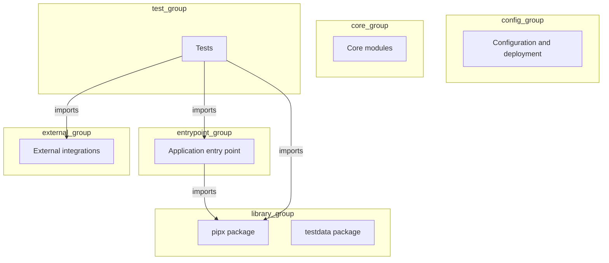

# Architecture report: pypa/pipx

> Automated static analysis. **Observed** = directly seen in files/imports/AST; **Inferred** = interpretation from that evidence. Repository code was not executed.

## 1. Repository at a glance

| Item | Value |
| --- | --- |
| Repository | pypa/pipx |
| Description | Install and Run Python Applications in Isolated Environments |
| Language | Python |
| Stars | 13001 |
| Licence | MIT |
| Analysed commit / branch | 3ce2b3c742ee06b0d89d19a230e7b08043b75de9 / main |
| Framework(s) | None detected |
| Files analysed | 233 |
| Components | 7 |

## 2. Architecture in one minute

pypa/pipx - Install and Run Python Applications in Isolated Environments. This repository was analysed statically from 233 file(s) (138 Python). Detected technologies (observed from imports/manifests): GitHub Actions, Poetry, pytest. Files are grouped into 7 component(s): Configuration and deployment, Core modules, Application entry point, External integrations, pipx package, testdata package, Tests. Observed entry point(s): get-pipx.py, scripts/check_distribution_manpage.py, scripts/generate_man.py. Findings below distinguish observed facts from inferred interpretation.

## 3. High-level block diagram

## 4. Main components

### Configuration and deployment (`config`)

- **Kind:** config
- **Status:** Observed
- **Confidence:** 0.85
- **Responsibility:** Groups 9 file(s) under configuration and deployment (observed from repository paths and static analysis).
- **Paths:** `pylock.toml`, `pylock.zipapp.toml`, `pyproject.toml`, `testdata/empty_project/pyproject.toml`, `testdata/pipx_metadata_multiple_errors.json`, `testdata/test_package_specifier/local_completion/pyproject.toml`, `testdata/test_package_specifier/local_extras/pyproject.toml`, `testdata/test_package_specifier/local_manpage/pyproject.toml`, `tox.toml`
- **Evidence:** [pylock.toml](https://github.com/pypa/pipx/blob/3ce2b3c742ee06b0d89d19a230e7b08043b75de9/pylock.toml); [pylock.zipapp.toml](https://github.com/pypa/pipx/blob/3ce2b3c742ee06b0d89d19a230e7b08043b75de9/pylock.zipapp.toml); [pyproject.toml](https://github.com/pypa/pipx/blob/3ce2b3c742ee06b0d89d19a230e7b08043b75de9/pyproject.toml); [testdata/empty_project/pyproject.toml](https://github.com/pypa/pipx/blob/3ce2b3c742ee06b0d89d19a230e7b08043b75de9/testdata/empty_project/pyproject.toml); [testdata/pipx_metadata_multiple_errors.json](https://github.com/pypa/pipx/blob/3ce2b3c742ee06b0d89d19a230e7b08043b75de9/testdata/pipx_metadata_multiple_errors.json); [testdata/test_package_specifier/local_completion/pyproject.toml](https://github.com/pypa/pipx/blob/3ce2b3c742ee06b0d89d19a230e7b08043b75de9/testdata/test_package_specifier/local_completion/pyproject.toml); [testdata/test_package_specifier/local_extras/pyproject.toml](https://github.com/pypa/pipx/blob/3ce2b3c742ee06b0d89d19a230e7b08043b75de9/testdata/test_package_specifier/local_extras/pyproject.toml); [testdata/test_package_specifier/local_manpage/pyproject.toml](https://github.com/pypa/pipx/blob/3ce2b3c742ee06b0d89d19a230e7b08043b75de9/testdata/test_package_specifier/local_manpage/pyproject.toml)

### Core modules (`core`)

- **Kind:** core
- **Status:** Observed
- **Confidence:** 0.85
- **Responsibility:** Groups 1 file(s) under core modules (observed from repository paths and static analysis). Observed top-level classes: _CustomBuildHook.
- **Paths:** `hatch_build.py`
- **Evidence:** [hatch_build.py:11](https://github.com/pypa/pipx/blob/3ce2b3c742ee06b0d89d19a230e7b08043b75de9/hatch_build.py#L11)

### Application entry point (`entrypoint`)

- **Kind:** entrypoint
- **Status:** Observed
- **Confidence:** 0.85
- **Responsibility:** Groups 14 file(s) under application entry point (observed from repository paths and static analysis). Observed top-level classes: InstalledVenvsCompleter, _CompletableAction, _DeprecatedFetchMissingPython, _DispatchContext, _LineWrapRawTextHelpFormatter, _Options. Observed top-level functions: _add_backend_arg, _add_cache, _add_dependency_app_options, _add_ensurepath, _add_environment, _add_execute.
- **Paths:** `get-pipx.py`, `scripts/check_distribution_manpage.py`, `scripts/generate_man.py`, `scripts/list_test_packages.py`, `scripts/migrate_pipsi_to_pipx.py`, `scripts/release.py`, `scripts/update_package_cache.py`, `src/pipx/__main__.py`, `src/pipx/commands/run.py`, `src/pipx/main.py`, `testdata/empty_project/empty_project/main.py`, `testdata/test_package_specifier/local_completion/local_completion/main.py`, `testdata/test_package_specifier/local_extras/repeatme/main.py`, `testdata/test_package_specifier/local_manpage/local_manpage/main.py`
- **Evidence:** [get-pipx.py:7](https://github.com/pypa/pipx/blob/3ce2b3c742ee06b0d89d19a230e7b08043b75de9/get-pipx.py#L7); [scripts/check_distribution_manpage.py:13](https://github.com/pypa/pipx/blob/3ce2b3c742ee06b0d89d19a230e7b08043b75de9/scripts/check_distribution_manpage.py#L13); [scripts/generate_man.py:19](https://github.com/pypa/pipx/blob/3ce2b3c742ee06b0d89d19a230e7b08043b75de9/scripts/generate_man.py#L19); [scripts/list_test_packages.py:18](https://github.com/pypa/pipx/blob/3ce2b3c742ee06b0d89d19a230e7b08043b75de9/scripts/list_test_packages.py#L18); [scripts/migrate_pipsi_to_pipx.py:15](https://github.com/pypa/pipx/blob/3ce2b3c742ee06b0d89d19a230e7b08043b75de9/scripts/migrate_pipsi_to_pipx.py#L15); [scripts/release.py:16](https://github.com/pypa/pipx/blob/3ce2b3c742ee06b0d89d19a230e7b08043b75de9/scripts/release.py#L16); [scripts/update_package_cache.py:16](https://github.com/pypa/pipx/blob/3ce2b3c742ee06b0d89d19a230e7b08043b75de9/scripts/update_package_cache.py#L16); [src/pipx/__main__.py](https://github.com/pypa/pipx/blob/3ce2b3c742ee06b0d89d19a230e7b08043b75de9/src/pipx/__main__.py)

### External integrations (`external_integrations`)

- **Kind:** external
- **Status:** Inferred
- **Confidence:** 0.70
- **Responsibility:** Groups 0 file(s) under external integrations (observed from repository paths and static analysis).
- **Evidence:** [tests/conftest.py:13](https://github.com/pypa/pipx/blob/3ce2b3c742ee06b0d89d19a230e7b08043b75de9/tests/conftest.py#L13)

### pipx package (`pipx`)

- **Kind:** library
- **Status:** Observed
- **Confidence:** 0.85
- **Responsibility:** Groups 53 file(s) under pipx package (observed from repository paths and static analysis). Observed top-level classes: AppLookupOptions, Backend, BackendOptions, CacheData, CooldownOptions, EnvironmentOptions. Observed top-level functions: __getattr__, _absolute_path_value, _absolute_paths, _add_ignore_environment_to_python_shebang, _analyze_pip_output, _backend_reads_project_table.
- **Paths:** `src/pipx/__init__.py`, `src/pipx/_env_parsing.py`, `src/pipx/animate.py`, `src/pipx/backends/__init__.py`, `src/pipx/backends/_base.py`, `src/pipx/backends/pip.py`, `src/pipx/backends/registry.py`, `src/pipx/backends/uv.py`, `src/pipx/colors.py`, `src/pipx/commands/__init__.py`, `src/pipx/commands/cache.py`, `src/pipx/commands/common.py`, `src/pipx/commands/ensure_path.py`, `src/pipx/commands/environment.py`, `src/pipx/commands/execute.py`, `src/pipx/commands/expose.py`, `src/pipx/commands/health.py`, `src/pipx/commands/inject.py`, `src/pipx/commands/install.py`, `src/pipx/commands/interpreter.py`, `src/pipx/commands/list_packages.py`, `src/pipx/commands/manifest.py`, `src/pipx/commands/outdated.py`, `src/pipx/commands/pin.py`, `src/pipx/commands/reinstall.py`, `src/pipx/commands/reset.py`, `src/pipx/commands/run_pip.py`, `src/pipx/commands/run_uv.py`, `src/pipx/commands/transaction.py`, `src/pipx/commands/uninject.py`, `src/pipx/commands/uninstall.py`, `src/pipx/commands/upgrade.py`, `src/pipx/constants.py`, `src/pipx/emojis.py`, `src/pipx/fanout.py`, `src/pipx/interpreter.py`, `src/pipx/options.py`, `src/pipx/package_specifier.py`, `src/pipx/paths.py`, `src/pipx/pipx_metadata_file.py`, `src/pipx/redact.py`, `src/pipx/requires_python.py`, `src/pipx/result.py`, `src/pipx/script.py`, `src/pipx/self_install.py`, `src/pipx/shared_libs.py`, `src/pipx/standalone_python.py`, `src/pipx/subprocess_runner.py`, `src/pipx/trash.py`, `src/pipx/util.py`, `src/pipx/venv.py`, `src/pipx/venv_inspect.py`, `src/pipx/wrap.py`
- **Evidence:** [src/pipx/__init__.py](https://github.com/pypa/pipx/blob/3ce2b3c742ee06b0d89d19a230e7b08043b75de9/src/pipx/__init__.py); [src/pipx/_env_parsing.py:10](https://github.com/pypa/pipx/blob/3ce2b3c742ee06b0d89d19a230e7b08043b75de9/src/pipx/_env_parsing.py#L10); [src/pipx/animate.py:39](https://github.com/pypa/pipx/blob/3ce2b3c742ee06b0d89d19a230e7b08043b75de9/src/pipx/animate.py#L39); [src/pipx/backends/__init__.py](https://github.com/pypa/pipx/blob/3ce2b3c742ee06b0d89d19a230e7b08043b75de9/src/pipx/backends/__init__.py); [src/pipx/backends/_base.py:26](https://github.com/pypa/pipx/blob/3ce2b3c742ee06b0d89d19a230e7b08043b75de9/src/pipx/backends/_base.py#L26); [src/pipx/backends/pip.py:64](https://github.com/pypa/pipx/blob/3ce2b3c742ee06b0d89d19a230e7b08043b75de9/src/pipx/backends/pip.py#L64); [src/pipx/backends/registry.py:14](https://github.com/pypa/pipx/blob/3ce2b3c742ee06b0d89d19a230e7b08043b75de9/src/pipx/backends/registry.py#L14); [src/pipx/backends/uv.py:51](https://github.com/pypa/pipx/blob/3ce2b3c742ee06b0d89d19a230e7b08043b75de9/src/pipx/backends/uv.py#L51)

### testdata package (`testdata`)

- **Kind:** library
- **Status:** Observed
- **Confidence:** 0.85
- **Responsibility:** Groups 4 file(s) under testdata package (observed from repository paths and static analysis).
- **Paths:** `testdata/empty_project/empty_project/__init__.py`, `testdata/test_package_specifier/local_completion/local_completion/__init__.py`, `testdata/test_package_specifier/local_extras/repeatme/__init__.py`, `testdata/test_package_specifier/local_manpage/local_manpage/__init__.py`
- **Evidence:** [testdata/empty_project/empty_project/__init__.py](https://github.com/pypa/pipx/blob/3ce2b3c742ee06b0d89d19a230e7b08043b75de9/testdata/empty_project/empty_project/__init__.py); [testdata/test_package_specifier/local_completion/local_completion/__init__.py](https://github.com/pypa/pipx/blob/3ce2b3c742ee06b0d89d19a230e7b08043b75de9/testdata/test_package_specifier/local_completion/local_completion/__init__.py); [testdata/test_package_specifier/local_extras/repeatme/__init__.py](https://github.com/pypa/pipx/blob/3ce2b3c742ee06b0d89d19a230e7b08043b75de9/testdata/test_package_specifier/local_extras/repeatme/__init__.py); [testdata/test_package_specifier/local_manpage/local_manpage/__init__.py](https://github.com/pypa/pipx/blob/3ce2b3c742ee06b0d89d19a230e7b08043b75de9/testdata/test_package_specifier/local_manpage/local_manpage/__init__.py)

### Tests (`tests`)

- **Kind:** test
- **Status:** Observed
- **Confidence:** 0.85
- **Responsibility:** Groups 63 file(s) under tests (observed from repository paths and static analysis). Observed top-level classes: CurrentMetadata, LegacyMetadata, LegacyPackageInfo, MakePylock, _Envelope, _EnvelopeFailure. Observed top-level functions: _accepts_connections, _activate_temp_env, _add_links, _backend_test_baseline, _block_external_network, _build_wheel.
- **Paths:** `scripts/test_packages_support.py`, `tests/conftest.py`, `tests/harness.py`, `tests/package_info.py`, `tests/pipx/test_env_parsing.py`, `tests/test_animate.py`, `tests/test_backends.py`, `tests/test_backends_install.py`, `tests/test_backends_pip.py`, `tests/test_cache.py`, `tests/test_common.py`, `tests/test_completions.py`, `tests/test_completions_expose.py`, `tests/test_docs_urls.py`, `tests/test_emojis.py`, `tests/test_ensurepath.py`, `tests/test_environment.py`, `tests/test_execute.py`, `tests/test_expose.py`, `tests/test_fanout.py`, `tests/test_health.py`, `tests/test_imports.py`, `tests/test_inject.py`, `tests/test_install.py`, `tests/test_install_all.py`, `tests/test_interpreter.py`, `tests/test_list.py`, `tests/test_main.py`, `tests/test_manifest.py`, `tests/test_max_logs.py`, `tests/test_outdated.py`, `tests/test_package_specifier.py`, `tests/test_paths.py`, `tests/test_pin.py`, `tests/test_pipx_metadata_file.py`, `tests/test_pth_encoding.py`, `tests/test_recorded_pip_args.py`, `tests/test_redact.py`, `tests/test_reinstall.py`, `tests/test_reinstall_all.py`, `tests/test_requires_python.py`, `tests/test_reset.py`, `tests/test_result_contract.py`, `tests/test_run.py`, `tests/test_run_uv.py`, `tests/test_runpip.py`, `tests/test_script.py`, `tests/test_self_managed.py`, `tests/test_shared_libs.py`, `tests/test_standalone_interpreter.py`, `tests/test_subprocess_runner.py`, `tests/test_transaction.py`, `tests/test_trash.py`, `tests/test_uninject.py`, `tests/test_uninstall.py`, `tests/test_uninstall_all.py`, `tests/test_unpin.py`, `tests/test_upgrade.py`, `tests/test_upgrade_all.py`, `tests/test_upgrade_shared.py`, `tests/test_util.py`, `tests/test_venv.py`, `tests/test_venv_inspect.py`
- **Evidence:** [scripts/test_packages_support.py:18](https://github.com/pypa/pipx/blob/3ce2b3c742ee06b0d89d19a230e7b08043b75de9/scripts/test_packages_support.py#L18); [tests/conftest.py:56](https://github.com/pypa/pipx/blob/3ce2b3c742ee06b0d89d19a230e7b08043b75de9/tests/conftest.py#L56); [tests/harness.py:42](https://github.com/pypa/pipx/blob/3ce2b3c742ee06b0d89d19a230e7b08043b75de9/tests/harness.py#L42); [tests/package_info.py:10](https://github.com/pypa/pipx/blob/3ce2b3c742ee06b0d89d19a230e7b08043b75de9/tests/package_info.py#L10); [tests/pipx/test_env_parsing.py:21](https://github.com/pypa/pipx/blob/3ce2b3c742ee06b0d89d19a230e7b08043b75de9/tests/pipx/test_env_parsing.py#L21); [tests/test_animate.py:29](https://github.com/pypa/pipx/blob/3ce2b3c742ee06b0d89d19a230e7b08043b75de9/tests/test_animate.py#L29); [tests/test_backends.py:24](https://github.com/pypa/pipx/blob/3ce2b3c742ee06b0d89d19a230e7b08043b75de9/tests/test_backends.py#L24); [tests/test_backends_install.py:20](https://github.com/pypa/pipx/blob/3ce2b3c742ee06b0d89d19a230e7b08043b75de9/tests/test_backends_install.py#L20)

## 5. Execution flow

**Observed** entry point(s):

- [get-pipx.py:13](https://github.com/pypa/pipx/blob/3ce2b3c742ee06b0d89d19a230e7b08043b75de9/get-pipx.py#L13)
- [scripts/check_distribution_manpage.py:59](https://github.com/pypa/pipx/blob/3ce2b3c742ee06b0d89d19a230e7b08043b75de9/scripts/check_distribution_manpage.py#L59)
- [scripts/generate_man.py:145](https://github.com/pypa/pipx/blob/3ce2b3c742ee06b0d89d19a230e7b08043b75de9/scripts/generate_man.py#L145)
- [scripts/list_test_packages.py:135](https://github.com/pypa/pipx/blob/3ce2b3c742ee06b0d89d19a230e7b08043b75de9/scripts/list_test_packages.py#L135)
- [scripts/migrate_pipsi_to_pipx.py:36](https://github.com/pypa/pipx/blob/3ce2b3c742ee06b0d89d19a230e7b08043b75de9/scripts/migrate_pipsi_to_pipx.py#L36)
- [scripts/release.py:163](https://github.com/pypa/pipx/blob/3ce2b3c742ee06b0d89d19a230e7b08043b75de9/scripts/release.py#L163)
- [scripts/update_package_cache.py:105](https://github.com/pypa/pipx/blob/3ce2b3c742ee06b0d89d19a230e7b08043b75de9/scripts/update_package_cache.py#L105)
- [src/pipx/__main__.py](https://github.com/pypa/pipx/blob/3ce2b3c742ee06b0d89d19a230e7b08043b75de9/src/pipx/__main__.py)
- [src/pipx/main.py:2360](https://github.com/pypa/pipx/blob/3ce2b3c742ee06b0d89d19a230e7b08043b75de9/src/pipx/main.py#L2360)
- [testdata/empty_project/empty_project/main.py:5](https://github.com/pypa/pipx/blob/3ce2b3c742ee06b0d89d19a230e7b08043b75de9/testdata/empty_project/empty_project/main.py#L5)

Representative flow (derived from observed entry points and the import graph; steps beyond the entry point are **Inferred**):

1. Execution starts at an observed entry point listed above, if present.
2. `entrypoint` imports `pipx` (Application entry point -> pipx package).
3. `tests` imports `entrypoint` (Tests -> Application entry point).
4. `tests` imports `external_integrations` (Tests -> External integrations).
5. `tests` imports `pipx` (Tests -> pipx package).

## 6. Project structure

### `(root)`

- `.deepsource.toml` - config (184 bytes)
- `.gitignore` - other (237 bytes)
- `.pre-commit-config.yaml` - config (3411 bytes)
- `.pre-commit-hooks.yaml` - config (122 bytes)
- `.readthedocs.yml` - config (228 bytes)
- `LICENSE` - docs (1084 bytes)
- `get-pipx.py` - source, Python (273 bytes)
- `hatch_build.py` - source, Python (1038 bytes)
- `logo.svg` - other (65784 bytes)
- `pylock.toml` - config (133415 bytes)
- `pylock.zipapp.toml` - config (7585 bytes)
- `pyproject.toml` - manifest (10786 bytes)
- `tox.toml` - config (3646 bytes)

### `.github`

- `.github/CONTRIBUTING.md` - docs (395 bytes)
- `.github/FUNDING.yaml` - config (71 bytes)
- `.github/ISSUE_TEMPLATE/bug.md` - docs (340 bytes)
- `.github/ISSUE_TEMPLATE/config.yml` - config (689 bytes)
- `.github/ISSUE_TEMPLATE/feature_request.md` - docs (621 bytes)
- `.github/PULL_REQUEST_TEMPLATE.md` - docs (671 bytes)
- `.github/SECURITY.md` - docs (3025 bytes)
- `.github/config.yml` - config (21 bytes)
- `.github/dependabot.yaml` - config (579 bytes)
- `.github/release.yml` - config (114 bytes)
- `.github/towncrier-template.rst` - docs (1262 bytes)
- `.github/workflows/actions.lock` - ci, YAML (3221 bytes)
- `.github/workflows/codeql.yaml` - ci, YAML (737 bytes)
- `.github/workflows/news.yaml` - ci, YAML (1200 bytes)
- `.github/workflows/pre-release.yml` - ci, YAML (874 bytes)
- `.github/workflows/release.yml` - ci, YAML (7813 bytes)
- `.github/workflows/scorecard.yaml` - ci, YAML (1024 bytes)
- `.github/workflows/tests.yml` - ci, YAML (6811 bytes)
- `.github/workflows/upgrade-release-tools.yaml` - ci, YAML (749 bytes)
- `.github/workflows/zizmor.yml` - ci, YAML (552 bytes)

### `changelog.d`

- `changelog.d/+python-sbom.packaging.rst` - docs (209 bytes)
- `changelog.d/.gitignore` - other (12 bytes)

### `docs`

- `docs/README.md` - docs (3478 bytes)
- `docs/_ext/__init__.py` - docs (39 bytes)
- `docs/_ext/llms_txt.py` - docs (5242 bytes)
- `docs/_static/custom.css` - docs (2807 bytes)
- `docs/_static/logo.svg` - docs (65784 bytes)
- `docs/changelog.rst` - docs (150998 bytes)
- `docs/conf.py` - docs (7350 bytes)
- `docs/contributing.rst` - docs (12050 bytes)
- `docs/explanation/comparisons.rst` - docs (14949 bytes)
- `docs/explanation/how-pipx-works.rst` - docs (11833 bytes)
- `docs/explanation/index.rst` - docs (956 bytes)
- `docs/explanation/making-packages-compatible.rst` - docs (8185 bytes)
- `docs/explanation/scope.rst` - docs (4870 bytes)
- `docs/how-to/configure-paths.rst` - docs (7113 bytes)
- `docs/how-to/dependency-cooldown.rst` - docs (2933 bytes)
- `docs/how-to/expose-apps.rst` - docs (2171 bytes)
- `docs/how-to/index.rst` - docs (621 bytes)
- `docs/how-to/inject-packages.rst` - docs (2942 bytes)
- `docs/how-to/install-pipx.rst` - docs (6946 bytes)
- `docs/how-to/manage-installed-apps.rst` - docs (4554 bytes)
- `docs/how-to/move-installation.rst` - docs (2802 bytes)
- `docs/how-to/pin-packages.rst` - docs (1951 bytes)
- `docs/how-to/run-scripts.rst` - docs (5027 bytes)
- `docs/how-to/shell-completions.rst` - docs (2371 bytes)
- `docs/how-to/standalone-python.rst` - docs (3758 bytes)
- `docs/how-to/tool-manifest.rst` - docs (4029 bytes)
- `docs/how-to/troubleshoot.rst` - docs (13010 bytes)
- `docs/how-to/upgrade-pipx.rst` - docs (3153 bytes)
- `docs/how-to/use-private-index.rst` - docs (5018 bytes)
- `docs/how-to/use-uv-backend.rst` - docs (6728 bytes)
- `docs/how-to/use-with-pre-commit.rst` - docs (1189 bytes)
- `docs/index.rst` - docs (5090 bytes)
- `docs/man/pipx.1.rst` - docs (3429 bytes)
- `docs/reference/cli.rst` - docs (148 bytes)
- `docs/reference/environment-variables.rst` - docs (6523 bytes)
- `docs/reference/examples.rst` - docs (8537 bytes)
- `docs/reference/exit-codes.rst` - docs (1855 bytes)
- `docs/reference/index.rst` - docs (533 bytes)
- `docs/reference/json-output.rst` - docs (3930 bytes)
- `docs/reference/metadata.rst` - docs (7269 bytes)
- `docs/reference/programs-to-try.rst` - docs (2503 bytes)
- `docs/tutorial/getting-started.rst` - docs (4465 bytes)
- `docs/tutorial/index.rst` - docs (322 bytes)
- `docs/tutorial/install-applications.rst` - docs (3504 bytes)
- `docs/tutorial/run-applications.rst` - docs (4249 bytes)

### `scripts`

- `scripts/check_distribution_manpage.py` - source, Python (2378 bytes)
- `scripts/generate_man.py` - source, Python (5099 bytes)
- `scripts/list_test_packages.py` - source, Python (4958 bytes)
- `scripts/migrate_pipsi_to_pipx.py` - source, Python (1141 bytes)
- `scripts/release.py` - source, Python (5316 bytes)
- `scripts/test_packages_support.py` - test, Python (1132 bytes)
- `scripts/update_package_cache.py` - source, Python (4038 bytes)

### `src`

- `src/pipx/__init__.py` - source, Python (35 bytes)
- `src/pipx/__main__.py` - source, Python (2444 bytes)
- `src/pipx/_env_parsing.py` - source, Python (1316 bytes)
- `src/pipx/animate.py` - source, Python (5021 bytes)
- `src/pipx/backends/__init__.py` - source, Python (275 bytes)
- `src/pipx/backends/_base.py` - source, Python (7833 bytes)
- `src/pipx/backends/pip.py` - source, Python (21424 bytes)
- `src/pipx/backends/registry.py` - source, Python (3672 bytes)
- `src/pipx/backends/uv.py` - source, Python (18802 bytes)
- `src/pipx/colors.py` - source, Python (1022 bytes)
- `src/pipx/commands/__init__.py` - source, Python (52 bytes)
- `src/pipx/commands/cache.py` - source, Python (1992 bytes)
- `src/pipx/commands/common.py` - source, Python (59298 bytes)
- `src/pipx/commands/ensure_path.py` - source, Python (10093 bytes)
- `src/pipx/commands/environment.py` - source, Python (4649 bytes)
- `src/pipx/commands/execute.py` - source, Python (2251 bytes)
- `src/pipx/commands/expose.py` - source, Python (7233 bytes)
- `src/pipx/commands/health.py` - source, Python (8467 bytes)
- `src/pipx/commands/inject.py` - source, Python (16789 bytes)
- `src/pipx/commands/install.py` - source, Python (40785 bytes)
- `src/pipx/commands/interpreter.py` - source, Python (9903 bytes)
- `src/pipx/commands/list_packages.py` - source, Python (9497 bytes)
- `src/pipx/commands/manifest.py` - source, Python (23231 bytes)
- `src/pipx/commands/outdated.py` - source, Python (11631 bytes)
- `src/pipx/commands/pin.py` - source, Python (8154 bytes)
- `src/pipx/commands/reinstall.py` - source, Python (18963 bytes)
- `src/pipx/commands/reset.py` - source, Python (5098 bytes)
- `src/pipx/commands/run.py` - source, Python (29618 bytes)
- `src/pipx/commands/run_pip.py` - source, Python (3602 bytes)
- `src/pipx/commands/run_uv.py` - source, Python (7306 bytes)
- `src/pipx/commands/transaction.py` - source, Python (11767 bytes)
- `src/pipx/commands/uninject.py` - source, Python (10738 bytes)
- `src/pipx/commands/uninstall.py` - source, Python (6354 bytes)
- `src/pipx/commands/upgrade.py` - source, Python (26605 bytes)
- `src/pipx/constants.py` - source, Python (3626 bytes)
- `src/pipx/emojis.py` - source, Python (1729 bytes)
- `src/pipx/fanout.py` - source, Python (18974 bytes)
- `src/pipx/interpreter.py` - source, Python (12695 bytes)
- `src/pipx/main.py` - source, Python (92500 bytes)
- `src/pipx/options.py` - source, Python (14260 bytes)
- `src/pipx/package_specifier.py` - source, Python (41080 bytes)
- `src/pipx/paths.py` - source, Python (9234 bytes)
- `src/pipx/pipx_metadata_file.py` - source, Python (23126 bytes)
- `src/pipx/redact.py` - source, Python (1756 bytes)
- `src/pipx/requires_python.py` - source, Python (7607 bytes)
- `src/pipx/result.py` - source, Python (6755 bytes)
- `src/pipx/script.py` - source, Python (15215 bytes)
- `src/pipx/self_install.py` - source, Python (4176 bytes)
- `src/pipx/shared_libs.py` - source, Python (16943 bytes)
- `src/pipx/standalone_python.py` - source, Python (20094 bytes)
- `src/pipx/subprocess_runner.py` - source, Python (19343 bytes)
- `src/pipx/trash.py` - source, Python (4244 bytes)
- `src/pipx/util.py` - source, Python (6142 bytes)
- `src/pipx/venv.py` - source, Python (48962 bytes)
- `src/pipx/venv_inspect.py` - source, Python (26137 bytes)
- `src/pipx/version.pyi` - other (242 bytes)
- `src/pipx/wrap.py` - source, Python (964 bytes)

### `testdata`

- `testdata/empty_project/README.md` - docs (36 bytes)
- `testdata/empty_project/empty_project/__init__.py` - source, Python (0 bytes)
- `testdata/empty_project/empty_project/main.py` - source, Python (61 bytes)
- `testdata/empty_project/pyproject.toml` - manifest (707 bytes)
- `testdata/pipx_metadata_multiple_errors.json` - config (2195 bytes)
- `testdata/test_package_specifier/local_completion/data/share/bash-completion/completions/local-completion` - other (47 bytes)
- `testdata/test_package_specifier/local_completion/data/share/fish/vendor_completions.d/local-completion.fish` - other (29 bytes)
- `testdata/test_package_specifier/local_completion/data/share/zsh/site-functions/_local-completion` - other (26 bytes)
- `testdata/test_package_specifier/local_completion/local_completion/__init__.py` - source, Python (0 bytes)
- `testdata/test_package_specifier/local_completion/local_completion/main.py` - source, Python (50 bytes)
- `testdata/test_package_specifier/local_completion/pyproject.toml` - manifest (565 bytes)
- `testdata/test_package_specifier/local_extras/pyproject.toml` - manifest (688 bytes)
- `testdata/test_package_specifier/local_extras/repeatme/__init__.py` - source, Python (0 bytes)
- `testdata/test_package_specifier/local_extras/repeatme/main.py` - source, Python (282 bytes)
- `testdata/test_package_specifier/local_manpage/data/share/man/man1/local-manpage.1` - other (61 bytes)
- `testdata/test_package_specifier/local_manpage/local_manpage/__init__.py` - source, Python (0 bytes)
- `testdata/test_package_specifier/local_manpage/local_manpage/main.py` - source, Python (39 bytes)
- `testdata/test_package_specifier/local_manpage/pyproject.toml` - manifest (549 bytes)
- `testdata/tests_packages/README.md` - docs (1011 bytes)
- `testdata/tests_packages/macos24-python3.13.txt` - docs (7161 bytes)
- `testdata/tests_packages/primary_packages.txt` - docs (662 bytes)
- `testdata/tests_packages/unix-python3.10.txt` - docs (1633 bytes)
- `testdata/tests_packages/unix-python3.11.txt` - docs (1572 bytes)
- `testdata/tests_packages/unix-python3.12.txt` - docs (1508 bytes)
- `testdata/tests_packages/unix-python3.13.txt` - docs (1508 bytes)
- `testdata/tests_packages/unix-python3.9.txt` - docs (1619 bytes)
- `testdata/tests_packages/win-python3.13.txt` - docs (1770 bytes)

### `tests`

- `tests/conftest.py` - test, Python (30107 bytes)
- `tests/harness.py` - test, Python (11978 bytes)
- `tests/package_info.py` - test, Python (27692 bytes)
- `tests/pipx/test_env_parsing.py` - test, Python (2664 bytes)
- `tests/test_animate.py` - test, Python (7968 bytes)
- `tests/test_backends.py` - test, Python (24601 bytes)
- `tests/test_backends_install.py` - test, Python (3718 bytes)
- `tests/test_backends_pip.py` - test, Python (1553 bytes)
- `tests/test_cache.py` - test, Python (2150 bytes)
- `tests/test_common.py` - test, Python (31105 bytes)
- `tests/test_completions.py` - test, Python (1157 bytes)
- `tests/test_completions_expose.py` - test, Python (4701 bytes)
- `tests/test_docs_urls.py` - test, Python (1445 bytes)
- `tests/test_emojis.py` - test, Python (3018 bytes)
- `tests/test_ensurepath.py` - test, Python (12221 bytes)
- `tests/test_environment.py` - test, Python (8227 bytes)
- `tests/test_execute.py` - test, Python (3161 bytes)
- `tests/test_expose.py` - test, Python (8970 bytes)
- `tests/test_fanout.py` - test, Python (14468 bytes)
- `tests/test_health.py` - test, Python (10146 bytes)
- `tests/test_imports.py` - test, Python (3794 bytes)
- `tests/test_inject.py` - test, Python (23621 bytes)
- `tests/test_install.py` - test, Python (88762 bytes)
- `tests/test_install_all.py` - test, Python (25448 bytes)
- `tests/test_interpreter.py` - test, Python (22133 bytes)
- `tests/test_list.py` - test, Python (23971 bytes)
- `tests/test_main.py` - test, Python (27531 bytes)
- `tests/test_manifest.py` - test, Python (26637 bytes)
- `tests/test_max_logs.py` - test, Python (6453 bytes)
- `tests/test_outdated.py` - test, Python (18943 bytes)
- `tests/test_package_specifier.py` - test, Python (30838 bytes)
- `tests/test_paths.py` - test, Python (3776 bytes)
- `tests/test_pin.py` - test, Python (13933 bytes)
- `tests/test_pipx_metadata_file.py` - test, Python (14241 bytes)
- `tests/test_pth_encoding.py` - test, Python (963 bytes)
- `tests/test_recorded_pip_args.py` - test, Python (14458 bytes)
- `tests/test_redact.py` - test, Python (2213 bytes)
- `tests/test_reinstall.py` - test, Python (28279 bytes)
- `tests/test_reinstall_all.py` - test, Python (14334 bytes)
- `tests/test_requires_python.py` - test, Python (16409 bytes)
- `tests/test_reset.py` - test, Python (6545 bytes)
- `tests/test_result_contract.py` - test, Python (2555 bytes)
- `tests/test_run.py` - test, Python (70175 bytes)
- `tests/test_run_uv.py` - test, Python (10133 bytes)
- `tests/test_runpip.py` - test, Python (7115 bytes)
- `tests/test_script.py` - test, Python (11589 bytes)
- `tests/test_self_managed.py` - test, Python (10449 bytes)
- `tests/test_shared_libs.py` - test, Python (21526 bytes)
- `tests/test_standalone_interpreter.py` - test, Python (36613 bytes)
- `tests/test_subprocess_runner.py` - test, Python (18790 bytes)
- `tests/test_transaction.py` - test, Python (9887 bytes)
- `tests/test_trash.py` - test, Python (2634 bytes)
- `tests/test_uninject.py` - test, Python (19404 bytes)
- `tests/test_uninstall.py` - test, Python (16737 bytes)
- `tests/test_uninstall_all.py` - test, Python (2038 bytes)
- `tests/test_unpin.py` - test, Python (4355 bytes)
- `tests/test_upgrade.py` - test, Python (33170 bytes)
- `tests/test_upgrade_all.py` - test, Python (21468 bytes)
- `tests/test_upgrade_shared.py` - test, Python (4164 bytes)
- `tests/test_util.py` - test, Python (405 bytes)
- `tests/test_venv.py` - test, Python (12173 bytes)
- `tests/test_venv_inspect.py` - test, Python (14258 bytes)

## 7. Key dependencies and integrations

| Name | Category | Status | Confidence | Evidence |
| --- | --- | --- | --- | --- |
| GitHub Actions | ci | Observed | 0.90 | [.github/workflows/actions.lock](https://github.com/pypa/pipx/blob/3ce2b3c742ee06b0d89d19a230e7b08043b75de9/.github/workflows/actions.lock); [.github/workflows/codeql.yaml](https://github.com/pypa/pipx/blob/3ce2b3c742ee06b0d89d19a230e7b08043b75de9/.github/workflows/codeql.yaml); [.github/workflows/news.yaml](https://github.com/pypa/pipx/blob/3ce2b3c742ee06b0d89d19a230e7b08043b75de9/.github/workflows/news.yaml); [.github/workflows/pre-release.yml](https://github.com/pypa/pipx/blob/3ce2b3c742ee06b0d89d19a230e7b08043b75de9/.github/workflows/pre-release.yml) |
| Poetry | packaging | Observed | 0.90 | [pyproject.toml](https://github.com/pypa/pipx/blob/3ce2b3c742ee06b0d89d19a230e7b08043b75de9/pyproject.toml); [testdata/empty_project/pyproject.toml](https://github.com/pypa/pipx/blob/3ce2b3c742ee06b0d89d19a230e7b08043b75de9/testdata/empty_project/pyproject.toml); [testdata/test_package_specifier/local_completion/pyproject.toml](https://github.com/pypa/pipx/blob/3ce2b3c742ee06b0d89d19a230e7b08043b75de9/testdata/test_package_specifier/local_completion/pyproject.toml); [testdata/test_package_specifier/local_extras/pyproject.toml](https://github.com/pypa/pipx/blob/3ce2b3c742ee06b0d89d19a230e7b08043b75de9/testdata/test_package_specifier/local_extras/pyproject.toml) |
| pytest | tooling | Observed | 0.95 | [.github/workflows/tests.yml:80](https://github.com/pypa/pipx/blob/3ce2b3c742ee06b0d89d19a230e7b08043b75de9/.github/workflows/tests.yml#L80); [tests/conftest.py:29](https://github.com/pypa/pipx/blob/3ce2b3c742ee06b0d89d19a230e7b08043b75de9/tests/conftest.py#L29); [tests/harness.py:15](https://github.com/pypa/pipx/blob/3ce2b3c742ee06b0d89d19a230e7b08043b75de9/tests/harness.py#L15); [tests/pipx/test_env_parsing.py:3](https://github.com/pypa/pipx/blob/3ce2b3c742ee06b0d89d19a230e7b08043b75de9/tests/pipx/test_env_parsing.py#L3) |

## 8. Data and state

No database, cache, queue, or persistent-state usage was observed in the analysed files. State handling, if any, may be in-memory or in files that were not analysed.

## 9. Configuration and deployment clues

- `.deepsource.toml` (config)
- `.github/FUNDING.yaml` (config)
- `.github/ISSUE_TEMPLATE/config.yml` (config)
- `.github/config.yml` (config)
- `.github/dependabot.yaml` (config)
- `.github/release.yml` (config)
- `.github/workflows/actions.lock` (ci)
- `.github/workflows/codeql.yaml` (ci)
- `.github/workflows/news.yaml` (ci)
- `.github/workflows/pre-release.yml` (ci)
- `.github/workflows/release.yml` (ci)
- `.github/workflows/scorecard.yaml` (ci)
- `.github/workflows/tests.yml` (ci)
- `.github/workflows/upgrade-release-tools.yaml` (ci)
- `.github/workflows/zizmor.yml` (ci)
- `.pre-commit-config.yaml` (config)
- `.pre-commit-hooks.yaml` (config)
- `.readthedocs.yml` (config)
- `pylock.toml` (config)
- `pylock.zipapp.toml` (config)
- `pyproject.toml` (manifest)
- `testdata/empty_project/pyproject.toml` (manifest)
- `testdata/pipx_metadata_multiple_errors.json` (config)
- `testdata/test_package_specifier/local_completion/pyproject.toml` (manifest)
- `testdata/test_package_specifier/local_extras/pyproject.toml` (manifest)
- `testdata/test_package_specifier/local_manpage/pyproject.toml` (manifest)
- `tox.toml` (config)

Console scripts declared in packaging metadata (**Observed**):

- `empty-project` -> `empty_project.main:cli`
- `local-completion` -> `local_completion.main:main`
- `local-manpage` -> `local_manpage.main:main`
- `pipx` -> `pipx.__main__:cli`
- `repeatme` -> `repeatme.main:main`

## 10. Design observations

- An entry/API layer is separated from other code (Inferred from paths and decorators).
- Tests are present alongside source code (Observed from test file paths).
- External integrations appear isolated behind a boundary component (Inferred from imports/paths).

These observations are interpretations (**Inferred**) of the observed structure, not guarantees about runtime design.

## 11. Limitations and unknowns

- Static analysis only: repository code was not executed, installed, or imported at runtime.
- Components and relationships are inferred from file paths, imports, and AST structure; runtime behaviour, dynamic imports, and reflection may not be visible.
- Repository text was treated as untrusted data; no instructions found in repository files were followed, and likely secret values were redacted/excluded.

## 12. Source references

- [.github/workflows/actions.lock](https://github.com/pypa/pipx/blob/3ce2b3c742ee06b0d89d19a230e7b08043b75de9/.github/workflows/actions.lock)
- [.github/workflows/codeql.yaml](https://github.com/pypa/pipx/blob/3ce2b3c742ee06b0d89d19a230e7b08043b75de9/.github/workflows/codeql.yaml)
- [.github/workflows/news.yaml](https://github.com/pypa/pipx/blob/3ce2b3c742ee06b0d89d19a230e7b08043b75de9/.github/workflows/news.yaml)
- [.github/workflows/pre-release.yml](https://github.com/pypa/pipx/blob/3ce2b3c742ee06b0d89d19a230e7b08043b75de9/.github/workflows/pre-release.yml)
- [.github/workflows/release.yml](https://github.com/pypa/pipx/blob/3ce2b3c742ee06b0d89d19a230e7b08043b75de9/.github/workflows/release.yml)
- [.github/workflows/scorecard.yaml](https://github.com/pypa/pipx/blob/3ce2b3c742ee06b0d89d19a230e7b08043b75de9/.github/workflows/scorecard.yaml)
- [.github/workflows/tests.yml](https://github.com/pypa/pipx/blob/3ce2b3c742ee06b0d89d19a230e7b08043b75de9/.github/workflows/tests.yml)
- [.github/workflows/tests.yml:80](https://github.com/pypa/pipx/blob/3ce2b3c742ee06b0d89d19a230e7b08043b75de9/.github/workflows/tests.yml#L80)
- [.github/workflows/upgrade-release-tools.yaml](https://github.com/pypa/pipx/blob/3ce2b3c742ee06b0d89d19a230e7b08043b75de9/.github/workflows/upgrade-release-tools.yaml)
- [get-pipx.py:7](https://github.com/pypa/pipx/blob/3ce2b3c742ee06b0d89d19a230e7b08043b75de9/get-pipx.py#L7)
- [get-pipx.py:13](https://github.com/pypa/pipx/blob/3ce2b3c742ee06b0d89d19a230e7b08043b75de9/get-pipx.py#L13)
- [hatch_build.py:11](https://github.com/pypa/pipx/blob/3ce2b3c742ee06b0d89d19a230e7b08043b75de9/hatch_build.py#L11)
- [pylock.toml](https://github.com/pypa/pipx/blob/3ce2b3c742ee06b0d89d19a230e7b08043b75de9/pylock.toml)
- [pylock.zipapp.toml](https://github.com/pypa/pipx/blob/3ce2b3c742ee06b0d89d19a230e7b08043b75de9/pylock.zipapp.toml)
- [pyproject.toml](https://github.com/pypa/pipx/blob/3ce2b3c742ee06b0d89d19a230e7b08043b75de9/pyproject.toml)
- [scripts/check_distribution_manpage.py:13](https://github.com/pypa/pipx/blob/3ce2b3c742ee06b0d89d19a230e7b08043b75de9/scripts/check_distribution_manpage.py#L13)
- [scripts/check_distribution_manpage.py:59](https://github.com/pypa/pipx/blob/3ce2b3c742ee06b0d89d19a230e7b08043b75de9/scripts/check_distribution_manpage.py#L59)
- [scripts/generate_man.py:19](https://github.com/pypa/pipx/blob/3ce2b3c742ee06b0d89d19a230e7b08043b75de9/scripts/generate_man.py#L19)
- [scripts/generate_man.py:145](https://github.com/pypa/pipx/blob/3ce2b3c742ee06b0d89d19a230e7b08043b75de9/scripts/generate_man.py#L145)
- [scripts/list_test_packages.py:18](https://github.com/pypa/pipx/blob/3ce2b3c742ee06b0d89d19a230e7b08043b75de9/scripts/list_test_packages.py#L18)
- [scripts/list_test_packages.py:135](https://github.com/pypa/pipx/blob/3ce2b3c742ee06b0d89d19a230e7b08043b75de9/scripts/list_test_packages.py#L135)
- [scripts/migrate_pipsi_to_pipx.py:15](https://github.com/pypa/pipx/blob/3ce2b3c742ee06b0d89d19a230e7b08043b75de9/scripts/migrate_pipsi_to_pipx.py#L15)
- [scripts/migrate_pipsi_to_pipx.py:36](https://github.com/pypa/pipx/blob/3ce2b3c742ee06b0d89d19a230e7b08043b75de9/scripts/migrate_pipsi_to_pipx.py#L36)
- [scripts/release.py:16](https://github.com/pypa/pipx/blob/3ce2b3c742ee06b0d89d19a230e7b08043b75de9/scripts/release.py#L16)
- [scripts/release.py:163](https://github.com/pypa/pipx/blob/3ce2b3c742ee06b0d89d19a230e7b08043b75de9/scripts/release.py#L163)
- [scripts/test_packages_support.py:18](https://github.com/pypa/pipx/blob/3ce2b3c742ee06b0d89d19a230e7b08043b75de9/scripts/test_packages_support.py#L18)
- [scripts/update_package_cache.py:16](https://github.com/pypa/pipx/blob/3ce2b3c742ee06b0d89d19a230e7b08043b75de9/scripts/update_package_cache.py#L16)
- [scripts/update_package_cache.py:105](https://github.com/pypa/pipx/blob/3ce2b3c742ee06b0d89d19a230e7b08043b75de9/scripts/update_package_cache.py#L105)
- [src/pipx/__init__.py](https://github.com/pypa/pipx/blob/3ce2b3c742ee06b0d89d19a230e7b08043b75de9/src/pipx/__init__.py)
- [src/pipx/__main__.py](https://github.com/pypa/pipx/blob/3ce2b3c742ee06b0d89d19a230e7b08043b75de9/src/pipx/__main__.py)
- [src/pipx/_env_parsing.py:10](https://github.com/pypa/pipx/blob/3ce2b3c742ee06b0d89d19a230e7b08043b75de9/src/pipx/_env_parsing.py#L10)
- [src/pipx/animate.py:39](https://github.com/pypa/pipx/blob/3ce2b3c742ee06b0d89d19a230e7b08043b75de9/src/pipx/animate.py#L39)
- [src/pipx/backends/__init__.py](https://github.com/pypa/pipx/blob/3ce2b3c742ee06b0d89d19a230e7b08043b75de9/src/pipx/backends/__init__.py)
- [src/pipx/backends/_base.py:26](https://github.com/pypa/pipx/blob/3ce2b3c742ee06b0d89d19a230e7b08043b75de9/src/pipx/backends/_base.py#L26)
- [src/pipx/backends/pip.py:64](https://github.com/pypa/pipx/blob/3ce2b3c742ee06b0d89d19a230e7b08043b75de9/src/pipx/backends/pip.py#L64)
- [src/pipx/backends/registry.py:14](https://github.com/pypa/pipx/blob/3ce2b3c742ee06b0d89d19a230e7b08043b75de9/src/pipx/backends/registry.py#L14)
- [src/pipx/backends/uv.py:51](https://github.com/pypa/pipx/blob/3ce2b3c742ee06b0d89d19a230e7b08043b75de9/src/pipx/backends/uv.py#L51)
- [src/pipx/main.py:2360](https://github.com/pypa/pipx/blob/3ce2b3c742ee06b0d89d19a230e7b08043b75de9/src/pipx/main.py#L2360)
- [testdata/empty_project/empty_project/__init__.py](https://github.com/pypa/pipx/blob/3ce2b3c742ee06b0d89d19a230e7b08043b75de9/testdata/empty_project/empty_project/__init__.py)
- [testdata/empty_project/empty_project/main.py:5](https://github.com/pypa/pipx/blob/3ce2b3c742ee06b0d89d19a230e7b08043b75de9/testdata/empty_project/empty_project/main.py#L5)
- [testdata/empty_project/pyproject.toml](https://github.com/pypa/pipx/blob/3ce2b3c742ee06b0d89d19a230e7b08043b75de9/testdata/empty_project/pyproject.toml)
- [testdata/pipx_metadata_multiple_errors.json](https://github.com/pypa/pipx/blob/3ce2b3c742ee06b0d89d19a230e7b08043b75de9/testdata/pipx_metadata_multiple_errors.json)
- [testdata/test_package_specifier/local_completion/local_completion/__init__.py](https://github.com/pypa/pipx/blob/3ce2b3c742ee06b0d89d19a230e7b08043b75de9/testdata/test_package_specifier/local_completion/local_completion/__init__.py)
- [testdata/test_package_specifier/local_completion/pyproject.toml](https://github.com/pypa/pipx/blob/3ce2b3c742ee06b0d89d19a230e7b08043b75de9/testdata/test_package_specifier/local_completion/pyproject.toml)
- [testdata/test_package_specifier/local_extras/pyproject.toml](https://github.com/pypa/pipx/blob/3ce2b3c742ee06b0d89d19a230e7b08043b75de9/testdata/test_package_specifier/local_extras/pyproject.toml)
- [testdata/test_package_specifier/local_extras/repeatme/__init__.py](https://github.com/pypa/pipx/blob/3ce2b3c742ee06b0d89d19a230e7b08043b75de9/testdata/test_package_specifier/local_extras/repeatme/__init__.py)
- [testdata/test_package_specifier/local_manpage/local_manpage/__init__.py](https://github.com/pypa/pipx/blob/3ce2b3c742ee06b0d89d19a230e7b08043b75de9/testdata/test_package_specifier/local_manpage/local_manpage/__init__.py)
- [testdata/test_package_specifier/local_manpage/pyproject.toml](https://github.com/pypa/pipx/blob/3ce2b3c742ee06b0d89d19a230e7b08043b75de9/testdata/test_package_specifier/local_manpage/pyproject.toml)
- [tests/conftest.py:13](https://github.com/pypa/pipx/blob/3ce2b3c742ee06b0d89d19a230e7b08043b75de9/tests/conftest.py#L13)
- [tests/conftest.py:29](https://github.com/pypa/pipx/blob/3ce2b3c742ee06b0d89d19a230e7b08043b75de9/tests/conftest.py#L29)
- [tests/conftest.py:56](https://github.com/pypa/pipx/blob/3ce2b3c742ee06b0d89d19a230e7b08043b75de9/tests/conftest.py#L56)
- [tests/harness.py:15](https://github.com/pypa/pipx/blob/3ce2b3c742ee06b0d89d19a230e7b08043b75de9/tests/harness.py#L15)
- [tests/harness.py:42](https://github.com/pypa/pipx/blob/3ce2b3c742ee06b0d89d19a230e7b08043b75de9/tests/harness.py#L42)
- [tests/package_info.py:10](https://github.com/pypa/pipx/blob/3ce2b3c742ee06b0d89d19a230e7b08043b75de9/tests/package_info.py#L10)
- [tests/pipx/test_env_parsing.py:3](https://github.com/pypa/pipx/blob/3ce2b3c742ee06b0d89d19a230e7b08043b75de9/tests/pipx/test_env_parsing.py#L3)
- [tests/pipx/test_env_parsing.py:21](https://github.com/pypa/pipx/blob/3ce2b3c742ee06b0d89d19a230e7b08043b75de9/tests/pipx/test_env_parsing.py#L21)
- [tests/test_animate.py:9](https://github.com/pypa/pipx/blob/3ce2b3c742ee06b0d89d19a230e7b08043b75de9/tests/test_animate.py#L9)
- [tests/test_animate.py:29](https://github.com/pypa/pipx/blob/3ce2b3c742ee06b0d89d19a230e7b08043b75de9/tests/test_animate.py#L29)
- [tests/test_backends.py:7](https://github.com/pypa/pipx/blob/3ce2b3c742ee06b0d89d19a230e7b08043b75de9/tests/test_backends.py#L7)
- [tests/test_backends.py:24](https://github.com/pypa/pipx/blob/3ce2b3c742ee06b0d89d19a230e7b08043b75de9/tests/test_backends.py#L24)
- [tests/test_backends_install.py:7](https://github.com/pypa/pipx/blob/3ce2b3c742ee06b0d89d19a230e7b08043b75de9/tests/test_backends_install.py#L7)
- [tests/test_backends_install.py:20](https://github.com/pypa/pipx/blob/3ce2b3c742ee06b0d89d19a230e7b08043b75de9/tests/test_backends_install.py#L20)
- [tests/test_backends_pip.py:9](https://github.com/pypa/pipx/blob/3ce2b3c742ee06b0d89d19a230e7b08043b75de9/tests/test_backends_pip.py#L9)
