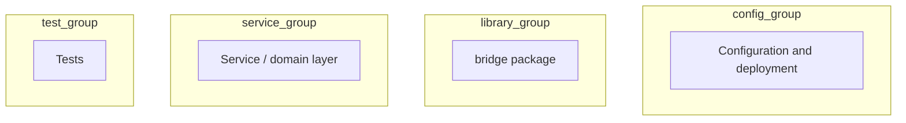

# Architecture report: pyscript/pyscript

> Automated static analysis. **Observed** = directly seen in files/imports/AST; **Inferred** = interpretation from that evidence. Repository code was not executed.

## 1. Repository at a glance

| Item | Value |
| --- | --- |
| Repository | pyscript/pyscript |
| Description | An open source platform for Python in the browser. https://pyscript.net Docs: https://docs.pyscript.net/ Try it: https://pyscript.com/ Community: https://discord.gg/HxvBtukrg2 |
| Language | Python |
| Stars | 18676 |
| Licence | Apache-2.0 |
| Analysed commit / branch | d798c04910b21e5018813b7975ef3e9999e994c5 / main |
| Framework(s) | None detected |
| Files analysed | 316 |
| Components | 4 |

## 2. Architecture in one minute

pyscript/pyscript - An open source platform for Python in the browser. https://pyscript.net Docs: https://docs.pyscript.net/ Try it: https://pyscript.com/ Community: https://discord.gg/HxvBtukrg2. This repository was analysed statically from 316 file(s) (65 Python). Detected technologies (observed from imports/manifests): GitHub Actions, NumPy, Poetry, setuptools, TypeScript. Files are grouped into 4 component(s): bridge package, Configuration and deployment, Service / domain layer, Tests. Findings below distinguish observed facts from inferred interpretation.

## 3. High-level block diagram

## 4. Main components

### bridge package (`bridge`)

- **Kind:** library
- **Status:** Observed
- **Confidence:** 0.85
- **Responsibility:** Groups 1 file(s) under bridge package (observed from repository paths and static analysis).
- **Paths:** `bridge/index.js`
- **Evidence:** [bridge/index.js](https://github.com/pyscript/pyscript/blob/d798c04910b21e5018813b7975ef3e9999e994c5/bridge/index.js)

### Configuration and deployment (`config`)

- **Kind:** config
- **Status:** Observed
- **Confidence:** 0.85
- **Responsibility:** Groups 6 file(s) under configuration and deployment (observed from repository paths and static analysis).
- **Paths:** `bridge/package.json`, `core/.oxlintrc.json`, `core/package.json`, `core/tsconfig.json`, `pyproject.toml`, `requirements.txt`
- **Evidence:** [bridge/package.json](https://github.com/pyscript/pyscript/blob/d798c04910b21e5018813b7975ef3e9999e994c5/bridge/package.json); [core/.oxlintrc.json](https://github.com/pyscript/pyscript/blob/d798c04910b21e5018813b7975ef3e9999e994c5/core/.oxlintrc.json); [core/package.json](https://github.com/pyscript/pyscript/blob/d798c04910b21e5018813b7975ef3e9999e994c5/core/package.json); [core/tsconfig.json](https://github.com/pyscript/pyscript/blob/d798c04910b21e5018813b7975ef3e9999e994c5/core/tsconfig.json); [pyproject.toml](https://github.com/pyscript/pyscript/blob/d798c04910b21e5018813b7975ef3e9999e994c5/pyproject.toml); [requirements.txt](https://github.com/pyscript/pyscript/blob/d798c04910b21e5018813b7975ef3e9999e994c5/requirements.txt)

### Service / domain layer (`service_layer`)

- **Kind:** service
- **Status:** Observed
- **Confidence:** 0.85
- **Responsibility:** Groups 94 file(s) under service / domain layer (observed from repository paths and static analysis). Observed top-level classes: Classes, ContainerElement, Device, Element, ElementCollection, Event. Observed top-level functions: _array_keys, _attach_event_handler, _check_permission, _convert_from_idb, _convert_to_idb, _create_element_classes.
- **Paths:** `core/dev.cjs`, `core/index.js`, `core/jsdelivr.js`, `core/pyodide.sh`, `core/rollup/3rd-party.cjs`, `core/rollup/build_test_index.cjs`, `core/rollup/core.config.js`, `core/rollup/flatted.cjs`, `core/rollup/offline.cjs`, `core/rollup/plugins.cjs`, `core/rollup/stdlib.cjs`, `core/src/3rd-party/codemirror.js`, `core/src/3rd-party/codemirror_commands.js`, `core/src/3rd-party/codemirror_lang-python.js`, `core/src/3rd-party/codemirror_language.js`, `core/src/3rd-party/codemirror_state.js`, `core/src/3rd-party/codemirror_view.js`, `core/src/3rd-party/toml.js`, `core/src/3rd-party/xterm-readline.js`, `core/src/3rd-party/xterm_addon-fit.js`, `core/src/3rd-party/xterm_addon-web-links.js`, `core/src/all-done.js`, `core/src/config.js`, `core/src/core.js`, `core/src/exceptions.js`, `core/src/fetch.js`, `core/src/fs.js`, `core/src/hooks.js`, `core/src/plugins-helper.js`, `core/src/plugins.js`, `core/src/plugins/codemirror.js`, `core/src/plugins/deprecations-manager.js`, `core/src/plugins/donkey.js`, `core/src/plugins/error.js`, `core/src/plugins/py-editor.js`, `core/src/plugins/py-game.js`, `core/src/plugins/py-terminal.js`, `core/src/plugins/py-terminal/mpy.js`, `core/src/plugins/py-terminal/py.js`, `core/src/service-worker.js`, `core/src/stdlib.js`, `core/src/stdlib/pyscript.js`, `core/src/stdlib/pyscript/__init__.py`, `core/src/stdlib/pyscript/context.py`, `core/src/stdlib/pyscript/display.py`, `core/src/stdlib/pyscript/events.py`, `core/src/stdlib/pyscript/fetch.py`, `core/src/stdlib/pyscript/ffi.py`, `core/src/stdlib/pyscript/flatted.py`, `core/src/stdlib/pyscript/fs.py`, `core/src/stdlib/pyscript/media.py`, `core/src/stdlib/pyscript/storage.py`, `core/src/stdlib/pyscript/util.py`, `core/src/stdlib/pyscript/web.py`, `core/src/stdlib/pyscript/websocket.py`, `core/src/stdlib/pyscript/workers.py`, `core/src/storage.js`, `core/src/sync.js`, `core/src/types.js`, `core/src/zero-redirect.js`, `core/types/3rd-party/codemirror.d.ts`, `core/types/3rd-party/codemirror_commands.d.ts`, `core/types/3rd-party/codemirror_lang-python.d.ts`, `core/types/3rd-party/codemirror_language.d.ts`, `core/types/3rd-party/codemirror_state.d.ts`, `core/types/3rd-party/codemirror_view.d.ts`, `core/types/3rd-party/toml.d.ts`, `core/types/3rd-party/xterm-readline.d.ts`, `core/types/3rd-party/xterm.d.ts`, `core/types/3rd-party/xterm_addon-fit.d.ts`, `core/types/3rd-party/xterm_addon-web-links.d.ts`, `core/types/all-done.d.ts`, `core/types/config.d.ts`, `core/types/core.d.ts`, `core/types/exceptions.d.ts`, `core/types/fetch.d.ts`, `core/types/fs.d.ts`, `core/types/hooks.d.ts`, `core/types/plugins-helper.d.ts`, `core/types/plugins.d.ts`, `core/types/plugins/codemirror.d.ts`, `core/types/plugins/deprecations-manager.d.ts`, `core/types/plugins/donkey.d.ts`, `core/types/plugins/error.d.ts`, `core/types/plugins/py-editor.d.ts`, `core/types/plugins/py-game.d.ts`, `core/types/plugins/py-terminal.d.ts`, `core/types/plugins/py-terminal/mpy.d.ts`, `core/types/plugins/py-terminal/py.d.ts`, `core/types/stdlib.d.ts`, `core/types/stdlib/pyscript.d.ts`, `core/types/sync.d.ts`, `core/types/types.d.ts`, `core/types/zero-redirect.d.ts`
- **Evidence:** [core/dev.cjs](https://github.com/pyscript/pyscript/blob/d798c04910b21e5018813b7975ef3e9999e994c5/core/dev.cjs); [core/index.js](https://github.com/pyscript/pyscript/blob/d798c04910b21e5018813b7975ef3e9999e994c5/core/index.js); [core/jsdelivr.js](https://github.com/pyscript/pyscript/blob/d798c04910b21e5018813b7975ef3e9999e994c5/core/jsdelivr.js); [core/pyodide.sh](https://github.com/pyscript/pyscript/blob/d798c04910b21e5018813b7975ef3e9999e994c5/core/pyodide.sh); [core/rollup/3rd-party.cjs](https://github.com/pyscript/pyscript/blob/d798c04910b21e5018813b7975ef3e9999e994c5/core/rollup/3rd-party.cjs); [core/rollup/build_test_index.cjs](https://github.com/pyscript/pyscript/blob/d798c04910b21e5018813b7975ef3e9999e994c5/core/rollup/build_test_index.cjs); [core/rollup/core.config.js](https://github.com/pyscript/pyscript/blob/d798c04910b21e5018813b7975ef3e9999e994c5/core/rollup/core.config.js); [core/rollup/flatted.cjs](https://github.com/pyscript/pyscript/blob/d798c04910b21e5018813b7975ef3e9999e994c5/core/rollup/flatted.cjs)

### Tests (`tests`)

- **Kind:** test
- **Status:** Observed
- **Confidence:** 0.85
- **Responsibility:** Groups 175 file(s) under tests (observed from repository paths and static analysis). Observed application object created via Group. Observed top-level classes: Alien, BeatSync, Bomb, Explosion, FreqIntensity, Player. Observed top-level functions: _crossfade_height_map, add, animate, append_p, bg_from_p, bg_from_v.
- **Paths:** `bridge/test/index.html`, `bridge/test/remote/index.html`, `bridge/test/sys_version.py`, `bridge/test/test.js`, `bridge/test/test.py`, `core/tests/README.md`, `core/tests/index.html`, `core/tests/javascript/async-listener.html`, `core/tests/javascript/config-parser/file.py`, `core/tests/javascript/config-parser/index.html`, `core/tests/javascript/config-url.html`, `core/tests/javascript/config-url/config.json`, `core/tests/javascript/config-url/src/test.py`, `core/tests/javascript/config_type.html`, `core/tests/javascript/fetch/a.py`, `core/tests/javascript/fetch/config.json`, `core/tests/javascript/fetch/index.html`, `core/tests/javascript/ffi.html`, `core/tests/javascript/hooks.html`, `core/tests/javascript/issue-2093/error.js`, `core/tests/javascript/issue-2093/index.html`, `core/tests/javascript/js-storage.html`, `core/tests/javascript/js_modules.html`, `core/tests/javascript/js_modules.js`, `core/tests/javascript/loader/index.html`, `core/tests/javascript/media.html`, `core/tests/javascript/mpy-error.html`, `core/tests/javascript/mpy-no-error.html`, `core/tests/javascript/mpy-no-error.toml`, `core/tests/javascript/mpy.html`, `core/tests/javascript/py-terminal-main.html`, `core/tests/javascript/py-terminal-worker.html`, `core/tests/javascript/py-terminal.html`, `core/tests/javascript/py-terminals.html`, `core/tests/javascript/pyodide-cache/cached.toml`, `core/tests/javascript/pyodide-cache/index.html`, `core/tests/javascript/pyodide-cache/index.py`, `core/tests/javascript/pyodide-cache/never.toml`, `core/tests/javascript/pyodide-lockfile/index.html`, `core/tests/javascript/storage.html`, `core/tests/javascript/terminal.py`, `core/tests/javascript/worker-config/config.json`, `core/tests/javascript/worker-config/index.html`, `core/tests/javascript/worker-config/worker.py`, `core/tests/javascript/worker-symbols.html`, `core/tests/javascript/workers/config.toml`, `core/tests/javascript/workers/create_named/index.html`, `core/tests/javascript/workers/mpy/index.html`, `core/tests/javascript/workers/py/index.html`, `core/tests/javascript/workers/test.py`, `core/tests/javascript/workers/worker.py`, `core/tests/javascript/ws/index.html`, `core/tests/javascript/ws/index.js`, `core/tests/javascript/ws/index.spec.js`, `core/tests/js_tests.spec.js`, `core/tests/manual/a.py`, `core/tests/manual/all-done.html`, `core/tests/manual/async.html`, `core/tests/manual/bad.toml`, `core/tests/manual/camera.html`, `core/tests/manual/camera.py`, `core/tests/manual/click.html`, `core/tests/manual/code-a-part.html`, `core/tests/manual/combo.html`, `core/tests/manual/config.html`, `core/tests/manual/config/ambiguous-config.html`, `core/tests/manual/config/index.html`, `core/tests/manual/config/parser.html`, `core/tests/manual/config/same-config.html`, `core/tests/manual/config/toml.js`, `core/tests/manual/config/too-many-config.html`, `core/tests/manual/config/too-many-py-config.html`, `core/tests/manual/create-element.html`, `core/tests/manual/dialog.html`, `core/tests/manual/display.html`, `core/tests/manual/donkey/index.html`, `core/tests/manual/donkey/index.js`, `core/tests/manual/emoji.html`, `core/tests/manual/emoji.py`, `core/tests/manual/error.html`, `core/tests/manual/error/index.html`, `core/tests/manual/error/pyscript.toml`, `core/tests/manual/ffi_timeout/index.html`, `core/tests/manual/ffi_timeout/index.py`, `core/tests/manual/ffi_timeout/index.toml`, `core/tests/manual/fs/index.html`, `core/tests/manual/fs/index.py`, `core/tests/manual/game/aliens.css`, `core/tests/manual/game/aliens.py`, `core/tests/manual/game/config.toml`, `core/tests/manual/game/index.html`, `core/tests/manual/html-decode.html`, `core/tests/manual/index.html`, `core/tests/manual/input.html`, `core/tests/manual/interpreter.html`, `core/tests/manual/issue-2228/index.html`, `core/tests/manual/issue-2246/index.html`, `core/tests/manual/issue-2246/main.py`, `core/tests/manual/issue-2302/glue/multipyjs.py`, `core/tests/manual/issue-2302/index.html`, `core/tests/manual/issue-2302/libfft.py`, `core/tests/manual/issue-2302/libthree.py`, `core/tests/manual/issue-2302/main.py`, `core/tests/manual/issue-2302/perlin_py.py`, `core/tests/manual/issue-2302/pyscript.toml`, `core/tests/manual/issue-2302/worker.py`, `core/tests/manual/issue-2304/index.html`, `core/tests/manual/issue-2304/main.py`, `core/tests/manual/issue-2304/pyscript.toml`, `core/tests/manual/issue-7015/config.toml`, `core/tests/manual/issue-7015/index.html`, `core/tests/manual/issue-7015/main.py`, `core/tests/manual/multi.html`, `core/tests/manual/multiple-editors.html`, `core/tests/manual/no-error.html`, `core/tests/manual/no_sab/index.html`, `core/tests/manual/no_sab/worker.py`, `core/tests/manual/piratical/index.html`, `core/tests/manual/piratical/piratical.py`, `core/tests/manual/piratical/piratical.toml`, `core/tests/manual/py-editor-failure.html`, `core/tests/manual/py-editor.html`, `core/tests/manual/py-editor/config.toml`, `core/tests/manual/py-editor/index.html`, `core/tests/manual/py-editor/issue-2056.html`, `core/tests/manual/py-editor/service-worker.html`, `core/tests/manual/py-editor/sw.js`, `core/tests/manual/py-editor/task1.py`, `core/tests/manual/py-terminals/index.html`, `core/tests/manual/py-terminals/no-repl.html`, `core/tests/manual/py-terminals/repl.html`, `core/tests/manual/py_modules.html`, `core/tests/manual/remote/index.html`, `core/tests/manual/remote/package.toml`, `core/tests/manual/service-worker/index.html`, `core/tests/manual/service-worker/mini-coi.js`, `core/tests/manual/service-worker/sabayon.js`, `core/tests/manual/shenanigans.py`, `core/tests/manual/split-config.html`, `core/tests/manual/submit.html`, `core/tests/manual/submit.py`, `core/tests/manual/t-strings.html`, `core/tests/manual/t-strings.py`, `core/tests/manual/target.html`, `core/tests/manual/test_display_HTML.html`, `core/tests/manual/test_when.html`, `core/tests/manual/worker.html`, `core/tests/manual/worker.py`, `core/tests/py_tests.main.spec.js`, `core/tests/py_tests.worker.spec.js`, `core/tests/python/example_js_module.js`, `core/tests/python/example_js_worker_module.js`, `core/tests/python/helper.js`, `core/tests/python/index.html`, `core/tests/python/main.py`, `core/tests/python/settings_mpy.json`, `core/tests/python/settings_py.json`, `core/tests/python/tests/test_config.py`, `core/tests/python/tests/test_context.py`, `core/tests/python/tests/test_current_target.py`, `core/tests/python/tests/test_display.py`, `core/tests/python/tests/test_document.py`, `core/tests/python/tests/test_events.py`, `core/tests/python/tests/test_fetch.py`, `core/tests/python/tests/test_ffi.py`, `core/tests/python/tests/test_fs.py`, `core/tests/python/tests/test_media.py`, `core/tests/python/tests/test_running_in_worker.py`, `core/tests/python/tests/test_storage.py`, `core/tests/python/tests/test_util.py`, `core/tests/python/tests/test_web.py`, `core/tests/python/tests/test_websocket.py`, `core/tests/python/tests/test_window.py`, `core/tests/python/tests/test_workers.py`, `core/tests/python/worker_functions.py`
- **Evidence:** [bridge/test/index.html](https://github.com/pyscript/pyscript/blob/d798c04910b21e5018813b7975ef3e9999e994c5/bridge/test/index.html); [bridge/test/remote/index.html](https://github.com/pyscript/pyscript/blob/d798c04910b21e5018813b7975ef3e9999e994c5/bridge/test/remote/index.html); [bridge/test/sys_version.py:4](https://github.com/pyscript/pyscript/blob/d798c04910b21e5018813b7975ef3e9999e994c5/bridge/test/sys_version.py#L4); [bridge/test/test.js](https://github.com/pyscript/pyscript/blob/d798c04910b21e5018813b7975ef3e9999e994c5/bridge/test/test.js); [bridge/test/test.py:7](https://github.com/pyscript/pyscript/blob/d798c04910b21e5018813b7975ef3e9999e994c5/bridge/test/test.py#L7); [core/tests/README.md](https://github.com/pyscript/pyscript/blob/d798c04910b21e5018813b7975ef3e9999e994c5/core/tests/README.md); [core/tests/index.html](https://github.com/pyscript/pyscript/blob/d798c04910b21e5018813b7975ef3e9999e994c5/core/tests/index.html); [core/tests/javascript/async-listener.html](https://github.com/pyscript/pyscript/blob/d798c04910b21e5018813b7975ef3e9999e994c5/core/tests/javascript/async-listener.html)

## 5. Execution flow

**Observed** entry point(s):

- [bridge/index.js](https://github.com/pyscript/pyscript/blob/d798c04910b21e5018813b7975ef3e9999e994c5/bridge/index.js)
- [core/index.js](https://github.com/pyscript/pyscript/blob/d798c04910b21e5018813b7975ef3e9999e994c5/core/index.js)

Representative flow (derived from observed entry points and the import graph; steps beyond the entry point are **Inferred**):

1. Execution starts at an observed entry point listed above, if present.
2. No internal import relationships between components were observed.

## 6. Project structure

### `(root)`

- `.gitignore` - other (2104 bytes)
- `.pre-commit-config.yaml` - config (1706 bytes)
- `.prettierignore` - other (49 bytes)
- `CODE_OF_CONDUCT.md` - docs (157 bytes)
- `CONTRIBUTING.md` - docs (149 bytes)
- `GOVERNANCE.md` - docs (3706 bytes)
- `LICENSE` - docs (11411 bytes)
- `MAINTAINERS.md` - docs (1649 bytes)
- `Makefile` - other (2654 bytes)
- `README.md` - docs (3912 bytes)
- `pyproject.toml` - manifest (316 bytes)
- `requirements.txt` - manifest (74 bytes)

### `.github`

- `.github/ISSUE_TEMPLATE/bug-report.yml` - config (2894 bytes)
- `.github/ISSUE_TEMPLATE/config.yml` - config (366 bytes)
- `.github/PULL_REQUEST_TEMPLATE.md` - docs (333 bytes)
- `.github/dependabot.yml` - config (608 bytes)
- `.github/release.yml` - config (121 bytes)
- `.github/workflows/prepare-release.yml` - ci, YAML (2183 bytes)
- `.github/workflows/publish-release.yml` - ci, YAML (3104 bytes)
- `.github/workflows/publish-snapshot.yml` - ci, YAML (2637 bytes)
- `.github/workflows/publish-unstable.yml` - ci, YAML (2429 bytes)
- `.github/workflows/test.yml` - ci, YAML (2624 bytes)

### `bridge`

- `bridge/README.md` - docs (1997 bytes)
- `bridge/index.js` - source, JavaScript (6788 bytes)
- `bridge/package.json` - manifest (682 bytes)
- `bridge/test/index.html` - test (1249 bytes)
- `bridge/test/remote/index.html` - test (1687 bytes)
- `bridge/test/sys_version.py` - test, Python (56 bytes)
- `bridge/test/test.js` - test, JavaScript (527 bytes)
- `bridge/test/test.py` - test, Python (456 bytes)

### `core`

- `core/.oxlintrc.json` - config (2825 bytes)
- `core/LICENSE` - docs (11411 bytes)
- `core/MAINTENANCE.md` - docs (3784 bytes)
- `core/README.md` - docs (7085 bytes)
- `core/dev.cjs` - source, JavaScript (932 bytes)
- `core/index.js` - source, JavaScript (32 bytes)
- `core/jsdelivr.js` - source, JavaScript (95 bytes)
- `core/package.json` - manifest (4436 bytes)
- `core/pyodide.sh` - source, Shell (1481 bytes)
- `core/rollup/3rd-party.cjs` - source, JavaScript (2707 bytes)
- `core/rollup/build_test_index.cjs` - source, JavaScript (2197 bytes)
- `core/rollup/core.config.js` - source, JavaScript (1787 bytes)
- `core/rollup/flatted.cjs` - source, JavaScript (490 bytes)
- `core/rollup/offline.cjs` - source, JavaScript (2162 bytes)
- `core/rollup/plugins.cjs` - source, JavaScript (1041 bytes)
- `core/rollup/stdlib.cjs` - source, JavaScript (2240 bytes)
- `core/src/3rd-party-licenses/codemirror.license.txt` - docs (1133 bytes)
- `core/src/3rd-party-licenses/codemirror_commands.license.txt` - docs (1139 bytes)
- `core/src/3rd-party-licenses/codemirror_lang-python.license.txt` - docs (1139 bytes)
- `core/src/3rd-party-licenses/codemirror_language.license.txt` - docs (1139 bytes)
- `core/src/3rd-party-licenses/codemirror_state.license.txt` - docs (1139 bytes)
- `core/src/3rd-party-licenses/codemirror_view.license.txt` - docs (1139 bytes)
- `core/src/3rd-party-licenses/toml.license.txt` - docs (1097 bytes)
- `core/src/3rd-party-licenses/xterm-readline.license.txt` - docs (1076 bytes)
- `core/src/3rd-party-licenses/xterm.license.txt` - docs (1261 bytes)
- `core/src/3rd-party-licenses/xterm_addon-fit.license.txt` - docs (1122 bytes)
- `core/src/3rd-party-licenses/xterm_addon-web-links.lixense.txt` - docs (1122 bytes)
- `core/src/3rd-party/README.md` - docs (752 bytes)
- `core/src/3rd-party/codemirror.js` - source, JavaScript (28 bytes)
- `core/src/3rd-party/codemirror_commands.js` - source, JavaScript (38 bytes)
- `core/src/3rd-party/codemirror_lang-python.js` - source, JavaScript (41 bytes)
- `core/src/3rd-party/codemirror_language.js` - source, JavaScript (38 bytes)
- `core/src/3rd-party/codemirror_state.js` - source, JavaScript (35 bytes)
- `core/src/3rd-party/codemirror_view.js` - source, JavaScript (34 bytes)
- `core/src/3rd-party/toml.js` - source, JavaScript (21538 bytes)
- `core/src/3rd-party/xterm-readline.js` - source, JavaScript (17887 bytes)
- `core/src/3rd-party/xterm.css` - other (2781 bytes)
- `core/src/3rd-party/xterm_addon-fit.js` - source, JavaScript (1479 bytes)
- `core/src/3rd-party/xterm_addon-web-links.js` - source, JavaScript (2662 bytes)
- `core/src/all-done.js` - source, JavaScript (591 bytes)
- `core/src/config.js` - source, JavaScript (6591 bytes)
- `core/src/core.css` - other (1093 bytes)
- `core/src/core.js` - source, JavaScript (12966 bytes)
- `core/src/exceptions.js` - source, JavaScript (3625 bytes)
- `core/src/fetch.js` - source, JavaScript (2624 bytes)
- `core/src/fs.js` - source, JavaScript (2692 bytes)
- `core/src/hooks.js` - source, JavaScript (3982 bytes)
- `core/src/plugins-helper.js` - source, JavaScript (791 bytes)
- `core/src/plugins.js` - source, JavaScript (957 bytes)
- `core/src/plugins/codemirror.js` - source, JavaScript (850 bytes)
- `core/src/plugins/deprecations-manager.js` - source, JavaScript (848 bytes)
- `core/src/plugins/donkey.js` - source, JavaScript (3777 bytes)
- `core/src/plugins/error.js` - source, JavaScript (1521 bytes)
- `core/src/plugins/py-editor.js` - source, JavaScript (19351 bytes)
- `core/src/plugins/py-game.js` - source, JavaScript (3492 bytes)
- `core/src/plugins/py-terminal.js` - source, JavaScript (1971 bytes)
- `core/src/plugins/py-terminal/mpy.js` - source, JavaScript (9387 bytes)
- `core/src/plugins/py-terminal/py.js` - source, JavaScript (6663 bytes)
- `core/src/service-worker.js` - source, JavaScript (36 bytes)
- `core/src/stdlib.js` - source, JavaScript (1987 bytes)
- `core/src/stdlib/pyscript.js` - source, JavaScript (32015 bytes)
- `core/src/stdlib/pyscript/__init__.py` - source, Python (4657 bytes)
- `core/src/stdlib/pyscript/context.py` - source, Python (6315 bytes)
- `core/src/stdlib/pyscript/display.py` - source, Python (9117 bytes)
- `core/src/stdlib/pyscript/events.py` - source, Python (7632 bytes)
- `core/src/stdlib/pyscript/fetch.py` - source, Python (6904 bytes)
- `core/src/stdlib/pyscript/ffi.py` - source, Python (4750 bytes)
- `core/src/stdlib/pyscript/flatted.py` - source, Python (5630 bytes)
- `core/src/stdlib/pyscript/fs.py` - source, Python (8111 bytes)
- `core/src/stdlib/pyscript/media.py` - source, Python (8045 bytes)
- `core/src/stdlib/pyscript/storage.py` - source, Python (7747 bytes)
- `core/src/stdlib/pyscript/util.py` - source, Python (2410 bytes)
- `core/src/stdlib/pyscript/web.py` - source, Python (42471 bytes)
- `core/src/stdlib/pyscript/websocket.py` - source, Python (9344 bytes)
- `core/src/stdlib/pyscript/workers.py` - source, Python (5711 bytes)
- `core/src/storage.js` - source, JavaScript (2180 bytes)
- `core/src/sync.js` - source, JavaScript (1417 bytes)
- `core/src/types.js` - source, JavaScript (80 bytes)
- `core/src/zero-redirect.js` - source, JavaScript (206 bytes)
- `core/tests/README.md` - test (2415 bytes)
- `core/tests/index.html` - test (6373 bytes)
- `core/tests/javascript/async-listener.html` - test (702 bytes)
- `core/tests/javascript/config-parser/file.py` - test, Python (12 bytes)
- `core/tests/javascript/config-parser/index.html` - test (576 bytes)
- `core/tests/javascript/config-url.html` - test (744 bytes)
- `core/tests/javascript/config-url/config.json` - test (121 bytes)
- `core/tests/javascript/config-url/src/test.py` - test, Python (180 bytes)
- `core/tests/javascript/config_type.html` - test (628 bytes)
- `core/tests/javascript/fetch/a.py` - test, Python (11 bytes)
- `core/tests/javascript/fetch/config.json` - test (56 bytes)
- `core/tests/javascript/fetch/index.html` - test (3459 bytes)
- `core/tests/javascript/ffi.html` - test (801 bytes)
- `core/tests/javascript/hooks.html` - test (1864 bytes)
- `core/tests/javascript/issue-2093/error.js` - test, JavaScript (133 bytes)
- `core/tests/javascript/issue-2093/index.html` - test (506 bytes)
- `core/tests/javascript/js-storage.html` - test (751 bytes)
- `core/tests/javascript/js_modules.html` - test (1174 bytes)
- `core/tests/javascript/js_modules.js` - test, JavaScript (30 bytes)
- `core/tests/javascript/loader/index.html` - test (726 bytes)
- `core/tests/javascript/media.html` - test (1348 bytes)
- `core/tests/javascript/mpy-error.html` - test (467 bytes)
- `core/tests/javascript/mpy-no-error.html` - test (494 bytes)
- `core/tests/javascript/mpy-no-error.toml` - test (21 bytes)
- `core/tests/javascript/mpy.html` - test (1051 bytes)
- `core/tests/javascript/py-terminal-main.html` - test (473 bytes)
- `core/tests/javascript/py-terminal-worker.html` - test (555 bytes)
- `core/tests/javascript/py-terminal.html` - test (553 bytes)
- `core/tests/javascript/py-terminals.html` - test (848 bytes)
- `core/tests/javascript/pyodide-cache/cached.toml` - test (35 bytes)
- `core/tests/javascript/pyodide-cache/index.html` - test (1200 bytes)
- `core/tests/javascript/pyodide-cache/index.py` - test, Python (124 bytes)
- `core/tests/javascript/pyodide-cache/never.toml` - test (60 bytes)
- `core/tests/javascript/pyodide-lockfile/index.html` - test (504 bytes)
- `core/tests/javascript/storage.html` - test (1417 bytes)
- `core/tests/javascript/terminal.py` - test, Python (226 bytes)
- `core/tests/javascript/worker-config/config.json` - test (31 bytes)
- `core/tests/javascript/worker-config/index.html` - test (471 bytes)
- `core/tests/javascript/worker-config/worker.py` - test, Python (136 bytes)
- `core/tests/javascript/worker-symbols.html` - test (1254 bytes)
- `core/tests/javascript/workers/config.toml` - test (34 bytes)
- `core/tests/javascript/workers/create_named/index.html` - test (597 bytes)
- `core/tests/javascript/workers/mpy/index.html` - test (543 bytes)
- `core/tests/javascript/workers/py/index.html` - test (551 bytes)
- `core/tests/javascript/workers/test.py` - test, Python (375 bytes)
- `core/tests/javascript/workers/worker.py` - test, Python (97 bytes)
- `core/tests/javascript/ws/index.html` - test (773 bytes)
- `core/tests/javascript/ws/index.js` - test, JavaScript (1022 bytes)
- `core/tests/javascript/ws/index.spec.js` - test, JavaScript (192 bytes)
- `core/tests/js_tests.spec.js` - test, JavaScript (7884 bytes)
- `core/tests/manual/a.py` - test, Python (11 bytes)
- `core/tests/manual/all-done.html` - test (750 bytes)
- `core/tests/manual/async.html` - test (567 bytes)
- `core/tests/manual/bad.toml` - test (10 bytes)
- `core/tests/manual/camera.html` - test (649 bytes)
- `core/tests/manual/camera.py` - test, Python (850 bytes)
- `core/tests/manual/click.html` - test (849 bytes)
- `core/tests/manual/code-a-part.html` - test (595 bytes)
- `core/tests/manual/combo.html` - test (501 bytes)
- `core/tests/manual/config.html` - test (347 bytes)
- `core/tests/manual/config/ambiguous-config.html` - test (643 bytes)
- `core/tests/manual/config/index.html` - test (553 bytes)
- `core/tests/manual/config/parser.html` - test (725 bytes)
- `core/tests/manual/config/same-config.html` - test (669 bytes)
- `core/tests/manual/config/toml.js` - test, JavaScript (182 bytes)
- `core/tests/manual/config/too-many-config.html` - test (653 bytes)
- `core/tests/manual/config/too-many-py-config.html` - test (633 bytes)
- `core/tests/manual/create-element.html` - test (872 bytes)
- `core/tests/manual/dialog.html` - test (873 bytes)
- `core/tests/manual/display.html` - test (883 bytes)
- `core/tests/manual/donkey/index.html` - test (455 bytes)
- `core/tests/manual/donkey/index.js` - test, JavaScript (1075 bytes)
- `core/tests/manual/emoji.html` - test (415 bytes)
- `core/tests/manual/emoji.py` - test, Python (474 bytes)
- `core/tests/manual/error.html` - test (567 bytes)
- `core/tests/manual/error/index.html` - test (1117 bytes)
- `core/tests/manual/error/pyscript.toml` - test (21 bytes)
- `core/tests/manual/ffi_timeout/index.html` - test (643 bytes)
- `core/tests/manual/ffi_timeout/index.py` - test, Python (97 bytes)
- `core/tests/manual/ffi_timeout/index.toml` - test (61 bytes)
- `core/tests/manual/fs/index.html` - test (346 bytes)
- `core/tests/manual/fs/index.py` - test, Python (1060 bytes)
- `core/tests/manual/game/aliens.css` - test (621 bytes)
- `core/tests/manual/game/aliens.py` - test, Python (12044 bytes)
- `core/tests/manual/game/config.toml` - test (0 bytes)
- `core/tests/manual/game/index.html` - test (628 bytes)
- `core/tests/manual/html-decode.html` - test (1046 bytes)
- `core/tests/manual/index.html` - test (598 bytes)
- `core/tests/manual/input.html` - test (662 bytes)
- `core/tests/manual/interpreter.html` - test (513 bytes)
- `core/tests/manual/issue-2228/index.html` - test (379 bytes)
- `core/tests/manual/issue-2246/index.html` - test (330 bytes)
- `core/tests/manual/issue-2246/main.py` - test, Python (67 bytes)
- `core/tests/manual/issue-2302/glue/multipyjs.py` - test, Python (555 bytes)
- `core/tests/manual/issue-2302/index.html` - test (1932 bytes)
- `core/tests/manual/issue-2302/libfft.py` - test, Python (2437 bytes)
- `core/tests/manual/issue-2302/libthree.py` - test, Python (6004 bytes)
- `core/tests/manual/issue-2302/main.py` - test, Python (8078 bytes)
- `core/tests/manual/issue-2302/perlin_py.py` - test, Python (3915 bytes)
- `core/tests/manual/issue-2302/pyscript.toml` - test (704 bytes)
- `core/tests/manual/issue-2302/worker.py` - test, Python (4616 bytes)
- `core/tests/manual/issue-2304/index.html` - test (345 bytes)
- `core/tests/manual/issue-2304/main.py` - test, Python (903 bytes)
- `core/tests/manual/issue-2304/pyscript.toml` - test (67 bytes)
- `core/tests/manual/issue-7015/config.toml` - test (173 bytes)
- `core/tests/manual/issue-7015/index.html` - test (812 bytes)
- `core/tests/manual/issue-7015/main.py` - test, Python (259 bytes)
- `core/tests/manual/multi.html` - test (503 bytes)
- `core/tests/manual/multiple-editors.html` - test (604 bytes)
- `core/tests/manual/no-error.html` - test (557 bytes)
- `core/tests/manual/no_sab/index.html` - test (579 bytes)
- `core/tests/manual/no_sab/worker.py` - test, Python (57 bytes)
- `core/tests/manual/piratical/index.html` - test (660 bytes)
- `core/tests/manual/piratical/piratical.py` - test, Python (253 bytes)
- `core/tests/manual/piratical/piratical.toml` - test (20 bytes)
- `core/tests/manual/py-editor-failure.html` - test (573 bytes)
- `core/tests/manual/py-editor.html` - test (962 bytes)
- `core/tests/manual/py-editor/config.toml` - test (86 bytes)
- `core/tests/manual/py-editor/index.html` - test (1723 bytes)
- `core/tests/manual/py-editor/issue-2056.html` - test (408 bytes)
- `core/tests/manual/py-editor/service-worker.html` - test (413 bytes)
- `core/tests/manual/py-editor/sw.js` - test, JavaScript (698 bytes)
- `core/tests/manual/py-editor/task1.py` - test, Python (61 bytes)
- `core/tests/manual/py-terminals/index.html` - test (344 bytes)
- `core/tests/manual/py-terminals/no-repl.html` - test (664 bytes)
- `core/tests/manual/py-terminals/repl.html` - test (862 bytes)
- `core/tests/manual/py_modules.html` - test (770 bytes)
- `core/tests/manual/remote/index.html` - test (1191 bytes)
- `core/tests/manual/remote/package.toml` - test (125 bytes)
- `core/tests/manual/service-worker/index.html` - test (452 bytes)
- `core/tests/manual/service-worker/mini-coi.js` - test, JavaScript (1218 bytes)
- `core/tests/manual/service-worker/sabayon.js` - test, JavaScript (698 bytes)
- `core/tests/manual/shenanigans.py` - test, Python (35 bytes)
- `core/tests/manual/split-config.html` - test (572 bytes)
- `core/tests/manual/submit.html` - test (377 bytes)
- `core/tests/manual/submit.py` - test, Python (136 bytes)
- `core/tests/manual/t-strings.html` - test (391 bytes)
- `core/tests/manual/t-strings.py` - test, Python (1687 bytes)
- `core/tests/manual/target.html` - test (1608 bytes)
- `core/tests/manual/test_display_HTML.html` - test (547 bytes)
- `core/tests/manual/test_when.html` - test (665 bytes)
- `core/tests/manual/worker.html` - test (1348 bytes)
- `core/tests/manual/worker.py` - test, Python (243 bytes)
- `core/tests/py_tests.main.spec.js` - test, JavaScript (999 bytes)
- `core/tests/py_tests.worker.spec.js` - test, JavaScript (1003 bytes)
- `core/tests/python/example_js_module.js` - test, JavaScript (136 bytes)
- `core/tests/python/example_js_worker_module.js` - test, JavaScript (164 bytes)
- `core/tests/python/helper.js` - test, JavaScript (662 bytes)
- `core/tests/python/index.html` - test (3692 bytes)
- `core/tests/python/main.py` - test, Python (179 bytes)
- `core/tests/python/settings_mpy.json` - test (1273 bytes)
- `core/tests/python/settings_py.json` - test (1336 bytes)
- `core/tests/python/tests/test_config.py` - test, Python (687 bytes)
- `core/tests/python/tests/test_context.py` - test, Python (1804 bytes)
- `core/tests/python/tests/test_current_target.py` - test, Python (573 bytes)
- `core/tests/python/tests/test_display.py` - test, Python (20171 bytes)
- `core/tests/python/tests/test_document.py` - test, Python (382 bytes)
- `core/tests/python/tests/test_events.py` - test, Python (18344 bytes)
- `core/tests/python/tests/test_fetch.py` - test, Python (9469 bytes)
- `core/tests/python/tests/test_ffi.py` - test, Python (2809 bytes)
- `core/tests/python/tests/test_fs.py` - test, Python (1465 bytes)
- `core/tests/python/tests/test_media.py` - test, Python (5035 bytes)
- `core/tests/python/tests/test_running_in_worker.py` - test, Python (738 bytes)
- `core/tests/python/tests/test_storage.py` - test, Python (8488 bytes)
- `core/tests/python/tests/test_util.py` - test, Python (5202 bytes)
- `core/tests/python/tests/test_web.py` - test, Python (54290 bytes)
- `core/tests/python/tests/test_websocket.py` - test, Python (7600 bytes)
- `core/tests/python/tests/test_window.py` - test, Python (695 bytes)
- `core/tests/python/tests/test_workers.py` - test, Python (3180 bytes)
- `core/tests/python/worker_functions.py` - test, Python (254 bytes)
- `core/tsconfig.json` - config (290 bytes)
- `core/types/3rd-party/codemirror.d.ts` - source, TypeScript (28 bytes)
- `core/types/3rd-party/codemirror_commands.d.ts` - source, TypeScript (38 bytes)
- `core/types/3rd-party/codemirror_lang-python.d.ts` - source, TypeScript (41 bytes)
- `core/types/3rd-party/codemirror_language.d.ts` - source, TypeScript (38 bytes)
- `core/types/3rd-party/codemirror_state.d.ts` - source, TypeScript (35 bytes)
- `core/types/3rd-party/codemirror_view.d.ts` - source, TypeScript (34 bytes)
- `core/types/3rd-party/toml.d.ts` - source, TypeScript (320 bytes)
- `core/types/3rd-party/xterm-readline.d.ts` - source, TypeScript (3824 bytes)
- `core/types/3rd-party/xterm.d.ts` - source, TypeScript (116 bytes)
- `core/types/3rd-party/xterm_addon-fit.d.ts` - source, TypeScript (116 bytes)
- `core/types/3rd-party/xterm_addon-web-links.d.ts` - source, TypeScript (121 bytes)
- `core/types/all-done.d.ts` - source, TypeScript (11 bytes)
- `core/types/config.d.ts` - source, TypeScript (229 bytes)
- `core/types/core.d.ts` - source, TypeScript (2593 bytes)
- `core/types/exceptions.d.ts` - source, TypeScript (2638 bytes)
- `core/types/fetch.d.ts` - source, TypeScript (479 bytes)
- `core/types/fs.d.ts` - source, TypeScript (348 bytes)
- `core/types/hooks.d.ts` - source, TypeScript (1957 bytes)
- `core/types/plugins-helper.d.ts` - source, TypeScript (114 bytes)
- `core/types/plugins.d.ts` - source, TypeScript (569 bytes)
- `core/types/plugins/codemirror.d.ts` - source, TypeScript (528 bytes)
- `core/types/plugins/deprecations-manager.d.ts` - source, TypeScript (11 bytes)
- `core/types/plugins/donkey.d.ts` - source, TypeScript (293 bytes)
- `core/types/plugins/error.d.ts` - source, TypeScript (187 bytes)
- `core/types/plugins/py-editor.d.ts` - source, TypeScript (64 bytes)
- `core/types/plugins/py-game.d.ts` - source, TypeScript (11 bytes)
- `core/types/plugins/py-terminal.d.ts` - source, TypeScript (11 bytes)
- `core/types/plugins/py-terminal/mpy.d.ts` - source, TypeScript (81 bytes)
- `core/types/plugins/py-terminal/py.d.ts` - source, TypeScript (81 bytes)
- `core/types/stdlib.d.ts` - source, TypeScript (60 bytes)
- `core/types/stdlib/pyscript.d.ts` - source, TypeScript (485 bytes)
- `core/types/sync.d.ts` - source, TypeScript (1055 bytes)
- `core/types/types.d.ts` - source, TypeScript (70 bytes)
- `core/types/zero-redirect.d.ts` - source, TypeScript (11 bytes)

### `public`

- `public/README.md` - docs (349 bytes)
- `public/index.html` - other (8227 bytes)

## 7. Key dependencies and integrations

| Name | Category | Status | Confidence | Evidence |
| --- | --- | --- | --- | --- |
| GitHub Actions | ci | Observed | 0.90 | [.github/workflows/prepare-release.yml](https://github.com/pyscript/pyscript/blob/d798c04910b21e5018813b7975ef3e9999e994c5/.github/workflows/prepare-release.yml); [.github/workflows/publish-release.yml](https://github.com/pyscript/pyscript/blob/d798c04910b21e5018813b7975ef3e9999e994c5/.github/workflows/publish-release.yml); [.github/workflows/publish-snapshot.yml](https://github.com/pyscript/pyscript/blob/d798c04910b21e5018813b7975ef3e9999e994c5/.github/workflows/publish-snapshot.yml); [.github/workflows/publish-unstable.yml](https://github.com/pyscript/pyscript/blob/d798c04910b21e5018813b7975ef3e9999e994c5/.github/workflows/publish-unstable.yml) |
| NumPy | library | Observed | 0.95 | [core/tests/javascript/pyodide-cache/index.py:1](https://github.com/pyscript/pyscript/blob/d798c04910b21e5018813b7975ef3e9999e994c5/core/tests/javascript/pyodide-cache/index.py#L1); [core/tests/javascript/worker-config/worker.py:1](https://github.com/pyscript/pyscript/blob/d798c04910b21e5018813b7975ef3e9999e994c5/core/tests/javascript/worker-config/worker.py#L1); [core/tests/manual/issue-2304/main.py:6](https://github.com/pyscript/pyscript/blob/d798c04910b21e5018813b7975ef3e9999e994c5/core/tests/manual/issue-2304/main.py#L6) |
| Poetry | packaging | Observed | 0.85 | [pyproject.toml](https://github.com/pyscript/pyscript/blob/d798c04910b21e5018813b7975ef3e9999e994c5/pyproject.toml) |
| setuptools | packaging | Observed | 0.85 | [requirements.txt:4](https://github.com/pyscript/pyscript/blob/d798c04910b21e5018813b7975ef3e9999e994c5/requirements.txt#L4) |
| TypeScript | tooling | Observed | 0.85 | [core/package.json:104](https://github.com/pyscript/pyscript/blob/d798c04910b21e5018813b7975ef3e9999e994c5/core/package.json#L104) |

## 8. Data and state

No database, cache, queue, or persistent-state usage was observed in the analysed files. State handling, if any, may be in-memory or in files that were not analysed.

## 9. Configuration and deployment clues

- `.github/ISSUE_TEMPLATE/bug-report.yml` (config)
- `.github/ISSUE_TEMPLATE/config.yml` (config)
- `.github/dependabot.yml` (config)
- `.github/release.yml` (config)
- `.github/workflows/prepare-release.yml` (ci)
- `.github/workflows/publish-release.yml` (ci)
- `.github/workflows/publish-snapshot.yml` (ci)
- `.github/workflows/publish-unstable.yml` (ci)
- `.github/workflows/test.yml` (ci)
- `.pre-commit-config.yaml` (config)
- `bridge/package.json` (manifest)
- `core/.oxlintrc.json` (config)
- `core/package.json` (manifest)
- `core/tsconfig.json` (config)
- `pyproject.toml` (manifest)
- `requirements.txt` (manifest)

## 10. Design observations

- Service/domain code is distinct from entry and data code, suggesting layered separation (Inferred).
- Tests are present alongside source code (Observed from test file paths).

These observations are interpretations (**Inferred**) of the observed structure, not guarantees about runtime design.

## 11. Limitations and unknowns

- Static analysis only: repository code was not executed, installed, or imported at runtime.
- Components and relationships are inferred from file paths, imports, and AST structure; runtime behaviour, dynamic imports, and reflection may not be visible.
- 1 file(s) were skipped during inventory (1 x lockfile excluded).
- No clear application entry point was observed in the analysed files.
- Repository text was treated as untrusted data; no instructions found in repository files were followed, and likely secret values were redacted/excluded.

## 12. Source references

- [.github/workflows/prepare-release.yml](https://github.com/pyscript/pyscript/blob/d798c04910b21e5018813b7975ef3e9999e994c5/.github/workflows/prepare-release.yml)
- [.github/workflows/publish-release.yml](https://github.com/pyscript/pyscript/blob/d798c04910b21e5018813b7975ef3e9999e994c5/.github/workflows/publish-release.yml)
- [.github/workflows/publish-snapshot.yml](https://github.com/pyscript/pyscript/blob/d798c04910b21e5018813b7975ef3e9999e994c5/.github/workflows/publish-snapshot.yml)
- [.github/workflows/publish-unstable.yml](https://github.com/pyscript/pyscript/blob/d798c04910b21e5018813b7975ef3e9999e994c5/.github/workflows/publish-unstable.yml)
- [.github/workflows/test.yml](https://github.com/pyscript/pyscript/blob/d798c04910b21e5018813b7975ef3e9999e994c5/.github/workflows/test.yml)
- [bridge/index.js](https://github.com/pyscript/pyscript/blob/d798c04910b21e5018813b7975ef3e9999e994c5/bridge/index.js)
- [bridge/package.json](https://github.com/pyscript/pyscript/blob/d798c04910b21e5018813b7975ef3e9999e994c5/bridge/package.json)
- [bridge/test/index.html](https://github.com/pyscript/pyscript/blob/d798c04910b21e5018813b7975ef3e9999e994c5/bridge/test/index.html)
- [bridge/test/remote/index.html](https://github.com/pyscript/pyscript/blob/d798c04910b21e5018813b7975ef3e9999e994c5/bridge/test/remote/index.html)
- [bridge/test/sys_version.py:4](https://github.com/pyscript/pyscript/blob/d798c04910b21e5018813b7975ef3e9999e994c5/bridge/test/sys_version.py#L4)
- [bridge/test/test.js](https://github.com/pyscript/pyscript/blob/d798c04910b21e5018813b7975ef3e9999e994c5/bridge/test/test.js)
- [bridge/test/test.py:7](https://github.com/pyscript/pyscript/blob/d798c04910b21e5018813b7975ef3e9999e994c5/bridge/test/test.py#L7)
- [core/.oxlintrc.json](https://github.com/pyscript/pyscript/blob/d798c04910b21e5018813b7975ef3e9999e994c5/core/.oxlintrc.json)
- [core/dev.cjs](https://github.com/pyscript/pyscript/blob/d798c04910b21e5018813b7975ef3e9999e994c5/core/dev.cjs)
- [core/index.js](https://github.com/pyscript/pyscript/blob/d798c04910b21e5018813b7975ef3e9999e994c5/core/index.js)
- [core/jsdelivr.js](https://github.com/pyscript/pyscript/blob/d798c04910b21e5018813b7975ef3e9999e994c5/core/jsdelivr.js)
- [core/package.json](https://github.com/pyscript/pyscript/blob/d798c04910b21e5018813b7975ef3e9999e994c5/core/package.json)
- [core/package.json:104](https://github.com/pyscript/pyscript/blob/d798c04910b21e5018813b7975ef3e9999e994c5/core/package.json#L104)
- [core/pyodide.sh](https://github.com/pyscript/pyscript/blob/d798c04910b21e5018813b7975ef3e9999e994c5/core/pyodide.sh)
- [core/rollup/3rd-party.cjs](https://github.com/pyscript/pyscript/blob/d798c04910b21e5018813b7975ef3e9999e994c5/core/rollup/3rd-party.cjs)
- [core/rollup/build_test_index.cjs](https://github.com/pyscript/pyscript/blob/d798c04910b21e5018813b7975ef3e9999e994c5/core/rollup/build_test_index.cjs)
- [core/rollup/core.config.js](https://github.com/pyscript/pyscript/blob/d798c04910b21e5018813b7975ef3e9999e994c5/core/rollup/core.config.js)
- [core/rollup/flatted.cjs](https://github.com/pyscript/pyscript/blob/d798c04910b21e5018813b7975ef3e9999e994c5/core/rollup/flatted.cjs)
- [core/tests/README.md](https://github.com/pyscript/pyscript/blob/d798c04910b21e5018813b7975ef3e9999e994c5/core/tests/README.md)
- [core/tests/index.html](https://github.com/pyscript/pyscript/blob/d798c04910b21e5018813b7975ef3e9999e994c5/core/tests/index.html)
- [core/tests/javascript/async-listener.html](https://github.com/pyscript/pyscript/blob/d798c04910b21e5018813b7975ef3e9999e994c5/core/tests/javascript/async-listener.html)
- [core/tests/javascript/pyodide-cache/index.py:1](https://github.com/pyscript/pyscript/blob/d798c04910b21e5018813b7975ef3e9999e994c5/core/tests/javascript/pyodide-cache/index.py#L1)
- [core/tests/javascript/worker-config/worker.py:1](https://github.com/pyscript/pyscript/blob/d798c04910b21e5018813b7975ef3e9999e994c5/core/tests/javascript/worker-config/worker.py#L1)
- [core/tests/manual/issue-2304/main.py:6](https://github.com/pyscript/pyscript/blob/d798c04910b21e5018813b7975ef3e9999e994c5/core/tests/manual/issue-2304/main.py#L6)
- [core/tsconfig.json](https://github.com/pyscript/pyscript/blob/d798c04910b21e5018813b7975ef3e9999e994c5/core/tsconfig.json)
- [pyproject.toml](https://github.com/pyscript/pyscript/blob/d798c04910b21e5018813b7975ef3e9999e994c5/pyproject.toml)
- [requirements.txt](https://github.com/pyscript/pyscript/blob/d798c04910b21e5018813b7975ef3e9999e994c5/requirements.txt)
- [requirements.txt:4](https://github.com/pyscript/pyscript/blob/d798c04910b21e5018813b7975ef3e9999e994c5/requirements.txt#L4)
