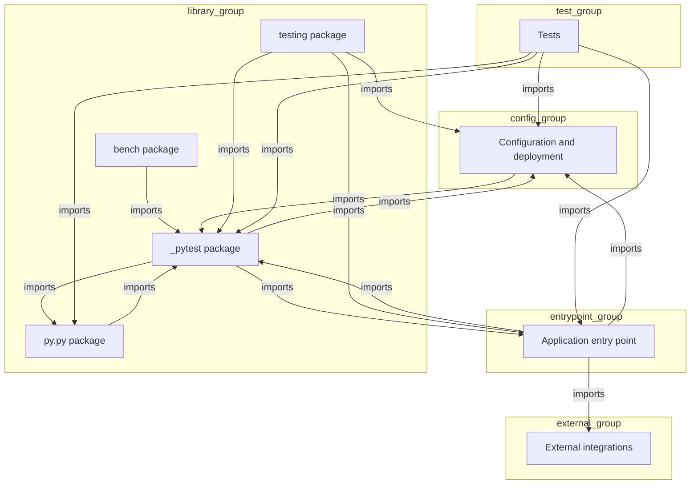

# Architecture report: pytest-dev/pytest

> Automated static analysis. **Observed** = directly seen in files/imports/AST; **Inferred** = interpretation from that evidence. Repository code was not executed.

## 1. Repository at a glance

| Item | Value |
| --- | --- |
| Repository | pytest-dev/pytest |
| Description | The pytest framework makes it easy to write small tests, yet scales to support complex functional testing |
| Language | Python |
| Stars | 14685 |
| Licence | MIT |
| Analysed commit / branch | fc9a7ef678f64d17f1c03b619f3842ea1d127e74 / main |
| Framework(s) | Django |
| Files analysed | 632 |
| Components | 8 |

## 2. Architecture in one minute

pytest-dev/pytest - The pytest framework makes it easy to write small tests, yet scales to support complex functional testing. This repository was analysed statically from 632 file(s) (274 Python). Detected technologies (observed from imports/manifests): GitHub Actions, Django, NumPy, requests, Poetry, setuptools. Files are grouped into 8 component(s): bench package, Configuration and deployment, Application entry point, External integrations, py.py package, _pytest package, testing package, Tests. Observed entry point(s): bench/bench.py, bench/bench_argcomplete.py, extra/get_issues.py. Findings below distinguish observed facts from inferred interpretation.

## 3. High-level block diagram

## 4. Main components

### bench package (`bench`)

- **Kind:** library
- **Status:** Observed
- **Confidence:** 0.85
- **Responsibility:** Groups 4 file(s) under bench package (observed from repository paths and static analysis). Observed top-level functions: foo, test_foo, test_it, test_it2.
- **Paths:** `bench/empty.py`, `bench/manyparam.py`, `bench/skip.py`, `bench/xunit.py`
- **Evidence:** [bench/empty.py](https://github.com/pytest-dev/pytest/blob/fc9a7ef678f64d17f1c03b619f3842ea1d127e74/bench/empty.py); [bench/manyparam.py:7](https://github.com/pytest-dev/pytest/blob/fc9a7ef678f64d17f1c03b619f3842ea1d127e74/bench/manyparam.py#L7); [bench/skip.py:10](https://github.com/pytest-dev/pytest/blob/fc9a7ef678f64d17f1c03b619f3842ea1d127e74/bench/skip.py#L10); [bench/xunit.py](https://github.com/pytest-dev/pytest/blob/fc9a7ef678f64d17f1c03b619f3842ea1d127e74/bench/xunit.py)

### Configuration and deployment (`config`)

- **Kind:** config
- **Status:** Observed
- **Confidence:** 0.85
- **Responsibility:** Groups 13 file(s) under configuration and deployment (observed from repository paths and static analysis). Observed top-level classes: Argument, Config, ConfigValue, ConftestImportFailure, DropShorterLongHelpFormatter, ExitCode. Observed top-level functions: _assertion_supported, _config_from_pytest_table, _config_from_tool_pytest, _console_main, _get_argparse_dest, _get_config_loader.
- **Paths:** `MANIFEST.in`, `codecov.yml`, `pyproject.toml`, `src/_pytest/config/__init__.py`, `src/_pytest/config/argparsing.py`, `src/_pytest/config/exceptions.py`, `src/_pytest/config/findpaths.py`, `testing/example_scripts/collect/collect_init_tests/pytest.ini`, `testing/example_scripts/customdirectory/pytest.ini`, `testing/example_scripts/pytest.ini`, `testing/plugins_integration/pytest.ini`, `testing/plugins_integration/requirements.txt`, `tox.ini`
- **Evidence:** [MANIFEST.in](https://github.com/pytest-dev/pytest/blob/fc9a7ef678f64d17f1c03b619f3842ea1d127e74/MANIFEST.in); [codecov.yml](https://github.com/pytest-dev/pytest/blob/fc9a7ef678f64d17f1c03b619f3842ea1d127e74/codecov.yml); [pyproject.toml](https://github.com/pytest-dev/pytest/blob/fc9a7ef678f64d17f1c03b619f3842ea1d127e74/pyproject.toml); [src/_pytest/config/__init__.py:108](https://github.com/pytest-dev/pytest/blob/fc9a7ef678f64d17f1c03b619f3842ea1d127e74/src/_pytest/config/__init__.py#L108); [src/_pytest/config/argparsing.py:48](https://github.com/pytest-dev/pytest/blob/fc9a7ef678f64d17f1c03b619f3842ea1d127e74/src/_pytest/config/argparsing.py#L48); [src/_pytest/config/exceptions.py:7](https://github.com/pytest-dev/pytest/blob/fc9a7ef678f64d17f1c03b619f3842ea1d127e74/src/_pytest/config/exceptions.py#L7); [src/_pytest/config/findpaths.py:25](https://github.com/pytest-dev/pytest/blob/fc9a7ef678f64d17f1c03b619f3842ea1d127e74/src/_pytest/config/findpaths.py#L25); [testing/example_scripts/collect/collect_init_tests/pytest.ini](https://github.com/pytest-dev/pytest/blob/fc9a7ef678f64d17f1c03b619f3842ea1d127e74/testing/example_scripts/collect/collect_init_tests/pytest.ini)

### Application entry point (`entrypoint`)

- **Kind:** entrypoint
- **Status:** Observed
- **Confidence:** 0.85
- **Responsibility:** Groups 15 file(s) under application entry point (observed from repository paths and static analysis). Observed top-level classes: CollectionArgument, Dir, FSHookProxy, Failed, Interrupted, InvalidFeatureRelease. Observed top-level functions: _get_kind, _in_venv, _main, announce, changelog, check_links.
- **Paths:** `bench/bench.py`, `bench/bench_argcomplete.py`, `extra/get_issues.py`, `scripts/diff-assert-rewrite.py`, `scripts/generate-gh-release-notes.py`, `scripts/prepare-release-pr.py`, `scripts/release.py`, `scripts/update-plugin-list.py`, `src/_pytest/main.py`, `src/pytest/__main__.py`, `testing/example_scripts/doctest/main_py/__main__.py`, `testing/example_scripts/perf_examples/collect_stats/generate_folders.py`, `testing/freeze/create_executable.py`, `testing/freeze/runtests_script.py`, `testing/freeze/tox_run.py`
- **Evidence:** [bench/bench.py](https://github.com/pytest-dev/pytest/blob/fc9a7ef678f64d17f1c03b619f3842ea1d127e74/bench/bench.py); [bench/bench_argcomplete.py](https://github.com/pytest-dev/pytest/blob/fc9a7ef678f64d17f1c03b619f3842ea1d127e74/bench/bench_argcomplete.py); [extra/get_issues.py:13](https://github.com/pytest-dev/pytest/blob/fc9a7ef678f64d17f1c03b619f3842ea1d127e74/extra/get_issues.py#L13); [scripts/diff-assert-rewrite.py:59](https://github.com/pytest-dev/pytest/blob/fc9a7ef678f64d17f1c03b619f3842ea1d127e74/scripts/diff-assert-rewrite.py#L59); [scripts/generate-gh-release-notes.py:22](https://github.com/pytest-dev/pytest/blob/fc9a7ef678f64d17f1c03b619f3842ea1d127e74/scripts/generate-gh-release-notes.py#L22); [scripts/prepare-release-pr.py:29](https://github.com/pytest-dev/pytest/blob/fc9a7ef678f64d17f1c03b619f3842ea1d127e74/scripts/prepare-release-pr.py#L29); [scripts/release.py:18](https://github.com/pytest-dev/pytest/blob/fc9a7ef678f64d17f1c03b619f3842ea1d127e74/scripts/release.py#L18); [scripts/update-plugin-list.py:75](https://github.com/pytest-dev/pytest/blob/fc9a7ef678f64d17f1c03b619f3842ea1d127e74/scripts/update-plugin-list.py#L75)

### External integrations (`external_integrations`)

- **Kind:** external
- **Status:** Inferred
- **Confidence:** 0.70
- **Responsibility:** Groups 0 file(s) under external integrations (observed from repository paths and static analysis).
- **Evidence:** [extra/get_issues.py:7](https://github.com/pytest-dev/pytest/blob/fc9a7ef678f64d17f1c03b619f3842ea1d127e74/extra/get_issues.py#L7)

### py.py package (`py_py`)

- **Kind:** library
- **Status:** Observed
- **Confidence:** 0.85
- **Responsibility:** Groups 1 file(s) under py.py package (observed from repository paths and static analysis).
- **Paths:** `src/py.py`
- **Evidence:** [src/py.py](https://github.com/pytest-dev/pytest/blob/fc9a7ef678f64d17f1c03b619f3842ea1d127e74/src/py.py)

### _pytest package (`pytest`)

- **Kind:** library
- **Status:** Observed
- **Confidence:** 0.85
- **Responsibility:** Groups 74 file(s) under _pytest package (observed from repository paths and static analysis). Observed top-level classes: AbstractRaises, Approx, ApproxDecimal, ApproxMapping, ApproxNumpy, ApproxScalar. Observed top-level functions: Cache_makedir, Config__getini_unknown_type, Config_inifile, Config_invocation_dir, Config_rootdir, FixtureRequest_fspath.
- **Paths:** `src/_pytest/__init__.py`, `src/_pytest/_argcomplete.py`, `src/_pytest/_code/__init__.py`, `src/_pytest/_code/code.py`, `src/_pytest/_code/source.py`, `src/_pytest/_io/__init__.py`, `src/_pytest/_io/pprint.py`, `src/_pytest/_io/saferepr.py`, `src/_pytest/_io/terminalwriter.py`, `src/_pytest/_io/wcwidth.py`, `src/_pytest/_py/__init__.py`, `src/_pytest/_py/error.py`, `src/_pytest/_py/path.py`, `src/_pytest/approx.py`, `src/_pytest/assertion/__init__.py`, `src/_pytest/assertion/_compare_any.py`, `src/_pytest/assertion/_compare_mapping.py`, `src/_pytest/assertion/_compare_sequence.py`, `src/_pytest/assertion/_compare_set.py`, `src/_pytest/assertion/_guards.py`, `src/_pytest/assertion/_typing.py`, `src/_pytest/assertion/compare_text.py`, `src/_pytest/assertion/highlight.py`, `src/_pytest/assertion/rewrite.py`, `src/_pytest/assertion/truncate.py`, `src/_pytest/assertion/util.py`, `src/_pytest/cacheprovider.py`, `src/_pytest/capture.py`, `src/_pytest/compat.py`, `src/_pytest/debugging.py`, `src/_pytest/deprecated.py`, `src/_pytest/doctest.py`, `src/_pytest/faulthandler.py`, `src/_pytest/fixtures.py`, `src/_pytest/freeze_support.py`, `src/_pytest/helpconfig.py`, `src/_pytest/hookspec.py`, `src/_pytest/junitxml.py`, `src/_pytest/legacypath.py`, `src/_pytest/logging.py`, `src/_pytest/mark/__init__.py`, `src/_pytest/mark/expression.py`, `src/_pytest/mark/structures.py`, `src/_pytest/monkeypatch.py`, `src/_pytest/nodeid.py`, `src/_pytest/nodes.py`, `src/_pytest/outcomes.py`, `src/_pytest/pastebin.py`, `src/_pytest/pathlib.py`, `src/_pytest/pytester.py`, `src/_pytest/pytester_assertions.py`, `src/_pytest/python.py`, `src/_pytest/raises.py`, `src/_pytest/recwarn.py`, `src/_pytest/reports.py`, `src/_pytest/runner.py`, `src/_pytest/scope.py`, `src/_pytest/setuponly.py`, `src/_pytest/setupplan.py`, `src/_pytest/skipping.py`, `src/_pytest/stash.py`, `src/_pytest/stepwise.py`, `src/_pytest/subtests.py`, `src/_pytest/terminal.py`, `src/_pytest/terminalprogress.py`, `src/_pytest/threadexception.py`, `src/_pytest/timing.py`, `src/_pytest/tmpdir.py`, `src/_pytest/tracemalloc.py`, `src/_pytest/unittest.py`, `src/_pytest/unraisableexception.py`, `src/_pytest/warning_types.py`, `src/_pytest/warnings.py`, `src/pytest/__init__.py`
- **Evidence:** [src/_pytest/__init__.py](https://github.com/pytest-dev/pytest/blob/fc9a7ef678f64d17f1c03b619f3842ea1d127e74/src/_pytest/__init__.py); [src/_pytest/_argcomplete.py:74](https://github.com/pytest-dev/pytest/blob/fc9a7ef678f64d17f1c03b619f3842ea1d127e74/src/_pytest/_argcomplete.py#L74); [src/_pytest/_code/__init__.py](https://github.com/pytest-dev/pytest/blob/fc9a7ef678f64d17f1c03b619f3842ea1d127e74/src/_pytest/_code/__init__.py); [src/_pytest/_code/code.py:60](https://github.com/pytest-dev/pytest/blob/fc9a7ef678f64d17f1c03b619f3842ea1d127e74/src/_pytest/_code/code.py#L60); [src/_pytest/_code/source.py:17](https://github.com/pytest-dev/pytest/blob/fc9a7ef678f64d17f1c03b619f3842ea1d127e74/src/_pytest/_code/source.py#L17); [src/_pytest/_io/__init__.py](https://github.com/pytest-dev/pytest/blob/fc9a7ef678f64d17f1c03b619f3842ea1d127e74/src/_pytest/_io/__init__.py); [src/_pytest/_io/pprint.py:37](https://github.com/pytest-dev/pytest/blob/fc9a7ef678f64d17f1c03b619f3842ea1d127e74/src/_pytest/_io/pprint.py#L37); [src/_pytest/_io/saferepr.py:8](https://github.com/pytest-dev/pytest/blob/fc9a7ef678f64d17f1c03b619f3842ea1d127e74/src/_pytest/_io/saferepr.py#L8)

### testing package (`testing`)

- **Kind:** library
- **Status:** Observed
- **Confidence:** 0.85
- **Responsibility:** Groups 27 file(s) under testing package (observed from repository paths and static analysis). Observed top-level classes: MyTestCase, MyVec3, TestApprox, TestApproxDatetime, TestAutouseDiscovery, TestAutouseManagement. Observed top-level functions: assert_approx_raises_regex, buy_apples, buy_bananas, check, check_basic_contextmanager, check_basic_matches.
- **Paths:** `testing/example_scripts/__init__.py`, `testing/example_scripts/acceptance/fixture_mock_integration.py`, `testing/example_scripts/collect/package_init_given_as_arg/pkg/__init__.py`, `testing/example_scripts/fixtures/custom_item/foo/__init__.py`, `testing/example_scripts/fixtures/fill_fixtures/test_conftest_funcargs_only_available_in_subdir/sub1/__init__.py`, `testing/example_scripts/fixtures/fill_fixtures/test_conftest_funcargs_only_available_in_subdir/sub2/__init__.py`, `testing/example_scripts/fixtures/fill_fixtures/test_extend_fixture_conftest_conftest/pkg/__init__.py`, `testing/example_scripts/issue_519.py`, `testing/example_scripts/tmpdir/tmp_path_fixture.py`, `testing/plugins_integration/bdd_wallet.py`, `testing/plugins_integration/django_settings.py`, `testing/plugins_integration/pytest_anyio_integration.py`, `testing/plugins_integration/pytest_asyncio_integration.py`, `testing/plugins_integration/pytest_mock_integration.py`, `testing/plugins_integration/pytest_rerunfailures_integration.py`, `testing/plugins_integration/pytest_trio_integration.py`, `testing/plugins_integration/pytest_twisted_integration.py`, `testing/plugins_integration/simple_integration.py`, `testing/python/approx.py`, `testing/python/collect.py`, `testing/python/fixtures.py`, `testing/python/integration.py`, `testing/python/metafunc.py`, `testing/python/raises.py`, `testing/python/raises_group.py`, `testing/typing_checks.py`, `testing/typing_raises_group.py`
- **Evidence:** [testing/example_scripts/__init__.py](https://github.com/pytest-dev/pytest/blob/fc9a7ef678f64d17f1c03b619f3842ea1d127e74/testing/example_scripts/__init__.py); [testing/example_scripts/acceptance/fixture_mock_integration.py:16](https://github.com/pytest-dev/pytest/blob/fc9a7ef678f64d17f1c03b619f3842ea1d127e74/testing/example_scripts/acceptance/fixture_mock_integration.py#L16); [testing/example_scripts/collect/package_init_given_as_arg/pkg/__init__.py:5](https://github.com/pytest-dev/pytest/blob/fc9a7ef678f64d17f1c03b619f3842ea1d127e74/testing/example_scripts/collect/package_init_given_as_arg/pkg/__init__.py#L5); [testing/example_scripts/fixtures/custom_item/foo/__init__.py](https://github.com/pytest-dev/pytest/blob/fc9a7ef678f64d17f1c03b619f3842ea1d127e74/testing/example_scripts/fixtures/custom_item/foo/__init__.py); [testing/example_scripts/fixtures/fill_fixtures/test_conftest_funcargs_only_available_in_subdir/sub1/__init__.py](https://github.com/pytest-dev/pytest/blob/fc9a7ef678f64d17f1c03b619f3842ea1d127e74/testing/example_scripts/fixtures/fill_fixtures/test_conftest_funcargs_only_available_in_subdir/sub1/__init__.py); [testing/example_scripts/fixtures/fill_fixtures/test_conftest_funcargs_only_available_in_subdir/sub2/__init__.py](https://github.com/pytest-dev/pytest/blob/fc9a7ef678f64d17f1c03b619f3842ea1d127e74/testing/example_scripts/fixtures/fill_fixtures/test_conftest_funcargs_only_available_in_subdir/sub2/__init__.py); [testing/example_scripts/fixtures/fill_fixtures/test_extend_fixture_conftest_conftest/pkg/__init__.py](https://github.com/pytest-dev/pytest/blob/fc9a7ef678f64d17f1c03b619f3842ea1d127e74/testing/example_scripts/fixtures/fill_fixtures/test_extend_fixture_conftest_conftest/pkg/__init__.py); [testing/example_scripts/issue_519.py:9](https://github.com/pytest-dev/pytest/blob/fc9a7ef678f64d17f1c03b619f3842ea1d127e74/testing/example_scripts/issue_519.py#L9)

### Tests (`tests`)

- **Kind:** test
- **Status:** Observed
- **Confidence:** 0.85
- **Responsibility:** Groups 156 file(s) under tests (observed from repository paths and static analysis). Observed top-level classes: Action, AsyncArguments, Base, BaseFunctionalTests, Broken, C. Observed top-level functions: ConftestWithSetinitial, StdCapture, StdCaptureFD, TeeStdCapture, XXX_test_expression_multiline, _exceptiongroup_common.
- **Paths:** `bench/unit_test.py`, `doc/en/conftest.py`, `doc/en/example/assertion/global_testmodule_config/conftest.py`, `doc/en/example/assertion/global_testmodule_config/test_hello_world.py`, `doc/en/example/assertion/test_failures.py`, `doc/en/example/assertion/test_setup_flow_example.py`, `doc/en/example/conftest.py`, `doc/en/example/customdirectory/conftest.py`, `doc/en/example/customdirectory/tests/manifest.json`, `doc/en/example/customdirectory/tests/test_first.py`, `doc/en/example/customdirectory/tests/test_second.py`, `doc/en/example/customdirectory/tests/test_third.py`, `doc/en/example/fixtures/test_fixtures_order_autouse.py`, `doc/en/example/fixtures/test_fixtures_order_autouse.svg`, `doc/en/example/fixtures/test_fixtures_order_autouse_flat.svg`, `doc/en/example/fixtures/test_fixtures_order_autouse_multiple_scopes.py`, `doc/en/example/fixtures/test_fixtures_order_autouse_multiple_scopes.svg`, `doc/en/example/fixtures/test_fixtures_order_autouse_temp_effects.py`, `doc/en/example/fixtures/test_fixtures_order_autouse_temp_effects.svg`, `doc/en/example/fixtures/test_fixtures_order_dependencies.py`, `doc/en/example/fixtures/test_fixtures_order_dependencies.svg`, `doc/en/example/fixtures/test_fixtures_order_dependencies_flat.svg`, `doc/en/example/fixtures/test_fixtures_order_dependencies_unclear.svg`, `doc/en/example/fixtures/test_fixtures_order_scope.py`, `doc/en/example/fixtures/test_fixtures_order_scope.svg`, `doc/en/example/fixtures/test_fixtures_request_different_scope.py`, `doc/en/example/fixtures/test_fixtures_request_different_scope.svg`, `doc/en/example/nonpython/conftest.py`, `doc/en/example/nonpython/test_simple.yaml`, `testing/_py/test_local.py`, `testing/acceptance_test.py`, `testing/code/test_code.py`, `testing/code/test_excinfo.py`, `testing/code/test_source.py`, `testing/conftest.py`, `testing/deprecated_test.py`, `testing/example_scripts/collect/collect_init_tests/tests/__init__.py`, `testing/example_scripts/collect/collect_init_tests/tests/test_foo.py`, `testing/example_scripts/collect/package_infinite_recursion/conftest.py`, `testing/example_scripts/collect/package_infinite_recursion/tests/__init__.py`, `testing/example_scripts/collect/package_infinite_recursion/tests/test_basic.py`, `testing/example_scripts/collect/package_init_given_as_arg/pkg/test_foo.py`, `testing/example_scripts/config/collect_pytest_prefix/conftest.py`, `testing/example_scripts/config/collect_pytest_prefix/test_foo.py`, `testing/example_scripts/conftest_usageerror/conftest.py`, `testing/example_scripts/customdirectory/conftest.py`, `testing/example_scripts/customdirectory/tests/manifest.json`, `testing/example_scripts/customdirectory/tests/test_first.py`, `testing/example_scripts/customdirectory/tests/test_second.py`, `testing/example_scripts/customdirectory/tests/test_third.py`, `testing/example_scripts/dataclasses/test_compare_dataclasses.py`, `testing/example_scripts/dataclasses/test_compare_dataclasses_field_comparison_off.py`, `testing/example_scripts/dataclasses/test_compare_dataclasses_verbose.py`, `testing/example_scripts/dataclasses/test_compare_dataclasses_with_custom_eq.py`, `testing/example_scripts/dataclasses/test_compare_initvar.py`, `testing/example_scripts/dataclasses/test_compare_recursive_dataclasses.py`, `testing/example_scripts/dataclasses/test_compare_two_different_dataclasses.py`, `testing/example_scripts/doctest/main_py/test_normal_module.py`, `testing/example_scripts/fixtures/custom_item/conftest.py`, `testing/example_scripts/fixtures/custom_item/foo/test_foo.py`, `testing/example_scripts/fixtures/fill_fixtures/test_conftest_funcargs_only_available_in_subdir/sub1/conftest.py`, `testing/example_scripts/fixtures/fill_fixtures/test_conftest_funcargs_only_available_in_subdir/sub1/test_in_sub1.py`, `testing/example_scripts/fixtures/fill_fixtures/test_conftest_funcargs_only_available_in_subdir/sub2/conftest.py`, `testing/example_scripts/fixtures/fill_fixtures/test_conftest_funcargs_only_available_in_subdir/sub2/test_in_sub2.py`, `testing/example_scripts/fixtures/fill_fixtures/test_detect_recursive_dependency_error.py`, `testing/example_scripts/fixtures/fill_fixtures/test_extend_fixture_conftest_conftest/conftest.py`, `testing/example_scripts/fixtures/fill_fixtures/test_extend_fixture_conftest_conftest/pkg/conftest.py`, `testing/example_scripts/fixtures/fill_fixtures/test_extend_fixture_conftest_conftest/pkg/test_spam.py`, `testing/example_scripts/fixtures/fill_fixtures/test_extend_fixture_conftest_module/conftest.py`, `testing/example_scripts/fixtures/fill_fixtures/test_extend_fixture_conftest_module/test_extend_fixture_conftest_module.py`, `testing/example_scripts/fixtures/fill_fixtures/test_extend_fixture_module_class.py`, `testing/example_scripts/fixtures/fill_fixtures/test_funcarg_basic.py`, `testing/example_scripts/fixtures/fill_fixtures/test_funcarg_lookup_classlevel.py`, `testing/example_scripts/fixtures/fill_fixtures/test_funcarg_lookup_modulelevel.py`, `testing/example_scripts/fixtures/fill_fixtures/test_funcarg_lookupfails.py`, `testing/example_scripts/fixtures/test_fixture_named_request.py`, `testing/example_scripts/fixtures/test_getfixturevalue_dynamic.py`, `testing/example_scripts/issue88_initial_file_multinodes/conftest.py`, `testing/example_scripts/issue88_initial_file_multinodes/test_hello.py`, `testing/example_scripts/marks/marks_considered_keywords/conftest.py`, `testing/example_scripts/marks/marks_considered_keywords/test_marks_as_keywords.py`, `testing/example_scripts/perf_examples/collect_stats/template_test.py`, `testing/example_scripts/unittest/test_parametrized_fixture_error_message.py`, `testing/example_scripts/unittest/test_setup_skip.py`, `testing/example_scripts/unittest/test_setup_skip_class.py`, `testing/example_scripts/unittest/test_setup_skip_module.py`, `testing/example_scripts/unittest/test_unittest_asyncio.py`, `testing/example_scripts/unittest/test_unittest_asynctest.py`, `testing/example_scripts/unittest/test_unittest_plain_async.py`, `testing/example_scripts/warnings/test_group_warnings_by_message.py`, `testing/example_scripts/warnings/test_group_warnings_by_message_summary/test_1.py`, `testing/example_scripts/warnings/test_group_warnings_by_message_summary/test_2.py`, `testing/examples/test_issue519.py`, `testing/freeze/tests/test_doctest.txt`, `testing/freeze/tests/test_trivial.py`, `testing/io/test_pprint.py`, `testing/io/test_saferepr.py`, `testing/io/test_terminalwriter.py`, `testing/io/test_wcwidth.py`, `testing/logging/test_fixture.py`, `testing/logging/test_formatter.py`, `testing/logging/test_reporting.py`, `testing/python/show_fixtures_per_test.py`, `testing/test_argcomplete.py`, `testing/test_assertion.py`, `testing/test_assertrewrite.py`, `testing/test_assertrewrite_coverage.py`, `testing/test_cacheprovider.py`, `testing/test_capture.py`, `testing/test_collect_imported_tests.py`, `testing/test_collection.py`, `testing/test_compat.py`, `testing/test_config.py`, `testing/test_conftest.py`, `testing/test_debugging.py`, `testing/test_doctest.py`, `testing/test_entry_points.py`, `testing/test_error_diffs.py`, `testing/test_faulthandler.py`, `testing/test_findpaths.py`, `testing/test_helpconfig.py`, `testing/test_junitxml.py`, `testing/test_legacypath.py`, `testing/test_link_resolve.py`, `testing/test_main.py`, `testing/test_mark.py`, `testing/test_mark_expression.py`, `testing/test_meta.py`, `testing/test_monkeypatch.py`, `testing/test_nodeid.py`, `testing/test_nodes.py`, `testing/test_parseopt.py`, `testing/test_pastebin.py`, `testing/test_pathlib.py`, `testing/test_pluginmanager.py`, `testing/test_pytester.py`, `testing/test_python_path.py`, `testing/test_recwarn.py`, `testing/test_reports.py`, `testing/test_runner.py`, `testing/test_runner_xunit.py`, `testing/test_scope.py`, `testing/test_session.py`, `testing/test_setuponly.py`, `testing/test_setupplan.py`, `testing/test_skipping.py`, `testing/test_stash.py`, `testing/test_stepwise.py`, `testing/test_subtests.py`, `testing/test_terminal.py`, `testing/test_threadexception.py`, `testing/test_tmpdir.py`, `testing/test_unittest.py`, `testing/test_unraisableexception.py`, `testing/test_warning_types.py`, `testing/test_warnings.py`
- **Evidence:** [bench/unit_test.py](https://github.com/pytest-dev/pytest/blob/fc9a7ef678f64d17f1c03b619f3842ea1d127e74/bench/unit_test.py); [doc/en/conftest.py](https://github.com/pytest-dev/pytest/blob/fc9a7ef678f64d17f1c03b619f3842ea1d127e74/doc/en/conftest.py); [doc/en/example/assertion/global_testmodule_config/conftest.py:11](https://github.com/pytest-dev/pytest/blob/fc9a7ef678f64d17f1c03b619f3842ea1d127e74/doc/en/example/assertion/global_testmodule_config/conftest.py#L11); [doc/en/example/assertion/global_testmodule_config/test_hello_world.py:7](https://github.com/pytest-dev/pytest/blob/fc9a7ef678f64d17f1c03b619f3842ea1d127e74/doc/en/example/assertion/global_testmodule_config/test_hello_world.py#L7); [doc/en/example/assertion/test_failures.py:11](https://github.com/pytest-dev/pytest/blob/fc9a7ef678f64d17f1c03b619f3842ea1d127e74/doc/en/example/assertion/test_failures.py#L11); [doc/en/example/assertion/test_setup_flow_example.py:4](https://github.com/pytest-dev/pytest/blob/fc9a7ef678f64d17f1c03b619f3842ea1d127e74/doc/en/example/assertion/test_setup_flow_example.py#L4); [doc/en/example/conftest.py](https://github.com/pytest-dev/pytest/blob/fc9a7ef678f64d17f1c03b619f3842ea1d127e74/doc/en/example/conftest.py); [doc/en/example/customdirectory/conftest.py:9](https://github.com/pytest-dev/pytest/blob/fc9a7ef678f64d17f1c03b619f3842ea1d127e74/doc/en/example/customdirectory/conftest.py#L9)

## 5. Execution flow

**Observed** entry point(s):

- [bench/bench.py:6](https://github.com/pytest-dev/pytest/blob/fc9a7ef678f64d17f1c03b619f3842ea1d127e74/bench/bench.py#L6)
- [bench/bench_argcomplete.py:20](https://github.com/pytest-dev/pytest/blob/fc9a7ef678f64d17f1c03b619f3842ea1d127e74/bench/bench_argcomplete.py#L20)
- [extra/get_issues.py:78](https://github.com/pytest-dev/pytest/blob/fc9a7ef678f64d17f1c03b619f3842ea1d127e74/extra/get_issues.py#L78)
- [scripts/diff-assert-rewrite.py:156](https://github.com/pytest-dev/pytest/blob/fc9a7ef678f64d17f1c03b619f3842ea1d127e74/scripts/diff-assert-rewrite.py#L156)
- [scripts/generate-gh-release-notes.py:68](https://github.com/pytest-dev/pytest/blob/fc9a7ef678f64d17f1c03b619f3842ea1d127e74/scripts/generate-gh-release-notes.py#L68)
- [scripts/prepare-release-pr.py:179](https://github.com/pytest-dev/pytest/blob/fc9a7ef678f64d17f1c03b619f3842ea1d127e74/scripts/prepare-release-pr.py#L179)
- [scripts/release.py:147](https://github.com/pytest-dev/pytest/blob/fc9a7ef678f64d17f1c03b619f3842ea1d127e74/scripts/release.py#L147)
- [scripts/update-plugin-list.py:229](https://github.com/pytest-dev/pytest/blob/fc9a7ef678f64d17f1c03b619f3842ea1d127e74/scripts/update-plugin-list.py#L229)
- [src/_pytest/config/__init__.py](https://github.com/pytest-dev/pytest/blob/fc9a7ef678f64d17f1c03b619f3842ea1d127e74/src/_pytest/config/__init__.py)
- [src/_pytest/config/__init__.py](https://github.com/pytest-dev/pytest/blob/fc9a7ef678f64d17f1c03b619f3842ea1d127e74/src/_pytest/config/__init__.py)
- [src/pytest/__main__.py:8](https://github.com/pytest-dev/pytest/blob/fc9a7ef678f64d17f1c03b619f3842ea1d127e74/src/pytest/__main__.py#L8)
- [testing/example_scripts/perf_examples/collect_stats/generate_folders.py:29](https://github.com/pytest-dev/pytest/blob/fc9a7ef678f64d17f1c03b619f3842ea1d127e74/testing/example_scripts/perf_examples/collect_stats/generate_folders.py#L29)

Representative flow (derived from observed entry points and the import graph; steps beyond the entry point are **Inferred**):

1. Execution starts at an observed entry point listed above, if present.
2. `bench` imports `pytest` (bench package -> _pytest package).
3. `config` imports `pytest` (Configuration and deployment -> _pytest package).
4. `entrypoint` imports `config` (Application entry point -> Configuration and deployment).
5. `entrypoint` imports `external_integrations` (Application entry point -> External integrations).
6. `entrypoint` imports `pytest` (Application entry point -> _pytest package).
7. `py_py` imports `pytest` (py.py package -> _pytest package).
8. `pytest` imports `config` (_pytest package -> Configuration and deployment).
9. `pytest` imports `entrypoint` (_pytest package -> Application entry point).

## 6. Project structure

### `(root)`

- `.git-blame-ignore-revs` - other (1299 bytes)
- `.git_archival.txt` - docs (127 bytes)
- `.gitattributes` - other (432 bytes)
- `.gitignore` - other (747 bytes)
- `.mailmap` - other (71 bytes)
- `.pre-commit-config.yaml` - config (4994 bytes)
- `.readthedocs.yaml` - config (604 bytes)
- `AUTHORS` - other (8241 bytes)
- `CHANGELOG.rst` - docs (230 bytes)
- `CITATION` - other (1165 bytes)
- `CODE_OF_CONDUCT.md` - docs (3718 bytes)
- `CONTRIBUTING.rst` - docs (28890 bytes)
- `LICENSE` - docs (1091 bytes)
- `MANIFEST.in` - manifest (307 bytes)
- `OPENCOLLECTIVE.rst` - docs (1953 bytes)
- `README.rst` - docs (5454 bytes)
- `RELEASING.rst` - docs (6572 bytes)
- `SECURITY.md` - docs (294 bytes)
- `TIDELIFT.rst` - docs (2412 bytes)
- `codecov.yml` - config (267 bytes)
- `pyproject.toml` - manifest (23294 bytes)
- `tox.ini` - config (7704 bytes)

### `.github`

- `.github/FUNDING.yml` - config (262 bytes)
- `.github/ISSUE_TEMPLATE/1_bug_report.md` - docs (361 bytes)
- `.github/ISSUE_TEMPLATE/2_feature_request.md` - docs (832 bytes)
- `.github/ISSUE_TEMPLATE/3_security_vulnerability.md` - docs (236 bytes)
- `.github/ISSUE_TEMPLATE/config.yml` - config (194 bytes)
- `.github/PULL_REQUEST_TEMPLATE.md` - docs (1660 bytes)
- `.github/actions/setup-tox/action.yml` - config (1006 bytes)
- `.github/chronographer.yml` - config (438 bytes)
- `.github/config.yml` - config (23 bytes)
- `.github/dependabot.yml` - config (540 bytes)
- `.github/labels.toml` - config (3690 bytes)
- `.github/patchback.yml` - config (214 bytes)
- `.github/workflows/deploy.yml` - ci, YAML (3788 bytes)
- `.github/workflows/doc-check-links.yml` - ci, YAML (678 bytes)
- `.github/workflows/prepare-release-pr.yml` - ci, YAML (1621 bytes)
- `.github/workflows/stale.yml` - ci, YAML (919 bytes)
- `.github/workflows/test.yml` - ci, YAML (9103 bytes)
- `.github/workflows/update-plugin-list.yml` - ci, YAML (2934 bytes)

### `bench`

- `bench/bench.py` - source, Python (383 bytes)
- `bench/bench_argcomplete.py` - source, Python (631 bytes)
- `bench/empty.py` - source, Python (98 bytes)
- `bench/manyparam.py` - source, Python (205 bytes)
- `bench/skip.py` - source, Python (166 bytes)
- `bench/unit_test.py` - test, Python (291 bytes)
- `bench/xunit.py` - source, Python (236 bytes)

### `changelog`

- `changelog/.gitignore` - other (477 bytes)
- `changelog/12582.improvement.rst` - docs (183 bytes)
- `changelog/15201.bugfix.rst` - docs (219 bytes)
- `changelog/15284.bugfix.rst` - docs (105 bytes)
- `changelog/15290.bugfix.rst` - docs (236 bytes)
- `changelog/15290.deprecation.rst` - docs (274 bytes)
- `changelog/15361.bugfix.rst` - docs (105 bytes)
- `changelog/15370.bugfix.rst` - docs (270 bytes)
- `changelog/README.rst` - docs (2463 bytes)
- `changelog/_template.rst` - docs (939 bytes)

### `doc`

- `doc/en/Makefile` - other (1510 bytes)
- `doc/en/_static/pytest-custom.css` - other (329 bytes)
- `doc/en/_templates/links.html` - other (364 bytes)
- `doc/en/adopt.rst` - docs (3997 bytes)
- `doc/en/announce/index.rst` - docs (3306 bytes)
- `doc/en/announce/release-2.0.0.rst` - docs (5195 bytes)
- `doc/en/announce/release-2.0.1.rst` - docs (3099 bytes)
- `doc/en/announce/release-2.0.2.rst` - docs (2798 bytes)
- `doc/en/announce/release-2.0.3.rst` - docs (1307 bytes)
- `doc/en/announce/release-2.1.0.rst` - docs (2145 bytes)
- `doc/en/announce/release-2.1.1.rst` - docs (1581 bytes)
- `doc/en/announce/release-2.1.2.rst` - docs (1286 bytes)
- `doc/en/announce/release-2.1.3.rst` - docs (1203 bytes)
- `doc/en/announce/release-2.2.0.rst` - docs (4350 bytes)
- `doc/en/announce/release-2.2.1.rst` - docs (1555 bytes)
- `doc/en/announce/release-2.2.2.rst` - docs (1619 bytes)
- `doc/en/announce/release-2.2.4.rst` - docs (1454 bytes)
- `doc/en/announce/release-2.3.0.rst` - docs (5567 bytes)
- `doc/en/announce/release-2.3.1.rst` - docs (1115 bytes)
- `doc/en/announce/release-2.3.2.rst` - docs (1761 bytes)
- `doc/en/announce/release-2.3.3.rst` - docs (2089 bytes)
- `doc/en/announce/release-2.3.4.rst` - docs (1696 bytes)
- `doc/en/announce/release-2.3.5.rst` - docs (3270 bytes)
- `doc/en/announce/release-2.4.0.rst` - docs (9143 bytes)
- `doc/en/announce/release-2.4.1.rst` - docs (881 bytes)
- `doc/en/announce/release-2.4.2.rst` - docs (1428 bytes)
- `doc/en/announce/release-2.5.0.rst` - docs (7274 bytes)
- `doc/en/announce/release-2.5.1.rst` - docs (1713 bytes)
- `doc/en/announce/release-2.5.2.rst` - docs (1909 bytes)
- `doc/en/announce/release-2.6.0.rst` - docs (5815 bytes)
- `doc/en/announce/release-2.6.1.rst` - docs (1989 bytes)
- `doc/en/announce/release-2.6.2.rst` - docs (1532 bytes)
- `doc/en/announce/release-2.6.3.rst` - docs (1678 bytes)
- `doc/en/announce/release-2.7.0.rst` - docs (3837 bytes)
- `doc/en/announce/release-2.7.1.rst` - docs (1941 bytes)
- `doc/en/announce/release-2.7.2.rst` - docs (1728 bytes)
- `doc/en/announce/release-2.8.2.rst` - docs (1298 bytes)
- `doc/en/announce/release-2.8.3.rst` - docs (1790 bytes)
- `doc/en/announce/release-2.8.4.rst` - docs (1375 bytes)
- `doc/en/announce/release-2.8.5.rst` - docs (1114 bytes)
- `doc/en/announce/release-2.8.6.rst` - docs (1908 bytes)
- `doc/en/announce/release-2.8.7.rst` - docs (719 bytes)
- `doc/en/announce/release-2.9.0.rst` - docs (4892 bytes)
- `doc/en/announce/release-2.9.1.rst` - docs (1481 bytes)
- `doc/en/announce/release-2.9.2.rst` - docs (1748 bytes)
- `doc/en/announce/release-3.0.0.rst` - docs (1769 bytes)
- `doc/en/announce/release-3.0.1.rst` - docs (575 bytes)
- `doc/en/announce/release-3.0.2.rst` - docs (512 bytes)
- `doc/en/announce/release-3.0.3.rst` - docs (561 bytes)
- `doc/en/announce/release-3.0.4.rst` - docs (608 bytes)
- `doc/en/announce/release-3.0.5.rst` - docs (529 bytes)
- `doc/en/announce/release-3.0.6.rst` - docs (618 bytes)
- `doc/en/announce/release-3.0.7.rst` - docs (639 bytes)
- `doc/en/announce/release-3.1.0.rst` - docs (1199 bytes)
- `doc/en/announce/release-3.1.1.rst` - docs (492 bytes)
- `doc/en/announce/release-3.1.2.rst` - docs (486 bytes)
- `doc/en/announce/release-3.1.3.rst` - docs (497 bytes)
- `doc/en/announce/release-3.10.0.rst` - docs (971 bytes)
- `doc/en/announce/release-3.10.1.rst` - docs (513 bytes)
- `doc/en/announce/release-3.2.0.rst` - docs (1030 bytes)
- `doc/en/announce/release-3.2.1.rst` - docs (487 bytes)
- `doc/en/announce/release-3.2.2.rst` - docs (569 bytes)
- `doc/en/announce/release-3.2.3.rst` - docs (482 bytes)
- `doc/en/announce/release-3.2.4.rst` - docs (714 bytes)
- `doc/en/announce/release-3.2.5.rst` - docs (408 bytes)
- `doc/en/announce/release-3.3.0.rst` - docs (1027 bytes)
- `doc/en/announce/release-3.3.1.rst` - docs (530 bytes)
- `doc/en/announce/release-3.3.2.rst` - docs (590 bytes)
- `doc/en/announce/release-3.4.0.rst` - docs (1064 bytes)
- `doc/en/announce/release-3.4.1.rst` - docs (549 bytes)
- `doc/en/announce/release-3.4.2.rst` - docs (565 bytes)
- `doc/en/announce/release-3.5.0.rst` - docs (1058 bytes)
- `doc/en/announce/release-3.5.1.rst` - docs (625 bytes)
- `doc/en/announce/release-3.6.0.rst` - docs (883 bytes)
- `doc/en/announce/release-3.6.1.rst` - docs (521 bytes)
- `doc/en/announce/release-3.6.2.rst` - docs (608 bytes)
- `doc/en/announce/release-3.6.3.rst` - docs (572 bytes)
- `doc/en/announce/release-3.6.4.rst` - docs (502 bytes)
- `doc/en/announce/release-3.7.0.rst` - docs (881 bytes)
- `doc/en/announce/release-3.7.1.rst` - docs (462 bytes)
- `doc/en/announce/release-3.7.2.rst` - docs (521 bytes)
- `doc/en/announce/release-3.7.3.rst` - docs (636 bytes)
- `doc/en/announce/release-3.7.4.rst` - docs (473 bytes)
- `doc/en/announce/release-3.8.0.rst` - docs (853 bytes)
- `doc/en/announce/release-3.8.1.rst` - docs (532 bytes)
- `doc/en/announce/release-3.8.2.rst` - docs (584 bytes)
- `doc/en/announce/release-3.9.0.rst` - docs (948 bytes)
- `doc/en/announce/release-3.9.1.rst` - docs (446 bytes)
- `doc/en/announce/release-3.9.2.rst` - docs (492 bytes)
- `doc/en/announce/release-3.9.3.rst` - docs (511 bytes)
- `doc/en/announce/release-4.0.0.rst` - docs (733 bytes)
- `doc/en/announce/release-4.0.1.rst` - docs (491 bytes)
- `doc/en/announce/release-4.0.2.rst` - docs (508 bytes)
- `doc/en/announce/release-4.1.0.rst` - docs (948 bytes)
- `doc/en/announce/release-4.1.1.rst` - docs (554 bytes)
- `doc/en/announce/release-4.2.0.rst` - docs (854 bytes)
- `doc/en/announce/release-4.2.1.rst` - docs (616 bytes)
- `doc/en/announce/release-4.3.0.rst` - docs (837 bytes)
- `doc/en/announce/release-4.3.1.rst` - docs (575 bytes)
- `doc/en/announce/release-4.4.0.rst` - docs (871 bytes)
- `doc/en/announce/release-4.4.1.rst` - docs (444 bytes)
- `doc/en/announce/release-4.4.2.rst` - docs (643 bytes)
- `doc/en/announce/release-4.5.0.rst` - docs (810 bytes)
- `doc/en/announce/release-4.6.0.rst` - docs (939 bytes)
- `doc/en/announce/release-4.6.1.rst` - docs (428 bytes)
- `doc/en/announce/release-4.6.2.rst` - docs (411 bytes)
- `doc/en/announce/release-4.6.3.rst` - docs (458 bytes)
- `doc/en/announce/release-4.6.4.rst` - docs (483 bytes)
- `doc/en/announce/release-4.6.5.rst` - docs (462 bytes)
- `doc/en/announce/release-4.6.6.rst` - docs (444 bytes)
- `doc/en/announce/release-4.6.7.rst` - docs (426 bytes)
- `doc/en/announce/release-4.6.8.rst` - docs (440 bytes)
- `doc/en/announce/release-4.6.9.rst` - docs (447 bytes)
- `doc/en/announce/release-5.0.0.rst` - docs (979 bytes)
- `doc/en/announce/release-5.0.1.rst` - docs (532 bytes)
- `doc/en/announce/release-5.1.0.rst` - docs (1130 bytes)
- `doc/en/announce/release-5.1.1.rst` - docs (513 bytes)
- `doc/en/announce/release-5.1.2.rst` - docs (499 bytes)
- `doc/en/announce/release-5.1.3.rst` - docs (486 bytes)
- `doc/en/announce/release-5.2.0.rst` - docs (811 bytes)
- `doc/en/announce/release-5.2.1.rst` - docs (492 bytes)
- `doc/en/announce/release-5.2.2.rst` - docs (600 bytes)
- `doc/en/announce/release-5.2.3.rst` - docs (570 bytes)
- `doc/en/announce/release-5.2.4.rst` - docs (469 bytes)
- `doc/en/announce/release-5.3.0.rst` - docs (938 bytes)
- `doc/en/announce/release-5.3.1.rst` - docs (550 bytes)
- `doc/en/announce/release-5.3.2.rst` - docs (548 bytes)
- `doc/en/announce/release-5.3.3.rst` - docs (598 bytes)
- `doc/en/announce/release-5.3.4.rst` - docs (439 bytes)
- `doc/en/announce/release-5.3.5.rst` - docs (422 bytes)
- `doc/en/announce/release-5.4.0.rst` - docs (1198 bytes)
- `doc/en/announce/release-5.4.1.rst` - docs (410 bytes)
- `doc/en/announce/release-5.4.2.rst` - docs (478 bytes)
- `doc/en/announce/release-5.4.3.rst` - docs (454 bytes)
- `doc/en/announce/release-6.0.0.rst` - docs (904 bytes)
- `doc/en/announce/release-6.0.0rc1.rst` - docs (1188 bytes)
- `doc/en/announce/release-6.0.1.rst` - docs (445 bytes)
- `doc/en/announce/release-6.0.2.rst` - docs (415 bytes)
- `doc/en/announce/release-6.1.0.rst` - docs (889 bytes)
- `doc/en/announce/release-6.1.1.rst` - docs (398 bytes)
- `doc/en/announce/release-6.1.2.rst` - docs (475 bytes)
- `doc/en/announce/release-6.2.0.rst` - docs (1445 bytes)
- `doc/en/announce/release-6.2.1.rst` - docs (434 bytes)
- `doc/en/announce/release-6.2.2.rst` - docs (445 bytes)
- `doc/en/announce/release-6.2.3.rst` - docs (415 bytes)
- `doc/en/announce/release-6.2.4.rst` - docs (467 bytes)
- `doc/en/announce/release-6.2.5.rst` - docs (611 bytes)
- `doc/en/announce/release-7.0.0.rst` - docs (1322 bytes)
- `doc/en/announce/release-7.0.0rc1.rst` - docs (1535 bytes)
- `doc/en/announce/release-7.0.1.rst` - docs (433 bytes)
- `doc/en/announce/release-7.1.0.rst` - docs (912 bytes)
- `doc/en/announce/release-7.1.1.rst` - docs (398 bytes)
- `doc/en/announce/release-7.1.2.rst` - docs (488 bytes)
- `doc/en/announce/release-7.1.3.rst` - docs (557 bytes)
- `doc/en/announce/release-7.2.0.rst` - docs (1557 bytes)
- `doc/en/announce/release-7.2.1.rst` - docs (518 bytes)
- `doc/en/announce/release-7.2.2.rst` - docs (492 bytes)
- `doc/en/announce/release-7.3.0.rst` - docs (2089 bytes)
- `doc/en/announce/release-7.3.1.rst` - docs (398 bytes)
- `doc/en/announce/release-7.3.2.rst` - docs (448 bytes)
- `doc/en/announce/release-7.4.0.rst` - docs (910 bytes)
- `doc/en/announce/release-7.4.1.rst` - docs (430 bytes)
- `doc/en/announce/release-7.4.2.rst` - docs (402 bytes)
- `doc/en/announce/release-7.4.3.rst` - docs (417 bytes)
- `doc/en/announce/release-7.4.4.rst` - docs (436 bytes)
- `doc/en/announce/release-8.0.0.rst` - docs (595 bytes)
- `doc/en/announce/release-8.0.0rc1.rst` - docs (1489 bytes)
- `doc/en/announce/release-8.0.0rc2.rst` - docs (899 bytes)
- `doc/en/announce/release-8.0.1.rst` - docs (452 bytes)
- `doc/en/announce/release-8.0.2.rst` - docs (398 bytes)
- `doc/en/announce/release-8.1.0.rst` - docs (977 bytes)
- `doc/en/announce/release-8.1.1.rst` - docs (398 bytes)
- `doc/en/announce/release-8.1.2.rst` - docs (402 bytes)
- `doc/en/announce/release-8.2.0.rst` - docs (842 bytes)
- `doc/en/announce/release-8.2.1.rst` - docs (415 bytes)
- `doc/en/announce/release-8.2.2.rst` - docs (415 bytes)
- `doc/en/announce/release-8.3.0.rst` - docs (1176 bytes)
- `doc/en/announce/release-8.3.1.rst` - docs (415 bytes)
- `doc/en/announce/release-8.3.2.rst` - docs (419 bytes)
- `doc/en/announce/release-8.3.3.rst` - docs (656 bytes)
- `doc/en/announce/release-8.3.4.rst` - docs (640 bytes)
- `doc/en/announce/release-8.3.5.rst` - docs (559 bytes)
- `doc/en/announce/release-8.4.0.rst` - docs (1918 bytes)
- `doc/en/announce/release-8.4.1.rst` - docs (435 bytes)
- `doc/en/announce/release-8.4.2.rst` - docs (559 bytes)
- `doc/en/announce/release-9.0.0.rst` - docs (1272 bytes)
- `doc/en/announce/release-9.0.1.rst` - docs (442 bytes)
- `doc/en/announce/release-9.0.2.rst` - docs (499 bytes)
- `doc/en/announce/release-9.0.3.rst` - docs (756 bytes)
- `doc/en/announce/release-9.1.0.rst` - docs (1731 bytes)
- `doc/en/announce/release-9.1.1.rst` - docs (370 bytes)
- `doc/en/announce/release-9.2.0.rst` - docs (1640 bytes)
- `doc/en/announce/sprint2016.rst` - docs (2161 bytes)
- `doc/en/backwards-compatibility.rst` - docs (6397 bytes)
- `doc/en/broken-dep-constraints.txt` - docs (171 bytes)
- `doc/en/builtin.rst` - docs (10822 bytes)
- `doc/en/conf.py` - source, Python (11660 bytes)
- `doc/en/conftest.py` - test, Python (66 bytes)
- `doc/en/contact.rst` - docs (2361 bytes)
- `doc/en/contents.rst` - docs (1601 bytes)
- `doc/en/contributing.rst` - docs (55 bytes)
- `doc/en/deprecations.rst` - docs (53538 bytes)
- `doc/en/development_guide.rst` - docs (251 bytes)
- `doc/en/example/assertion/failure_demo.py` - source, Python (5721 bytes)
- `doc/en/example/assertion/global_testmodule_config/conftest.py` - test, Python (366 bytes)
- `doc/en/example/assertion/global_testmodule_config/test_hello_world.py` - test, Python (81 bytes)
- `doc/en/example/assertion/test_failures.py` - test, Python (464 bytes)
- `doc/en/example/assertion/test_setup_flow_example.py` - test, Python (1289 bytes)
- `doc/en/example/attic.rst` - docs (2710 bytes)
- `doc/en/example/conftest.py` - test, Python (87 bytes)
- `doc/en/example/customdirectory.rst` - docs (2701 bytes)
- `doc/en/example/customdirectory/conftest.py` - test, Python (1071 bytes)
- `doc/en/example/customdirectory/pytest.ini` - config (0 bytes)
- `doc/en/example/customdirectory/tests/manifest.json` - test (75 bytes)
- `doc/en/example/customdirectory/tests/test_first.py` - test, Python (87 bytes)
- `doc/en/example/customdirectory/tests/test_second.py` - test, Python (88 bytes)
- `doc/en/example/customdirectory/tests/test_third.py` - test, Python (87 bytes)
- `doc/en/example/fixtures/fixture_availability.svg` - other (5131 bytes)
- `doc/en/example/fixtures/fixture_availability_plugins.svg` - other (5506 bytes)
- `doc/en/example/fixtures/test_fixtures_order_autouse.py` - test, Python (598 bytes)
- `doc/en/example/fixtures/test_fixtures_order_autouse.svg` - test (2346 bytes)
- `doc/en/example/fixtures/test_fixtures_order_autouse_flat.svg` - test (1950 bytes)
- `doc/en/example/fixtures/test_fixtures_order_autouse_multiple_scopes.py` - test, Python (560 bytes)
- `doc/en/example/fixtures/test_fixtures_order_autouse_multiple_scopes.svg` - test (2700 bytes)
- `doc/en/example/fixtures/test_fixtures_order_autouse_temp_effects.py` - test, Python (639 bytes)
- `doc/en/example/fixtures/test_fixtures_order_autouse_temp_effects.svg` - test (3644 bytes)
- `doc/en/example/fixtures/test_fixtures_order_dependencies.py` - test, Python (584 bytes)
- `doc/en/example/fixtures/test_fixtures_order_dependencies.svg` - test (2226 bytes)
- `doc/en/example/fixtures/test_fixtures_order_dependencies_flat.svg` - test (1783 bytes)
- `doc/en/example/fixtures/test_fixtures_order_dependencies_unclear.svg` - test (2227 bytes)
- `doc/en/example/fixtures/test_fixtures_order_scope.py` - test, Python (646 bytes)
- `doc/en/example/fixtures/test_fixtures_order_scope.svg` - test (1937 bytes)
- `doc/en/example/fixtures/test_fixtures_request_different_scope.py` - test, Python (514 bytes)
- `doc/en/example/fixtures/test_fixtures_request_different_scope.svg` - test (4395 bytes)
- `doc/en/example/index.rst` - docs (935 bytes)
- `doc/en/example/markers.rst` - docs (28579 bytes)
- `doc/en/example/multipython.py` - source, Python (1958 bytes)
- `doc/en/example/nonpython.rst` - docs (4153 bytes)
- `doc/en/example/nonpython/__init__.py` - source, Python (0 bytes)
- `doc/en/example/nonpython/conftest.py` - test, Python (1549 bytes)
- `doc/en/example/nonpython/test_simple.yaml` - test (79 bytes)
- `doc/en/example/parametrize.rst` - docs (23096 bytes)
- `doc/en/example/pythoncollection.py` - source, Python (236 bytes)
- `doc/en/example/pythoncollection.rst` - docs (10514 bytes)
- `doc/en/example/reportingdemo.rst` - docs (27356 bytes)
- `doc/en/example/simple.rst` - docs (33908 bytes)
- `doc/en/example/special.rst` - docs (2031 bytes)
- `doc/en/example/xfail_demo.py` - source, Python (485 bytes)
- `doc/en/explanation/anatomy.rst` - docs (2104 bytes)
- `doc/en/explanation/ci.rst` - docs (2146 bytes)
- `doc/en/explanation/fixtures.rst` - docs (6090 bytes)
- `doc/en/explanation/flaky.rst` - docs (13191 bytes)
- `doc/en/explanation/goodpractices.rst` - docs (15747 bytes)
- `doc/en/explanation/index.rst` - docs (166 bytes)
- `doc/en/explanation/pythonpath.rst` - docs (7960 bytes)
- `doc/en/explanation/types.rst` - docs (3775 bytes)
- `doc/en/funcarg_compare.rst` - docs (8760 bytes)
- `doc/en/funcargs.rst` - docs (441 bytes)
- `doc/en/getting-started.rst` - docs (10834 bytes)
- `doc/en/historical-notes.rst` - docs (10774 bytes)
- `doc/en/history.rst` - docs (7148 bytes)
- `doc/en/how-to/assert.rst` - docs (19934 bytes)
- `doc/en/how-to/bash-completion.rst` - docs (780 bytes)
- `doc/en/how-to/cache.rst` - docs (11373 bytes)
- `doc/en/how-to/capture-stdout-stderr.rst` - docs (6661 bytes)
- `doc/en/how-to/capture-warnings.rst` - docs (18772 bytes)
- `doc/en/how-to/doctest.rst` - docs (10408 bytes)
- `doc/en/how-to/existingtestsuite.rst` - docs (1249 bytes)
- `doc/en/how-to/failures.rst` - docs (5514 bytes)
- `doc/en/how-to/fixtures.rst` - docs (62068 bytes)
- `doc/en/how-to/index.rst` - docs (805 bytes)
- `doc/en/how-to/logging.rst` - docs (11073 bytes)
- `doc/en/how-to/mark.rst` - docs (3498 bytes)
- `doc/en/how-to/monkeypatch.rst` - docs (16231 bytes)
- `doc/en/how-to/output.rst` - docs (31621 bytes)
- `doc/en/how-to/parametrize.rst` - docs (10300 bytes)
- `doc/en/how-to/plugins.rst` - docs (6270 bytes)
- `doc/en/how-to/skipping.rst` - docs (12278 bytes)
- `doc/en/how-to/subtests.rst` - docs (4750 bytes)
- `doc/en/how-to/tmp_path.rst` - docs (6322 bytes)
- `doc/en/how-to/unittest.rst` - docs (9785 bytes)
- `doc/en/how-to/usage.rst` - docs (7014 bytes)
- `doc/en/how-to/writing_hook_functions.rst` - docs (14270 bytes)
- `doc/en/how-to/writing_plugins.rst` - docs (16877 bytes)
- `doc/en/how-to/xunit_setup.rst` - docs (3667 bytes)
- `doc/en/img/pytest_logo_curves.svg` - other (7833 bytes)
- `doc/en/index.rst` - docs (5024 bytes)
- `doc/en/license.rst` - docs (1372 bytes)
- `doc/en/naming20.rst` - docs (719 bytes)
- `doc/en/proposals/parametrize_with_fixtures.rst` - docs (4236 bytes)
- `doc/en/pytest.ini` - config (74 bytes)
- `doc/en/recwarn.rst` - docs (70 bytes)
- `doc/en/reference/customize.rst` - docs (10056 bytes)
- `doc/en/reference/exit-codes.rst` - docs (1137 bytes)
- `doc/en/reference/fixtures.rst` - docs (16583 bytes)
- `doc/en/reference/index.rst` - docs (158 bytes)
- `doc/en/reference/reference.rst` - docs (109160 bytes)
- `doc/en/requirements.txt` - manifest (221 bytes)
- `doc/en/sponsor.rst` - docs (1062 bytes)
- `doc/en/talks.rst` - docs (6275 bytes)
- `doc/en/tidelift.rst` - docs (2597 bytes)
- `doc/en/yieldfixture.rst` - docs (472 bytes)

### `extra`

- `extra/get_issues.py` - source, Python (2370 bytes)

### `scripts`

- `scripts/.gitignore` - other (24 bytes)
- `scripts/diff-assert-rewrite.py` - source, Python (5769 bytes)
- `scripts/generate-gh-release-notes.py` - source, Python (2155 bytes)
- `scripts/prepare-release-pr.py` - source, Python (4989 bytes)
- `scripts/release.major.rst` - docs (587 bytes)
- `scripts/release.minor.rst` - docs (558 bytes)
- `scripts/release.patch.rst` - docs (362 bytes)
- `scripts/release.pre.rst` - docs (871 bytes)
- `scripts/release.py` - source, Python (4969 bytes)
- `scripts/update-plugin-list.py` - source, Python (7594 bytes)

### `src`

- `src/_pytest/__init__.py` - source, Python (391 bytes)
- `src/_pytest/_argcomplete.py` - source, Python (3776 bytes)
- `src/_pytest/_code/__init__.py` - source, Python (521 bytes)
- `src/_pytest/_code/code.py` - source, Python (61366 bytes)
- `src/_pytest/_code/source.py` - source, Python (9287 bytes)
- `src/_pytest/_io/__init__.py` - source, Python (190 bytes)
- `src/_pytest/_io/pprint.py` - source, Python (22147 bytes)
- `src/_pytest/_io/saferepr.py` - source, Python (4920 bytes)
- `src/_pytest/_io/terminalwriter.py` - source, Python (8994 bytes)
- `src/_pytest/_io/wcwidth.py` - source, Python (1289 bytes)
- `src/_pytest/_py/__init__.py` - source, Python (0 bytes)
- `src/_pytest/_py/error.py` - source, Python (3475 bytes)
- `src/_pytest/_py/path.py` - source, Python (49229 bytes)
- `src/_pytest/approx.py` - source, Python (44683 bytes)
- `src/_pytest/assertion/__init__.py` - source, Python (9343 bytes)
- `src/_pytest/assertion/_compare_any.py` - source, Python (5250 bytes)
- `src/_pytest/assertion/_compare_mapping.py` - source, Python (3002 bytes)
- `src/_pytest/assertion/_compare_sequence.py` - source, Python (3596 bytes)
- `src/_pytest/assertion/_compare_set.py` - source, Python (2667 bytes)
- `src/_pytest/assertion/_guards.py` - source, Python (1954 bytes)
- `src/_pytest/assertion/_typing.py` - source, Python (1153 bytes)
- `src/_pytest/assertion/compare_text.py` - source, Python (4542 bytes)
- `src/_pytest/assertion/highlight.py` - source, Python (327 bytes)
- `src/_pytest/assertion/rewrite.py` - source, Python (49277 bytes)
- `src/_pytest/assertion/truncate.py` - source, Python (6164 bytes)
- `src/_pytest/assertion/util.py` - source, Python (7010 bytes)
- `src/_pytest/cacheprovider.py` - source, Python (23717 bytes)
- `src/_pytest/capture.py` - source, Python (37552 bytes)
- `src/_pytest/compat.py` - source, Python (10703 bytes)
- `src/_pytest/config/__init__.py` - source, Python (93008 bytes)
- `src/_pytest/config/argparsing.py` - source, Python (24462 bytes)
- `src/_pytest/config/exceptions.py` - source, Python (315 bytes)
- `src/_pytest/config/findpaths.py` - source, Python (18132 bytes)
- `src/_pytest/debugging.py` - source, Python (13853 bytes)
- `src/_pytest/deprecated.py` - source, Python (7283 bytes)
- `src/_pytest/doctest.py` - source, Python (26145 bytes)
- `src/_pytest/faulthandler.py` - source, Python (4268 bytes)
- `src/_pytest/fixtures.py` - source, Python (103634 bytes)
- `src/_pytest/freeze_support.py` - source, Python (1300 bytes)
- `src/_pytest/helpconfig.py` - source, Python (9913 bytes)
- `src/_pytest/hookspec.py` - source, Python (42166 bytes)
- `src/_pytest/junitxml.py` - source, Python (27890 bytes)
- `src/_pytest/legacypath.py` - source, Python (16833 bytes)
- `src/_pytest/logging.py` - source, Python (36516 bytes)
- `src/_pytest/main.py` - source, Python (44147 bytes)
- `src/_pytest/mark/__init__.py` - source, Python (11355 bytes)
- `src/_pytest/mark/expression.py` - source, Python (11686 bytes)
- `src/_pytest/mark/structures.py` - source, Python (25387 bytes)
- `src/_pytest/monkeypatch.py` - source, Python (16734 bytes)
- `src/_pytest/nodeid.py` - source, Python (4405 bytes)
- `src/_pytest/nodes.py` - source, Python (27966 bytes)
- `src/_pytest/outcomes.py` - source, Python (8799 bytes)
- `src/_pytest/pastebin.py` - source, Python (4290 bytes)
- `src/_pytest/pathlib.py` - source, Python (39450 bytes)
- `src/_pytest/py.typed` - other (0 bytes)
- `src/_pytest/pytester.py` - source, Python (63484 bytes)
- `src/_pytest/pytester_assertions.py` - source, Python (2253 bytes)
- `src/_pytest/python.py` - source, Python (72057 bytes)
- `src/_pytest/raises.py` - source, Python (59802 bytes)
- `src/_pytest/recwarn.py` - source, Python (13830 bytes)
- `src/_pytest/reports.py` - source, Python (24498 bytes)
- `src/_pytest/runner.py` - source, Python (21161 bytes)
- `src/_pytest/scope.py` - source, Python (2736 bytes)
- `src/_pytest/setuponly.py` - source, Python (3167 bytes)
- `src/_pytest/setupplan.py` - source, Python (1184 bytes)
- `src/_pytest/skipping.py` - source, Python (12068 bytes)
- `src/_pytest/stash.py` - source, Python (3090 bytes)
- `src/_pytest/stepwise.py` - source, Python (8112 bytes)
- `src/_pytest/subtests.py` - source, Python (13114 bytes)
- `src/_pytest/terminal.py` - source, Python (67073 bytes)
- `src/_pytest/terminalprogress.py` - source, Python (1153 bytes)
- `src/_pytest/threadexception.py` - source, Python (4892 bytes)
- `src/_pytest/timing.py` - source, Python (3549 bytes)
- `src/_pytest/tmpdir.py` - source, Python (15361 bytes)
- `src/_pytest/tracemalloc.py` - source, Python (778 bytes)
- `src/_pytest/unittest.py` - source, Python (25185 bytes)
- `src/_pytest/unraisableexception.py` - source, Python (6484 bytes)
- `src/_pytest/warning_types.py` - source, Python (4463 bytes)
- `src/_pytest/warnings.py` - source, Python (3885 bytes)
- `src/py.py` - source, Python (329 bytes)
- `src/pytest/__init__.py` - source, Python (5859 bytes)
- `src/pytest/__main__.py` - source, Python (175 bytes)
- `src/pytest/py.typed` - other (0 bytes)

### `testing`

- `testing/_py/test_local.py` - test, Python (52632 bytes)
- `testing/acceptance_test.py` - test, Python (61200 bytes)
- `testing/code/test_code.py` - test, Python (6033 bytes)
- `testing/code/test_excinfo.py` - test, Python (78458 bytes)
- `testing/code/test_source.py` - test, Python (18321 bytes)
- `testing/conftest.py` - test, Python (8065 bytes)
- `testing/deprecated_test.py` - test, Python (13781 bytes)
- `testing/example_scripts/README.rst` - docs (423 bytes)
- `testing/example_scripts/__init__.py` - source, Python (0 bytes)
- `testing/example_scripts/acceptance/fixture_mock_integration.py` - source, Python (359 bytes)
- `testing/example_scripts/collect/collect_init_tests/pytest.ini` - config (29 bytes)
- `testing/example_scripts/collect/collect_init_tests/tests/__init__.py` - test, Python (90 bytes)
- `testing/example_scripts/collect/collect_init_tests/tests/test_foo.py` - test, Python (89 bytes)
- `testing/example_scripts/collect/package_infinite_recursion/__init__.pyi` - other (0 bytes)
- `testing/example_scripts/collect/package_infinite_recursion/conftest.py` - test, Python (125 bytes)
- `testing/example_scripts/collect/package_infinite_recursion/tests/__init__.py` - test, Python (0 bytes)
- `testing/example_scripts/collect/package_infinite_recursion/tests/test_basic.py` - test, Python (85 bytes)
- `testing/example_scripts/collect/package_init_given_as_arg/pkg/__init__.py` - source, Python (90 bytes)
- `testing/example_scripts/collect/package_init_given_as_arg/pkg/test_foo.py` - test, Python (89 bytes)
- `testing/example_scripts/config/collect_pytest_prefix/__init__.pyi` - other (0 bytes)
- `testing/example_scripts/config/collect_pytest_prefix/conftest.py` - test, Python (70 bytes)
- `testing/example_scripts/config/collect_pytest_prefix/test_foo.py` - test, Python (89 bytes)
- `testing/example_scripts/conftest_usageerror/__init__.pyi` - other (0 bytes)
- `testing/example_scripts/conftest_usageerror/conftest.py` - test, Python (223 bytes)
- `testing/example_scripts/customdirectory/conftest.py` - test, Python (693 bytes)
- `testing/example_scripts/customdirectory/pytest.ini` - config (0 bytes)
- `testing/example_scripts/customdirectory/tests/manifest.json` - test (75 bytes)
- `testing/example_scripts/customdirectory/tests/test_first.py` - test, Python (114 bytes)
- `testing/example_scripts/customdirectory/tests/test_second.py` - test, Python (115 bytes)
- `testing/example_scripts/customdirectory/tests/test_third.py` - test, Python (114 bytes)
- `testing/example_scripts/dataclasses/test_compare_dataclasses.py` - test, Python (339 bytes)
- `testing/example_scripts/dataclasses/test_compare_dataclasses_field_comparison_off.py` - test, Python (382 bytes)
- `testing/example_scripts/dataclasses/test_compare_dataclasses_verbose.py` - test, Python (347 bytes)
- `testing/example_scripts/dataclasses/test_compare_dataclasses_with_custom_eq.py` - test, Python (425 bytes)
- `testing/example_scripts/dataclasses/test_compare_initvar.py` - test, Python (260 bytes)
- `testing/example_scripts/dataclasses/test_compare_recursive_dataclasses.py` - test, Python (614 bytes)
- `testing/example_scripts/dataclasses/test_compare_two_different_dataclasses.py` - test, Python (518 bytes)
- `testing/example_scripts/doctest/main_py/__main__.py` - source, Python (108 bytes)
- `testing/example_scripts/doctest/main_py/test_normal_module.py` - test, Python (137 bytes)
- `testing/example_scripts/fixtures/custom_item/__init__.pyi` - other (0 bytes)
- `testing/example_scripts/fixtures/custom_item/conftest.py` - test, Python (375 bytes)
- `testing/example_scripts/fixtures/custom_item/foo/__init__.py` - source, Python (0 bytes)
- `testing/example_scripts/fixtures/custom_item/foo/test_foo.py` - test, Python (85 bytes)
- `testing/example_scripts/fixtures/fill_fixtures/test_conftest_funcargs_only_available_in_subdir/sub1/__init__.py` - source, Python (0 bytes)
- `testing/example_scripts/fixtures/fill_fixtures/test_conftest_funcargs_only_available_in_subdir/sub1/conftest.py` - test, Python (205 bytes)
- `testing/example_scripts/fixtures/fill_fixtures/test_conftest_funcargs_only_available_in_subdir/sub1/test_in_sub1.py` - test, Python (91 bytes)
- `testing/example_scripts/fixtures/fill_fixtures/test_conftest_funcargs_only_available_in_subdir/sub2/__init__.py` - source, Python (0 bytes)
- `testing/example_scripts/fixtures/fill_fixtures/test_conftest_funcargs_only_available_in_subdir/sub2/conftest.py` - test, Python (246 bytes)
- `testing/example_scripts/fixtures/fill_fixtures/test_conftest_funcargs_only_available_in_subdir/sub2/test_in_sub2.py` - test, Python (91 bytes)
- `testing/example_scripts/fixtures/fill_fixtures/test_detect_recursive_dependency_error.py` - test, Python (198 bytes)
- `testing/example_scripts/fixtures/fill_fixtures/test_extend_fixture_conftest_conftest/__init__.pyi` - other (0 bytes)
- `testing/example_scripts/fixtures/fill_fixtures/test_extend_fixture_conftest_conftest/conftest.py` - test, Python (125 bytes)
- `testing/example_scripts/fixtures/fill_fixtures/test_extend_fixture_conftest_conftest/pkg/__init__.py` - source, Python (0 bytes)
- `testing/example_scripts/fixtures/fill_fixtures/test_extend_fixture_conftest_conftest/pkg/conftest.py` - test, Python (131 bytes)
- `testing/example_scripts/fixtures/fill_fixtures/test_extend_fixture_conftest_conftest/pkg/test_spam.py` - test, Python (115 bytes)
- `testing/example_scripts/fixtures/fill_fixtures/test_extend_fixture_conftest_module/__init__.pyi` - other (0 bytes)
- `testing/example_scripts/fixtures/fill_fixtures/test_extend_fixture_conftest_module/conftest.py` - test, Python (125 bytes)
- `testing/example_scripts/fixtures/fill_fixtures/test_extend_fixture_conftest_module/test_extend_fixture_conftest_module.py` - test, Python (184 bytes)
- `testing/example_scripts/fixtures/fill_fixtures/test_extend_fixture_module_class.py` - test, Python (279 bytes)
- `testing/example_scripts/fixtures/fill_fixtures/test_funcarg_basic.py` - test, Python (242 bytes)
- `testing/example_scripts/fixtures/fill_fixtures/test_funcarg_lookup_classlevel.py` - test, Python (254 bytes)
- `testing/example_scripts/fixtures/fill_fixtures/test_funcarg_lookup_modulelevel.py` - test, Python (319 bytes)
- `testing/example_scripts/fixtures/fill_fixtures/test_funcarg_lookupfails.py` - test, Python (168 bytes)
- `testing/example_scripts/fixtures/test_fixture_named_request.py` - test, Python (142 bytes)
- `testing/example_scripts/fixtures/test_getfixturevalue_dynamic.py` - test, Python (321 bytes)
- `testing/example_scripts/issue88_initial_file_multinodes/__init__.pyi` - other (0 bytes)
- `testing/example_scripts/issue88_initial_file_multinodes/conftest.py` - test, Python (387 bytes)
- `testing/example_scripts/issue88_initial_file_multinodes/test_hello.py` - test, Python (91 bytes)
- `testing/example_scripts/issue_519.py` - source, Python (1456 bytes)
- `testing/example_scripts/junit-10.xsd` - other (6555 bytes)
- `testing/example_scripts/marks/marks_considered_keywords/__init__.pyi` - other (0 bytes)
- `testing/example_scripts/marks/marks_considered_keywords/conftest.py` - test, Python (0 bytes)
- `testing/example_scripts/marks/marks_considered_keywords/test_marks_as_keywords.py` - test, Python (122 bytes)
- `testing/example_scripts/perf_examples/collect_stats/.gitignore` - other (6 bytes)
- `testing/example_scripts/perf_examples/collect_stats/generate_folders.py` - source, Python (919 bytes)
- `testing/example_scripts/perf_examples/collect_stats/template_test.py` - test, Python (87 bytes)
- `testing/example_scripts/pytest.ini` - config (70 bytes)
- `testing/example_scripts/tmpdir/tmp_path_fixture.py` - source, Python (226 bytes)
- `testing/example_scripts/unittest/test_parametrized_fixture_error_message.py` - test, Python (285 bytes)
- `testing/example_scripts/unittest/test_setup_skip.py` - test, Python (343 bytes)
- `testing/example_scripts/unittest/test_setup_skip_class.py` - test, Python (369 bytes)
- `testing/example_scripts/unittest/test_setup_skip_module.py` - test, Python (297 bytes)
- `testing/example_scripts/unittest/test_unittest_asyncio.py` - test, Python (630 bytes)
- `testing/example_scripts/unittest/test_unittest_asynctest.py` - test, Python (470 bytes)
- `testing/example_scripts/unittest/test_unittest_plain_async.py` - test, Python (163 bytes)
- `testing/example_scripts/warnings/test_group_warnings_by_message.py` - test, Python (333 bytes)
- `testing/example_scripts/warnings/test_group_warnings_by_message_summary/test_1.py` - test, Python (335 bytes)
- `testing/example_scripts/warnings/test_group_warnings_by_message_summary/test_2.py` - test, Python (119 bytes)
- `testing/examples/test_issue519.py` - test, Python (239 bytes)
- `testing/freeze/.gitignore` - other (20 bytes)
- `testing/freeze/create_executable.py` - source, Python (463 bytes)
- `testing/freeze/runtests_script.py` - source, Python (230 bytes)
- `testing/freeze/tests/test_doctest.txt` - test (41 bytes)
- `testing/freeze/tests/test_trivial.py` - test, Python (170 bytes)
- `testing/freeze/tox_run.py` - source, Python (424 bytes)
- `testing/io/test_pprint.py` - test, Python (22551 bytes)
- `testing/io/test_saferepr.py` - test, Python (6131 bytes)
- `testing/io/test_terminalwriter.py` - test, Python (9875 bytes)
- `testing/io/test_wcwidth.py` - test, Python (861 bytes)
- `testing/logging/test_fixture.py` - test, Python (19592 bytes)
- `testing/logging/test_formatter.py` - test, Python (5407 bytes)
- `testing/logging/test_reporting.py` - test, Python (49838 bytes)
- `testing/plugins_integration/.gitignore` - other (15 bytes)
- `testing/plugins_integration/README.rst` - docs (751 bytes)
- `testing/plugins_integration/bdd_wallet.feature` - other (192 bytes)
- `testing/plugins_integration/bdd_wallet.py` - source, Python (681 bytes)
- `testing/plugins_integration/django_settings.py` - source, Python (61 bytes)
- `testing/plugins_integration/pytest.ini` - config (425 bytes)
- `testing/plugins_integration/pytest_anyio_integration.py` - source, Python (161 bytes)
- `testing/plugins_integration/pytest_asyncio_integration.py` - source, Python (167 bytes)
- `testing/plugins_integration/pytest_mock_integration.py` - source, Python (112 bytes)
- `testing/plugins_integration/pytest_rerunfailures_integration.py` - source, Python (304 bytes)
- `testing/plugins_integration/pytest_trio_integration.py` - source, Python (158 bytes)
- `testing/plugins_integration/pytest_twisted_integration.py` - source, Python (416 bytes)
- `testing/plugins_integration/requirements.txt` - manifest (305 bytes)
- `testing/plugins_integration/simple_integration.py` - source, Python (186 bytes)
- `testing/python/approx.py` - source, Python (67593 bytes)
- `testing/python/collect.py` - source, Python (56417 bytes)
- `testing/python/fixtures.py` - source, Python (196490 bytes)
- `testing/python/integration.py` - source, Python (14076 bytes)
- `testing/python/metafunc.py` - source, Python (85422 bytes)
- `testing/python/raises.py` - source, Python (19250 bytes)
- `testing/python/raises_group.py` - source, Python (55895 bytes)
- `testing/python/show_fixtures_per_test.py` - test, Python (9629 bytes)
- `testing/test_argcomplete.py` - test, Python (3235 bytes)
- `testing/test_assertion.py` - test, Python (103867 bytes)
- `testing/test_assertrewrite.py` - test, Python (78330 bytes)
- `testing/test_assertrewrite_coverage.py` - test, Python (39694 bytes)
- `testing/test_cacheprovider.py` - test, Python (51031 bytes)
- `testing/test_capture.py` - test, Python (55906 bytes)
- `testing/test_collect_imported_tests.py` - test, Python (2889 bytes)
- `testing/test_collection.py` - test, Python (95094 bytes)
- `testing/test_compat.py` - test, Python (4949 bytes)
- `testing/test_config.py` - test, Python (128007 bytes)
- `testing/test_conftest.py` - test, Python (34932 bytes)
- `testing/test_debugging.py` - test, Python (46751 bytes)
- `testing/test_doctest.py` - test, Python (58083 bytes)
- `testing/test_entry_points.py` - test, Python (315 bytes)
- `testing/test_error_diffs.py` - test, Python (8675 bytes)
- `testing/test_faulthandler.py` - test, Python (7210 bytes)
- `testing/test_findpaths.py` - test, Python (10314 bytes)
- `testing/test_helpconfig.py` - test, Python (6821 bytes)
- `testing/test_junitxml.py` - test, Python (64590 bytes)
- `testing/test_legacypath.py` - test, Python (5869 bytes)
- `testing/test_link_resolve.py` - test, Python (2379 bytes)
- `testing/test_main.py` - test, Python (12797 bytes)
- `testing/test_mark.py` - test, Python (50676 bytes)
- `testing/test_mark_expression.py` - test, Python (11738 bytes)
- `testing/test_meta.py` - test, Python (793 bytes)
- `testing/test_monkeypatch.py` - test, Python (18934 bytes)
- `testing/test_nodeid.py` - test, Python (6738 bytes)
- `testing/test_nodes.py` - test, Python (5775 bytes)
- `testing/test_parseopt.py` - test, Python (20298 bytes)
- `testing/test_pastebin.py` - test, Python (7105 bytes)
- `testing/test_pathlib.py` - test, Python (64148 bytes)
- `testing/test_pluginmanager.py` - test, Python (21001 bytes)
- `testing/test_pytester.py` - test, Python (28203 bytes)
- `testing/test_python_path.py` - test, Python (4065 bytes)
- `testing/test_recwarn.py` - test, Python (24695 bytes)
- `testing/test_reports.py` - test, Python (23666 bytes)
- `testing/test_runner.py` - test, Python (41147 bytes)
- `testing/test_runner_xunit.py` - test, Python (7857 bytes)
- `testing/test_scope.py` - test, Python (1382 bytes)
- `testing/test_session.py` - test, Python (15535 bytes)
- `testing/test_setuponly.py` - test, Python (8225 bytes)
- `testing/test_setupplan.py` - test, Python (3534 bytes)
- `testing/test_skipping.py` - test, Python (47437 bytes)
- `testing/test_stash.py` - test, Python (1876 bytes)
- `testing/test_stepwise.py` - test, Python (16450 bytes)
- `testing/test_subtests.py` - test, Python (37117 bytes)
- `testing/test_terminal.py` - test, Python (124152 bytes)
- `testing/test_threadexception.py` - test, Python (7182 bytes)
- `testing/test_tmpdir.py` - test, Python (34929 bytes)
- `testing/test_unittest.py` - test, Python (51378 bytes)
- `testing/test_unraisableexception.py` - test, Python (16687 bytes)
- `testing/test_warning_types.py` - test, Python (1508 bytes)
- `testing/test_warnings.py` - test, Python (39208 bytes)
- `testing/typing_checks.py` - source, Python (1925 bytes)
- `testing/typing_raises_group.py` - source, Python (8364 bytes)

## 7. Key dependencies and integrations

| Name | Category | Status | Confidence | Evidence |
| --- | --- | --- | --- | --- |
| GitHub Actions | ci | Observed | 0.90 | [.github/workflows/deploy.yml](https://github.com/pytest-dev/pytest/blob/fc9a7ef678f64d17f1c03b619f3842ea1d127e74/.github/workflows/deploy.yml); [.github/workflows/doc-check-links.yml](https://github.com/pytest-dev/pytest/blob/fc9a7ef678f64d17f1c03b619f3842ea1d127e74/.github/workflows/doc-check-links.yml); [.github/workflows/prepare-release-pr.yml](https://github.com/pytest-dev/pytest/blob/fc9a7ef678f64d17f1c03b619f3842ea1d127e74/.github/workflows/prepare-release-pr.yml); [.github/workflows/stale.yml](https://github.com/pytest-dev/pytest/blob/fc9a7ef678f64d17f1c03b619f3842ea1d127e74/.github/workflows/stale.yml) |
| Django | framework | Observed | 0.85 | [testing/plugins_integration/requirements.txt:2](https://github.com/pytest-dev/pytest/blob/fc9a7ef678f64d17f1c03b619f3842ea1d127e74/testing/plugins_integration/requirements.txt#L2) |
| NumPy | library | Observed | 0.95 | [pyproject.toml:70](https://github.com/pytest-dev/pytest/blob/fc9a7ef678f64d17f1c03b619f3842ea1d127e74/pyproject.toml#L70); [src/_pytest/approx.py:32](https://github.com/pytest-dev/pytest/blob/fc9a7ef678f64d17f1c03b619f3842ea1d127e74/src/_pytest/approx.py#L32); [src/_pytest/approx.py:255](https://github.com/pytest-dev/pytest/blob/fc9a7ef678f64d17f1c03b619f3842ea1d127e74/src/_pytest/approx.py#L255); [src/_pytest/approx.py:271](https://github.com/pytest-dev/pytest/blob/fc9a7ef678f64d17f1c03b619f3842ea1d127e74/src/_pytest/approx.py#L271) |
| requests | library | Observed | 0.90 | [extra/get_issues.py:7](https://github.com/pytest-dev/pytest/blob/fc9a7ef678f64d17f1c03b619f3842ea1d127e74/extra/get_issues.py#L7); [pyproject.toml:75](https://github.com/pytest-dev/pytest/blob/fc9a7ef678f64d17f1c03b619f3842ea1d127e74/pyproject.toml#L75) |
| Poetry | packaging | Observed | 0.85 | [pyproject.toml](https://github.com/pytest-dev/pytest/blob/fc9a7ef678f64d17f1c03b619f3842ea1d127e74/pyproject.toml) |
| setuptools | packaging | Observed | 0.90 | [pyproject.toml:2](https://github.com/pytest-dev/pytest/blob/fc9a7ef678f64d17f1c03b619f3842ea1d127e74/pyproject.toml#L2); [testing/acceptance_test.py:13](https://github.com/pytest-dev/pytest/blob/fc9a7ef678f64d17f1c03b619f3842ea1d127e74/testing/acceptance_test.py#L13) |
| pytest | tooling | Observed | 0.95 | [.github/workflows/deploy.yml:19](https://github.com/pytest-dev/pytest/blob/fc9a7ef678f64d17f1c03b619f3842ea1d127e74/.github/workflows/deploy.yml#L19); [.github/workflows/doc-check-links.yml:15](https://github.com/pytest-dev/pytest/blob/fc9a7ef678f64d17f1c03b619f3842ea1d127e74/.github/workflows/doc-check-links.yml#L15); [.github/workflows/test.yml:26](https://github.com/pytest-dev/pytest/blob/fc9a7ef678f64d17f1c03b619f3842ea1d127e74/.github/workflows/test.yml#L26); [.github/workflows/update-plugin-list.yml:15](https://github.com/pytest-dev/pytest/blob/fc9a7ef678f64d17f1c03b619f3842ea1d127e74/.github/workflows/update-plugin-list.yml#L15) |
| unittest | tooling | Observed | 0.95 | [bench/unit_test.py:3](https://github.com/pytest-dev/pytest/blob/fc9a7ef678f64d17f1c03b619f3842ea1d127e74/bench/unit_test.py#L3); [src/_pytest/unittest.py:18](https://github.com/pytest-dev/pytest/blob/fc9a7ef678f64d17f1c03b619f3842ea1d127e74/src/_pytest/unittest.py#L18); [src/_pytest/unittest.py:49](https://github.com/pytest-dev/pytest/blob/fc9a7ef678f64d17f1c03b619f3842ea1d127e74/src/_pytest/unittest.py#L49); [src/_pytest/unittest.py:94](https://github.com/pytest-dev/pytest/blob/fc9a7ef678f64d17f1c03b619f3842ea1d127e74/src/_pytest/unittest.py#L94) |

## 8. Data and state

No database, cache, queue, or persistent-state usage was observed in the analysed files. State handling, if any, may be in-memory or in files that were not analysed.

## 9. Configuration and deployment clues

- `.github/FUNDING.yml` (config)
- `.github/ISSUE_TEMPLATE/config.yml` (config)
- `.github/actions/setup-tox/action.yml` (config)
- `.github/chronographer.yml` (config)
- `.github/config.yml` (config)
- `.github/dependabot.yml` (config)
- `.github/labels.toml` (config)
- `.github/patchback.yml` (config)
- `.github/workflows/deploy.yml` (ci)
- `.github/workflows/doc-check-links.yml` (ci)
- `.github/workflows/prepare-release-pr.yml` (ci)
- `.github/workflows/stale.yml` (ci)
- `.github/workflows/test.yml` (ci)
- `.github/workflows/update-plugin-list.yml` (ci)
- `.pre-commit-config.yaml` (config)
- `.readthedocs.yaml` (config)
- `MANIFEST.in` (manifest)
- `codecov.yml` (config)
- `doc/en/example/customdirectory/pytest.ini` (config)
- `doc/en/pytest.ini` (config)
- `doc/en/requirements.txt` (manifest)
- `pyproject.toml` (manifest)
- `testing/example_scripts/collect/collect_init_tests/pytest.ini` (config)
- `testing/example_scripts/customdirectory/pytest.ini` (config)
- `testing/example_scripts/pytest.ini` (config)
- `testing/plugins_integration/pytest.ini` (config)
- `testing/plugins_integration/requirements.txt` (manifest)
- `tox.ini` (config)

Console scripts declared in packaging metadata (**Observed**):

- `py.test` -> `_pytest.config:_console_main`
- `pytest` -> `_pytest.config:_console_main`

## 10. Design observations

- An entry/API layer is separated from other code (Inferred from paths and decorators).
- Tests are present alongside source code (Observed from test file paths).
- External integrations appear isolated behind a boundary component (Inferred from imports/paths).

These observations are interpretations (**Inferred**) of the observed structure, not guarantees about runtime design.

## 11. Limitations and unknowns

- Static analysis only: repository code was not executed, installed, or imported at runtime.
- Components and relationships are inferred from file paths, imports, and AST structure; runtime behaviour, dynamic imports, and reflection may not be visible.
- 1 file(s) were skipped during inventory (1 x lockfile excluded).
- Repository text was treated as untrusted data; no instructions found in repository files were followed, and likely secret values were redacted/excluded.

## 12. Source references

- [.github/workflows/deploy.yml](https://github.com/pytest-dev/pytest/blob/fc9a7ef678f64d17f1c03b619f3842ea1d127e74/.github/workflows/deploy.yml)
- [.github/workflows/deploy.yml:19](https://github.com/pytest-dev/pytest/blob/fc9a7ef678f64d17f1c03b619f3842ea1d127e74/.github/workflows/deploy.yml#L19)
- [.github/workflows/doc-check-links.yml](https://github.com/pytest-dev/pytest/blob/fc9a7ef678f64d17f1c03b619f3842ea1d127e74/.github/workflows/doc-check-links.yml)
- [.github/workflows/doc-check-links.yml:15](https://github.com/pytest-dev/pytest/blob/fc9a7ef678f64d17f1c03b619f3842ea1d127e74/.github/workflows/doc-check-links.yml#L15)
- [.github/workflows/prepare-release-pr.yml](https://github.com/pytest-dev/pytest/blob/fc9a7ef678f64d17f1c03b619f3842ea1d127e74/.github/workflows/prepare-release-pr.yml)
- [.github/workflows/stale.yml](https://github.com/pytest-dev/pytest/blob/fc9a7ef678f64d17f1c03b619f3842ea1d127e74/.github/workflows/stale.yml)
- [.github/workflows/test.yml](https://github.com/pytest-dev/pytest/blob/fc9a7ef678f64d17f1c03b619f3842ea1d127e74/.github/workflows/test.yml)
- [.github/workflows/test.yml:26](https://github.com/pytest-dev/pytest/blob/fc9a7ef678f64d17f1c03b619f3842ea1d127e74/.github/workflows/test.yml#L26)
- [.github/workflows/update-plugin-list.yml](https://github.com/pytest-dev/pytest/blob/fc9a7ef678f64d17f1c03b619f3842ea1d127e74/.github/workflows/update-plugin-list.yml)
- [.github/workflows/update-plugin-list.yml:15](https://github.com/pytest-dev/pytest/blob/fc9a7ef678f64d17f1c03b619f3842ea1d127e74/.github/workflows/update-plugin-list.yml#L15)
- [MANIFEST.in](https://github.com/pytest-dev/pytest/blob/fc9a7ef678f64d17f1c03b619f3842ea1d127e74/MANIFEST.in)
- [bench/bench.py](https://github.com/pytest-dev/pytest/blob/fc9a7ef678f64d17f1c03b619f3842ea1d127e74/bench/bench.py)
- [bench/bench.py:6](https://github.com/pytest-dev/pytest/blob/fc9a7ef678f64d17f1c03b619f3842ea1d127e74/bench/bench.py#L6)
- [bench/bench.py:10](https://github.com/pytest-dev/pytest/blob/fc9a7ef678f64d17f1c03b619f3842ea1d127e74/bench/bench.py#L10)
- [bench/bench_argcomplete.py](https://github.com/pytest-dev/pytest/blob/fc9a7ef678f64d17f1c03b619f3842ea1d127e74/bench/bench_argcomplete.py)
- [bench/bench_argcomplete.py:20](https://github.com/pytest-dev/pytest/blob/fc9a7ef678f64d17f1c03b619f3842ea1d127e74/bench/bench_argcomplete.py#L20)
- [bench/empty.py](https://github.com/pytest-dev/pytest/blob/fc9a7ef678f64d17f1c03b619f3842ea1d127e74/bench/empty.py)
- [bench/manyparam.py:3](https://github.com/pytest-dev/pytest/blob/fc9a7ef678f64d17f1c03b619f3842ea1d127e74/bench/manyparam.py#L3)
- [bench/manyparam.py:7](https://github.com/pytest-dev/pytest/blob/fc9a7ef678f64d17f1c03b619f3842ea1d127e74/bench/manyparam.py#L7)
- [bench/skip.py:3](https://github.com/pytest-dev/pytest/blob/fc9a7ef678f64d17f1c03b619f3842ea1d127e74/bench/skip.py#L3)
- [bench/skip.py:10](https://github.com/pytest-dev/pytest/blob/fc9a7ef678f64d17f1c03b619f3842ea1d127e74/bench/skip.py#L10)
- [bench/unit_test.py](https://github.com/pytest-dev/pytest/blob/fc9a7ef678f64d17f1c03b619f3842ea1d127e74/bench/unit_test.py)
- [bench/unit_test.py:3](https://github.com/pytest-dev/pytest/blob/fc9a7ef678f64d17f1c03b619f3842ea1d127e74/bench/unit_test.py#L3)
- [bench/xunit.py](https://github.com/pytest-dev/pytest/blob/fc9a7ef678f64d17f1c03b619f3842ea1d127e74/bench/xunit.py)
- [codecov.yml](https://github.com/pytest-dev/pytest/blob/fc9a7ef678f64d17f1c03b619f3842ea1d127e74/codecov.yml)
- [doc/en/conf.py:9](https://github.com/pytest-dev/pytest/blob/fc9a7ef678f64d17f1c03b619f3842ea1d127e74/doc/en/conf.py#L9)
- [doc/en/conftest.py](https://github.com/pytest-dev/pytest/blob/fc9a7ef678f64d17f1c03b619f3842ea1d127e74/doc/en/conftest.py)
- [doc/en/example/assertion/global_testmodule_config/conftest.py:11](https://github.com/pytest-dev/pytest/blob/fc9a7ef678f64d17f1c03b619f3842ea1d127e74/doc/en/example/assertion/global_testmodule_config/conftest.py#L11)
- [doc/en/example/assertion/global_testmodule_config/test_hello_world.py:7](https://github.com/pytest-dev/pytest/blob/fc9a7ef678f64d17f1c03b619f3842ea1d127e74/doc/en/example/assertion/global_testmodule_config/test_hello_world.py#L7)
- [doc/en/example/assertion/test_failures.py:11](https://github.com/pytest-dev/pytest/blob/fc9a7ef678f64d17f1c03b619f3842ea1d127e74/doc/en/example/assertion/test_failures.py#L11)
- [doc/en/example/assertion/test_setup_flow_example.py:4](https://github.com/pytest-dev/pytest/blob/fc9a7ef678f64d17f1c03b619f3842ea1d127e74/doc/en/example/assertion/test_setup_flow_example.py#L4)
- [doc/en/example/conftest.py](https://github.com/pytest-dev/pytest/blob/fc9a7ef678f64d17f1c03b619f3842ea1d127e74/doc/en/example/conftest.py)
- [doc/en/example/customdirectory/conftest.py:9](https://github.com/pytest-dev/pytest/blob/fc9a7ef678f64d17f1c03b619f3842ea1d127e74/doc/en/example/customdirectory/conftest.py#L9)
- [extra/get_issues.py:7](https://github.com/pytest-dev/pytest/blob/fc9a7ef678f64d17f1c03b619f3842ea1d127e74/extra/get_issues.py#L7)
- [extra/get_issues.py:13](https://github.com/pytest-dev/pytest/blob/fc9a7ef678f64d17f1c03b619f3842ea1d127e74/extra/get_issues.py#L13)
- [extra/get_issues.py:78](https://github.com/pytest-dev/pytest/blob/fc9a7ef678f64d17f1c03b619f3842ea1d127e74/extra/get_issues.py#L78)
- [pyproject.toml](https://github.com/pytest-dev/pytest/blob/fc9a7ef678f64d17f1c03b619f3842ea1d127e74/pyproject.toml)
- [pyproject.toml:2](https://github.com/pytest-dev/pytest/blob/fc9a7ef678f64d17f1c03b619f3842ea1d127e74/pyproject.toml#L2)
- [pyproject.toml:70](https://github.com/pytest-dev/pytest/blob/fc9a7ef678f64d17f1c03b619f3842ea1d127e74/pyproject.toml#L70)
- [pyproject.toml:75](https://github.com/pytest-dev/pytest/blob/fc9a7ef678f64d17f1c03b619f3842ea1d127e74/pyproject.toml#L75)
- [scripts/diff-assert-rewrite.py:59](https://github.com/pytest-dev/pytest/blob/fc9a7ef678f64d17f1c03b619f3842ea1d127e74/scripts/diff-assert-rewrite.py#L59)
- [scripts/diff-assert-rewrite.py:156](https://github.com/pytest-dev/pytest/blob/fc9a7ef678f64d17f1c03b619f3842ea1d127e74/scripts/diff-assert-rewrite.py#L156)
- [scripts/generate-gh-release-notes.py:22](https://github.com/pytest-dev/pytest/blob/fc9a7ef678f64d17f1c03b619f3842ea1d127e74/scripts/generate-gh-release-notes.py#L22)
- [scripts/generate-gh-release-notes.py:68](https://github.com/pytest-dev/pytest/blob/fc9a7ef678f64d17f1c03b619f3842ea1d127e74/scripts/generate-gh-release-notes.py#L68)
- [scripts/prepare-release-pr.py:29](https://github.com/pytest-dev/pytest/blob/fc9a7ef678f64d17f1c03b619f3842ea1d127e74/scripts/prepare-release-pr.py#L29)
- [scripts/prepare-release-pr.py:179](https://github.com/pytest-dev/pytest/blob/fc9a7ef678f64d17f1c03b619f3842ea1d127e74/scripts/prepare-release-pr.py#L179)
- [scripts/release.py:18](https://github.com/pytest-dev/pytest/blob/fc9a7ef678f64d17f1c03b619f3842ea1d127e74/scripts/release.py#L18)
- [scripts/release.py:147](https://github.com/pytest-dev/pytest/blob/fc9a7ef678f64d17f1c03b619f3842ea1d127e74/scripts/release.py#L147)
- [scripts/update-plugin-list.py:75](https://github.com/pytest-dev/pytest/blob/fc9a7ef678f64d17f1c03b619f3842ea1d127e74/scripts/update-plugin-list.py#L75)
- [scripts/update-plugin-list.py:229](https://github.com/pytest-dev/pytest/blob/fc9a7ef678f64d17f1c03b619f3842ea1d127e74/scripts/update-plugin-list.py#L229)
- [src/_pytest/__init__.py](https://github.com/pytest-dev/pytest/blob/fc9a7ef678f64d17f1c03b619f3842ea1d127e74/src/_pytest/__init__.py)
- [src/_pytest/_argcomplete.py:74](https://github.com/pytest-dev/pytest/blob/fc9a7ef678f64d17f1c03b619f3842ea1d127e74/src/_pytest/_argcomplete.py#L74)
- [src/_pytest/_code/__init__.py](https://github.com/pytest-dev/pytest/blob/fc9a7ef678f64d17f1c03b619f3842ea1d127e74/src/_pytest/_code/__init__.py)
- [src/_pytest/_code/code.py:60](https://github.com/pytest-dev/pytest/blob/fc9a7ef678f64d17f1c03b619f3842ea1d127e74/src/_pytest/_code/code.py#L60)
- [src/_pytest/_code/source.py:17](https://github.com/pytest-dev/pytest/blob/fc9a7ef678f64d17f1c03b619f3842ea1d127e74/src/_pytest/_code/source.py#L17)
- [src/_pytest/_io/__init__.py](https://github.com/pytest-dev/pytest/blob/fc9a7ef678f64d17f1c03b619f3842ea1d127e74/src/_pytest/_io/__init__.py)
- [src/_pytest/_io/pprint.py:37](https://github.com/pytest-dev/pytest/blob/fc9a7ef678f64d17f1c03b619f3842ea1d127e74/src/_pytest/_io/pprint.py#L37)
- [src/_pytest/_io/saferepr.py:8](https://github.com/pytest-dev/pytest/blob/fc9a7ef678f64d17f1c03b619f3842ea1d127e74/src/_pytest/_io/saferepr.py#L8)
- [src/_pytest/approx.py:32](https://github.com/pytest-dev/pytest/blob/fc9a7ef678f64d17f1c03b619f3842ea1d127e74/src/_pytest/approx.py#L32)
- [src/_pytest/approx.py:255](https://github.com/pytest-dev/pytest/blob/fc9a7ef678f64d17f1c03b619f3842ea1d127e74/src/_pytest/approx.py#L255)
- [src/_pytest/approx.py:271](https://github.com/pytest-dev/pytest/blob/fc9a7ef678f64d17f1c03b619f3842ea1d127e74/src/_pytest/approx.py#L271)
- [src/_pytest/config/__init__.py](https://github.com/pytest-dev/pytest/blob/fc9a7ef678f64d17f1c03b619f3842ea1d127e74/src/_pytest/config/__init__.py)
- [src/_pytest/config/__init__.py:108](https://github.com/pytest-dev/pytest/blob/fc9a7ef678f64d17f1c03b619f3842ea1d127e74/src/_pytest/config/__init__.py#L108)
- [src/_pytest/config/argparsing.py:48](https://github.com/pytest-dev/pytest/blob/fc9a7ef678f64d17f1c03b619f3842ea1d127e74/src/_pytest/config/argparsing.py#L48)
- [src/_pytest/config/exceptions.py:7](https://github.com/pytest-dev/pytest/blob/fc9a7ef678f64d17f1c03b619f3842ea1d127e74/src/_pytest/config/exceptions.py#L7)
- [src/_pytest/config/findpaths.py:25](https://github.com/pytest-dev/pytest/blob/fc9a7ef678f64d17f1c03b619f3842ea1d127e74/src/_pytest/config/findpaths.py#L25)
- [src/_pytest/unittest.py:18](https://github.com/pytest-dev/pytest/blob/fc9a7ef678f64d17f1c03b619f3842ea1d127e74/src/_pytest/unittest.py#L18)
- [src/_pytest/unittest.py:49](https://github.com/pytest-dev/pytest/blob/fc9a7ef678f64d17f1c03b619f3842ea1d127e74/src/_pytest/unittest.py#L49)
- [src/_pytest/unittest.py:94](https://github.com/pytest-dev/pytest/blob/fc9a7ef678f64d17f1c03b619f3842ea1d127e74/src/_pytest/unittest.py#L94)
- [src/_pytest/unittest.py:316](https://github.com/pytest-dev/pytest/blob/fc9a7ef678f64d17f1c03b619f3842ea1d127e74/src/_pytest/unittest.py#L316)
- [src/_pytest/unittest.py:434](https://github.com/pytest-dev/pytest/blob/fc9a7ef678f64d17f1c03b619f3842ea1d127e74/src/_pytest/unittest.py#L434)
- [src/_pytest/unittest.py:483](https://github.com/pytest-dev/pytest/blob/fc9a7ef678f64d17f1c03b619f3842ea1d127e74/src/_pytest/unittest.py#L483)
- [src/py.py](https://github.com/pytest-dev/pytest/blob/fc9a7ef678f64d17f1c03b619f3842ea1d127e74/src/py.py)
- [src/pytest/__main__.py:8](https://github.com/pytest-dev/pytest/blob/fc9a7ef678f64d17f1c03b619f3842ea1d127e74/src/pytest/__main__.py#L8)
- [testing/_py/test_local.py:9](https://github.com/pytest-dev/pytest/blob/fc9a7ef678f64d17f1c03b619f3842ea1d127e74/testing/_py/test_local.py#L9)
- [testing/acceptance_test.py:13](https://github.com/pytest-dev/pytest/blob/fc9a7ef678f64d17f1c03b619f3842ea1d127e74/testing/acceptance_test.py#L13)
- [testing/example_scripts/__init__.py](https://github.com/pytest-dev/pytest/blob/fc9a7ef678f64d17f1c03b619f3842ea1d127e74/testing/example_scripts/__init__.py)
- [testing/example_scripts/acceptance/fixture_mock_integration.py:16](https://github.com/pytest-dev/pytest/blob/fc9a7ef678f64d17f1c03b619f3842ea1d127e74/testing/example_scripts/acceptance/fixture_mock_integration.py#L16)
- [testing/example_scripts/collect/collect_init_tests/pytest.ini](https://github.com/pytest-dev/pytest/blob/fc9a7ef678f64d17f1c03b619f3842ea1d127e74/testing/example_scripts/collect/collect_init_tests/pytest.ini)
- [testing/example_scripts/collect/package_init_given_as_arg/pkg/__init__.py:5](https://github.com/pytest-dev/pytest/blob/fc9a7ef678f64d17f1c03b619f3842ea1d127e74/testing/example_scripts/collect/package_init_given_as_arg/pkg/__init__.py#L5)
- [testing/example_scripts/fixtures/custom_item/foo/__init__.py](https://github.com/pytest-dev/pytest/blob/fc9a7ef678f64d17f1c03b619f3842ea1d127e74/testing/example_scripts/fixtures/custom_item/foo/__init__.py)
- [testing/example_scripts/fixtures/fill_fixtures/test_conftest_funcargs_only_available_in_subdir/sub1/__init__.py](https://github.com/pytest-dev/pytest/blob/fc9a7ef678f64d17f1c03b619f3842ea1d127e74/testing/example_scripts/fixtures/fill_fixtures/test_conftest_funcargs_only_available_in_subdir/sub1/__init__.py)
- [testing/example_scripts/fixtures/fill_fixtures/test_conftest_funcargs_only_available_in_subdir/sub2/__init__.py](https://github.com/pytest-dev/pytest/blob/fc9a7ef678f64d17f1c03b619f3842ea1d127e74/testing/example_scripts/fixtures/fill_fixtures/test_conftest_funcargs_only_available_in_subdir/sub2/__init__.py)
- [testing/example_scripts/fixtures/fill_fixtures/test_extend_fixture_conftest_conftest/pkg/__init__.py](https://github.com/pytest-dev/pytest/blob/fc9a7ef678f64d17f1c03b619f3842ea1d127e74/testing/example_scripts/fixtures/fill_fixtures/test_extend_fixture_conftest_conftest/pkg/__init__.py)
- [testing/example_scripts/issue_519.py:9](https://github.com/pytest-dev/pytest/blob/fc9a7ef678f64d17f1c03b619f3842ea1d127e74/testing/example_scripts/issue_519.py#L9)
- [testing/example_scripts/perf_examples/collect_stats/generate_folders.py:29](https://github.com/pytest-dev/pytest/blob/fc9a7ef678f64d17f1c03b619f3842ea1d127e74/testing/example_scripts/perf_examples/collect_stats/generate_folders.py#L29)
- [testing/plugins_integration/requirements.txt:2](https://github.com/pytest-dev/pytest/blob/fc9a7ef678f64d17f1c03b619f3842ea1d127e74/testing/plugins_integration/requirements.txt#L2)
