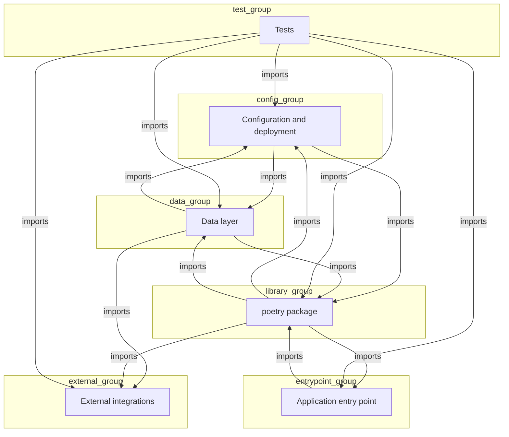

# Architecture report: python-poetry/poetry

> Automated static analysis. **Observed** = directly seen in files/imports/AST; **Inferred** = interpretation from that evidence. Repository code was not executed.

## 1. Repository at a glance

| Item | Value |
| --- | --- |
| Repository | python-poetry/poetry |
| Description | Python packaging and dependency management made easy |
| Language | Python |
| Stars | 34323 |
| Licence | MIT |
| Analysed commit / branch | 4acc75e19f128c8340c6f977a35e53b5f7f39071 / main |
| Framework(s) | None detected |
| Files analysed | 760 |
| Components | 6 |

## 2. Architecture in one minute

python-poetry/poetry - Python packaging and dependency management made easy. This repository was analysed statically from 760 file(s) (396 Python). Detected technologies (observed from imports/manifests): GitHub Actions, requests, Poetry, setuptools, pytest, unittest. Files are grouped into 6 component(s): Configuration and deployment, Data layer, Application entry point, External integrations, poetry package, Tests. Observed entry point(s): src/poetry/__main__.py, src/poetry/console/application.py. Findings below distinguish observed facts from inferred interpretation.

## 3. High-level block diagram

## 4. Main components

### Configuration and deployment (`config`)

- **Kind:** config
- **Status:** Observed
- **Confidence:** 0.85
- **Responsibility:** Groups 9 file(s) under configuration and deployment (observed from repository paths and static analysis). Observed top-level classes: Config, ConfigCommand, ConfigSetting, ConfigSource, ConfigSourceMigration, DictConfigSource. Observed top-level functions: boolean_normalizer, boolean_validator, build_config_setting_normalizer, build_config_setting_validator, int_normalizer, int_validator.
- **Paths:** `pyproject.toml`, `src/poetry/config/__init__.py`, `src/poetry/config/config.py`, `src/poetry/config/config_source.py`, `src/poetry/config/dict_config_source.py`, `src/poetry/config/file_config_source.py`, `src/poetry/config/source.py`, `src/poetry/console/commands/config.py`, `src/poetry/json/schemas/poetry.json`
- **Evidence:** [pyproject.toml](https://github.com/python-poetry/poetry/blob/4acc75e19f128c8340c6f977a35e53b5f7f39071/pyproject.toml); [src/poetry/config/__init__.py](https://github.com/python-poetry/poetry/blob/4acc75e19f128c8340c6f977a35e53b5f7f39071/src/poetry/config/__init__.py); [src/poetry/config/config.py:36](https://github.com/python-poetry/poetry/blob/4acc75e19f128c8340c6f977a35e53b5f7f39071/src/poetry/config/config.py#L36); [src/poetry/config/config_source.py:23](https://github.com/python-poetry/poetry/blob/4acc75e19f128c8340c6f977a35e53b5f7f39071/src/poetry/config/config_source.py#L23); [src/poetry/config/dict_config_source.py:15](https://github.com/python-poetry/poetry/blob/4acc75e19f128c8340c6f977a35e53b5f7f39071/src/poetry/config/dict_config_source.py#L15); [src/poetry/config/file_config_source.py:23](https://github.com/python-poetry/poetry/blob/4acc75e19f128c8340c6f977a35e53b5f7f39071/src/poetry/config/file_config_source.py#L23); [src/poetry/config/source.py:15](https://github.com/python-poetry/poetry/blob/4acc75e19f128c8340c6f977a35e53b5f7f39071/src/poetry/config/source.py#L15); [src/poetry/console/commands/config.py:42](https://github.com/python-poetry/poetry/blob/4acc75e19f128c8340c6f977a35e53b5f7f39071/src/poetry/console/commands/config.py#L42)

### Data layer (`data_layer`)

- **Kind:** data
- **Status:** Observed
- **Confidence:** 0.85
- **Responsibility:** Groups 19 file(s) under data layer (observed from repository paths and static analysis). Observed top-level classes: AbstractRepository, CachedRepository, HTMLPage, HTMLPageParser, HTTPRepository, InstalledRepository. Observed top-level functions: _const_factory, make_absolute_url.
- **Paths:** `src/poetry/repositories/__init__.py`, `src/poetry/repositories/abstract_repository.py`, `src/poetry/repositories/cached_repository.py`, `src/poetry/repositories/exceptions.py`, `src/poetry/repositories/http_repository.py`, `src/poetry/repositories/installed_repository.py`, `src/poetry/repositories/legacy_repository.py`, `src/poetry/repositories/link_sources/__init__.py`, `src/poetry/repositories/link_sources/base.py`, `src/poetry/repositories/link_sources/html.py`, `src/poetry/repositories/link_sources/json.py`, `src/poetry/repositories/lockfile_repository.py`, `src/poetry/repositories/parsers/__init__.py`, `src/poetry/repositories/parsers/html_page_parser.py`, `src/poetry/repositories/parsers/pypi_search_parser.py`, `src/poetry/repositories/pypi_repository.py`, `src/poetry/repositories/repository.py`, `src/poetry/repositories/repository_pool.py`, `src/poetry/repositories/single_page_repository.py`
- **Evidence:** [src/poetry/repositories/__init__.py](https://github.com/python-poetry/poetry/blob/4acc75e19f128c8340c6f977a35e53b5f7f39071/src/poetry/repositories/__init__.py); [src/poetry/repositories/abstract_repository.py:14](https://github.com/python-poetry/poetry/blob/4acc75e19f128c8340c6f977a35e53b5f7f39071/src/poetry/repositories/abstract_repository.py#L14); [src/poetry/repositories/cached_repository.py:24](https://github.com/python-poetry/poetry/blob/4acc75e19f128c8340c6f977a35e53b5f7f39071/src/poetry/repositories/cached_repository.py#L24); [src/poetry/repositories/exceptions.py:4](https://github.com/python-poetry/poetry/blob/4acc75e19f128c8340c6f977a35e53b5f7f39071/src/poetry/repositories/exceptions.py#L4); [src/poetry/repositories/http_repository.py:58](https://github.com/python-poetry/poetry/blob/4acc75e19f128c8340c6f977a35e53b5f7f39071/src/poetry/repositories/http_repository.py#L58); [src/poetry/repositories/installed_repository.py:30](https://github.com/python-poetry/poetry/blob/4acc75e19f128c8340c6f977a35e53b5f7f39071/src/poetry/repositories/installed_repository.py#L30); [src/poetry/repositories/legacy_repository.py:28](https://github.com/python-poetry/poetry/blob/4acc75e19f128c8340c6f977a35e53b5f7f39071/src/poetry/repositories/legacy_repository.py#L28); [src/poetry/repositories/link_sources/__init__.py](https://github.com/python-poetry/poetry/blob/4acc75e19f128c8340c6f977a35e53b5f7f39071/src/poetry/repositories/link_sources/__init__.py)

### Application entry point (`entrypoint`)

- **Kind:** entrypoint
- **Status:** Observed
- **Confidence:** 0.85
- **Responsibility:** Groups 3 file(s) under application entry point (observed from repository paths and static analysis). Observed top-level classes: Application, RunCommand. Observed top-level functions: load_command, main.
- **Paths:** `src/poetry/__main__.py`, `src/poetry/console/application.py`, `src/poetry/console/commands/run.py`
- **Evidence:** [src/poetry/__main__.py](https://github.com/python-poetry/poetry/blob/4acc75e19f128c8340c6f977a35e53b5f7f39071/src/poetry/__main__.py); [src/poetry/console/application.py:43](https://github.com/python-poetry/poetry/blob/4acc75e19f128c8340c6f977a35e53b5f7f39071/src/poetry/console/application.py#L43); [src/poetry/console/commands/run.py:17](https://github.com/python-poetry/poetry/blob/4acc75e19f128c8340c6f977a35e53b5f7f39071/src/poetry/console/commands/run.py#L17)

### External integrations (`external_integrations`)

- **Kind:** external
- **Status:** Inferred
- **Confidence:** 0.70
- **Responsibility:** Groups 0 file(s) under external integrations (observed from repository paths and static analysis).
- **Evidence:** [src/poetry/inspection/lazy_wheel.py:22](https://github.com/python-poetry/poetry/blob/4acc75e19f128c8340c6f977a35e53b5f7f39071/src/poetry/inspection/lazy_wheel.py#L22); [src/poetry/inspection/lazy_wheel.py:23](https://github.com/python-poetry/poetry/blob/4acc75e19f128c8340c6f977a35e53b5f7f39071/src/poetry/inspection/lazy_wheel.py#L23); [src/poetry/inspection/lazy_wheel.py:24](https://github.com/python-poetry/poetry/blob/4acc75e19f128c8340c6f977a35e53b5f7f39071/src/poetry/inspection/lazy_wheel.py#L24); [src/poetry/inspection/lazy_wheel.py:25](https://github.com/python-poetry/poetry/blob/4acc75e19f128c8340c6f977a35e53b5f7f39071/src/poetry/inspection/lazy_wheel.py#L25); [src/poetry/inspection/lazy_wheel.py:35](https://github.com/python-poetry/poetry/blob/4acc75e19f128c8340c6f977a35e53b5f7f39071/src/poetry/inspection/lazy_wheel.py#L35); [src/poetry/publishing/uploader.py:14](https://github.com/python-poetry/poetry/blob/4acc75e19f128c8340c6f977a35e53b5f7f39071/src/poetry/publishing/uploader.py#L14)

### poetry package (`poetry`)

- **Kind:** library
- **Status:** Observed
- **Confidence:** 0.85
- **Responsibility:** Groups 164 file(s) under poetry package (observed from repository paths and static analysis). Observed top-level classes: AboutCommand, AddCommand, ApplicationPlugin, ArtifactCache, Assignment, AtomicCachedProperty. Observed top-level functions: __getattr__, _effective_marker, _expiration, _file_lock, _get_package_from_git, _get_validator_and_properties.
- **Paths:** `src/poetry/__version__.py`, `src/poetry/console/__init__.py`, `src/poetry/console/command_loader.py`, `src/poetry/console/commands/__init__.py`, `src/poetry/console/commands/about.py`, `src/poetry/console/commands/add.py`, `src/poetry/console/commands/build.py`, `src/poetry/console/commands/cache/__init__.py`, `src/poetry/console/commands/cache/clear.py`, `src/poetry/console/commands/cache/list.py`, `src/poetry/console/commands/check.py`, `src/poetry/console/commands/command.py`, `src/poetry/console/commands/debug/__init__.py`, `src/poetry/console/commands/debug/info.py`, `src/poetry/console/commands/debug/resolve.py`, `src/poetry/console/commands/debug/tags.py`, `src/poetry/console/commands/env/__init__.py`, `src/poetry/console/commands/env/activate.py`, `src/poetry/console/commands/env/info.py`, `src/poetry/console/commands/env/list.py`, `src/poetry/console/commands/env/remove.py`, `src/poetry/console/commands/env/use.py`, `src/poetry/console/commands/env_command.py`, `src/poetry/console/commands/group_command.py`, `src/poetry/console/commands/init.py`, `src/poetry/console/commands/install.py`, `src/poetry/console/commands/installer_command.py`, `src/poetry/console/commands/lock.py`, `src/poetry/console/commands/new.py`, `src/poetry/console/commands/publish.py`, `src/poetry/console/commands/python/__init__.py`, `src/poetry/console/commands/python/install.py`, `src/poetry/console/commands/python/list.py`, `src/poetry/console/commands/python/remove.py`, `src/poetry/console/commands/remove.py`, `src/poetry/console/commands/search.py`, `src/poetry/console/commands/self/__init__.py`, `src/poetry/console/commands/self/add.py`, `src/poetry/console/commands/self/install.py`, `src/poetry/console/commands/self/lock.py`, `src/poetry/console/commands/self/remove.py`, `src/poetry/console/commands/self/self_command.py`, `src/poetry/console/commands/self/show/__init__.py`, `src/poetry/console/commands/self/show/plugins.py`, `src/poetry/console/commands/self/sync.py`, `src/poetry/console/commands/self/update.py`, `src/poetry/console/commands/show.py`, `src/poetry/console/commands/source/__init__.py`, `src/poetry/console/commands/source/add.py`, `src/poetry/console/commands/source/remove.py`, `src/poetry/console/commands/source/show.py`, `src/poetry/console/commands/sync.py`, `src/poetry/console/commands/update.py`, `src/poetry/console/commands/version.py`, `src/poetry/console/events/__init__.py`, `src/poetry/console/events/console_events.py`, `src/poetry/console/exceptions.py`, `src/poetry/console/logging/__init__.py`, `src/poetry/console/logging/filters.py`, `src/poetry/console/logging/formatters/__init__.py`, `src/poetry/console/logging/formatters/builder_formatter.py`, `src/poetry/console/logging/formatters/formatter.py`, `src/poetry/console/logging/io_formatter.py`, `src/poetry/console/logging/io_handler.py`, `src/poetry/exceptions.py`, `src/poetry/factory.py`, `src/poetry/inspection/__init__.py`, `src/poetry/inspection/info.py`, `src/poetry/inspection/lazy_wheel.py`, `src/poetry/installation/__init__.py`, `src/poetry/installation/chef.py`, `src/poetry/installation/chooser.py`, `src/poetry/installation/executor.py`, `src/poetry/installation/installer.py`, `src/poetry/installation/operations/__init__.py`, `src/poetry/installation/operations/install.py`, `src/poetry/installation/operations/operation.py`, `src/poetry/installation/operations/uninstall.py`, `src/poetry/installation/operations/update.py`, `src/poetry/installation/uninstaller.py`, `src/poetry/installation/wheel_installer.py`, `src/poetry/json/__init__.py`, `src/poetry/layouts/__init__.py`, `src/poetry/layouts/layout.py`, `src/poetry/layouts/src.py`, `src/poetry/locations.py`, `src/poetry/masonry/__init__.py`, `src/poetry/masonry/api.py`, `src/poetry/masonry/builders/__init__.py`, `src/poetry/masonry/builders/editable.py`, `src/poetry/mixology/__init__.py`, `src/poetry/mixology/assignment.py`, `src/poetry/mixology/failure.py`, `src/poetry/mixology/incompatibility.py`, `src/poetry/mixology/incompatibility_cause.py`, `src/poetry/mixology/partial_solution.py`, `src/poetry/mixology/result.py`, `src/poetry/mixology/set_relation.py`, `src/poetry/mixology/term.py`, `src/poetry/mixology/version_solver.py`, `src/poetry/packages/__init__.py`, `src/poetry/packages/dependency_package.py`, `src/poetry/packages/direct_origin.py`, `src/poetry/packages/locker.py`, `src/poetry/packages/package_collection.py`, `src/poetry/packages/transitive_package_info.py`, `src/poetry/plugins/__init__.py`, `src/poetry/plugins/application_plugin.py`, `src/poetry/plugins/base_plugin.py`, `src/poetry/plugins/plugin.py`, `src/poetry/plugins/plugin_manager.py`, `src/poetry/poetry.py`, `src/poetry/publishing/__init__.py`, `src/poetry/publishing/hash_manager.py`, `src/poetry/publishing/publisher.py`, `src/poetry/publishing/uploader.py`, `src/poetry/puzzle/__init__.py`, `src/poetry/puzzle/exceptions.py`, `src/poetry/puzzle/provider.py`, `src/poetry/puzzle/solver.py`, `src/poetry/puzzle/transaction.py`, `src/poetry/pyproject/__init__.py`, `src/poetry/pyproject/toml.py`, `src/poetry/toml/__init__.py`, `src/poetry/toml/exceptions.py`, `src/poetry/toml/file.py`, `src/poetry/utils/__init__.py`, `src/poetry/utils/_compat.py`, `src/poetry/utils/authenticator.py`, `src/poetry/utils/cache.py`, `src/poetry/utils/constants.py`, `src/poetry/utils/dependency_specification.py`, `src/poetry/utils/download.py`, `src/poetry/utils/env/__init__.py`, `src/poetry/utils/env/base_env.py`, `src/poetry/utils/env/env_manager.py`, `src/poetry/utils/env/exceptions.py`, `src/poetry/utils/env/generic_env.py`, `src/poetry/utils/env/mock_env.py`, `src/poetry/utils/env/null_env.py`, `src/poetry/utils/env/python/__init__.py`, `src/poetry/utils/env/python/exceptions.py`, `src/poetry/utils/env/python/installer.py`, `src/poetry/utils/env/python/manager.py`, `src/poetry/utils/env/python/providers.py`, `src/poetry/utils/env/script_strings.py`, `src/poetry/utils/env/site_packages.py`, `src/poetry/utils/env/system_env.py`, `src/poetry/utils/env/virtual_env.py`, `src/poetry/utils/extras.py`, `src/poetry/utils/helpers.py`, `src/poetry/utils/isolated_build.py`, `src/poetry/utils/log_utils.py`, `src/poetry/utils/password_manager.py`, `src/poetry/utils/patterns.py`, `src/poetry/utils/pip.py`, `src/poetry/utils/threading.py`, `src/poetry/utils/wheel.py`, `src/poetry/vcs/__init__.py`, `src/poetry/vcs/git/__init__.py`, `src/poetry/vcs/git/backend.py`, `src/poetry/vcs/git/system.py`, `src/poetry/version/__init__.py`, `src/poetry/version/version_selector.py`
- **Evidence:** [src/poetry/__version__.py](https://github.com/python-poetry/poetry/blob/4acc75e19f128c8340c6f977a35e53b5f7f39071/src/poetry/__version__.py); [src/poetry/console/__init__.py](https://github.com/python-poetry/poetry/blob/4acc75e19f128c8340c6f977a35e53b5f7f39071/src/poetry/console/__init__.py); [src/poetry/console/command_loader.py:15](https://github.com/python-poetry/poetry/blob/4acc75e19f128c8340c6f977a35e53b5f7f39071/src/poetry/console/command_loader.py#L15); [src/poetry/console/commands/__init__.py](https://github.com/python-poetry/poetry/blob/4acc75e19f128c8340c6f977a35e53b5f7f39071/src/poetry/console/commands/__init__.py); [src/poetry/console/commands/about.py:6](https://github.com/python-poetry/poetry/blob/4acc75e19f128c8340c6f977a35e53b5f7f39071/src/poetry/console/commands/about.py#L6); [src/poetry/console/commands/add.py:28](https://github.com/python-poetry/poetry/blob/4acc75e19f128c8340c6f977a35e53b5f7f39071/src/poetry/console/commands/add.py#L28); [src/poetry/console/commands/build.py:34](https://github.com/python-poetry/poetry/blob/4acc75e19f128c8340c6f977a35e53b5f7f39071/src/poetry/console/commands/build.py#L34); [src/poetry/console/commands/cache/__init__.py](https://github.com/python-poetry/poetry/blob/4acc75e19f128c8340c6f977a35e53b5f7f39071/src/poetry/console/commands/cache/__init__.py)

### Tests (`tests`)

- **Kind:** test
- **Status:** Observed
- **Confidence:** 0.85
- **Responsibility:** Groups 525 file(s) under tests (observed from repository paths and static analysis). Observed top-level classes: AddCommandPlugin, CheckProjectPathCommand, Chef, Config, CustomInstalledRepository, DistributionHash. Observed top-level functions: __add_packages, _build_wheel, _configure_project_with_groups, _configure_run_install_dev, _generate_choice_list_packages, _hashless_package_and_pool.
- **Paths:** `tests/__init__.py`, `tests/config/__init__.py`, `tests/config/test_config.py`, `tests/config/test_config_source.py`, `tests/config/test_dict_config_source.py`, `tests/config/test_file_config_source.py`, `tests/config/test_source.py`, `tests/conftest.py`, `tests/console/__init__.py`, `tests/console/commands/__init__.py`, `tests/console/commands/cache/__init__.py`, `tests/console/commands/cache/conftest.py`, `tests/console/commands/cache/test_clear.py`, `tests/console/commands/cache/test_list.py`, `tests/console/commands/conftest.py`, `tests/console/commands/debug/__init__.py`, `tests/console/commands/debug/test_info.py`, `tests/console/commands/debug/test_resolve.py`, `tests/console/commands/env/__init__.py`, `tests/console/commands/env/conftest.py`, `tests/console/commands/env/helpers.py`, `tests/console/commands/env/test_activate.py`, `tests/console/commands/env/test_info.py`, `tests/console/commands/env/test_list.py`, `tests/console/commands/env/test_remove.py`, `tests/console/commands/env/test_use.py`, `tests/console/commands/python/__init__.py`, `tests/console/commands/python/test_python_install.py`, `tests/console/commands/python/test_python_list.py`, `tests/console/commands/python/test_python_remove.py`, `tests/console/commands/self/__init__.py`, `tests/console/commands/self/conftest.py`, `tests/console/commands/self/fixtures/poetry-1.0.5-darwin.sha256sum`, `tests/console/commands/self/test_add_plugins.py`, `tests/console/commands/self/test_install.py`, `tests/console/commands/self/test_remove_plugins.py`, `tests/console/commands/self/test_self_command.py`, `tests/console/commands/self/test_show.py`, `tests/console/commands/self/test_show_plugins.py`, `tests/console/commands/self/test_sync.py`, `tests/console/commands/self/test_update.py`, `tests/console/commands/self/utils.py`, `tests/console/commands/source/__init__.py`, `tests/console/commands/source/conftest.py`, `tests/console/commands/source/test_add.py`, `tests/console/commands/source/test_remove.py`, `tests/console/commands/source/test_show.py`, `tests/console/commands/test_about.py`, `tests/console/commands/test_add.py`, `tests/console/commands/test_build.py`, `tests/console/commands/test_check.py`, `tests/console/commands/test_config.py`, `tests/console/commands/test_init.py`, `tests/console/commands/test_install.py`, `tests/console/commands/test_lock.py`, `tests/console/commands/test_new.py`, `tests/console/commands/test_publish.py`, `tests/console/commands/test_remove.py`, `tests/console/commands/test_run.py`, `tests/console/commands/test_search.py`, `tests/console/commands/test_show.py`, `tests/console/commands/test_sync.py`, `tests/console/commands/test_update.py`, `tests/console/commands/test_version.py`, `tests/console/conftest.py`, `tests/console/logging/__init__.py`, `tests/console/logging/formatters/__init__.py`, `tests/console/logging/formatters/test_builder_formatter.py`, `tests/console/logging/test_io_formatter.py`, `tests/console/logging/test_io_handler.py`, `tests/console/test_application.py`, `tests/console/test_application_command_not_found.py`, `tests/console/test_application_global_options.py`, `tests/console/test_application_removed_commands.py`, `tests/console/test_command_loader.py`, `tests/console/test_exceptions_console_message.py`, `tests/console/test_exceptions_poetry_runtime_error.py`, `tests/fixtures/bad_scripts_project/no_colon/README.rst`, `tests/fixtures/bad_scripts_project/no_colon/pyproject.toml`, `tests/fixtures/bad_scripts_project/no_colon/simple_project/__init__.py`, `tests/fixtures/bad_scripts_project/too_many_colon/README.rst`, `tests/fixtures/bad_scripts_project/too_many_colon/pyproject.toml`, `tests/fixtures/bad_scripts_project/too_many_colon/simple_project/__init__.py`, `tests/fixtures/build_constraints/pyproject.toml`, `tests/fixtures/build_constraints_empty/pyproject.toml`, `tests/fixtures/build_system_requires_not_available/README.rst`, `tests/fixtures/build_system_requires_not_available/pyproject.toml`, `tests/fixtures/build_system_requires_not_available/simple_project/__init__.py`, `tests/fixtures/build_systems/core_from_git/README.md`, `tests/fixtures/build_systems/core_from_git/pyproject.toml`, `tests/fixtures/build_systems/core_from_git/simple_project/__init__.py`, `tests/fixtures/build_systems/core_in_range/README.md`, `tests/fixtures/build_systems/core_in_range/pyproject.toml`, `tests/fixtures/build_systems/core_in_range/simple_project/__init__.py`, `tests/fixtures/build_systems/core_not_in_range/README.md`, `tests/fixtures/build_systems/core_not_in_range/pyproject.toml`, `tests/fixtures/build_systems/core_not_in_range/simple_project/__init__.py`, `tests/fixtures/build_systems/has_build_script/README.md`, `tests/fixtures/build_systems/has_build_script/pyproject.toml`, `tests/fixtures/build_systems/has_build_script/simple_project/__init__.py`, `tests/fixtures/build_systems/multiple_build_deps/README.md`, `tests/fixtures/build_systems/multiple_build_deps/pyproject.toml`, `tests/fixtures/build_systems/multiple_build_deps/simple_project/__init__.py`, `tests/fixtures/build_systems/no_build_backend/README.md`, `tests/fixtures/build_systems/no_build_backend/pyproject.toml`, `tests/fixtures/build_systems/no_build_backend/simple_project/__init__.py`, `tests/fixtures/build_systems/no_build_system/README.md`, `tests/fixtures/build_systems/no_build_system/pyproject.toml`, `tests/fixtures/build_systems/no_build_system/simple_project/__init__.py`, `tests/fixtures/build_systems/no_core/README.md`, `tests/fixtures/build_systems/no_core/pyproject.toml`, `tests/fixtures/build_systems/no_core/simple_project/__init__.py`, `tests/fixtures/complete.toml`, `tests/fixtures/deleted_directory_dependency/pyproject.toml`, `tests/fixtures/deleted_file_dependency/pyproject.toml`, `tests/fixtures/directory/project_with_transitive_directory_dependencies/project_with_transitive_directory_dependencies/__init__.py`, `tests/fixtures/directory/project_with_transitive_directory_dependencies/pyproject.toml`, `tests/fixtures/directory/project_with_transitive_directory_dependencies/setup.py`, `tests/fixtures/directory/project_with_transitive_file_dependencies/inner-directory-project/pyproject.toml`, `tests/fixtures/directory/project_with_transitive_file_dependencies/project_with_transitive_file_dependencies/__init__.py`, `tests/fixtures/directory/project_with_transitive_file_dependencies/pyproject.toml`, `tests/fixtures/excluded_subpackage/README.rst`, `tests/fixtures/excluded_subpackage/example/__init__.py`, `tests/fixtures/excluded_subpackage/example/test/__init__.py`, `tests/fixtures/excluded_subpackage/example/test/excluded.py`, `tests/fixtures/excluded_subpackage/pyproject.toml`, `tests/fixtures/extended_project/README.rst`, `tests/fixtures/extended_project/build.py`, `tests/fixtures/extended_project/extended_project/__init__.py`, `tests/fixtures/extended_project/pyproject.toml`, `tests/fixtures/extended_project_without_setup/README.rst`, `tests/fixtures/extended_project_without_setup/build.py`, `tests/fixtures/extended_project_without_setup/extended_project/__init__.py`, `tests/fixtures/extended_project_without_setup/pyproject.toml`, `tests/fixtures/extended_with_no_setup/README.md`, `tests/fixtures/extended_with_no_setup/build.py`, `tests/fixtures/extended_with_no_setup/extended/__init__.py`, `tests/fixtures/extended_with_no_setup/extended/extended.c`, `tests/fixtures/extended_with_no_setup/pyproject.toml`, `tests/fixtures/file_scripts_dir_ref_project/bin/some-directory/.gitkeep`, `tests/fixtures/file_scripts_dir_ref_project/file_scripts_dir_ref_project/__init__.py`, `tests/fixtures/file_scripts_dir_ref_project/pyproject.toml`, `tests/fixtures/file_scripts_missing_ref_project/file_scripts_missing_ref_project/__init__.py`, `tests/fixtures/file_scripts_missing_ref_project/pyproject.toml`, `tests/fixtures/file_scripts_no_ref_field_project/file_scripts_no_ref_field_project/__init__.py`, `tests/fixtures/file_scripts_no_ref_field_project/pyproject.toml`, `tests/fixtures/file_scripts_project/bin/my-script.sh`, `tests/fixtures/file_scripts_project/file_scripts_project/__init__.py`, `tests/fixtures/file_scripts_project/pyproject.toml`, `tests/fixtures/git/github.com/demo/demo/demo/__init__.py`, `tests/fixtures/git/github.com/demo/demo/pyproject.toml`, `tests/fixtures/git/github.com/demo/namespace-package-one/namespace_package/__init__.py`, `tests/fixtures/git/github.com/demo/namespace-package-one/namespace_package/one/__init__.py`, `tests/fixtures/git/github.com/demo/namespace-package-one/setup.py`, `tests/fixtures/git/github.com/demo/no-dependencies/demo/__init__.py`, `tests/fixtures/git/github.com/demo/no-dependencies/setup.py`, `tests/fixtures/git/github.com/demo/no-version/demo/__init__.py`, `tests/fixtures/git/github.com/demo/no-version/setup.py`, `tests/fixtures/git/github.com/demo/non-canonical-name/demo/__init__.py`, `tests/fixtures/git/github.com/demo/non-canonical-name/setup.py`, `tests/fixtures/git/github.com/demo/poetry-plugin/poetry_plugin/__init__.py`, `tests/fixtures/git/github.com/demo/poetry-plugin/pyproject.toml`, `tests/fixtures/git/github.com/demo/poetry-plugin2/subdir/poetry_plugin/__init__.py`, `tests/fixtures/git/github.com/demo/poetry-plugin2/subdir/pyproject.toml`, `tests/fixtures/git/github.com/demo/prerelease/prerelease/__init__.py`, `tests/fixtures/git/github.com/demo/prerelease/pyproject.toml`, `tests/fixtures/git/github.com/demo/pyproject-demo/demo/__init__.py`, `tests/fixtures/git/github.com/demo/pyproject-demo/pyproject.toml`, `tests/fixtures/git/github.com/demo/subdirectories/one-copy/one/__init__.py`, `tests/fixtures/git/github.com/demo/subdirectories/one-copy/pyproject.toml`, `tests/fixtures/git/github.com/demo/subdirectories/one/one/__init__.py`, `tests/fixtures/git/github.com/demo/subdirectories/one/pyproject.toml`, `tests/fixtures/git/github.com/demo/subdirectories/two/pyproject.toml`, `tests/fixtures/git/github.com/demo/subdirectories/two/two/__init__.py`, `tests/fixtures/git/github.com/forked_demo/subdirectories/one-copy/one/__init__.py`, `tests/fixtures/git/github.com/forked_demo/subdirectories/one-copy/pyproject.toml`, `tests/fixtures/git/github.com/forked_demo/subdirectories/one/one/__init__.py`, `tests/fixtures/git/github.com/forked_demo/subdirectories/one/pyproject.toml`, `tests/fixtures/git/github.com/forked_demo/subdirectories/two/pyproject.toml`, `tests/fixtures/git/github.com/forked_demo/subdirectories/two/two/__init__.py`, `tests/fixtures/incompatible_lock/pyproject.toml`, `tests/fixtures/inspection/demo/pyproject.toml`, `tests/fixtures/inspection/demo_no_setup_pkg_info_no_deps/PKG-INFO`, `tests/fixtures/inspection/demo_no_setup_pkg_info_no_deps/pyproject.toml`, `tests/fixtures/inspection/demo_no_setup_pkg_info_no_deps_dynamic/PKG-INFO`, `tests/fixtures/inspection/demo_no_setup_pkg_info_no_deps_dynamic/pyproject.toml`, `tests/fixtures/inspection/demo_no_setup_pkg_info_no_deps_for_sure/PKG-INFO`, `tests/fixtures/inspection/demo_no_setup_pkg_info_no_deps_for_sure/pyproject.toml`, `tests/fixtures/inspection/demo_only_requires_txt.egg-info/PKG-INFO`, `tests/fixtures/inspection/demo_only_requires_txt.egg-info/requires.txt`, `tests/fixtures/inspection/demo_poetry_package/pyproject.toml`, `tests/fixtures/inspection/demo_with_obsolete_egg_info/demo-0.1.0.egg-info/PKG-INFO`, `tests/fixtures/inspection/demo_with_obsolete_egg_info/demo-0.1.0.egg-info/requires.txt`, `tests/fixtures/inspection/demo_with_obsolete_egg_info/pyproject.toml`, `tests/fixtures/invalid_lock/pyproject.toml`, `tests/fixtures/invalid_pyproject/pyproject.toml`, `tests/fixtures/invalid_pyproject_dep_name/pyproject.toml`, `tests/fixtures/missing_directory_dependency/pyproject.toml`, `tests/fixtures/missing_extra_directory_dependency/pyproject.toml`, `tests/fixtures/missing_file_dependency/pyproject.toml`, `tests/fixtures/nameless_pyproject/pyproject.toml`, `tests/fixtures/no_name_project/README.rst`, `tests/fixtures/no_name_project/pyproject.toml`, `tests/fixtures/non_package_mode/pyproject.toml`, `tests/fixtures/old_lock/pyproject.toml`, `tests/fixtures/old_lock_path_dependency/pyproject.toml`, `tests/fixtures/old_lock_path_dependency/quix/pyproject.toml`, `tests/fixtures/outdated_lock/pyproject.toml`, `tests/fixtures/private_pyproject/pyproject.toml`, `tests/fixtures/project_plugins/my_application_plugin-1.0.dist-info/METADATA`, `tests/fixtures/project_plugins/my_application_plugin-1.0.dist-info/entry_points.txt`, `tests/fixtures/project_plugins/my_application_plugin-2.0.dist-info/METADATA`, `tests/fixtures/project_plugins/my_application_plugin-2.0.dist-info/entry_points.txt`, `tests/fixtures/project_plugins/my_other_plugin-1.0.dist-info/METADATA`, `tests/fixtures/project_plugins/my_other_plugin-1.0.dist-info/entry_points.txt`, `tests/fixtures/project_plugins/pyproject.toml`, `tests/fixtures/project_plugins/some_lib-1.0.dist-info/METADATA`, `tests/fixtures/project_plugins/some_lib-2.0.dist-info/METADATA`, `tests/fixtures/project_with_extras/project_with_extras/__init__.py`, `tests/fixtures/project_with_extras/pyproject.toml`, `tests/fixtures/project_with_git_dev_dependency/pyproject.toml`, `tests/fixtures/project_with_local_dependencies/pyproject.toml`, `tests/fixtures/project_with_multi_constraints_dependency/project/__init__.py`, `tests/fixtures/project_with_multi_constraints_dependency/pyproject.toml`, `tests/fixtures/project_with_nested_local/bar/pyproject.toml`, `tests/fixtures/project_with_nested_local/foo/pyproject.toml`, `tests/fixtures/project_with_nested_local/pyproject.toml`, `tests/fixtures/project_with_nested_local/quix/pyproject.toml`, `tests/fixtures/project_with_setup/my_package/__init__.py`, `tests/fixtures/project_with_setup/setup.py`, `tests/fixtures/project_with_setup_calls_script/my_package/__init__.py`, `tests/fixtures/project_with_setup_calls_script/pyproject.toml`, `tests/fixtures/project_with_setup_calls_script/setup.py`, `tests/fixtures/pypi_reference/pyproject.toml`, `tests/fixtures/sample_project/README.rst`, `tests/fixtures/sample_project/pyproject.toml`, `tests/fixtures/scripts/README.md`, `tests/fixtures/scripts/pyproject.toml`, `tests/fixtures/scripts/scripts/__init__.py`, `tests/fixtures/scripts/scripts/check_argv0.py`, `tests/fixtures/scripts/scripts/exit_code.py`, `tests/fixtures/scripts/scripts/return_code.py`, `tests/fixtures/self_version_not_ok/pyproject.toml`, `tests/fixtures/self_version_not_ok_invalid_config/pyproject.toml`, `tests/fixtures/self_version_ok/pyproject.toml`, `tests/fixtures/simple_project/LICENSE`, `tests/fixtures/simple_project/README.rst`, `tests/fixtures/simple_project/pyproject.toml`, `tests/fixtures/simple_project/simple_project/__init__.py`, `tests/fixtures/simple_project_legacy/LICENSE`, `tests/fixtures/simple_project_legacy/README.rst`, `tests/fixtures/simple_project_legacy/pyproject.toml`, `tests/fixtures/simple_project_legacy/simple_project/__init__.py`, `tests/fixtures/up_to_date_lock/pyproject.toml`, `tests/fixtures/up_to_date_lock_non_package/pyproject.toml`, `tests/fixtures/with-include/LICENSE`, `tests/fixtures/with-include/README.rst`, `tests/fixtures/with-include/extra_dir/README.md`, `tests/fixtures/with-include/extra_dir/__init__.py`, `tests/fixtures/with-include/extra_dir/sub_pkg/__init__.py`, `tests/fixtures/with-include/extra_dir/sub_pkg/vcs_excluded.txt`, `tests/fixtures/with-include/extra_dir/vcs_excluded.txt`, `tests/fixtures/with-include/for_wheel_only/__init__.py`, `tests/fixtures/with-include/my_module.py`, `tests/fixtures/with-include/notes.txt`, `tests/fixtures/with-include/package_with_include/__init__.py`, `tests/fixtures/with-include/pyproject.toml`, `tests/fixtures/with-include/src/src_package/__init__.py`, `tests/fixtures/with-include/tests/__init__.py`, `tests/fixtures/with_conditional_path_deps/demo_one/pyproject.toml`, `tests/fixtures/with_conditional_path_deps/demo_two/pyproject.toml`, `tests/fixtures/with_conditional_path_deps/pyproject.toml`, `tests/fixtures/with_explicit_pypi_and_other/pyproject.toml`, `tests/fixtures/with_explicit_pypi_and_other_explicit/pyproject.toml`, `tests/fixtures/with_explicit_pypi_no_other/pyproject.toml`, `tests/fixtures/with_explicit_source/pyproject.toml`, `tests/fixtures/with_local_config/README.rst`, `tests/fixtures/with_local_config/poetry.toml`, `tests/fixtures/with_local_config/pyproject.toml`, `tests/fixtures/with_multiple_dist_dir/README.rst`, `tests/fixtures/with_multiple_dist_dir/pyproject.toml`, `tests/fixtures/with_multiple_dist_dir/simple_project/__init__.py`, `tests/fixtures/with_multiple_readme_files/README-1.rst`, `tests/fixtures/with_multiple_readme_files/README-2.rst`, `tests/fixtures/with_multiple_readme_files/my_package/__init__.py`, `tests/fixtures/with_multiple_readme_files/pyproject.toml`, `tests/fixtures/with_multiple_sources/pyproject.toml`, `tests/fixtures/with_multiple_sources_pypi/pyproject.toml`, `tests/fixtures/with_multiple_supplemental_sources/pyproject.toml`, `tests/fixtures/with_path_dependency/bazz/pyproject.toml`, `tests/fixtures/with_path_dependency/pyproject.toml`, `tests/fixtures/with_primary_source_explicit/pyproject.toml`, `tests/fixtures/with_primary_source_implicit/pyproject.toml`, `tests/fixtures/with_source/README.rst`, `tests/fixtures/with_source/pyproject.toml`, `tests/fixtures/with_supplemental_source/pyproject.toml`, `tests/helpers.py`, `tests/inspection/__init__.py`, `tests/inspection/test_info.py`, `tests/inspection/test_lazy_wheel.py`, `tests/installation/__init__.py`, `tests/installation/conftest.py`, `tests/installation/fixtures/extras-with-dependencies.test`, `tests/installation/fixtures/extras.test`, `tests/installation/fixtures/install-no-dev.test`, `tests/installation/fixtures/no-dependencies.test`, `tests/installation/fixtures/remove.test`, `tests/installation/fixtures/update-with-lock.test`, `tests/installation/fixtures/update-with-locked-extras.test`, `tests/installation/fixtures/with-conditional-dependency.test`, `tests/installation/fixtures/with-conflicting-dependency-extras-root.test`, `tests/installation/fixtures/with-conflicting-dependency-extras-transitive.test`, `tests/installation/fixtures/with-dependencies-differing-extras.test`, `tests/installation/fixtures/with-dependencies-extras.test`, `tests/installation/fixtures/with-dependencies-nested-extras.test`, `tests/installation/fixtures/with-dependencies.test`, `tests/installation/fixtures/with-directory-dependency-poetry-transitive.test`, `tests/installation/fixtures/with-directory-dependency-poetry.test`, `tests/installation/fixtures/with-directory-dependency-setuptools.test`, `tests/installation/fixtures/with-duplicate-dependencies-update.test`, `tests/installation/fixtures/with-duplicate-dependencies.test`, `tests/installation/fixtures/with-exclusive-extras.test`, `tests/installation/fixtures/with-file-dependency-transitive.test`, `tests/installation/fixtures/with-file-dependency.test`, `tests/installation/fixtures/with-multiple-updates.test`, `tests/installation/fixtures/with-optional-dependencies.test`, `tests/installation/fixtures/with-platform-dependencies.test`, `tests/installation/fixtures/with-prereleases.test`, `tests/installation/fixtures/with-pypi-repository.test`, `tests/installation/fixtures/with-python-versions.test`, `tests/installation/fixtures/with-same-version-url-dependencies.test`, `tests/installation/fixtures/with-self-referencing-extras-all-deep.test`, `tests/installation/fixtures/with-self-referencing-extras-all-top.test`, `tests/installation/fixtures/with-self-referencing-extras-b-markers.test`, `tests/installation/fixtures/with-self-referencing-extras-deep.test`, `tests/installation/fixtures/with-self-referencing-extras-download-deep.test`, `tests/installation/fixtures/with-self-referencing-extras-download-top.test`, `tests/installation/fixtures/with-self-referencing-extras-install-deep.test`, `tests/installation/fixtures/with-self-referencing-extras-install-download-deep.test`, `tests/installation/fixtures/with-self-referencing-extras-install-download-top.test`, `tests/installation/fixtures/with-self-referencing-extras-install-top.test`, `tests/installation/fixtures/with-self-referencing-extras-nested-deep.test`, `tests/installation/fixtures/with-self-referencing-extras-nested-top.test`, `tests/installation/fixtures/with-self-referencing-extras-top.test`, `tests/installation/fixtures/with-sub-dependencies.test`, `tests/installation/fixtures/with-url-dependency.test`, `tests/installation/fixtures/with-vcs-dependency-with-extras.test`, `tests/installation/fixtures/with-vcs-dependency-without-ref.test`, `tests/installation/fixtures/with-wheel-dependency-no-requires-dist.test`, `tests/installation/test_chef.py`, `tests/installation/test_chooser.py`, `tests/installation/test_chooser_errors.py`, `tests/installation/test_executor.py`, `tests/installation/test_installer.py`, `tests/installation/test_uninstaller.py`, `tests/installation/test_wheel_installer.py`, `tests/integration/__init__.py`, `tests/integration/test_utils_vcs_git.py`, `tests/json/__init__.py`, `tests/json/fixtures/build_constraints.toml`, `tests/json/fixtures/self_invalid_plugin.toml`, `tests/json/fixtures/self_invalid_version.toml`, `tests/json/fixtures/self_valid.toml`, `tests/json/fixtures/source/complete_invalid_priority.toml`, `tests/json/fixtures/source/complete_invalid_url.toml`, `tests/json/fixtures/source/complete_valid.toml`, `tests/json/test_schema.py`, `tests/masonry/builders/__init__.py`, `tests/masonry/builders/fixtures/excluded_subpackage/README.rst`, `tests/masonry/builders/fixtures/excluded_subpackage/example/__init__.py`, `tests/masonry/builders/fixtures/excluded_subpackage/example/test/__init__.py`, `tests/masonry/builders/fixtures/excluded_subpackage/example/test/excluded.py`, `tests/masonry/builders/fixtures/excluded_subpackage/pyproject.toml`, `tests/masonry/builders/test_editable_builder.py`, `tests/mixology/__init__.py`, `tests/mixology/helpers.py`, `tests/mixology/test_incompatibility.py`, `tests/mixology/version_solver/__init__.py`, `tests/mixology/version_solver/conftest.py`, `tests/mixology/version_solver/test_backtracking.py`, `tests/mixology/version_solver/test_basic_graph.py`, `tests/mixology/version_solver/test_dependency_cache.py`, `tests/mixology/version_solver/test_python_constraint.py`, `tests/mixology/version_solver/test_unsolvable.py`, `tests/mixology/version_solver/test_with_lock.py`, `tests/packages/__init__.py`, `tests/packages/test_direct_origin.py`, `tests/packages/test_locker.py`, `tests/packages/test_transitive_package_info.py`, `tests/plugins/__init__.py`, `tests/plugins/test_plugin_manager.py`, `tests/publishing/__init__.py`, `tests/publishing/test_hash_manager.py`, `tests/publishing/test_publisher.py`, `tests/publishing/test_uploader.py`, `tests/puzzle/__init__.py`, `tests/puzzle/conftest.py`, `tests/puzzle/test_provider.py`, `tests/puzzle/test_solver.py`, `tests/puzzle/test_solver_internals.py`, `tests/puzzle/test_transaction.py`, `tests/pyproject/__init__.py`, `tests/pyproject/conftest.py`, `tests/pyproject/test_pyproject_toml.py`, `tests/pyproject/test_pyproject_toml_file.py`, `tests/repositories/__init__.py`, `tests/repositories/conftest.py`, `tests/repositories/fixtures/__init__.py`, `tests/repositories/fixtures/distribution_hashes.py`, `tests/repositories/fixtures/installed/src/bender/bender.egg-info/PKG-INFO`, `tests/repositories/fixtures/installed/src/pendulum/pendulum.egg-info/PKG-INFO`, `tests/repositories/fixtures/installed/src/pendulum/pendulum.egg-info/requires.txt`, `tests/repositories/fixtures/legacy.py`, `tests/repositories/fixtures/legacy/absolute.html`, `tests/repositories/fixtures/legacy/black.html`, `tests/repositories/fixtures/legacy/clikit.html`, `tests/repositories/fixtures/legacy/demo.html`, `tests/repositories/fixtures/legacy/discord-py.html`, `tests/repositories/fixtures/legacy/futures-partial-yank.html`, `tests/repositories/fixtures/legacy/futures.html`, `tests/repositories/fixtures/legacy/invalid-version.html`, `tests/repositories/fixtures/legacy/ipython.html`, `tests/repositories/fixtures/legacy/isort-metadata.html`, `tests/repositories/fixtures/legacy/isort.html`, `tests/repositories/fixtures/legacy/json/_readme`, `tests/repositories/fixtures/legacy/json/absolute.json`, `tests/repositories/fixtures/legacy/json/demo.json`, `tests/repositories/fixtures/legacy/json/invalid-version.json`, `tests/repositories/fixtures/legacy/json/isort-metadata.json`, `tests/repositories/fixtures/legacy/json/jupyter.json`, `tests/repositories/fixtures/legacy/json/poetry-test-py2-py3-metadata-merge.json`, `tests/repositories/fixtures/legacy/json/relative.json`, `tests/repositories/fixtures/legacy/json/sqlalchemy-legacy.json`, `tests/repositories/fixtures/legacy/jupyter.html`, `tests/repositories/fixtures/legacy/missing-version.html`, `tests/repositories/fixtures/legacy/pastel.html`, `tests/repositories/fixtures/legacy/poetry-test-py2-py3-metadata-merge.html`, `tests/repositories/fixtures/legacy/pytest-with-extra-packages.html`, `tests/repositories/fixtures/legacy/pytest.html`, `tests/repositories/fixtures/legacy/python-language-server.html`, `tests/repositories/fixtures/legacy/pyyaml.html`, `tests/repositories/fixtures/legacy/relative.html`, `tests/repositories/fixtures/legacy/sqlalchemy-legacy.html`, `tests/repositories/fixtures/legacy/tomlkit.html`, `tests/repositories/fixtures/pypi.org/generate.py`, `tests/repositories/fixtures/pypi.org/json/attrs.json`, `tests/repositories/fixtures/pypi.org/json/attrs/17.4.0.json`, `tests/repositories/fixtures/pypi.org/json/black.json`, `tests/repositories/fixtures/pypi.org/json/black/19.10b0.json`, `tests/repositories/fixtures/pypi.org/json/black/21.11b0.json`, `tests/repositories/fixtures/pypi.org/json/cleo.json`, `tests/repositories/fixtures/pypi.org/json/cleo/1.0.0a5.json`, `tests/repositories/fixtures/pypi.org/json/clikit.json`, `tests/repositories/fixtures/pypi.org/json/clikit/0.2.4.json`, `tests/repositories/fixtures/pypi.org/json/colorama.json`, `tests/repositories/fixtures/pypi.org/json/colorama/0.3.9.json`, `tests/repositories/fixtures/pypi.org/json/discord-py.json`, `tests/repositories/fixtures/pypi.org/json/discord-py/2.0.0.json`, `tests/repositories/fixtures/pypi.org/json/filecache.json`, `tests/repositories/fixtures/pypi.org/json/filecache/0.81.json`, `tests/repositories/fixtures/pypi.org/json/funcsigs.json`, `tests/repositories/fixtures/pypi.org/json/funcsigs/1.0.2.json`, `tests/repositories/fixtures/pypi.org/json/futures.json`, `tests/repositories/fixtures/pypi.org/json/futures/3.2.0.json`, `tests/repositories/fixtures/pypi.org/json/hbmqtt.json`, `tests/repositories/fixtures/pypi.org/json/hbmqtt/0.9.6.json`, `tests/repositories/fixtures/pypi.org/json/importlib-metadata.json`, `tests/repositories/fixtures/pypi.org/json/importlib-metadata/1.7.0.json`, `tests/repositories/fixtures/pypi.org/json/ipython.json`, `tests/repositories/fixtures/pypi.org/json/ipython/4.1.0rc1.json`, `tests/repositories/fixtures/pypi.org/json/ipython/5.7.0.json`, `tests/repositories/fixtures/pypi.org/json/ipython/7.5.0.json`, `tests/repositories/fixtures/pypi.org/json/isodate.json`, `tests/repositories/fixtures/pypi.org/json/isodate/0.7.0.json`, `tests/repositories/fixtures/pypi.org/json/isort-metadata.json`, `tests/repositories/fixtures/pypi.org/json/isort.json`, `tests/repositories/fixtures/pypi.org/json/isort/4.3.4.json`, `tests/repositories/fixtures/pypi.org/json/jupyter.json`, `tests/repositories/fixtures/pypi.org/json/jupyter/1.0.0.json`, `tests/repositories/fixtures/pypi.org/json/mocked/invalid-version-package.json`, `tests/repositories/fixtures/pypi.org/json/mocked/isort-metadata/4.3.4.json`, `tests/repositories/fixtures/pypi.org/json/mocked/six-unknown-version.json`, `tests/repositories/fixtures/pypi.org/json/mocked/six-unknown-version/1.11.0.json`, `tests/repositories/fixtures/pypi.org/json/mocked/with-extra-dependency.json`, `tests/repositories/fixtures/pypi.org/json/mocked/with-extra-dependency/0.12.4.json`, `tests/repositories/fixtures/pypi.org/json/mocked/with-transitive-extra-dependency.json`, `tests/repositories/fixtures/pypi.org/json/mocked/with-transitive-extra-dependency/0.12.4.json`, `tests/repositories/fixtures/pypi.org/json/more-itertools.json`, `tests/repositories/fixtures/pypi.org/json/more-itertools/4.1.0.json`, `tests/repositories/fixtures/pypi.org/json/pastel.json`, `tests/repositories/fixtures/pypi.org/json/pastel/0.1.0.json`, `tests/repositories/fixtures/pypi.org/json/pluggy.json`, `tests/repositories/fixtures/pypi.org/json/pluggy/0.6.0.json`, `tests/repositories/fixtures/pypi.org/json/poetry-core.json`, `tests/repositories/fixtures/pypi.org/json/poetry-core/1.5.0.json`, `tests/repositories/fixtures/pypi.org/json/poetry-core/2.1.3.json`, `tests/repositories/fixtures/pypi.org/json/py.json`, `tests/repositories/fixtures/pypi.org/json/py/1.5.3.json`, `tests/repositories/fixtures/pypi.org/json/pylev.json`, `tests/repositories/fixtures/pypi.org/json/pylev/1.3.0.json`, `tests/repositories/fixtures/pypi.org/json/pytest.json`, `tests/repositories/fixtures/pypi.org/json/pytest/3.5.0.json`, `tests/repositories/fixtures/pypi.org/json/pytest/3.5.1.json`, `tests/repositories/fixtures/pypi.org/json/python-language-server.json`, `tests/repositories/fixtures/pypi.org/json/python-language-server/0.21.2.json`, `tests/repositories/fixtures/pypi.org/json/pyyaml.json`, `tests/repositories/fixtures/pypi.org/json/pyyaml/3.13.0.json`, `tests/repositories/fixtures/pypi.org/json/requests.json`, `tests/repositories/fixtures/pypi.org/json/requests/2.18.0.json`, `tests/repositories/fixtures/pypi.org/json/requests/2.18.1.json`, `tests/repositories/fixtures/pypi.org/json/requests/2.18.2.json`, `tests/repositories/fixtures/pypi.org/json/requests/2.18.3.json`, `tests/repositories/fixtures/pypi.org/json/requests/2.18.4.json`, `tests/repositories/fixtures/pypi.org/json/requests/2.19.0.json`, `tests/repositories/fixtures/pypi.org/json/setuptools.json`, `tests/repositories/fixtures/pypi.org/json/setuptools/39.2.0.json`, `tests/repositories/fixtures/pypi.org/json/setuptools/67.6.1.json`, `tests/repositories/fixtures/pypi.org/json/six.json`, `tests/repositories/fixtures/pypi.org/json/six/1.11.0.json`, `tests/repositories/fixtures/pypi.org/json/sqlalchemy.json`, `tests/repositories/fixtures/pypi.org/json/sqlalchemy/1.2.12.json`, `tests/repositories/fixtures/pypi.org/json/toga.json`, `tests/repositories/fixtures/pypi.org/json/toga/0.3.0.json`, `tests/repositories/fixtures/pypi.org/json/toga/0.3.0dev1.json`, `tests/repositories/fixtures/pypi.org/json/toga/0.3.0dev2.json`
- **Evidence:** [tests/__init__.py](https://github.com/python-poetry/poetry/blob/4acc75e19f128c8340c6f977a35e53b5f7f39071/tests/__init__.py); [tests/config/__init__.py](https://github.com/python-poetry/poetry/blob/4acc75e19f128c8340c6f977a35e53b5f7f39071/tests/config/__init__.py); [tests/config/test_config.py:32](https://github.com/python-poetry/poetry/blob/4acc75e19f128c8340c6f977a35e53b5f7f39071/tests/config/test_config.py#L32); [tests/config/test_config_source.py:15](https://github.com/python-poetry/poetry/blob/4acc75e19f128c8340c6f977a35e53b5f7f39071/tests/config/test_config_source.py#L15); [tests/config/test_dict_config_source.py:9](https://github.com/python-poetry/poetry/blob/4acc75e19f128c8340c6f977a35e53b5f7f39071/tests/config/test_dict_config_source.py#L9); [tests/config/test_file_config_source.py:17](https://github.com/python-poetry/poetry/blob/4acc75e19f128c8340c6f977a35e53b5f7f39071/tests/config/test_file_config_source.py#L17); [tests/config/test_source.py:30](https://github.com/python-poetry/poetry/blob/4acc75e19f128c8340c6f977a35e53b5f7f39071/tests/config/test_source.py#L30); [tests/conftest.py:99](https://github.com/python-poetry/poetry/blob/4acc75e19f128c8340c6f977a35e53b5f7f39071/tests/conftest.py#L99)

## 5. Execution flow

**Observed** entry point(s):

- [src/poetry/__main__.py:6](https://github.com/python-poetry/poetry/blob/4acc75e19f128c8340c6f977a35e53b5f7f39071/src/poetry/__main__.py#L6)
- [src/poetry/console/application.py](https://github.com/python-poetry/poetry/blob/4acc75e19f128c8340c6f977a35e53b5f7f39071/src/poetry/console/application.py)

Representative flow (derived from observed entry points and the import graph; steps beyond the entry point are **Inferred**):

1. Execution starts at an observed entry point listed above, if present.
2. `config` imports `data_layer` (Configuration and deployment -> Data layer).
3. `config` imports `poetry` (Configuration and deployment -> poetry package).
4. `data_layer` imports `config` (Data layer -> Configuration and deployment).
5. `data_layer` imports `external_integrations` (Data layer -> External integrations).
6. `data_layer` imports `poetry` (Data layer -> poetry package).
7. `entrypoint` imports `poetry` (Application entry point -> poetry package).
8. `poetry` imports `config` (poetry package -> Configuration and deployment).
9. `poetry` imports `data_layer` (poetry package -> Data layer).

## 6. Project structure

### `(root)`

- `.gitattributes` - other (95 bytes)
- `.gitignore` - other (173 bytes)
- `.pre-commit-config.yaml` - config (1160 bytes)
- `.pre-commit-hooks.yaml` - config (652 bytes)
- `CITATION.cff` - other (806 bytes)
- `CODE_OF_CONDUCT.md` - docs (3352 bytes)
- `LICENSE` - docs (1070 bytes)
- `README.md` - docs (5464 bytes)
- `pyproject.toml` - manifest (5523 bytes)

### `.github`

- `.github/ISSUE_TEMPLATE/---bug-report.yml` - config (3392 bytes)
- `.github/ISSUE_TEMPLATE/---documentation.yml` - config (1768 bytes)
- `.github/ISSUE_TEMPLATE/---feature-request.yml` - config (1593 bytes)
- `.github/ISSUE_TEMPLATE/config.yml` - config (606 bytes)
- `.github/PULL_REQUEST_TEMPLATE.md` - docs (584 bytes)
- `.github/actions/bootstrap-poetry/action.yaml` - config (1914 bytes)
- `.github/actions/poetry-install/action.yaml` - config (1616 bytes)
- `.github/dependabot.yml` - config (867 bytes)
- `.github/scripts/backport.sh` - source, Shell (9944 bytes)
- `.github/workflows/.tests-matrix.yaml` - ci, YAML (4153 bytes)
- `.github/workflows/backport.yaml` - ci, YAML (1305 bytes)
- `.github/workflows/docs.yaml` - ci, YAML (2498 bytes)
- `.github/workflows/lock-threads.yaml` - ci, YAML (1113 bytes)
- `.github/workflows/release.yaml` - ci, YAML (1637 bytes)
- `.github/workflows/tests.yaml` - ci, YAML (4300 bytes)

### `docs`

- `docs/_index.md` - docs (13671 bytes)
- `docs/basic-usage.md` - docs (13304 bytes)
- `docs/building-extension-modules.md` - docs (9898 bytes)
- `docs/cli.md` - docs (46929 bytes)
- `docs/community.md` - docs (654 bytes)
- `docs/configuration.md` - docs (22854 bytes)
- `docs/contributing.md` - docs (12890 bytes)
- `docs/dependency-specification.md` - docs (24297 bytes)
- `docs/faq.md` - docs (16605 bytes)
- `docs/libraries.md` - docs (4177 bytes)
- `docs/managing-dependencies.md` - docs (7580 bytes)
- `docs/managing-environments.md` - docs (5503 bytes)
- `docs/plugins.md` - docs (8521 bytes)
- `docs/pre-commit-hooks.md` - docs (6171 bytes)
- `docs/pyproject.md` - docs (28569 bytes)
- `docs/repositories.md` - docs (21299 bytes)

### `src`

- `src/poetry/__main__.py` - source, Python (146 bytes)
- `src/poetry/__version__.py` - source, Python (110 bytes)
- `src/poetry/config/__init__.py` - source, Python (0 bytes)
- `src/poetry/config/config.py` - source, Python (16362 bytes)
- `src/poetry/config/config_source.py` - source, Python (2647 bytes)
- `src/poetry/config/dict_config_source.py` - source, Python (1692 bytes)
- `src/poetry/config/file_config_source.py` - source, Python (2601 bytes)
- `src/poetry/config/source.py` - source, Python (972 bytes)
- `src/poetry/console/__init__.py` - source, Python (0 bytes)
- `src/poetry/console/application.py` - source, Python (22726 bytes)
- `src/poetry/console/command_loader.py` - source, Python (615 bytes)
- `src/poetry/console/commands/__init__.py` - source, Python (0 bytes)
- `src/poetry/console/commands/about.py` - source, Python (668 bytes)
- `src/poetry/console/commands/add.py` - source, Python (16404 bytes)
- `src/poetry/console/commands/build.py` - source, Python (8027 bytes)
- `src/poetry/console/commands/cache/__init__.py` - source, Python (0 bytes)
- `src/poetry/console/commands/cache/clear.py` - source, Python (2817 bytes)
- `src/poetry/console/commands/cache/list.py` - source, Python (634 bytes)
- `src/poetry/console/commands/check.py` - source, Python (7809 bytes)
- `src/poetry/console/commands/command.py` - source, Python (1294 bytes)
- `src/poetry/console/commands/config.py` - source, Python (13962 bytes)
- `src/poetry/console/commands/debug/__init__.py` - source, Python (0 bytes)
- `src/poetry/console/commands/debug/info.py` - source, Python (993 bytes)
- `src/poetry/console/commands/debug/resolve.py` - source, Python (4703 bytes)
- `src/poetry/console/commands/debug/tags.py` - source, Python (532 bytes)
- `src/poetry/console/commands/env/__init__.py` - source, Python (0 bytes)
- `src/poetry/console/commands/env/activate.py` - source, Python (2093 bytes)
- `src/poetry/console/commands/env/info.py` - source, Python (2688 bytes)
- `src/poetry/console/commands/env/list.py` - source, Python (987 bytes)
- `src/poetry/console/commands/env/remove.py` - source, Python (2394 bytes)
- `src/poetry/console/commands/env/use.py` - source, Python (877 bytes)
- `src/poetry/console/commands/env_command.py` - source, Python (544 bytes)
- `src/poetry/console/commands/group_command.py` - source, Python (4438 bytes)
- `src/poetry/console/commands/init.py` - source, Python (20480 bytes)
- `src/poetry/console/commands/install.py` - source, Python (8429 bytes)
- `src/poetry/console/commands/installer_command.py` - source, Python (1130 bytes)
- `src/poetry/console/commands/lock.py` - source, Python (1136 bytes)
- `src/poetry/console/commands/new.py` - source, Python (2864 bytes)
- `src/poetry/console/commands/publish.py` - source, Python (4206 bytes)
- `src/poetry/console/commands/python/__init__.py` - source, Python (263 bytes)
- `src/poetry/console/commands/python/install.py` - source, Python (4604 bytes)
- `src/poetry/console/commands/python/list.py` - source, Python (4369 bytes)
- `src/poetry/console/commands/python/remove.py` - source, Python (3446 bytes)
- `src/poetry/console/commands/remove.py` - source, Python (10756 bytes)
- `src/poetry/console/commands/run.py` - source, Python (3408 bytes)
- `src/poetry/console/commands/search.py` - source, Python (1616 bytes)
- `src/poetry/console/commands/self/__init__.py` - source, Python (0 bytes)
- `src/poetry/console/commands/self/add.py` - source, Python (1412 bytes)
- `src/poetry/console/commands/self/install.py` - source, Python (1354 bytes)
- `src/poetry/console/commands/self/lock.py` - source, Python (642 bytes)
- `src/poetry/console/commands/self/remove.py` - source, Python (772 bytes)
- `src/poetry/console/commands/self/self_command.py` - source, Python (5177 bytes)
- `src/poetry/console/commands/self/show/__init__.py` - source, Python (1440 bytes)
- `src/poetry/console/commands/self/show/plugins.py` - source, Python (3979 bytes)
- `src/poetry/console/commands/self/sync.py` - source, Python (1043 bytes)
- `src/poetry/console/commands/self/update.py` - source, Python (2036 bytes)
- `src/poetry/console/commands/show.py` - source, Python (25564 bytes)
- `src/poetry/console/commands/source/__init__.py` - source, Python (0 bytes)
- `src/poetry/console/commands/source/add.py` - source, Python (3756 bytes)
- `src/poetry/console/commands/source/remove.py` - source, Python (1273 bytes)
- `src/poetry/console/commands/source/show.py` - source, Python (2380 bytes)
- `src/poetry/console/commands/sync.py` - source, Python (1181 bytes)
- `src/poetry/console/commands/update.py` - source, Python (3671 bytes)
- `src/poetry/console/commands/version.py` - source, Python (4116 bytes)
- `src/poetry/console/events/__init__.py` - source, Python (0 bytes)
- `src/poetry/console/events/console_events.py` - source, Python (0 bytes)
- `src/poetry/console/exceptions.py` - source, Python (7669 bytes)
- `src/poetry/console/logging/__init__.py` - source, Python (0 bytes)
- `src/poetry/console/logging/filters.py` - source, Python (99 bytes)
- `src/poetry/console/logging/formatters/__init__.py` - source, Python (336 bytes)
- `src/poetry/console/logging/formatters/builder_formatter.py` - source, Python (788 bytes)
- `src/poetry/console/logging/formatters/formatter.py` - source, Python (174 bytes)
- `src/poetry/console/logging/io_formatter.py` - source, Python (2174 bytes)
- `src/poetry/console/logging/io_handler.py` - source, Python (718 bytes)
- `src/poetry/exceptions.py` - source, Python (76 bytes)
- `src/poetry/factory.py` - source, Python (12793 bytes)
- `src/poetry/inspection/__init__.py` - source, Python (0 bytes)
- `src/poetry/inspection/info.py` - source, Python (19200 bytes)
- `src/poetry/inspection/lazy_wheel.py` - source, Python (29903 bytes)
- `src/poetry/installation/__init__.py` - source, Python (114 bytes)
- `src/poetry/installation/chef.py` - source, Python (4203 bytes)
- `src/poetry/installation/chooser.py` - source, Python (14261 bytes)
- `src/poetry/installation/executor.py` - source, Python (37565 bytes)
- `src/poetry/installation/installer.py` - source, Python (13727 bytes)
- `src/poetry/installation/operations/__init__.py` - source, Python (262 bytes)
- `src/poetry/installation/operations/install.py` - source, Python (906 bytes)
- `src/poetry/installation/operations/operation.py` - source, Python (1187 bytes)
- `src/poetry/installation/operations/uninstall.py` - source, Python (953 bytes)
- `src/poetry/installation/operations/update.py` - source, Python (1540 bytes)
- `src/poetry/installation/uninstaller.py` - source, Python (15155 bytes)
- `src/poetry/installation/wheel_installer.py` - source, Python (7669 bytes)
- `src/poetry/json/__init__.py` - source, Python (1380 bytes)
- `src/poetry/json/schemas/poetry.json` - config (12145 bytes)
- `src/poetry/layouts/__init__.py` - source, Python (310 bytes)
- `src/poetry/layouts/layout.py` - source, Python (7480 bytes)
- `src/poetry/layouts/src.py` - source, Python (202 bytes)
- `src/poetry/locations.py` - source, Python (597 bytes)
- `src/poetry/masonry/__init__.py` - source, Python (0 bytes)
- `src/poetry/masonry/api.py` - source, Python (497 bytes)
- `src/poetry/masonry/builders/__init__.py` - source, Python (374 bytes)
- `src/poetry/masonry/builders/editable.py` - source, Python (11211 bytes)
- `src/poetry/mixology/__init__.py` - source, Python (467 bytes)
- `src/poetry/mixology/assignment.py` - source, Python (1555 bytes)
- `src/poetry/mixology/failure.py` - source, Python (11850 bytes)
- `src/poetry/mixology/incompatibility.py` - source, Python (15400 bytes)
- `src/poetry/mixology/incompatibility_cause.py` - source, Python (1968 bytes)
- `src/poetry/mixology/partial_solution.py` - source, Python (7138 bytes)
- `src/poetry/mixology/result.py` - source, Python (676 bytes)
- `src/poetry/mixology/set_relation.py` - source, Python (211 bytes)
- `src/poetry/mixology/term.py` - source, Python (7695 bytes)
- `src/poetry/mixology/version_solver.py` - source, Python (30733 bytes)
- `src/poetry/packages/__init__.py` - source, Python (273 bytes)
- `src/poetry/packages/dependency_package.py` - source, Python (1343 bytes)
- `src/poetry/packages/direct_origin.py` - source, Python (3673 bytes)
- `src/poetry/packages/locker.py` - source, Python (24780 bytes)
- `src/poetry/packages/package_collection.py` - source, Python (897 bytes)
- `src/poetry/packages/transitive_package_info.py` - source, Python (986 bytes)
- `src/poetry/plugins/__init__.py` - source, Python (185 bytes)
- `src/poetry/plugins/application_plugin.py` - source, Python (687 bytes)
- `src/poetry/plugins/base_plugin.py` - source, Python (424 bytes)
- `src/poetry/plugins/plugin.py` - source, Python (452 bytes)
- `src/poetry/plugins/plugin_manager.py` - source, Python (11005 bytes)
- `src/poetry/poetry.py` - source, Python (2830 bytes)
- `src/poetry/publishing/__init__.py` - source, Python (112 bytes)
- `src/poetry/publishing/hash_manager.py` - source, Python (1825 bytes)
- `src/poetry/publishing/publisher.py` - source, Python (3109 bytes)
- `src/poetry/publishing/uploader.py` - source, Python (13593 bytes)
- `src/poetry/puzzle/__init__.py` - source, Python (99 bytes)
- `src/poetry/puzzle/exceptions.py` - source, Python (788 bytes)
- `src/poetry/puzzle/provider.py` - source, Python (47357 bytes)
- `src/poetry/puzzle/solver.py` - source, Python (21861 bytes)
- `src/poetry/puzzle/transaction.py` - source, Python (8191 bytes)
- `src/poetry/py.typed` - other (0 bytes)
- `src/poetry/pyproject/__init__.py` - source, Python (0 bytes)
- `src/poetry/pyproject/toml.py` - source, Python (1516 bytes)
- `src/poetry/repositories/__init__.py` - source, Python (198 bytes)
- `src/poetry/repositories/abstract_repository.py` - source, Python (749 bytes)
- `src/poetry/repositories/cached_repository.py` - source, Python (2596 bytes)
- `src/poetry/repositories/exceptions.py` - source, Python (178 bytes)
- `src/poetry/repositories/http_repository.py` - source, Python (24576 bytes)
- `src/poetry/repositories/installed_repository.py` - source, Python (11579 bytes)
- `src/poetry/repositories/legacy_repository.py` - source, Python (4335 bytes)
- `src/poetry/repositories/link_sources/__init__.py` - source, Python (0 bytes)
- `src/poetry/repositories/link_sources/base.py` - source, Python (7029 bytes)
- `src/poetry/repositories/link_sources/html.py` - source, Python (3885 bytes)
- `src/poetry/repositories/link_sources/json.py` - source, Python (3550 bytes)
- `src/poetry/repositories/lockfile_repository.py` - source, Python (549 bytes)
- `src/poetry/repositories/parsers/__init__.py` - source, Python (0 bytes)
- `src/poetry/repositories/parsers/html_page_parser.py` - source, Python (596 bytes)
- `src/poetry/repositories/parsers/pypi_search_parser.py` - source, Python (2546 bytes)
- `src/poetry/repositories/pypi_repository.py` - source, Python (8159 bytes)
- `src/poetry/repositories/repository.py` - source, Python (4436 bytes)
- `src/poetry/repositories/repository_pool.py` - source, Python (6690 bytes)
- `src/poetry/repositories/single_page_repository.py` - source, Python (727 bytes)
- `src/poetry/toml/__init__.py` - source, Python (157 bytes)
- `src/poetry/toml/exceptions.py` - source, Python (191 bytes)
- `src/poetry/toml/file.py` - source, Python (1039 bytes)
- `src/poetry/utils/__init__.py` - source, Python (0 bytes)
- `src/poetry/utils/_compat.py` - source, Python (2408 bytes)
- `src/poetry/utils/authenticator.py` - source, Python (18778 bytes)
- `src/poetry/utils/cache.py` - source, Python (10378 bytes)
- `src/poetry/utils/constants.py` - source, Python (422 bytes)
- `src/poetry/utils/dependency_specification.py` - source, Python (7582 bytes)
- `src/poetry/utils/download.py` - source, Python (4556 bytes)
- `src/poetry/utils/env/__init__.py` - source, Python (3483 bytes)
- `src/poetry/utils/env/base_env.py` - source, Python (16888 bytes)
- `src/poetry/utils/env/env_manager.py` - source, Python (23041 bytes)
- `src/poetry/utils/env/exceptions.py` - source, Python (862 bytes)
- `src/poetry/utils/env/generic_env.py` - source, Python (2838 bytes)
- `src/poetry/utils/env/mock_env.py` - source, Python (2805 bytes)
- `src/poetry/utils/env/null_env.py` - source, Python (1402 bytes)
- `src/poetry/utils/env/python/__init__.py` - source, Python (110 bytes)
- `src/poetry/utils/env/python/exceptions.py` - source, Python (1396 bytes)
- `src/poetry/utils/env/python/installer.py` - source, Python (3821 bytes)
- `src/poetry/utils/env/python/manager.py` - source, Python (11010 bytes)
- `src/poetry/utils/env/python/providers.py` - source, Python (3101 bytes)
- `src/poetry/utils/env/script_strings.py` - source, Python (3715 bytes)
- `src/poetry/utils/env/site_packages.py` - source, Python (8351 bytes)
- `src/poetry/utils/env/system_env.py` - source, Python (2794 bytes)
- `src/poetry/utils/env/virtual_env.py` - source, Python (6061 bytes)
- `src/poetry/utils/extras.py` - source, Python (1787 bytes)
- `src/poetry/utils/helpers.py` - source, Python (14607 bytes)
- `src/poetry/utils/isolated_build.py` - source, Python (8115 bytes)
- `src/poetry/utils/log_utils.py` - source, Python (942 bytes)
- `src/poetry/utils/password_manager.py` - source, Python (10083 bytes)
- `src/poetry/utils/patterns.py` - source, Python (407 bytes)
- `src/poetry/utils/pip.py` - source, Python (1434 bytes)
- `src/poetry/utils/threading.py` - source, Python (2429 bytes)
- `src/poetry/utils/wheel.py` - source, Python (1366 bytes)
- `src/poetry/vcs/__init__.py` - source, Python (0 bytes)
- `src/poetry/vcs/git/__init__.py` - source, Python (95 bytes)
- `src/poetry/vcs/git/backend.py` - source, Python (22489 bytes)
- `src/poetry/vcs/git/system.py` - source, Python (1523 bytes)
- `src/poetry/version/__init__.py` - source, Python (0 bytes)
- `src/poetry/version/version_selector.py` - source, Python (1579 bytes)

### `tests`

- `tests/__init__.py` - test, Python (0 bytes)
- `tests/config/__init__.py` - test, Python (0 bytes)
- `tests/config/test_config.py` - test, Python (5844 bytes)
- `tests/config/test_config_source.py` - test, Python (4588 bytes)
- `tests/config/test_dict_config_source.py` - test, Python (4409 bytes)
- `tests/config/test_file_config_source.py` - test, Python (4489 bytes)
- `tests/config/test_source.py` - test, Python (1411 bytes)
- `tests/conftest.py` - test, Python (35453 bytes)
- `tests/console/__init__.py` - test, Python (0 bytes)
- `tests/console/commands/__init__.py` - test, Python (0 bytes)
- `tests/console/commands/cache/__init__.py` - test, Python (0 bytes)
- `tests/console/commands/cache/conftest.py` - test, Python (1537 bytes)
- `tests/console/commands/cache/test_clear.py` - test, Python (4266 bytes)
- `tests/console/commands/cache/test_list.py` - test, Python (893 bytes)
- `tests/console/commands/conftest.py` - test, Python (1315 bytes)
- `tests/console/commands/debug/__init__.py` - test, Python (0 bytes)
- `tests/console/commands/debug/test_info.py` - test, Python (1650 bytes)
- `tests/console/commands/debug/test_resolve.py` - test, Python (2370 bytes)
- `tests/console/commands/env/__init__.py` - test, Python (0 bytes)
- `tests/console/commands/env/conftest.py` - test, Python (2431 bytes)
- `tests/console/commands/env/helpers.py` - test, Python (1889 bytes)
- `tests/console/commands/env/test_activate.py` - test, Python (3541 bytes)
- `tests/console/commands/env/test_info.py` - test, Python (1651 bytes)
- `tests/console/commands/env/test_list.py` - test, Python (2037 bytes)
- `tests/console/commands/env/test_remove.py` - test, Python (4825 bytes)
- `tests/console/commands/env/test_use.py` - test, Python (5765 bytes)
- `tests/console/commands/python/__init__.py` - test, Python (0 bytes)
- `tests/console/commands/python/test_python_install.py` - test, Python (6429 bytes)
- `tests/console/commands/python/test_python_list.py` - test, Python (5922 bytes)
- `tests/console/commands/python/test_python_remove.py` - test, Python (4622 bytes)
- `tests/console/commands/self/__init__.py` - test, Python (0 bytes)
- `tests/console/commands/self/conftest.py` - test, Python (2292 bytes)
- `tests/console/commands/self/fixtures/poetry-1.0.5-darwin.sha256sum` - test (65 bytes)
- `tests/console/commands/self/test_add_plugins.py` - test, Python (7271 bytes)
- `tests/console/commands/self/test_install.py` - test, Python (1701 bytes)
- `tests/console/commands/self/test_remove_plugins.py` - test, Python (3088 bytes)
- `tests/console/commands/self/test_self_command.py` - test, Python (1583 bytes)
- `tests/console/commands/self/test_show.py` - test, Python (2898 bytes)
- `tests/console/commands/self/test_show_plugins.py` - test, Python (5815 bytes)
- `tests/console/commands/self/test_sync.py` - test, Python (1307 bytes)
- `tests/console/commands/self/test_update.py` - test, Python (2150 bytes)
- `tests/console/commands/self/utils.py` - test, Python (977 bytes)
- `tests/console/commands/source/__init__.py` - test, Python (0 bytes)
- `tests/console/commands/source/conftest.py` - test, Python (3696 bytes)
- `tests/console/commands/source/test_add.py` - test, Python (5983 bytes)
- `tests/console/commands/source/test_remove.py` - test, Python (2902 bytes)
- `tests/console/commands/source/test_show.py` - test, Python (5419 bytes)
- `tests/console/commands/test_about.py` - test, Python (824 bytes)
- `tests/console/commands/test_add.py` - test, Python (57431 bytes)
- `tests/console/commands/test_build.py` - test, Python (9713 bytes)
- `tests/console/commands/test_check.py` - test, Python (14915 bytes)
- `tests/console/commands/test_config.py` - test, Python (29123 bytes)
- `tests/console/commands/test_init.py` - test, Python (34712 bytes)
- `tests/console/commands/test_install.py` - test, Python (17649 bytes)
- `tests/console/commands/test_lock.py` - test, Python (9110 bytes)
- `tests/console/commands/test_new.py` - test, Python (7712 bytes)
- `tests/console/commands/test_publish.py` - test, Python (10040 bytes)
- `tests/console/commands/test_remove.py` - test, Python (31154 bytes)
- `tests/console/commands/test_run.py` - test, Python (8786 bytes)
- `tests/console/commands/test_search.py` - test, Python (5024 bytes)
- `tests/console/commands/test_show.py` - test, Python (98442 bytes)
- `tests/console/commands/test_sync.py` - test, Python (1286 bytes)
- `tests/console/commands/test_update.py` - test, Python (8935 bytes)
- `tests/console/commands/test_version.py` - test, Python (4424 bytes)
- `tests/console/conftest.py` - test, Python (4647 bytes)
- `tests/console/logging/__init__.py` - test, Python (0 bytes)
- `tests/console/logging/formatters/__init__.py` - test, Python (0 bytes)
- `tests/console/logging/formatters/test_builder_formatter.py` - test, Python (1055 bytes)
- `tests/console/logging/test_io_formatter.py` - test, Python (3727 bytes)
- `tests/console/logging/test_io_handler.py` - test, Python (1693 bytes)
- `tests/console/test_application.py` - test, Python (7908 bytes)
- `tests/console/test_application_command_not_found.py` - test, Python (1612 bytes)
- `tests/console/test_application_global_options.py` - test, Python (8201 bytes)
- `tests/console/test_application_removed_commands.py` - test, Python (1987 bytes)
- `tests/console/test_command_loader.py` - test, Python (875 bytes)
- `tests/console/test_exceptions_console_message.py` - test, Python (2182 bytes)
- `tests/console/test_exceptions_poetry_runtime_error.py` - test, Python (4788 bytes)
- `tests/fixtures/bad_scripts_project/no_colon/README.rst` - test (22 bytes)
- `tests/fixtures/bad_scripts_project/no_colon/pyproject.toml` - test (729 bytes)
- `tests/fixtures/bad_scripts_project/no_colon/simple_project/__init__.py` - test, Python (0 bytes)
- `tests/fixtures/bad_scripts_project/too_many_colon/README.rst` - test (22 bytes)
- `tests/fixtures/bad_scripts_project/too_many_colon/pyproject.toml` - test (727 bytes)
- `tests/fixtures/bad_scripts_project/too_many_colon/simple_project/__init__.py` - test, Python (0 bytes)
- `tests/fixtures/build_constraints/pyproject.toml` - test (341 bytes)
- `tests/fixtures/build_constraints_empty/pyproject.toml` - test (88 bytes)
- `tests/fixtures/build_system_requires_not_available/README.rst` - test (22 bytes)
- `tests/fixtures/build_system_requires_not_available/pyproject.toml` - test (676 bytes)
- `tests/fixtures/build_system_requires_not_available/simple_project/__init__.py` - test, Python (0 bytes)
- `tests/fixtures/build_systems/core_from_git/README.md` - test (22 bytes)
- `tests/fixtures/build_systems/core_from_git/pyproject.toml` - test (437 bytes)
- `tests/fixtures/build_systems/core_from_git/simple_project/__init__.py` - test, Python (0 bytes)
- `tests/fixtures/build_systems/core_in_range/README.md` - test (22 bytes)
- `tests/fixtures/build_systems/core_in_range/pyproject.toml` - test (392 bytes)
- `tests/fixtures/build_systems/core_in_range/simple_project/__init__.py` - test, Python (0 bytes)
- `tests/fixtures/build_systems/core_not_in_range/README.md` - test (22 bytes)
- `tests/fixtures/build_systems/core_not_in_range/pyproject.toml` - test (386 bytes)
- `tests/fixtures/build_systems/core_not_in_range/simple_project/__init__.py` - test, Python (0 bytes)
- `tests/fixtures/build_systems/has_build_script/README.md` - test (22 bytes)
- `tests/fixtures/build_systems/has_build_script/pyproject.toml` - test (460 bytes)
- `tests/fixtures/build_systems/has_build_script/simple_project/__init__.py` - test, Python (0 bytes)
- `tests/fixtures/build_systems/multiple_build_deps/README.md` - test (22 bytes)
- `tests/fixtures/build_systems/multiple_build_deps/pyproject.toml` - test (356 bytes)
- `tests/fixtures/build_systems/multiple_build_deps/simple_project/__init__.py` - test, Python (0 bytes)
- `tests/fixtures/build_systems/no_build_backend/README.md` - test (22 bytes)
- `tests/fixtures/build_systems/no_build_backend/pyproject.toml` - test (350 bytes)
- `tests/fixtures/build_systems/no_build_backend/simple_project/__init__.py` - test, Python (0 bytes)
- `tests/fixtures/build_systems/no_build_system/README.md` - test (22 bytes)
- `tests/fixtures/build_systems/no_build_system/pyproject.toml` - test (298 bytes)
- `tests/fixtures/build_systems/no_build_system/simple_project/__init__.py` - test, Python (0 bytes)
- `tests/fixtures/build_systems/no_core/README.md` - test (22 bytes)
- `tests/fixtures/build_systems/no_core/pyproject.toml` - test (466 bytes)
- `tests/fixtures/build_systems/no_core/simple_project/__init__.py` - test, Python (0 bytes)
- `tests/fixtures/complete.toml` - test (1174 bytes)
- `tests/fixtures/deleted_directory_dependency/pyproject.toml` - test (234 bytes)
- `tests/fixtures/deleted_file_dependency/pyproject.toml` - test (234 bytes)
- `tests/fixtures/directory/project_with_transitive_directory_dependencies/project_with_transitive_directory_dependencies/__init__.py` - test, Python (0 bytes)
- `tests/fixtures/directory/project_with_transitive_directory_dependencies/pyproject.toml` - test (424 bytes)
- `tests/fixtures/directory/project_with_transitive_directory_dependencies/setup.py` - test, Python (574 bytes)
- `tests/fixtures/directory/project_with_transitive_file_dependencies/inner-directory-project/pyproject.toml` - test (240 bytes)
- `tests/fixtures/directory/project_with_transitive_file_dependencies/project_with_transitive_file_dependencies/__init__.py` - test, Python (0 bytes)
- `tests/fixtures/directory/project_with_transitive_file_dependencies/pyproject.toml` - test (391 bytes)
- `tests/fixtures/excluded_subpackage/README.rst` - test (22 bytes)
- `tests/fixtures/excluded_subpackage/example/__init__.py` - test, Python (59 bytes)
- `tests/fixtures/excluded_subpackage/example/test/__init__.py` - test, Python (0 bytes)
- `tests/fixtures/excluded_subpackage/example/test/excluded.py` - test, Python (159 bytes)
- `tests/fixtures/excluded_subpackage/pyproject.toml` - test (335 bytes)
- `tests/fixtures/extended_project/README.rst` - test (22 bytes)
- `tests/fixtures/extended_project/build.py` - test, Python (362 bytes)
- `tests/fixtures/extended_project/extended_project/__init__.py` - test, Python (0 bytes)
- `tests/fixtures/extended_project/pyproject.toml` - test (652 bytes)
- `tests/fixtures/extended_project_without_setup/README.rst` - test (22 bytes)
- `tests/fixtures/extended_project_without_setup/build.py` - test, Python (0 bytes)
- `tests/fixtures/extended_project_without_setup/extended_project/__init__.py` - test, Python (0 bytes)
- `tests/fixtures/extended_project_without_setup/pyproject.toml` - test (756 bytes)
- `tests/fixtures/extended_with_no_setup/README.md` - test (18 bytes)
- `tests/fixtures/extended_with_no_setup/build.py` - test, Python (859 bytes)
- `tests/fixtures/extended_with_no_setup/extended/__init__.py` - test, Python (0 bytes)
- `tests/fixtures/extended_with_no_setup/extended/extended.c` - test, C (895 bytes)
- `tests/fixtures/extended_with_no_setup/pyproject.toml` - test (581 bytes)
- `tests/fixtures/file_scripts_dir_ref_project/bin/some-directory/.gitkeep` - test (88 bytes)
- `tests/fixtures/file_scripts_dir_ref_project/file_scripts_dir_ref_project/__init__.py` - test, Python (73 bytes)
- `tests/fixtures/file_scripts_dir_ref_project/pyproject.toml` - test (454 bytes)
- `tests/fixtures/file_scripts_missing_ref_project/file_scripts_missing_ref_project/__init__.py` - test, Python (73 bytes)
- `tests/fixtures/file_scripts_missing_ref_project/pyproject.toml` - test (477 bytes)
- `tests/fixtures/file_scripts_no_ref_field_project/file_scripts_no_ref_field_project/__init__.py` - test, Python (73 bytes)
- `tests/fixtures/file_scripts_no_ref_field_project/pyproject.toml` - test (437 bytes)
- `tests/fixtures/file_scripts_project/bin/my-script.sh` - test, Shell (42 bytes)
- `tests/fixtures/file_scripts_project/file_scripts_project/__init__.py` - test, Python (73 bytes)
- `tests/fixtures/file_scripts_project/pyproject.toml` - test (410 bytes)
- `tests/fixtures/git/github.com/demo/demo/demo/__init__.py` - test, Python (59 bytes)
- `tests/fixtures/git/github.com/demo/demo/pyproject.toml` - test (447 bytes)
- `tests/fixtures/git/github.com/demo/namespace-package-one/namespace_package/__init__.py` - test, Python (93 bytes)
- `tests/fixtures/git/github.com/demo/namespace-package-one/namespace_package/one/__init__.py` - test, Python (50 bytes)
- `tests/fixtures/git/github.com/demo/namespace-package-one/setup.py` - test, Python (402 bytes)
- `tests/fixtures/git/github.com/demo/no-dependencies/demo/__init__.py` - test, Python (59 bytes)
- `tests/fixtures/git/github.com/demo/no-dependencies/setup.py` - test, Python (329 bytes)
- `tests/fixtures/git/github.com/demo/no-version/demo/__init__.py` - test, Python (59 bytes)
- `tests/fixtures/git/github.com/demo/no-version/setup.py` - test, Python (696 bytes)
- `tests/fixtures/git/github.com/demo/non-canonical-name/demo/__init__.py` - test, Python (59 bytes)
- `tests/fixtures/git/github.com/demo/non-canonical-name/setup.py` - test, Python (429 bytes)
- `tests/fixtures/git/github.com/demo/poetry-plugin/poetry_plugin/__init__.py` - test, Python (0 bytes)
- `tests/fixtures/git/github.com/demo/poetry-plugin/pyproject.toml` - test (355 bytes)
- `tests/fixtures/git/github.com/demo/poetry-plugin2/subdir/poetry_plugin/__init__.py` - test, Python (0 bytes)
- `tests/fixtures/git/github.com/demo/poetry-plugin2/subdir/pyproject.toml` - test (355 bytes)
- `tests/fixtures/git/github.com/demo/prerelease/prerelease/__init__.py` - test, Python (0 bytes)
- `tests/fixtures/git/github.com/demo/prerelease/pyproject.toml` - test (274 bytes)
- `tests/fixtures/git/github.com/demo/pyproject-demo/demo/__init__.py` - test, Python (0 bytes)
- `tests/fixtures/git/github.com/demo/pyproject-demo/pyproject.toml` - test (281 bytes)
- `tests/fixtures/git/github.com/demo/subdirectories/one-copy/one/__init__.py` - test, Python (0 bytes)
- `tests/fixtures/git/github.com/demo/subdirectories/one-copy/pyproject.toml` - test (244 bytes)
- `tests/fixtures/git/github.com/demo/subdirectories/one/one/__init__.py` - test, Python (0 bytes)
- `tests/fixtures/git/github.com/demo/subdirectories/one/pyproject.toml` - test (244 bytes)
- `tests/fixtures/git/github.com/demo/subdirectories/two/pyproject.toml` - test (252 bytes)
- `tests/fixtures/git/github.com/demo/subdirectories/two/two/__init__.py` - test, Python (0 bytes)
- `tests/fixtures/git/github.com/forked_demo/subdirectories/one-copy/one/__init__.py` - test, Python (0 bytes)
- `tests/fixtures/git/github.com/forked_demo/subdirectories/one-copy/pyproject.toml` - test (244 bytes)
- `tests/fixtures/git/github.com/forked_demo/subdirectories/one/one/__init__.py` - test, Python (0 bytes)
- `tests/fixtures/git/github.com/forked_demo/subdirectories/one/pyproject.toml` - test (244 bytes)
- `tests/fixtures/git/github.com/forked_demo/subdirectories/two/pyproject.toml` - test (252 bytes)
- `tests/fixtures/git/github.com/forked_demo/subdirectories/two/two/__init__.py` - test, Python (0 bytes)
- `tests/fixtures/incompatible_lock/pyproject.toml` - test (326 bytes)
- `tests/fixtures/inspection/demo/pyproject.toml` - test (384 bytes)
- `tests/fixtures/inspection/demo_no_setup_pkg_info_no_deps/PKG-INFO` - test (225 bytes)
- `tests/fixtures/inspection/demo_no_setup_pkg_info_no_deps/pyproject.toml` - test (461 bytes)
- `tests/fixtures/inspection/demo_no_setup_pkg_info_no_deps_dynamic/PKG-INFO` - test (248 bytes)
- `tests/fixtures/inspection/demo_no_setup_pkg_info_no_deps_dynamic/pyproject.toml` - test (461 bytes)
- `tests/fixtures/inspection/demo_no_setup_pkg_info_no_deps_for_sure/PKG-INFO` - test (225 bytes)
- `tests/fixtures/inspection/demo_no_setup_pkg_info_no_deps_for_sure/pyproject.toml` - test (461 bytes)
- `tests/fixtures/inspection/demo_only_requires_txt.egg-info/PKG-INFO` - test (225 bytes)
- `tests/fixtures/inspection/demo_only_requires_txt.egg-info/requires.txt` - test (64 bytes)
- `tests/fixtures/inspection/demo_poetry_package/pyproject.toml` - test (306 bytes)
- `tests/fixtures/inspection/demo_with_obsolete_egg_info/demo-0.1.0.egg-info/PKG-INFO` - test (225 bytes)
- `tests/fixtures/inspection/demo_with_obsolete_egg_info/demo-0.1.0.egg-info/requires.txt` - test (64 bytes)
- `tests/fixtures/inspection/demo_with_obsolete_egg_info/pyproject.toml` - test (384 bytes)
- `tests/fixtures/invalid_lock/pyproject.toml` - test (326 bytes)
- `tests/fixtures/invalid_pyproject/pyproject.toml` - test (780 bytes)
- `tests/fixtures/invalid_pyproject_dep_name/pyproject.toml` - test (116 bytes)
- `tests/fixtures/missing_directory_dependency/pyproject.toml` - test (305 bytes)
- `tests/fixtures/missing_extra_directory_dependency/pyproject.toml` - test (341 bytes)
- `tests/fixtures/missing_file_dependency/pyproject.toml` - test (330 bytes)
- `tests/fixtures/nameless_pyproject/pyproject.toml` - test (147 bytes)
- `tests/fixtures/no_name_project/README.rst` - test (32 bytes)
- `tests/fixtures/no_name_project/pyproject.toml` - test (317 bytes)
- `tests/fixtures/non_package_mode/pyproject.toml` - test (174 bytes)
- `tests/fixtures/old_lock/pyproject.toml` - test (326 bytes)
- `tests/fixtures/old_lock_path_dependency/pyproject.toml` - test (342 bytes)
- `tests/fixtures/old_lock_path_dependency/quix/pyproject.toml` - test (247 bytes)
- `tests/fixtures/outdated_lock/pyproject.toml` - test (207 bytes)
- `tests/fixtures/private_pyproject/pyproject.toml` - test (211 bytes)
- `tests/fixtures/project_plugins/my_application_plugin-1.0.dist-info/METADATA` - test (192 bytes)
- `tests/fixtures/project_plugins/my_application_plugin-1.0.dist-info/entry_points.txt` - test (89 bytes)
- `tests/fixtures/project_plugins/my_application_plugin-2.0.dist-info/METADATA` - test (192 bytes)
- `tests/fixtures/project_plugins/my_application_plugin-2.0.dist-info/entry_points.txt` - test (89 bytes)
- `tests/fixtures/project_plugins/my_other_plugin-1.0.dist-info/METADATA` - test (186 bytes)
- `tests/fixtures/project_plugins/my_other_plugin-1.0.dist-info/entry_points.txt` - test (73 bytes)
- `tests/fixtures/project_plugins/pyproject.toml` - test (125 bytes)
- `tests/fixtures/project_plugins/some_lib-1.0.dist-info/METADATA` - test (99 bytes)
- `tests/fixtures/project_plugins/some_lib-2.0.dist-info/METADATA` - test (99 bytes)
- `tests/fixtures/project_with_extras/project_with_extras/__init__.py` - test, Python (0 bytes)
- `tests/fixtures/project_with_extras/pyproject.toml` - test (370 bytes)
- `tests/fixtures/project_with_git_dev_dependency/pyproject.toml` - test (887 bytes)
- `tests/fixtures/project_with_local_dependencies/pyproject.toml` - test (893 bytes)
- `tests/fixtures/project_with_multi_constraints_dependency/project/__init__.py` - test, Python (0 bytes)
- `tests/fixtures/project_with_multi_constraints_dependency/pyproject.toml` - test (400 bytes)
- `tests/fixtures/project_with_nested_local/bar/pyproject.toml` - test (264 bytes)
- `tests/fixtures/project_with_nested_local/foo/pyproject.toml` - test (262 bytes)
- `tests/fixtures/project_with_nested_local/pyproject.toml` - test (324 bytes)
- `tests/fixtures/project_with_nested_local/quix/pyproject.toml` - test (221 bytes)
- `tests/fixtures/project_with_setup/my_package/__init__.py` - test, Python (0 bytes)
- `tests/fixtures/project_with_setup/setup.py` - test, Python (416 bytes)
- `tests/fixtures/project_with_setup_calls_script/my_package/__init__.py` - test, Python (0 bytes)
- `tests/fixtures/project_with_setup_calls_script/pyproject.toml` - test (105 bytes)
- `tests/fixtures/project_with_setup_calls_script/setup.py` - test, Python (532 bytes)
- `tests/fixtures/pypi_reference/pyproject.toml` - test (383 bytes)
- `tests/fixtures/sample_project/README.rst` - test (22 bytes)
- `tests/fixtures/sample_project/pyproject.toml` - test (1501 bytes)
- `tests/fixtures/scripts/README.md` - test (0 bytes)
- `tests/fixtures/scripts/pyproject.toml` - test (400 bytes)
- `tests/fixtures/scripts/scripts/__init__.py` - test, Python (0 bytes)
- `tests/fixtures/scripts/scripts/check_argv0.py` - test, Python (557 bytes)
- `tests/fixtures/scripts/scripts/exit_code.py` - test, Python (122 bytes)
- `tests/fixtures/scripts/scripts/return_code.py` - test, Python (128 bytes)
- `tests/fixtures/self_version_not_ok/pyproject.toml` - test (104 bytes)
- `tests/fixtures/self_version_not_ok_invalid_config/pyproject.toml` - test (124 bytes)
- `tests/fixtures/self_version_ok/pyproject.toml` - test (105 bytes)
- `tests/fixtures/simple_project/LICENSE` - test (12 bytes)
- `tests/fixtures/simple_project/README.rst` - test (22 bytes)
- `tests/fixtures/simple_project/pyproject.toml` - test (875 bytes)
- `tests/fixtures/simple_project/simple_project/__init__.py` - test, Python (0 bytes)
- `tests/fixtures/simple_project_legacy/LICENSE` - test (12 bytes)
- `tests/fixtures/simple_project_legacy/README.rst` - test (22 bytes)
- `tests/fixtures/simple_project_legacy/pyproject.toml` - test (775 bytes)
- `tests/fixtures/simple_project_legacy/simple_project/__init__.py` - test, Python (0 bytes)
- `tests/fixtures/up_to_date_lock/pyproject.toml` - test (207 bytes)
- `tests/fixtures/up_to_date_lock_non_package/pyproject.toml` - test (190 bytes)
- `tests/fixtures/with-include/LICENSE` - test (1062 bytes)
- `tests/fixtures/with-include/README.rst` - test (22 bytes)
- `tests/fixtures/with-include/extra_dir/README.md` - test (0 bytes)
- `tests/fixtures/with-include/extra_dir/__init__.py` - test, Python (0 bytes)
- `tests/fixtures/with-include/extra_dir/sub_pkg/__init__.py` - test, Python (0 bytes)
- `tests/fixtures/with-include/extra_dir/sub_pkg/vcs_excluded.txt` - test (0 bytes)
- `tests/fixtures/with-include/extra_dir/vcs_excluded.txt` - test (0 bytes)
- `tests/fixtures/with-include/for_wheel_only/__init__.py` - test, Python (0 bytes)
- `tests/fixtures/with-include/my_module.py` - test, Python (0 bytes)
- `tests/fixtures/with-include/notes.txt` - test (0 bytes)
- `tests/fixtures/with-include/package_with_include/__init__.py` - test, Python (59 bytes)
- `tests/fixtures/with-include/pyproject.toml` - test (1265 bytes)
- `tests/fixtures/with-include/src/src_package/__init__.py` - test, Python (0 bytes)
- `tests/fixtures/with-include/tests/__init__.py` - test, Python (0 bytes)
- `tests/fixtures/with_conditional_path_deps/demo_one/pyproject.toml` - test (153 bytes)
- `tests/fixtures/with_conditional_path_deps/demo_two/pyproject.toml` - test (153 bytes)
- `tests/fixtures/with_conditional_path_deps/pyproject.toml` - test (257 bytes)
- `tests/fixtures/with_explicit_pypi_and_other/pyproject.toml` - test (376 bytes)
- `tests/fixtures/with_explicit_pypi_and_other_explicit/pyproject.toml` - test (408 bytes)
- `tests/fixtures/with_explicit_pypi_no_other/pyproject.toml` - test (307 bytes)
- `tests/fixtures/with_explicit_source/pyproject.toml` - test (358 bytes)
- `tests/fixtures/with_local_config/README.rst` - test (22 bytes)
- `tests/fixtures/with_local_config/poetry.toml` - test (48 bytes)
- `tests/fixtures/with_local_config/pyproject.toml` - test (1337 bytes)
- `tests/fixtures/with_multiple_dist_dir/README.rst` - test (22 bytes)
- `tests/fixtures/with_multiple_dist_dir/pyproject.toml` - test (775 bytes)
- `tests/fixtures/with_multiple_dist_dir/simple_project/__init__.py` - test, Python (0 bytes)
- `tests/fixtures/with_multiple_readme_files/README-1.rst` - test (28 bytes)
- `tests/fixtures/with_multiple_readme_files/README-2.rst` - test (20 bytes)
- `tests/fixtures/with_multiple_readme_files/my_package/__init__.py` - test, Python (79 bytes)
- `tests/fixtures/with_multiple_readme_files/pyproject.toml` - test (371 bytes)
- `tests/fixtures/with_multiple_sources/pyproject.toml` - test (411 bytes)
- `tests/fixtures/with_multiple_sources_pypi/pyproject.toml` - test (518 bytes)
- `tests/fixtures/with_multiple_supplemental_sources/pyproject.toml` - test (437 bytes)
- `tests/fixtures/with_path_dependency/bazz/pyproject.toml` - test (364 bytes)
- `tests/fixtures/with_path_dependency/pyproject.toml` - test (305 bytes)
- `tests/fixtures/with_primary_source_explicit/pyproject.toml` - test (337 bytes)
- `tests/fixtures/with_primary_source_implicit/pyproject.toml` - test (316 bytes)
- `tests/fixtures/with_source/README.rst` - test (22 bytes)
- `tests/fixtures/with_source/pyproject.toml` - test (1405 bytes)
- `tests/fixtures/with_supplemental_source/pyproject.toml` - test (370 bytes)
- `tests/helpers.py` - test, Python (10954 bytes)
- `tests/inspection/__init__.py` - test, Python (0 bytes)
- `tests/inspection/test_info.py` - test, Python (14014 bytes)
- `tests/inspection/test_lazy_wheel.py` - test, Python (18964 bytes)
- `tests/installation/__init__.py` - test, Python (0 bytes)
- `tests/installation/conftest.py` - test, Python (942 bytes)
- `tests/installation/fixtures/extras-with-dependencies.test` - test (690 bytes)
- `tests/installation/fixtures/extras.test` - test (602 bytes)
- `tests/installation/fixtures/install-no-dev.test` - test (456 bytes)
- `tests/installation/fixtures/no-dependencies.test` - test (95 bytes)
- `tests/installation/fixtures/remove.test` - test (206 bytes)
- `tests/installation/fixtures/update-with-lock.test` - test (206 bytes)
- `tests/installation/fixtures/update-with-locked-extras.test` - test (777 bytes)
- `tests/installation/fixtures/with-conditional-dependency.test` - test (259 bytes)
- `tests/installation/fixtures/with-conflicting-dependency-extras-root.test` - test (607 bytes)
- `tests/installation/fixtures/with-conflicting-dependency-extras-transitive.test` - test (1358 bytes)
- `tests/installation/fixtures/with-dependencies-differing-extras.test` - test (1258 bytes)
- `tests/installation/fixtures/with-dependencies-extras.test` - test (563 bytes)
- `tests/installation/fixtures/with-dependencies-nested-extras.test` - test (685 bytes)
- `tests/installation/fixtures/with-dependencies.test` - test (331 bytes)
- `tests/installation/fixtures/with-directory-dependency-poetry-transitive.test` - test (2276 bytes)
- `tests/installation/fixtures/with-directory-dependency-poetry.test` - test (634 bytes)
- `tests/installation/fixtures/with-directory-dependency-setuptools.test` - test (669 bytes)
- `tests/installation/fixtures/with-duplicate-dependencies-update.test` - test (525 bytes)
- `tests/installation/fixtures/with-duplicate-dependencies.test` - test (1085 bytes)
- `tests/installation/fixtures/with-exclusive-extras.test` - test (731 bytes)
- `tests/installation/fixtures/with-file-dependency-transitive.test` - test (1451 bytes)
- `tests/installation/fixtures/with-file-dependency.test` - test (712 bytes)
- `tests/installation/fixtures/with-multiple-updates.test` - test (879 bytes)
- `tests/installation/fixtures/with-optional-dependencies.test` - test (550 bytes)
- `tests/installation/fixtures/with-platform-dependencies.test` - test (775 bytes)
- `tests/installation/fixtures/with-prereleases.test` - test (333 bytes)
- `tests/installation/fixtures/with-pypi-repository.test` - test (5700 bytes)
- `tests/installation/fixtures/with-python-versions.test` - test (478 bytes)
- `tests/installation/fixtures/with-same-version-url-dependencies.test` - test (1345 bytes)
- `tests/installation/fixtures/with-self-referencing-extras-all-deep.test` - test (1290 bytes)
- `tests/installation/fixtures/with-self-referencing-extras-all-top.test` - test (1101 bytes)
- `tests/installation/fixtures/with-self-referencing-extras-b-markers.test` - test (954 bytes)
- `tests/installation/fixtures/with-self-referencing-extras-deep.test` - test (767 bytes)
- `tests/installation/fixtures/with-self-referencing-extras-download-deep.test` - test (1062 bytes)
- `tests/installation/fixtures/with-self-referencing-extras-download-top.test` - test (868 bytes)
- `tests/installation/fixtures/with-self-referencing-extras-install-deep.test` - test (1058 bytes)
- `tests/installation/fixtures/with-self-referencing-extras-install-download-deep.test` - test (1306 bytes)
- `tests/installation/fixtures/with-self-referencing-extras-install-download-top.test` - test (1101 bytes)
- `tests/installation/fixtures/with-self-referencing-extras-install-top.test` - test (865 bytes)
- `tests/installation/fixtures/with-self-referencing-extras-nested-deep.test` - test (1293 bytes)
- `tests/installation/fixtures/with-self-referencing-extras-nested-top.test` - test (1101 bytes)
- `tests/installation/fixtures/with-self-referencing-extras-top.test` - test (608 bytes)
- `tests/installation/fixtures/with-sub-dependencies.test` - test (651 bytes)
- `tests/installation/fixtures/with-url-dependency.test` - test (727 bytes)
- `tests/installation/fixtures/with-vcs-dependency-with-extras.test` - test (762 bytes)
- `tests/installation/fixtures/with-vcs-dependency-without-ref.test` - test (527 bytes)
- `tests/installation/fixtures/with-wheel-dependency-no-requires-dist.test` - test (496 bytes)
- `tests/installation/test_chef.py` - test, Python (5151 bytes)
- `tests/installation/test_chooser.py` - test, Python (19529 bytes)
- `tests/installation/test_chooser_errors.py` - test, Python (3436 bytes)
- `tests/installation/test_executor.py` - test, Python (72108 bytes)
- `tests/installation/test_installer.py` - test, Python (102411 bytes)
- `tests/installation/test_uninstaller.py` - test, Python (23369 bytes)
- `tests/installation/test_wheel_installer.py` - test, Python (9849 bytes)
- `tests/integration/__init__.py` - test, Python (0 bytes)
- `tests/integration/test_utils_vcs_git.py` - test, Python (14162 bytes)
- `tests/json/__init__.py` - test, Python (0 bytes)
- `tests/json/fixtures/build_constraints.toml` - test (341 bytes)
- `tests/json/fixtures/self_invalid_plugin.toml` - test (147 bytes)
- `tests/json/fixtures/self_invalid_version.toml` - test (127 bytes)
- `tests/json/fixtures/self_valid.toml` - test (179 bytes)
- `tests/json/fixtures/source/complete_invalid_priority.toml` - test (338 bytes)
- `tests/json/fixtures/source/complete_invalid_url.toml` - test (282 bytes)
- `tests/json/fixtures/source/complete_valid.toml` - test (337 bytes)
- `tests/json/test_schema.py` - test, Python (2634 bytes)
- `tests/masonry/builders/__init__.py` - test, Python (0 bytes)
- `tests/masonry/builders/fixtures/excluded_subpackage/README.rst` - test (22 bytes)
- `tests/masonry/builders/fixtures/excluded_subpackage/example/__init__.py` - test, Python (59 bytes)
- `tests/masonry/builders/fixtures/excluded_subpackage/example/test/__init__.py` - test, Python (0 bytes)
- `tests/masonry/builders/fixtures/excluded_subpackage/example/test/excluded.py` - test, Python (176 bytes)
- `tests/masonry/builders/fixtures/excluded_subpackage/pyproject.toml` - test (335 bytes)
- `tests/masonry/builders/test_editable_builder.py` - test, Python (18628 bytes)
- `tests/mixology/__init__.py` - test, Python (0 bytes)
- `tests/mixology/helpers.py` - test, Python (2198 bytes)
- `tests/mixology/test_incompatibility.py` - test, Python (1554 bytes)
- `tests/mixology/version_solver/__init__.py` - test, Python (109 bytes)
- `tests/mixology/version_solver/conftest.py` - test, Python (1068 bytes)
- `tests/mixology/version_solver/test_backtracking.py` - test, Python (7406 bytes)
- `tests/mixology/version_solver/test_basic_graph.py` - test, Python (4326 bytes)
- `tests/mixology/version_solver/test_dependency_cache.py` - test, Python (7554 bytes)
- `tests/mixology/version_solver/test_python_constraint.py` - test, Python (1759 bytes)
- `tests/mixology/version_solver/test_unsolvable.py` - test, Python (5475 bytes)
- `tests/mixology/version_solver/test_with_lock.py` - test, Python (7700 bytes)
- `tests/packages/__init__.py` - test, Python (0 bytes)
- `tests/packages/test_direct_origin.py` - test, Python (2655 bytes)
- `tests/packages/test_locker.py` - test, Python (50913 bytes)
- `tests/packages/test_transitive_package_info.py` - test, Python (1108 bytes)
- `tests/plugins/__init__.py` - test, Python (0 bytes)
- `tests/plugins/test_plugin_manager.py` - test, Python (20931 bytes)
- `tests/publishing/__init__.py` - test, Python (0 bytes)
- `tests/publishing/test_hash_manager.py` - test, Python (2276 bytes)
- `tests/publishing/test_publisher.py` - test, Python (8670 bytes)
- `tests/publishing/test_uploader.py` - test, Python (14435 bytes)
- `tests/puzzle/__init__.py` - test, Python (0 bytes)
- `tests/puzzle/conftest.py` - test, Python (1217 bytes)
- `tests/puzzle/test_provider.py` - test, Python (39828 bytes)
- `tests/puzzle/test_solver.py` - test, Python (190627 bytes)
- `tests/puzzle/test_solver_internals.py` - test, Python (23260 bytes)
- `tests/puzzle/test_transaction.py` - test, Python (19224 bytes)
- `tests/pyproject/__init__.py` - test, Python (0 bytes)
- `tests/pyproject/conftest.py` - test, Python (867 bytes)
- `tests/pyproject/test_pyproject_toml.py` - test, Python (1379 bytes)
- `tests/pyproject/test_pyproject_toml_file.py` - test, Python (561 bytes)
- `tests/repositories/__init__.py` - test, Python (0 bytes)
- `tests/repositories/conftest.py` - test, Python (701 bytes)
- `tests/repositories/fixtures/__init__.py` - test, Python (244 bytes)
- `tests/repositories/fixtures/distribution_hashes.py` - test, Python (14366 bytes)
- `tests/repositories/fixtures/installed/src/bender/bender.egg-info/PKG-INFO` - test (717 bytes)
- `tests/repositories/fixtures/installed/src/pendulum/pendulum.egg-info/PKG-INFO` - test (8866 bytes)
- `tests/repositories/fixtures/installed/src/pendulum/pendulum.egg-info/requires.txt` - test (87 bytes)
- `tests/repositories/fixtures/legacy.py` - test, Python (8838 bytes)
- `tests/repositories/fixtures/legacy/absolute.html` - test (731 bytes)
- `tests/repositories/fixtures/legacy/black.html` - test (1396 bytes)
- `tests/repositories/fixtures/legacy/clikit.html` - test (1455 bytes)
- `tests/repositories/fixtures/legacy/demo.html` - test (260 bytes)
- `tests/repositories/fixtures/legacy/discord-py.html` - test (746 bytes)
- `tests/repositories/fixtures/legacy/futures-partial-yank.html` - test (759 bytes)
- `tests/repositories/fixtures/legacy/futures.html` - test (747 bytes)
- `tests/repositories/fixtures/legacy/invalid-version.html` - test (625 bytes)
- `tests/repositories/fixtures/legacy/ipython.html` - test (1990 bytes)
- `tests/repositories/fixtures/legacy/isort-metadata.html` - test (470 bytes)
- `tests/repositories/fixtures/legacy/isort.html` - test (917 bytes)
- `tests/repositories/fixtures/legacy/json/_readme` - test (75 bytes)
- `tests/repositories/fixtures/legacy/json/absolute.json` - test (1065 bytes)
- `tests/repositories/fixtures/legacy/json/demo.json` - test (415 bytes)
- `tests/repositories/fixtures/legacy/json/invalid-version.json` - test (1016 bytes)
- `tests/repositories/fixtures/legacy/json/isort-metadata.json` - test (539 bytes)
- `tests/repositories/fixtures/legacy/json/jupyter.json` - test (486 bytes)
- `tests/repositories/fixtures/legacy/json/poetry-test-py2-py3-metadata-merge.json` - test (807 bytes)
- `tests/repositories/fixtures/legacy/json/relative.json` - test (1173 bytes)
- `tests/repositories/fixtures/legacy/json/sqlalchemy-legacy.json` - test (536 bytes)
- `tests/repositories/fixtures/legacy/jupyter.html` - test (333 bytes)
- `tests/repositories/fixtures/legacy/missing-version.html` - test (348 bytes)
- `tests/repositories/fixtures/legacy/pastel.html` - test (401 bytes)
- `tests/repositories/fixtures/legacy/poetry-test-py2-py3-metadata-merge.html` - test (534 bytes)
- `tests/repositories/fixtures/legacy/pytest-with-extra-packages.html` - test (1727 bytes)
- `tests/repositories/fixtures/legacy/pytest.html` - test (802 bytes)
- `tests/repositories/fixtures/legacy/python-language-server.html` - test (467 bytes)
- `tests/repositories/fixtures/legacy/pyyaml.html` - test (941 bytes)
- `tests/repositories/fixtures/legacy/relative.html` - test (687 bytes)
- `tests/repositories/fixtures/legacy/sqlalchemy-legacy.html` - test (465 bytes)
- `tests/repositories/fixtures/legacy/tomlkit.html` - test (473 bytes)
- `tests/repositories/fixtures/pypi.org/generate.py` - test, Python (26138 bytes)
- `tests/repositories/fixtures/pypi.org/json/attrs.json` - test (1558 bytes)
- `tests/repositories/fixtures/pypi.org/json/attrs/17.4.0.json` - test (4211 bytes)
- `tests/repositories/fixtures/pypi.org/json/black.json` - test (3042 bytes)
- `tests/repositories/fixtures/pypi.org/json/black/19.10b0.json` - test (4133 bytes)
- `tests/repositories/fixtures/pypi.org/json/black/21.11b0.json` - test (4915 bytes)
- `tests/repositories/fixtures/pypi.org/json/cleo.json` - test (1566 bytes)
- `tests/repositories/fixtures/pypi.org/json/cleo/1.0.0a5.json` - test (3501 bytes)
- `tests/repositories/fixtures/pypi.org/json/clikit.json` - test (1636 bytes)
- `tests/repositories/fixtures/pypi.org/json/clikit/0.2.4.json` - test (3964 bytes)
- `tests/repositories/fixtures/pypi.org/json/colorama.json` - test (1568 bytes)
- `tests/repositories/fixtures/pypi.org/json/colorama/0.3.9.json` - test (3891 bytes)
- `tests/repositories/fixtures/pypi.org/json/discord-py.json` - test (1583 bytes)
- `tests/repositories/fixtures/pypi.org/json/discord-py/2.0.0.json` - test (4420 bytes)
- `tests/repositories/fixtures/pypi.org/json/filecache.json` - test (1456 bytes)
- `tests/repositories/fixtures/pypi.org/json/filecache/0.81.json` - test (3548 bytes)
- `tests/repositories/fixtures/pypi.org/json/funcsigs.json` - test (1466 bytes)
- `tests/repositories/fixtures/pypi.org/json/funcsigs/1.0.2.json` - test (4170 bytes)
- `tests/repositories/fixtures/pypi.org/json/futures.json` - test (1569 bytes)
- `tests/repositories/fixtures/pypi.org/json/futures/3.2.0.json` - test (3460 bytes)
- `tests/repositories/fixtures/pypi.org/json/hbmqtt.json` - test (1866 bytes)
- `tests/repositories/fixtures/pypi.org/json/hbmqtt/0.9.6.json` - test (4349 bytes)
- `tests/repositories/fixtures/pypi.org/json/importlib-metadata.json` - test (1602 bytes)
- `tests/repositories/fixtures/pypi.org/json/importlib-metadata/1.7.0.json` - test (4247 bytes)
- `tests/repositories/fixtures/pypi.org/json/ipython.json` - test (5567 bytes)
- `tests/repositories/fixtures/pypi.org/json/ipython/4.1.0rc1.json` - test (6447 bytes)
- `tests/repositories/fixtures/pypi.org/json/ipython/5.7.0.json` - test (6451 bytes)
- `tests/repositories/fixtures/pypi.org/json/ipython/7.5.0.json` - test (5581 bytes)
- `tests/repositories/fixtures/pypi.org/json/isodate.json` - test (1641 bytes)
- `tests/repositories/fixtures/pypi.org/json/isodate/0.7.0.json` - test (5387 bytes)
- `tests/repositories/fixtures/pypi.org/json/isort-metadata.json` - test (1342 bytes)
- `tests/repositories/fixtures/pypi.org/json/isort.json` - test (2323 bytes)
- `tests/repositories/fixtures/pypi.org/json/isort/4.3.4.json` - test (4786 bytes)
- `tests/repositories/fixtures/pypi.org/json/jupyter.json` - test (2140 bytes)
- `tests/repositories/fixtures/pypi.org/json/jupyter/1.0.0.json` - test (4778 bytes)
- `tests/repositories/fixtures/pypi.org/json/mocked/invalid-version-package.json` - test (956 bytes)
- `tests/repositories/fixtures/pypi.org/json/mocked/isort-metadata/4.3.4.json` - test (21476 bytes)
- `tests/repositories/fixtures/pypi.org/json/mocked/six-unknown-version.json` - test (1322 bytes)
- `tests/repositories/fixtures/pypi.org/json/mocked/six-unknown-version/1.11.0.json` - test (2139 bytes)
- `tests/repositories/fixtures/pypi.org/json/mocked/with-extra-dependency.json` - test (939 bytes)
- `tests/repositories/fixtures/pypi.org/json/mocked/with-extra-dependency/0.12.4.json` - test (2188 bytes)
- `tests/repositories/fixtures/pypi.org/json/mocked/with-transitive-extra-dependency.json` - test (972 bytes)
- `tests/repositories/fixtures/pypi.org/json/mocked/with-transitive-extra-dependency/0.12.4.json` - test (2241 bytes)
- `tests/repositories/fixtures/pypi.org/json/more-itertools.json` - test (2386 bytes)
- `tests/repositories/fixtures/pypi.org/json/more-itertools/4.1.0.json` - test (4769 bytes)
- `tests/repositories/fixtures/pypi.org/json/pastel.json` - test (1548 bytes)
- `tests/repositories/fixtures/pypi.org/json/pastel/0.1.0.json` - test (3562 bytes)
- `tests/repositories/fixtures/pypi.org/json/pluggy.json` - test (2447 bytes)
- `tests/repositories/fixtures/pypi.org/json/pluggy/0.6.0.json` - test (5201 bytes)
- `tests/repositories/fixtures/pypi.org/json/poetry-core.json` - test (3172 bytes)
- `tests/repositories/fixtures/pypi.org/json/poetry-core/1.5.0.json` - test (3691 bytes)
- `tests/repositories/fixtures/pypi.org/json/poetry-core/2.1.3.json` - test (3637 bytes)
- `tests/repositories/fixtures/pypi.org/json/py.json` - test (1617 bytes)
- `tests/repositories/fixtures/pypi.org/json/py/1.5.3.json` - test (4344 bytes)
- `tests/repositories/fixtures/pypi.org/json/pylev.json` - test (1449 bytes)
- `tests/repositories/fixtures/pypi.org/json/pylev/1.3.0.json` - test (3524 bytes)
- `tests/repositories/fixtures/pypi.org/json/pytest.json` - test (3101 bytes)
- `tests/repositories/fixtures/pypi.org/json/pytest/3.5.0.json` - test (4557 bytes)
- `tests/repositories/fixtures/pypi.org/json/pytest/3.5.1.json` - test (4677 bytes)
- `tests/repositories/fixtures/pypi.org/json/python-language-server.json` - test (821 bytes)
- `tests/repositories/fixtures/pypi.org/json/python-language-server/0.21.2.json` - test (2212 bytes)
- `tests/repositories/fixtures/pypi.org/json/pyyaml.json` - test (8119 bytes)
- `tests/repositories/fixtures/pypi.org/json/pyyaml/3.13.0.json` - test (13046 bytes)
- `tests/repositories/fixtures/pypi.org/json/requests.json` - test (8128 bytes)
- `tests/repositories/fixtures/pypi.org/json/requests/2.18.0.json` - test (4470 bytes)
- `tests/repositories/fixtures/pypi.org/json/requests/2.18.1.json` - test (4469 bytes)
- `tests/repositories/fixtures/pypi.org/json/requests/2.18.2.json` - test (4469 bytes)
- `tests/repositories/fixtures/pypi.org/json/requests/2.18.3.json` - test (4469 bytes)
- `tests/repositories/fixtures/pypi.org/json/requests/2.18.4.json` - test (4240 bytes)
- `tests/repositories/fixtures/pypi.org/json/requests/2.19.0.json` - test (4537 bytes)
- `tests/repositories/fixtures/pypi.org/json/setuptools.json` - test (2937 bytes)
- `tests/repositories/fixtures/pypi.org/json/setuptools/39.2.0.json` - test (4446 bytes)
- `tests/repositories/fixtures/pypi.org/json/setuptools/67.6.1.json` - test (6227 bytes)
- `tests/repositories/fixtures/pypi.org/json/six.json` - test (1548 bytes)
- `tests/repositories/fixtures/pypi.org/json/six/1.11.0.json` - test (3229 bytes)
- `tests/repositories/fixtures/pypi.org/json/sqlalchemy.json` - test (787 bytes)
- `tests/repositories/fixtures/pypi.org/json/sqlalchemy/1.2.12.json` - test (2603 bytes)
- `tests/repositories/fixtures/pypi.org/json/toga.json` - test (5287 bytes)
- `tests/repositories/fixtures/pypi.org/json/toga/0.3.0.json` - test (4401 bytes)
- `tests/repositories/fixtures/pypi.org/json/toga/0.3.0dev1.json` - test (3795 bytes)
- `tests/repositories/fixtures/pypi.org/json/toga/0.3.0dev2.json` - test (3795 bytes)

## 7. Key dependencies and integrations

| Name | Category | Status | Confidence | Evidence |
| --- | --- | --- | --- | --- |
| GitHub Actions | ci | Observed | 0.90 | [.github/workflows/.tests-matrix.yaml](https://github.com/python-poetry/poetry/blob/4acc75e19f128c8340c6f977a35e53b5f7f39071/.github/workflows/.tests-matrix.yaml); [.github/workflows/backport.yaml](https://github.com/python-poetry/poetry/blob/4acc75e19f128c8340c6f977a35e53b5f7f39071/.github/workflows/backport.yaml); [.github/workflows/docs.yaml](https://github.com/python-poetry/poetry/blob/4acc75e19f128c8340c6f977a35e53b5f7f39071/.github/workflows/docs.yaml); [.github/workflows/lock-threads.yaml](https://github.com/python-poetry/poetry/blob/4acc75e19f128c8340c6f977a35e53b5f7f39071/.github/workflows/lock-threads.yaml) |
| requests | library | Observed | 0.95 | [pyproject.toml:21](https://github.com/python-poetry/poetry/blob/4acc75e19f128c8340c6f977a35e53b5f7f39071/pyproject.toml#L21); [src/poetry/inspection/lazy_wheel.py:22](https://github.com/python-poetry/poetry/blob/4acc75e19f128c8340c6f977a35e53b5f7f39071/src/poetry/inspection/lazy_wheel.py#L22); [src/poetry/inspection/lazy_wheel.py:23](https://github.com/python-poetry/poetry/blob/4acc75e19f128c8340c6f977a35e53b5f7f39071/src/poetry/inspection/lazy_wheel.py#L23); [src/poetry/inspection/lazy_wheel.py:24](https://github.com/python-poetry/poetry/blob/4acc75e19f128c8340c6f977a35e53b5f7f39071/src/poetry/inspection/lazy_wheel.py#L24) |
| Poetry | packaging | Observed | 0.95 | [pyproject.toml:2](https://github.com/python-poetry/poetry/blob/4acc75e19f128c8340c6f977a35e53b5f7f39071/pyproject.toml#L2); [src/poetry/__main__.py:7](https://github.com/python-poetry/poetry/blob/4acc75e19f128c8340c6f977a35e53b5f7f39071/src/poetry/__main__.py#L7); [src/poetry/config/config.py:19](https://github.com/python-poetry/poetry/blob/4acc75e19f128c8340c6f977a35e53b5f7f39071/src/poetry/config/config.py#L19); [src/poetry/config/config.py:20](https://github.com/python-poetry/poetry/blob/4acc75e19f128c8340c6f977a35e53b5f7f39071/src/poetry/config/config.py#L20) |
| setuptools | packaging | Observed | 0.95 | [tests/fixtures/build_systems/multiple_build_deps/pyproject.toml:13](https://github.com/python-poetry/poetry/blob/4acc75e19f128c8340c6f977a35e53b5f7f39071/tests/fixtures/build_systems/multiple_build_deps/pyproject.toml#L13); [tests/fixtures/extended_with_no_setup/build.py:6](https://github.com/python-poetry/poetry/blob/4acc75e19f128c8340c6f977a35e53b5f7f39071/tests/fixtures/extended_with_no_setup/build.py#L6); [tests/fixtures/extended_with_no_setup/build.py:7](https://github.com/python-poetry/poetry/blob/4acc75e19f128c8340c6f977a35e53b5f7f39071/tests/fixtures/extended_with_no_setup/build.py#L7); [tests/fixtures/extended_with_no_setup/build.py:8](https://github.com/python-poetry/poetry/blob/4acc75e19f128c8340c6f977a35e53b5f7f39071/tests/fixtures/extended_with_no_setup/build.py#L8) |
| pytest | tooling | Observed | 0.95 | [.github/workflows/.tests-matrix.yaml:14](https://github.com/python-poetry/poetry/blob/4acc75e19f128c8340c6f977a35e53b5f7f39071/.github/workflows/.tests-matrix.yaml#L14); [.github/workflows/tests.yaml:122](https://github.com/python-poetry/poetry/blob/4acc75e19f128c8340c6f977a35e53b5f7f39071/.github/workflows/tests.yaml#L122); [tests/config/test_config.py:11](https://github.com/python-poetry/poetry/blob/4acc75e19f128c8340c6f977a35e53b5f7f39071/tests/config/test_config.py#L11); [tests/config/test_config_source.py:5](https://github.com/python-poetry/poetry/blob/4acc75e19f128c8340c6f977a35e53b5f7f39071/tests/config/test_config_source.py#L5) |
| unittest | tooling | Observed | 0.95 | [tests/conftest.py:70](https://github.com/python-poetry/poetry/blob/4acc75e19f128c8340c6f977a35e53b5f7f39071/tests/conftest.py#L70); [tests/console/commands/env/test_use.py:22](https://github.com/python-poetry/poetry/blob/4acc75e19f128c8340c6f977a35e53b5f7f39071/tests/console/commands/env/test_use.py#L22); [tests/console/commands/python/test_python_install.py:15](https://github.com/python-poetry/poetry/blob/4acc75e19f128c8340c6f977a35e53b5f7f39071/tests/console/commands/python/test_python_install.py#L15); [tests/console/commands/test_init.py:25](https://github.com/python-poetry/poetry/blob/4acc75e19f128c8340c6f977a35e53b5f7f39071/tests/console/commands/test_init.py#L25) |

## 8. Data and state

- Data component `data_layer` (Observed): Groups 19 file(s) under data layer (observed from repository paths and static analysis). Observed top-level classes: AbstractRepository, CachedRepository, HTMLPage, HTMLPageParser, HTTPRepository, InstalledRepository. Observed top-level functions: _const_factory, make_absolute_url.

## 9. Configuration and deployment clues

- `.github/ISSUE_TEMPLATE/---bug-report.yml` (config)
- `.github/ISSUE_TEMPLATE/---documentation.yml` (config)
- `.github/ISSUE_TEMPLATE/---feature-request.yml` (config)
- `.github/ISSUE_TEMPLATE/config.yml` (config)
- `.github/actions/bootstrap-poetry/action.yaml` (config)
- `.github/actions/poetry-install/action.yaml` (config)
- `.github/dependabot.yml` (config)
- `.github/workflows/.tests-matrix.yaml` (ci)
- `.github/workflows/backport.yaml` (ci)
- `.github/workflows/docs.yaml` (ci)
- `.github/workflows/lock-threads.yaml` (ci)
- `.github/workflows/release.yaml` (ci)
- `.github/workflows/tests.yaml` (ci)
- `.pre-commit-config.yaml` (config)
- `.pre-commit-hooks.yaml` (config)
- `pyproject.toml` (manifest)
- `src/poetry/json/schemas/poetry.json` (config)

Console scripts declared in packaging metadata (**Observed**):

- `baz` -> `bar:baz.boom.bim`
- `foo` -> `foo:bar`
- `fox` -> `fuz.foo:bar.baz`
- `poetry` -> `poetry.console.application:main`

## 10. Design observations

- An entry/API layer is separated from other code (Inferred from paths and decorators).
- Data-related code is grouped separately, suggesting a data-layer boundary (Inferred).
- Tests are present alongside source code (Observed from test file paths).
- External integrations appear isolated behind a boundary component (Inferred from imports/paths).

These observations are interpretations (**Inferred**) of the observed structure, not guarantees about runtime design.

## 11. Limitations and unknowns

- Static analysis only: repository code was not executed, installed, or imported at runtime.
- Components and relationships are inferred from file paths, imports, and AST structure; runtime behaviour, dynamic imports, and reflection may not be visible.
- 40 file(s) were skipped during inventory (13 x lockfile excluded; 27 x vendored/generated directory excluded).
- Repository text was treated as untrusted data; no instructions found in repository files were followed, and likely secret values were redacted/excluded.

## 12. Source references

- [.github/workflows/.tests-matrix.yaml](https://github.com/python-poetry/poetry/blob/4acc75e19f128c8340c6f977a35e53b5f7f39071/.github/workflows/.tests-matrix.yaml)
- [.github/workflows/.tests-matrix.yaml:14](https://github.com/python-poetry/poetry/blob/4acc75e19f128c8340c6f977a35e53b5f7f39071/.github/workflows/.tests-matrix.yaml#L14)
- [.github/workflows/backport.yaml](https://github.com/python-poetry/poetry/blob/4acc75e19f128c8340c6f977a35e53b5f7f39071/.github/workflows/backport.yaml)
- [.github/workflows/docs.yaml](https://github.com/python-poetry/poetry/blob/4acc75e19f128c8340c6f977a35e53b5f7f39071/.github/workflows/docs.yaml)
- [.github/workflows/lock-threads.yaml](https://github.com/python-poetry/poetry/blob/4acc75e19f128c8340c6f977a35e53b5f7f39071/.github/workflows/lock-threads.yaml)
- [.github/workflows/release.yaml](https://github.com/python-poetry/poetry/blob/4acc75e19f128c8340c6f977a35e53b5f7f39071/.github/workflows/release.yaml)
- [.github/workflows/tests.yaml](https://github.com/python-poetry/poetry/blob/4acc75e19f128c8340c6f977a35e53b5f7f39071/.github/workflows/tests.yaml)
- [.github/workflows/tests.yaml:122](https://github.com/python-poetry/poetry/blob/4acc75e19f128c8340c6f977a35e53b5f7f39071/.github/workflows/tests.yaml#L122)
- [pyproject.toml](https://github.com/python-poetry/poetry/blob/4acc75e19f128c8340c6f977a35e53b5f7f39071/pyproject.toml)
- [pyproject.toml:2](https://github.com/python-poetry/poetry/blob/4acc75e19f128c8340c6f977a35e53b5f7f39071/pyproject.toml#L2)
- [pyproject.toml:21](https://github.com/python-poetry/poetry/blob/4acc75e19f128c8340c6f977a35e53b5f7f39071/pyproject.toml#L21)
- [src/poetry/__main__.py](https://github.com/python-poetry/poetry/blob/4acc75e19f128c8340c6f977a35e53b5f7f39071/src/poetry/__main__.py)
- [src/poetry/__main__.py:6](https://github.com/python-poetry/poetry/blob/4acc75e19f128c8340c6f977a35e53b5f7f39071/src/poetry/__main__.py#L6)
- [src/poetry/__main__.py:7](https://github.com/python-poetry/poetry/blob/4acc75e19f128c8340c6f977a35e53b5f7f39071/src/poetry/__main__.py#L7)
- [src/poetry/__version__.py](https://github.com/python-poetry/poetry/blob/4acc75e19f128c8340c6f977a35e53b5f7f39071/src/poetry/__version__.py)
- [src/poetry/config/__init__.py](https://github.com/python-poetry/poetry/blob/4acc75e19f128c8340c6f977a35e53b5f7f39071/src/poetry/config/__init__.py)
- [src/poetry/config/config.py:19](https://github.com/python-poetry/poetry/blob/4acc75e19f128c8340c6f977a35e53b5f7f39071/src/poetry/config/config.py#L19)
- [src/poetry/config/config.py:20](https://github.com/python-poetry/poetry/blob/4acc75e19f128c8340c6f977a35e53b5f7f39071/src/poetry/config/config.py#L20)
- [src/poetry/config/config.py:21](https://github.com/python-poetry/poetry/blob/4acc75e19f128c8340c6f977a35e53b5f7f39071/src/poetry/config/config.py#L21)
- [src/poetry/config/config.py:22](https://github.com/python-poetry/poetry/blob/4acc75e19f128c8340c6f977a35e53b5f7f39071/src/poetry/config/config.py#L22)
- [src/poetry/config/config.py:23](https://github.com/python-poetry/poetry/blob/4acc75e19f128c8340c6f977a35e53b5f7f39071/src/poetry/config/config.py#L23)
- [src/poetry/config/config.py:24](https://github.com/python-poetry/poetry/blob/4acc75e19f128c8340c6f977a35e53b5f7f39071/src/poetry/config/config.py#L24)
- [src/poetry/config/config.py:36](https://github.com/python-poetry/poetry/blob/4acc75e19f128c8340c6f977a35e53b5f7f39071/src/poetry/config/config.py#L36)
- [src/poetry/config/config_source.py:23](https://github.com/python-poetry/poetry/blob/4acc75e19f128c8340c6f977a35e53b5f7f39071/src/poetry/config/config_source.py#L23)
- [src/poetry/config/dict_config_source.py:15](https://github.com/python-poetry/poetry/blob/4acc75e19f128c8340c6f977a35e53b5f7f39071/src/poetry/config/dict_config_source.py#L15)
- [src/poetry/config/file_config_source.py:23](https://github.com/python-poetry/poetry/blob/4acc75e19f128c8340c6f977a35e53b5f7f39071/src/poetry/config/file_config_source.py#L23)
- [src/poetry/config/source.py:15](https://github.com/python-poetry/poetry/blob/4acc75e19f128c8340c6f977a35e53b5f7f39071/src/poetry/config/source.py#L15)
- [src/poetry/console/__init__.py](https://github.com/python-poetry/poetry/blob/4acc75e19f128c8340c6f977a35e53b5f7f39071/src/poetry/console/__init__.py)
- [src/poetry/console/application.py](https://github.com/python-poetry/poetry/blob/4acc75e19f128c8340c6f977a35e53b5f7f39071/src/poetry/console/application.py)
- [src/poetry/console/application.py:43](https://github.com/python-poetry/poetry/blob/4acc75e19f128c8340c6f977a35e53b5f7f39071/src/poetry/console/application.py#L43)
- [src/poetry/console/command_loader.py:15](https://github.com/python-poetry/poetry/blob/4acc75e19f128c8340c6f977a35e53b5f7f39071/src/poetry/console/command_loader.py#L15)
- [src/poetry/console/commands/__init__.py](https://github.com/python-poetry/poetry/blob/4acc75e19f128c8340c6f977a35e53b5f7f39071/src/poetry/console/commands/__init__.py)
- [src/poetry/console/commands/about.py:6](https://github.com/python-poetry/poetry/blob/4acc75e19f128c8340c6f977a35e53b5f7f39071/src/poetry/console/commands/about.py#L6)
- [src/poetry/console/commands/add.py:28](https://github.com/python-poetry/poetry/blob/4acc75e19f128c8340c6f977a35e53b5f7f39071/src/poetry/console/commands/add.py#L28)
- [src/poetry/console/commands/build.py:34](https://github.com/python-poetry/poetry/blob/4acc75e19f128c8340c6f977a35e53b5f7f39071/src/poetry/console/commands/build.py#L34)
- [src/poetry/console/commands/cache/__init__.py](https://github.com/python-poetry/poetry/blob/4acc75e19f128c8340c6f977a35e53b5f7f39071/src/poetry/console/commands/cache/__init__.py)
- [src/poetry/console/commands/config.py:42](https://github.com/python-poetry/poetry/blob/4acc75e19f128c8340c6f977a35e53b5f7f39071/src/poetry/console/commands/config.py#L42)
- [src/poetry/console/commands/run.py:17](https://github.com/python-poetry/poetry/blob/4acc75e19f128c8340c6f977a35e53b5f7f39071/src/poetry/console/commands/run.py#L17)
- [src/poetry/inspection/lazy_wheel.py:22](https://github.com/python-poetry/poetry/blob/4acc75e19f128c8340c6f977a35e53b5f7f39071/src/poetry/inspection/lazy_wheel.py#L22)
- [src/poetry/inspection/lazy_wheel.py:23](https://github.com/python-poetry/poetry/blob/4acc75e19f128c8340c6f977a35e53b5f7f39071/src/poetry/inspection/lazy_wheel.py#L23)
- [src/poetry/inspection/lazy_wheel.py:24](https://github.com/python-poetry/poetry/blob/4acc75e19f128c8340c6f977a35e53b5f7f39071/src/poetry/inspection/lazy_wheel.py#L24)
- [src/poetry/inspection/lazy_wheel.py:25](https://github.com/python-poetry/poetry/blob/4acc75e19f128c8340c6f977a35e53b5f7f39071/src/poetry/inspection/lazy_wheel.py#L25)
- [src/poetry/inspection/lazy_wheel.py:35](https://github.com/python-poetry/poetry/blob/4acc75e19f128c8340c6f977a35e53b5f7f39071/src/poetry/inspection/lazy_wheel.py#L35)
- [src/poetry/publishing/uploader.py:14](https://github.com/python-poetry/poetry/blob/4acc75e19f128c8340c6f977a35e53b5f7f39071/src/poetry/publishing/uploader.py#L14)
- [src/poetry/repositories/__init__.py](https://github.com/python-poetry/poetry/blob/4acc75e19f128c8340c6f977a35e53b5f7f39071/src/poetry/repositories/__init__.py)
- [src/poetry/repositories/abstract_repository.py:14](https://github.com/python-poetry/poetry/blob/4acc75e19f128c8340c6f977a35e53b5f7f39071/src/poetry/repositories/abstract_repository.py#L14)
- [src/poetry/repositories/cached_repository.py:24](https://github.com/python-poetry/poetry/blob/4acc75e19f128c8340c6f977a35e53b5f7f39071/src/poetry/repositories/cached_repository.py#L24)
- [src/poetry/repositories/exceptions.py:4](https://github.com/python-poetry/poetry/blob/4acc75e19f128c8340c6f977a35e53b5f7f39071/src/poetry/repositories/exceptions.py#L4)
- [src/poetry/repositories/http_repository.py:17](https://github.com/python-poetry/poetry/blob/4acc75e19f128c8340c6f977a35e53b5f7f39071/src/poetry/repositories/http_repository.py#L17)
- [src/poetry/repositories/http_repository.py:58](https://github.com/python-poetry/poetry/blob/4acc75e19f128c8340c6f977a35e53b5f7f39071/src/poetry/repositories/http_repository.py#L58)
- [src/poetry/repositories/installed_repository.py:30](https://github.com/python-poetry/poetry/blob/4acc75e19f128c8340c6f977a35e53b5f7f39071/src/poetry/repositories/installed_repository.py#L30)
- [src/poetry/repositories/legacy_repository.py:28](https://github.com/python-poetry/poetry/blob/4acc75e19f128c8340c6f977a35e53b5f7f39071/src/poetry/repositories/legacy_repository.py#L28)
- [src/poetry/repositories/link_sources/__init__.py](https://github.com/python-poetry/poetry/blob/4acc75e19f128c8340c6f977a35e53b5f7f39071/src/poetry/repositories/link_sources/__init__.py)
- [tests/__init__.py](https://github.com/python-poetry/poetry/blob/4acc75e19f128c8340c6f977a35e53b5f7f39071/tests/__init__.py)
- [tests/config/__init__.py](https://github.com/python-poetry/poetry/blob/4acc75e19f128c8340c6f977a35e53b5f7f39071/tests/config/__init__.py)
- [tests/config/test_config.py:11](https://github.com/python-poetry/poetry/blob/4acc75e19f128c8340c6f977a35e53b5f7f39071/tests/config/test_config.py#L11)
- [tests/config/test_config.py:32](https://github.com/python-poetry/poetry/blob/4acc75e19f128c8340c6f977a35e53b5f7f39071/tests/config/test_config.py#L32)
- [tests/config/test_config_source.py:5](https://github.com/python-poetry/poetry/blob/4acc75e19f128c8340c6f977a35e53b5f7f39071/tests/config/test_config_source.py#L5)
- [tests/config/test_config_source.py:15](https://github.com/python-poetry/poetry/blob/4acc75e19f128c8340c6f977a35e53b5f7f39071/tests/config/test_config_source.py#L15)
- [tests/config/test_dict_config_source.py:3](https://github.com/python-poetry/poetry/blob/4acc75e19f128c8340c6f977a35e53b5f7f39071/tests/config/test_dict_config_source.py#L3)
- [tests/config/test_dict_config_source.py:9](https://github.com/python-poetry/poetry/blob/4acc75e19f128c8340c6f977a35e53b5f7f39071/tests/config/test_dict_config_source.py#L9)
- [tests/config/test_file_config_source.py:5](https://github.com/python-poetry/poetry/blob/4acc75e19f128c8340c6f977a35e53b5f7f39071/tests/config/test_file_config_source.py#L5)
- [tests/config/test_file_config_source.py:17](https://github.com/python-poetry/poetry/blob/4acc75e19f128c8340c6f977a35e53b5f7f39071/tests/config/test_file_config_source.py#L17)
- [tests/config/test_source.py:3](https://github.com/python-poetry/poetry/blob/4acc75e19f128c8340c6f977a35e53b5f7f39071/tests/config/test_source.py#L3)
- [tests/config/test_source.py:30](https://github.com/python-poetry/poetry/blob/4acc75e19f128c8340c6f977a35e53b5f7f39071/tests/config/test_source.py#L30)
- [tests/conftest.py:18](https://github.com/python-poetry/poetry/blob/4acc75e19f128c8340c6f977a35e53b5f7f39071/tests/conftest.py#L18)
- [tests/conftest.py:70](https://github.com/python-poetry/poetry/blob/4acc75e19f128c8340c6f977a35e53b5f7f39071/tests/conftest.py#L70)
- [tests/conftest.py:99](https://github.com/python-poetry/poetry/blob/4acc75e19f128c8340c6f977a35e53b5f7f39071/tests/conftest.py#L99)
- [tests/console/commands/env/test_use.py:22](https://github.com/python-poetry/poetry/blob/4acc75e19f128c8340c6f977a35e53b5f7f39071/tests/console/commands/env/test_use.py#L22)
- [tests/console/commands/python/test_python_install.py:15](https://github.com/python-poetry/poetry/blob/4acc75e19f128c8340c6f977a35e53b5f7f39071/tests/console/commands/python/test_python_install.py#L15)
- [tests/console/commands/test_init.py:25](https://github.com/python-poetry/poetry/blob/4acc75e19f128c8340c6f977a35e53b5f7f39071/tests/console/commands/test_init.py#L25)
- [tests/console/commands/test_new.py:16](https://github.com/python-poetry/poetry/blob/4acc75e19f128c8340c6f977a35e53b5f7f39071/tests/console/commands/test_new.py#L16)
- [tests/console/commands/test_publish.py:8](https://github.com/python-poetry/poetry/blob/4acc75e19f128c8340c6f977a35e53b5f7f39071/tests/console/commands/test_publish.py#L8)
- [tests/fixtures/build_systems/multiple_build_deps/pyproject.toml:13](https://github.com/python-poetry/poetry/blob/4acc75e19f128c8340c6f977a35e53b5f7f39071/tests/fixtures/build_systems/multiple_build_deps/pyproject.toml#L13)
- [tests/fixtures/extended_with_no_setup/build.py:6](https://github.com/python-poetry/poetry/blob/4acc75e19f128c8340c6f977a35e53b5f7f39071/tests/fixtures/extended_with_no_setup/build.py#L6)
- [tests/fixtures/extended_with_no_setup/build.py:7](https://github.com/python-poetry/poetry/blob/4acc75e19f128c8340c6f977a35e53b5f7f39071/tests/fixtures/extended_with_no_setup/build.py#L7)
- [tests/fixtures/extended_with_no_setup/build.py:8](https://github.com/python-poetry/poetry/blob/4acc75e19f128c8340c6f977a35e53b5f7f39071/tests/fixtures/extended_with_no_setup/build.py#L8)
- [tests/fixtures/extended_with_no_setup/pyproject.toml:25](https://github.com/python-poetry/poetry/blob/4acc75e19f128c8340c6f977a35e53b5f7f39071/tests/fixtures/extended_with_no_setup/pyproject.toml#L25)
- [tests/fixtures/git/github.com/demo/namespace-package-one/setup.py:3](https://github.com/python-poetry/poetry/blob/4acc75e19f128c8340c6f977a35e53b5f7f39071/tests/fixtures/git/github.com/demo/namespace-package-one/setup.py#L3)
- [tests/fixtures/git/github.com/demo/namespace-package-one/setup.py:4](https://github.com/python-poetry/poetry/blob/4acc75e19f128c8340c6f977a35e53b5f7f39071/tests/fixtures/git/github.com/demo/namespace-package-one/setup.py#L4)
- [tests/fixtures/git/github.com/demo/no-dependencies/setup.py:3](https://github.com/python-poetry/poetry/blob/4acc75e19f128c8340c6f977a35e53b5f7f39071/tests/fixtures/git/github.com/demo/no-dependencies/setup.py#L3)
- [tests/mixology/version_solver/test_dependency_cache.py:5](https://github.com/python-poetry/poetry/blob/4acc75e19f128c8340c6f977a35e53b5f7f39071/tests/mixology/version_solver/test_dependency_cache.py#L5)
- [tests/packages/test_direct_origin.py:4](https://github.com/python-poetry/poetry/blob/4acc75e19f128c8340c6f977a35e53b5f7f39071/tests/packages/test_direct_origin.py#L4)
