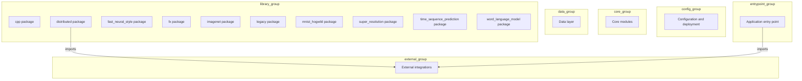

# Architecture report: pytorch/examples

> Automated static analysis. **Observed** = directly seen in files/imports/AST; **Inferred** = interpretation from that evidence. Repository code was not executed.

## 1. Repository at a glance

| Item | Value |
| --- | --- |
| Repository | pytorch/examples |
| Description | A set of examples around pytorch in Vision, Text, Reinforcement Learning, etc. |
| Language | Python |
| Stars | 24094 |
| Licence | BSD-3-Clause |
| Analysed commit / branch | acc295dc7b90714f1bf47f06004fc19a7fe235c4 / main |
| Framework(s) | None detected |
| Files analysed | 223 |
| Components | 15 |

## 2. Architecture in one minute

pytorch/examples - A set of examples around pytorch in Vision, Text, Reinforcement Learning, etc.. This repository was analysed statically from 223 file(s) (93 Python). Detected technologies (observed from imports/manifests): GitHub Actions, aiohttp, AWS (boto3), NumPy, pandas, requests. Files are grouped into 15 component(s): Configuration and deployment, Core modules, cpp package, Data layer, distributed package, Application entry point, External integrations, fast_neural_style package. Observed entry point(s): cpp/tools/download_mnist.py, distributed/FSDP/T5_training.py, distributed/FSDP2/example.py. Findings below distinguish observed facts from inferred interpretation.

## 3. High-level block diagram

## 4. Main components

### Configuration and deployment (`config`)

- **Kind:** config
- **Status:** Observed
- **Confidence:** 0.85
- **Responsibility:** Groups 35 file(s) under configuration and deployment (observed from repository paths and static analysis). Observed top-level classes: fsdp_config, train_config.
- **Paths:** `dcgan/requirements.txt`, `distributed/FSDP/configs/__init__.py`, `distributed/FSDP/configs/fsdp.py`, `distributed/FSDP/configs/training.py`, `distributed/FSDP/requirements.txt`, `distributed/FSDP2/requirements.txt`, `distributed/ddp-tutorial-series/requirements.txt`, `distributed/ddp/requirements.txt`, `distributed/minGPT-ddp/mingpt/gpt2_train_cfg.yaml`, `distributed/minGPT-ddp/requirements.txt`, `distributed/rpc/batch/requirements.txt`, `distributed/rpc/ddp_rpc/requirements.txt`, `distributed/rpc/parameter_server/requirements.txt`, `distributed/rpc/pipeline/requirements.txt`, `distributed/rpc/rl/requirements.txt`, `distributed/rpc/rnn/requirements.txt`, `distributed/tensor_parallelism/requirements.txt`, `fast_neural_style/requirements.txt`, `fx/requirements.txt`, `gat/requirements.txt`, `gcn/requirements.txt`, `imagenet/requirements.txt`, `language_translation/requirements.txt`, `legacy/snli/requirements.txt`, `mnist/requirements.txt`, `mnist_forward_forward/requirements.txt`, `mnist_hogwild/requirements.txt`, `mnist_rnn/requirements.txt`, `regression/requirements.txt`, `reinforcement_learning/requirements.txt`, `siamese_network/requirements.txt`, `super_resolution/requirements.txt`, `time_sequence_prediction/requirements.txt`, `vae/requirements.txt`, `word_language_model/requirements.txt`
- **Evidence:** [dcgan/requirements.txt](https://github.com/pytorch/examples/blob/acc295dc7b90714f1bf47f06004fc19a7fe235c4/dcgan/requirements.txt); [distributed/FSDP/configs/__init__.py](https://github.com/pytorch/examples/blob/acc295dc7b90714f1bf47f06004fc19a7fe235c4/distributed/FSDP/configs/__init__.py); [distributed/FSDP/configs/fsdp.py:7](https://github.com/pytorch/examples/blob/acc295dc7b90714f1bf47f06004fc19a7fe235c4/distributed/FSDP/configs/fsdp.py#L7); [distributed/FSDP/configs/training.py:6](https://github.com/pytorch/examples/blob/acc295dc7b90714f1bf47f06004fc19a7fe235c4/distributed/FSDP/configs/training.py#L6); [distributed/FSDP/requirements.txt](https://github.com/pytorch/examples/blob/acc295dc7b90714f1bf47f06004fc19a7fe235c4/distributed/FSDP/requirements.txt); [distributed/FSDP2/requirements.txt](https://github.com/pytorch/examples/blob/acc295dc7b90714f1bf47f06004fc19a7fe235c4/distributed/FSDP2/requirements.txt); [distributed/ddp-tutorial-series/requirements.txt](https://github.com/pytorch/examples/blob/acc295dc7b90714f1bf47f06004fc19a7fe235c4/distributed/ddp-tutorial-series/requirements.txt); [distributed/ddp/requirements.txt](https://github.com/pytorch/examples/blob/acc295dc7b90714f1bf47f06004fc19a7fe235c4/distributed/ddp/requirements.txt)

### Core modules (`core`)

- **Kind:** core
- **Status:** Observed
- **Confidence:** 0.85
- **Responsibility:** Groups 4 file(s) under core modules (observed from repository paths and static analysis).
- **Paths:** `run_cpp_examples.sh`, `run_distributed_examples.sh`, `run_python_examples.sh`, `utils.sh`
- **Evidence:** [run_cpp_examples.sh](https://github.com/pytorch/examples/blob/acc295dc7b90714f1bf47f06004fc19a7fe235c4/run_cpp_examples.sh); [run_distributed_examples.sh](https://github.com/pytorch/examples/blob/acc295dc7b90714f1bf47f06004fc19a7fe235c4/run_distributed_examples.sh); [run_python_examples.sh](https://github.com/pytorch/examples/blob/acc295dc7b90714f1bf47f06004fc19a7fe235c4/run_python_examples.sh); [utils.sh](https://github.com/pytorch/examples/blob/acc295dc7b90714f1bf47f06004fc19a7fe235c4/utils.sh)

### cpp package (`cpp`)

- **Kind:** library
- **Status:** Observed
- **Confidence:** 0.85
- **Responsibility:** Groups 11 file(s) under cpp package (observed from repository paths and static analysis).
- **Paths:** `cpp/autograd/autograd.cpp`, `cpp/custom-dataset/custom-dataset.cpp`, `cpp/dcgan/dcgan.cpp`, `cpp/dcgan/display_samples.py`, `cpp/distributed/dist-mnist.cpp`, `cpp/mnist/mnist.cpp`, `cpp/regression/regression.cpp`, `cpp/transfer-learning/classify.cpp`, `cpp/transfer-learning/convert.py`, `cpp/transfer-learning/main.cpp`, `cpp/transfer-learning/main.h`
- **Evidence:** [cpp/autograd/autograd.cpp](https://github.com/pytorch/examples/blob/acc295dc7b90714f1bf47f06004fc19a7fe235c4/cpp/autograd/autograd.cpp); [cpp/custom-dataset/custom-dataset.cpp](https://github.com/pytorch/examples/blob/acc295dc7b90714f1bf47f06004fc19a7fe235c4/cpp/custom-dataset/custom-dataset.cpp); [cpp/dcgan/dcgan.cpp](https://github.com/pytorch/examples/blob/acc295dc7b90714f1bf47f06004fc19a7fe235c4/cpp/dcgan/dcgan.cpp); [cpp/dcgan/display_samples.py](https://github.com/pytorch/examples/blob/acc295dc7b90714f1bf47f06004fc19a7fe235c4/cpp/dcgan/display_samples.py); [cpp/distributed/dist-mnist.cpp](https://github.com/pytorch/examples/blob/acc295dc7b90714f1bf47f06004fc19a7fe235c4/cpp/distributed/dist-mnist.cpp); [cpp/mnist/mnist.cpp](https://github.com/pytorch/examples/blob/acc295dc7b90714f1bf47f06004fc19a7fe235c4/cpp/mnist/mnist.cpp); [cpp/regression/regression.cpp](https://github.com/pytorch/examples/blob/acc295dc7b90714f1bf47f06004fc19a7fe235c4/cpp/regression/regression.cpp); [cpp/transfer-learning/classify.cpp](https://github.com/pytorch/examples/blob/acc295dc7b90714f1bf47f06004fc19a7fe235c4/cpp/transfer-learning/classify.cpp)

### Data layer (`data_layer`)

- **Kind:** data
- **Status:** Observed
- **Confidence:** 0.85
- **Responsibility:** Groups 6 file(s) under data layer (observed from repository paths and static analysis). Observed top-level classes: Attention, Block, Bottle, EmbeddingStem, Encoder, FeedForward. Observed top-level functions: create_optimizer.
- **Paths:** `distributed/FSDP2/model.py`, `distributed/minGPT-ddp/mingpt/model.py`, `language_translation/src/model.py`, `legacy/snli/model.py`, `super_resolution/model.py`, `word_language_model/model.py`
- **Evidence:** [distributed/FSDP2/model.py:9](https://github.com/pytorch/examples/blob/acc295dc7b90714f1bf47f06004fc19a7fe235c4/distributed/FSDP2/model.py#L9); [distributed/minGPT-ddp/mingpt/model.py:15](https://github.com/pytorch/examples/blob/acc295dc7b90714f1bf47f06004fc19a7fe235c4/distributed/minGPT-ddp/mingpt/model.py#L15); [language_translation/src/model.py:7](https://github.com/pytorch/examples/blob/acc295dc7b90714f1bf47f06004fc19a7fe235c4/language_translation/src/model.py#L7); [legacy/snli/model.py:5](https://github.com/pytorch/examples/blob/acc295dc7b90714f1bf47f06004fc19a7fe235c4/legacy/snli/model.py#L5); [super_resolution/model.py:6](https://github.com/pytorch/examples/blob/acc295dc7b90714f1bf47f06004fc19a7fe235c4/super_resolution/model.py#L6); [word_language_model/model.py:6](https://github.com/pytorch/examples/blob/acc295dc7b90714f1bf47f06004fc19a7fe235c4/word_language_model/model.py#L6)

### distributed package (`distributed`)

- **Kind:** library
- **Status:** Observed
- **Confidence:** 0.85
- **Responsibility:** Groups 28 file(s) under distributed package (observed from repository paths and static analysis). Observed top-level classes: Attention, CharDataset, Checkpointer, DataConfig, Decoder, EmbeddingTable. Observed top-level functions: _call_method, _parameter_rrefs, _remote_method, apply_fsdp_checkpointing, apply_rotary_emb, bfloat_support.
- **Paths:** `distributed/FSDP/download_dataset.sh`, `distributed/FSDP/model_checkpointing/__init__.py`, `distributed/FSDP/model_checkpointing/checkpoint_handler.py`, `distributed/FSDP/policies/__init__.py`, `distributed/FSDP/policies/activation_checkpointing_functions.py`, `distributed/FSDP/policies/mixed_precision.py`, `distributed/FSDP/policies/wrapping.py`, `distributed/FSDP/summarization_dataset.py`, `distributed/FSDP/utils/__init__.py`, `distributed/FSDP/utils/environment.py`, `distributed/FSDP/utils/train_utils.py`, `distributed/FSDP2/checkpoint.py`, `distributed/FSDP2/run_example.sh`, `distributed/FSDP2/utils.py`, `distributed/ddp-tutorial-series/datautils.py`, `distributed/ddp-tutorial-series/slurm/sbatch_run.sh`, `distributed/ddp/run_example.sh`, `distributed/minGPT-ddp/mingpt/char_dataset.py`, `distributed/minGPT-ddp/mingpt/slurm/sbatch_run.sh`, `distributed/minGPT-ddp/mingpt/trainer.py`, `distributed/minGPT-ddp/run_example.sh`, `distributed/rpc/rnn/rnn.py`, `distributed/tensor_parallelism/fsdp_tp_example.py`, `distributed/tensor_parallelism/llama2_model.py`, `distributed/tensor_parallelism/log_utils.py`, `distributed/tensor_parallelism/run_example.sh`, `distributed/tensor_parallelism/sequence_parallel_example.py`, `distributed/tensor_parallelism/tensor_parallel_example.py`
- **Evidence:** [distributed/FSDP/download_dataset.sh](https://github.com/pytorch/examples/blob/acc295dc7b90714f1bf47f06004fc19a7fe235c4/distributed/FSDP/download_dataset.sh); [distributed/FSDP/model_checkpointing/__init__.py](https://github.com/pytorch/examples/blob/acc295dc7b90714f1bf47f06004fc19a7fe235c4/distributed/FSDP/model_checkpointing/__init__.py); [distributed/FSDP/model_checkpointing/checkpoint_handler.py:31](https://github.com/pytorch/examples/blob/acc295dc7b90714f1bf47f06004fc19a7fe235c4/distributed/FSDP/model_checkpointing/checkpoint_handler.py#L31); [distributed/FSDP/policies/__init__.py](https://github.com/pytorch/examples/blob/acc295dc7b90714f1bf47f06004fc19a7fe235c4/distributed/FSDP/policies/__init__.py); [distributed/FSDP/policies/activation_checkpointing_functions.py:23](https://github.com/pytorch/examples/blob/acc295dc7b90714f1bf47f06004fc19a7fe235c4/distributed/FSDP/policies/activation_checkpointing_functions.py#L23); [distributed/FSDP/policies/mixed_precision.py](https://github.com/pytorch/examples/blob/acc295dc7b90714f1bf47f06004fc19a7fe235c4/distributed/FSDP/policies/mixed_precision.py); [distributed/FSDP/policies/wrapping.py:27](https://github.com/pytorch/examples/blob/acc295dc7b90714f1bf47f06004fc19a7fe235c4/distributed/FSDP/policies/wrapping.py#L27); [distributed/FSDP/summarization_dataset.py:26](https://github.com/pytorch/examples/blob/acc295dc7b90714f1bf47f06004fc19a7fe235c4/distributed/FSDP/summarization_dataset.py#L26)

### Application entry point (`entrypoint`)

- **Kind:** entrypoint
- **Status:** Observed
- **Confidence:** 0.85
- **Responsibility:** Groups 36 file(s) under application entry point (observed from repository paths and static analysis). Observed top-level classes: APP_MATCHER, Agent, AverageMeter, BatchUpdateParameterServer, Discriminator, DistResNet50. Observed top-level functions: _call_method, _remote_method, _run_trainer, _yield_tokens, accuracy, batchify.
- **Paths:** `cpp/tools/download_mnist.py`, `dcgan/main.py`, `distributed/FSDP/T5_training.py`, `distributed/FSDP2/example.py`, `distributed/ddp-tutorial-series/multigpu.py`, `distributed/ddp-tutorial-series/multigpu_torchrun.py`, `distributed/ddp-tutorial-series/multinode.py`, `distributed/ddp-tutorial-series/single_gpu.py`, `distributed/ddp/example.py`, `distributed/minGPT-ddp/mingpt/main.py`, `distributed/rpc/batch/parameter_server.py`, `distributed/rpc/batch/reinforce.py`, `distributed/rpc/ddp_rpc/main.py`, `distributed/rpc/parameter_server/rpc_parameter_server.py`, `distributed/rpc/pipeline/main.py`, `distributed/rpc/rl/main.py`, `distributed/rpc/rnn/main.py`, `fast_neural_style/download_saved_models.py`, `fast_neural_style/neural_style/neural_style.py`, `gat/main.py`, `gcn/main.py`, `imagenet/main.py`, `language_translation/main.py`, `language_translation/src/data.py`, `mnist/main.py`, `mnist_forward_forward/main.py`, `mnist_hogwild/main.py`, `mnist_rnn/main.py`, `regression/main.py`, `reinforcement_learning/actor_critic.py`, `reinforcement_learning/reinforce.py`, `siamese_network/main.py`, `super_resolution/main.py`, `time_sequence_prediction/train.py`, `vae/main.py`, `word_language_model/main.py`
- **Evidence:** [cpp/tools/download_mnist.py:25](https://github.com/pytorch/examples/blob/acc295dc7b90714f1bf47f06004fc19a7fe235c4/cpp/tools/download_mnist.py#L25); [dcgan/main.py:117](https://github.com/pytorch/examples/blob/acc295dc7b90714f1bf47f06004fc19a7fe235c4/dcgan/main.py#L117); [distributed/FSDP/T5_training.py:47](https://github.com/pytorch/examples/blob/acc295dc7b90714f1bf47f06004fc19a7fe235c4/distributed/FSDP/T5_training.py#L47); [distributed/FSDP2/example.py:10](https://github.com/pytorch/examples/blob/acc295dc7b90714f1bf47f06004fc19a7fe235c4/distributed/FSDP2/example.py#L10); [distributed/ddp-tutorial-series/multigpu.py:13](https://github.com/pytorch/examples/blob/acc295dc7b90714f1bf47f06004fc19a7fe235c4/distributed/ddp-tutorial-series/multigpu.py#L13); [distributed/ddp-tutorial-series/multigpu_torchrun.py:13](https://github.com/pytorch/examples/blob/acc295dc7b90714f1bf47f06004fc19a7fe235c4/distributed/ddp-tutorial-series/multigpu_torchrun.py#L13); [distributed/ddp-tutorial-series/multinode.py:13](https://github.com/pytorch/examples/blob/acc295dc7b90714f1bf47f06004fc19a7fe235c4/distributed/ddp-tutorial-series/multinode.py#L13); [distributed/ddp-tutorial-series/single_gpu.py:7](https://github.com/pytorch/examples/blob/acc295dc7b90714f1bf47f06004fc19a7fe235c4/distributed/ddp-tutorial-series/single_gpu.py#L7)

### External integrations (`external_integrations`)

- **Kind:** external
- **Status:** Inferred
- **Confidence:** 0.70
- **Responsibility:** Groups 0 file(s) under external integrations (observed from repository paths and static analysis).
- **Evidence:** [distributed/minGPT-ddp/mingpt/trainer.py:16](https://github.com/pytorch/examples/blob/acc295dc7b90714f1bf47f06004fc19a7fe235c4/distributed/minGPT-ddp/mingpt/trainer.py#L16); [gat/main.py:3](https://github.com/pytorch/examples/blob/acc295dc7b90714f1bf47f06004fc19a7fe235c4/gat/main.py#L3); [gcn/main.py:3](https://github.com/pytorch/examples/blob/acc295dc7b90714f1bf47f06004fc19a7fe235c4/gcn/main.py#L3)

### fast_neural_style package (`fast_neural_style`)

- **Kind:** library
- **Status:** Observed
- **Confidence:** 0.85
- **Responsibility:** Groups 4 file(s) under fast_neural_style package (observed from repository paths and static analysis). Observed top-level classes: ConvLayer, ResidualBlock, TransformerNet, UpsampleConvLayer, Vgg16. Observed top-level functions: gram_matrix, load_image, normalize_batch, save_image.
- **Paths:** `fast_neural_style/neural_style/__init__.py`, `fast_neural_style/neural_style/transformer_net.py`, `fast_neural_style/neural_style/utils.py`, `fast_neural_style/neural_style/vgg.py`
- **Evidence:** [fast_neural_style/neural_style/__init__.py](https://github.com/pytorch/examples/blob/acc295dc7b90714f1bf47f06004fc19a7fe235c4/fast_neural_style/neural_style/__init__.py); [fast_neural_style/neural_style/transformer_net.py:4](https://github.com/pytorch/examples/blob/acc295dc7b90714f1bf47f06004fc19a7fe235c4/fast_neural_style/neural_style/transformer_net.py#L4); [fast_neural_style/neural_style/utils.py:5](https://github.com/pytorch/examples/blob/acc295dc7b90714f1bf47f06004fc19a7fe235c4/fast_neural_style/neural_style/utils.py#L5); [fast_neural_style/neural_style/vgg.py:7](https://github.com/pytorch/examples/blob/acc295dc7b90714f1bf47f06004fc19a7fe235c4/fast_neural_style/neural_style/vgg.py#L7)

### fx package (`fx`)

- **Kind:** library
- **Status:** Observed
- **Confidence:** 0.85
- **Responsibility:** Groups 12 file(s) under fx package (observed from repository paths and static analysis). Observed top-level classes: ActivationFunction, Foo, InliningTracer, LowerReluTracer, M, M1. Observed top-level functions: add_inverse, add_lowp, assert_all_nodes_have_tags, f, inline_lowp_func, invert.
- **Paths:** `fx/custom_tracer.py`, `fx/inline_function.py`, `fx/invert.py`, `fx/module_tracer.py`, `fx/native_interpreter/interpreter.cpp`, `fx/native_interpreter/use_interpreter.py`, `fx/primitive_library.py`, `fx/profiling_tracer.py`, `fx/proxy_based_graph_creation.py`, `fx/replace_op.py`, `fx/subgraph_rewriter_basic_use.py`, `fx/wrap_output_dynamically.py`
- **Evidence:** [fx/custom_tracer.py:45](https://github.com/pytorch/examples/blob/acc295dc7b90714f1bf47f06004fc19a7fe235c4/fx/custom_tracer.py#L45); [fx/inline_function.py:31](https://github.com/pytorch/examples/blob/acc295dc7b90714f1bf47f06004fc19a7fe235c4/fx/inline_function.py#L31); [fx/invert.py:9](https://github.com/pytorch/examples/blob/acc295dc7b90714f1bf47f06004fc19a7fe235c4/fx/invert.py#L9); [fx/module_tracer.py:15](https://github.com/pytorch/examples/blob/acc295dc7b90714f1bf47f06004fc19a7fe235c4/fx/module_tracer.py#L15); [fx/native_interpreter/interpreter.cpp](https://github.com/pytorch/examples/blob/acc295dc7b90714f1bf47f06004fc19a7fe235c4/fx/native_interpreter/interpreter.cpp); [fx/native_interpreter/use_interpreter.py:19](https://github.com/pytorch/examples/blob/acc295dc7b90714f1bf47f06004fc19a7fe235c4/fx/native_interpreter/use_interpreter.py#L19); [fx/primitive_library.py:22](https://github.com/pytorch/examples/blob/acc295dc7b90714f1bf47f06004fc19a7fe235c4/fx/primitive_library.py#L22); [fx/profiling_tracer.py:16](https://github.com/pytorch/examples/blob/acc295dc7b90714f1bf47f06004fc19a7fe235c4/fx/profiling_tracer.py#L16)

### imagenet package (`imagenet`)

- **Kind:** library
- **Status:** Observed
- **Confidence:** 0.85
- **Responsibility:** Groups 1 file(s) under imagenet package (observed from repository paths and static analysis).
- **Paths:** `imagenet/extract_ILSVRC.sh`
- **Evidence:** [imagenet/extract_ILSVRC.sh](https://github.com/pytorch/examples/blob/acc295dc7b90714f1bf47f06004fc19a7fe235c4/imagenet/extract_ILSVRC.sh)

### legacy package (`legacy`)

- **Kind:** library
- **Status:** Observed
- **Confidence:** 0.85
- **Responsibility:** Groups 2 file(s) under legacy package (observed from repository paths and static analysis). Observed top-level functions: get_args, makedirs.
- **Paths:** `legacy/snli/train.py`, `legacy/snli/util.py`
- **Evidence:** [legacy/snli/train.py](https://github.com/pytorch/examples/blob/acc295dc7b90714f1bf47f06004fc19a7fe235c4/legacy/snli/train.py); [legacy/snli/util.py:4](https://github.com/pytorch/examples/blob/acc295dc7b90714f1bf47f06004fc19a7fe235c4/legacy/snli/util.py#L4)

### mnist_hogwild package (`mnist_hogwild`)

- **Kind:** library
- **Status:** Observed
- **Confidence:** 0.85
- **Responsibility:** Groups 1 file(s) under mnist_hogwild package (observed from repository paths and static analysis). Observed top-level functions: test, test_epoch, train, train_epoch.
- **Paths:** `mnist_hogwild/train.py`
- **Evidence:** [mnist_hogwild/train.py:7](https://github.com/pytorch/examples/blob/acc295dc7b90714f1bf47f06004fc19a7fe235c4/mnist_hogwild/train.py#L7)

### super_resolution package (`super_resolution`)

- **Kind:** library
- **Status:** Observed
- **Confidence:** 0.85
- **Responsibility:** Groups 3 file(s) under super_resolution package (observed from repository paths and static analysis). Observed top-level classes: DatasetFromFolder. Observed top-level functions: calculate_valid_crop_size, download_bsd300, get_test_set, get_training_set, input_transform, is_image_file.
- **Paths:** `super_resolution/data.py`, `super_resolution/dataset.py`, `super_resolution/super_resolve.py`
- **Evidence:** [super_resolution/data.py:10](https://github.com/pytorch/examples/blob/acc295dc7b90714f1bf47f06004fc19a7fe235c4/super_resolution/data.py#L10); [super_resolution/dataset.py:8](https://github.com/pytorch/examples/blob/acc295dc7b90714f1bf47f06004fc19a7fe235c4/super_resolution/dataset.py#L8); [super_resolution/super_resolve.py](https://github.com/pytorch/examples/blob/acc295dc7b90714f1bf47f06004fc19a7fe235c4/super_resolution/super_resolve.py)

### time_sequence_prediction package (`time_sequence_prediction`)

- **Kind:** library
- **Status:** Observed
- **Confidence:** 0.85
- **Responsibility:** Groups 1 file(s) under time_sequence_prediction package (observed from repository paths and static analysis).
- **Paths:** `time_sequence_prediction/generate_sine_wave.py`
- **Evidence:** [time_sequence_prediction/generate_sine_wave.py](https://github.com/pytorch/examples/blob/acc295dc7b90714f1bf47f06004fc19a7fe235c4/time_sequence_prediction/generate_sine_wave.py)

### word_language_model package (`word_language_model`)

- **Kind:** library
- **Status:** Observed
- **Confidence:** 0.85
- **Responsibility:** Groups 2 file(s) under word_language_model package (observed from repository paths and static analysis). Observed top-level classes: Corpus, Dictionary.
- **Paths:** `word_language_model/data.py`, `word_language_model/generate.py`
- **Evidence:** [word_language_model/data.py:5](https://github.com/pytorch/examples/blob/acc295dc7b90714f1bf47f06004fc19a7fe235c4/word_language_model/data.py#L5); [word_language_model/generate.py](https://github.com/pytorch/examples/blob/acc295dc7b90714f1bf47f06004fc19a7fe235c4/word_language_model/generate.py)

## 5. Execution flow

**Observed** entry point(s):

- [cpp/tools/download_mnist.py:88](https://github.com/pytorch/examples/blob/acc295dc7b90714f1bf47f06004fc19a7fe235c4/cpp/tools/download_mnist.py#L88)
- [distributed/FSDP/T5_training.py:198](https://github.com/pytorch/examples/blob/acc295dc7b90714f1bf47f06004fc19a7fe235c4/distributed/FSDP/T5_training.py#L198)
- [distributed/FSDP2/example.py:111](https://github.com/pytorch/examples/blob/acc295dc7b90714f1bf47f06004fc19a7fe235c4/distributed/FSDP2/example.py#L111)
- [distributed/ddp-tutorial-series/multigpu.py:95](https://github.com/pytorch/examples/blob/acc295dc7b90714f1bf47f06004fc19a7fe235c4/distributed/ddp-tutorial-series/multigpu.py#L95)
- [distributed/ddp-tutorial-series/multigpu_torchrun.py:103](https://github.com/pytorch/examples/blob/acc295dc7b90714f1bf47f06004fc19a7fe235c4/distributed/ddp-tutorial-series/multigpu_torchrun.py#L103)
- [distributed/ddp-tutorial-series/multinode.py:104](https://github.com/pytorch/examples/blob/acc295dc7b90714f1bf47f06004fc19a7fe235c4/distributed/ddp-tutorial-series/multinode.py#L104)
- [distributed/ddp-tutorial-series/single_gpu.py:73](https://github.com/pytorch/examples/blob/acc295dc7b90714f1bf47f06004fc19a7fe235c4/distributed/ddp-tutorial-series/single_gpu.py#L73)
- [distributed/ddp/example.py:96](https://github.com/pytorch/examples/blob/acc295dc7b90714f1bf47f06004fc19a7fe235c4/distributed/ddp/example.py#L96)
- [distributed/minGPT-ddp/mingpt/main.py:52](https://github.com/pytorch/examples/blob/acc295dc7b90714f1bf47f06004fc19a7fe235c4/distributed/minGPT-ddp/mingpt/main.py#L52)
- [distributed/rpc/batch/parameter_server.py:156](https://github.com/pytorch/examples/blob/acc295dc7b90714f1bf47f06004fc19a7fe235c4/distributed/rpc/batch/parameter_server.py#L156)
- [distributed/rpc/batch/reinforce.py:261](https://github.com/pytorch/examples/blob/acc295dc7b90714f1bf47f06004fc19a7fe235c4/distributed/rpc/batch/reinforce.py#L261)
- [language_translation/src/data.py:120](https://github.com/pytorch/examples/blob/acc295dc7b90714f1bf47f06004fc19a7fe235c4/language_translation/src/data.py#L120)

Representative flow (derived from observed entry points and the import graph; steps beyond the entry point are **Inferred**):

1. Execution starts at an observed entry point listed above, if present.
2. `distributed` imports `external_integrations` (distributed package -> External integrations).
3. `entrypoint` imports `external_integrations` (Application entry point -> External integrations).

## 6. Project structure

### `(root)`

- `.gitignore` - other (323 bytes)
- `CODEOWNERS` - other (648 bytes)
- `CODE_OF_CONDUCT.md` - docs (3353 bytes)
- `CONTRIBUTING.md` - docs (2395 bytes)
- `LICENSE` - docs (1520 bytes)
- `README.md` - docs (2503 bytes)
- `run_cpp_examples.sh` - source, Shell (4116 bytes)
- `run_distributed_examples.sh` - source, Shell (3029 bytes)
- `run_python_examples.sh` - source, Shell (8648 bytes)
- `runtime.txt` - docs (4 bytes)
- `utils.sh` - source, Shell (1597 bytes)

### `.github`

- `.github/ISSUE_TEMPLATE/bug_template.md` - docs (1327 bytes)
- `.github/ISSUE_TEMPLATE/doc_template.md` - docs (206 bytes)
- `.github/ISSUE_TEMPLATE/feature_template.md` - docs (553 bytes)
- `.github/PULL_REQUEST_TEMPLATE/pull_request_template.md` - docs (1405 bytes)
- `.github/workflows/doc-build.yml` - ci, YAML (895 bytes)
- `.github/workflows/main_cpp.yml` - ci, YAML (1401 bytes)
- `.github/workflows/main_distributed.yaml` - ci, YAML (1095 bytes)
- `.github/workflows/main_python.yml` - ci, YAML (1045 bytes)

### `cpp`

- `cpp/.clang-format` - other (2569 bytes)
- `cpp/autograd/CMakeLists.txt` - docs (719 bytes)
- `cpp/autograd/README.md` - docs (1442 bytes)
- `cpp/autograd/autograd.cpp` - source, C++ (6003 bytes)
- `cpp/custom-dataset/CMakeLists.txt` - docs (1058 bytes)
- `cpp/custom-dataset/README.md` - docs (2225 bytes)
- `cpp/custom-dataset/custom-dataset.cpp` - source, C++ (6949 bytes)
- `cpp/dcgan/CMakeLists.txt` - docs (933 bytes)
- `cpp/dcgan/README.md` - docs (1871 bytes)
- `cpp/dcgan/dcgan.cpp` - source, C++ (8000 bytes)
- `cpp/dcgan/display_samples.py` - source, Python (891 bytes)
- `cpp/distributed/CMakeLists.txt` - docs (634 bytes)
- `cpp/distributed/README.md` - docs (1203 bytes)
- `cpp/distributed/dist-mnist.cpp` - source, C++ (5596 bytes)
- `cpp/mnist/CMakeLists.txt` - docs (958 bytes)
- `cpp/mnist/README.md` - docs (1046 bytes)
- `cpp/mnist/mnist.cpp` - source, C++ (4746 bytes)
- `cpp/regression/CMakeLists.txt` - docs (723 bytes)
- `cpp/regression/README.md` - docs (729 bytes)
- `cpp/regression/regression.cpp` - source, C++ (2321 bytes)
- `cpp/tools/InstallingOpenCV.md` - docs (958 bytes)
- `cpp/tools/download_mnist.py` - source, Python (2723 bytes)
- `cpp/transfer-learning/CMakeLists.txt` - docs (552 bytes)
- `cpp/transfer-learning/README.md` - docs (798 bytes)
- `cpp/transfer-learning/classify.cpp` - source, C++ (2676 bytes)
- `cpp/transfer-learning/convert.py` - source, Python (586 bytes)
- `cpp/transfer-learning/main.cpp` - source, C++ (9714 bytes)
- `cpp/transfer-learning/main.h` - source, C/C++ (2412 bytes)

### `dcgan`

- `dcgan/README.md` - docs (2359 bytes)
- `dcgan/main.py` - source, Python (10653 bytes)
- `dcgan/requirements.txt` - manifest (23 bytes)

### `distributed`

- `distributed/FSDP/.gitignore` - other (23 bytes)
- `distributed/FSDP/README.md` - docs (704 bytes)
- `distributed/FSDP/T5_training.py` - source, Python (7857 bytes)
- `distributed/FSDP/configs/__init__.py` - source, Python (65 bytes)
- `distributed/FSDP/configs/fsdp.py` - source, Python (654 bytes)
- `distributed/FSDP/configs/training.py` - source, Python (388 bytes)
- `distributed/FSDP/download_dataset.sh` - source, Shell (285 bytes)
- `distributed/FSDP/model_checkpointing/__init__.py` - source, Python (292 bytes)
- `distributed/FSDP/model_checkpointing/checkpoint_handler.py` - source, Python (8863 bytes)
- `distributed/FSDP/policies/__init__.py` - source, Python (128 bytes)
- `distributed/FSDP/policies/activation_checkpointing_functions.py` - source, Python (816 bytes)
- `distributed/FSDP/policies/mixed_precision.py` - source, Python (862 bytes)
- `distributed/FSDP/policies/wrapping.py` - source, Python (1152 bytes)
- `distributed/FSDP/requirements.txt` - manifest (54 bytes)
- `distributed/FSDP/summarization_dataset.py` - source, Python (2835 bytes)
- `distributed/FSDP/utils/__init__.py` - source, Python (203 bytes)
- `distributed/FSDP/utils/environment.py` - source, Python (982 bytes)
- `distributed/FSDP/utils/train_utils.py` - source, Python (3187 bytes)
- `distributed/FSDP2/README.md` - docs (705 bytes)
- `distributed/FSDP2/checkpoint.py` - source, Python (7707 bytes)
- `distributed/FSDP2/example.py` - source, Python (4136 bytes)
- `distributed/FSDP2/model.py` - source, Python (4604 bytes)
- `distributed/FSDP2/requirements.txt` - manifest (17 bytes)
- `distributed/FSDP2/run_example.sh` - source, Shell (348 bytes)
- `distributed/FSDP2/utils.py` - source, Python (675 bytes)
- `distributed/ddp-tutorial-series/README.md` - docs (929 bytes)
- `distributed/ddp-tutorial-series/datautils.py` - source, Python (331 bytes)
- `distributed/ddp-tutorial-series/multigpu.py` - source, Python (3674 bytes)
- `distributed/ddp-tutorial-series/multigpu_torchrun.py` - source, Python (4021 bytes)
- `distributed/ddp-tutorial-series/multinode.py` - source, Python (4106 bytes)
- `distributed/ddp-tutorial-series/requirements.txt` - manifest (13 bytes)
- `distributed/ddp-tutorial-series/single_gpu.py` - source, Python (2784 bytes)
- `distributed/ddp-tutorial-series/slurm/config.yaml.template` - other (582 bytes)
- `distributed/ddp-tutorial-series/slurm/sbatch_run.sh` - source, Shell (553 bytes)
- `distributed/ddp-tutorial-series/slurm/setup_pcluster_slurm.md` - docs (1114 bytes)
- `distributed/ddp/README.md` - docs (7282 bytes)
- `distributed/ddp/example.py` - source, Python (3481 bytes)
- `distributed/ddp/requirements.txt` - manifest (11 bytes)
- `distributed/ddp/run_example.sh` - source, Shell (394 bytes)
- `distributed/minGPT-ddp/README.md` - docs (1017 bytes)
- `distributed/minGPT-ddp/mingpt/char_dataset.py` - source, Python (1410 bytes)
- `distributed/minGPT-ddp/mingpt/gpt2_train_cfg.yaml` - config (468 bytes)
- `distributed/minGPT-ddp/mingpt/main.py` - source, Python (2139 bytes)
- `distributed/minGPT-ddp/mingpt/model.py` - source, Python (11128 bytes)
- `distributed/minGPT-ddp/mingpt/slurm/config.yaml.template` - other (582 bytes)
- `distributed/minGPT-ddp/mingpt/slurm/sbatch_run.sh` - source, Shell (543 bytes)
- `distributed/minGPT-ddp/mingpt/slurm/setup_pcluster_slurm.md` - docs (1205 bytes)
- `distributed/minGPT-ddp/mingpt/trainer.py` - source, Python (5993 bytes)
- `distributed/minGPT-ddp/requirements.txt` - manifest (45 bytes)
- `distributed/minGPT-ddp/run_example.sh` - source, Shell (326 bytes)
- `distributed/rpc/batch/README.md` - docs (702 bytes)
- `distributed/rpc/batch/parameter_server.py` - source, Python (4705 bytes)
- `distributed/rpc/batch/reinforce.py` - source, Python (9892 bytes)
- `distributed/rpc/batch/requirements.txt` - manifest (34 bytes)
- `distributed/rpc/ddp_rpc/README.md` - docs (961 bytes)
- `distributed/rpc/ddp_rpc/main.py` - source, Python (6922 bytes)
- `distributed/rpc/ddp_rpc/requirements.txt` - manifest (19 bytes)
- `distributed/rpc/parameter_server/README.md` - docs (1244 bytes)
- `distributed/rpc/parameter_server/requirements.txt` - manifest (19 bytes)
- `distributed/rpc/parameter_server/rpc_parameter_server.py` - source, Python (11628 bytes)
- `distributed/rpc/pipeline/README.md` - docs (685 bytes)
- `distributed/rpc/pipeline/main.py` - source, Python (9675 bytes)
- `distributed/rpc/pipeline/requirements.txt` - manifest (17 bytes)
- `distributed/rpc/rl/README.md` - docs (330 bytes)
- `distributed/rpc/rl/main.py` - source, Python (9133 bytes)
- `distributed/rpc/rl/requirements.txt` - manifest (22 bytes)
- `distributed/rpc/rnn/README.md` - docs (231 bytes)
- `distributed/rpc/rnn/main.py` - source, Python (2485 bytes)
- `distributed/rpc/rnn/requirements.txt` - manifest (19 bytes)
- `distributed/rpc/rnn/rnn.py` - source, Python (3692 bytes)
- `distributed/tensor_parallelism/README.md` - docs (1155 bytes)
- `distributed/tensor_parallelism/fsdp_tp_example.py` - source, Python (6114 bytes)
- `distributed/tensor_parallelism/llama2_model.py` - source, Python (16585 bytes)
- `distributed/tensor_parallelism/log_utils.py` - source, Python (611 bytes)
- `distributed/tensor_parallelism/requirements.txt` - manifest (96 bytes)
- `distributed/tensor_parallelism/run_example.sh` - source, Shell (497 bytes)
- `distributed/tensor_parallelism/sequence_parallel_example.py` - source, Python (3324 bytes)
- `distributed/tensor_parallelism/tensor_parallel_example.py` - source, Python (3975 bytes)

### `docs`

- `docs/Makefile` - docs (638 bytes)
- `docs/make.bat` - docs (804 bytes)
- `docs/requirements.txt` - manifest (137 bytes)
- `docs/source/_static/.gitkeep` - docs (0 bytes)
- `docs/source/conf.py` - docs (2631 bytes)
- `docs/source/index.rst` - docs (7346 bytes)

### `fast_neural_style`

- `fast_neural_style/README.md` - docs (3903 bytes)
- `fast_neural_style/download_saved_models.py` - source, Python (931 bytes)
- `fast_neural_style/neural_style/__init__.py` - source, Python (0 bytes)
- `fast_neural_style/neural_style/neural_style.py` - source, Python (10889 bytes)
- `fast_neural_style/neural_style/transformer_net.py` - source, Python (3782 bytes)
- `fast_neural_style/neural_style/utils.py` - source, Python (997 bytes)
- `fast_neural_style/neural_style/vgg.py` - source, Python (1398 bytes)
- `fast_neural_style/requirements.txt` - manifest (29 bytes)

### `fx`

- `fx/README.md` - docs (500 bytes)
- `fx/custom_tracer.py` - source, Python (4178 bytes)
- `fx/inline_function.py` - source, Python (3195 bytes)
- `fx/invert.py` - source, Python (2140 bytes)
- `fx/module_tracer.py` - source, Python (6648 bytes)
- `fx/native_interpreter/CMakeLists.txt` - docs (283 bytes)
- `fx/native_interpreter/README.md` - docs (2504 bytes)
- `fx/native_interpreter/interpreter.cpp` - source, C++ (7343 bytes)
- `fx/native_interpreter/use_interpreter.py` - source, Python (5134 bytes)
- `fx/primitive_library.py` - source, Python (6365 bytes)
- `fx/profiling_tracer.py` - source, Python (5966 bytes)
- `fx/proxy_based_graph_creation.py` - source, Python (2115 bytes)
- `fx/replace_op.py` - source, Python (2434 bytes)
- `fx/requirements.txt` - manifest (18 bytes)
- `fx/subgraph_rewriter_basic_use.py` - source, Python (2486 bytes)
- `fx/wrap_output_dynamically.py` - source, Python (2653 bytes)

### `gat`

- `gat/README.md` - docs (6927 bytes)
- `gat/main.py` - source, Python (16116 bytes)
- `gat/requirements.txt` - manifest (21 bytes)

### `gcn`

- `gcn/README.md` - docs (2062 bytes)
- `gcn/main.py` - source, Python (11760 bytes)
- `gcn/requirements.txt` - manifest (38 bytes)

### `imagenet`

- `imagenet/README.md` - docs (5573 bytes)
- `imagenet/extract_ILSVRC.sh` - source, Shell (2654 bytes)
- `imagenet/main.py` - source, Python (20959 bytes)
- `imagenet/requirements.txt` - manifest (23 bytes)

### `language_translation`

- `language_translation/README.md` - docs (1740 bytes)
- `language_translation/main.py` - source, Python (10809 bytes)
- `language_translation/requirements.txt` - manifest (51 bytes)
- `language_translation/src/data.py` - source, Python (5083 bytes)
- `language_translation/src/model.py` - source, Python (2859 bytes)

### `legacy`

- `legacy/snli/README.md` - docs (1340 bytes)
- `legacy/snli/model.py` - source, Python (2655 bytes)
- `legacy/snli/requirements.txt` - manifest (22 bytes)
- `legacy/snli/train.py` - source, Python (5354 bytes)
- `legacy/snli/util.py` - source, Python (3885 bytes)

### `mnist`

- `mnist/README.md` - docs (152 bytes)
- `mnist/main.py` - source, Python (5392 bytes)
- `mnist/requirements.txt` - manifest (18 bytes)

### `mnist_forward_forward`

- `mnist_forward_forward/README.md` - docs (1161 bytes)
- `mnist_forward_forward/main.py` - source, Python (5833 bytes)
- `mnist_forward_forward/requirements.txt` - manifest (18 bytes)

### `mnist_hogwild`

- `mnist_hogwild/README.md` - docs (958 bytes)
- `mnist_hogwild/main.py` - source, Python (4205 bytes)
- `mnist_hogwild/requirements.txt` - manifest (26 bytes)
- `mnist_hogwild/train.py` - source, Python (2038 bytes)

### `mnist_rnn`

- `mnist_rnn/README.md` - docs (993 bytes)
- `mnist_rnn/main.py` - source, Python (5658 bytes)
- `mnist_rnn/requirements.txt` - manifest (18 bytes)

### `regression`

- `regression/README.md` - docs (99 bytes)
- `regression/main.py` - source, Python (1595 bytes)
- `regression/requirements.txt` - manifest (6 bytes)

### `reinforcement_learning`

- `reinforcement_learning/README.md` - docs (167 bytes)
- `reinforcement_learning/actor_critic.py` - source, Python (5370 bytes)
- `reinforcement_learning/reinforce.py` - source, Python (3384 bytes)
- `reinforcement_learning/requirements.txt` - manifest (39 bytes)

### `siamese_network`

- `siamese_network/README.md` - docs (1804 bytes)
- `siamese_network/main.py` - source, Python (12938 bytes)
- `siamese_network/requirements.txt` - manifest (18 bytes)

### `super_resolution`

- `super_resolution/README.md` - docs (1793 bytes)
- `super_resolution/data.py` - source, Python (2044 bytes)
- `super_resolution/dataset.py` - source, Python (1083 bytes)
- `super_resolution/main.py` - source, Python (3094 bytes)
- `super_resolution/model.py` - source, Python (1060 bytes)
- `super_resolution/requirements.txt` - manifest (22 bytes)
- `super_resolution/super_resolve.py` - source, Python (1720 bytes)

### `time_sequence_prediction`

- `time_sequence_prediction/README.md` - docs (821 bytes)
- `time_sequence_prediction/generate_sine_wave.py` - source, Python (275 bytes)
- `time_sequence_prediction/requirements.txt` - manifest (21 bytes)
- `time_sequence_prediction/train.py` - source, Python (3333 bytes)

### `vae`

- `vae/README.md` - docs (1049 bytes)
- `vae/main.py` - source, Python (4899 bytes)
- `vae/requirements.txt` - manifest (27 bytes)
- `vae/results/.gitignore` - other (6 bytes)

### `word_language_model`

- `word_language_model/README.md` - docs (3182 bytes)
- `word_language_model/data.py` - source, Python (1482 bytes)
- `word_language_model/data/wikitext-2/README` - other (159 bytes)
- `word_language_model/generate.py` - source, Python (3886 bytes)
- `word_language_model/main.py` - source, Python (11669 bytes)
- `word_language_model/model.py` - source, Python (5951 bytes)
- `word_language_model/requirements.txt` - manifest (11 bytes)

## 7. Key dependencies and integrations

| Name | Category | Status | Confidence | Evidence |
| --- | --- | --- | --- | --- |
| GitHub Actions | ci | Observed | 0.90 | [.github/workflows/doc-build.yml](https://github.com/pytorch/examples/blob/acc295dc7b90714f1bf47f06004fc19a7fe235c4/.github/workflows/doc-build.yml); [.github/workflows/main_cpp.yml](https://github.com/pytorch/examples/blob/acc295dc7b90714f1bf47f06004fc19a7fe235c4/.github/workflows/main_cpp.yml); [.github/workflows/main_distributed.yaml](https://github.com/pytorch/examples/blob/acc295dc7b90714f1bf47f06004fc19a7fe235c4/.github/workflows/main_distributed.yaml); [.github/workflows/main_python.yml](https://github.com/pytorch/examples/blob/acc295dc7b90714f1bf47f06004fc19a7fe235c4/.github/workflows/main_python.yml) |
| aiohttp | library | Observed | 0.85 | [distributed/minGPT-ddp/requirements.txt:5](https://github.com/pytorch/examples/blob/acc295dc7b90714f1bf47f06004fc19a7fe235c4/distributed/minGPT-ddp/requirements.txt#L5) |
| AWS (boto3) | library | Observed | 0.90 | [distributed/minGPT-ddp/mingpt/trainer.py:16](https://github.com/pytorch/examples/blob/acc295dc7b90714f1bf47f06004fc19a7fe235c4/distributed/minGPT-ddp/mingpt/trainer.py#L16); [distributed/minGPT-ddp/requirements.txt:2](https://github.com/pytorch/examples/blob/acc295dc7b90714f1bf47f06004fc19a7fe235c4/distributed/minGPT-ddp/requirements.txt#L2) |
| NumPy | library | Observed | 0.95 | [distributed/FSDP/summarization_dataset.py:13](https://github.com/pytorch/examples/blob/acc295dc7b90714f1bf47f06004fc19a7fe235c4/distributed/FSDP/summarization_dataset.py#L13); [distributed/FSDP2/requirements.txt:2](https://github.com/pytorch/examples/blob/acc295dc7b90714f1bf47f06004fc19a7fe235c4/distributed/FSDP2/requirements.txt#L2); [distributed/rpc/batch/requirements.txt:3](https://github.com/pytorch/examples/blob/acc295dc7b90714f1bf47f06004fc19a7fe235c4/distributed/rpc/batch/requirements.txt#L3); [distributed/rpc/ddp_rpc/requirements.txt:2](https://github.com/pytorch/examples/blob/acc295dc7b90714f1bf47f06004fc19a7fe235c4/distributed/rpc/ddp_rpc/requirements.txt#L2) |
| pandas | library | Observed | 0.90 | [distributed/FSDP/summarization_dataset.py:12](https://github.com/pytorch/examples/blob/acc295dc7b90714f1bf47f06004fc19a7fe235c4/distributed/FSDP/summarization_dataset.py#L12) |
| requests | library | Observed | 0.95 | [distributed/minGPT-ddp/requirements.txt:4](https://github.com/pytorch/examples/blob/acc295dc7b90714f1bf47f06004fc19a7fe235c4/distributed/minGPT-ddp/requirements.txt#L4); [gat/main.py:3](https://github.com/pytorch/examples/blob/acc295dc7b90714f1bf47f06004fc19a7fe235c4/gat/main.py#L3); [gat/requirements.txt:2](https://github.com/pytorch/examples/blob/acc295dc7b90714f1bf47f06004fc19a7fe235c4/gat/requirements.txt#L2); [gcn/main.py:3](https://github.com/pytorch/examples/blob/acc295dc7b90714f1bf47f06004fc19a7fe235c4/gcn/main.py#L3) |

## 8. Data and state

- Data component `data_layer` (Observed): Groups 6 file(s) under data layer (observed from repository paths and static analysis). Observed top-level classes: Attention, Block, Bottle, EmbeddingStem, Encoder, FeedForward. Observed top-level functions: create_optimizer.

## 9. Configuration and deployment clues

- `.github/workflows/doc-build.yml` (ci)
- `.github/workflows/main_cpp.yml` (ci)
- `.github/workflows/main_distributed.yaml` (ci)
- `.github/workflows/main_python.yml` (ci)
- `dcgan/requirements.txt` (manifest)
- `distributed/FSDP/requirements.txt` (manifest)
- `distributed/FSDP2/requirements.txt` (manifest)
- `distributed/ddp-tutorial-series/requirements.txt` (manifest)
- `distributed/ddp/requirements.txt` (manifest)
- `distributed/minGPT-ddp/mingpt/gpt2_train_cfg.yaml` (config)
- `distributed/minGPT-ddp/requirements.txt` (manifest)
- `distributed/rpc/batch/requirements.txt` (manifest)
- `distributed/rpc/ddp_rpc/requirements.txt` (manifest)
- `distributed/rpc/parameter_server/requirements.txt` (manifest)
- `distributed/rpc/pipeline/requirements.txt` (manifest)
- `distributed/rpc/rl/requirements.txt` (manifest)
- `distributed/rpc/rnn/requirements.txt` (manifest)
- `distributed/tensor_parallelism/requirements.txt` (manifest)
- `docs/requirements.txt` (manifest)
- `fast_neural_style/requirements.txt` (manifest)
- `fx/requirements.txt` (manifest)
- `gat/requirements.txt` (manifest)
- `gcn/requirements.txt` (manifest)
- `imagenet/requirements.txt` (manifest)
- `language_translation/requirements.txt` (manifest)
- `legacy/snli/requirements.txt` (manifest)
- `mnist/requirements.txt` (manifest)
- `mnist_forward_forward/requirements.txt` (manifest)
- `mnist_hogwild/requirements.txt` (manifest)
- `mnist_rnn/requirements.txt` (manifest)
- `regression/requirements.txt` (manifest)
- `reinforcement_learning/requirements.txt` (manifest)
- `siamese_network/requirements.txt` (manifest)
- `super_resolution/requirements.txt` (manifest)
- `time_sequence_prediction/requirements.txt` (manifest)
- `vae/requirements.txt` (manifest)
- `word_language_model/requirements.txt` (manifest)

## 10. Design observations

- An entry/API layer is separated from other code (Inferred from paths and decorators).
- Data-related code is grouped separately, suggesting a data-layer boundary (Inferred).
- External integrations appear isolated behind a boundary component (Inferred from imports/paths).

These observations are interpretations (**Inferred**) of the observed structure, not guarantees about runtime design.

## 11. Limitations and unknowns

- Static analysis only: repository code was not executed, installed, or imported at runtime.
- Components and relationships are inferred from file paths, imports, and AST structure; runtime behaviour, dynamic imports, and reflection may not be visible.
- Repository text was treated as untrusted data; no instructions found in repository files were followed, and likely secret values were redacted/excluded.

## 12. Source references

- [.github/workflows/doc-build.yml](https://github.com/pytorch/examples/blob/acc295dc7b90714f1bf47f06004fc19a7fe235c4/.github/workflows/doc-build.yml)
- [.github/workflows/main_cpp.yml](https://github.com/pytorch/examples/blob/acc295dc7b90714f1bf47f06004fc19a7fe235c4/.github/workflows/main_cpp.yml)
- [.github/workflows/main_distributed.yaml](https://github.com/pytorch/examples/blob/acc295dc7b90714f1bf47f06004fc19a7fe235c4/.github/workflows/main_distributed.yaml)
- [.github/workflows/main_python.yml](https://github.com/pytorch/examples/blob/acc295dc7b90714f1bf47f06004fc19a7fe235c4/.github/workflows/main_python.yml)
- [cpp/autograd/autograd.cpp](https://github.com/pytorch/examples/blob/acc295dc7b90714f1bf47f06004fc19a7fe235c4/cpp/autograd/autograd.cpp)
- [cpp/custom-dataset/custom-dataset.cpp](https://github.com/pytorch/examples/blob/acc295dc7b90714f1bf47f06004fc19a7fe235c4/cpp/custom-dataset/custom-dataset.cpp)
- [cpp/dcgan/dcgan.cpp](https://github.com/pytorch/examples/blob/acc295dc7b90714f1bf47f06004fc19a7fe235c4/cpp/dcgan/dcgan.cpp)
- [cpp/dcgan/display_samples.py](https://github.com/pytorch/examples/blob/acc295dc7b90714f1bf47f06004fc19a7fe235c4/cpp/dcgan/display_samples.py)
- [cpp/distributed/dist-mnist.cpp](https://github.com/pytorch/examples/blob/acc295dc7b90714f1bf47f06004fc19a7fe235c4/cpp/distributed/dist-mnist.cpp)
- [cpp/mnist/mnist.cpp](https://github.com/pytorch/examples/blob/acc295dc7b90714f1bf47f06004fc19a7fe235c4/cpp/mnist/mnist.cpp)
- [cpp/regression/regression.cpp](https://github.com/pytorch/examples/blob/acc295dc7b90714f1bf47f06004fc19a7fe235c4/cpp/regression/regression.cpp)
- [cpp/tools/download_mnist.py:25](https://github.com/pytorch/examples/blob/acc295dc7b90714f1bf47f06004fc19a7fe235c4/cpp/tools/download_mnist.py#L25)
- [cpp/tools/download_mnist.py:88](https://github.com/pytorch/examples/blob/acc295dc7b90714f1bf47f06004fc19a7fe235c4/cpp/tools/download_mnist.py#L88)
- [cpp/transfer-learning/classify.cpp](https://github.com/pytorch/examples/blob/acc295dc7b90714f1bf47f06004fc19a7fe235c4/cpp/transfer-learning/classify.cpp)
- [dcgan/main.py:117](https://github.com/pytorch/examples/blob/acc295dc7b90714f1bf47f06004fc19a7fe235c4/dcgan/main.py#L117)
- [dcgan/requirements.txt](https://github.com/pytorch/examples/blob/acc295dc7b90714f1bf47f06004fc19a7fe235c4/dcgan/requirements.txt)
- [distributed/FSDP/T5_training.py:47](https://github.com/pytorch/examples/blob/acc295dc7b90714f1bf47f06004fc19a7fe235c4/distributed/FSDP/T5_training.py#L47)
- [distributed/FSDP/T5_training.py:198](https://github.com/pytorch/examples/blob/acc295dc7b90714f1bf47f06004fc19a7fe235c4/distributed/FSDP/T5_training.py#L198)
- [distributed/FSDP/configs/__init__.py](https://github.com/pytorch/examples/blob/acc295dc7b90714f1bf47f06004fc19a7fe235c4/distributed/FSDP/configs/__init__.py)
- [distributed/FSDP/configs/fsdp.py:7](https://github.com/pytorch/examples/blob/acc295dc7b90714f1bf47f06004fc19a7fe235c4/distributed/FSDP/configs/fsdp.py#L7)
- [distributed/FSDP/configs/training.py:6](https://github.com/pytorch/examples/blob/acc295dc7b90714f1bf47f06004fc19a7fe235c4/distributed/FSDP/configs/training.py#L6)
- [distributed/FSDP/download_dataset.sh](https://github.com/pytorch/examples/blob/acc295dc7b90714f1bf47f06004fc19a7fe235c4/distributed/FSDP/download_dataset.sh)
- [distributed/FSDP/model_checkpointing/__init__.py](https://github.com/pytorch/examples/blob/acc295dc7b90714f1bf47f06004fc19a7fe235c4/distributed/FSDP/model_checkpointing/__init__.py)
- [distributed/FSDP/model_checkpointing/checkpoint_handler.py:31](https://github.com/pytorch/examples/blob/acc295dc7b90714f1bf47f06004fc19a7fe235c4/distributed/FSDP/model_checkpointing/checkpoint_handler.py#L31)
- [distributed/FSDP/policies/__init__.py](https://github.com/pytorch/examples/blob/acc295dc7b90714f1bf47f06004fc19a7fe235c4/distributed/FSDP/policies/__init__.py)
- [distributed/FSDP/policies/activation_checkpointing_functions.py:23](https://github.com/pytorch/examples/blob/acc295dc7b90714f1bf47f06004fc19a7fe235c4/distributed/FSDP/policies/activation_checkpointing_functions.py#L23)
- [distributed/FSDP/policies/mixed_precision.py](https://github.com/pytorch/examples/blob/acc295dc7b90714f1bf47f06004fc19a7fe235c4/distributed/FSDP/policies/mixed_precision.py)
- [distributed/FSDP/policies/wrapping.py:27](https://github.com/pytorch/examples/blob/acc295dc7b90714f1bf47f06004fc19a7fe235c4/distributed/FSDP/policies/wrapping.py#L27)
- [distributed/FSDP/requirements.txt](https://github.com/pytorch/examples/blob/acc295dc7b90714f1bf47f06004fc19a7fe235c4/distributed/FSDP/requirements.txt)
- [distributed/FSDP/summarization_dataset.py:12](https://github.com/pytorch/examples/blob/acc295dc7b90714f1bf47f06004fc19a7fe235c4/distributed/FSDP/summarization_dataset.py#L12)
- [distributed/FSDP/summarization_dataset.py:13](https://github.com/pytorch/examples/blob/acc295dc7b90714f1bf47f06004fc19a7fe235c4/distributed/FSDP/summarization_dataset.py#L13)
- [distributed/FSDP/summarization_dataset.py:26](https://github.com/pytorch/examples/blob/acc295dc7b90714f1bf47f06004fc19a7fe235c4/distributed/FSDP/summarization_dataset.py#L26)
- [distributed/FSDP2/example.py:10](https://github.com/pytorch/examples/blob/acc295dc7b90714f1bf47f06004fc19a7fe235c4/distributed/FSDP2/example.py#L10)
- [distributed/FSDP2/example.py:111](https://github.com/pytorch/examples/blob/acc295dc7b90714f1bf47f06004fc19a7fe235c4/distributed/FSDP2/example.py#L111)
- [distributed/FSDP2/model.py:9](https://github.com/pytorch/examples/blob/acc295dc7b90714f1bf47f06004fc19a7fe235c4/distributed/FSDP2/model.py#L9)
- [distributed/FSDP2/requirements.txt](https://github.com/pytorch/examples/blob/acc295dc7b90714f1bf47f06004fc19a7fe235c4/distributed/FSDP2/requirements.txt)
- [distributed/FSDP2/requirements.txt:2](https://github.com/pytorch/examples/blob/acc295dc7b90714f1bf47f06004fc19a7fe235c4/distributed/FSDP2/requirements.txt#L2)
- [distributed/ddp-tutorial-series/multigpu.py:13](https://github.com/pytorch/examples/blob/acc295dc7b90714f1bf47f06004fc19a7fe235c4/distributed/ddp-tutorial-series/multigpu.py#L13)
- [distributed/ddp-tutorial-series/multigpu.py:95](https://github.com/pytorch/examples/blob/acc295dc7b90714f1bf47f06004fc19a7fe235c4/distributed/ddp-tutorial-series/multigpu.py#L95)
- [distributed/ddp-tutorial-series/multigpu_torchrun.py:13](https://github.com/pytorch/examples/blob/acc295dc7b90714f1bf47f06004fc19a7fe235c4/distributed/ddp-tutorial-series/multigpu_torchrun.py#L13)
- [distributed/ddp-tutorial-series/multigpu_torchrun.py:103](https://github.com/pytorch/examples/blob/acc295dc7b90714f1bf47f06004fc19a7fe235c4/distributed/ddp-tutorial-series/multigpu_torchrun.py#L103)
- [distributed/ddp-tutorial-series/multinode.py:13](https://github.com/pytorch/examples/blob/acc295dc7b90714f1bf47f06004fc19a7fe235c4/distributed/ddp-tutorial-series/multinode.py#L13)
- [distributed/ddp-tutorial-series/multinode.py:104](https://github.com/pytorch/examples/blob/acc295dc7b90714f1bf47f06004fc19a7fe235c4/distributed/ddp-tutorial-series/multinode.py#L104)
- [distributed/ddp-tutorial-series/requirements.txt](https://github.com/pytorch/examples/blob/acc295dc7b90714f1bf47f06004fc19a7fe235c4/distributed/ddp-tutorial-series/requirements.txt)
- [distributed/ddp-tutorial-series/single_gpu.py:7](https://github.com/pytorch/examples/blob/acc295dc7b90714f1bf47f06004fc19a7fe235c4/distributed/ddp-tutorial-series/single_gpu.py#L7)
- [distributed/ddp-tutorial-series/single_gpu.py:73](https://github.com/pytorch/examples/blob/acc295dc7b90714f1bf47f06004fc19a7fe235c4/distributed/ddp-tutorial-series/single_gpu.py#L73)
- [distributed/ddp/example.py:96](https://github.com/pytorch/examples/blob/acc295dc7b90714f1bf47f06004fc19a7fe235c4/distributed/ddp/example.py#L96)
- [distributed/ddp/requirements.txt](https://github.com/pytorch/examples/blob/acc295dc7b90714f1bf47f06004fc19a7fe235c4/distributed/ddp/requirements.txt)
- [distributed/minGPT-ddp/mingpt/main.py:52](https://github.com/pytorch/examples/blob/acc295dc7b90714f1bf47f06004fc19a7fe235c4/distributed/minGPT-ddp/mingpt/main.py#L52)
- [distributed/minGPT-ddp/mingpt/model.py:15](https://github.com/pytorch/examples/blob/acc295dc7b90714f1bf47f06004fc19a7fe235c4/distributed/minGPT-ddp/mingpt/model.py#L15)
- [distributed/minGPT-ddp/mingpt/trainer.py:16](https://github.com/pytorch/examples/blob/acc295dc7b90714f1bf47f06004fc19a7fe235c4/distributed/minGPT-ddp/mingpt/trainer.py#L16)
- [distributed/minGPT-ddp/requirements.txt:2](https://github.com/pytorch/examples/blob/acc295dc7b90714f1bf47f06004fc19a7fe235c4/distributed/minGPT-ddp/requirements.txt#L2)
- [distributed/minGPT-ddp/requirements.txt:4](https://github.com/pytorch/examples/blob/acc295dc7b90714f1bf47f06004fc19a7fe235c4/distributed/minGPT-ddp/requirements.txt#L4)
- [distributed/minGPT-ddp/requirements.txt:5](https://github.com/pytorch/examples/blob/acc295dc7b90714f1bf47f06004fc19a7fe235c4/distributed/minGPT-ddp/requirements.txt#L5)
- [distributed/rpc/batch/parameter_server.py:156](https://github.com/pytorch/examples/blob/acc295dc7b90714f1bf47f06004fc19a7fe235c4/distributed/rpc/batch/parameter_server.py#L156)
- [distributed/rpc/batch/reinforce.py:261](https://github.com/pytorch/examples/blob/acc295dc7b90714f1bf47f06004fc19a7fe235c4/distributed/rpc/batch/reinforce.py#L261)
- [distributed/rpc/batch/requirements.txt:3](https://github.com/pytorch/examples/blob/acc295dc7b90714f1bf47f06004fc19a7fe235c4/distributed/rpc/batch/requirements.txt#L3)
- [distributed/rpc/ddp_rpc/requirements.txt:2](https://github.com/pytorch/examples/blob/acc295dc7b90714f1bf47f06004fc19a7fe235c4/distributed/rpc/ddp_rpc/requirements.txt#L2)
- [distributed/rpc/parameter_server/requirements.txt:2](https://github.com/pytorch/examples/blob/acc295dc7b90714f1bf47f06004fc19a7fe235c4/distributed/rpc/parameter_server/requirements.txt#L2)
- [distributed/rpc/rl/main.py:3](https://github.com/pytorch/examples/blob/acc295dc7b90714f1bf47f06004fc19a7fe235c4/distributed/rpc/rl/main.py#L3)
- [distributed/rpc/rl/requirements.txt:2](https://github.com/pytorch/examples/blob/acc295dc7b90714f1bf47f06004fc19a7fe235c4/distributed/rpc/rl/requirements.txt#L2)
- [distributed/rpc/rnn/requirements.txt:2](https://github.com/pytorch/examples/blob/acc295dc7b90714f1bf47f06004fc19a7fe235c4/distributed/rpc/rnn/requirements.txt#L2)
- [fast_neural_style/neural_style/__init__.py](https://github.com/pytorch/examples/blob/acc295dc7b90714f1bf47f06004fc19a7fe235c4/fast_neural_style/neural_style/__init__.py)
- [fast_neural_style/neural_style/transformer_net.py:4](https://github.com/pytorch/examples/blob/acc295dc7b90714f1bf47f06004fc19a7fe235c4/fast_neural_style/neural_style/transformer_net.py#L4)
- [fast_neural_style/neural_style/utils.py:5](https://github.com/pytorch/examples/blob/acc295dc7b90714f1bf47f06004fc19a7fe235c4/fast_neural_style/neural_style/utils.py#L5)
- [fast_neural_style/neural_style/vgg.py:7](https://github.com/pytorch/examples/blob/acc295dc7b90714f1bf47f06004fc19a7fe235c4/fast_neural_style/neural_style/vgg.py#L7)
- [fx/custom_tracer.py:45](https://github.com/pytorch/examples/blob/acc295dc7b90714f1bf47f06004fc19a7fe235c4/fx/custom_tracer.py#L45)
- [fx/inline_function.py:31](https://github.com/pytorch/examples/blob/acc295dc7b90714f1bf47f06004fc19a7fe235c4/fx/inline_function.py#L31)
- [fx/invert.py:9](https://github.com/pytorch/examples/blob/acc295dc7b90714f1bf47f06004fc19a7fe235c4/fx/invert.py#L9)
- [fx/module_tracer.py:15](https://github.com/pytorch/examples/blob/acc295dc7b90714f1bf47f06004fc19a7fe235c4/fx/module_tracer.py#L15)
- [fx/native_interpreter/interpreter.cpp](https://github.com/pytorch/examples/blob/acc295dc7b90714f1bf47f06004fc19a7fe235c4/fx/native_interpreter/interpreter.cpp)
- [fx/native_interpreter/use_interpreter.py:19](https://github.com/pytorch/examples/blob/acc295dc7b90714f1bf47f06004fc19a7fe235c4/fx/native_interpreter/use_interpreter.py#L19)
- [fx/primitive_library.py:22](https://github.com/pytorch/examples/blob/acc295dc7b90714f1bf47f06004fc19a7fe235c4/fx/primitive_library.py#L22)
- [fx/profiling_tracer.py:16](https://github.com/pytorch/examples/blob/acc295dc7b90714f1bf47f06004fc19a7fe235c4/fx/profiling_tracer.py#L16)
- [gat/main.py:3](https://github.com/pytorch/examples/blob/acc295dc7b90714f1bf47f06004fc19a7fe235c4/gat/main.py#L3)
- [gat/requirements.txt:2](https://github.com/pytorch/examples/blob/acc295dc7b90714f1bf47f06004fc19a7fe235c4/gat/requirements.txt#L2)
- [gcn/main.py:3](https://github.com/pytorch/examples/blob/acc295dc7b90714f1bf47f06004fc19a7fe235c4/gcn/main.py#L3)
- [gcn/requirements.txt:3](https://github.com/pytorch/examples/blob/acc295dc7b90714f1bf47f06004fc19a7fe235c4/gcn/requirements.txt#L3)
- [imagenet/extract_ILSVRC.sh](https://github.com/pytorch/examples/blob/acc295dc7b90714f1bf47f06004fc19a7fe235c4/imagenet/extract_ILSVRC.sh)
- [language_translation/src/data.py:120](https://github.com/pytorch/examples/blob/acc295dc7b90714f1bf47f06004fc19a7fe235c4/language_translation/src/data.py#L120)
- [language_translation/src/model.py:7](https://github.com/pytorch/examples/blob/acc295dc7b90714f1bf47f06004fc19a7fe235c4/language_translation/src/model.py#L7)
- [legacy/snli/model.py:5](https://github.com/pytorch/examples/blob/acc295dc7b90714f1bf47f06004fc19a7fe235c4/legacy/snli/model.py#L5)
- [legacy/snli/train.py](https://github.com/pytorch/examples/blob/acc295dc7b90714f1bf47f06004fc19a7fe235c4/legacy/snli/train.py)
- [legacy/snli/util.py:4](https://github.com/pytorch/examples/blob/acc295dc7b90714f1bf47f06004fc19a7fe235c4/legacy/snli/util.py#L4)
- [mnist_hogwild/train.py:7](https://github.com/pytorch/examples/blob/acc295dc7b90714f1bf47f06004fc19a7fe235c4/mnist_hogwild/train.py#L7)
- [run_cpp_examples.sh](https://github.com/pytorch/examples/blob/acc295dc7b90714f1bf47f06004fc19a7fe235c4/run_cpp_examples.sh)
- [run_distributed_examples.sh](https://github.com/pytorch/examples/blob/acc295dc7b90714f1bf47f06004fc19a7fe235c4/run_distributed_examples.sh)
- [run_python_examples.sh](https://github.com/pytorch/examples/blob/acc295dc7b90714f1bf47f06004fc19a7fe235c4/run_python_examples.sh)
- [super_resolution/data.py:10](https://github.com/pytorch/examples/blob/acc295dc7b90714f1bf47f06004fc19a7fe235c4/super_resolution/data.py#L10)
- [super_resolution/dataset.py:8](https://github.com/pytorch/examples/blob/acc295dc7b90714f1bf47f06004fc19a7fe235c4/super_resolution/dataset.py#L8)
- [super_resolution/model.py:6](https://github.com/pytorch/examples/blob/acc295dc7b90714f1bf47f06004fc19a7fe235c4/super_resolution/model.py#L6)
- [super_resolution/super_resolve.py](https://github.com/pytorch/examples/blob/acc295dc7b90714f1bf47f06004fc19a7fe235c4/super_resolution/super_resolve.py)
- [time_sequence_prediction/generate_sine_wave.py](https://github.com/pytorch/examples/blob/acc295dc7b90714f1bf47f06004fc19a7fe235c4/time_sequence_prediction/generate_sine_wave.py)
- [utils.sh](https://github.com/pytorch/examples/blob/acc295dc7b90714f1bf47f06004fc19a7fe235c4/utils.sh)
- [word_language_model/data.py:5](https://github.com/pytorch/examples/blob/acc295dc7b90714f1bf47f06004fc19a7fe235c4/word_language_model/data.py#L5)
- [word_language_model/generate.py](https://github.com/pytorch/examples/blob/acc295dc7b90714f1bf47f06004fc19a7fe235c4/word_language_model/generate.py)
- [word_language_model/model.py:6](https://github.com/pytorch/examples/blob/acc295dc7b90714f1bf47f06004fc19a7fe235c4/word_language_model/model.py#L6)
