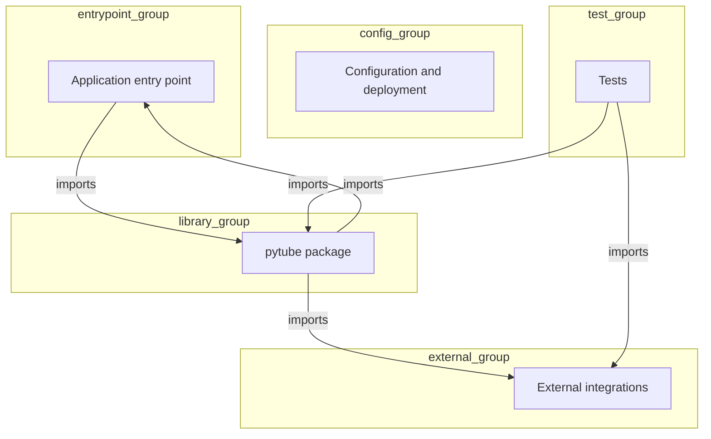

# Architecture report: pytube/pytube

> Automated static analysis. **Observed** = directly seen in files/imports/AST; **Inferred** = interpretation from that evidence. Repository code was not executed.

## 1. Repository at a glance

| Item | Value |
| --- | --- |
| Repository | pytube/pytube |
| Description | Lightweight, dependency-free Python library and CLI for downloading YouTube videos, playlists, and captions. |
| Language | Python |
| Stars | 13209 |
| Licence | Unlicense |
| Analysed commit / branch | a32fff39058a6f7e5e59ecd06a7467b71197ce35 / master |
| Framework(s) | None detected |
| Files analysed | 60 |
| Components | 5 |

## 2. Architecture in one minute

pytube/pytube - Lightweight, dependency-free Python library and CLI for downloading YouTube videos, playlists, and captions.. This repository was analysed statically from 60 file(s) (39 Python). Detected technologies (observed from imports/manifests): GitHub Actions, setuptools, pytest, unittest. Files are grouped into 5 component(s): Configuration and deployment, Application entry point, External integrations, pytube package, Tests. Observed entry point(s): pytube/cli.py, pytube/version.py. Findings below distinguish observed facts from inferred interpretation.

## 3. High-level block diagram

## 4. Main components

### Configuration and deployment (`config`)

- **Kind:** config
- **Status:** Observed
- **Confidence:** 0.85
- **Responsibility:** Groups 3 file(s) under configuration and deployment (observed from repository paths and static analysis).
- **Paths:** `MANIFEST.in`, `Pipfile`, `setup.py`
- **Evidence:** [MANIFEST.in](https://github.com/pytube/pytube/blob/a32fff39058a6f7e5e59ecd06a7467b71197ce35/MANIFEST.in); [Pipfile](https://github.com/pytube/pytube/blob/a32fff39058a6f7e5e59ecd06a7467b71197ce35/Pipfile); [setup.py](https://github.com/pytube/pytube/blob/a32fff39058a6f7e5e59ecd06a7467b71197ce35/setup.py)

### Application entry point (`entrypoint`)

- **Kind:** entrypoint
- **Status:** Observed
- **Confidence:** 0.85
- **Responsibility:** Groups 3 file(s) under application entry point (observed from repository paths and static analysis). Observed top-level classes: YouTube. Observed top-level functions: _download, _ffmpeg_downloader, _parse_args, _perform_args_on_youtube, _print_available_captions, _unique_name.
- **Paths:** `pytube/__main__.py`, `pytube/cli.py`, `pytube/version.py`
- **Evidence:** [pytube/__main__.py:24](https://github.com/pytube/pytube/blob/a32fff39058a6f7e5e59ecd06a7467b71197ce35/pytube/__main__.py#L24); [pytube/cli.py:23](https://github.com/pytube/pytube/blob/a32fff39058a6f7e5e59ecd06a7467b71197ce35/pytube/cli.py#L23); [pytube/version.py](https://github.com/pytube/pytube/blob/a32fff39058a6f7e5e59ecd06a7467b71197ce35/pytube/version.py)

### External integrations (`external_integrations`)

- **Kind:** external
- **Status:** Inferred
- **Confidence:** 0.70
- **Responsibility:** Groups 0 file(s) under external integrations (observed from repository paths and static analysis).
- **Evidence:** [pytube/request.py:6](https://github.com/pytube/pytube/blob/a32fff39058a6f7e5e59ecd06a7467b71197ce35/pytube/request.py#L6); [tests/test_request.py:1](https://github.com/pytube/pytube/blob/a32fff39058a6f7e5e59ecd06a7467b71197ce35/tests/test_request.py#L1)

### pytube package (`pytube`)

- **Kind:** library
- **Status:** Observed
- **Confidence:** 0.85
- **Responsibility:** Groups 18 file(s) under pytube package (observed from repository paths and static analysis). Observed top-level classes: AgeRestrictedError, Caption, CaptionQuery, Channel, Cipher, DeferredGeneratorList. Observed top-level functions: _execute_request, _video_info_url, apply_descrambler, apply_signature, cache, channel_name.
- **Paths:** `pytube/__init__.py`, `pytube/captions.py`, `pytube/cipher.py`, `pytube/contrib/__init__.py`, `pytube/contrib/channel.py`, `pytube/contrib/playlist.py`, `pytube/contrib/search.py`, `pytube/exceptions.py`, `pytube/extract.py`, `pytube/helpers.py`, `pytube/innertube.py`, `pytube/itags.py`, `pytube/metadata.py`, `pytube/monostate.py`, `pytube/parser.py`, `pytube/query.py`, `pytube/request.py`, `pytube/streams.py`
- **Evidence:** [pytube/__init__.py](https://github.com/pytube/pytube/blob/a32fff39058a6f7e5e59ecd06a7467b71197ce35/pytube/__init__.py); [pytube/captions.py:13](https://github.com/pytube/pytube/blob/a32fff39058a6f7e5e59ecd06a7467b71197ce35/pytube/captions.py#L13); [pytube/cipher.py:27](https://github.com/pytube/pytube/blob/a32fff39058a6f7e5e59ecd06a7467b71197ce35/pytube/cipher.py#L27); [pytube/contrib/__init__.py](https://github.com/pytube/pytube/blob/a32fff39058a6f7e5e59ecd06a7467b71197ce35/pytube/contrib/__init__.py); [pytube/contrib/channel.py:13](https://github.com/pytube/pytube/blob/a32fff39058a6f7e5e59ecd06a7467b71197ce35/pytube/contrib/channel.py#L13); [pytube/contrib/playlist.py:14](https://github.com/pytube/pytube/blob/a32fff39058a6f7e5e59ecd06a7467b71197ce35/pytube/contrib/playlist.py#L14); [pytube/contrib/search.py:13](https://github.com/pytube/pytube/blob/a32fff39058a6f7e5e59ecd06a7467b71197ce35/pytube/contrib/search.py#L13); [pytube/exceptions.py:5](https://github.com/pytube/pytube/blob/a32fff39058a6f7e5e59ecd06a7467b71197ce35/pytube/exceptions.py#L5)

### Tests (`tests`)

- **Kind:** test
- **Status:** Observed
- **Confidence:** 0.85
- **Responsibility:** Groups 17 file(s) under tests (observed from repository paths and static analysis). Observed routes: PATCH pytube.request.urlopen, PATCH pytube.request.get, PATCH pytube.request.get, PATCH pytube.request.get, PATCH pytube.request.get. Observed top-level functions: age_restricted, base_js, channel_videos_html, cipher_signature, load_and_init_from_playback_file, load_playback_file.
- **Paths:** `tests/__init__.py`, `tests/conftest.py`, `tests/contrib/test_channel.py`, `tests/contrib/test_playlist.py`, `tests/test_captions.py`, `tests/test_cipher.py`, `tests/test_cli.py`, `tests/test_exceptions.py`, `tests/test_extract.py`, `tests/test_helpers.py`, `tests/test_itags.py`, `tests/test_main.py`, `tests/test_metadata.py`, `tests/test_parser.py`, `tests/test_query.py`, `tests/test_request.py`, `tests/test_streams.py`
- **Evidence:** [tests/__init__.py](https://github.com/pytube/pytube/blob/a32fff39058a6f7e5e59ecd06a7467b71197ce35/tests/__init__.py); [tests/conftest.py:11](https://github.com/pytube/pytube/blob/a32fff39058a6f7e5e59ecd06a7467b71197ce35/tests/conftest.py#L11); [tests/contrib/test_channel.py:7](https://github.com/pytube/pytube/blob/a32fff39058a6f7e5e59ecd06a7467b71197ce35/tests/contrib/test_channel.py#L7); [tests/contrib/test_playlist.py:8](https://github.com/pytube/pytube/blob/a32fff39058a6f7e5e59ecd06a7467b71197ce35/tests/contrib/test_playlist.py#L8); [tests/test_captions.py:9](https://github.com/pytube/pytube/blob/a32fff39058a6f7e5e59ecd06a7467b71197ce35/tests/test_captions.py#L9); [tests/test_cipher.py:7](https://github.com/pytube/pytube/blob/a32fff39058a6f7e5e59ecd06a7467b71197ce35/tests/test_cipher.py#L7); [tests/test_cli.py:16](https://github.com/pytube/pytube/blob/a32fff39058a6f7e5e59ecd06a7467b71197ce35/tests/test_cli.py#L16); [tests/test_exceptions.py:8](https://github.com/pytube/pytube/blob/a32fff39058a6f7e5e59ecd06a7467b71197ce35/tests/test_exceptions.py#L8)

## 5. Execution flow

**Observed** entry point(s):

- [pytube/cli.py](https://github.com/pytube/pytube/blob/a32fff39058a6f7e5e59ecd06a7467b71197ce35/pytube/cli.py)
- [pytube/version.py:3](https://github.com/pytube/pytube/blob/a32fff39058a6f7e5e59ecd06a7467b71197ce35/pytube/version.py#L3)

**Observed** routes (from decorators):

- `PATCH pytube.request.urlopen` -> `load_and_init_from_playback_file` in `tests/conftest.py:22`
- `PATCH pytube.request.get` -> `test_init_with_url` in `tests/contrib/test_channel.py:7`
- `PATCH pytube.request.get` -> `test_channel_uri` in `tests/contrib/test_channel.py:19`
- `PATCH pytube.request.get` -> `test_channel_name` in `tests/contrib/test_channel.py:30`
- `PATCH pytube.request.get` -> `test_channel_id` in `tests/contrib/test_channel.py:38`
- `PATCH pytube.request.get` -> `test_channel_vanity_url` in `tests/contrib/test_channel.py:46`
- `PATCH pytube.request.get` -> `test_channel_video_list` in `tests/contrib/test_channel.py:54`
- `PATCH pytube.request.get` -> `test_videos_html` in `tests/contrib/test_channel.py:74`
- `PATCH pytube.request.get` -> `test_title` in `tests/contrib/test_playlist.py:8`
- `PATCH pytube.request.get` -> `test_init_with_playlist_url` in `tests/contrib/test_playlist.py:23`
- `PATCH pytube.request.get` -> `test_init_with_watch_url` in `tests/contrib/test_playlist.py:34`
- `PATCH pytube.request.get` -> `test_last_updated` in `tests/contrib/test_playlist.py:48`
- `PATCH pytube.request.get` -> `test_video_urls` in `tests/contrib/test_playlist.py:59`
- `PATCH pytube.request.get` -> `test_html` in `tests/contrib/test_playlist.py:81`
- `PATCH pytube.request.get` -> `test_repr` in `tests/contrib/test_playlist.py:90`
- `PATCH pytube.request.get` -> `test_sequence` in `tests/contrib/test_playlist.py:114`
- `PATCH pytube.request.get` -> `test_videos` in `tests/contrib/test_playlist.py:124`
- `PATCH pytube.cli.YouTube.__init__` -> `test_videos` in `tests/contrib/test_playlist.py:124`
- `PATCH pytube.request.get` -> `test_load_more` in `tests/contrib/test_playlist.py:134`
- `PATCH pytube.cli.YouTube.__init__` -> `test_load_more` in `tests/contrib/test_playlist.py:134`
- `PATCH pytube.request.get` -> `test_proxy` in `tests/contrib/test_playlist.py:147`
- `PATCH pytube.contrib.playlist.install_proxy` -> `test_proxy` in `tests/contrib/test_playlist.py:147`
- `PATCH pytube.request.get` -> `test_trimmed` in `tests/contrib/test_playlist.py:155`
- `PATCH pytube.request.get` -> `test_playlist_failed_pagination` in `tests/contrib/test_playlist.py:169`
- `PATCH pytube.request.post` -> `test_playlist_failed_pagination` in `tests/contrib/test_playlist.py:169`
- `PATCH pytube.request.get` -> `test_playlist_pagination` in `tests/contrib/test_playlist.py:196`
- `PATCH pytube.request.post` -> `test_playlist_pagination` in `tests/contrib/test_playlist.py:196`
- `PATCH pytube.request.get` -> `test_trimmed_pagination` in `tests/contrib/test_playlist.py:215`
- `PATCH pytube.request.get` -> `test_trimmed_pagination_not_found` in `tests/contrib/test_playlist.py:232`
- `PATCH pytube.request.get` -> `test_playlist_submenu` in `tests/contrib/test_playlist.py:251`
- `PATCH pytube.request.get` -> `test_playlist_length` in `tests/contrib/test_playlist.py:266`
- `PATCH pytube.request.get` -> `test_playlist_description` in `tests/contrib/test_playlist.py:274`
- `PATCH pytube.request.get` -> `test_playlist_views` in `tests/contrib/test_playlist.py:294`
- `PATCH pytube.request.get` -> `test_playlist_owner` in `tests/contrib/test_playlist.py:302`
- `PATCH pytube.request.get` -> `test_playlist_owner_id` in `tests/contrib/test_playlist.py:310`
- `PATCH pytube.request.get` -> `test_playlist_owner_url` in `tests/contrib/test_playlist.py:318`
- `PATCH pytube.captions.Caption.generate_srt_captions` -> `test_download` in `tests/test_captions.py:56`
- `PATCH pytube.captions.Caption.generate_srt_captions` -> `test_download_with_prefix` in `tests/test_captions.py:75`
- `PATCH pytube.captions.Caption.generate_srt_captions` -> `test_download_with_output_path` in `tests/test_captions.py:95`
- `PATCH pytube.captions.Caption.xml_captions` -> `test_download_xml_and_trim_extension` in `tests/test_captions.py:114`
- `PATCH pytube.request.get` -> `test_xml_captions` in `tests/test_captions.py:143`
- `PATCH pytube.captions.request` -> `test_generate_srt_captions` in `tests/test_captions.py:152`
- `PATCH pytube.cli._parse_args` -> `test_main_invalid_url` in `tests/test_cli.py:16`
- `PATCH pytube.cli.display_streams` -> `test_download_when_itag_not_found` in `tests/test_cli.py:26`
- `PATCH pytube.cli.YouTube` -> `test_download_when_itag_not_found` in `tests/test_cli.py:26`
- `PATCH pytube.cli.YouTube` -> `test_download_when_itag_is_found` in `tests/test_cli.py:40`
- `PATCH pytube.Stream` -> `test_download_when_itag_is_found` in `tests/test_cli.py:40`
- `PATCH pytube.cli.YouTube` -> `test_display_stream` in `tests/test_cli.py:55`
- `PATCH pytube.Stream` -> `test_display_stream` in `tests/test_cli.py:55`
- `PATCH pytube.cli._print_available_captions` -> `test_download_caption_with_none` in `tests/test_cli.py:68`
- `PATCH pytube.cli.YouTube` -> `test_download_caption_with_none` in `tests/test_cli.py:68`
- `PATCH pytube.cli.YouTube` -> `test_download_caption_with_language_found` in `tests/test_cli.py:81`
- `PATCH pytube.cli._print_available_captions` -> `test_download_caption_with_lang_not_found` in `tests/test_cli.py:94`
- `PATCH pytube.cli.YouTube` -> `test_download_caption_with_lang_not_found` in `tests/test_cli.py:94`
- `PATCH pytube.Stream` -> `test_on_progress` in `tests/test_cli.py:129`
- `PATCH pytube.cli.setup_logger` -> `test_main_logging_setup` in `tests/test_cli.py:168`
- `PATCH pytube.cli.YouTube` -> `test_main_download_by_itag` in `tests/test_cli.py:181`
- `PATCH pytube.cli.YouTube` -> `test_main_build_playback_report` in `tests/test_cli.py:194`
- `PATCH pytube.cli.YouTube` -> `test_main_display_streams` in `tests/test_cli.py:208`
- `PATCH pytube.cli.YouTube` -> `test_main_download_caption` in `tests/test_cli.py:219`
- `PATCH pytube.cli.YouTube` -> `test_download_by_resolution_flag` in `tests/test_cli.py:231`
- `PATCH pytube.cli.download_by_resolution` -> `test_download_by_resolution_flag` in `tests/test_cli.py:231`
- `PATCH pytube.cli.YouTube` -> `test_download_with_playlist` in `tests/test_cli.py:245`
- `PATCH pytube.cli.Playlist` -> `test_download_with_playlist` in `tests/test_cli.py:245`
- `PATCH pytube.cli._perform_args_on_youtube` -> `test_download_with_playlist` in `tests/test_cli.py:245`
- `PATCH pytube.cli.YouTube` -> `test_download_with_playlist_video_error` in `tests/test_cli.py:264`
- `PATCH pytube.cli.Playlist` -> `test_download_with_playlist_video_error` in `tests/test_cli.py:264`
- `PATCH pytube.cli._perform_args_on_youtube` -> `test_download_with_playlist_video_error` in `tests/test_cli.py:264`
- `PATCH pytube.cli.YouTube` -> `test_download_by_resolution` in `tests/test_cli.py:288`
- `PATCH pytube.StreamQuery` -> `test_download_by_resolution` in `tests/test_cli.py:288`
- `PATCH pytube.Stream` -> `test_download_by_resolution` in `tests/test_cli.py:288`
- `PATCH pytube.cli._download` -> `test_download_by_resolution` in `tests/test_cli.py:288`
- `PATCH pytube.cli.YouTube` -> `test_download_by_resolution_not_exists` in `tests/test_cli.py:303`
- `PATCH pytube.StreamQuery` -> `test_download_by_resolution_not_exists` in `tests/test_cli.py:303`
- `PATCH pytube.cli._download` -> `test_download_by_resolution_not_exists` in `tests/test_cli.py:303`
- `PATCH pytube.Stream` -> `test_download_stream_file_exists` in `tests/test_cli.py:314`
- `PATCH pytube.cli.YouTube` -> `test_perform_args_should_ffmpeg_process` in `tests/test_cli.py:327`
- `PATCH pytube.cli.ffmpeg_process` -> `test_perform_args_should_ffmpeg_process` in `tests/test_cli.py:327`
- `PATCH pytube.cli.YouTube` -> `test_ffmpeg_process_best_should_download` in `tests/test_cli.py:344`
- `PATCH pytube.cli._ffmpeg_downloader` -> `test_ffmpeg_process_best_should_download` in `tests/test_cli.py:344`
- `PATCH pytube.cli.YouTube` -> `test_ffmpeg_process_res_should_download` in `tests/test_cli.py:367`
- `PATCH pytube.cli._ffmpeg_downloader` -> `test_ffmpeg_process_res_should_download` in `tests/test_cli.py:367`
- `PATCH pytube.cli.YouTube` -> `test_ffmpeg_process_res_none_should_not_download` in `tests/test_cli.py:388`
- `PATCH pytube.cli._ffmpeg_downloader` -> `test_ffmpeg_process_res_none_should_not_download` in `tests/test_cli.py:388`
- `PATCH pytube.cli.YouTube` -> `test_ffmpeg_process_audio_none_should_fallback_download` in `tests/test_cli.py:407`
- `PATCH pytube.cli._ffmpeg_downloader` -> `test_ffmpeg_process_audio_none_should_fallback_download` in `tests/test_cli.py:407`
- `PATCH pytube.cli.YouTube` -> `test_ffmpeg_process_audio_fallback_none_should_exit` in `tests/test_cli.py:427`
- `PATCH pytube.cli._ffmpeg_downloader` -> `test_ffmpeg_process_audio_fallback_none_should_exit` in `tests/test_cli.py:427`
- `PATCH pytube.cli.os.unlink` -> `test_ffmpeg_downloader` in `tests/test_cli.py:452`
- `PATCH pytube.cli.subprocess.run` -> `test_ffmpeg_downloader` in `tests/test_cli.py:452`
- `PATCH pytube.cli._download` -> `test_ffmpeg_downloader` in `tests/test_cli.py:452`
- `PATCH pytube.cli._unique_name` -> `test_ffmpeg_downloader` in `tests/test_cli.py:452`
- `PATCH pytube.cli.download_audio` -> `test_download_audio_args` in `tests/test_cli.py:485`
- `PATCH pytube.cli.YouTube.__init__` -> `test_download_audio_args` in `tests/test_cli.py:485`
- `PATCH pytube.cli._download` -> `test_download_audio` in `tests/test_cli.py:501`
- `PATCH pytube.cli.YouTube` -> `test_download_audio` in `tests/test_cli.py:501`
- `PATCH pytube.cli._download` -> `test_download_audio_none` in `tests/test_cli.py:516`
- `PATCH pytube.cli.YouTube` -> `test_download_audio_none` in `tests/test_cli.py:516`
- `PATCH pytube.cli.YouTube.__init__` -> `test_perform_args_on_youtube` in `tests/test_cli.py:530`
- `PATCH pytube.cli.os.path.exists` -> `test_unique_name` in `tests/test_cli.py:541`
- `PATCH pytube.cli.os.path.exists` -> `test_unique_name_counter` in `tests/test_cli.py:548`
- `PATCH warnings.warn` -> `test_deprecated` in `tests/test_helpers.py:30`
- `PATCH os.path.isabs` -> `test_target_directory_with_relative_path` in `tests/test_helpers.py:63`
- `PATCH os.getcwd` -> `test_target_directory_with_relative_path` in `tests/test_helpers.py:63`
- `PATCH os.makedirs` -> `test_target_directory_with_relative_path` in `tests/test_helpers.py:63`
- `PATCH os.path.isabs` -> `test_target_directory_with_absolute_path` in `tests/test_helpers.py:70`
- `PATCH os.makedirs` -> `test_target_directory_with_absolute_path` in `tests/test_helpers.py:70`
- `PATCH os.getcwd` -> `test_target_directory_with_no_path` in `tests/test_helpers.py:77`
- `PATCH os.makedirs` -> `test_target_directory_with_no_path` in `tests/test_helpers.py:77`
- `PATCH pytube.helpers.logging` -> `test_setup_logger` in `tests/test_helpers.py:83`
- `PATCH builtins.open` -> `test_create_mock_html_json` in `tests/test_helpers.py:96`
- `PATCH pytube.request.urlopen` -> `test_create_mock_html_json` in `tests/test_helpers.py:96`
- `PATCH urllib.request.install_opener` -> `test_install_proxy` in `tests/test_main.py:11`
- `PATCH pytube.request.get` -> `test_video_unavailable` in `tests/test_main.py:21`
- `PATCH pytube.request.urlopen` -> `test_streaming` in `tests/test_request.py:12`
- `PATCH pytube.request.urlopen` -> `test_timeout` in `tests/test_request.py:32`
- `PATCH pytube.request.urlopen` -> `test_headers` in `tests/test_request.py:41`
- `PATCH pytube.request.urlopen` -> `test_get` in `tests/test_request.py:50`
- `PATCH pytube.streams.request` -> `test_stream_to_buffer` in `tests/test_streams.py:13`
- `PATCH pytube.request.head` -> `test_download` in `tests/test_streams.py:128`
- `PATCH pytube.request.stream` -> `test_download` in `tests/test_streams.py:128`
- `PATCH pytube.request.head` -> `test_download_with_prefix` in `tests/test_streams.py:142`
- `PATCH pytube.request.stream` -> `test_download_with_prefix` in `tests/test_streams.py:142`
- `PATCH pytube.streams.target_directory` -> `test_download_with_prefix` in `tests/test_streams.py:142`
- `PATCH pytube.request.head` -> `test_download_with_filename` in `tests/test_streams.py:160`
- `PATCH pytube.request.stream` -> `test_download_with_filename` in `tests/test_streams.py:160`
- `PATCH pytube.streams.target_directory` -> `test_download_with_filename` in `tests/test_streams.py:160`
- `PATCH pytube.request.head` -> `test_download_with_existing` in `tests/test_streams.py:179`
- `PATCH pytube.request.stream` -> `test_download_with_existing` in `tests/test_streams.py:179`
- `PATCH pytube.streams.target_directory` -> `test_download_with_existing` in `tests/test_streams.py:179`
- `PATCH os.path.isfile` -> `test_download_with_existing` in `tests/test_streams.py:179`
- `PATCH pytube.request.head` -> `test_download_with_existing_no_skip` in `tests/test_streams.py:200`
- `PATCH pytube.request.stream` -> `test_download_with_existing_no_skip` in `tests/test_streams.py:200`
- `PATCH pytube.streams.target_directory` -> `test_download_with_existing_no_skip` in `tests/test_streams.py:200`
- `PATCH os.path.isfile` -> `test_download_with_existing_no_skip` in `tests/test_streams.py:200`
- `PATCH pytube.request.head` -> `test_on_progress_hook` in `tests/test_streams.py:229`
- `PATCH pytube.request.stream` -> `test_on_progress_hook` in `tests/test_streams.py:229`
- `PATCH pytube.request.head` -> `test_on_complete_hook` in `tests/test_streams.py:250`
- `PATCH pytube.request.stream` -> `test_on_complete_hook` in `tests/test_streams.py:250`

Representative flow (derived from observed entry points and the import graph; steps beyond the entry point are **Inferred**):

1. Execution starts at an observed entry point listed above, if present.
2. `entrypoint` imports `pytube` (Application entry point -> pytube package).
3. `pytube` imports `entrypoint` (pytube package -> Application entry point).
4. `pytube` imports `external_integrations` (pytube package -> External integrations).
5. `tests` imports `external_integrations` (Tests -> External integrations).
6. `tests` imports `pytube` (Tests -> pytube package).

## 6. Project structure

### `(root)`

- `.bumpversion.cfg` - config (102 bytes)
- `.deepsource.toml` - config (177 bytes)
- `.editorconfig` - config (176 bytes)
- `.envrc` - other (368 bytes)
- `.flake8` - other (386 bytes)
- `.gitattributes` - other (99 bytes)
- `.gitignore` - other (1671 bytes)
- `.pre-commit-config.yaml` - config (1633 bytes)
- `.readthedocs.yml` - config (496 bytes)
- `CODE_OF_CONDUCT.md` - docs (5214 bytes)
- `Contributing.md` - docs (2141 bytes)
- `LICENSE` - docs (1211 bytes)
- `MANIFEST.in` - manifest (55 bytes)
- `Makefile` - other (1428 bytes)
- `Pipfile` - manifest (771 bytes)
- `README.md` - docs (3672 bytes)
- `setup.py` - manifest, Python (2032 bytes)

### `.github`

- `.github/ISSUE_TEMPLATE/bug_report.md` - docs (1038 bytes)
- `.github/ISSUE_TEMPLATE/feature_request.md` - docs (604 bytes)
- `.github/workflows/ci.yml` - ci, YAML (655 bytes)
- `.github/workflows/greetings.yml` - ci, YAML (360 bytes)
- `.github/workflows/pypi-publish.yml` - ci, YAML (843 bytes)

### `pytube`

- `pytube/__init__.py` - source, Python (592 bytes)
- `pytube/__main__.py` - source, Python (15423 bytes)
- `pytube/captions.py` - source, Python (5648 bytes)
- `pytube/cipher.py` - source, Python (22529 bytes)
- `pytube/cli.py` - source, Python (16641 bytes)
- `pytube/contrib/__init__.py` - source, Python (0 bytes)
- `pytube/contrib/channel.py` - source, Python (6576 bytes)
- `pytube/contrib/playlist.py` - source, Python (14204 bytes)
- `pytube/contrib/search.py` - source, Python (8898 bytes)
- `pytube/exceptions.py` - source, Python (3907 bytes)
- `pytube/extract.py` - source, Python (17798 bytes)
- `pytube/helpers.py` - source, Python (9794 bytes)
- `pytube/innertube.py` - source, Python (15785 bytes)
- `pytube/itags.py` - source, Python (4311 bytes)
- `pytube/metadata.py` - source, Python (1482 bytes)
- `pytube/monostate.py` - source, Python (451 bytes)
- `pytube/parser.py` - source, Python (5931 bytes)
- `pytube/query.py` - source, Python (12844 bytes)
- `pytube/request.py` - source, Python (8662 bytes)
- `pytube/streams.py` - source, Python (15288 bytes)
- `pytube/version.py` - source, Python (74 bytes)

### `tests`

- `tests/__init__.py` - test, Python (57 bytes)
- `tests/conftest.py` - test, Python (4921 bytes)
- `tests/contrib/test_channel.py` - test, Python (3122 bytes)
- `tests/contrib/test_playlist.py` - test, Python (11623 bytes)
- `tests/test_captions.py` - test, Python (5759 bytes)
- `tests/test_cipher.py` - test, Python (2736 bytes)
- `tests/test_cli.py` - test, Python (17295 bytes)
- `tests/test_exceptions.py` - test, Python (3452 bytes)
- `tests/test_extract.py` - test, Python (2957 bytes)
- `tests/test_helpers.py` - test, Python (5024 bytes)
- `tests/test_itags.py` - test, Python (276 bytes)
- `tests/test_main.py` - test, Python (1915 bytes)
- `tests/test_metadata.py` - test, Python (498 bytes)
- `tests/test_parser.py` - test, Python (1406 bytes)
- `tests/test_query.py` - test, Python (6148 bytes)
- `tests/test_request.py` - test, Python (1820 bytes)
- `tests/test_streams.py` - test, Python (13696 bytes)

## 7. Key dependencies and integrations

| Name | Category | Status | Confidence | Evidence |
| --- | --- | --- | --- | --- |
| GitHub Actions | ci | Observed | 0.90 | [.github/workflows/ci.yml](https://github.com/pytube/pytube/blob/a32fff39058a6f7e5e59ecd06a7467b71197ce35/.github/workflows/ci.yml); [.github/workflows/greetings.yml](https://github.com/pytube/pytube/blob/a32fff39058a6f7e5e59ecd06a7467b71197ce35/.github/workflows/greetings.yml); [.github/workflows/pypi-publish.yml](https://github.com/pytube/pytube/blob/a32fff39058a6f7e5e59ecd06a7467b71197ce35/.github/workflows/pypi-publish.yml) |
| setuptools | packaging | Observed | 0.90 | [setup.py:6](https://github.com/pytube/pytube/blob/a32fff39058a6f7e5e59ecd06a7467b71197ce35/setup.py#L6) |
| pytest | tooling | Observed | 0.95 | [Pipfile:27](https://github.com/pytube/pytube/blob/a32fff39058a6f7e5e59ecd06a7467b71197ce35/Pipfile#L27); [tests/conftest.py:5](https://github.com/pytube/pytube/blob/a32fff39058a6f7e5e59ecd06a7467b71197ce35/tests/conftest.py#L5); [tests/test_captions.py:2](https://github.com/pytube/pytube/blob/a32fff39058a6f7e5e59ecd06a7467b71197ce35/tests/test_captions.py#L2); [tests/test_cipher.py:1](https://github.com/pytube/pytube/blob/a32fff39058a6f7e5e59ecd06a7467b71197ce35/tests/test_cipher.py#L1) |
| unittest | tooling | Observed | 0.95 | [tests/conftest.py:6](https://github.com/pytube/pytube/blob/a32fff39058a6f7e5e59ecd06a7467b71197ce35/tests/conftest.py#L6); [tests/contrib/test_channel.py:1](https://github.com/pytube/pytube/blob/a32fff39058a6f7e5e59ecd06a7467b71197ce35/tests/contrib/test_channel.py#L1); [tests/contrib/test_playlist.py:2](https://github.com/pytube/pytube/blob/a32fff39058a6f7e5e59ecd06a7467b71197ce35/tests/contrib/test_playlist.py#L2); [tests/test_captions.py:3](https://github.com/pytube/pytube/blob/a32fff39058a6f7e5e59ecd06a7467b71197ce35/tests/test_captions.py#L3) |

## 8. Data and state

No database, cache, queue, or persistent-state usage was observed in the analysed files. State handling, if any, may be in-memory or in files that were not analysed.

## 9. Configuration and deployment clues

- `.bumpversion.cfg` (config)
- `.deepsource.toml` (config)
- `.editorconfig` (config)
- `.github/workflows/ci.yml` (ci)
- `.github/workflows/greetings.yml` (ci)
- `.github/workflows/pypi-publish.yml` (ci)
- `.pre-commit-config.yaml` (config)
- `.readthedocs.yml` (config)
- `MANIFEST.in` (manifest)
- `Pipfile` (manifest)
- `setup.py` (manifest)

Console scripts declared in packaging metadata (**Observed**):

- `pytube` -> `pytube.cli:main`

## 10. Design observations

- An entry/API layer is separated from other code (Inferred from paths and decorators).
- Tests are present alongside source code (Observed from test file paths).
- External integrations appear isolated behind a boundary component (Inferred from imports/paths).

These observations are interpretations (**Inferred**) of the observed structure, not guarantees about runtime design.

## 11. Limitations and unknowns

- Static analysis only: repository code was not executed, installed, or imported at runtime.
- Components and relationships are inferred from file paths, imports, and AST structure; runtime behaviour, dynamic imports, and reflection may not be visible.
- 1 file(s) were skipped during inventory (1 x lockfile excluded).
- Repository text was treated as untrusted data; no instructions found in repository files were followed, and likely secret values were redacted/excluded.

## 12. Source references

- [.github/workflows/ci.yml](https://github.com/pytube/pytube/blob/a32fff39058a6f7e5e59ecd06a7467b71197ce35/.github/workflows/ci.yml)
- [.github/workflows/greetings.yml](https://github.com/pytube/pytube/blob/a32fff39058a6f7e5e59ecd06a7467b71197ce35/.github/workflows/greetings.yml)
- [.github/workflows/pypi-publish.yml](https://github.com/pytube/pytube/blob/a32fff39058a6f7e5e59ecd06a7467b71197ce35/.github/workflows/pypi-publish.yml)
- [MANIFEST.in](https://github.com/pytube/pytube/blob/a32fff39058a6f7e5e59ecd06a7467b71197ce35/MANIFEST.in)
- [Pipfile](https://github.com/pytube/pytube/blob/a32fff39058a6f7e5e59ecd06a7467b71197ce35/Pipfile)
- [Pipfile:27](https://github.com/pytube/pytube/blob/a32fff39058a6f7e5e59ecd06a7467b71197ce35/Pipfile#L27)
- [pytube/__init__.py](https://github.com/pytube/pytube/blob/a32fff39058a6f7e5e59ecd06a7467b71197ce35/pytube/__init__.py)
- [pytube/__main__.py:24](https://github.com/pytube/pytube/blob/a32fff39058a6f7e5e59ecd06a7467b71197ce35/pytube/__main__.py#L24)
- [pytube/captions.py:13](https://github.com/pytube/pytube/blob/a32fff39058a6f7e5e59ecd06a7467b71197ce35/pytube/captions.py#L13)
- [pytube/cipher.py:27](https://github.com/pytube/pytube/blob/a32fff39058a6f7e5e59ecd06a7467b71197ce35/pytube/cipher.py#L27)
- [pytube/cli.py](https://github.com/pytube/pytube/blob/a32fff39058a6f7e5e59ecd06a7467b71197ce35/pytube/cli.py)
- [pytube/cli.py:23](https://github.com/pytube/pytube/blob/a32fff39058a6f7e5e59ecd06a7467b71197ce35/pytube/cli.py#L23)
- [pytube/contrib/__init__.py](https://github.com/pytube/pytube/blob/a32fff39058a6f7e5e59ecd06a7467b71197ce35/pytube/contrib/__init__.py)
- [pytube/contrib/channel.py:13](https://github.com/pytube/pytube/blob/a32fff39058a6f7e5e59ecd06a7467b71197ce35/pytube/contrib/channel.py#L13)
- [pytube/contrib/playlist.py:14](https://github.com/pytube/pytube/blob/a32fff39058a6f7e5e59ecd06a7467b71197ce35/pytube/contrib/playlist.py#L14)
- [pytube/contrib/search.py:13](https://github.com/pytube/pytube/blob/a32fff39058a6f7e5e59ecd06a7467b71197ce35/pytube/contrib/search.py#L13)
- [pytube/exceptions.py:5](https://github.com/pytube/pytube/blob/a32fff39058a6f7e5e59ecd06a7467b71197ce35/pytube/exceptions.py#L5)
- [pytube/request.py:6](https://github.com/pytube/pytube/blob/a32fff39058a6f7e5e59ecd06a7467b71197ce35/pytube/request.py#L6)
- [pytube/version.py](https://github.com/pytube/pytube/blob/a32fff39058a6f7e5e59ecd06a7467b71197ce35/pytube/version.py)
- [pytube/version.py:3](https://github.com/pytube/pytube/blob/a32fff39058a6f7e5e59ecd06a7467b71197ce35/pytube/version.py#L3)
- [setup.py](https://github.com/pytube/pytube/blob/a32fff39058a6f7e5e59ecd06a7467b71197ce35/setup.py)
- [setup.py:6](https://github.com/pytube/pytube/blob/a32fff39058a6f7e5e59ecd06a7467b71197ce35/setup.py#L6)
- [tests/__init__.py](https://github.com/pytube/pytube/blob/a32fff39058a6f7e5e59ecd06a7467b71197ce35/tests/__init__.py)
- [tests/conftest.py:5](https://github.com/pytube/pytube/blob/a32fff39058a6f7e5e59ecd06a7467b71197ce35/tests/conftest.py#L5)
- [tests/conftest.py:6](https://github.com/pytube/pytube/blob/a32fff39058a6f7e5e59ecd06a7467b71197ce35/tests/conftest.py#L6)
- [tests/conftest.py:11](https://github.com/pytube/pytube/blob/a32fff39058a6f7e5e59ecd06a7467b71197ce35/tests/conftest.py#L11)
- [tests/contrib/test_channel.py:1](https://github.com/pytube/pytube/blob/a32fff39058a6f7e5e59ecd06a7467b71197ce35/tests/contrib/test_channel.py#L1)
- [tests/contrib/test_channel.py:7](https://github.com/pytube/pytube/blob/a32fff39058a6f7e5e59ecd06a7467b71197ce35/tests/contrib/test_channel.py#L7)
- [tests/contrib/test_playlist.py:2](https://github.com/pytube/pytube/blob/a32fff39058a6f7e5e59ecd06a7467b71197ce35/tests/contrib/test_playlist.py#L2)
- [tests/contrib/test_playlist.py:8](https://github.com/pytube/pytube/blob/a32fff39058a6f7e5e59ecd06a7467b71197ce35/tests/contrib/test_playlist.py#L8)
- [tests/test_captions.py:2](https://github.com/pytube/pytube/blob/a32fff39058a6f7e5e59ecd06a7467b71197ce35/tests/test_captions.py#L2)
- [tests/test_captions.py:3](https://github.com/pytube/pytube/blob/a32fff39058a6f7e5e59ecd06a7467b71197ce35/tests/test_captions.py#L3)
- [tests/test_captions.py:4](https://github.com/pytube/pytube/blob/a32fff39058a6f7e5e59ecd06a7467b71197ce35/tests/test_captions.py#L4)
- [tests/test_captions.py:9](https://github.com/pytube/pytube/blob/a32fff39058a6f7e5e59ecd06a7467b71197ce35/tests/test_captions.py#L9)
- [tests/test_cipher.py:1](https://github.com/pytube/pytube/blob/a32fff39058a6f7e5e59ecd06a7467b71197ce35/tests/test_cipher.py#L1)
- [tests/test_cipher.py:7](https://github.com/pytube/pytube/blob/a32fff39058a6f7e5e59ecd06a7467b71197ce35/tests/test_cipher.py#L7)
- [tests/test_cli.py:4](https://github.com/pytube/pytube/blob/a32fff39058a6f7e5e59ecd06a7467b71197ce35/tests/test_cli.py#L4)
- [tests/test_cli.py:5](https://github.com/pytube/pytube/blob/a32fff39058a6f7e5e59ecd06a7467b71197ce35/tests/test_cli.py#L5)
- [tests/test_cli.py:7](https://github.com/pytube/pytube/blob/a32fff39058a6f7e5e59ecd06a7467b71197ce35/tests/test_cli.py#L7)
- [tests/test_cli.py:16](https://github.com/pytube/pytube/blob/a32fff39058a6f7e5e59ecd06a7467b71197ce35/tests/test_cli.py#L16)
- [tests/test_exceptions.py:1](https://github.com/pytube/pytube/blob/a32fff39058a6f7e5e59ecd06a7467b71197ce35/tests/test_exceptions.py#L1)
- [tests/test_exceptions.py:2](https://github.com/pytube/pytube/blob/a32fff39058a6f7e5e59ecd06a7467b71197ce35/tests/test_exceptions.py#L2)
- [tests/test_exceptions.py:8](https://github.com/pytube/pytube/blob/a32fff39058a6f7e5e59ecd06a7467b71197ce35/tests/test_exceptions.py#L8)
- [tests/test_extract.py:3](https://github.com/pytube/pytube/blob/a32fff39058a6f7e5e59ecd06a7467b71197ce35/tests/test_extract.py#L3)
- [tests/test_helpers.py:5](https://github.com/pytube/pytube/blob/a32fff39058a6f7e5e59ecd06a7467b71197ce35/tests/test_helpers.py#L5)
- [tests/test_request.py:1](https://github.com/pytube/pytube/blob/a32fff39058a6f7e5e59ecd06a7467b71197ce35/tests/test_request.py#L1)
