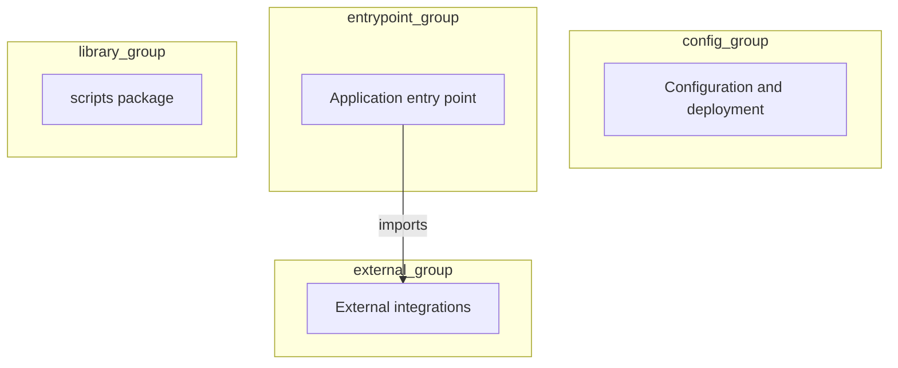

# Architecture report: qazbnm456/awesome-web-security

> Automated static analysis. **Observed** = directly seen in files/imports/AST; **Inferred** = interpretation from that evidence. Repository code was not executed.

## 1. Repository at a glance

| Item | Value |
| --- | --- |
| Repository | qazbnm456/awesome-web-security |
| Description | 🐶 A curated list of Web Security materials and resources. |
| Language | Python |
| Stars | 14059 |
| Licence | Not detected |
| Analysed commit / branch | 23b4ecc5ec5949dcae14bd2178c81172bb6ac862 / master |
| Framework(s) | None detected |
| Files analysed | 130 |
| Components | 4 |

## 2. Architecture in one minute

qazbnm456/awesome-web-security - 🐶 A curated list of Web Security materials and resources.. This repository was analysed statically from 130 file(s) (10 Python). Detected technologies (observed from imports/manifests): GitHub Actions. Files are grouped into 4 component(s): Configuration and deployment, Application entry point, External integrations, scripts package. Observed entry point(s): scripts/ci/archive.py, scripts/ci/check_content_drift.py, scripts/ci/port_legacy_pr.py. Findings below distinguish observed facts from inferred interpretation.

## 3. High-level block diagram

## 4. Main components

### Configuration and deployment (`config`)

- **Kind:** config
- **Status:** Observed
- **Confidence:** 0.85
- **Responsibility:** Groups 92 file(s) under configuration and deployment (observed from repository paths and static analysis).
- **Paths:** `data/categories.yml`, `data/entries/angularjs.yml`, `data/entries/aws.yml`, `data/entries/azure.yml`, `data/entries/blogs.yml`, `data/entries/browser-backend.yml`, `data/entries/browser-frontend.yml`, `data/entries/cheetsheets.yml`, `data/entries/clickjacking.yml`, `data/entries/command-injection.yml`, `data/entries/community.yml`, `data/entries/crypto.yml`, `data/entries/csrf.yml`, `data/entries/csv-injection.yml`, `data/entries/deserialization.yml`, `data/entries/digests.yml`, `data/entries/dns-rebinding.yml`, `data/entries/evasions-authentication.yml`, `data/entries/evasions-csp.yml`, `data/entries/evasions-jsmvc.yml`, `data/entries/evasions-waf.yml`, `data/entries/evasions-xxe.yml`, `data/entries/fingerprint.yml`, `data/entries/forums.yml`, `data/entries/ftp-injection.yml`, `data/entries/jwt.yml`, `data/entries/miscellaneous.yml`, `data/entries/nfs.yml`, `data/entries/oauth.yml`, `data/entries/open-redirect.yml`, `data/entries/orm-injection.yml`, `data/entries/osint.yml`, `data/entries/pocs-database.yml`, `data/entries/practices-application.yml`, `data/entries/practices-aws.yml`, `data/entries/practices-modsecurity.yml`, `data/entries/practices-xss.yml`, `data/entries/prototype-pollution.yml`, `data/entries/rails.yml`, `data/entries/reactjs.yml`, `data/entries/relative-path-overwrite.yml`, `data/entries/saml.yml`, `data/entries/social-engineering-database.yml`, `data/entries/sql-injection.yml`, `data/entries/ssl-tls.yml`, `data/entries/ssrf.yml`, `data/entries/sub-domain-enumeration.yml`, `data/entries/tools-auditing.yml`, `data/entries/tools-code-generating.yml`, `data/entries/tools-command-injection.yml`, `data/entries/tools-csrf.yml`, `data/entries/tools-decompiler.yml`, `data/entries/tools-detecting.yml`, `data/entries/tools-disassembler.yml`, `data/entries/tools-dns-rebinding.yml`, `data/entries/tools-fuzzing.yml`, `data/entries/tools-leaking.yml`, `data/entries/tools-osint.yml`, `data/entries/tools-others.yml`, `data/entries/tools-penetration-testing.yml`, `data/entries/tools-preventing.yml`, `data/entries/tools-proxy.yml`, `data/entries/tools-scanning.yml`, `data/entries/tools-sql-injection.yml`, `data/entries/tools-ssrf.yml`, `data/entries/tools-sub-domain-enumeration.yml`, `data/entries/tools-template-injection.yml`, `data/entries/tools-webshell.yml`, `data/entries/tools-xss.yml`, `data/entries/tools-xxe.yml`, `data/entries/tricks-clickjacking.yml`, `data/entries/tricks-csrf.yml`, `data/entries/tricks-deserialization.yml`, `data/entries/tricks-ftp-injection.yml`, `data/entries/tricks-header-injection.yml`, `data/entries/tricks-nosql-injection.yml`, `data/entries/tricks-oauth.yml`, `data/entries/tricks-others.yml`, `data/entries/tricks-rce.yml`, `data/entries/tricks-sql-injection.yml`, `data/entries/tricks-ssrf.yml`, `data/entries/tricks-url.yml`, `data/entries/tricks-web-cache-poisoning.yml`, `data/entries/tricks-xss.yml`, `data/entries/tricks-xxe.yml`, `data/entries/twitter-users.yml`, `data/entries/upload.yml`, `data/entries/web-cache-poisoning.yml`, `data/entries/web-shell.yml`, `data/entries/webmail.yml`, `data/entries/xss.yml`, `data/entries/xxe.yml`
- **Evidence:** [data/categories.yml](https://github.com/qazbnm456/awesome-web-security/blob/23b4ecc5ec5949dcae14bd2178c81172bb6ac862/data/categories.yml); [data/entries/angularjs.yml](https://github.com/qazbnm456/awesome-web-security/blob/23b4ecc5ec5949dcae14bd2178c81172bb6ac862/data/entries/angularjs.yml); [data/entries/aws.yml](https://github.com/qazbnm456/awesome-web-security/blob/23b4ecc5ec5949dcae14bd2178c81172bb6ac862/data/entries/aws.yml); [data/entries/azure.yml](https://github.com/qazbnm456/awesome-web-security/blob/23b4ecc5ec5949dcae14bd2178c81172bb6ac862/data/entries/azure.yml); [data/entries/blogs.yml](https://github.com/qazbnm456/awesome-web-security/blob/23b4ecc5ec5949dcae14bd2178c81172bb6ac862/data/entries/blogs.yml); [data/entries/browser-backend.yml](https://github.com/qazbnm456/awesome-web-security/blob/23b4ecc5ec5949dcae14bd2178c81172bb6ac862/data/entries/browser-backend.yml); [data/entries/browser-frontend.yml](https://github.com/qazbnm456/awesome-web-security/blob/23b4ecc5ec5949dcae14bd2178c81172bb6ac862/data/entries/browser-frontend.yml); [data/entries/cheetsheets.yml](https://github.com/qazbnm456/awesome-web-security/blob/23b4ecc5ec5949dcae14bd2178c81172bb6ac862/data/entries/cheetsheets.yml)

### Application entry point (`entrypoint`)

- **Kind:** entrypoint
- **Status:** Observed
- **Confidence:** 0.85
- **Responsibility:** Groups 10 file(s) under application entry point (observed from repository paths and static analysis). Observed top-level classes: Entry, ParsedReadme, Section, YamlError, _BlockInternalRedirect, _NoRedirect. Observed top-level functions: _build_opener, _dead_reco, _extract_urls, _github_readme, _host_check, _host_is_non_public.
- **Paths:** `scripts/ci/archive.py`, `scripts/ci/check_content_drift.py`, `scripts/ci/port_legacy_pr.py`, `scripts/ci/pr_review.py`, `scripts/ci/publish_review.py`, `scripts/ci/triage_dead_links.py`, `scripts/generate.py`, `scripts/migrate.py`, `scripts/verify_anchors.py`, `scripts/verify_schema.py`
- **Evidence:** [scripts/ci/archive.py:60](https://github.com/qazbnm456/awesome-web-security/blob/23b4ecc5ec5949dcae14bd2178c81172bb6ac862/scripts/ci/archive.py#L60); [scripts/ci/check_content_drift.py:87](https://github.com/qazbnm456/awesome-web-security/blob/23b4ecc5ec5949dcae14bd2178c81172bb6ac862/scripts/ci/check_content_drift.py#L87); [scripts/ci/port_legacy_pr.py:48](https://github.com/qazbnm456/awesome-web-security/blob/23b4ecc5ec5949dcae14bd2178c81172bb6ac862/scripts/ci/port_legacy_pr.py#L48); [scripts/ci/pr_review.py:67](https://github.com/qazbnm456/awesome-web-security/blob/23b4ecc5ec5949dcae14bd2178c81172bb6ac862/scripts/ci/pr_review.py#L67); [scripts/ci/publish_review.py:60](https://github.com/qazbnm456/awesome-web-security/blob/23b4ecc5ec5949dcae14bd2178c81172bb6ac862/scripts/ci/publish_review.py#L60); [scripts/ci/triage_dead_links.py:142](https://github.com/qazbnm456/awesome-web-security/blob/23b4ecc5ec5949dcae14bd2178c81172bb6ac862/scripts/ci/triage_dead_links.py#L142); [scripts/generate.py:34](https://github.com/qazbnm456/awesome-web-security/blob/23b4ecc5ec5949dcae14bd2178c81172bb6ac862/scripts/generate.py#L34); [scripts/migrate.py:53](https://github.com/qazbnm456/awesome-web-security/blob/23b4ecc5ec5949dcae14bd2178c81172bb6ac862/scripts/migrate.py#L53)

### External integrations (`external_integrations`)

- **Kind:** external
- **Status:** Inferred
- **Confidence:** 0.70
- **Responsibility:** Groups 0 file(s) under external integrations (observed from repository paths and static analysis).
- **Evidence:** [scripts/ci/check_content_drift.py:39](https://github.com/qazbnm456/awesome-web-security/blob/23b4ecc5ec5949dcae14bd2178c81172bb6ac862/scripts/ci/check_content_drift.py#L39); [scripts/ci/pr_review.py:31](https://github.com/qazbnm456/awesome-web-security/blob/23b4ecc5ec5949dcae14bd2178c81172bb6ac862/scripts/ci/pr_review.py#L31); [scripts/ci/triage_dead_links.py:71](https://github.com/qazbnm456/awesome-web-security/blob/23b4ecc5ec5949dcae14bd2178c81172bb6ac862/scripts/ci/triage_dead_links.py#L71)

### scripts package (`scripts`)

- **Kind:** library
- **Status:** Observed
- **Confidence:** 0.85
- **Responsibility:** Groups 1 file(s) under scripts package (observed from repository paths and static analysis).
- **Paths:** `scripts/verify_skill.sh`
- **Evidence:** [scripts/verify_skill.sh](https://github.com/qazbnm456/awesome-web-security/blob/23b4ecc5ec5949dcae14bd2178c81172bb6ac862/scripts/verify_skill.sh)

## 5. Execution flow

**Observed** entry point(s):

- [scripts/ci/archive.py:335](https://github.com/qazbnm456/awesome-web-security/blob/23b4ecc5ec5949dcae14bd2178c81172bb6ac862/scripts/ci/archive.py#L335)
- [scripts/ci/check_content_drift.py:344](https://github.com/qazbnm456/awesome-web-security/blob/23b4ecc5ec5949dcae14bd2178c81172bb6ac862/scripts/ci/check_content_drift.py#L344)
- [scripts/ci/port_legacy_pr.py:195](https://github.com/qazbnm456/awesome-web-security/blob/23b4ecc5ec5949dcae14bd2178c81172bb6ac862/scripts/ci/port_legacy_pr.py#L195)
- [scripts/ci/pr_review.py:833](https://github.com/qazbnm456/awesome-web-security/blob/23b4ecc5ec5949dcae14bd2178c81172bb6ac862/scripts/ci/pr_review.py#L833)
- [scripts/ci/publish_review.py:234](https://github.com/qazbnm456/awesome-web-security/blob/23b4ecc5ec5949dcae14bd2178c81172bb6ac862/scripts/ci/publish_review.py#L234)
- [scripts/ci/triage_dead_links.py:719](https://github.com/qazbnm456/awesome-web-security/blob/23b4ecc5ec5949dcae14bd2178c81172bb6ac862/scripts/ci/triage_dead_links.py#L719)
- [scripts/generate.py:380](https://github.com/qazbnm456/awesome-web-security/blob/23b4ecc5ec5949dcae14bd2178c81172bb6ac862/scripts/generate.py#L380)
- [scripts/migrate.py:587](https://github.com/qazbnm456/awesome-web-security/blob/23b4ecc5ec5949dcae14bd2178c81172bb6ac862/scripts/migrate.py#L587)
- [scripts/verify_anchors.py:86](https://github.com/qazbnm456/awesome-web-security/blob/23b4ecc5ec5949dcae14bd2178c81172bb6ac862/scripts/verify_anchors.py#L86)
- [scripts/verify_schema.py:130](https://github.com/qazbnm456/awesome-web-security/blob/23b4ecc5ec5949dcae14bd2178c81172bb6ac862/scripts/verify_schema.py#L130)

Representative flow (derived from observed entry points and the import graph; steps beyond the entry point are **Inferred**):

1. Execution starts at an observed entry point listed above, if present.
2. `entrypoint` imports `external_integrations` (Application entry point -> External integrations).

## 6. Project structure

### `(root)`

- `.gitignore` - other (32 bytes)
- `CLAUDE.md` - docs (13482 bytes)
- `CONTRIBUTING.md` - docs (7592 bytes)
- `README-jp.md` - docs (75270 bytes)
- `README-zh.md` - docs (80921 bytes)
- `README.md` - docs (80477 bytes)
- `RUBRIC.md` - docs (4912 bytes)
- `code-of-conduct.md` - docs (3226 bytes)

### `.claude-plugin`

- `.claude-plugin/marketplace.json` - config (893 bytes)

### `.github`

- `.github/FUNDING.yml` - config (72 bytes)
- `.github/ISSUE_TEMPLATE/propose-resource.yml` - config (3440 bytes)
- `.github/PULL_REQUEST_TEMPLATE.md` - docs (1007 bytes)
- `.github/workflows/content-drift.yml` - ci, YAML (1925 bytes)
- `.github/workflows/diff-sentry.yml` - ci, YAML (1133 bytes)
- `.github/workflows/health-link-check.yml` - ci, YAML (6436 bytes)
- `.github/workflows/post-merge-archive.yml` - ci, YAML (3895 bytes)
- `.github/workflows/pr-review-backlog.yml` - ci, YAML (3040 bytes)
- `.github/workflows/pr-review-publish.yml` - ci, YAML (2696 bytes)
- `.github/workflows/pr-review.yml` - ci, YAML (3810 bytes)

### `.vscode`

- `.vscode/settings.json` - config (205 bytes)

### `data`

- `data/categories.yml` - config (19016 bytes)
- `data/entries/angularjs.yml` - config (1575 bytes)
- `data/entries/aws.yml` - config (3910 bytes)
- `data/entries/azure.yml` - config (1596 bytes)
- `data/entries/blogs.yml` - config (7011 bytes)
- `data/entries/browser-backend.yml` - config (8475 bytes)
- `data/entries/browser-frontend.yml` - config (11206 bytes)
- `data/entries/cheetsheets.yml` - config (5167 bytes)
- `data/entries/clickjacking.yml` - config (3363 bytes)
- `data/entries/command-injection.yml` - config (3378 bytes)
- `data/entries/community.yml` - config (1001 bytes)
- `data/entries/crypto.yml` - config (1470 bytes)
- `data/entries/csrf.yml` - config (1982 bytes)
- `data/entries/csv-injection.yml` - config (2104 bytes)
- `data/entries/deserialization.yml` - config (6135 bytes)
- `data/entries/digests.yml` - config (6942 bytes)
- `data/entries/dns-rebinding.yml` - config (4362 bytes)
- `data/entries/evasions-authentication.yml` - config (1065 bytes)
- `data/entries/evasions-csp.yml` - config (5087 bytes)
- `data/entries/evasions-jsmvc.yml` - config (879 bytes)
- `data/entries/evasions-waf.yml` - config (3649 bytes)
- `data/entries/evasions-xxe.yml` - config (7570 bytes)
- `data/entries/fingerprint.yml` - config (1469 bytes)
- `data/entries/forums.yml` - config (7570 bytes)
- `data/entries/ftp-injection.yml` - config (2883 bytes)
- `data/entries/jwt.yml` - config (1653 bytes)
- `data/entries/miscellaneous.yml` - config (28140 bytes)
- `data/entries/nfs.yml` - config (969 bytes)
- `data/entries/oauth.yml` - config (3014 bytes)
- `data/entries/open-redirect.yml` - config (2037 bytes)
- `data/entries/orm-injection.yml` - config (2641 bytes)
- `data/entries/osint.yml` - config (2877 bytes)
- `data/entries/pocs-database.yml` - config (3570 bytes)
- `data/entries/practices-application.yml` - config (6496 bytes)
- `data/entries/practices-aws.yml` - config (1305 bytes)
- `data/entries/practices-modsecurity.yml` - config (886 bytes)
- `data/entries/practices-xss.yml` - config (2062 bytes)
- `data/entries/prototype-pollution.yml` - config (2918 bytes)
- `data/entries/rails.yml` - config (2967 bytes)
- `data/entries/reactjs.yml` - config (719 bytes)
- `data/entries/relative-path-overwrite.yml` - config (2152 bytes)
- `data/entries/saml.yml` - config (2996 bytes)
- `data/entries/social-engineering-database.yml` - config (1380 bytes)
- `data/entries/sql-injection.yml` - config (9090 bytes)
- `data/entries/ssl-tls.yml` - config (2086 bytes)
- `data/entries/ssrf.yml` - config (1501 bytes)
- `data/entries/sub-domain-enumeration.yml` - config (1588 bytes)
- `data/entries/tools-auditing.yml` - config (1783 bytes)
- `data/entries/tools-code-generating.yml` - config (696 bytes)
- `data/entries/tools-command-injection.yml` - config (748 bytes)
- `data/entries/tools-csrf.yml` - config (719 bytes)
- `data/entries/tools-decompiler.yml` - config (1374 bytes)
- `data/entries/tools-detecting.yml` - config (5608 bytes)
- `data/entries/tools-disassembler.yml` - config (1919 bytes)
- `data/entries/tools-dns-rebinding.yml` - config (2892 bytes)
- `data/entries/tools-fuzzing.yml` - config (6230 bytes)
- `data/entries/tools-leaking.yml` - config (6165 bytes)
- `data/entries/tools-osint.yml` - config (14535 bytes)
- `data/entries/tools-others.yml` - config (2934 bytes)
- `data/entries/tools-penetration-testing.yml` - config (5539 bytes)
- `data/entries/tools-preventing.yml` - config (7862 bytes)
- `data/entries/tools-proxy.yml` - config (2204 bytes)
- `data/entries/tools-scanning.yml` - config (7429 bytes)
- `data/entries/tools-sql-injection.yml` - config (679 bytes)
- `data/entries/tools-ssrf.yml` - config (753 bytes)
- `data/entries/tools-sub-domain-enumeration.yml` - config (6026 bytes)
- `data/entries/tools-template-injection.yml` - config (725 bytes)
- `data/entries/tools-webshell.yml` - config (4792 bytes)
- `data/entries/tools-xss.yml` - config (2891 bytes)
- `data/entries/tools-xxe.yml` - config (695 bytes)
- `data/entries/tricks-clickjacking.yml` - config (819 bytes)
- `data/entries/tricks-csrf.yml` - config (3393 bytes)
- `data/entries/tricks-deserialization.yml` - config (947 bytes)
- `data/entries/tricks-ftp-injection.yml` - config (1463 bytes)
- `data/entries/tricks-header-injection.yml` - config (900 bytes)
- `data/entries/tricks-nosql-injection.yml` - config (839 bytes)
- `data/entries/tricks-oauth.yml` - config (769 bytes)
- `data/entries/tricks-others.yml` - config (8206 bytes)
- `data/entries/tricks-rce.yml` - config (10588 bytes)
- `data/entries/tricks-sql-injection.yml` - config (4342 bytes)
- `data/entries/tricks-ssrf.yml` - config (8043 bytes)
- `data/entries/tricks-url.yml` - config (3028 bytes)
- `data/entries/tricks-web-cache-poisoning.yml` - config (1513 bytes)
- `data/entries/tricks-xss.yml` - config (12546 bytes)
- `data/entries/tricks-xxe.yml` - config (6729 bytes)
- `data/entries/twitter-users.yml` - config (5110 bytes)
- `data/entries/upload.yml` - config (1516 bytes)
- `data/entries/web-cache-poisoning.yml` - config (2869 bytes)
- `data/entries/web-shell.yml` - config (1333 bytes)
- `data/entries/webmail.yml` - config (1237 bytes)
- `data/entries/xss.yml` - config (6864 bytes)
- `data/entries/xxe.yml` - config (4084 bytes)
- `data/templates/postamble.md` - docs (477 bytes)
- `data/templates/preamble.md` - docs (2398 bytes)

### `scripts`

- `scripts/ci/archive.py` - source, Python (13553 bytes)
- `scripts/ci/check_content_drift.py` - source, Python (15242 bytes)
- `scripts/ci/port_legacy_pr.py` - source, Python (6976 bytes)
- `scripts/ci/pr_review.py` - source, Python (34583 bytes)
- `scripts/ci/publish_review.py` - source, Python (9030 bytes)
- `scripts/ci/templates/comment.en.md` - docs (696 bytes)
- `scripts/ci/templates/comment.jp.md` - docs (971 bytes)
- `scripts/ci/templates/comment.zh.md` - docs (769 bytes)
- `scripts/ci/templates/port-comment.md` - docs (1260 bytes)
- `scripts/ci/triage_dead_links.py` - source, Python (31473 bytes)
- `scripts/generate.py` - source, Python (13619 bytes)
- `scripts/migrate.py` - source, Python (23300 bytes)
- `scripts/verify_anchors.py` - source, Python (2626 bytes)
- `scripts/verify_schema.py` - source, Python (5434 bytes)
- `scripts/verify_skill.sh` - source, Shell (1589 bytes)

### `skills`

- `skills/awesome-web-security/SKILL.md` - docs (5401 bytes)

## 7. Key dependencies and integrations

| Name | Category | Status | Confidence | Evidence |
| --- | --- | --- | --- | --- |
| GitHub Actions | ci | Observed | 0.90 | [.github/workflows/content-drift.yml](https://github.com/qazbnm456/awesome-web-security/blob/23b4ecc5ec5949dcae14bd2178c81172bb6ac862/.github/workflows/content-drift.yml); [.github/workflows/diff-sentry.yml](https://github.com/qazbnm456/awesome-web-security/blob/23b4ecc5ec5949dcae14bd2178c81172bb6ac862/.github/workflows/diff-sentry.yml); [.github/workflows/health-link-check.yml](https://github.com/qazbnm456/awesome-web-security/blob/23b4ecc5ec5949dcae14bd2178c81172bb6ac862/.github/workflows/health-link-check.yml); [.github/workflows/post-merge-archive.yml](https://github.com/qazbnm456/awesome-web-security/blob/23b4ecc5ec5949dcae14bd2178c81172bb6ac862/.github/workflows/post-merge-archive.yml) |

## 8. Data and state

No database, cache, queue, or persistent-state usage was observed in the analysed files. State handling, if any, may be in-memory or in files that were not analysed.

## 9. Configuration and deployment clues

- `.claude-plugin/marketplace.json` (config)
- `.github/FUNDING.yml` (config)
- `.github/ISSUE_TEMPLATE/propose-resource.yml` (config)
- `.github/workflows/content-drift.yml` (ci)
- `.github/workflows/diff-sentry.yml` (ci)
- `.github/workflows/health-link-check.yml` (ci)
- `.github/workflows/post-merge-archive.yml` (ci)
- `.github/workflows/pr-review-backlog.yml` (ci)
- `.github/workflows/pr-review-publish.yml` (ci)
- `.github/workflows/pr-review.yml` (ci)
- `.vscode/settings.json` (config)
- `data/categories.yml` (config)
- `data/entries/angularjs.yml` (config)
- `data/entries/aws.yml` (config)
- `data/entries/azure.yml` (config)
- `data/entries/blogs.yml` (config)
- `data/entries/browser-backend.yml` (config)
- `data/entries/browser-frontend.yml` (config)
- `data/entries/cheetsheets.yml` (config)
- `data/entries/clickjacking.yml` (config)
- `data/entries/command-injection.yml` (config)
- `data/entries/community.yml` (config)
- `data/entries/crypto.yml` (config)
- `data/entries/csrf.yml` (config)
- `data/entries/csv-injection.yml` (config)
- `data/entries/deserialization.yml` (config)
- `data/entries/digests.yml` (config)
- `data/entries/dns-rebinding.yml` (config)
- `data/entries/evasions-authentication.yml` (config)
- `data/entries/evasions-csp.yml` (config)
- `data/entries/evasions-jsmvc.yml` (config)
- `data/entries/evasions-waf.yml` (config)
- `data/entries/evasions-xxe.yml` (config)
- `data/entries/fingerprint.yml` (config)
- `data/entries/forums.yml` (config)
- `data/entries/ftp-injection.yml` (config)
- `data/entries/jwt.yml` (config)
- `data/entries/miscellaneous.yml` (config)
- `data/entries/nfs.yml` (config)
- `data/entries/oauth.yml` (config)
- `data/entries/open-redirect.yml` (config)
- `data/entries/orm-injection.yml` (config)
- `data/entries/osint.yml` (config)
- `data/entries/pocs-database.yml` (config)
- `data/entries/practices-application.yml` (config)
- `data/entries/practices-aws.yml` (config)
- `data/entries/practices-modsecurity.yml` (config)
- `data/entries/practices-xss.yml` (config)
- `data/entries/prototype-pollution.yml` (config)
- `data/entries/rails.yml` (config)
- `data/entries/reactjs.yml` (config)
- `data/entries/relative-path-overwrite.yml` (config)
- `data/entries/saml.yml` (config)
- `data/entries/social-engineering-database.yml` (config)
- `data/entries/sql-injection.yml` (config)
- `data/entries/ssl-tls.yml` (config)
- `data/entries/ssrf.yml` (config)
- `data/entries/sub-domain-enumeration.yml` (config)
- `data/entries/tools-auditing.yml` (config)
- `data/entries/tools-code-generating.yml` (config)
- `data/entries/tools-command-injection.yml` (config)
- `data/entries/tools-csrf.yml` (config)
- `data/entries/tools-decompiler.yml` (config)
- `data/entries/tools-detecting.yml` (config)
- `data/entries/tools-disassembler.yml` (config)
- `data/entries/tools-dns-rebinding.yml` (config)
- `data/entries/tools-fuzzing.yml` (config)
- `data/entries/tools-leaking.yml` (config)
- `data/entries/tools-osint.yml` (config)
- `data/entries/tools-others.yml` (config)
- `data/entries/tools-penetration-testing.yml` (config)
- `data/entries/tools-preventing.yml` (config)
- `data/entries/tools-proxy.yml` (config)
- `data/entries/tools-scanning.yml` (config)
- `data/entries/tools-sql-injection.yml` (config)
- `data/entries/tools-ssrf.yml` (config)
- `data/entries/tools-sub-domain-enumeration.yml` (config)
- `data/entries/tools-template-injection.yml` (config)
- `data/entries/tools-webshell.yml` (config)
- `data/entries/tools-xss.yml` (config)
- `data/entries/tools-xxe.yml` (config)
- `data/entries/tricks-clickjacking.yml` (config)
- `data/entries/tricks-csrf.yml` (config)
- `data/entries/tricks-deserialization.yml` (config)
- `data/entries/tricks-ftp-injection.yml` (config)
- `data/entries/tricks-header-injection.yml` (config)
- `data/entries/tricks-nosql-injection.yml` (config)
- `data/entries/tricks-oauth.yml` (config)
- `data/entries/tricks-others.yml` (config)
- `data/entries/tricks-rce.yml` (config)
- `data/entries/tricks-sql-injection.yml` (config)
- `data/entries/tricks-ssrf.yml` (config)
- `data/entries/tricks-url.yml` (config)
- `data/entries/tricks-web-cache-poisoning.yml` (config)
- `data/entries/tricks-xss.yml` (config)
- `data/entries/tricks-xxe.yml` (config)
- `data/entries/twitter-users.yml` (config)
- `data/entries/upload.yml` (config)
- `data/entries/web-cache-poisoning.yml` (config)
- `data/entries/web-shell.yml` (config)
- `data/entries/webmail.yml` (config)
- `data/entries/xss.yml` (config)
- `data/entries/xxe.yml` (config)

## 10. Design observations

- An entry/API layer is separated from other code (Inferred from paths and decorators).
- External integrations appear isolated behind a boundary component (Inferred from imports/paths).

These observations are interpretations (**Inferred**) of the observed structure, not guarantees about runtime design.

## 11. Limitations and unknowns

- Static analysis only: repository code was not executed, installed, or imported at runtime.
- Components and relationships are inferred from file paths, imports, and AST structure; runtime behaviour, dynamic imports, and reflection may not be visible.
- Repository text was treated as untrusted data; no instructions found in repository files were followed, and likely secret values were redacted/excluded.

## 12. Source references

- [.github/workflows/content-drift.yml](https://github.com/qazbnm456/awesome-web-security/blob/23b4ecc5ec5949dcae14bd2178c81172bb6ac862/.github/workflows/content-drift.yml)
- [.github/workflows/diff-sentry.yml](https://github.com/qazbnm456/awesome-web-security/blob/23b4ecc5ec5949dcae14bd2178c81172bb6ac862/.github/workflows/diff-sentry.yml)
- [.github/workflows/health-link-check.yml](https://github.com/qazbnm456/awesome-web-security/blob/23b4ecc5ec5949dcae14bd2178c81172bb6ac862/.github/workflows/health-link-check.yml)
- [.github/workflows/post-merge-archive.yml](https://github.com/qazbnm456/awesome-web-security/blob/23b4ecc5ec5949dcae14bd2178c81172bb6ac862/.github/workflows/post-merge-archive.yml)
- [.github/workflows/pr-review-backlog.yml](https://github.com/qazbnm456/awesome-web-security/blob/23b4ecc5ec5949dcae14bd2178c81172bb6ac862/.github/workflows/pr-review-backlog.yml)
- [.github/workflows/pr-review-publish.yml](https://github.com/qazbnm456/awesome-web-security/blob/23b4ecc5ec5949dcae14bd2178c81172bb6ac862/.github/workflows/pr-review-publish.yml)
- [.github/workflows/pr-review.yml](https://github.com/qazbnm456/awesome-web-security/blob/23b4ecc5ec5949dcae14bd2178c81172bb6ac862/.github/workflows/pr-review.yml)
- [data/categories.yml](https://github.com/qazbnm456/awesome-web-security/blob/23b4ecc5ec5949dcae14bd2178c81172bb6ac862/data/categories.yml)
- [data/entries/angularjs.yml](https://github.com/qazbnm456/awesome-web-security/blob/23b4ecc5ec5949dcae14bd2178c81172bb6ac862/data/entries/angularjs.yml)
- [data/entries/aws.yml](https://github.com/qazbnm456/awesome-web-security/blob/23b4ecc5ec5949dcae14bd2178c81172bb6ac862/data/entries/aws.yml)
- [data/entries/azure.yml](https://github.com/qazbnm456/awesome-web-security/blob/23b4ecc5ec5949dcae14bd2178c81172bb6ac862/data/entries/azure.yml)
- [data/entries/blogs.yml](https://github.com/qazbnm456/awesome-web-security/blob/23b4ecc5ec5949dcae14bd2178c81172bb6ac862/data/entries/blogs.yml)
- [data/entries/browser-backend.yml](https://github.com/qazbnm456/awesome-web-security/blob/23b4ecc5ec5949dcae14bd2178c81172bb6ac862/data/entries/browser-backend.yml)
- [data/entries/browser-frontend.yml](https://github.com/qazbnm456/awesome-web-security/blob/23b4ecc5ec5949dcae14bd2178c81172bb6ac862/data/entries/browser-frontend.yml)
- [data/entries/cheetsheets.yml](https://github.com/qazbnm456/awesome-web-security/blob/23b4ecc5ec5949dcae14bd2178c81172bb6ac862/data/entries/cheetsheets.yml)
- [scripts/ci/archive.py:60](https://github.com/qazbnm456/awesome-web-security/blob/23b4ecc5ec5949dcae14bd2178c81172bb6ac862/scripts/ci/archive.py#L60)
- [scripts/ci/archive.py:335](https://github.com/qazbnm456/awesome-web-security/blob/23b4ecc5ec5949dcae14bd2178c81172bb6ac862/scripts/ci/archive.py#L335)
- [scripts/ci/check_content_drift.py:39](https://github.com/qazbnm456/awesome-web-security/blob/23b4ecc5ec5949dcae14bd2178c81172bb6ac862/scripts/ci/check_content_drift.py#L39)
- [scripts/ci/check_content_drift.py:87](https://github.com/qazbnm456/awesome-web-security/blob/23b4ecc5ec5949dcae14bd2178c81172bb6ac862/scripts/ci/check_content_drift.py#L87)
- [scripts/ci/check_content_drift.py:344](https://github.com/qazbnm456/awesome-web-security/blob/23b4ecc5ec5949dcae14bd2178c81172bb6ac862/scripts/ci/check_content_drift.py#L344)
- [scripts/ci/port_legacy_pr.py:48](https://github.com/qazbnm456/awesome-web-security/blob/23b4ecc5ec5949dcae14bd2178c81172bb6ac862/scripts/ci/port_legacy_pr.py#L48)
- [scripts/ci/port_legacy_pr.py:195](https://github.com/qazbnm456/awesome-web-security/blob/23b4ecc5ec5949dcae14bd2178c81172bb6ac862/scripts/ci/port_legacy_pr.py#L195)
- [scripts/ci/pr_review.py:31](https://github.com/qazbnm456/awesome-web-security/blob/23b4ecc5ec5949dcae14bd2178c81172bb6ac862/scripts/ci/pr_review.py#L31)
- [scripts/ci/pr_review.py:67](https://github.com/qazbnm456/awesome-web-security/blob/23b4ecc5ec5949dcae14bd2178c81172bb6ac862/scripts/ci/pr_review.py#L67)
- [scripts/ci/pr_review.py:833](https://github.com/qazbnm456/awesome-web-security/blob/23b4ecc5ec5949dcae14bd2178c81172bb6ac862/scripts/ci/pr_review.py#L833)
- [scripts/ci/publish_review.py:60](https://github.com/qazbnm456/awesome-web-security/blob/23b4ecc5ec5949dcae14bd2178c81172bb6ac862/scripts/ci/publish_review.py#L60)
- [scripts/ci/publish_review.py:234](https://github.com/qazbnm456/awesome-web-security/blob/23b4ecc5ec5949dcae14bd2178c81172bb6ac862/scripts/ci/publish_review.py#L234)
- [scripts/ci/triage_dead_links.py:71](https://github.com/qazbnm456/awesome-web-security/blob/23b4ecc5ec5949dcae14bd2178c81172bb6ac862/scripts/ci/triage_dead_links.py#L71)
- [scripts/ci/triage_dead_links.py:142](https://github.com/qazbnm456/awesome-web-security/blob/23b4ecc5ec5949dcae14bd2178c81172bb6ac862/scripts/ci/triage_dead_links.py#L142)
- [scripts/ci/triage_dead_links.py:719](https://github.com/qazbnm456/awesome-web-security/blob/23b4ecc5ec5949dcae14bd2178c81172bb6ac862/scripts/ci/triage_dead_links.py#L719)
- [scripts/generate.py:34](https://github.com/qazbnm456/awesome-web-security/blob/23b4ecc5ec5949dcae14bd2178c81172bb6ac862/scripts/generate.py#L34)
- [scripts/generate.py:380](https://github.com/qazbnm456/awesome-web-security/blob/23b4ecc5ec5949dcae14bd2178c81172bb6ac862/scripts/generate.py#L380)
- [scripts/migrate.py:53](https://github.com/qazbnm456/awesome-web-security/blob/23b4ecc5ec5949dcae14bd2178c81172bb6ac862/scripts/migrate.py#L53)
- [scripts/migrate.py:587](https://github.com/qazbnm456/awesome-web-security/blob/23b4ecc5ec5949dcae14bd2178c81172bb6ac862/scripts/migrate.py#L587)
- [scripts/verify_anchors.py:86](https://github.com/qazbnm456/awesome-web-security/blob/23b4ecc5ec5949dcae14bd2178c81172bb6ac862/scripts/verify_anchors.py#L86)
- [scripts/verify_schema.py:130](https://github.com/qazbnm456/awesome-web-security/blob/23b4ecc5ec5949dcae14bd2178c81172bb6ac862/scripts/verify_schema.py#L130)
- [scripts/verify_skill.sh](https://github.com/qazbnm456/awesome-web-security/blob/23b4ecc5ec5949dcae14bd2178c81172bb6ac862/scripts/verify_skill.sh)
