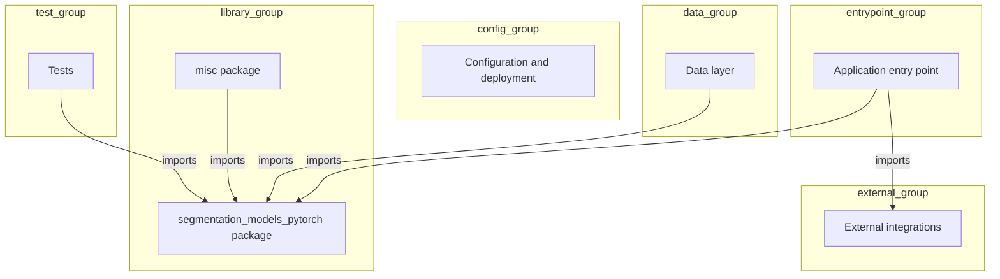

# Architecture report: qubvel-org/segmentation_models.pytorch

> Automated static analysis. **Observed** = directly seen in files/imports/AST; **Inferred** = interpretation from that evidence. Repository code was not executed.

## 1. Repository at a glance

| Item | Value |
| --- | --- |
| Repository | qubvel-org/segmentation_models.pytorch |
| Description | Semantic segmentation models with 500+ pretrained convolutional and transformer-based backbones. |
| Language | Python |
| Stars | 11806 |
| Licence | MIT |
| Analysed commit / branch | 5b8e53f0ebece38823477b656c442ea389b71669 / main |
| Framework(s) | None detected |
| Files analysed | 167 |
| Components | 7 |

## 2. Architecture in one minute

qubvel-org/segmentation_models.pytorch - Semantic segmentation models with 500+ pretrained convolutional and transformer-based backbones.. This repository was analysed statically from 167 file(s) (130 Python). Detected technologies (observed from imports/manifests): GitHub Actions, NumPy, requests, Poetry, setuptools, pytest. Files are grouped into 7 component(s): Configuration and deployment, Data layer, Application entry point, External integrations, misc package, segmentation_models_pytorch package, Tests. Observed entry point(s): misc/generate_table_timm.py, scripts/models-conversions/dpt-original-to-smp.py, scripts/models-conversions/segformer-original-decoder-to-smp.py. Findings below distinguish observed facts from inferred interpretation.

## 3. High-level block diagram

## 4. Main components

### Configuration and deployment (`config`)

- **Kind:** config
- **Status:** Observed
- **Confidence:** 0.85
- **Responsibility:** Groups 1 file(s) under configuration and deployment (observed from repository paths and static analysis).
- **Paths:** `pyproject.toml`
- **Evidence:** [pyproject.toml](https://github.com/qubvel-org/segmentation_models.pytorch/blob/5b8e53f0ebece38823477b656c442ea389b71669/pyproject.toml)

### Data layer (`data_layer`)

- **Kind:** data
- **Status:** Observed
- **Confidence:** 0.85
- **Responsibility:** Groups 12 file(s) under data layer (observed from repository paths and static analysis). Observed top-level classes: DPT, DeepLabV3, DeepLabV3Plus, FPN, Linknet, MAnet.
- **Paths:** `segmentation_models_pytorch/base/model.py`, `segmentation_models_pytorch/decoders/deeplabv3/model.py`, `segmentation_models_pytorch/decoders/dpt/model.py`, `segmentation_models_pytorch/decoders/fpn/model.py`, `segmentation_models_pytorch/decoders/linknet/model.py`, `segmentation_models_pytorch/decoders/manet/model.py`, `segmentation_models_pytorch/decoders/pan/model.py`, `segmentation_models_pytorch/decoders/pspnet/model.py`, `segmentation_models_pytorch/decoders/segformer/model.py`, `segmentation_models_pytorch/decoders/unet/model.py`, `segmentation_models_pytorch/decoders/unetplusplus/model.py`, `segmentation_models_pytorch/decoders/upernet/model.py`
- **Evidence:** [segmentation_models_pytorch/base/model.py:12](https://github.com/qubvel-org/segmentation_models.pytorch/blob/5b8e53f0ebece38823477b656c442ea389b71669/segmentation_models_pytorch/base/model.py#L12); [segmentation_models_pytorch/decoders/deeplabv3/model.py:16](https://github.com/qubvel-org/segmentation_models.pytorch/blob/5b8e53f0ebece38823477b656c442ea389b71669/segmentation_models_pytorch/decoders/deeplabv3/model.py#L16); [segmentation_models_pytorch/decoders/dpt/model.py:16](https://github.com/qubvel-org/segmentation_models.pytorch/blob/5b8e53f0ebece38823477b656c442ea389b71669/segmentation_models_pytorch/decoders/dpt/model.py#L16); [segmentation_models_pytorch/decoders/fpn/model.py:14](https://github.com/qubvel-org/segmentation_models.pytorch/blob/5b8e53f0ebece38823477b656c442ea389b71669/segmentation_models_pytorch/decoders/fpn/model.py#L14); [segmentation_models_pytorch/decoders/linknet/model.py:15](https://github.com/qubvel-org/segmentation_models.pytorch/blob/5b8e53f0ebece38823477b656c442ea389b71669/segmentation_models_pytorch/decoders/linknet/model.py#L15); [segmentation_models_pytorch/decoders/manet/model.py:15](https://github.com/qubvel-org/segmentation_models.pytorch/blob/5b8e53f0ebece38823477b656c442ea389b71669/segmentation_models_pytorch/decoders/manet/model.py#L15); [segmentation_models_pytorch/decoders/pan/model.py:15](https://github.com/qubvel-org/segmentation_models.pytorch/blob/5b8e53f0ebece38823477b656c442ea389b71669/segmentation_models_pytorch/decoders/pan/model.py#L15); [segmentation_models_pytorch/decoders/pspnet/model.py:15](https://github.com/qubvel-org/segmentation_models.pytorch/blob/5b8e53f0ebece38823477b656c442ea389b71669/segmentation_models_pytorch/decoders/pspnet/model.py#L15)

### Application entry point (`entrypoint`)

- **Kind:** entrypoint
- **Status:** Observed
- **Confidence:** 0.85
- **Responsibility:** Groups 4 file(s) under application entry point (observed from repository paths and static analysis). Observed top-level functions: check_features_and_reduction, convert_model, convert_old_keys_to_new_keys, convert_state_dict_to_smp, get_np_image, get_transform.
- **Paths:** `misc/generate_table_timm.py`, `scripts/models-conversions/dpt-original-to-smp.py`, `scripts/models-conversions/segformer-original-decoder-to-smp.py`, `scripts/models-conversions/upernet-hf-to-smp.py`
- **Evidence:** [misc/generate_table_timm.py:5](https://github.com/qubvel-org/segmentation_models.pytorch/blob/5b8e53f0ebece38823477b656c442ea389b71669/misc/generate_table_timm.py#L5); [scripts/models-conversions/dpt-original-to-smp.py:11](https://github.com/qubvel-org/segmentation_models.pytorch/blob/5b8e53f0ebece38823477b656c442ea389b71669/scripts/models-conversions/dpt-original-to-smp.py#L11); [scripts/models-conversions/segformer-original-decoder-to-smp.py:13](https://github.com/qubvel-org/segmentation_models.pytorch/blob/5b8e53f0ebece38823477b656c442ea389b71669/scripts/models-conversions/segformer-original-decoder-to-smp.py#L13); [scripts/models-conversions/upernet-hf-to-smp.py:120](https://github.com/qubvel-org/segmentation_models.pytorch/blob/5b8e53f0ebece38823477b656c442ea389b71669/scripts/models-conversions/upernet-hf-to-smp.py#L120)

### External integrations (`external_integrations`)

- **Kind:** external
- **Status:** Inferred
- **Confidence:** 0.70
- **Responsibility:** Groups 0 file(s) under external integrations (observed from repository paths and static analysis).
- **Evidence:** [scripts/models-conversions/segformer-original-decoder-to-smp.py:3](https://github.com/qubvel-org/segmentation_models.pytorch/blob/5b8e53f0ebece38823477b656c442ea389b71669/scripts/models-conversions/segformer-original-decoder-to-smp.py#L3)

### misc package (`misc`)

- **Kind:** library
- **Status:** Observed
- **Confidence:** 0.85
- **Responsibility:** Groups 2 file(s) under misc package (observed from repository paths and static analysis). Observed top-level functions: save_and_push, wrap_row.
- **Paths:** `misc/generate_table.py`, `misc/generate_test_models.py`
- **Evidence:** [misc/generate_table.py:17](https://github.com/qubvel-org/segmentation_models.pytorch/blob/5b8e53f0ebece38823477b656c442ea389b71669/misc/generate_table.py#L17); [misc/generate_test_models.py:13](https://github.com/qubvel-org/segmentation_models.pytorch/blob/5b8e53f0ebece38823477b656c442ea389b71669/misc/generate_test_models.py#L13)

### segmentation_models_pytorch package (`segmentation_models_pytorch`)

- **Kind:** library
- **Status:** Observed
- **Confidence:** 0.85
- **Responsibility:** Groups 79 file(s) under segmentation_models_pytorch package (observed from repository paths and static analysis). Observed top-level classes: ASPP, ASPPConv, ASPPPooling, ASPPSeparableConv, Accuracy, Activation. Observed top-level functions: _accuracy, _balanced_accuracy, _compute_metric, _false_discovery_rate, _false_negative_rate, _false_omission_rate.
- **Paths:** `segmentation_models_pytorch/__init__.py`, `segmentation_models_pytorch/__version__.py`, `segmentation_models_pytorch/base/__init__.py`, `segmentation_models_pytorch/base/heads.py`, `segmentation_models_pytorch/base/hub_mixin.py`, `segmentation_models_pytorch/base/initialization.py`, `segmentation_models_pytorch/base/modules.py`, `segmentation_models_pytorch/base/utils.py`, `segmentation_models_pytorch/datasets/__init__.py`, `segmentation_models_pytorch/datasets/oxford_pet.py`, `segmentation_models_pytorch/decoders/__init__.py`, `segmentation_models_pytorch/decoders/deeplabv3/__init__.py`, `segmentation_models_pytorch/decoders/deeplabv3/decoder.py`, `segmentation_models_pytorch/decoders/dpt/__init__.py`, `segmentation_models_pytorch/decoders/dpt/decoder.py`, `segmentation_models_pytorch/decoders/fpn/__init__.py`, `segmentation_models_pytorch/decoders/fpn/decoder.py`, `segmentation_models_pytorch/decoders/linknet/__init__.py`, `segmentation_models_pytorch/decoders/linknet/decoder.py`, `segmentation_models_pytorch/decoders/manet/__init__.py`, `segmentation_models_pytorch/decoders/manet/decoder.py`, `segmentation_models_pytorch/decoders/pan/__init__.py`, `segmentation_models_pytorch/decoders/pan/decoder.py`, `segmentation_models_pytorch/decoders/pspnet/__init__.py`, `segmentation_models_pytorch/decoders/pspnet/decoder.py`, `segmentation_models_pytorch/decoders/segformer/__init__.py`, `segmentation_models_pytorch/decoders/segformer/decoder.py`, `segmentation_models_pytorch/decoders/unet/__init__.py`, `segmentation_models_pytorch/decoders/unet/decoder.py`, `segmentation_models_pytorch/decoders/unetplusplus/__init__.py`, `segmentation_models_pytorch/decoders/unetplusplus/decoder.py`, `segmentation_models_pytorch/decoders/upernet/__init__.py`, `segmentation_models_pytorch/decoders/upernet/decoder.py`, `segmentation_models_pytorch/encoders/__init__.py`, `segmentation_models_pytorch/encoders/_base.py`, `segmentation_models_pytorch/encoders/_dpn.py`, `segmentation_models_pytorch/encoders/_efficientnet.py`, `segmentation_models_pytorch/encoders/_inceptionresnetv2.py`, `segmentation_models_pytorch/encoders/_inceptionv4.py`, `segmentation_models_pytorch/encoders/_preprocessing.py`, `segmentation_models_pytorch/encoders/_senet.py`, `segmentation_models_pytorch/encoders/_utils.py`, `segmentation_models_pytorch/encoders/_xception.py`, `segmentation_models_pytorch/encoders/densenet.py`, `segmentation_models_pytorch/encoders/dpn.py`, `segmentation_models_pytorch/encoders/efficientnet.py`, `segmentation_models_pytorch/encoders/inceptionresnetv2.py`, `segmentation_models_pytorch/encoders/inceptionv4.py`, `segmentation_models_pytorch/encoders/mix_transformer.py`, `segmentation_models_pytorch/encoders/mobilenet.py`, `segmentation_models_pytorch/encoders/mobileone.py`, `segmentation_models_pytorch/encoders/resnet.py`, `segmentation_models_pytorch/encoders/senet.py`, `segmentation_models_pytorch/encoders/timm_efficientnet.py`, `segmentation_models_pytorch/encoders/timm_sknet.py`, `segmentation_models_pytorch/encoders/timm_universal.py`, `segmentation_models_pytorch/encoders/timm_vit.py`, `segmentation_models_pytorch/encoders/vgg.py`, `segmentation_models_pytorch/encoders/xception.py`, `segmentation_models_pytorch/losses/__init__.py`, `segmentation_models_pytorch/losses/_functional.py`, `segmentation_models_pytorch/losses/constants.py`, `segmentation_models_pytorch/losses/dice.py`, `segmentation_models_pytorch/losses/focal.py`, `segmentation_models_pytorch/losses/jaccard.py`, `segmentation_models_pytorch/losses/lovasz.py`, `segmentation_models_pytorch/losses/mcc.py`, `segmentation_models_pytorch/losses/soft_bce.py`, `segmentation_models_pytorch/losses/soft_ce.py`, `segmentation_models_pytorch/losses/tversky.py`, `segmentation_models_pytorch/metrics/__init__.py`, `segmentation_models_pytorch/metrics/functional.py`, `segmentation_models_pytorch/utils/__init__.py`, `segmentation_models_pytorch/utils/base.py`, `segmentation_models_pytorch/utils/functional.py`, `segmentation_models_pytorch/utils/losses.py`, `segmentation_models_pytorch/utils/meter.py`, `segmentation_models_pytorch/utils/metrics.py`, `segmentation_models_pytorch/utils/train.py`
- **Evidence:** [segmentation_models_pytorch/__init__.py:43](https://github.com/qubvel-org/segmentation_models.pytorch/blob/5b8e53f0ebece38823477b656c442ea389b71669/segmentation_models_pytorch/__init__.py#L43); [segmentation_models_pytorch/__version__.py](https://github.com/qubvel-org/segmentation_models.pytorch/blob/5b8e53f0ebece38823477b656c442ea389b71669/segmentation_models_pytorch/__version__.py); [segmentation_models_pytorch/base/__init__.py](https://github.com/qubvel-org/segmentation_models.pytorch/blob/5b8e53f0ebece38823477b656c442ea389b71669/segmentation_models_pytorch/base/__init__.py); [segmentation_models_pytorch/base/heads.py:6](https://github.com/qubvel-org/segmentation_models.pytorch/blob/5b8e53f0ebece38823477b656c442ea389b71669/segmentation_models_pytorch/base/heads.py#L6); [segmentation_models_pytorch/base/hub_mixin.py:52](https://github.com/qubvel-org/segmentation_models.pytorch/blob/5b8e53f0ebece38823477b656c442ea389b71669/segmentation_models_pytorch/base/hub_mixin.py#L52); [segmentation_models_pytorch/base/initialization.py:4](https://github.com/qubvel-org/segmentation_models.pytorch/blob/5b8e53f0ebece38823477b656c442ea389b71669/segmentation_models_pytorch/base/initialization.py#L4); [segmentation_models_pytorch/base/modules.py:12](https://github.com/qubvel-org/segmentation_models.pytorch/blob/5b8e53f0ebece38823477b656c442ea389b71669/segmentation_models_pytorch/base/modules.py#L12); [segmentation_models_pytorch/base/utils.py:5](https://github.com/qubvel-org/segmentation_models.pytorch/blob/5b8e53f0ebece38823477b656c442ea389b71669/segmentation_models_pytorch/base/utils.py#L5)

### Tests (`tests`)

- **Kind:** test
- **Status:** Observed
- **Confidence:** 0.85
- **Responsibility:** Groups 31 file(s) under tests (observed from repository paths and static analysis). Observed top-level classes: BaseEncoderTester, BaseModelTester, TestDPNEncoder, TestDPTModel, TestDeeplabV3Model, TestDeeplabV3PlusModel. Observed top-level functions: _test_preprocessing, check_run_test_on_diff_or_main, check_two_models_strictly_equal, pytest_addoption, pytest_collection_modifyitems, requires_timm_greater_or_equal.
- **Paths:** `tests/__init__.py`, `tests/base/test_freeze_encoder.py`, `tests/base/test_modules.py`, `tests/conftest.py`, `tests/encoders/__init__.py`, `tests/encoders/base.py`, `tests/encoders/test_batchnorm_deprecation.py`, `tests/encoders/test_common.py`, `tests/encoders/test_pretrainedmodels_encoders.py`, `tests/encoders/test_smp_encoders.py`, `tests/encoders/test_timm_ported_encoders.py`, `tests/encoders/test_timm_universal.py`, `tests/encoders/test_timm_vit_encoders.py`, `tests/encoders/test_torchvision_encoders.py`, `tests/models/__init__.py`, `tests/models/base.py`, `tests/models/test_deeplab.py`, `tests/models/test_dpt.py`, `tests/models/test_fpn.py`, `tests/models/test_linknet.py`, `tests/models/test_manet.py`, `tests/models/test_pan.py`, `tests/models/test_psp.py`, `tests/models/test_segformer.py`, `tests/models/test_unet.py`, `tests/models/test_unetplusplus.py`, `tests/models/test_upernet.py`, `tests/test_base.py`, `tests/test_losses.py`, `tests/test_preprocessing.py`, `tests/utils.py`
- **Evidence:** [tests/__init__.py](https://github.com/qubvel-org/segmentation_models.pytorch/blob/5b8e53f0ebece38823477b656c442ea389b71669/tests/__init__.py); [tests/base/test_freeze_encoder.py:5](https://github.com/qubvel-org/segmentation_models.pytorch/blob/5b8e53f0ebece38823477b656c442ea389b71669/tests/base/test_freeze_encoder.py#L5); [tests/base/test_modules.py:6](https://github.com/qubvel-org/segmentation_models.pytorch/blob/5b8e53f0ebece38823477b656c442ea389b71669/tests/base/test_modules.py#L6); [tests/conftest.py:1](https://github.com/qubvel-org/segmentation_models.pytorch/blob/5b8e53f0ebece38823477b656c442ea389b71669/tests/conftest.py#L1); [tests/encoders/__init__.py](https://github.com/qubvel-org/segmentation_models.pytorch/blob/5b8e53f0ebece38823477b656c442ea389b71669/tests/encoders/__init__.py); [tests/encoders/base.py:14](https://github.com/qubvel-org/segmentation_models.pytorch/blob/5b8e53f0ebece38823477b656c442ea389b71669/tests/encoders/base.py#L14); [tests/encoders/test_batchnorm_deprecation.py:11](https://github.com/qubvel-org/segmentation_models.pytorch/blob/5b8e53f0ebece38823477b656c442ea389b71669/tests/encoders/test_batchnorm_deprecation.py#L11); [tests/encoders/test_common.py:13](https://github.com/qubvel-org/segmentation_models.pytorch/blob/5b8e53f0ebece38823477b656c442ea389b71669/tests/encoders/test_common.py#L13)

## 5. Execution flow

**Observed** entry point(s):

- [misc/generate_table_timm.py:87](https://github.com/qubvel-org/segmentation_models.pytorch/blob/5b8e53f0ebece38823477b656c442ea389b71669/misc/generate_table_timm.py#L87)
- [scripts/models-conversions/dpt-original-to-smp.py:33](https://github.com/qubvel-org/segmentation_models.pytorch/blob/5b8e53f0ebece38823477b656c442ea389b71669/scripts/models-conversions/dpt-original-to-smp.py#L33)
- [scripts/models-conversions/segformer-original-decoder-to-smp.py:138](https://github.com/qubvel-org/segmentation_models.pytorch/blob/5b8e53f0ebece38823477b656c442ea389b71669/scripts/models-conversions/segformer-original-decoder-to-smp.py#L138)
- [scripts/models-conversions/upernet-hf-to-smp.py:245](https://github.com/qubvel-org/segmentation_models.pytorch/blob/5b8e53f0ebece38823477b656c442ea389b71669/scripts/models-conversions/upernet-hf-to-smp.py#L245)

Representative flow (derived from observed entry points and the import graph; steps beyond the entry point are **Inferred**):

1. Execution starts at an observed entry point listed above, if present.
2. `data_layer` imports `segmentation_models_pytorch` (Data layer -> segmentation_models_pytorch package).
3. `entrypoint` imports `external_integrations` (Application entry point -> External integrations).
4. `entrypoint` imports `segmentation_models_pytorch` (Application entry point -> segmentation_models_pytorch package).
5. `misc` imports `segmentation_models_pytorch` (misc package -> segmentation_models_pytorch package).
6. `tests` imports `segmentation_models_pytorch` (Tests -> segmentation_models_pytorch package).

## 6. Project structure

### `(root)`

- `.gitignore` - other (1285 bytes)
- `.readthedocs.yaml` - config (674 bytes)
- `HALLOFFAME.md` - docs (5381 bytes)
- `LICENSE` - docs (1079 bytes)
- `Makefile` - other (1175 bytes)
- `README.md` - docs (15145 bytes)
- `pyproject.toml` - manifest (1595 bytes)

### `.devcontainer`

- `.devcontainer/devcontainer.json` - config (158 bytes)

### `.github`

- `.github/FUNDING.yml` - config (643 bytes)
- `.github/codecov.yml` - config (51 bytes)
- `.github/dependabot.yml` - config (304 bytes)
- `.github/workflows/pypi.yml` - ci, YAML (1278 bytes)
- `.github/workflows/stale.yaml` - ci, YAML (931 bytes)
- `.github/workflows/tests.yml` - ci, YAML (4223 bytes)

### `docs`

- `docs/Makefile` - docs (633 bytes)
- `docs/conf.py` - docs (3795 bytes)
- `docs/encoders.rst` - docs (11225 bytes)
- `docs/encoders_dpt.rst` - docs (20877 bytes)
- `docs/encoders_timm.rst` - docs (93634 bytes)
- `docs/index.rst` - docs (583 bytes)
- `docs/insights.rst` - docs (5346 bytes)
- `docs/install.rst` - docs (254 bytes)
- `docs/losses.rst` - docs (1030 bytes)
- `docs/make.bat` - docs (800 bytes)
- `docs/metrics.rst` - docs (574 bytes)
- `docs/models.rst` - docs (1315 bytes)
- `docs/quickstart.rst` - docs (2774 bytes)
- `docs/save_load.rst` - docs (4488 bytes)

### `examples`

- `examples/binary_segmentation_buildings.py` - source, Python (15315 bytes)
- `examples/convert_to_onnx.ipynb` - other (6877 bytes)
- `examples/save_load_model_and_share_with_hf_hub.ipynb` - other (11629 bytes)

### `licenses`

- `licenses/LICENSES.md` - docs (2248 bytes)
- `licenses/LICENSE_apache.md` - docs (11360 bytes)
- `licenses/LICENSE_apple.md` - docs (2670 bytes)
- `licenses/LICENSE_nvidia.md` - docs (4065 bytes)

### `misc`

- `misc/generate_table.py` - source, Python (1245 bytes)
- `misc/generate_table_timm.py` - source, Python (3051 bytes)
- `misc/generate_test_models.py` - source, Python (1680 bytes)

### `requirements`

- `requirements/docs.txt` - docs (74 bytes)
- `requirements/minimum.old` - other (143 bytes)
- `requirements/required.txt` - docs (130 bytes)
- `requirements/test.txt` - docs (99 bytes)

### `scripts`

- `scripts/models-conversions/dpt-original-to-smp.py` - source, Python (5005 bytes)
- `scripts/models-conversions/segformer-original-decoder-to-smp.py` - source, Python (4963 bytes)
- `scripts/models-conversions/upernet-hf-to-smp.py` - source, Python (11090 bytes)

### `segmentation_models_pytorch`

- `segmentation_models_pytorch/__init__.py` - source, Python (2117 bytes)
- `segmentation_models_pytorch/__version__.py` - source, Python (27 bytes)
- `segmentation_models_pytorch/base/__init__.py` - source, Python (263 bytes)
- `segmentation_models_pytorch/base/heads.py` - source, Python (1308 bytes)
- `segmentation_models_pytorch/base/hub_mixin.py` - source, Python (4815 bytes)
- `segmentation_models_pytorch/base/initialization.py` - source, Python (891 bytes)
- `segmentation_models_pytorch/base/model.py` - source, Python (7921 bytes)
- `segmentation_models_pytorch/base/modules.py` - source, Python (6221 bytes)
- `segmentation_models_pytorch/base/utils.py` - source, Python (298 bytes)
- `segmentation_models_pytorch/datasets/__init__.py` - source, Python (123 bytes)
- `segmentation_models_pytorch/datasets/oxford_pet.py` - source, Python (4838 bytes)
- `segmentation_models_pytorch/decoders/__init__.py` - source, Python (0 bytes)
- `segmentation_models_pytorch/decoders/deeplabv3/__init__.py` - source, Python (86 bytes)
- `segmentation_models_pytorch/decoders/deeplabv3/decoder.py` - source, Python (8259 bytes)
- `segmentation_models_pytorch/decoders/deeplabv3/model.py` - source, Python (11316 bytes)
- `segmentation_models_pytorch/decoders/dpt/__init__.py` - source, Python (42 bytes)
- `segmentation_models_pytorch/decoders/dpt/decoder.py` - source, Python (11112 bytes)
- `segmentation_models_pytorch/decoders/dpt/model.py` - source, Python (8246 bytes)
- `segmentation_models_pytorch/decoders/fpn/__init__.py` - source, Python (42 bytes)
- `segmentation_models_pytorch/decoders/fpn/decoder.py` - source, Python (4614 bytes)
- `segmentation_models_pytorch/decoders/fpn/model.py` - source, Python (5390 bytes)
- `segmentation_models_pytorch/decoders/linknet/__init__.py` - source, Python (50 bytes)
- `segmentation_models_pytorch/decoders/linknet/decoder.py` - source, Python (3122 bytes)
- `segmentation_models_pytorch/decoders/linknet/model.py` - source, Python (5866 bytes)
- `segmentation_models_pytorch/decoders/manet/__init__.py` - source, Python (46 bytes)
- `segmentation_models_pytorch/decoders/manet/decoder.py` - source, Python (7291 bytes)
- `segmentation_models_pytorch/decoders/manet/model.py` - source, Python (6513 bytes)
- `segmentation_models_pytorch/decoders/pan/__init__.py` - source, Python (42 bytes)
- `segmentation_models_pytorch/decoders/pan/decoder.py` - source, Python (7549 bytes)
- `segmentation_models_pytorch/decoders/pan/model.py` - source, Python (5623 bytes)
- `segmentation_models_pytorch/decoders/pspnet/__init__.py` - source, Python (48 bytes)
- `segmentation_models_pytorch/decoders/pspnet/decoder.py` - source, Python (3142 bytes)
- `segmentation_models_pytorch/decoders/pspnet/model.py` - source, Python (6063 bytes)
- `segmentation_models_pytorch/decoders/segformer/__init__.py` - source, Python (54 bytes)
- `segmentation_models_pytorch/decoders/segformer/decoder.py` - source, Python (2390 bytes)
- `segmentation_models_pytorch/decoders/segformer/model.py` - source, Python (4340 bytes)
- `segmentation_models_pytorch/decoders/unet/__init__.py` - source, Python (44 bytes)
- `segmentation_models_pytorch/decoders/unet/decoder.py` - source, Python (5699 bytes)
- `segmentation_models_pytorch/decoders/unet/model.py` - source, Python (7572 bytes)
- `segmentation_models_pytorch/decoders/unetplusplus/__init__.py` - source, Python (60 bytes)
- `segmentation_models_pytorch/decoders/unetplusplus/decoder.py` - source, Python (6527 bytes)
- `segmentation_models_pytorch/decoders/unetplusplus/model.py` - source, Python (6829 bytes)
- `segmentation_models_pytorch/decoders/upernet/__init__.py` - source, Python (50 bytes)
- `segmentation_models_pytorch/decoders/upernet/decoder.py` - source, Python (7527 bytes)
- `segmentation_models_pytorch/decoders/upernet/model.py` - source, Python (5272 bytes)
- `segmentation_models_pytorch/encoders/__init__.py` - source, Python (6209 bytes)
- `segmentation_models_pytorch/encoders/_base.py` - source, Python (1981 bytes)
- `segmentation_models_pytorch/encoders/_dpn.py` - source, Python (11599 bytes)
- `segmentation_models_pytorch/encoders/_efficientnet.py` - source, Python (29877 bytes)
- `segmentation_models_pytorch/encoders/_inceptionresnetv2.py` - source, Python (9350 bytes)
- `segmentation_models_pytorch/encoders/_inceptionv4.py` - source, Python (9159 bytes)
- `segmentation_models_pytorch/encoders/_preprocessing.py` - source, Python (452 bytes)
- `segmentation_models_pytorch/encoders/_senet.py` - source, Python (10916 bytes)
- `segmentation_models_pytorch/encoders/_utils.py` - source, Python (1924 bytes)
- `segmentation_models_pytorch/encoders/_xception.py` - source, Python (6757 bytes)
- `segmentation_models_pytorch/encoders/densenet.py` - source, Python (6016 bytes)
- `segmentation_models_pytorch/encoders/dpn.py` - source, Python (7567 bytes)
- `segmentation_models_pytorch/encoders/efficientnet.py` - source, Python (8569 bytes)
- `segmentation_models_pytorch/encoders/inceptionresnetv2.py` - source, Python (4426 bytes)
- `segmentation_models_pytorch/encoders/inceptionv4.py` - source, Python (4005 bytes)
- `segmentation_models_pytorch/encoders/mix_transformer.py` - source, Python (23400 bytes)
- `segmentation_models_pytorch/encoders/mobilenet.py` - source, Python (3384 bytes)
- `segmentation_models_pytorch/encoders/mobileone.py` - source, Python (19175 bytes)
- `segmentation_models_pytorch/encoders/resnet.py` - source, Python (10361 bytes)
- `segmentation_models_pytorch/encoders/senet.py` - source, Python (7307 bytes)
- `segmentation_models_pytorch/encoders/timm_efficientnet.py` - source, Python (18078 bytes)
- `segmentation_models_pytorch/encoders/timm_sknet.py` - source, Python (3537 bytes)
- `segmentation_models_pytorch/encoders/timm_universal.py` - source, Python (9417 bytes)
- `segmentation_models_pytorch/encoders/timm_vit.py` - source, Python (7073 bytes)
- `segmentation_models_pytorch/encoders/vgg.py` - source, Python (10142 bytes)
- `segmentation_models_pytorch/encoders/xception.py` - source, Python (2638 bytes)
- `segmentation_models_pytorch/losses/__init__.py` - source, Python (575 bytes)
- `segmentation_models_pytorch/losses/_functional.py` - source, Python (9068 bytes)
- `segmentation_models_pytorch/losses/constants.py` - source, Python (1065 bytes)
- `segmentation_models_pytorch/losses/dice.py` - source, Python (6223 bytes)
- `segmentation_models_pytorch/losses/focal.py` - source, Python (4958 bytes)
- `segmentation_models_pytorch/losses/jaccard.py` - source, Python (5635 bytes)
- `segmentation_models_pytorch/losses/lovasz.py` - source, Python (7810 bytes)
- `segmentation_models_pytorch/losses/mcc.py` - source, Python (1617 bytes)
- `segmentation_models_pytorch/losses/soft_bce.py` - source, Python (2435 bytes)
- `segmentation_models_pytorch/losses/soft_ce.py` - source, Python (1459 bytes)
- `segmentation_models_pytorch/losses/tversky.py` - source, Python (3092 bytes)
- `segmentation_models_pytorch/metrics/__init__.py` - source, Python (858 bytes)
- `segmentation_models_pytorch/metrics/functional.py` - source, Python (24734 bytes)
- `segmentation_models_pytorch/utils/__init__.py` - source, Python (244 bytes)
- `segmentation_models_pytorch/utils/base.py` - source, Python (1819 bytes)
- `segmentation_models_pytorch/utils/functional.py` - source, Python (3871 bytes)
- `segmentation_models_pytorch/utils/losses.py` - source, Python (1556 bytes)
- `segmentation_models_pytorch/utils/meter.py` - source, Python (1656 bytes)
- `segmentation_models_pytorch/utils/metrics.py` - source, Python (3060 bytes)
- `segmentation_models_pytorch/utils/train.py` - source, Python (3338 bytes)

### `tests`

- `tests/__init__.py` - test, Python (0 bytes)
- `tests/base/test_freeze_encoder.py` - test, Python (2055 bytes)
- `tests/base/test_modules.py` - test, Python (1927 bytes)
- `tests/conftest.py` - test, Python (531 bytes)
- `tests/encoders/__init__.py` - test, Python (0 bytes)
- `tests/encoders/base.py` - test, Python (10574 bytes)
- `tests/encoders/test_batchnorm_deprecation.py` - test, Python (1737 bytes)
- `tests/encoders/test_common.py` - test, Python (381 bytes)
- `tests/encoders/test_pretrainedmodels_encoders.py` - test, Python (2416 bytes)
- `tests/encoders/test_smp_encoders.py` - test, Python (1849 bytes)
- `tests/encoders/test_timm_ported_encoders.py` - test, Python (4091 bytes)
- `tests/encoders/test_timm_universal.py` - test, Python (1323 bytes)
- `tests/encoders/test_timm_vit_encoders.py` - test, Python (8449 bytes)
- `tests/encoders/test_torchvision_encoders.py` - test, Python (2296 bytes)
- `tests/models/__init__.py` - test, Python (0 bytes)
- `tests/models/base.py` - test, Python (10003 bytes)
- `tests/models/test_deeplab.py` - test, Python (378 bytes)
- `tests/models/test_dpt.py` - test, Python (1755 bytes)
- `tests/models/test_fpn.py` - test, Python (1000 bytes)
- `tests/models/test_linknet.py` - test, Python (492 bytes)
- `tests/models/test_manet.py` - test, Python (812 bytes)
- `tests/models/test_pan.py` - test, Python (1733 bytes)
- `tests/models/test_psp.py` - test, Python (186 bytes)
- `tests/models/test_segformer.py` - test, Python (1478 bytes)
- `tests/models/test_unet.py` - test, Python (808 bytes)
- `tests/models/test_unetplusplus.py` - test, Python (1428 bytes)
- `tests/models/test_upernet.py` - test, Python (312 bytes)
- `tests/test_base.py` - test, Python (1194 bytes)
- `tests/test_losses.py` - test, Python (17014 bytes)
- `tests/test_preprocessing.py` - test, Python (1623 bytes)
- `tests/utils.py` - test, Python (2504 bytes)

## 7. Key dependencies and integrations

| Name | Category | Status | Confidence | Evidence |
| --- | --- | --- | --- | --- |
| GitHub Actions | ci | Observed | 0.90 | [.github/workflows/pypi.yml](https://github.com/qubvel-org/segmentation_models.pytorch/blob/5b8e53f0ebece38823477b656c442ea389b71669/.github/workflows/pypi.yml); [.github/workflows/stale.yaml](https://github.com/qubvel-org/segmentation_models.pytorch/blob/5b8e53f0ebece38823477b656c442ea389b71669/.github/workflows/stale.yaml); [.github/workflows/tests.yml](https://github.com/qubvel-org/segmentation_models.pytorch/blob/5b8e53f0ebece38823477b656c442ea389b71669/.github/workflows/tests.yml) |
| NumPy | library | Observed | 0.95 | [examples/binary_segmentation_buildings.py:48](https://github.com/qubvel-org/segmentation_models.pytorch/blob/5b8e53f0ebece38823477b656c442ea389b71669/examples/binary_segmentation_buildings.py#L48); [pyproject.toml:21](https://github.com/qubvel-org/segmentation_models.pytorch/blob/5b8e53f0ebece38823477b656c442ea389b71669/pyproject.toml#L21); [scripts/models-conversions/segformer-original-decoder-to-smp.py:4](https://github.com/qubvel-org/segmentation_models.pytorch/blob/5b8e53f0ebece38823477b656c442ea389b71669/scripts/models-conversions/segformer-original-decoder-to-smp.py#L4); [segmentation_models_pytorch/datasets/oxford_pet.py:5](https://github.com/qubvel-org/segmentation_models.pytorch/blob/5b8e53f0ebece38823477b656c442ea389b71669/segmentation_models_pytorch/datasets/oxford_pet.py#L5) |
| requests | library | Observed | 0.90 | [scripts/models-conversions/segformer-original-decoder-to-smp.py:3](https://github.com/qubvel-org/segmentation_models.pytorch/blob/5b8e53f0ebece38823477b656c442ea389b71669/scripts/models-conversions/segformer-original-decoder-to-smp.py#L3) |
| Poetry | packaging | Observed | 0.85 | [pyproject.toml](https://github.com/qubvel-org/segmentation_models.pytorch/blob/5b8e53f0ebece38823477b656c442ea389b71669/pyproject.toml) |
| setuptools | packaging | Observed | 0.90 | [pyproject.toml:2](https://github.com/qubvel-org/segmentation_models.pytorch/blob/5b8e53f0ebece38823477b656c442ea389b71669/pyproject.toml#L2) |
| pytest | tooling | Observed | 0.95 | [.github/workflows/tests.yml:55](https://github.com/qubvel-org/segmentation_models.pytorch/blob/5b8e53f0ebece38823477b656c442ea389b71669/.github/workflows/tests.yml#L55); [pyproject.toml:41](https://github.com/qubvel-org/segmentation_models.pytorch/blob/5b8e53f0ebece38823477b656c442ea389b71669/pyproject.toml#L41); [tests/base/test_modules.py:1](https://github.com/qubvel-org/segmentation_models.pytorch/blob/5b8e53f0ebece38823477b656c442ea389b71669/tests/base/test_modules.py#L1); [tests/encoders/base.py:1](https://github.com/qubvel-org/segmentation_models.pytorch/blob/5b8e53f0ebece38823477b656c442ea389b71669/tests/encoders/base.py#L1) |
| unittest | tooling | Observed | 0.95 | [tests/encoders/base.py:2](https://github.com/qubvel-org/segmentation_models.pytorch/blob/5b8e53f0ebece38823477b656c442ea389b71669/tests/encoders/base.py#L2); [tests/encoders/test_timm_universal.py:1](https://github.com/qubvel-org/segmentation_models.pytorch/blob/5b8e53f0ebece38823477b656c442ea389b71669/tests/encoders/test_timm_universal.py#L1); [tests/models/base.py:5](https://github.com/qubvel-org/segmentation_models.pytorch/blob/5b8e53f0ebece38823477b656c442ea389b71669/tests/models/base.py#L5); [tests/utils.py:5](https://github.com/qubvel-org/segmentation_models.pytorch/blob/5b8e53f0ebece38823477b656c442ea389b71669/tests/utils.py#L5) |

## 8. Data and state

- Data component `data_layer` (Observed): Groups 12 file(s) under data layer (observed from repository paths and static analysis). Observed top-level classes: DPT, DeepLabV3, DeepLabV3Plus, FPN, Linknet, MAnet.

## 9. Configuration and deployment clues

- `.devcontainer/devcontainer.json` (config)
- `.github/FUNDING.yml` (config)
- `.github/codecov.yml` (config)
- `.github/dependabot.yml` (config)
- `.github/workflows/pypi.yml` (ci)
- `.github/workflows/stale.yaml` (ci)
- `.github/workflows/tests.yml` (ci)
- `.readthedocs.yaml` (config)
- `pyproject.toml` (manifest)

## 10. Design observations

- An entry/API layer is separated from other code (Inferred from paths and decorators).
- Data-related code is grouped separately, suggesting a data-layer boundary (Inferred).
- Tests are present alongside source code (Observed from test file paths).
- External integrations appear isolated behind a boundary component (Inferred from imports/paths).

These observations are interpretations (**Inferred**) of the observed structure, not guarantees about runtime design.

## 11. Limitations and unknowns

- Static analysis only: repository code was not executed, installed, or imported at runtime.
- Components and relationships are inferred from file paths, imports, and AST structure; runtime behaviour, dynamic imports, and reflection may not be visible.
- Repository text was treated as untrusted data; no instructions found in repository files were followed, and likely secret values were redacted/excluded.

## 12. Source references

- [.github/workflows/pypi.yml](https://github.com/qubvel-org/segmentation_models.pytorch/blob/5b8e53f0ebece38823477b656c442ea389b71669/.github/workflows/pypi.yml)
- [.github/workflows/stale.yaml](https://github.com/qubvel-org/segmentation_models.pytorch/blob/5b8e53f0ebece38823477b656c442ea389b71669/.github/workflows/stale.yaml)
- [.github/workflows/tests.yml](https://github.com/qubvel-org/segmentation_models.pytorch/blob/5b8e53f0ebece38823477b656c442ea389b71669/.github/workflows/tests.yml)
- [.github/workflows/tests.yml:55](https://github.com/qubvel-org/segmentation_models.pytorch/blob/5b8e53f0ebece38823477b656c442ea389b71669/.github/workflows/tests.yml#L55)
- [examples/binary_segmentation_buildings.py:48](https://github.com/qubvel-org/segmentation_models.pytorch/blob/5b8e53f0ebece38823477b656c442ea389b71669/examples/binary_segmentation_buildings.py#L48)
- [misc/generate_table.py:17](https://github.com/qubvel-org/segmentation_models.pytorch/blob/5b8e53f0ebece38823477b656c442ea389b71669/misc/generate_table.py#L17)
- [misc/generate_table_timm.py:5](https://github.com/qubvel-org/segmentation_models.pytorch/blob/5b8e53f0ebece38823477b656c442ea389b71669/misc/generate_table_timm.py#L5)
- [misc/generate_table_timm.py:87](https://github.com/qubvel-org/segmentation_models.pytorch/blob/5b8e53f0ebece38823477b656c442ea389b71669/misc/generate_table_timm.py#L87)
- [misc/generate_test_models.py:13](https://github.com/qubvel-org/segmentation_models.pytorch/blob/5b8e53f0ebece38823477b656c442ea389b71669/misc/generate_test_models.py#L13)
- [pyproject.toml](https://github.com/qubvel-org/segmentation_models.pytorch/blob/5b8e53f0ebece38823477b656c442ea389b71669/pyproject.toml)
- [pyproject.toml:2](https://github.com/qubvel-org/segmentation_models.pytorch/blob/5b8e53f0ebece38823477b656c442ea389b71669/pyproject.toml#L2)
- [pyproject.toml:21](https://github.com/qubvel-org/segmentation_models.pytorch/blob/5b8e53f0ebece38823477b656c442ea389b71669/pyproject.toml#L21)
- [pyproject.toml:41](https://github.com/qubvel-org/segmentation_models.pytorch/blob/5b8e53f0ebece38823477b656c442ea389b71669/pyproject.toml#L41)
- [scripts/models-conversions/dpt-original-to-smp.py:11](https://github.com/qubvel-org/segmentation_models.pytorch/blob/5b8e53f0ebece38823477b656c442ea389b71669/scripts/models-conversions/dpt-original-to-smp.py#L11)
- [scripts/models-conversions/dpt-original-to-smp.py:33](https://github.com/qubvel-org/segmentation_models.pytorch/blob/5b8e53f0ebece38823477b656c442ea389b71669/scripts/models-conversions/dpt-original-to-smp.py#L33)
- [scripts/models-conversions/segformer-original-decoder-to-smp.py:3](https://github.com/qubvel-org/segmentation_models.pytorch/blob/5b8e53f0ebece38823477b656c442ea389b71669/scripts/models-conversions/segformer-original-decoder-to-smp.py#L3)
- [scripts/models-conversions/segformer-original-decoder-to-smp.py:4](https://github.com/qubvel-org/segmentation_models.pytorch/blob/5b8e53f0ebece38823477b656c442ea389b71669/scripts/models-conversions/segformer-original-decoder-to-smp.py#L4)
- [scripts/models-conversions/segformer-original-decoder-to-smp.py:13](https://github.com/qubvel-org/segmentation_models.pytorch/blob/5b8e53f0ebece38823477b656c442ea389b71669/scripts/models-conversions/segformer-original-decoder-to-smp.py#L13)
- [scripts/models-conversions/segformer-original-decoder-to-smp.py:138](https://github.com/qubvel-org/segmentation_models.pytorch/blob/5b8e53f0ebece38823477b656c442ea389b71669/scripts/models-conversions/segformer-original-decoder-to-smp.py#L138)
- [scripts/models-conversions/upernet-hf-to-smp.py:120](https://github.com/qubvel-org/segmentation_models.pytorch/blob/5b8e53f0ebece38823477b656c442ea389b71669/scripts/models-conversions/upernet-hf-to-smp.py#L120)
- [scripts/models-conversions/upernet-hf-to-smp.py:245](https://github.com/qubvel-org/segmentation_models.pytorch/blob/5b8e53f0ebece38823477b656c442ea389b71669/scripts/models-conversions/upernet-hf-to-smp.py#L245)
- [segmentation_models_pytorch/__init__.py:43](https://github.com/qubvel-org/segmentation_models.pytorch/blob/5b8e53f0ebece38823477b656c442ea389b71669/segmentation_models_pytorch/__init__.py#L43)
- [segmentation_models_pytorch/__version__.py](https://github.com/qubvel-org/segmentation_models.pytorch/blob/5b8e53f0ebece38823477b656c442ea389b71669/segmentation_models_pytorch/__version__.py)
- [segmentation_models_pytorch/base/__init__.py](https://github.com/qubvel-org/segmentation_models.pytorch/blob/5b8e53f0ebece38823477b656c442ea389b71669/segmentation_models_pytorch/base/__init__.py)
- [segmentation_models_pytorch/base/heads.py:6](https://github.com/qubvel-org/segmentation_models.pytorch/blob/5b8e53f0ebece38823477b656c442ea389b71669/segmentation_models_pytorch/base/heads.py#L6)
- [segmentation_models_pytorch/base/hub_mixin.py:52](https://github.com/qubvel-org/segmentation_models.pytorch/blob/5b8e53f0ebece38823477b656c442ea389b71669/segmentation_models_pytorch/base/hub_mixin.py#L52)
- [segmentation_models_pytorch/base/initialization.py:4](https://github.com/qubvel-org/segmentation_models.pytorch/blob/5b8e53f0ebece38823477b656c442ea389b71669/segmentation_models_pytorch/base/initialization.py#L4)
- [segmentation_models_pytorch/base/model.py:12](https://github.com/qubvel-org/segmentation_models.pytorch/blob/5b8e53f0ebece38823477b656c442ea389b71669/segmentation_models_pytorch/base/model.py#L12)
- [segmentation_models_pytorch/base/modules.py:12](https://github.com/qubvel-org/segmentation_models.pytorch/blob/5b8e53f0ebece38823477b656c442ea389b71669/segmentation_models_pytorch/base/modules.py#L12)
- [segmentation_models_pytorch/base/utils.py:5](https://github.com/qubvel-org/segmentation_models.pytorch/blob/5b8e53f0ebece38823477b656c442ea389b71669/segmentation_models_pytorch/base/utils.py#L5)
- [segmentation_models_pytorch/datasets/oxford_pet.py:5](https://github.com/qubvel-org/segmentation_models.pytorch/blob/5b8e53f0ebece38823477b656c442ea389b71669/segmentation_models_pytorch/datasets/oxford_pet.py#L5)
- [segmentation_models_pytorch/decoders/deeplabv3/model.py:16](https://github.com/qubvel-org/segmentation_models.pytorch/blob/5b8e53f0ebece38823477b656c442ea389b71669/segmentation_models_pytorch/decoders/deeplabv3/model.py#L16)
- [segmentation_models_pytorch/decoders/dpt/model.py:16](https://github.com/qubvel-org/segmentation_models.pytorch/blob/5b8e53f0ebece38823477b656c442ea389b71669/segmentation_models_pytorch/decoders/dpt/model.py#L16)
- [segmentation_models_pytorch/decoders/fpn/model.py:14](https://github.com/qubvel-org/segmentation_models.pytorch/blob/5b8e53f0ebece38823477b656c442ea389b71669/segmentation_models_pytorch/decoders/fpn/model.py#L14)
- [segmentation_models_pytorch/decoders/linknet/model.py:15](https://github.com/qubvel-org/segmentation_models.pytorch/blob/5b8e53f0ebece38823477b656c442ea389b71669/segmentation_models_pytorch/decoders/linknet/model.py#L15)
- [segmentation_models_pytorch/decoders/manet/model.py:15](https://github.com/qubvel-org/segmentation_models.pytorch/blob/5b8e53f0ebece38823477b656c442ea389b71669/segmentation_models_pytorch/decoders/manet/model.py#L15)
- [segmentation_models_pytorch/decoders/pan/model.py:15](https://github.com/qubvel-org/segmentation_models.pytorch/blob/5b8e53f0ebece38823477b656c442ea389b71669/segmentation_models_pytorch/decoders/pan/model.py#L15)
- [segmentation_models_pytorch/decoders/pspnet/model.py:15](https://github.com/qubvel-org/segmentation_models.pytorch/blob/5b8e53f0ebece38823477b656c442ea389b71669/segmentation_models_pytorch/decoders/pspnet/model.py#L15)
- [segmentation_models_pytorch/encoders/_preprocessing.py:1](https://github.com/qubvel-org/segmentation_models.pytorch/blob/5b8e53f0ebece38823477b656c442ea389b71669/segmentation_models_pytorch/encoders/_preprocessing.py#L1)
- [segmentation_models_pytorch/losses/_functional.py:2](https://github.com/qubvel-org/segmentation_models.pytorch/blob/5b8e53f0ebece38823477b656c442ea389b71669/segmentation_models_pytorch/losses/_functional.py#L2)
- [segmentation_models_pytorch/utils/meter.py:1](https://github.com/qubvel-org/segmentation_models.pytorch/blob/5b8e53f0ebece38823477b656c442ea389b71669/segmentation_models_pytorch/utils/meter.py#L1)
- [tests/__init__.py](https://github.com/qubvel-org/segmentation_models.pytorch/blob/5b8e53f0ebece38823477b656c442ea389b71669/tests/__init__.py)
- [tests/base/test_freeze_encoder.py:5](https://github.com/qubvel-org/segmentation_models.pytorch/blob/5b8e53f0ebece38823477b656c442ea389b71669/tests/base/test_freeze_encoder.py#L5)
- [tests/base/test_modules.py:1](https://github.com/qubvel-org/segmentation_models.pytorch/blob/5b8e53f0ebece38823477b656c442ea389b71669/tests/base/test_modules.py#L1)
- [tests/base/test_modules.py:6](https://github.com/qubvel-org/segmentation_models.pytorch/blob/5b8e53f0ebece38823477b656c442ea389b71669/tests/base/test_modules.py#L6)
- [tests/conftest.py:1](https://github.com/qubvel-org/segmentation_models.pytorch/blob/5b8e53f0ebece38823477b656c442ea389b71669/tests/conftest.py#L1)
- [tests/encoders/__init__.py](https://github.com/qubvel-org/segmentation_models.pytorch/blob/5b8e53f0ebece38823477b656c442ea389b71669/tests/encoders/__init__.py)
- [tests/encoders/base.py:1](https://github.com/qubvel-org/segmentation_models.pytorch/blob/5b8e53f0ebece38823477b656c442ea389b71669/tests/encoders/base.py#L1)
- [tests/encoders/base.py:2](https://github.com/qubvel-org/segmentation_models.pytorch/blob/5b8e53f0ebece38823477b656c442ea389b71669/tests/encoders/base.py#L2)
- [tests/encoders/base.py:14](https://github.com/qubvel-org/segmentation_models.pytorch/blob/5b8e53f0ebece38823477b656c442ea389b71669/tests/encoders/base.py#L14)
- [tests/encoders/test_batchnorm_deprecation.py:1](https://github.com/qubvel-org/segmentation_models.pytorch/blob/5b8e53f0ebece38823477b656c442ea389b71669/tests/encoders/test_batchnorm_deprecation.py#L1)
- [tests/encoders/test_batchnorm_deprecation.py:11](https://github.com/qubvel-org/segmentation_models.pytorch/blob/5b8e53f0ebece38823477b656c442ea389b71669/tests/encoders/test_batchnorm_deprecation.py#L11)
- [tests/encoders/test_common.py:1](https://github.com/qubvel-org/segmentation_models.pytorch/blob/5b8e53f0ebece38823477b656c442ea389b71669/tests/encoders/test_common.py#L1)
- [tests/encoders/test_common.py:13](https://github.com/qubvel-org/segmentation_models.pytorch/blob/5b8e53f0ebece38823477b656c442ea389b71669/tests/encoders/test_common.py#L13)
- [tests/encoders/test_timm_universal.py:1](https://github.com/qubvel-org/segmentation_models.pytorch/blob/5b8e53f0ebece38823477b656c442ea389b71669/tests/encoders/test_timm_universal.py#L1)
- [tests/encoders/test_timm_vit_encoders.py:3](https://github.com/qubvel-org/segmentation_models.pytorch/blob/5b8e53f0ebece38823477b656c442ea389b71669/tests/encoders/test_timm_vit_encoders.py#L3)
- [tests/models/base.py:2](https://github.com/qubvel-org/segmentation_models.pytorch/blob/5b8e53f0ebece38823477b656c442ea389b71669/tests/models/base.py#L2)
- [tests/models/base.py:5](https://github.com/qubvel-org/segmentation_models.pytorch/blob/5b8e53f0ebece38823477b656c442ea389b71669/tests/models/base.py#L5)
- [tests/test_preprocessing.py:1](https://github.com/qubvel-org/segmentation_models.pytorch/blob/5b8e53f0ebece38823477b656c442ea389b71669/tests/test_preprocessing.py#L1)
- [tests/utils.py:5](https://github.com/qubvel-org/segmentation_models.pytorch/blob/5b8e53f0ebece38823477b656c442ea389b71669/tests/utils.py#L5)
