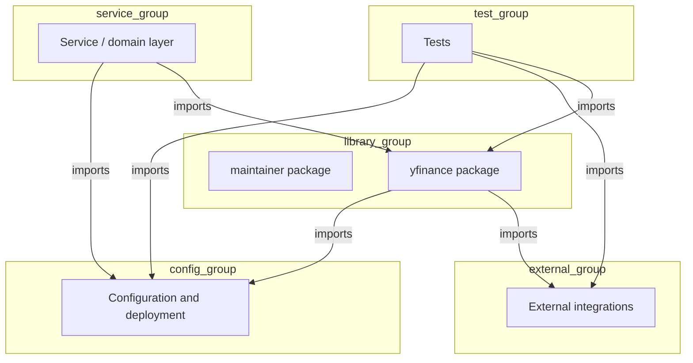

# Architecture report: ranaroussi/yfinance

> Automated static analysis. **Observed** = directly seen in files/imports/AST; **Inferred** = interpretation from that evidence. Repository code was not executed.

## 1. Repository at a glance

| Item | Value |
| --- | --- |
| Repository | ranaroussi/yfinance |
| Description | Download market data from Yahoo! Finance's API |
| Language | Python |
| Stars | 25918 |
| Licence | Apache-2.0 |
| Analysed commit / branch | 2492a853aee975b4f39f230ad763298f039e37ae / main |
| Framework(s) | None detected |
| Files analysed | 218 |
| Components | 6 |

## 2. Architecture in one minute

ranaroussi/yfinance - Download market data from Yahoo! Finance's API. This repository was analysed statically from 218 file(s) (72 Python). Detected technologies (observed from imports/manifests): GitHub Actions, NumPy, pandas, Peewee, requests, Poetry. Files are grouped into 6 component(s): Configuration and deployment, External integrations, maintainer package, Service / domain layer, Tests, yfinance package. Findings below distinguish observed facts from inferred interpretation.

## 3. High-level block diagram

## 4. Main components

### Configuration and deployment (`config`)

- **Kind:** config
- **Status:** Observed
- **Confidence:** 0.85
- **Responsibility:** Groups 4 file(s) under configuration and deployment (observed from repository paths and static analysis). Observed top-level classes: ConfigMgr, NestedConfig.
- **Paths:** `meta.yaml`, `pyproject.toml`, `ruff.toml`, `yfinance/config.py`
- **Evidence:** [meta.yaml](https://github.com/ranaroussi/yfinance/blob/2492a853aee975b4f39f230ad763298f039e37ae/meta.yaml); [pyproject.toml](https://github.com/ranaroussi/yfinance/blob/2492a853aee975b4f39f230ad763298f039e37ae/pyproject.toml); [ruff.toml](https://github.com/ranaroussi/yfinance/blob/2492a853aee975b4f39f230ad763298f039e37ae/ruff.toml); [yfinance/config.py:4](https://github.com/ranaroussi/yfinance/blob/2492a853aee975b4f39f230ad763298f039e37ae/yfinance/config.py#L4)

### External integrations (`external_integrations`)

- **Kind:** external
- **Status:** Inferred
- **Confidence:** 0.70
- **Responsibility:** Groups 0 file(s) under external integrations (observed from repository paths and static analysis).
- **Evidence:** [tests/test_http.py:46](https://github.com/ranaroussi/yfinance/blob/2492a853aee975b4f39f230ad763298f039e37ae/tests/test_http.py#L46); [tests/test_http.py:54](https://github.com/ranaroussi/yfinance/blob/2492a853aee975b4f39f230ad763298f039e37ae/tests/test_http.py#L54); [tests/test_http.py:68](https://github.com/ranaroussi/yfinance/blob/2492a853aee975b4f39f230ad763298f039e37ae/tests/test_http.py#L68); [tests/test_prices.py:5](https://github.com/ranaroussi/yfinance/blob/2492a853aee975b4f39f230ad763298f039e37ae/tests/test_prices.py#L5); [yfinance/_http.py:27](https://github.com/ranaroussi/yfinance/blob/2492a853aee975b4f39f230ad763298f039e37ae/yfinance/_http.py#L27); [yfinance/_http.py:31](https://github.com/ranaroussi/yfinance/blob/2492a853aee975b4f39f230ad763298f039e37ae/yfinance/_http.py#L31)

### maintainer package (`maintainer`)

- **Kind:** library
- **Status:** Observed
- **Confidence:** 0.85
- **Responsibility:** Groups 1 file(s) under maintainer package (observed from repository paths and static analysis).
- **Paths:** `maintainer/verify_github_actions.sh`
- **Evidence:** [maintainer/verify_github_actions.sh](https://github.com/ranaroussi/yfinance/blob/2492a853aee975b4f39f230ad763298f039e37ae/maintainer/verify_github_actions.sh)

### Service / domain layer (`service_layer`)

- **Kind:** service
- **Status:** Observed
- **Confidence:** 0.85
- **Responsibility:** Groups 5 file(s) under service / domain layer (observed from repository paths and static analysis). Observed top-level classes: Domain, Industry, Market, MarketRegion, Sector.
- **Paths:** `yfinance/domain/__init__.py`, `yfinance/domain/domain.py`, `yfinance/domain/industry.py`, `yfinance/domain/market.py`, `yfinance/domain/sector.py`
- **Evidence:** [yfinance/domain/__init__.py](https://github.com/ranaroussi/yfinance/blob/2492a853aee975b4f39f230ad763298f039e37ae/yfinance/domain/__init__.py); [yfinance/domain/domain.py:11](https://github.com/ranaroussi/yfinance/blob/2492a853aee975b4f39f230ad763298f039e37ae/yfinance/domain/domain.py#L11); [yfinance/domain/industry.py:12](https://github.com/ranaroussi/yfinance/blob/2492a853aee975b4f39f230ad763298f039e37ae/yfinance/domain/industry.py#L12); [yfinance/domain/market.py:11](https://github.com/ranaroussi/yfinance/blob/2492a853aee975b4f39f230ad763298f039e37ae/yfinance/domain/market.py#L11); [yfinance/domain/sector.py:12](https://github.com/ranaroussi/yfinance/blob/2492a853aee975b4f39f230ad763298f039e37ae/yfinance/domain/sector.py#L12)

### Tests (`tests`)

- **Kind:** test
- **Status:** Observed
- **Confidence:** 0.85
- **Responsibility:** Groups 112 file(s) under tests (observed from repository paths and static analysis). Observed routes: PATCH yfinance.screener.screener.YfData.post, PATCH yfinance.data.YfData.post, PATCH yfinance.data.YfData.get, PATCH yfinance.data.YfData.post. Observed top-level classes: TestAsyncWebSocketListen, TestAuthLogin, TestAuthSubscriptionTier, TestCache, TestCacheNoPermission, TestCalendarCache. Observed top-level functions: _auth, _earnings_response, _mock_response, _reload_http, _response, _result.
- **Paths:** `tests/__init__.py`, `tests/context.py`, `tests/data/1398-HK-1d-bad-div-fixed.csv`, `tests/data/1398-HK-1d-bad-div.csv`, `tests/data/3988-HK-1d-bad-div-fixed.csv`, `tests/data/3988-HK-1d-bad-div.csv`, `tests/data/4063-T-1d-bad-div-fixed.csv`, `tests/data/4063-T-1d-bad-div.csv`, `tests/data/4063-T-1d-bad-stock-split-fixed.csv`, `tests/data/4063-T-1d-bad-stock-split.csv`, `tests/data/8TRA-DE-1d-missing-div-adjust-fixed.csv`, `tests/data/8TRA-DE-1d-missing-div-adjust.csv`, `tests/data/ABDP-L-1d-bad-div-fixed.csv`, `tests/data/ABDP-L-1d-bad-div.csv`, `tests/data/ADIG-L-1d-bad-div-fixed.csv`, `tests/data/ADIG-L-1d-bad-div.csv`, `tests/data/AET-L-1d-100x-error-fixed.csv`, `tests/data/AET-L-1d-100x-error.csv`, `tests/data/ALPHA-PA-1d-bad-stock-split-fixed.csv`, `tests/data/ALPHA-PA-1d-bad-stock-split.csv`, `tests/data/ASAI-L-1h-bad-unit-fixed.csv`, `tests/data/ASAI-L-1h-bad-unit.csv`, `tests/data/AV-L-1wk-bad-stock-split-fixed.csv`, `tests/data/AV-L-1wk-bad-stock-split.csv`, `tests/data/CALM-1d-no-bad-divs.csv`, `tests/data/CLC-L-1d-bad-div-fixed.csv`, `tests/data/CLC-L-1d-bad-div.csv`, `tests/data/CNE-L-1d-bad-stock-split-fixed.csv`, `tests/data/CNE-L-1d-bad-stock-split.csv`, `tests/data/DEX-AX-1d-bad-stock-split-fixed.csv`, `tests/data/DEX-AX-1d-bad-stock-split.csv`, `tests/data/DODFX-1d-cg-double-count-fixed.csv`, `tests/data/DODFX-1d-cg-double-count.csv`, `tests/data/EA-15m-no-bad-divs.csv`, `tests/data/ELCO-L-1d-bad-div-fixed.csv`, `tests/data/ELCO-L-1d-bad-div.csv`, `tests/data/EWG-1d-no-bad-divs.csv`, `tests/data/HSBK-IL-1d-no-bad-divs.csv`, `tests/data/IBE-MC-1d-no-bad-divs.csv`, `tests/data/JENYX-1d-cg-double-count-fixed.csv`, `tests/data/JENYX-1d-cg-double-count.csv`, `tests/data/KALA-1d-no-bad-level-shift.csv`, `tests/data/KALA-1h-no-bad-level-shift.csv`, `tests/data/KAP-IL-1d-bad-div-fixed.csv`, `tests/data/KAP-IL-1d-bad-div.csv`, `tests/data/KEN-TA-1d-bad-div-fixed.csv`, `tests/data/KEN-TA-1d-bad-div.csv`, `tests/data/KME-MI-1d-bad-div-fixed.csv`, `tests/data/KME-MI-1d-bad-div.csv`, `tests/data/KMR-L-1d-no-bad-divs.csv`, `tests/data/LA-V-1d-bad-stock-split-fixed.csv`, `tests/data/LA-V-1d-bad-stock-split.csv`, `tests/data/LSC-L-1d-bad-div-fixed.csv`, `tests/data/LSC-L-1d-bad-div.csv`, `tests/data/MOB-ST-1d-bad-stock-split-fixed.csv`, `tests/data/MOB-ST-1d-bad-stock-split.csv`, `tests/data/NFE-1d-bad-stock-split-fixed.csv`, `tests/data/NFE-1d-bad-stock-split.csv`, `tests/data/NRDY-1d-bad-stock-split-fixed.csv`, `tests/data/NRDY-1d-bad-stock-split.csv`, `tests/data/NVT-L-1d-bad-div-fixed.csv`, `tests/data/NVT-L-1d-bad-div.csv`, `tests/data/PSH-L-1d-bad-div-fixed.csv`, `tests/data/PSH-L-1d-bad-div.csv`, `tests/data/REL-L-1d-bad-div-fixed.csv`, `tests/data/REL-L-1d-bad-div.csv`, `tests/data/RGL-L-1d-bad-div-fixed.csv`, `tests/data/RGL-L-1d-bad-div.csv`, `tests/data/SAND-1d-bad-div-fixed.csv`, `tests/data/SAND-1d-bad-div.csv`, `tests/data/SCR-TO-1d-bad-div-fixed.csv`, `tests/data/SCR-TO-1d-bad-div.csv`, `tests/data/SERE-L-1d-bad-div-fixed.csv`, `tests/data/SERE-L-1d-bad-div.csv`, `tests/data/SOXS-1d-bad-level-shift-fixed.csv`, `tests/data/SOXS-1d-bad-level-shift.csv`, `tests/data/SOXS-1h-bad-level-shift.csv`, `tests/data/SPM-MI-1d-bad-stock-split-fixed.csv`, `tests/data/SPM-MI-1d-bad-stock-split.csv`, `tests/data/SSW-JO-1d-100x-error-fixed.csv`, `tests/data/SSW-JO-1d-100x-error.csv`, `tests/data/TEM-L-1d-bad-div-fixed.csv`, `tests/data/TEM-L-1d-bad-div.csv`, `tests/data/TENT-L-1d-bad-div-fixed.csv`, `tests/data/TENT-L-1d-bad-div.csv`, `tests/data/TEP-PA-1d-bad-div-fixed.csv`, `tests/data/TEP-PA-1d-bad-div.csv`, `tests/data/TISG-MI-1d-no-bad-divs.csv`, `tests/data/VWILX-1d-cg-double-count-fixed.csv`, `tests/data/VWILX-1d-cg-double-count.csv`, `tests/test_auth.py`, `tests/test_cache.py`, `tests/test_cache_noperms.py`, `tests/test_calendars.py`, `tests/test_calendars_cache.py`, `tests/test_cookie_crumb_degradation.py`, `tests/test_data.py`, `tests/test_download_concurrency.py`, `tests/test_http.py`, `tests/test_live.py`, `tests/test_lookup.py`, `tests/test_market.py`, `tests/test_multi.py`, `tests/test_price_repair.py`, `tests/test_price_shift_detection.py`, `tests/test_prices.py`, `tests/test_screener.py`, `tests/test_search.py`, `tests/test_sector_region.py`, `tests/test_ticker.py`, `tests/test_ticker_locale.py`, `tests/test_utils.py`
- **Evidence:** [tests/__init__.py](https://github.com/ranaroussi/yfinance/blob/2492a853aee975b4f39f230ad763298f039e37ae/tests/__init__.py); [tests/context.py](https://github.com/ranaroussi/yfinance/blob/2492a853aee975b4f39f230ad763298f039e37ae/tests/context.py); [tests/data/1398-HK-1d-bad-div-fixed.csv](https://github.com/ranaroussi/yfinance/blob/2492a853aee975b4f39f230ad763298f039e37ae/tests/data/1398-HK-1d-bad-div-fixed.csv); [tests/data/1398-HK-1d-bad-div.csv](https://github.com/ranaroussi/yfinance/blob/2492a853aee975b4f39f230ad763298f039e37ae/tests/data/1398-HK-1d-bad-div.csv); [tests/data/3988-HK-1d-bad-div-fixed.csv](https://github.com/ranaroussi/yfinance/blob/2492a853aee975b4f39f230ad763298f039e37ae/tests/data/3988-HK-1d-bad-div-fixed.csv); [tests/data/3988-HK-1d-bad-div.csv](https://github.com/ranaroussi/yfinance/blob/2492a853aee975b4f39f230ad763298f039e37ae/tests/data/3988-HK-1d-bad-div.csv); [tests/data/4063-T-1d-bad-div-fixed.csv](https://github.com/ranaroussi/yfinance/blob/2492a853aee975b4f39f230ad763298f039e37ae/tests/data/4063-T-1d-bad-div-fixed.csv); [tests/data/4063-T-1d-bad-div.csv](https://github.com/ranaroussi/yfinance/blob/2492a853aee975b4f39f230ad763298f039e37ae/tests/data/4063-T-1d-bad-div.csv)

### yfinance package (`yfinance`)

- **Kind:** library
- **Status:** Observed
- **Confidence:** 0.85
- **Responsibility:** Groups 27 file(s) under yfinance package (observed from repository paths and static analysis). Observed top-level classes: Analysis, AsyncWebSocket, Auth, BaseWebSocket, CalendarQuery, Calendars. Observed top-level functions: _attr_impl, _attr_one, _disable_debug_mode, _download_impl, _download_one, _download_one_threaded.
- **Paths:** `yfinance/__init__.py`, `yfinance/_http.py`, `yfinance/base.py`, `yfinance/cache.py`, `yfinance/calendars.py`, `yfinance/const.py`, `yfinance/data.py`, `yfinance/exceptions.py`, `yfinance/live.py`, `yfinance/lookup.py`, `yfinance/multi.py`, `yfinance/pricing_pb2.py`, `yfinance/scrapers/__init__.py`, `yfinance/scrapers/analysis.py`, `yfinance/scrapers/fundamentals.py`, `yfinance/scrapers/funds.py`, `yfinance/scrapers/holders.py`, `yfinance/scrapers/quote.py`, `yfinance/screener/__init__.py`, `yfinance/screener/query.py`, `yfinance/screener/screener.py`, `yfinance/search.py`, `yfinance/shared.py`, `yfinance/ticker.py`, `yfinance/tickers.py`, `yfinance/utils.py`, `yfinance/version.py`
- **Evidence:** [yfinance/__init__.py:54](https://github.com/ranaroussi/yfinance/blob/2492a853aee975b4f39f230ad763298f039e37ae/yfinance/__init__.py#L54); [yfinance/_http.py:46](https://github.com/ranaroussi/yfinance/blob/2492a853aee975b4f39f230ad763298f039e37ae/yfinance/_http.py#L46); [yfinance/base.py:81](https://github.com/ranaroussi/yfinance/blob/2492a853aee975b4f39f230ad763298f039e37ae/yfinance/base.py#L81); [yfinance/cache.py:19](https://github.com/ranaroussi/yfinance/blob/2492a853aee975b4f39f230ad763298f039e37ae/yfinance/cache.py#L19); [yfinance/calendars.py:17](https://github.com/ranaroussi/yfinance/blob/2492a853aee975b4f39f230ad763298f039e37ae/yfinance/calendars.py#L17); [yfinance/const.py:387](https://github.com/ranaroussi/yfinance/blob/2492a853aee975b4f39f230ad763298f039e37ae/yfinance/const.py#L387); [yfinance/data.py:19](https://github.com/ranaroussi/yfinance/blob/2492a853aee975b4f39f230ad763298f039e37ae/yfinance/data.py#L19); [yfinance/exceptions.py:1](https://github.com/ranaroussi/yfinance/blob/2492a853aee975b4f39f230ad763298f039e37ae/yfinance/exceptions.py#L1)

## 5. Execution flow

No entry point was observed; the startup flow below is therefore limited.

**Observed** routes (from decorators):

- `PATCH yfinance.screener.screener.YfData.post` -> `test_set_large_size_in_body` in `tests/test_screener.py:17`
- `PATCH yfinance.data.YfData.post` -> `test_fetch_query` in `tests/test_screener.py:22`
- `PATCH yfinance.data.YfData.get` -> `test_fetch_predefined` in `tests/test_screener.py:31`
- `PATCH yfinance.data.YfData.post` -> `test_predefined_with_offset_sends_count_as_size` in `tests/test_screener.py:40`

Representative flow (derived from observed entry points and the import graph; steps beyond the entry point are **Inferred**):

1. Execution starts at an observed entry point listed above, if present.
2. `service_layer` imports `config` (Service / domain layer -> Configuration and deployment).
3. `service_layer` imports `yfinance` (Service / domain layer -> yfinance package).
4. `tests` imports `config` (Tests -> Configuration and deployment).
5. `tests` imports `external_integrations` (Tests -> External integrations).
6. `tests` imports `yfinance` (Tests -> yfinance package).
7. `yfinance` imports `config` (yfinance package -> Configuration and deployment).
8. `yfinance` imports `external_integrations` (yfinance package -> External integrations).

## 6. Project structure

### `(root)`

- `.gitignore` - other (293 bytes)
- `.travis.yml` - ci, YAML (750 bytes)
- `CHANGELOG.md` - docs (0 bytes)
- `CHANGELOG.rst` - docs (27881 bytes)
- `CODE_OF_CONDUCT.md` - docs (560 bytes)
- `CONTRIBUTING.md` - docs (2400 bytes)
- `LICENSE.txt` - docs (11358 bytes)
- `README.md` - docs (4418 bytes)
- `meta.yaml` - config (1485 bytes)
- `pyproject.toml` - manifest (3022 bytes)
- `ruff.toml` - config (163 bytes)

### `.github`

- `.github/FUNDING.yml` - config (19 bytes)
- `.github/ISSUE_TEMPLATE/bug_report.yaml` - config (3065 bytes)
- `.github/dependabot.yml` - config (143 bytes)
- `.github/workflows/auto_close_default_issues.yml` - ci, YAML (1843 bytes)
- `.github/workflows/deploy_doc.yml` - ci, YAML (1382 bytes)
- `.github/workflows/pyright.yml` - ci, YAML (935 bytes)
- `.github/workflows/pytest.yml.disabled` - ci, YAML (1129 bytes)
- `.github/workflows/python-publish.yml` - ci, YAML (1185 bytes)
- `.github/workflows/ruff.yml` - ci, YAML (585 bytes)
- `.github/workflows/zizmor.yml` - ci, YAML (694 bytes)

### `doc`

- `doc/Makefile` - other (638 bytes)
- `doc/make.bat` - other (804 bytes)
- `doc/source/_static/yfinance.css` - other (82 bytes)
- `doc/source/_templates/autosummary/class.rst` - docs (638 bytes)
- `doc/source/advanced/caching.rst` - docs (554 bytes)
- `doc/source/advanced/config.rst` - docs (1806 bytes)
- `doc/source/advanced/index.rst` - docs (159 bytes)
- `doc/source/advanced/install.rst` - docs (284 bytes)
- `doc/source/advanced/logging.rst` - docs (268 bytes)
- `doc/source/advanced/multi_level_columns.rst` - docs (637 bytes)
- `doc/source/advanced/price_adjustment.rst` - docs (808 bytes)
- `doc/source/advanced/price_repair.rst` - docs (10724 bytes)
- `doc/source/conf.py` - source, Python (1662 bytes)
- `doc/source/development/code.rst` - docs (2957 bytes)
- `doc/source/development/documentation.rst` - docs (1525 bytes)
- `doc/source/development/index.rst` - docs (213 bytes)
- `doc/source/development/running.rst` - docs (1340 bytes)
- `doc/source/development/testing.rst` - docs (800 bytes)
- `doc/source/index.rst` - docs (1802 bytes)
- `doc/source/reference/examples/auth.py` - source, Python (779 bytes)
- `doc/source/reference/examples/calendars.py` - source, Python (1155 bytes)
- `doc/source/reference/examples/download.py` - source, Python (66 bytes)
- `doc/source/reference/examples/funds_data.py` - source, Python (335 bytes)
- `doc/source/reference/examples/live_async.py` - source, Python (568 bytes)
- `doc/source/reference/examples/live_sync.py` - source, Python (456 bytes)
- `doc/source/reference/examples/lookup.py` - source, Python (839 bytes)
- `doc/source/reference/examples/market.py` - source, Python (101 bytes)
- `doc/source/reference/examples/proxy.py` - source, Python (385 bytes)
- `doc/source/reference/examples/search.py` - source, Python (254 bytes)
- `doc/source/reference/examples/sector_industry.py` - source, Python (428 bytes)
- `doc/source/reference/examples/sector_industry_ticker.py` - source, Python (312 bytes)
- `doc/source/reference/examples/ticker.py` - source, Python (324 bytes)
- `doc/source/reference/examples/tickers.py` - source, Python (484 bytes)
- `doc/source/reference/index.rst` - docs (2298 bytes)
- `doc/source/reference/yfinance.analysis.rst` - docs (1181 bytes)
- `doc/source/reference/yfinance.auth.rst` - docs (1397 bytes)
- `doc/source/reference/yfinance.calendars.rst` - docs (354 bytes)
- `doc/source/reference/yfinance.financials.rst` - docs (423 bytes)
- `doc/source/reference/yfinance.functions.rst` - docs (615 bytes)
- `doc/source/reference/yfinance.funds_data.rst` - docs (169 bytes)
- `doc/source/reference/yfinance.market.rst` - docs (806 bytes)
- `doc/source/reference/yfinance.price_history.rst` - docs (169 bytes)
- `doc/source/reference/yfinance.screener.rst` - docs (1010 bytes)
- `doc/source/reference/yfinance.search.rst` - docs (646 bytes)
- `doc/source/reference/yfinance.sector_industry.rst` - docs (1161 bytes)
- `doc/source/reference/yfinance.stock.rst` - docs (649 bytes)
- `doc/source/reference/yfinance.ticker_tickers.rst` - docs (1027 bytes)
- `doc/source/reference/yfinance.websocket.rst` - docs (1101 bytes)

### `maintainer`

- `maintainer/prompts/update-github-actions.txt` - docs (2841 bytes)
- `maintainer/verify_github_actions.sh` - source, Shell (3511 bytes)

### `tests`

- `tests/__init__.py` - test, Python (0 bytes)
- `tests/context.py` - test, Python (934 bytes)
- `tests/data/1398-HK-1d-bad-div-fixed.csv` - test (90540 bytes)
- `tests/data/1398-HK-1d-bad-div.csv` - test (87091 bytes)
- `tests/data/3988-HK-1d-bad-div-fixed.csv` - test (91206 bytes)
- `tests/data/3988-HK-1d-bad-div.csv` - test (87857 bytes)
- `tests/data/4063-T-1d-bad-div-fixed.csv` - test (60659 bytes)
- `tests/data/4063-T-1d-bad-div.csv` - test (56649 bytes)
- `tests/data/4063-T-1d-bad-stock-split-fixed.csv` - test (1536 bytes)
- `tests/data/4063-T-1d-bad-stock-split.csv` - test (1580 bytes)
- `tests/data/8TRA-DE-1d-missing-div-adjust-fixed.csv` - test (634 bytes)
- `tests/data/8TRA-DE-1d-missing-div-adjust.csv` - test (693 bytes)
- `tests/data/ABDP-L-1d-bad-div-fixed.csv` - test (63680 bytes)
- `tests/data/ABDP-L-1d-bad-div.csv` - test (59661 bytes)
- `tests/data/ADIG-L-1d-bad-div-fixed.csv` - test (82504 bytes)
- `tests/data/ADIG-L-1d-bad-div.csv` - test (78806 bytes)
- `tests/data/AET-L-1d-100x-error-fixed.csv` - test (2761 bytes)
- `tests/data/AET-L-1d-100x-error.csv` - test (3153 bytes)
- `tests/data/ALPHA-PA-1d-bad-stock-split-fixed.csv` - test (2586 bytes)
- `tests/data/ALPHA-PA-1d-bad-stock-split.csv` - test (3023 bytes)
- `tests/data/ASAI-L-1h-bad-unit-fixed.csv` - test (1459 bytes)
- `tests/data/ASAI-L-1h-bad-unit.csv` - test (1495 bytes)
- `tests/data/AV-L-1wk-bad-stock-split-fixed.csv` - test (9647 bytes)
- `tests/data/AV-L-1wk-bad-stock-split.csv` - test (10473 bytes)
- `tests/data/CALM-1d-no-bad-divs.csv` - test (85588 bytes)
- `tests/data/CLC-L-1d-bad-div-fixed.csv` - test (87168 bytes)
- `tests/data/CLC-L-1d-bad-div.csv` - test (83561 bytes)
- `tests/data/CNE-L-1d-bad-stock-split-fixed.csv` - test (1066 bytes)
- `tests/data/CNE-L-1d-bad-stock-split.csv` - test (1282 bytes)
- `tests/data/DEX-AX-1d-bad-stock-split-fixed.csv` - test (2876 bytes)
- `tests/data/DEX-AX-1d-bad-stock-split.csv` - test (2951 bytes)
- `tests/data/DODFX-1d-cg-double-count-fixed.csv` - test (59040 bytes)
- `tests/data/DODFX-1d-cg-double-count.csv` - test (59033 bytes)
- `tests/data/EA-15m-no-bad-divs.csv` - test (30619 bytes)
- `tests/data/ELCO-L-1d-bad-div-fixed.csv` - test (70833 bytes)
- `tests/data/ELCO-L-1d-bad-div.csv` - test (66813 bytes)
- `tests/data/EWG-1d-no-bad-divs.csv` - test (90981 bytes)
- `tests/data/HSBK-IL-1d-no-bad-divs.csv` - test (83616 bytes)
- `tests/data/IBE-MC-1d-no-bad-divs.csv` - test (90204 bytes)
- `tests/data/JENYX-1d-cg-double-count-fixed.csv` - test (147010 bytes)
- `tests/data/JENYX-1d-cg-double-count.csv` - test (163195 bytes)
- `tests/data/KALA-1d-no-bad-level-shift.csv` - test (1477 bytes)
- `tests/data/KALA-1h-no-bad-level-shift.csv` - test (17076 bytes)
- `tests/data/KAP-IL-1d-bad-div-fixed.csv` - test (83278 bytes)
- `tests/data/KAP-IL-1d-bad-div.csv` - test (79393 bytes)
- `tests/data/KEN-TA-1d-bad-div-fixed.csv` - test (61171 bytes)
- `tests/data/KEN-TA-1d-bad-div.csv` - test (54419 bytes)
- `tests/data/KME-MI-1d-bad-div-fixed.csv` - test (94558 bytes)
- `tests/data/KME-MI-1d-bad-div.csv` - test (90903 bytes)
- `tests/data/KMR-L-1d-no-bad-divs.csv` - test (59642 bytes)
- `tests/data/LA-V-1d-bad-stock-split-fixed.csv` - test (3894 bytes)
- `tests/data/LA-V-1d-bad-stock-split.csv` - test (3899 bytes)
- `tests/data/LSC-L-1d-bad-div-fixed.csv` - test (60608 bytes)
- `tests/data/LSC-L-1d-bad-div.csv` - test (57472 bytes)
- `tests/data/MOB-ST-1d-bad-stock-split-fixed.csv` - test (1640 bytes)
- `tests/data/MOB-ST-1d-bad-stock-split.csv` - test (1822 bytes)
- `tests/data/NFE-1d-bad-stock-split-fixed.csv` - test (2393 bytes)
- `tests/data/NFE-1d-bad-stock-split.csv` - test (2710 bytes)
- `tests/data/NRDY-1d-bad-stock-split-fixed.csv` - test (28801 bytes)
- `tests/data/NRDY-1d-bad-stock-split.csv` - test (30534 bytes)
- `tests/data/NVT-L-1d-bad-div-fixed.csv` - test (82249 bytes)
- `tests/data/NVT-L-1d-bad-div.csv` - test (78408 bytes)
- `tests/data/PSH-L-1d-bad-div-fixed.csv` - test (66209 bytes)
- `tests/data/PSH-L-1d-bad-div.csv` - test (62207 bytes)
- `tests/data/REL-L-1d-bad-div-fixed.csv` - test (66419 bytes)
- `tests/data/REL-L-1d-bad-div.csv` - test (61590 bytes)
- `tests/data/RGL-L-1d-bad-div-fixed.csv` - test (89978 bytes)
- `tests/data/RGL-L-1d-bad-div.csv` - test (86264 bytes)
- `tests/data/SAND-1d-bad-div-fixed.csv` - test (89135 bytes)
- `tests/data/SAND-1d-bad-div.csv` - test (85651 bytes)
- `tests/data/SCR-TO-1d-bad-div-fixed.csv` - test (89100 bytes)
- `tests/data/SCR-TO-1d-bad-div.csv` - test (93334 bytes)
- `tests/data/SERE-L-1d-bad-div-fixed.csv` - test (79134 bytes)
- `tests/data/SERE-L-1d-bad-div.csv` - test (75730 bytes)
- `tests/data/SOXS-1d-bad-level-shift-fixed.csv` - test (2126 bytes)
- `tests/data/SOXS-1d-bad-level-shift.csv` - test (2094 bytes)
- `tests/data/SOXS-1h-bad-level-shift.csv` - test (16361 bytes)
- `tests/data/SPM-MI-1d-bad-stock-split-fixed.csv` - test (2709 bytes)
- `tests/data/SPM-MI-1d-bad-stock-split.csv` - test (2966 bytes)
- `tests/data/SSW-JO-1d-100x-error-fixed.csv` - test (2103 bytes)
- `tests/data/SSW-JO-1d-100x-error.csv` - test (2082 bytes)
- `tests/data/TEM-L-1d-bad-div-fixed.csv` - test (85252 bytes)
- `tests/data/TEM-L-1d-bad-div.csv` - test (81788 bytes)
- `tests/data/TENT-L-1d-bad-div-fixed.csv` - test (74033 bytes)
- `tests/data/TENT-L-1d-bad-div.csv` - test (70491 bytes)
- `tests/data/TEP-PA-1d-bad-div-fixed.csv` - test (86271 bytes)
- `tests/data/TEP-PA-1d-bad-div.csv` - test (82457 bytes)
- `tests/data/TISG-MI-1d-no-bad-divs.csv` - test (73578 bytes)
- `tests/data/VWILX-1d-cg-double-count-fixed.csv` - test (58407 bytes)
- `tests/data/VWILX-1d-cg-double-count.csv` - test (65677 bytes)
- `tests/test_auth.py` - test, Python (6224 bytes)
- `tests/test_cache.py` - test, Python (1530 bytes)
- `tests/test_cache_noperms.py` - test, Python (1664 bytes)
- `tests/test_calendars.py` - test, Python (2009 bytes)
- `tests/test_calendars_cache.py` - test, Python (5152 bytes)
- `tests/test_cookie_crumb_degradation.py` - test, Python (5376 bytes)
- `tests/test_data.py` - test, Python (7798 bytes)
- `tests/test_download_concurrency.py` - test, Python (2297 bytes)
- `tests/test_http.py` - test, Python (2915 bytes)
- `tests/test_live.py` - test, Python (2996 bytes)
- `tests/test_lookup.py` - test, Python (5867 bytes)
- `tests/test_market.py` - test, Python (1879 bytes)
- `tests/test_multi.py` - test, Python (8633 bytes)
- `tests/test_price_repair.py` - test, Python (41772 bytes)
- `tests/test_price_shift_detection.py` - test, Python (23568 bytes)
- `tests/test_prices.py` - test, Python (28401 bytes)
- `tests/test_screener.py` - test, Python (2413 bytes)
- `tests/test_search.py` - test, Python (1336 bytes)
- `tests/test_sector_region.py` - test, Python (1090 bytes)
- `tests/test_ticker.py` - test, Python (94029 bytes)
- `tests/test_ticker_locale.py` - test, Python (2067 bytes)
- `tests/test_utils.py` - test, Python (13589 bytes)

### `yfinance`

- `yfinance/__init__.py` - source, Python (2312 bytes)
- `yfinance/_http.py` - source, Python (3234 bytes)
- `yfinance/base.py` - source, Python (38364 bytes)
- `yfinance/cache.py` - source, Python (17765 bytes)
- `yfinance/calendars.py` - source, Python (20111 bytes)
- `yfinance/config.py` - source, Python (1570 bytes)
- `yfinance/const.py` - source, Python (47974 bytes)
- `yfinance/data.py` - source, Python (29637 bytes)
- `yfinance/domain/__init__.py` - source, Python (112 bytes)
- `yfinance/domain/domain.py` - source, Python (6909 bytes)
- `yfinance/domain/industry.py` - source, Python (5581 bytes)
- `yfinance/domain/market.py` - source, Python (5085 bytes)
- `yfinance/domain/sector.py` - source, Python (5609 bytes)
- `yfinance/exceptions.py` - source, Python (2691 bytes)
- `yfinance/live.py` - source, Python (12711 bytes)
- `yfinance/lookup.py` - source, Python (7035 bytes)
- `yfinance/multi.py` - source, Python (16756 bytes)
- `yfinance/pricing.proto` - other (939 bytes)
- `yfinance/pricing_pb2.py` - source, Python (2499 bytes)
- `yfinance/scrapers/__init__.py` - source, Python (0 bytes)
- `yfinance/scrapers/analysis.py` - source, Python (10417 bytes)
- `yfinance/scrapers/fundamentals.py` - source, Python (8361 bytes)
- `yfinance/scrapers/funds.py` - source, Python (11762 bytes)
- `yfinance/scrapers/holders.py` - source, Python (9542 bytes)
- `yfinance/scrapers/quote.py` - source, Python (38686 bytes)
- `yfinance/scrapers/yahoo-keys.txt` - docs (1032 bytes)
- `yfinance/screener/__init__.py` - source, Python (203 bytes)
- `yfinance/screener/query.py` - source, Python (10808 bytes)
- `yfinance/screener/screener.py` - source, Python (12521 bytes)
- `yfinance/search.py` - source, Python (5942 bytes)
- `yfinance/shared.py` - source, Python (826 bytes)
- `yfinance/ticker.py` - source, Python (9501 bytes)
- `yfinance/tickers.py` - source, Python (5037 bytes)
- `yfinance/utils.py` - source, Python (48225 bytes)
- `yfinance/version.py` - source, Python (17 bytes)

## 7. Key dependencies and integrations

| Name | Category | Status | Confidence | Evidence |
| --- | --- | --- | --- | --- |
| GitHub Actions | ci | Observed | 0.90 | [.github/workflows/auto_close_default_issues.yml](https://github.com/ranaroussi/yfinance/blob/2492a853aee975b4f39f230ad763298f039e37ae/.github/workflows/auto_close_default_issues.yml); [.github/workflows/deploy_doc.yml](https://github.com/ranaroussi/yfinance/blob/2492a853aee975b4f39f230ad763298f039e37ae/.github/workflows/deploy_doc.yml); [.github/workflows/pyright.yml](https://github.com/ranaroussi/yfinance/blob/2492a853aee975b4f39f230ad763298f039e37ae/.github/workflows/pyright.yml); [.github/workflows/pytest.yml.disabled](https://github.com/ranaroussi/yfinance/blob/2492a853aee975b4f39f230ad763298f039e37ae/.github/workflows/pytest.yml.disabled) |
| NumPy | library | Observed | 0.95 | [pyproject.toml:39](https://github.com/ranaroussi/yfinance/blob/2492a853aee975b4f39f230ad763298f039e37ae/pyproject.toml#L39); [tests/test_price_repair.py:9](https://github.com/ranaroussi/yfinance/blob/2492a853aee975b4f39f230ad763298f039e37ae/tests/test_price_repair.py#L9); [tests/test_price_shift_detection.py:8](https://github.com/ranaroussi/yfinance/blob/2492a853aee975b4f39f230ad763298f039e37ae/tests/test_price_shift_detection.py#L8); [tests/test_prices.py:9](https://github.com/ranaroussi/yfinance/blob/2492a853aee975b4f39f230ad763298f039e37ae/tests/test_prices.py#L9) |
| pandas | library | Observed | 0.95 | [pyproject.toml:12](https://github.com/ranaroussi/yfinance/blob/2492a853aee975b4f39f230ad763298f039e37ae/pyproject.toml#L12); [tests/test_calendars.py:4](https://github.com/ranaroussi/yfinance/blob/2492a853aee975b4f39f230ad763298f039e37ae/tests/test_calendars.py#L4); [tests/test_lookup.py:5](https://github.com/ranaroussi/yfinance/blob/2492a853aee975b4f39f230ad763298f039e37ae/tests/test_lookup.py#L5); [tests/test_multi.py:7](https://github.com/ranaroussi/yfinance/blob/2492a853aee975b4f39f230ad763298f039e37ae/tests/test_multi.py#L7) |
| Peewee | library | Observed | 0.90 | [pyproject.toml:41](https://github.com/ranaroussi/yfinance/blob/2492a853aee975b4f39f230ad763298f039e37ae/pyproject.toml#L41); [yfinance/cache.py:1](https://github.com/ranaroussi/yfinance/blob/2492a853aee975b4f39f230ad763298f039e37ae/yfinance/cache.py#L1) |
| requests | library | Observed | 0.95 | [pyproject.toml:45](https://github.com/ranaroussi/yfinance/blob/2492a853aee975b4f39f230ad763298f039e37ae/pyproject.toml#L45); [tests/test_http.py:46](https://github.com/ranaroussi/yfinance/blob/2492a853aee975b4f39f230ad763298f039e37ae/tests/test_http.py#L46); [tests/test_http.py:54](https://github.com/ranaroussi/yfinance/blob/2492a853aee975b4f39f230ad763298f039e37ae/tests/test_http.py#L54); [tests/test_http.py:68](https://github.com/ranaroussi/yfinance/blob/2492a853aee975b4f39f230ad763298f039e37ae/tests/test_http.py#L68) |
| Poetry | packaging | Observed | 0.85 | [pyproject.toml](https://github.com/ranaroussi/yfinance/blob/2492a853aee975b4f39f230ad763298f039e37ae/pyproject.toml) |
| setuptools | packaging | Observed | 0.85 | [pyproject.toml:2](https://github.com/ranaroussi/yfinance/blob/2492a853aee975b4f39f230ad763298f039e37ae/pyproject.toml#L2) |
| pytest | tooling | Observed | 0.85 | [.github/workflows/pytest.yml.disabled:1](https://github.com/ranaroussi/yfinance/blob/2492a853aee975b4f39f230ad763298f039e37ae/.github/workflows/pytest.yml.disabled#L1); [pyproject.toml:57](https://github.com/ranaroussi/yfinance/blob/2492a853aee975b4f39f230ad763298f039e37ae/pyproject.toml#L57) |
| unittest | tooling | Observed | 0.95 | [tests/test_auth.py:8](https://github.com/ranaroussi/yfinance/blob/2492a853aee975b4f39f230ad763298f039e37ae/tests/test_auth.py#L8); [tests/test_auth.py:9](https://github.com/ranaroussi/yfinance/blob/2492a853aee975b4f39f230ad763298f039e37ae/tests/test_auth.py#L9); [tests/test_cache.py:13](https://github.com/ranaroussi/yfinance/blob/2492a853aee975b4f39f230ad763298f039e37ae/tests/test_cache.py#L13); [tests/test_cache_noperms.py:13](https://github.com/ranaroussi/yfinance/blob/2492a853aee975b4f39f230ad763298f039e37ae/tests/test_cache_noperms.py#L13) |

## 8. Data and state

No database, cache, queue, or persistent-state usage was observed in the analysed files. State handling, if any, may be in-memory or in files that were not analysed.

## 9. Configuration and deployment clues

- `.github/FUNDING.yml` (config)
- `.github/ISSUE_TEMPLATE/bug_report.yaml` (config)
- `.github/dependabot.yml` (config)
- `.github/workflows/auto_close_default_issues.yml` (ci)
- `.github/workflows/deploy_doc.yml` (ci)
- `.github/workflows/pyright.yml` (ci)
- `.github/workflows/pytest.yml.disabled` (ci)
- `.github/workflows/python-publish.yml` (ci)
- `.github/workflows/ruff.yml` (ci)
- `.github/workflows/zizmor.yml` (ci)
- `.travis.yml` (ci)
- `meta.yaml` (config)
- `pyproject.toml` (manifest)
- `ruff.toml` (config)

## 10. Design observations

- Service/domain code is distinct from entry and data code, suggesting layered separation (Inferred).
- Tests are present alongside source code (Observed from test file paths).
- External integrations appear isolated behind a boundary component (Inferred from imports/paths).

These observations are interpretations (**Inferred**) of the observed structure, not guarantees about runtime design.

## 11. Limitations and unknowns

- Static analysis only: repository code was not executed, installed, or imported at runtime.
- Components and relationships are inferred from file paths, imports, and AST structure; runtime behaviour, dynamic imports, and reflection may not be visible.
- No clear application entry point was observed in the analysed files.
- Repository text was treated as untrusted data; no instructions found in repository files were followed, and likely secret values were redacted/excluded.

## 12. Source references

- [.github/workflows/auto_close_default_issues.yml](https://github.com/ranaroussi/yfinance/blob/2492a853aee975b4f39f230ad763298f039e37ae/.github/workflows/auto_close_default_issues.yml)
- [.github/workflows/deploy_doc.yml](https://github.com/ranaroussi/yfinance/blob/2492a853aee975b4f39f230ad763298f039e37ae/.github/workflows/deploy_doc.yml)
- [.github/workflows/pyright.yml](https://github.com/ranaroussi/yfinance/blob/2492a853aee975b4f39f230ad763298f039e37ae/.github/workflows/pyright.yml)
- [.github/workflows/pytest.yml.disabled](https://github.com/ranaroussi/yfinance/blob/2492a853aee975b4f39f230ad763298f039e37ae/.github/workflows/pytest.yml.disabled)
- [.github/workflows/pytest.yml.disabled:1](https://github.com/ranaroussi/yfinance/blob/2492a853aee975b4f39f230ad763298f039e37ae/.github/workflows/pytest.yml.disabled#L1)
- [.github/workflows/python-publish.yml](https://github.com/ranaroussi/yfinance/blob/2492a853aee975b4f39f230ad763298f039e37ae/.github/workflows/python-publish.yml)
- [.github/workflows/ruff.yml](https://github.com/ranaroussi/yfinance/blob/2492a853aee975b4f39f230ad763298f039e37ae/.github/workflows/ruff.yml)
- [.github/workflows/zizmor.yml](https://github.com/ranaroussi/yfinance/blob/2492a853aee975b4f39f230ad763298f039e37ae/.github/workflows/zizmor.yml)
- [maintainer/verify_github_actions.sh](https://github.com/ranaroussi/yfinance/blob/2492a853aee975b4f39f230ad763298f039e37ae/maintainer/verify_github_actions.sh)
- [meta.yaml](https://github.com/ranaroussi/yfinance/blob/2492a853aee975b4f39f230ad763298f039e37ae/meta.yaml)
- [pyproject.toml](https://github.com/ranaroussi/yfinance/blob/2492a853aee975b4f39f230ad763298f039e37ae/pyproject.toml)
- [pyproject.toml:2](https://github.com/ranaroussi/yfinance/blob/2492a853aee975b4f39f230ad763298f039e37ae/pyproject.toml#L2)
- [pyproject.toml:12](https://github.com/ranaroussi/yfinance/blob/2492a853aee975b4f39f230ad763298f039e37ae/pyproject.toml#L12)
- [pyproject.toml:39](https://github.com/ranaroussi/yfinance/blob/2492a853aee975b4f39f230ad763298f039e37ae/pyproject.toml#L39)
- [pyproject.toml:41](https://github.com/ranaroussi/yfinance/blob/2492a853aee975b4f39f230ad763298f039e37ae/pyproject.toml#L41)
- [pyproject.toml:45](https://github.com/ranaroussi/yfinance/blob/2492a853aee975b4f39f230ad763298f039e37ae/pyproject.toml#L45)
- [pyproject.toml:57](https://github.com/ranaroussi/yfinance/blob/2492a853aee975b4f39f230ad763298f039e37ae/pyproject.toml#L57)
- [ruff.toml](https://github.com/ranaroussi/yfinance/blob/2492a853aee975b4f39f230ad763298f039e37ae/ruff.toml)
- [tests/__init__.py](https://github.com/ranaroussi/yfinance/blob/2492a853aee975b4f39f230ad763298f039e37ae/tests/__init__.py)
- [tests/context.py](https://github.com/ranaroussi/yfinance/blob/2492a853aee975b4f39f230ad763298f039e37ae/tests/context.py)
- [tests/data/1398-HK-1d-bad-div-fixed.csv](https://github.com/ranaroussi/yfinance/blob/2492a853aee975b4f39f230ad763298f039e37ae/tests/data/1398-HK-1d-bad-div-fixed.csv)
- [tests/data/1398-HK-1d-bad-div.csv](https://github.com/ranaroussi/yfinance/blob/2492a853aee975b4f39f230ad763298f039e37ae/tests/data/1398-HK-1d-bad-div.csv)
- [tests/data/3988-HK-1d-bad-div-fixed.csv](https://github.com/ranaroussi/yfinance/blob/2492a853aee975b4f39f230ad763298f039e37ae/tests/data/3988-HK-1d-bad-div-fixed.csv)
- [tests/data/3988-HK-1d-bad-div.csv](https://github.com/ranaroussi/yfinance/blob/2492a853aee975b4f39f230ad763298f039e37ae/tests/data/3988-HK-1d-bad-div.csv)
- [tests/data/4063-T-1d-bad-div-fixed.csv](https://github.com/ranaroussi/yfinance/blob/2492a853aee975b4f39f230ad763298f039e37ae/tests/data/4063-T-1d-bad-div-fixed.csv)
- [tests/data/4063-T-1d-bad-div.csv](https://github.com/ranaroussi/yfinance/blob/2492a853aee975b4f39f230ad763298f039e37ae/tests/data/4063-T-1d-bad-div.csv)
- [tests/test_auth.py:8](https://github.com/ranaroussi/yfinance/blob/2492a853aee975b4f39f230ad763298f039e37ae/tests/test_auth.py#L8)
- [tests/test_auth.py:9](https://github.com/ranaroussi/yfinance/blob/2492a853aee975b4f39f230ad763298f039e37ae/tests/test_auth.py#L9)
- [tests/test_cache.py:13](https://github.com/ranaroussi/yfinance/blob/2492a853aee975b4f39f230ad763298f039e37ae/tests/test_cache.py#L13)
- [tests/test_cache_noperms.py:13](https://github.com/ranaroussi/yfinance/blob/2492a853aee975b4f39f230ad763298f039e37ae/tests/test_cache_noperms.py#L13)
- [tests/test_calendars.py:2](https://github.com/ranaroussi/yfinance/blob/2492a853aee975b4f39f230ad763298f039e37ae/tests/test_calendars.py#L2)
- [tests/test_calendars.py:4](https://github.com/ranaroussi/yfinance/blob/2492a853aee975b4f39f230ad763298f039e37ae/tests/test_calendars.py#L4)
- [tests/test_calendars_cache.py:3](https://github.com/ranaroussi/yfinance/blob/2492a853aee975b4f39f230ad763298f039e37ae/tests/test_calendars_cache.py#L3)
- [tests/test_calendars_cache.py:4](https://github.com/ranaroussi/yfinance/blob/2492a853aee975b4f39f230ad763298f039e37ae/tests/test_calendars_cache.py#L4)
- [tests/test_cookie_crumb_degradation.py:1](https://github.com/ranaroussi/yfinance/blob/2492a853aee975b4f39f230ad763298f039e37ae/tests/test_cookie_crumb_degradation.py#L1)
- [tests/test_http.py:46](https://github.com/ranaroussi/yfinance/blob/2492a853aee975b4f39f230ad763298f039e37ae/tests/test_http.py#L46)
- [tests/test_http.py:54](https://github.com/ranaroussi/yfinance/blob/2492a853aee975b4f39f230ad763298f039e37ae/tests/test_http.py#L54)
- [tests/test_http.py:68](https://github.com/ranaroussi/yfinance/blob/2492a853aee975b4f39f230ad763298f039e37ae/tests/test_http.py#L68)
- [tests/test_lookup.py:5](https://github.com/ranaroussi/yfinance/blob/2492a853aee975b4f39f230ad763298f039e37ae/tests/test_lookup.py#L5)
- [tests/test_multi.py:7](https://github.com/ranaroussi/yfinance/blob/2492a853aee975b4f39f230ad763298f039e37ae/tests/test_multi.py#L7)
- [tests/test_price_repair.py:9](https://github.com/ranaroussi/yfinance/blob/2492a853aee975b4f39f230ad763298f039e37ae/tests/test_price_repair.py#L9)
- [tests/test_price_repair.py:10](https://github.com/ranaroussi/yfinance/blob/2492a853aee975b4f39f230ad763298f039e37ae/tests/test_price_repair.py#L10)
- [tests/test_price_shift_detection.py:8](https://github.com/ranaroussi/yfinance/blob/2492a853aee975b4f39f230ad763298f039e37ae/tests/test_price_shift_detection.py#L8)
- [tests/test_price_shift_detection.py:9](https://github.com/ranaroussi/yfinance/blob/2492a853aee975b4f39f230ad763298f039e37ae/tests/test_price_shift_detection.py#L9)
- [tests/test_prices.py:5](https://github.com/ranaroussi/yfinance/blob/2492a853aee975b4f39f230ad763298f039e37ae/tests/test_prices.py#L5)
- [tests/test_prices.py:9](https://github.com/ranaroussi/yfinance/blob/2492a853aee975b4f39f230ad763298f039e37ae/tests/test_prices.py#L9)
- [tests/test_prices.py:10](https://github.com/ranaroussi/yfinance/blob/2492a853aee975b4f39f230ad763298f039e37ae/tests/test_prices.py#L10)
- [tests/test_ticker.py:13](https://github.com/ranaroussi/yfinance/blob/2492a853aee975b4f39f230ad763298f039e37ae/tests/test_ticker.py#L13)
- [tests/test_ticker.py:1958](https://github.com/ranaroussi/yfinance/blob/2492a853aee975b4f39f230ad763298f039e37ae/tests/test_ticker.py#L1958)
- [yfinance/__init__.py:54](https://github.com/ranaroussi/yfinance/blob/2492a853aee975b4f39f230ad763298f039e37ae/yfinance/__init__.py#L54)
- [yfinance/_http.py:27](https://github.com/ranaroussi/yfinance/blob/2492a853aee975b4f39f230ad763298f039e37ae/yfinance/_http.py#L27)
- [yfinance/_http.py:31](https://github.com/ranaroussi/yfinance/blob/2492a853aee975b4f39f230ad763298f039e37ae/yfinance/_http.py#L31)
- [yfinance/_http.py:46](https://github.com/ranaroussi/yfinance/blob/2492a853aee975b4f39f230ad763298f039e37ae/yfinance/_http.py#L46)
- [yfinance/_http.py:91](https://github.com/ranaroussi/yfinance/blob/2492a853aee975b4f39f230ad763298f039e37ae/yfinance/_http.py#L91)
- [yfinance/base.py:28](https://github.com/ranaroussi/yfinance/blob/2492a853aee975b4f39f230ad763298f039e37ae/yfinance/base.py#L28)
- [yfinance/base.py:81](https://github.com/ranaroussi/yfinance/blob/2492a853aee975b4f39f230ad763298f039e37ae/yfinance/base.py#L81)
- [yfinance/cache.py:1](https://github.com/ranaroussi/yfinance/blob/2492a853aee975b4f39f230ad763298f039e37ae/yfinance/cache.py#L1)
- [yfinance/cache.py:19](https://github.com/ranaroussi/yfinance/blob/2492a853aee975b4f39f230ad763298f039e37ae/yfinance/cache.py#L19)
- [yfinance/calendars.py:5](https://github.com/ranaroussi/yfinance/blob/2492a853aee975b4f39f230ad763298f039e37ae/yfinance/calendars.py#L5)
- [yfinance/calendars.py:6](https://github.com/ranaroussi/yfinance/blob/2492a853aee975b4f39f230ad763298f039e37ae/yfinance/calendars.py#L6)
- [yfinance/calendars.py:17](https://github.com/ranaroussi/yfinance/blob/2492a853aee975b4f39f230ad763298f039e37ae/yfinance/calendars.py#L17)
- [yfinance/config.py:4](https://github.com/ranaroussi/yfinance/blob/2492a853aee975b4f39f230ad763298f039e37ae/yfinance/config.py#L4)
- [yfinance/const.py:387](https://github.com/ranaroussi/yfinance/blob/2492a853aee975b4f39f230ad763298f039e37ae/yfinance/const.py#L387)
- [yfinance/data.py:19](https://github.com/ranaroussi/yfinance/blob/2492a853aee975b4f39f230ad763298f039e37ae/yfinance/data.py#L19)
- [yfinance/domain/__init__.py](https://github.com/ranaroussi/yfinance/blob/2492a853aee975b4f39f230ad763298f039e37ae/yfinance/domain/__init__.py)
- [yfinance/domain/domain.py:11](https://github.com/ranaroussi/yfinance/blob/2492a853aee975b4f39f230ad763298f039e37ae/yfinance/domain/domain.py#L11)
- [yfinance/domain/industry.py:12](https://github.com/ranaroussi/yfinance/blob/2492a853aee975b4f39f230ad763298f039e37ae/yfinance/domain/industry.py#L12)
- [yfinance/domain/market.py:11](https://github.com/ranaroussi/yfinance/blob/2492a853aee975b4f39f230ad763298f039e37ae/yfinance/domain/market.py#L11)
- [yfinance/domain/sector.py:12](https://github.com/ranaroussi/yfinance/blob/2492a853aee975b4f39f230ad763298f039e37ae/yfinance/domain/sector.py#L12)
- [yfinance/exceptions.py:1](https://github.com/ranaroussi/yfinance/blob/2492a853aee975b4f39f230ad763298f039e37ae/yfinance/exceptions.py#L1)
- [yfinance/multi.py:32](https://github.com/ranaroussi/yfinance/blob/2492a853aee975b4f39f230ad763298f039e37ae/yfinance/multi.py#L32)
