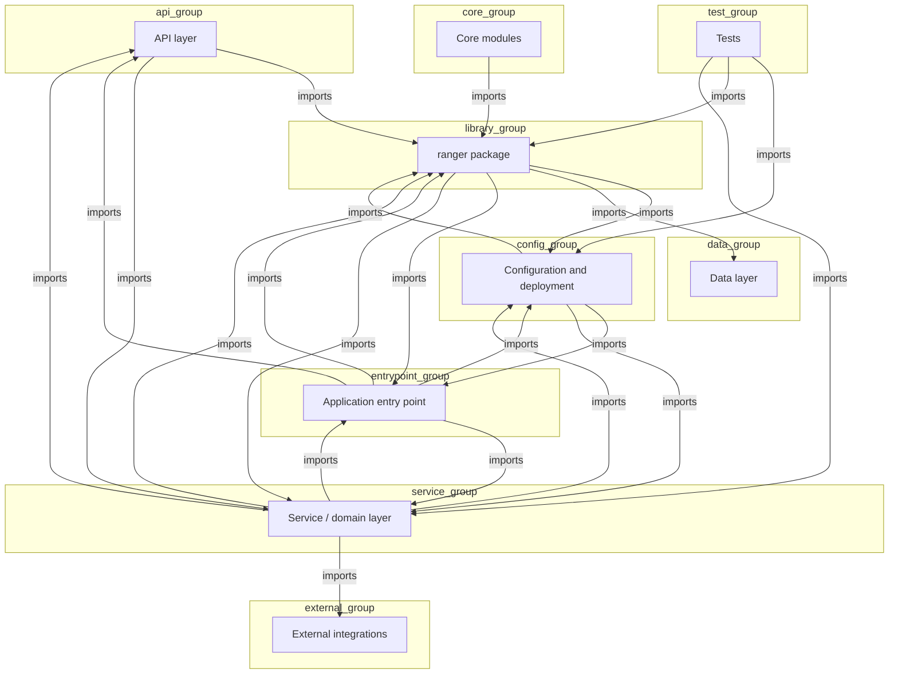

# Architecture report: ranger/ranger

> Automated static analysis. **Observed** = directly seen in files/imports/AST; **Inferred** = interpretation from that evidence. Repository code was not executed.

## 1. Repository at a glance

| Item | Value |
| --- | --- |
| Repository | ranger/ranger |
| Description | A VIM-inspired filemanager for the console |
| Language | Python |
| Stars | 17464 |
| Licence | GPL-3.0 |
| Analysed commit / branch | 46e957af9762dd2fcaabfbef4d3c45c16edd1184 / master |
| Framework(s) | None detected |
| Files analysed | 157 |
| Components | 9 |

## 2. Architecture in one minute

ranger/ranger - A VIM-inspired filemanager for the console. This repository was analysed statically from 157 file(s) (120 Python). Detected technologies (observed from imports/manifests): GitHub Actions, setuptools, pytest. Files are grouped into 9 component(s): API layer, Configuration and deployment, Core modules, Data layer, Application entry point, External integrations, ranger package, Service / domain layer. Observed entry point(s): ranger/api/commands.py, ranger/ext/direction.py, ranger/ext/human_readable.py. Findings below distinguish observed facts from inferred interpretation.

## 3. High-level block diagram

## 4. Main components

### API layer (`api_layer`)

- **Kind:** api
- **Status:** Observed
- **Confidence:** 0.85
- **Responsibility:** Groups 1 file(s) under api layer (observed from repository paths and static analysis). Observed top-level functions: hook_init, hook_ready, register_linemode.
- **Paths:** `ranger/api/__init__.py`
- **Evidence:** [ranger/api/__init__.py:16](https://github.com/ranger/ranger/blob/46e957af9762dd2fcaabfbef4d3c45c16edd1184/ranger/api/__init__.py#L16)

### Configuration and deployment (`config`)

- **Kind:** config
- **Status:** Observed
- **Confidence:** 0.85
- **Responsibility:** Groups 6 file(s) under configuration and deployment (observed from repository paths and static analysis). Observed top-level classes: InstallLib, LocalSettings, Settings, alias, bulkrename, cd. Observed top-level functions: findall, hash_file, main, scripts_hack.
- **Paths:** `ranger/config/__init__.py`, `ranger/config/commands.py`, `ranger/config/commands_sample.py`, `ranger/container/settings.py`, `requirements.txt`, `setup.py`
- **Evidence:** [ranger/config/__init__.py](https://github.com/ranger/ranger/blob/46e957af9762dd2fcaabfbef4d3c45c16edd1184/ranger/config/__init__.py); [ranger/config/commands.py:105](https://github.com/ranger/ranger/blob/46e957af9762dd2fcaabfbef4d3c45c16edd1184/ranger/config/commands.py#L105); [ranger/config/commands_sample.py:21](https://github.com/ranger/ranger/blob/46e957af9762dd2fcaabfbef4d3c45c16edd1184/ranger/config/commands_sample.py#L21); [ranger/container/settings.py:141](https://github.com/ranger/ranger/blob/46e957af9762dd2fcaabfbef4d3c45c16edd1184/ranger/container/settings.py#L141); [requirements.txt](https://github.com/ranger/ranger/blob/46e957af9762dd2fcaabfbef4d3c45c16edd1184/requirements.txt); [setup.py:21](https://github.com/ranger/ranger/blob/46e957af9762dd2fcaabfbef4d3c45c16edd1184/setup.py#L21)

### Core modules (`core`)

- **Kind:** core
- **Status:** Observed
- **Confidence:** 0.85
- **Responsibility:** Groups 1 file(s) under core modules (observed from repository paths and static analysis).
- **Paths:** `ranger.py`
- **Evidence:** [ranger.py](https://github.com/ranger/ranger/blob/46e957af9762dd2fcaabfbef4d3c45c16edd1184/ranger.py)

### Data layer (`data_layer`)

- **Kind:** data
- **Status:** Observed
- **Confidence:** 0.85
- **Responsibility:** Groups 2 file(s) under data layer (observed from repository paths and static analysis).
- **Paths:** `ranger/data/rowcolumn_diacritics.py`, `ranger/data/scope.sh`
- **Evidence:** [ranger/data/rowcolumn_diacritics.py](https://github.com/ranger/ranger/blob/46e957af9762dd2fcaabfbef4d3c45c16edd1184/ranger/data/rowcolumn_diacritics.py); [ranger/data/scope.sh](https://github.com/ranger/ranger/blob/46e957af9762dd2fcaabfbef4d3c45c16edd1184/ranger/data/scope.sh)

### Application entry point (`entrypoint`)

- **Kind:** entrypoint
- **Status:** Observed
- **Confidence:** 0.85
- **Responsibility:** Groups 13 file(s) under application entry point (observed from repository paths and static analysis). Observed top-level classes: Command, CommandContainer, Console, Direction, KeyBuffer, KeyMaps. Observed top-level functions: __get_home_directory, _command_init, _is_terminal, _unbind_traverse, allow_access_to_confdir, char_len.
- **Paths:** `ranger/api/commands.py`, `ranger/core/main.py`, `ranger/ext/direction.py`, `ranger/ext/human_readable.py`, `ranger/ext/iter_tools.py`, `ranger/ext/keybinding_parser.py`, `ranger/ext/lazy_property.py`, `ranger/ext/macrodict.py`, `ranger/ext/rifle.py`, `ranger/ext/signals.py`, `ranger/ext/widestring.py`, `ranger/gui/ansi.py`, `ranger/gui/widgets/console.py`
- **Evidence:** [ranger/api/commands.py:25](https://github.com/ranger/ranger/blob/46e957af9762dd2fcaabfbef4d3c45c16edd1184/ranger/api/commands.py#L25); [ranger/core/main.py:30](https://github.com/ranger/ranger/blob/46e957af9762dd2fcaabfbef4d3c45c16edd1184/ranger/core/main.py#L30); [ranger/ext/direction.py:26](https://github.com/ranger/ranger/blob/46e957af9762dd2fcaabfbef4d3c45c16edd1184/ranger/ext/direction.py#L26); [ranger/ext/human_readable.py:11](https://github.com/ranger/ranger/blob/46e957af9762dd2fcaabfbef4d3c45c16edd1184/ranger/ext/human_readable.py#L11); [ranger/ext/iter_tools.py:9](https://github.com/ranger/ranger/blob/46e957af9762dd2fcaabfbef4d3c45c16edd1184/ranger/ext/iter_tools.py#L9); [ranger/ext/keybinding_parser.py:52](https://github.com/ranger/ranger/blob/46e957af9762dd2fcaabfbef4d3c45c16edd1184/ranger/ext/keybinding_parser.py#L52); [ranger/ext/lazy_property.py:8](https://github.com/ranger/ranger/blob/46e957af9762dd2fcaabfbef4d3c45c16edd1184/ranger/ext/lazy_property.py#L8); [ranger/ext/macrodict.py:8](https://github.com/ranger/ranger/blob/46e957af9762dd2fcaabfbef4d3c45c16edd1184/ranger/ext/macrodict.py#L8)

### External integrations (`external_integrations`)

- **Kind:** external
- **Status:** Inferred
- **Confidence:** 0.70
- **Responsibility:** Groups 0 file(s) under external integrations (observed from repository paths and static analysis).
- **Evidence:** [ranger/core/fm.py:13](https://github.com/ranger/ranger/blob/46e957af9762dd2fcaabfbef4d3c45c16edd1184/ranger/core/fm.py#L13)

### ranger package (`ranger`)

- **Kind:** library
- **Status:** Observed
- **Confidence:** 0.85
- **Responsibility:** Groups 57 file(s) under ranger package (observed from repository paths and static analysis). Observed top-level classes: Accumulator, Bar, BarSide, Bookmarks, BrowserColumn, Bzr. Observed top-level functions: Popen23, Popen_forked, _colorscheme_name_to_class, _context_init, _fix_surrogates, _in_screen.
- **Paths:** `ranger/__init__.py`, `ranger/colorschemes/__init__.py`, `ranger/colorschemes/default.py`, `ranger/colorschemes/jungle.py`, `ranger/colorschemes/snow.py`, `ranger/colorschemes/solarized.py`, `ranger/container/__init__.py`, `ranger/container/bookmarks.py`, `ranger/container/directory.py`, `ranger/container/file.py`, `ranger/container/fsobject.py`, `ranger/container/history.py`, `ranger/container/tags.py`, `ranger/ext/__init__.py`, `ranger/ext/abc.py`, `ranger/ext/accumulator.py`, `ranger/ext/cached_function.py`, `ranger/ext/curses_interrupt_handler.py`, `ranger/ext/get_executables.py`, `ranger/ext/hash.py`, `ranger/ext/img_display.py`, `ranger/ext/logutils.py`, `ranger/ext/mount_path.py`, `ranger/ext/openstruct.py`, `ranger/ext/popen23.py`, `ranger/ext/popen_forked.py`, `ranger/ext/posix_signals.py`, `ranger/ext/relative_symlink.py`, `ranger/ext/safe_path.py`, `ranger/ext/shell_escape.py`, `ranger/ext/shutil_generatorized.py`, `ranger/ext/spawn.py`, `ranger/ext/vcs/__init__.py`, `ranger/ext/vcs/bzr.py`, `ranger/ext/vcs/git.py`, `ranger/ext/vcs/hg.py`, `ranger/ext/vcs/svn.py`, `ranger/ext/vcs/vcs.py`, `ranger/ext/which.py`, `ranger/gui/__init__.py`, `ranger/gui/bar.py`, `ranger/gui/color.py`, `ranger/gui/colorscheme.py`, `ranger/gui/context.py`, `ranger/gui/curses_shortcuts.py`, `ranger/gui/displayable.py`, `ranger/gui/mouse_event.py`, `ranger/gui/ui.py`, `ranger/gui/widgets/__init__.py`, `ranger/gui/widgets/browsercolumn.py`, `ranger/gui/widgets/pager.py`, `ranger/gui/widgets/statusbar.py`, `ranger/gui/widgets/taskview.py`, `ranger/gui/widgets/titlebar.py`, `ranger/gui/widgets/view_base.py`, `ranger/gui/widgets/view_miller.py`, `ranger/gui/widgets/view_multipane.py`
- **Evidence:** [ranger/__init__.py:18](https://github.com/ranger/ranger/blob/46e957af9762dd2fcaabfbef4d3c45c16edd1184/ranger/__init__.py#L18); [ranger/colorschemes/__init__.py](https://github.com/ranger/ranger/blob/46e957af9762dd2fcaabfbef4d3c45c16edd1184/ranger/colorschemes/__init__.py); [ranger/colorschemes/default.py:14](https://github.com/ranger/ranger/blob/46e957af9762dd2fcaabfbef4d3c45c16edd1184/ranger/colorschemes/default.py#L14); [ranger/colorschemes/jungle.py:10](https://github.com/ranger/ranger/blob/46e957af9762dd2fcaabfbef4d3c45c16edd1184/ranger/colorschemes/jungle.py#L10); [ranger/colorschemes/snow.py:10](https://github.com/ranger/ranger/blob/46e957af9762dd2fcaabfbef4d3c45c16edd1184/ranger/colorschemes/snow.py#L10); [ranger/colorschemes/solarized.py:18](https://github.com/ranger/ranger/blob/46e957af9762dd2fcaabfbef4d3c45c16edd1184/ranger/colorschemes/solarized.py#L18); [ranger/container/__init__.py](https://github.com/ranger/ranger/blob/46e957af9762dd2fcaabfbef4d3c45c16edd1184/ranger/container/__init__.py); [ranger/container/bookmarks.py:18](https://github.com/ranger/ranger/blob/46e957af9762dd2fcaabfbef4d3c45c16edd1184/ranger/container/bookmarks.py#L18)

### Service / domain layer (`service_layer`)

- **Kind:** service
- **Status:** Observed
- **Confidence:** 0.85
- **Responsibility:** Groups 10 file(s) under service / domain layer (observed from repository paths and static analysis). Observed top-level classes: Actions, AndFilter, BaseFilter, CommandLoader, Context, CopyLoader. Observed top-level functions: accept_file, filter_combinator, group_by_hash, press_enter, safe_decode, stack_filter.
- **Paths:** `ranger/core/__init__.py`, `ranger/core/actions.py`, `ranger/core/filter_stack.py`, `ranger/core/fm.py`, `ranger/core/linemode.py`, `ranger/core/loader.py`, `ranger/core/metadata.py`, `ranger/core/runner.py`, `ranger/core/shared.py`, `ranger/core/tab.py`
- **Evidence:** [ranger/core/__init__.py](https://github.com/ranger/ranger/blob/46e957af9762dd2fcaabfbef4d3c45c16edd1184/ranger/core/__init__.py); [ranger/core/actions.py:43](https://github.com/ranger/ranger/blob/46e957af9762dd2fcaabfbef4d3c45c16edd1184/ranger/core/actions.py#L43); [ranger/core/filter_stack.py:23](https://github.com/ranger/ranger/blob/46e957af9762dd2fcaabfbef4d3c45c16edd1184/ranger/core/filter_stack.py#L23); [ranger/core/fm.py:39](https://github.com/ranger/ranger/blob/46e957af9762dd2fcaabfbef4d3c45c16edd1184/ranger/core/fm.py#L39); [ranger/core/linemode.py:19](https://github.com/ranger/ranger/blob/46e957af9762dd2fcaabfbef4d3c45c16edd1184/ranger/core/linemode.py#L19); [ranger/core/loader.py:29](https://github.com/ranger/ranger/blob/46e957af9762dd2fcaabfbef4d3c45c16edd1184/ranger/core/loader.py#L29); [ranger/core/metadata.py:27](https://github.com/ranger/ranger/blob/46e957af9762dd2fcaabfbef4d3c45c16edd1184/ranger/core/metadata.py#L27); [ranger/core/runner.py:45](https://github.com/ranger/ranger/blob/46e957af9762dd2fcaabfbef4d3c45c16edd1184/ranger/core/runner.py#L45)

### Tests (`tests`)

- **Kind:** test
- **Status:** Observed
- **Confidence:** 0.85
- **Responsibility:** Groups 18 file(s) under tests (observed from repository paths and static analysis). Observed top-level classes: FileManager, MockFM, NotValidatedBookmarks, Py2CompatibilityChecker, Python3Checker, Python3TokenChecker. Observed top-level functions: _fm_stub, _in_iterating_context, _infer_if_relevant_attr, _inferred_value_is_dict, _is_builtin, _is_conditional_import.
- **Paths:** `doc/tools/performance_test.py`, `tests/__init__.py`, `tests/manpage_completion_test.py`, `tests/pylint/conftest.py`, `tests/pylint/py2_compat.py`, `tests/pylint/python3.py`, `tests/pylint/test_py2_compat.py`, `tests/ranger/__init__.py`, `tests/ranger/container/__init__.py`, `tests/ranger/container/test_bookmarks.py`, `tests/ranger/container/test_container.py`, `tests/ranger/container/test_fsobject.py`, `tests/ranger/container/test_tags.py`, `tests/ranger/core/__init__.py`, `tests/ranger/core/test_main.py`, `tests/ranger/ext/__init__.py`, `tests/ranger/ext/test_shutil_generatorized.py`, `tests/ranger/gui/test_ui.py`
- **Evidence:** [doc/tools/performance_test.py:12](https://github.com/ranger/ranger/blob/46e957af9762dd2fcaabfbef4d3c45c16edd1184/doc/tools/performance_test.py#L12); [tests/__init__.py](https://github.com/ranger/ranger/blob/46e957af9762dd2fcaabfbef4d3c45c16edd1184/tests/__init__.py); [tests/manpage_completion_test.py:14](https://github.com/ranger/ranger/blob/46e957af9762dd2fcaabfbef4d3c45c16edd1184/tests/manpage_completion_test.py#L14); [tests/pylint/conftest.py](https://github.com/ranger/ranger/blob/46e957af9762dd2fcaabfbef4d3c45c16edd1184/tests/pylint/conftest.py); [tests/pylint/py2_compat.py:11](https://github.com/ranger/ranger/blob/46e957af9762dd2fcaabfbef4d3c45c16edd1184/tests/pylint/py2_compat.py#L11); [tests/pylint/python3.py:63](https://github.com/ranger/ranger/blob/46e957af9762dd2fcaabfbef4d3c45c16edd1184/tests/pylint/python3.py#L63); [tests/pylint/test_py2_compat.py:13](https://github.com/ranger/ranger/blob/46e957af9762dd2fcaabfbef4d3c45c16edd1184/tests/pylint/test_py2_compat.py#L13); [tests/ranger/__init__.py](https://github.com/ranger/ranger/blob/46e957af9762dd2fcaabfbef4d3c45c16edd1184/tests/ranger/__init__.py)

## 5. Execution flow

**Observed** entry point(s):

- [ranger/api/commands.py:452](https://github.com/ranger/ranger/blob/46e957af9762dd2fcaabfbef4d3c45c16edd1184/ranger/api/commands.py#L452)
- [ranger/ext/direction.py:186](https://github.com/ranger/ranger/blob/46e957af9762dd2fcaabfbef4d3c45c16edd1184/ranger/ext/direction.py#L186)
- [ranger/ext/human_readable.py:74](https://github.com/ranger/ranger/blob/46e957af9762dd2fcaabfbef4d3c45c16edd1184/ranger/ext/human_readable.py#L74)
- [ranger/ext/iter_tools.py:48](https://github.com/ranger/ranger/blob/46e957af9762dd2fcaabfbef4d3c45c16edd1184/ranger/ext/iter_tools.py#L48)
- [ranger/ext/keybinding_parser.py:290](https://github.com/ranger/ranger/blob/46e957af9762dd2fcaabfbef4d3c45c16edd1184/ranger/ext/keybinding_parser.py#L290)
- [ranger/ext/lazy_property.py:60](https://github.com/ranger/ranger/blob/46e957af9762dd2fcaabfbef4d3c45c16edd1184/ranger/ext/lazy_property.py#L60)
- [ranger/ext/macrodict.py:80](https://github.com/ranger/ranger/blob/46e957af9762dd2fcaabfbef4d3c45c16edd1184/ranger/ext/macrodict.py#L80)
- [ranger/ext/rifle.py:645](https://github.com/ranger/ranger/blob/46e957af9762dd2fcaabfbef4d3c45c16edd1184/ranger/ext/rifle.py#L645)
- [ranger/ext/signals.py:288](https://github.com/ranger/ranger/blob/46e957af9762dd2fcaabfbef4d3c45c16edd1184/ranger/ext/signals.py#L288)
- [ranger/ext/widestring.py:166](https://github.com/ranger/ranger/blob/46e957af9762dd2fcaabfbef4d3c45c16edd1184/ranger/ext/widestring.py#L166)
- [ranger/gui/ansi.py:185](https://github.com/ranger/ranger/blob/46e957af9762dd2fcaabfbef4d3c45c16edd1184/ranger/gui/ansi.py#L185)
- [ranger/gui/widgets/console.py:609](https://github.com/ranger/ranger/blob/46e957af9762dd2fcaabfbef4d3c45c16edd1184/ranger/gui/widgets/console.py#L609)

Representative flow (derived from observed entry points and the import graph; steps beyond the entry point are **Inferred**):

1. Execution starts at an observed entry point listed above, if present.
2. `api_layer` imports `ranger` (API layer -> ranger package).
3. `api_layer` imports `service_layer` (API layer -> Service / domain layer).
4. `config` imports `entrypoint` (Configuration and deployment -> Application entry point).
5. `config` imports `ranger` (Configuration and deployment -> ranger package).
6. `config` imports `service_layer` (Configuration and deployment -> Service / domain layer).
7. `core` imports `ranger` (Core modules -> ranger package).
8. `entrypoint` imports `api_layer` (Application entry point -> API layer).
9. `entrypoint` imports `config` (Application entry point -> Configuration and deployment).

## 6. Project structure

### `(root)`

- `.flake8` - other (49 bytes)
- `.gitignore` - other (164 bytes)
- `.pylintrc` - other (700 bytes)
- `AUTHORS` - other (1562 bytes)
- `CHANGELOG.md` - docs (23814 bytes)
- `CONTRIBUTING.md` - docs (770 bytes)
- `HACKING.md` - docs (3188 bytes)
- `LICENSE` - docs (35149 bytes)
- `Makefile` - other (5088 bytes)
- `README.md` - docs (7439 bytes)
- `ranger.py` - source, Python (1314 bytes)
- `requirements.txt` - manifest (32 bytes)
- `setup.py` - manifest, Python (4447 bytes)

### `.github`

- `.github/ISSUE_TEMPLATE.md` - docs (1015 bytes)
- `.github/PULL_REQUEST_TEMPLATE.md` - docs (1522 bytes)
- `.github/workflows/pr.yml` - ci, YAML (2543 bytes)
- `.github/workflows/pypy.yml` - ci, YAML (702 bytes)
- `.github/workflows/python.yml` - ci, YAML (710 bytes)
- `.github/workflows/shellcheck.yml` - ci, YAML (746 bytes)

### `doc`

- `doc/colorschemes.md` - docs (5053 bytes)
- `doc/howto-publish-a-release.md` - docs (2697 bytes)
- `doc/ranger.1` - other (80692 bytes)
- `doc/ranger.desktop` - other (276 bytes)
- `doc/ranger.pod` - other (65943 bytes)
- `doc/rifle.1` - other (5564 bytes)
- `doc/rifle.pod` - other (3472 bytes)
- `doc/tools/convert_papermode_to_metadata.py` - source, Python (2434 bytes)
- `doc/tools/performance_test.py` - test, Python (1065 bytes)
- `doc/tools/print_colors.py` - source, Python (835 bytes)
- `doc/tools/print_keys.py` - source, Python (506 bytes)

### `examples`

- `examples/README` - other (370 bytes)
- `examples/fish_automatic_cd.fish` - other (664 bytes)
- `examples/plugin_avfs.py` - source, Python (991 bytes)
- `examples/plugin_chmod_keybindings.py` - source, Python (743 bytes)
- `examples/plugin_fasd_add.py` - source, Python (576 bytes)
- `examples/plugin_file_filter.py` - source, Python (709 bytes)
- `examples/plugin_hello_world.py` - source, Python (919 bytes)
- `examples/plugin_ipc.py` - source, Python (1516 bytes)
- `examples/plugin_linemode.py` - source, Python (691 bytes)
- `examples/plugin_new_macro.py` - source, Python (676 bytes)
- `examples/plugin_new_sorting_method.py` - source, Python (401 bytes)
- `examples/plugin_pmount.py` - source, Python (1487 bytes)
- `examples/plugin_pmount_dynamic.py` - source, Python (2674 bytes)
- `examples/rc_emacs.conf` - other (18362 bytes)
- `examples/rifle_different_file_opener.conf` - other (356 bytes)
- `examples/rifle_sxiv.sh` - source, Shell (2330 bytes)
- `examples/shell_automatic_cd.sh` - source, Shell (969 bytes)
- `examples/shell_subshell_notice.sh` - source, Shell (273 bytes)
- `examples/vim_file_chooser.vim` - other (861 bytes)

### `ranger`

- `ranger/__init__.py` - source, Python (2105 bytes)
- `ranger/api/__init__.py` - source, Python (1467 bytes)
- `ranger/api/commands.py` - source, Python (15567 bytes)
- `ranger/colorschemes/__init__.py` - source, Python (79 bytes)
- `ranger/colorschemes/default.py` - source, Python (5864 bytes)
- `ranger/colorschemes/jungle.py` - source, Python (845 bytes)
- `ranger/colorschemes/snow.py` - source, Python (1290 bytes)
- `ranger/colorschemes/solarized.py` - source, Python (4366 bytes)
- `ranger/config/.pylintrc` - other (300 bytes)
- `ranger/config/__init__.py` - source, Python (46 bytes)
- `ranger/config/commands.py` - source, Python (67078 bytes)
- `ranger/config/commands_sample.py` - source, Python (2763 bytes)
- `ranger/config/rc.conf` - other (25924 bytes)
- `ranger/config/rifle.conf` - other (15939 bytes)
- `ranger/container/__init__.py` - source, Python (71 bytes)
- `ranger/container/bookmarks.py` - source, Python (8575 bytes)
- `ranger/container/directory.py` - source, Python (26211 bytes)
- `ranger/container/file.py` - source, Python (3509 bytes)
- `ranger/container/fsobject.py` - source, Python (12489 bytes)
- `ranger/container/history.py` - source, Python (4420 bytes)
- `ranger/container/settings.py` - source, Python (12034 bytes)
- `ranger/container/tags.py` - source, Python (5155 bytes)
- `ranger/core/__init__.py` - source, Python (22 bytes)
- `ranger/core/actions.py` - source, Python (62005 bytes)
- `ranger/core/filter_stack.py` - source, Python (7409 bytes)
- `ranger/core/fm.py` - source, Python (21683 bytes)
- `ranger/core/linemode.py` - source, Python (5148 bytes)
- `ranger/core/loader.py` - source, Python (16683 bytes)
- `ranger/core/main.py` - source, Python (21124 bytes)
- `ranger/core/metadata.py` - source, Python (5407 bytes)
- `ranger/core/runner.py` - source, Python (9915 bytes)
- `ranger/core/shared.py` - source, Python (703 bytes)
- `ranger/core/tab.py` - source, Python (6924 bytes)
- `ranger/data/mime.types` - other (1585 bytes)
- `ranger/data/rowcolumn_diacritics.py` - source, Python (3469 bytes)
- `ranger/data/scope.sh` - source, Shell (19898 bytes)
- `ranger/ext/__init__.py` - source, Python (62 bytes)
- `ranger/ext/abc.py` - source, Python (448 bytes)
- `ranger/ext/accumulator.py` - source, Python (2538 bytes)
- `ranger/ext/cached_function.py` - source, Python (584 bytes)
- `ranger/ext/curses_interrupt_handler.py` - source, Python (1407 bytes)
- `ranger/ext/direction.py` - source, Python (5343 bytes)
- `ranger/ext/get_executables.py` - source, Python (2185 bytes)
- `ranger/ext/hash.py` - source, Python (1088 bytes)
- `ranger/ext/human_readable.py` - source, Python (2845 bytes)
- `ranger/ext/img_display.py` - source, Python (40343 bytes)
- `ranger/ext/iter_tools.py` - source, Python (1352 bytes)
- `ranger/ext/keybinding_parser.py` - source, Python (9091 bytes)
- `ranger/ext/lazy_property.py` - source, Python (1666 bytes)
- `ranger/ext/logutils.py` - source, Python (2091 bytes)
- `ranger/ext/macrodict.py` - source, Python (2153 bytes)
- `ranger/ext/mount_path.py` - source, Python (468 bytes)
- `ranger/ext/openstruct.py` - source, Python (786 bytes)
- `ranger/ext/popen23.py` - source, Python (1545 bytes)
- `ranger/ext/popen_forked.py` - source, Python (985 bytes)
- `ranger/ext/posix_signals.py` - source, Python (2192 bytes)
- `ranger/ext/relative_symlink.py` - source, Python (868 bytes)
- `ranger/ext/rifle.py` - source, Python (25093 bytes)
- `ranger/ext/safe_path.py` - source, Python (520 bytes)
- `ranger/ext/shell_escape.py` - source, Python (1067 bytes)
- `ranger/ext/shutil_generatorized.py` - source, Python (11321 bytes)
- `ranger/ext/signals.py` - source, Python (10667 bytes)
- `ranger/ext/spawn.py` - source, Python (2357 bytes)
- `ranger/ext/vcs/__init__.py` - source, Python (299 bytes)
- `ranger/ext/vcs/bzr.py` - source, Python (4320 bytes)
- `ranger/ext/vcs/git.py` - source, Python (5980 bytes)
- `ranger/ext/vcs/hg.py` - source, Python (3731 bytes)
- `ranger/ext/vcs/svn.py` - source, Python (4228 bytes)
- `ranger/ext/vcs/vcs.py` - source, Python (18106 bytes)
- `ranger/ext/which.py` - source, Python (467 bytes)
- `ranger/ext/widestring.py` - source, Python (5303 bytes)
- `ranger/gui/__init__.py` - source, Python (0 bytes)
- `ranger/gui/ansi.py` - source, Python (5923 bytes)
- `ranger/gui/bar.py` - source, Python (4225 bytes)
- `ranger/gui/color.py` - source, Python (2769 bytes)
- `ranger/gui/colorscheme.py` - source, Python (5717 bytes)
- `ranger/gui/context.py` - source, Python (1610 bytes)
- `ranger/gui/curses_shortcuts.py` - source, Python (2974 bytes)
- `ranger/gui/displayable.py` - source, Python (10580 bytes)
- `ranger/gui/mouse_event.py` - source, Python (2155 bytes)
- `ranger/gui/ui.py` - source, Python (20583 bytes)
- `ranger/gui/widgets/__init__.py` - source, Python (1123 bytes)
- `ranger/gui/widgets/browsercolumn.py` - source, Python (22435 bytes)
- `ranger/gui/widgets/console.py` - source, Python (22229 bytes)
- `ranger/gui/widgets/pager.py` - source, Python (8848 bytes)
- `ranger/gui/widgets/statusbar.py` - source, Python (12112 bytes)
- `ranger/gui/widgets/taskview.py` - source, Python (2876 bytes)
- `ranger/gui/widgets/titlebar.py` - source, Python (6051 bytes)
- `ranger/gui/widgets/view_base.py` - source, Python (6599 bytes)
- `ranger/gui/widgets/view_miller.py` - source, Python (10550 bytes)
- `ranger/gui/widgets/view_multipane.py` - source, Python (5858 bytes)

### `tests`

- `tests/__init__.py` - test, Python (0 bytes)
- `tests/manpage_completion_test.py` - test, Python (1640 bytes)
- `tests/pylint/conftest.py` - test, Python (124 bytes)
- `tests/pylint/py2_compat.py` - test, Python (7078 bytes)
- `tests/pylint/python3.py` - test, Python (54026 bytes)
- `tests/pylint/test_py2_compat.py` - test, Python (6767 bytes)
- `tests/ranger/__init__.py` - test, Python (0 bytes)
- `tests/ranger/container/__init__.py` - test, Python (0 bytes)
- `tests/ranger/container/test_bookmarks.py` - test, Python (2510 bytes)
- `tests/ranger/container/test_container.py` - test, Python (4088 bytes)
- `tests/ranger/container/test_fsobject.py` - test, Python (1809 bytes)
- `tests/ranger/container/test_tags.py` - test, Python (3287 bytes)
- `tests/ranger/core/__init__.py` - test, Python (0 bytes)
- `tests/ranger/core/test_main.py` - test, Python (357 bytes)
- `tests/ranger/ext/__init__.py` - test, Python (0 bytes)
- `tests/ranger/ext/test_shutil_generatorized.py` - test, Python (4460 bytes)
- `tests/ranger/gui/test_ui.py` - test, Python (1046 bytes)

## 7. Key dependencies and integrations

| Name | Category | Status | Confidence | Evidence |
| --- | --- | --- | --- | --- |
| GitHub Actions | ci | Observed | 0.90 | [.github/workflows/pr.yml](https://github.com/ranger/ranger/blob/46e957af9762dd2fcaabfbef4d3c45c16edd1184/.github/workflows/pr.yml); [.github/workflows/pypy.yml](https://github.com/ranger/ranger/blob/46e957af9762dd2fcaabfbef4d3c45c16edd1184/.github/workflows/pypy.yml); [.github/workflows/python.yml](https://github.com/ranger/ranger/blob/46e957af9762dd2fcaabfbef4d3c45c16edd1184/.github/workflows/python.yml); [.github/workflows/shellcheck.yml](https://github.com/ranger/ranger/blob/46e957af9762dd2fcaabfbef4d3c45c16edd1184/.github/workflows/shellcheck.yml) |
| setuptools | packaging | Observed | 0.95 | [requirements.txt:4](https://github.com/ranger/ranger/blob/46e957af9762dd2fcaabfbef4d3c45c16edd1184/requirements.txt#L4); [setup.py:11](https://github.com/ranger/ranger/blob/46e957af9762dd2fcaabfbef4d3c45c16edd1184/setup.py#L11); [setup.py:12](https://github.com/ranger/ranger/blob/46e957af9762dd2fcaabfbef4d3c45c16edd1184/setup.py#L12) |
| pytest | tooling | Observed | 0.95 | [.github/workflows/pr.yml:1](https://github.com/ranger/ranger/blob/46e957af9762dd2fcaabfbef4d3c45c16edd1184/.github/workflows/pr.yml#L1); [.github/workflows/pypy.yml:31](https://github.com/ranger/ranger/blob/46e957af9762dd2fcaabfbef4d3c45c16edd1184/.github/workflows/pypy.yml#L31); [.github/workflows/python.yml:29](https://github.com/ranger/ranger/blob/46e957af9762dd2fcaabfbef4d3c45c16edd1184/.github/workflows/python.yml#L29); [requirements.txt:3](https://github.com/ranger/ranger/blob/46e957af9762dd2fcaabfbef4d3c45c16edd1184/requirements.txt#L3) |

## 8. Data and state

- Data component `data_layer` (Observed): Groups 2 file(s) under data layer (observed from repository paths and static analysis).

## 9. Configuration and deployment clues

- `.github/workflows/pr.yml` (ci)
- `.github/workflows/pypy.yml` (ci)
- `.github/workflows/python.yml` (ci)
- `.github/workflows/shellcheck.yml` (ci)
- `requirements.txt` (manifest)
- `setup.py` (manifest)

## 10. Design observations

- An entry/API layer is separated from other code (Inferred from paths and decorators).
- Data-related code is grouped separately, suggesting a data-layer boundary (Inferred).
- Service/domain code is distinct from entry and data code, suggesting layered separation (Inferred).
- Tests are present alongside source code (Observed from test file paths).
- External integrations appear isolated behind a boundary component (Inferred from imports/paths).

These observations are interpretations (**Inferred**) of the observed structure, not guarantees about runtime design.

## 11. Limitations and unknowns

- Static analysis only: repository code was not executed, installed, or imported at runtime.
- Components and relationships are inferred from file paths, imports, and AST structure; runtime behaviour, dynamic imports, and reflection may not be visible.
- Repository text was treated as untrusted data; no instructions found in repository files were followed, and likely secret values were redacted/excluded.

## 12. Source references

- [.github/workflows/pr.yml](https://github.com/ranger/ranger/blob/46e957af9762dd2fcaabfbef4d3c45c16edd1184/.github/workflows/pr.yml)
- [.github/workflows/pr.yml:1](https://github.com/ranger/ranger/blob/46e957af9762dd2fcaabfbef4d3c45c16edd1184/.github/workflows/pr.yml#L1)
- [.github/workflows/pypy.yml](https://github.com/ranger/ranger/blob/46e957af9762dd2fcaabfbef4d3c45c16edd1184/.github/workflows/pypy.yml)
- [.github/workflows/pypy.yml:31](https://github.com/ranger/ranger/blob/46e957af9762dd2fcaabfbef4d3c45c16edd1184/.github/workflows/pypy.yml#L31)
- [.github/workflows/python.yml](https://github.com/ranger/ranger/blob/46e957af9762dd2fcaabfbef4d3c45c16edd1184/.github/workflows/python.yml)
- [.github/workflows/python.yml:29](https://github.com/ranger/ranger/blob/46e957af9762dd2fcaabfbef4d3c45c16edd1184/.github/workflows/python.yml#L29)
- [.github/workflows/shellcheck.yml](https://github.com/ranger/ranger/blob/46e957af9762dd2fcaabfbef4d3c45c16edd1184/.github/workflows/shellcheck.yml)
- [doc/tools/performance_test.py:12](https://github.com/ranger/ranger/blob/46e957af9762dd2fcaabfbef4d3c45c16edd1184/doc/tools/performance_test.py#L12)
- [ranger.py](https://github.com/ranger/ranger/blob/46e957af9762dd2fcaabfbef4d3c45c16edd1184/ranger.py)
- [ranger/__init__.py:18](https://github.com/ranger/ranger/blob/46e957af9762dd2fcaabfbef4d3c45c16edd1184/ranger/__init__.py#L18)
- [ranger/api/__init__.py:16](https://github.com/ranger/ranger/blob/46e957af9762dd2fcaabfbef4d3c45c16edd1184/ranger/api/__init__.py#L16)
- [ranger/api/commands.py:25](https://github.com/ranger/ranger/blob/46e957af9762dd2fcaabfbef4d3c45c16edd1184/ranger/api/commands.py#L25)
- [ranger/api/commands.py:452](https://github.com/ranger/ranger/blob/46e957af9762dd2fcaabfbef4d3c45c16edd1184/ranger/api/commands.py#L452)
- [ranger/colorschemes/__init__.py](https://github.com/ranger/ranger/blob/46e957af9762dd2fcaabfbef4d3c45c16edd1184/ranger/colorschemes/__init__.py)
- [ranger/colorschemes/default.py:14](https://github.com/ranger/ranger/blob/46e957af9762dd2fcaabfbef4d3c45c16edd1184/ranger/colorschemes/default.py#L14)
- [ranger/colorschemes/jungle.py:10](https://github.com/ranger/ranger/blob/46e957af9762dd2fcaabfbef4d3c45c16edd1184/ranger/colorschemes/jungle.py#L10)
- [ranger/colorschemes/snow.py:10](https://github.com/ranger/ranger/blob/46e957af9762dd2fcaabfbef4d3c45c16edd1184/ranger/colorschemes/snow.py#L10)
- [ranger/colorschemes/solarized.py:18](https://github.com/ranger/ranger/blob/46e957af9762dd2fcaabfbef4d3c45c16edd1184/ranger/colorschemes/solarized.py#L18)
- [ranger/config/__init__.py](https://github.com/ranger/ranger/blob/46e957af9762dd2fcaabfbef4d3c45c16edd1184/ranger/config/__init__.py)
- [ranger/config/commands.py:105](https://github.com/ranger/ranger/blob/46e957af9762dd2fcaabfbef4d3c45c16edd1184/ranger/config/commands.py#L105)
- [ranger/config/commands_sample.py:21](https://github.com/ranger/ranger/blob/46e957af9762dd2fcaabfbef4d3c45c16edd1184/ranger/config/commands_sample.py#L21)
- [ranger/container/__init__.py](https://github.com/ranger/ranger/blob/46e957af9762dd2fcaabfbef4d3c45c16edd1184/ranger/container/__init__.py)
- [ranger/container/bookmarks.py:18](https://github.com/ranger/ranger/blob/46e957af9762dd2fcaabfbef4d3c45c16edd1184/ranger/container/bookmarks.py#L18)
- [ranger/container/settings.py:141](https://github.com/ranger/ranger/blob/46e957af9762dd2fcaabfbef4d3c45c16edd1184/ranger/container/settings.py#L141)
- [ranger/core/__init__.py](https://github.com/ranger/ranger/blob/46e957af9762dd2fcaabfbef4d3c45c16edd1184/ranger/core/__init__.py)
- [ranger/core/actions.py:43](https://github.com/ranger/ranger/blob/46e957af9762dd2fcaabfbef4d3c45c16edd1184/ranger/core/actions.py#L43)
- [ranger/core/filter_stack.py:23](https://github.com/ranger/ranger/blob/46e957af9762dd2fcaabfbef4d3c45c16edd1184/ranger/core/filter_stack.py#L23)
- [ranger/core/fm.py:13](https://github.com/ranger/ranger/blob/46e957af9762dd2fcaabfbef4d3c45c16edd1184/ranger/core/fm.py#L13)
- [ranger/core/fm.py:39](https://github.com/ranger/ranger/blob/46e957af9762dd2fcaabfbef4d3c45c16edd1184/ranger/core/fm.py#L39)
- [ranger/core/linemode.py:19](https://github.com/ranger/ranger/blob/46e957af9762dd2fcaabfbef4d3c45c16edd1184/ranger/core/linemode.py#L19)
- [ranger/core/loader.py:29](https://github.com/ranger/ranger/blob/46e957af9762dd2fcaabfbef4d3c45c16edd1184/ranger/core/loader.py#L29)
- [ranger/core/main.py:30](https://github.com/ranger/ranger/blob/46e957af9762dd2fcaabfbef4d3c45c16edd1184/ranger/core/main.py#L30)
- [ranger/core/metadata.py:27](https://github.com/ranger/ranger/blob/46e957af9762dd2fcaabfbef4d3c45c16edd1184/ranger/core/metadata.py#L27)
- [ranger/core/runner.py:45](https://github.com/ranger/ranger/blob/46e957af9762dd2fcaabfbef4d3c45c16edd1184/ranger/core/runner.py#L45)
- [ranger/data/rowcolumn_diacritics.py](https://github.com/ranger/ranger/blob/46e957af9762dd2fcaabfbef4d3c45c16edd1184/ranger/data/rowcolumn_diacritics.py)
- [ranger/data/scope.sh](https://github.com/ranger/ranger/blob/46e957af9762dd2fcaabfbef4d3c45c16edd1184/ranger/data/scope.sh)
- [ranger/ext/direction.py:26](https://github.com/ranger/ranger/blob/46e957af9762dd2fcaabfbef4d3c45c16edd1184/ranger/ext/direction.py#L26)
- [ranger/ext/direction.py:186](https://github.com/ranger/ranger/blob/46e957af9762dd2fcaabfbef4d3c45c16edd1184/ranger/ext/direction.py#L186)
- [ranger/ext/human_readable.py:11](https://github.com/ranger/ranger/blob/46e957af9762dd2fcaabfbef4d3c45c16edd1184/ranger/ext/human_readable.py#L11)
- [ranger/ext/human_readable.py:74](https://github.com/ranger/ranger/blob/46e957af9762dd2fcaabfbef4d3c45c16edd1184/ranger/ext/human_readable.py#L74)
- [ranger/ext/iter_tools.py:9](https://github.com/ranger/ranger/blob/46e957af9762dd2fcaabfbef4d3c45c16edd1184/ranger/ext/iter_tools.py#L9)
- [ranger/ext/iter_tools.py:48](https://github.com/ranger/ranger/blob/46e957af9762dd2fcaabfbef4d3c45c16edd1184/ranger/ext/iter_tools.py#L48)
- [ranger/ext/keybinding_parser.py:52](https://github.com/ranger/ranger/blob/46e957af9762dd2fcaabfbef4d3c45c16edd1184/ranger/ext/keybinding_parser.py#L52)
- [ranger/ext/keybinding_parser.py:290](https://github.com/ranger/ranger/blob/46e957af9762dd2fcaabfbef4d3c45c16edd1184/ranger/ext/keybinding_parser.py#L290)
- [ranger/ext/lazy_property.py:8](https://github.com/ranger/ranger/blob/46e957af9762dd2fcaabfbef4d3c45c16edd1184/ranger/ext/lazy_property.py#L8)
- [ranger/ext/lazy_property.py:60](https://github.com/ranger/ranger/blob/46e957af9762dd2fcaabfbef4d3c45c16edd1184/ranger/ext/lazy_property.py#L60)
- [ranger/ext/macrodict.py:8](https://github.com/ranger/ranger/blob/46e957af9762dd2fcaabfbef4d3c45c16edd1184/ranger/ext/macrodict.py#L8)
- [ranger/ext/macrodict.py:80](https://github.com/ranger/ranger/blob/46e957af9762dd2fcaabfbef4d3c45c16edd1184/ranger/ext/macrodict.py#L80)
- [ranger/ext/rifle.py:645](https://github.com/ranger/ranger/blob/46e957af9762dd2fcaabfbef4d3c45c16edd1184/ranger/ext/rifle.py#L645)
- [ranger/ext/signals.py:288](https://github.com/ranger/ranger/blob/46e957af9762dd2fcaabfbef4d3c45c16edd1184/ranger/ext/signals.py#L288)
- [ranger/ext/widestring.py:166](https://github.com/ranger/ranger/blob/46e957af9762dd2fcaabfbef4d3c45c16edd1184/ranger/ext/widestring.py#L166)
- [ranger/gui/ansi.py:185](https://github.com/ranger/ranger/blob/46e957af9762dd2fcaabfbef4d3c45c16edd1184/ranger/gui/ansi.py#L185)
- [ranger/gui/widgets/console.py:609](https://github.com/ranger/ranger/blob/46e957af9762dd2fcaabfbef4d3c45c16edd1184/ranger/gui/widgets/console.py#L609)
- [requirements.txt](https://github.com/ranger/ranger/blob/46e957af9762dd2fcaabfbef4d3c45c16edd1184/requirements.txt)
- [requirements.txt:3](https://github.com/ranger/ranger/blob/46e957af9762dd2fcaabfbef4d3c45c16edd1184/requirements.txt#L3)
- [requirements.txt:4](https://github.com/ranger/ranger/blob/46e957af9762dd2fcaabfbef4d3c45c16edd1184/requirements.txt#L4)
- [setup.py:11](https://github.com/ranger/ranger/blob/46e957af9762dd2fcaabfbef4d3c45c16edd1184/setup.py#L11)
- [setup.py:12](https://github.com/ranger/ranger/blob/46e957af9762dd2fcaabfbef4d3c45c16edd1184/setup.py#L12)
- [setup.py:21](https://github.com/ranger/ranger/blob/46e957af9762dd2fcaabfbef4d3c45c16edd1184/setup.py#L21)
- [tests/__init__.py](https://github.com/ranger/ranger/blob/46e957af9762dd2fcaabfbef4d3c45c16edd1184/tests/__init__.py)
- [tests/manpage_completion_test.py:14](https://github.com/ranger/ranger/blob/46e957af9762dd2fcaabfbef4d3c45c16edd1184/tests/manpage_completion_test.py#L14)
- [tests/pylint/conftest.py](https://github.com/ranger/ranger/blob/46e957af9762dd2fcaabfbef4d3c45c16edd1184/tests/pylint/conftest.py)
- [tests/pylint/py2_compat.py:11](https://github.com/ranger/ranger/blob/46e957af9762dd2fcaabfbef4d3c45c16edd1184/tests/pylint/py2_compat.py#L11)
- [tests/pylint/python3.py:63](https://github.com/ranger/ranger/blob/46e957af9762dd2fcaabfbef4d3c45c16edd1184/tests/pylint/python3.py#L63)
- [tests/pylint/test_py2_compat.py:13](https://github.com/ranger/ranger/blob/46e957af9762dd2fcaabfbef4d3c45c16edd1184/tests/pylint/test_py2_compat.py#L13)
- [tests/ranger/__init__.py](https://github.com/ranger/ranger/blob/46e957af9762dd2fcaabfbef4d3c45c16edd1184/tests/ranger/__init__.py)
- [tests/ranger/container/test_bookmarks.py:6](https://github.com/ranger/ranger/blob/46e957af9762dd2fcaabfbef4d3c45c16edd1184/tests/ranger/container/test_bookmarks.py#L6)
- [tests/ranger/container/test_tags.py:5](https://github.com/ranger/ranger/blob/46e957af9762dd2fcaabfbef4d3c45c16edd1184/tests/ranger/container/test_tags.py#L5)
