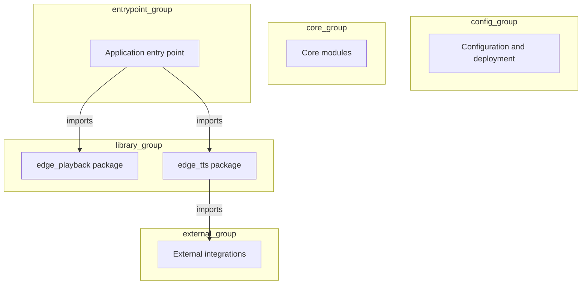

# Architecture report: rany2/edge-tts

> Automated static analysis. **Observed** = directly seen in files/imports/AST; **Inferred** = interpretation from that evidence. Repository code was not executed.

## 1. Repository at a glance

| Item | Value |
| --- | --- |
| Repository | rany2/edge-tts |
| Description | Use Microsoft Edge's online text-to-speech service from Python WITHOUT needing Microsoft Edge |
| Language | Python |
| Stars | 12541 |
| Licence | Other |
| Analysed commit / branch | bd44c1d1aaebdc1db7f47456ee12431b42ec7cac / master |
| Framework(s) | None detected |
| Files analysed | 42 |
| Components | 6 |

## 2. Architecture in one minute

rany2/edge-tts - Use Microsoft Edge's online text-to-speech service from Python WITHOUT needing Microsoft Edge. This repository was analysed statically from 42 file(s) (25 Python). Detected technologies (observed from imports/manifests): GitHub Actions, aiohttp, setuptools. Files are grouped into 6 component(s): Configuration and deployment, Core modules, edge_playback package, edge_tts package, Application entry point, External integrations. Observed entry point(s): src/edge_playback/__main__.py, src/edge_tts/__main__.py, src/edge_tts/util.py. Findings below distinguish observed facts from inferred interpretation.

## 3. High-level block diagram

## 4. Main components

### Configuration and deployment (`config`)

- **Kind:** config
- **Status:** Observed
- **Confidence:** 0.85
- **Responsibility:** Groups 3 file(s) under configuration and deployment (observed from repository paths and static analysis).
- **Paths:** `mypy.ini`, `setup.cfg`, `setup.py`
- **Evidence:** [mypy.ini](https://github.com/rany2/edge-tts/blob/bd44c1d1aaebdc1db7f47456ee12431b42ec7cac/mypy.ini); [setup.cfg](https://github.com/rany2/edge-tts/blob/bd44c1d1aaebdc1db7f47456ee12431b42ec7cac/setup.cfg); [setup.py](https://github.com/rany2/edge-tts/blob/bd44c1d1aaebdc1db7f47456ee12431b42ec7cac/setup.py)

### Core modules (`core`)

- **Kind:** core
- **Status:** Observed
- **Confidence:** 0.85
- **Responsibility:** Groups 3 file(s) under core modules (observed from repository paths and static analysis).
- **Paths:** `build_and_publish.sh`, `format.sh`, `lint.sh`
- **Evidence:** [build_and_publish.sh](https://github.com/rany2/edge-tts/blob/bd44c1d1aaebdc1db7f47456ee12431b42ec7cac/build_and_publish.sh); [format.sh](https://github.com/rany2/edge-tts/blob/bd44c1d1aaebdc1db7f47456ee12431b42ec7cac/format.sh); [lint.sh](https://github.com/rany2/edge-tts/blob/bd44c1d1aaebdc1db7f47456ee12431b42ec7cac/lint.sh)

### edge_playback package (`edge_playback`)

- **Kind:** library
- **Status:** Observed
- **Confidence:** 0.85
- **Responsibility:** Groups 3 file(s) under edge_playback package (observed from repository paths and static analysis). Observed top-level functions: play_mp3_win32, pr_err.
- **Paths:** `src/edge_playback/__init__.py`, `src/edge_playback/util.py`, `src/edge_playback/win32_playback.py`
- **Evidence:** [src/edge_playback/__init__.py](https://github.com/rany2/edge-tts/blob/bd44c1d1aaebdc1db7f47456ee12431b42ec7cac/src/edge_playback/__init__.py); [src/edge_playback/util.py:6](https://github.com/rany2/edge-tts/blob/bd44c1d1aaebdc1db7f47456ee12431b42ec7cac/src/edge_playback/util.py#L6); [src/edge_playback/win32_playback.py:8](https://github.com/rany2/edge-tts/blob/bd44c1d1aaebdc1db7f47456ee12431b42ec7cac/src/edge_playback/win32_playback.py#L8)

### edge_tts package (`edge_tts`)

- **Kind:** library
- **Status:** Observed
- **Confidence:** 0.85
- **Responsibility:** Groups 12 file(s) under edge_tts package (observed from repository paths and static analysis). Observed top-level classes: Communicate, CommunicateState, DRM, EdgeTTSException, NoAudioReceived, ProgressBar. Observed top-level functions: __list_voices, _adjust_split_point_for_xml_entity, _cs64_digest, _expand_sha256_schedule, _find_last_newline_or_space_within_limit, _find_safe_utf8_split_point.
- **Paths:** `src/edge_tts/__init__.py`, `src/edge_tts/communicate.py`, `src/edge_tts/constants.py`, `src/edge_tts/data_classes.py`, `src/edge_tts/drm.py`, `src/edge_tts/exceptions.py`, `src/edge_tts/progress.py`, `src/edge_tts/srt_composer.py`, `src/edge_tts/submaker.py`, `src/edge_tts/typing.py`, `src/edge_tts/version.py`, `src/edge_tts/voices.py`
- **Evidence:** [src/edge_tts/__init__.py](https://github.com/rany2/edge-tts/blob/bd44c1d1aaebdc1db7f47456ee12431b42ec7cac/src/edge_tts/__init__.py); [src/edge_tts/communicate.py:50](https://github.com/rany2/edge-tts/blob/bd44c1d1aaebdc1db7f47456ee12431b42ec7cac/src/edge_tts/communicate.py#L50); [src/edge_tts/constants.py](https://github.com/rany2/edge-tts/blob/bd44c1d1aaebdc1db7f47456ee12431b42ec7cac/src/edge_tts/constants.py); [src/edge_tts/data_classes.py:13](https://github.com/rany2/edge-tts/blob/bd44c1d1aaebdc1db7f47456ee12431b42ec7cac/src/edge_tts/data_classes.py#L13); [src/edge_tts/drm.py:155](https://github.com/rany2/edge-tts/blob/bd44c1d1aaebdc1db7f47456ee12431b42ec7cac/src/edge_tts/drm.py#L155); [src/edge_tts/exceptions.py:4](https://github.com/rany2/edge-tts/blob/bd44c1d1aaebdc1db7f47456ee12431b42ec7cac/src/edge_tts/exceptions.py#L4); [src/edge_tts/progress.py:33](https://github.com/rany2/edge-tts/blob/bd44c1d1aaebdc1db7f47456ee12431b42ec7cac/src/edge_tts/progress.py#L33); [src/edge_tts/srt_composer.py:42](https://github.com/rany2/edge-tts/blob/bd44c1d1aaebdc1db7f47456ee12431b42ec7cac/src/edge_tts/srt_composer.py#L42)

### Application entry point (`entrypoint`)

- **Kind:** entrypoint
- **Status:** Observed
- **Confidence:** 0.85
- **Responsibility:** Groups 3 file(s) under application entry point (observed from repository paths and static analysis). Observed top-level functions: _check_deps, _cleanup, _create_temp_files, _main, _parse_args, _play_media.
- **Paths:** `src/edge_playback/__main__.py`, `src/edge_tts/__main__.py`, `src/edge_tts/util.py`
- **Evidence:** [src/edge_playback/__main__.py:14](https://github.com/rany2/edge-tts/blob/bd44c1d1aaebdc1db7f47456ee12431b42ec7cac/src/edge_playback/__main__.py#L14); [src/edge_tts/__main__.py](https://github.com/rany2/edge-tts/blob/bd44c1d1aaebdc1db7f47456ee12431b42ec7cac/src/edge_tts/__main__.py); [src/edge_tts/util.py:17](https://github.com/rany2/edge-tts/blob/bd44c1d1aaebdc1db7f47456ee12431b42ec7cac/src/edge_tts/util.py#L17)

### External integrations (`external_integrations`)

- **Kind:** external
- **Status:** Inferred
- **Confidence:** 0.70
- **Responsibility:** Groups 0 file(s) under external integrations (observed from repository paths and static analysis).
- **Evidence:** [src/edge_tts/communicate.py:25](https://github.com/rany2/edge-tts/blob/bd44c1d1aaebdc1db7f47456ee12431b42ec7cac/src/edge_tts/communicate.py#L25); [src/edge_tts/drm.py:13](https://github.com/rany2/edge-tts/blob/bd44c1d1aaebdc1db7f47456ee12431b42ec7cac/src/edge_tts/drm.py#L13); [src/edge_tts/voices.py:8](https://github.com/rany2/edge-tts/blob/bd44c1d1aaebdc1db7f47456ee12431b42ec7cac/src/edge_tts/voices.py#L8)

## 5. Execution flow

**Observed** entry point(s):

- [src/edge_playback/__main__.py:132](https://github.com/rany2/edge-tts/blob/bd44c1d1aaebdc1db7f47456ee12431b42ec7cac/src/edge_playback/__main__.py#L132)
- [src/edge_tts/__main__.py:5](https://github.com/rany2/edge-tts/blob/bd44c1d1aaebdc1db7f47456ee12431b42ec7cac/src/edge_tts/__main__.py#L5)
- [src/edge_tts/util.py:187](https://github.com/rany2/edge-tts/blob/bd44c1d1aaebdc1db7f47456ee12431b42ec7cac/src/edge_tts/util.py#L187)

Representative flow (derived from observed entry points and the import graph; steps beyond the entry point are **Inferred**):

1. Execution starts at an observed entry point listed above, if present.
2. `edge_tts` imports `external_integrations` (edge_tts package -> External integrations).
3. `entrypoint` imports `edge_playback` (Application entry point -> edge_playback package).
4. `entrypoint` imports `edge_tts` (Application entry point -> edge_tts package).

## 6. Project structure

### `(root)`

- `.gitignore` - other (3127 bytes)
- `.isort.cfg` - config (161 bytes)
- `LICENSE` - docs (9041 bytes)
- `README.md` - docs (5189 bytes)
- `build_and_publish.sh` - source, Shell (136 bytes)
- `format.sh` - source, Shell (99 bytes)
- `gpl-3.0.txt` - docs (35149 bytes)
- `lint.sh` - source, Shell (108 bytes)
- `mypy.ini` - config (501 bytes)
- `pylintrc` - other (21231 bytes)
- `setup.cfg` - manifest (912 bytes)
- `setup.py` - manifest, Python (307 bytes)

### `.github`

- `.github/FUNDING.yml` - config (14 bytes)
- `.github/dependabot.yml` - config (106 bytes)
- `.github/workflows/code-quality.yml` - ci, YAML (585 bytes)
- `.github/workflows/codeql-analysis.yml` - ci, YAML (2277 bytes)

### `examples`

- `examples/async_audio_gen_with_dynamic_voice_selection.py` - source, Python (715 bytes)
- `examples/async_audio_gen_with_predefined_voice.py` - source, Python (407 bytes)
- `examples/async_audio_streaming_with_predefined_voice_and_subtitles.py` - source, Python (850 bytes)
- `examples/sync_audio_gen_with_predefined_voice.py` - source, Python (373 bytes)
- `examples/sync_audio_streaming_with_predefined_voice_subtitles.py` - source, Python (807 bytes)
- `examples/sync_audio_streaming_with_predefined_voice_subtitles_print2stdout.py` - source, Python (1416 bytes)

### `src`

- `src/edge_playback/__init__.py` - source, Python (226 bytes)
- `src/edge_playback/__main__.py` - source, Python (4015 bytes)
- `src/edge_playback/py.typed` - other (0 bytes)
- `src/edge_playback/util.py` - source, Python (145 bytes)
- `src/edge_playback/win32_playback.py` - source, Python (1690 bytes)
- `src/edge_tts/__init__.py` - source, Python (468 bytes)
- `src/edge_tts/__main__.py` - source, Python (111 bytes)
- `src/edge_tts/communicate.py` - source, Python (24364 bytes)
- `src/edge_tts/constants.py` - source, Python (1777 bytes)
- `src/edge_tts/data_classes.py` - source, Python (2815 bytes)
- `src/edge_tts/drm.py` - source, Python (18490 bytes)
- `src/edge_tts/exceptions.py` - source, Python (798 bytes)
- `src/edge_tts/progress.py` - source, Python (9003 bytes)
- `src/edge_tts/py.typed` - other (0 bytes)
- `src/edge_tts/srt_composer.py` - source, Python (10155 bytes)
- `src/edge_tts/submaker.py` - source, Python (1757 bytes)
- `src/edge_tts/typing.py` - source, Python (1558 bytes)
- `src/edge_tts/util.py` - source, Python (6176 bytes)
- `src/edge_tts/version.py` - source, Python (144 bytes)
- `src/edge_tts/voices.py` - source, Python (3999 bytes)

## 7. Key dependencies and integrations

| Name | Category | Status | Confidence | Evidence |
| --- | --- | --- | --- | --- |
| GitHub Actions | ci | Observed | 0.90 | [.github/workflows/code-quality.yml](https://github.com/rany2/edge-tts/blob/bd44c1d1aaebdc1db7f47456ee12431b42ec7cac/.github/workflows/code-quality.yml); [.github/workflows/codeql-analysis.yml](https://github.com/rany2/edge-tts/blob/bd44c1d1aaebdc1db7f47456ee12431b42ec7cac/.github/workflows/codeql-analysis.yml) |
| aiohttp | library | Observed | 0.95 | [setup.py:7](https://github.com/rany2/edge-tts/blob/bd44c1d1aaebdc1db7f47456ee12431b42ec7cac/setup.py#L7); [src/edge_tts/communicate.py:25](https://github.com/rany2/edge-tts/blob/bd44c1d1aaebdc1db7f47456ee12431b42ec7cac/src/edge_tts/communicate.py#L25); [src/edge_tts/drm.py:13](https://github.com/rany2/edge-tts/blob/bd44c1d1aaebdc1db7f47456ee12431b42ec7cac/src/edge_tts/drm.py#L13); [src/edge_tts/voices.py:8](https://github.com/rany2/edge-tts/blob/bd44c1d1aaebdc1db7f47456ee12431b42ec7cac/src/edge_tts/voices.py#L8) |
| setuptools | packaging | Observed | 0.90 | [setup.py:1](https://github.com/rany2/edge-tts/blob/bd44c1d1aaebdc1db7f47456ee12431b42ec7cac/setup.py#L1) |

## 8. Data and state

No database, cache, queue, or persistent-state usage was observed in the analysed files. State handling, if any, may be in-memory or in files that were not analysed.

## 9. Configuration and deployment clues

- `.github/FUNDING.yml` (config)
- `.github/dependabot.yml` (config)
- `.github/workflows/code-quality.yml` (ci)
- `.github/workflows/codeql-analysis.yml` (ci)
- `.isort.cfg` (config)
- `mypy.ini` (config)
- `setup.cfg` (manifest)
- `setup.py` (manifest)

## 10. Design observations

- An entry/API layer is separated from other code (Inferred from paths and decorators).
- External integrations appear isolated behind a boundary component (Inferred from imports/paths).

These observations are interpretations (**Inferred**) of the observed structure, not guarantees about runtime design.

## 11. Limitations and unknowns

- Static analysis only: repository code was not executed, installed, or imported at runtime.
- Components and relationships are inferred from file paths, imports, and AST structure; runtime behaviour, dynamic imports, and reflection may not be visible.
- Repository text was treated as untrusted data; no instructions found in repository files were followed, and likely secret values were redacted/excluded.

## 12. Source references

- [.github/workflows/code-quality.yml](https://github.com/rany2/edge-tts/blob/bd44c1d1aaebdc1db7f47456ee12431b42ec7cac/.github/workflows/code-quality.yml)
- [.github/workflows/codeql-analysis.yml](https://github.com/rany2/edge-tts/blob/bd44c1d1aaebdc1db7f47456ee12431b42ec7cac/.github/workflows/codeql-analysis.yml)
- [build_and_publish.sh](https://github.com/rany2/edge-tts/blob/bd44c1d1aaebdc1db7f47456ee12431b42ec7cac/build_and_publish.sh)
- [format.sh](https://github.com/rany2/edge-tts/blob/bd44c1d1aaebdc1db7f47456ee12431b42ec7cac/format.sh)
- [lint.sh](https://github.com/rany2/edge-tts/blob/bd44c1d1aaebdc1db7f47456ee12431b42ec7cac/lint.sh)
- [mypy.ini](https://github.com/rany2/edge-tts/blob/bd44c1d1aaebdc1db7f47456ee12431b42ec7cac/mypy.ini)
- [setup.cfg](https://github.com/rany2/edge-tts/blob/bd44c1d1aaebdc1db7f47456ee12431b42ec7cac/setup.cfg)
- [setup.py](https://github.com/rany2/edge-tts/blob/bd44c1d1aaebdc1db7f47456ee12431b42ec7cac/setup.py)
- [setup.py:1](https://github.com/rany2/edge-tts/blob/bd44c1d1aaebdc1db7f47456ee12431b42ec7cac/setup.py#L1)
- [setup.py:7](https://github.com/rany2/edge-tts/blob/bd44c1d1aaebdc1db7f47456ee12431b42ec7cac/setup.py#L7)
- [src/edge_playback/__init__.py](https://github.com/rany2/edge-tts/blob/bd44c1d1aaebdc1db7f47456ee12431b42ec7cac/src/edge_playback/__init__.py)
- [src/edge_playback/__main__.py:14](https://github.com/rany2/edge-tts/blob/bd44c1d1aaebdc1db7f47456ee12431b42ec7cac/src/edge_playback/__main__.py#L14)
- [src/edge_playback/__main__.py:132](https://github.com/rany2/edge-tts/blob/bd44c1d1aaebdc1db7f47456ee12431b42ec7cac/src/edge_playback/__main__.py#L132)
- [src/edge_playback/util.py:6](https://github.com/rany2/edge-tts/blob/bd44c1d1aaebdc1db7f47456ee12431b42ec7cac/src/edge_playback/util.py#L6)
- [src/edge_playback/win32_playback.py:8](https://github.com/rany2/edge-tts/blob/bd44c1d1aaebdc1db7f47456ee12431b42ec7cac/src/edge_playback/win32_playback.py#L8)
- [src/edge_tts/__init__.py](https://github.com/rany2/edge-tts/blob/bd44c1d1aaebdc1db7f47456ee12431b42ec7cac/src/edge_tts/__init__.py)
- [src/edge_tts/__main__.py](https://github.com/rany2/edge-tts/blob/bd44c1d1aaebdc1db7f47456ee12431b42ec7cac/src/edge_tts/__main__.py)
- [src/edge_tts/__main__.py:5](https://github.com/rany2/edge-tts/blob/bd44c1d1aaebdc1db7f47456ee12431b42ec7cac/src/edge_tts/__main__.py#L5)
- [src/edge_tts/communicate.py:25](https://github.com/rany2/edge-tts/blob/bd44c1d1aaebdc1db7f47456ee12431b42ec7cac/src/edge_tts/communicate.py#L25)
- [src/edge_tts/communicate.py:50](https://github.com/rany2/edge-tts/blob/bd44c1d1aaebdc1db7f47456ee12431b42ec7cac/src/edge_tts/communicate.py#L50)
- [src/edge_tts/constants.py](https://github.com/rany2/edge-tts/blob/bd44c1d1aaebdc1db7f47456ee12431b42ec7cac/src/edge_tts/constants.py)
- [src/edge_tts/data_classes.py:13](https://github.com/rany2/edge-tts/blob/bd44c1d1aaebdc1db7f47456ee12431b42ec7cac/src/edge_tts/data_classes.py#L13)
- [src/edge_tts/drm.py:13](https://github.com/rany2/edge-tts/blob/bd44c1d1aaebdc1db7f47456ee12431b42ec7cac/src/edge_tts/drm.py#L13)
- [src/edge_tts/drm.py:155](https://github.com/rany2/edge-tts/blob/bd44c1d1aaebdc1db7f47456ee12431b42ec7cac/src/edge_tts/drm.py#L155)
- [src/edge_tts/exceptions.py:4](https://github.com/rany2/edge-tts/blob/bd44c1d1aaebdc1db7f47456ee12431b42ec7cac/src/edge_tts/exceptions.py#L4)
- [src/edge_tts/progress.py:33](https://github.com/rany2/edge-tts/blob/bd44c1d1aaebdc1db7f47456ee12431b42ec7cac/src/edge_tts/progress.py#L33)
- [src/edge_tts/srt_composer.py:42](https://github.com/rany2/edge-tts/blob/bd44c1d1aaebdc1db7f47456ee12431b42ec7cac/src/edge_tts/srt_composer.py#L42)
- [src/edge_tts/util.py:17](https://github.com/rany2/edge-tts/blob/bd44c1d1aaebdc1db7f47456ee12431b42ec7cac/src/edge_tts/util.py#L17)
- [src/edge_tts/util.py:187](https://github.com/rany2/edge-tts/blob/bd44c1d1aaebdc1db7f47456ee12431b42ec7cac/src/edge_tts/util.py#L187)
- [src/edge_tts/voices.py:8](https://github.com/rany2/edge-tts/blob/bd44c1d1aaebdc1db7f47456ee12431b42ec7cac/src/edge_tts/voices.py#L8)
