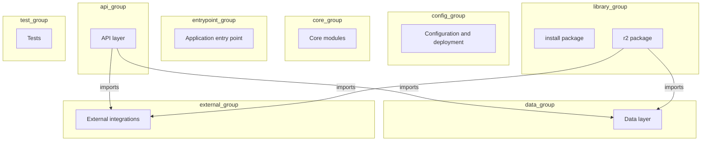

# Architecture report: reddit-archive/reddit

> Automated static analysis. **Observed** = directly seen in files/imports/AST; **Inferred** = interpretation from that evidence. Repository code was not executed.

## 1. Repository at a glance

| Item | Value |
| --- | --- |
| Repository | reddit-archive/reddit |
| Description | historical code from reddit.com |
| Language | Python |
| Stars | 16949 |
| Licence | Other |
| Analysed commit / branch | 753b17407e9a9dca09558526805922de24133d53 / master |
| Framework(s) | None detected |
| Files analysed | 800 |
| Components | 9 |

## 2. Architecture in one minute

reddit-archive/reddit - historical code from reddit.com. This repository was analysed statically from 800 file(s) (278 Python). Detected technologies (observed from imports/manifests): Gunicorn, requests, SQLAlchemy, unittest. Files are grouped into 9 component(s): API layer, Configuration and deployment, Core modules, Data layer, Application entry point, External integrations, install package, r2 package. Observed entry point(s): r2/r2/lib/contrib/rcssmin.py, r2/r2/lib/einhorn.py, r2/r2/lib/static.py. Findings below distinguish observed facts from inferred interpretation.

## 3. High-level block diagram

## 4. Main components

### API layer (`api_layer`)

- **Kind:** api
- **Status:** Observed
- **Confidence:** 0.85
- **Responsibility:** Groups 35 file(s) under api layer (observed from repository paths and static analysis). Observed top-level classes: APIv1GoldController, APIv1LoginController, APIv1ScopesController, APIv1UserController, AdController, AdminToolController. Observed top-level functions: _clear_ads_images, _force_images, _format_expires, _get_ads_images, _get_ads_keyspace, _get_callback_hmac.
- **Paths:** `r2/r2/controllers/__init__.py`, `r2/r2/controllers/admin.py`, `r2/r2/controllers/api.py`, `r2/r2/controllers/api_docs.py`, `r2/r2/controllers/apiv1/__init__.py`, `r2/r2/controllers/apiv1/gold.py`, `r2/r2/controllers/apiv1/login.py`, `r2/r2/controllers/apiv1/scopes.py`, `r2/r2/controllers/apiv1/user.py`, `r2/r2/controllers/awards.py`, `r2/r2/controllers/buttons.py`, `r2/r2/controllers/captcha.py`, `r2/r2/controllers/embed.py`, `r2/r2/controllers/error.py`, `r2/r2/controllers/front.py`, `r2/r2/controllers/googletagmanager.py`, `r2/r2/controllers/health.py`, `r2/r2/controllers/ipn.py`, `r2/r2/controllers/listingcontroller.py`, `r2/r2/controllers/login.py`, `r2/r2/controllers/mailgun.py`, `r2/r2/controllers/mediaembed.py`, `r2/r2/controllers/multi.py`, `r2/r2/controllers/newsletter.py`, `r2/r2/controllers/oauth2.py`, `r2/r2/controllers/oembed.py`, `r2/r2/controllers/policies.py`, `r2/r2/controllers/post.py`, `r2/r2/controllers/promotecontroller.py`, `r2/r2/controllers/reddit_base.py`, `r2/r2/controllers/redirect.py`, `r2/r2/controllers/robots.py`, `r2/r2/controllers/toolbar.py`, `r2/r2/controllers/web.py`, `r2/r2/controllers/wiki.py`
- **Evidence:** [r2/r2/controllers/__init__.py:26](https://github.com/reddit-archive/reddit/blob/753b17407e9a9dca09558526805922de24133d53/r2/r2/controllers/__init__.py#L26); [r2/r2/controllers/admin.py:27](https://github.com/reddit-archive/reddit/blob/753b17407e9a9dca09558526805922de24133d53/r2/r2/controllers/admin.py#L27); [r2/r2/controllers/api.py:142](https://github.com/reddit-archive/reddit/blob/753b17407e9a9dca09558526805922de24133d53/r2/r2/controllers/api.py#L142); [r2/r2/controllers/api_docs.py:85](https://github.com/reddit-archive/reddit/blob/753b17407e9a9dca09558526805922de24133d53/r2/r2/controllers/api_docs.py#L85); [r2/r2/controllers/apiv1/__init__.py](https://github.com/reddit-archive/reddit/blob/753b17407e9a9dca09558526805922de24133d53/r2/r2/controllers/apiv1/__init__.py); [r2/r2/controllers/apiv1/gold.py:44](https://github.com/reddit-archive/reddit/blob/753b17407e9a9dca09558526805922de24133d53/r2/r2/controllers/apiv1/gold.py#L44); [r2/r2/controllers/apiv1/login.py:40](https://github.com/reddit-archive/reddit/blob/753b17407e9a9dca09558526805922de24133d53/r2/r2/controllers/apiv1/login.py#L40); [r2/r2/controllers/apiv1/scopes.py:31](https://github.com/reddit-archive/reddit/blob/753b17407e9a9dca09558526805922de24133d53/r2/r2/controllers/apiv1/scopes.py#L31)

### Configuration and deployment (`config`)

- **Kind:** config
- **Status:** Observed
- **Confidence:** 0.85
- **Responsibility:** Groups 17 file(s) under configuration and deployment (observed from repository paths and static analysis). Observed top-level classes: CleanupMiddleware, DomainListingMiddleware, DomainMiddleware, ExtensionMiddleware, FeatureState, FullPathMiddleware. Observed top-level functions: ErrorDocuments, _get_featurestate, _stub, _wsgi_json, all_enabled, api.
- **Paths:** `install/install.cfg`, `r2/babel.cfg`, `r2/example.ini`, `r2/r2/config/__init__.py`, `r2/r2/config/environment.py`, `r2/r2/config/extensions.py`, `r2/r2/config/feature/__init__.py`, `r2/r2/config/feature/feature.py`, `r2/r2/config/feature/state.py`, `r2/r2/config/feature/world.py`, `r2/r2/config/hooks.py`, `r2/r2/config/middleware.py`, `r2/r2/config/paths.py`, `r2/r2/config/queues.py`, `r2/r2/config/routing.py`, `r2/r2/config/templates.py`, `r2/r2/data/locations.json`
- **Evidence:** [install/install.cfg](https://github.com/reddit-archive/reddit/blob/753b17407e9a9dca09558526805922de24133d53/install/install.cfg); [r2/babel.cfg](https://github.com/reddit-archive/reddit/blob/753b17407e9a9dca09558526805922de24133d53/r2/babel.cfg); [r2/example.ini](https://github.com/reddit-archive/reddit/blob/753b17407e9a9dca09558526805922de24133d53/r2/example.ini); [r2/r2/config/__init__.py](https://github.com/reddit-archive/reddit/blob/753b17407e9a9dca09558526805922de24133d53/r2/r2/config/__init__.py); [r2/r2/config/environment.py:44](https://github.com/reddit-archive/reddit/blob/753b17407e9a9dca09558526805922de24133d53/r2/r2/config/environment.py#L44); [r2/r2/config/extensions.py:25](https://github.com/reddit-archive/reddit/blob/753b17407e9a9dca09558526805922de24133d53/r2/r2/config/extensions.py#L25); [r2/r2/config/feature/__init__.py](https://github.com/reddit-archive/reddit/blob/753b17407e9a9dca09558526805922de24133d53/r2/r2/config/feature/__init__.py); [r2/r2/config/feature/feature.py:33](https://github.com/reddit-archive/reddit/blob/753b17407e9a9dca09558526805922de24133d53/r2/r2/config/feature/feature.py#L33)

### Core modules (`core`)

- **Kind:** core
- **Status:** Observed
- **Confidence:** 0.85
- **Responsibility:** Groups 1 file(s) under core modules (observed from repository paths and static analysis).
- **Paths:** `install-reddit.sh`
- **Evidence:** [install-reddit.sh](https://github.com/reddit-archive/reddit/blob/753b17407e9a9dca09558526805922de24133d53/install-reddit.sh)

### Data layer (`data_layer`)

- **Kind:** data
- **Status:** Observed
- **Confidence:** 0.85
- **Responsibility:** Groups 45 file(s) under data layer (observed from repository paths and static analysis). Observed top-level classes: AccountSRFeedback, AccountSRPrefs, AccountsByIP, AdImpressionsByCodename, AdminNotesBySystem, AdminTools. Observed top-level functions: MigratingUserRel, PROMOTE_DEFAULT_PRIORITY, UserRel, _get_subscription_details, _is_query_precomputed, account_by_payingid.
- **Paths:** `r2/r2/lib/db/__init__.py`, `r2/r2/lib/db/alter_db.py`, `r2/r2/lib/db/operators.py`, `r2/r2/lib/db/queries.py`, `r2/r2/lib/db/sorts.py`, `r2/r2/lib/db/tdb_cassandra.py`, `r2/r2/lib/db/tdb_lite.py`, `r2/r2/lib/db/tdb_sql.py`, `r2/r2/lib/db/thing.py`, `r2/r2/lib/db/userrel.py`, `r2/r2/models/__init__.py`, `r2/r2/models/account.py`, `r2/r2/models/admin_notes.py`, `r2/r2/models/admintools.py`, `r2/r2/models/automoderator.py`, `r2/r2/models/award.py`, `r2/r2/models/bans.py`, `r2/r2/models/bidding.py`, `r2/r2/models/builder.py`, `r2/r2/models/comment_tree.py`, `r2/r2/models/flair.py`, `r2/r2/models/gold.py`, `r2/r2/models/ip.py`, `r2/r2/models/keyvalue.py`, `r2/r2/models/last_modified.py`, `r2/r2/models/link.py`, `r2/r2/models/listing.py`, `r2/r2/models/mail_queue.py`, `r2/r2/models/media_cache.py`, `r2/r2/models/modaction.py`, `r2/r2/models/printable.py`, `r2/r2/models/promo.py`, `r2/r2/models/promo_metrics.py`, `r2/r2/models/query_cache.py`, `r2/r2/models/recommend.py`, `r2/r2/models/report.py`, `r2/r2/models/rules.py`, `r2/r2/models/subreddit.py`, `r2/r2/models/token.py`, `r2/r2/models/traffic.py`, `r2/r2/models/trylater.py`, `r2/r2/models/vote.py`, `r2/r2/models/wiki.py`, `r2/r2/public/static/js/models/subreddit-rule.js`, `r2/r2/public/static/js/models/validators.js`
- **Evidence:** [r2/r2/lib/db/__init__.py](https://github.com/reddit-archive/reddit/blob/753b17407e9a9dca09558526805922de24133d53/r2/r2/lib/db/__init__.py); [r2/r2/lib/db/alter_db.py](https://github.com/reddit-archive/reddit/blob/753b17407e9a9dca09558526805922de24133d53/r2/r2/lib/db/alter_db.py); [r2/r2/lib/db/operators.py:23](https://github.com/reddit-archive/reddit/blob/753b17407e9a9dca09558526805922de24133d53/r2/r2/lib/db/operators.py#L23); [r2/r2/lib/db/queries.py](https://github.com/reddit-archive/reddit/blob/753b17407e9a9dca09558526805922de24133d53/r2/r2/lib/db/queries.py); [r2/r2/lib/db/sorts.py](https://github.com/reddit-archive/reddit/blob/753b17407e9a9dca09558526805922de24133d53/r2/r2/lib/db/sorts.py); [r2/r2/lib/db/tdb_cassandra.py](https://github.com/reddit-archive/reddit/blob/753b17407e9a9dca09558526805922de24133d53/r2/r2/lib/db/tdb_cassandra.py); [r2/r2/lib/db/tdb_lite.py:26](https://github.com/reddit-archive/reddit/blob/753b17407e9a9dca09558526805922de24133d53/r2/r2/lib/db/tdb_lite.py#L26); [r2/r2/lib/db/tdb_sql.py](https://github.com/reddit-archive/reddit/blob/753b17407e9a9dca09558526805922de24133d53/r2/r2/lib/db/tdb_sql.py)

### Application entry point (`entrypoint`)

- **Kind:** entrypoint
- **Status:** Observed
- **Confidence:** 0.85
- **Responsibility:** Groups 4 file(s) under application entry point (observed from repository paths and static analysis). Observed top-level classes: EinhornSyncWorker. Observed top-level functions: _make_cssmin, generate_secret, generate_static_name, locate_static_file, make_hotp, make_totp.
- **Paths:** `r2/r2/lib/contrib/rcssmin.py`, `r2/r2/lib/einhorn.py`, `r2/r2/lib/static.py`, `r2/r2/lib/totp.py`
- **Evidence:** [r2/r2/lib/contrib/rcssmin.py:80](https://github.com/reddit-archive/reddit/blob/753b17407e9a9dca09558526805922de24133d53/r2/r2/lib/contrib/rcssmin.py#L80); [r2/r2/lib/einhorn.py:57](https://github.com/reddit-archive/reddit/blob/753b17407e9a9dca09558526805922de24133d53/r2/r2/lib/einhorn.py#L57); [r2/r2/lib/static.py:32](https://github.com/reddit-archive/reddit/blob/753b17407e9a9dca09558526805922de24133d53/r2/r2/lib/static.py#L32); [r2/r2/lib/totp.py:35](https://github.com/reddit-archive/reddit/blob/753b17407e9a9dca09558526805922de24133d53/r2/r2/lib/totp.py#L35)

### External integrations (`external_integrations`)

- **Kind:** external
- **Status:** Inferred
- **Confidence:** 0.70
- **Responsibility:** Groups 0 file(s) under external integrations (observed from repository paths and static analysis).
- **Evidence:** [r2/r2/controllers/ipn.py:31](https://github.com/reddit-archive/reddit/blob/753b17407e9a9dca09558526805922de24133d53/r2/r2/controllers/ipn.py#L31); [r2/r2/controllers/listingcontroller.py:58](https://github.com/reddit-archive/reddit/blob/753b17407e9a9dca09558526805922de24133d53/r2/r2/controllers/listingcontroller.py#L58); [r2/r2/controllers/reddit_base.py:27](https://github.com/reddit-archive/reddit/blob/753b17407e9a9dca09558526805922de24133d53/r2/r2/controllers/reddit_base.py#L27); [r2/r2/lib/app_globals.py:35](https://github.com/reddit-archive/reddit/blob/753b17407e9a9dca09558526805922de24133d53/r2/r2/lib/app_globals.py#L35); [r2/r2/lib/app_globals.py:39](https://github.com/reddit-archive/reddit/blob/753b17407e9a9dca09558526805922de24133d53/r2/r2/lib/app_globals.py#L39); [r2/r2/lib/authorize/interaction.py:23](https://github.com/reddit-archive/reddit/blob/753b17407e9a9dca09558526805922de24133d53/r2/r2/lib/authorize/interaction.py#L23)

### install package (`install`)

- **Kind:** library
- **Status:** Observed
- **Confidence:** 0.85
- **Responsibility:** Groups 12 file(s) under install package (observed from repository paths and static analysis).
- **Paths:** `install/done.sh`, `install/drone.sh`, `install/install_apt.sh`, `install/install_cassandra.sh`, `install/install_services.sh`, `install/install_zookeeper.sh`, `install/reddit.sh`, `install/setup_cassandra.sh`, `install/setup_mcrouter.sh`, `install/setup_postgres.sh`, `install/setup_rabbitmq.sh`, `install/travis.sh`
- **Evidence:** [install/done.sh](https://github.com/reddit-archive/reddit/blob/753b17407e9a9dca09558526805922de24133d53/install/done.sh); [install/drone.sh](https://github.com/reddit-archive/reddit/blob/753b17407e9a9dca09558526805922de24133d53/install/drone.sh); [install/install_apt.sh](https://github.com/reddit-archive/reddit/blob/753b17407e9a9dca09558526805922de24133d53/install/install_apt.sh); [install/install_cassandra.sh](https://github.com/reddit-archive/reddit/blob/753b17407e9a9dca09558526805922de24133d53/install/install_cassandra.sh); [install/install_services.sh](https://github.com/reddit-archive/reddit/blob/753b17407e9a9dca09558526805922de24133d53/install/install_services.sh); [install/install_zookeeper.sh](https://github.com/reddit-archive/reddit/blob/753b17407e9a9dca09558526805922de24133d53/install/install_zookeeper.sh); [install/reddit.sh](https://github.com/reddit-archive/reddit/blob/753b17407e9a9dca09558526805922de24133d53/install/reddit.sh); [install/setup_cassandra.sh](https://github.com/reddit-archive/reddit/blob/753b17407e9a9dca09558526805922de24133d53/install/setup_cassandra.sh)

### r2 package (`r2`)

- **Kind:** library
- **Status:** Observed
- **Confidence:** 0.85
- **Responsibility:** Groups 263 file(s) under r2 package (observed from repository paths and static analysis). Observed top-level classes: AbortWikiError, AccountJsonTemplate, Address, AddressValueError, AdminDetailsBar, AdminKindMenu. Observed top-level functions: P_, _absolute_url, _add_message_nolock, _before_last_sitemap, _calculate_qa_comment_scores, _clickthrough_rate.
- **Paths:** `r2/Makefile.py`, `r2/coverage.sh`, `r2/r2/__init__.py`, `r2/r2/commands.py`, `r2/r2/lib/__init__.py`, `r2/r2/lib/amqp.py`, `r2/r2/lib/app_globals.py`, `r2/r2/lib/authorize/__init__.py`, `r2/r2/lib/authorize/api.py`, `r2/r2/lib/authorize/interaction.py`, `r2/r2/lib/automoderator.py`, `r2/r2/lib/base.py`, `r2/r2/lib/baseplate_integration.py`, `r2/r2/lib/butler.py`, `r2/r2/lib/c/filters.c`, `r2/r2/lib/cache.py`, `r2/r2/lib/cache_poisoning.py`, `r2/r2/lib/captcha.py`, `r2/r2/lib/comment_tree.py`, `r2/r2/lib/configparse.py`, `r2/r2/lib/contrib/__init__.py`, `r2/r2/lib/contrib/ipaddress.py`, `r2/r2/lib/contrib/simpleflake.py`, `r2/r2/lib/cookies.py`, `r2/r2/lib/count.py`, `r2/r2/lib/csrf.py`, `r2/r2/lib/cssfilter.py`, `r2/r2/lib/emailer.py`, `r2/r2/lib/embeds.py`, `r2/r2/lib/emr_helpers.py`, `r2/r2/lib/errors.py`, `r2/r2/lib/eventcollector.py`, `r2/r2/lib/export.py`, `r2/r2/lib/filters.py`, `r2/r2/lib/generate_strings.py`, `r2/r2/lib/geoip.py`, `r2/r2/lib/gzipper.py`, `r2/r2/lib/hadoop_decompress.py`, `r2/r2/lib/hardcachebackend.py`, `r2/r2/lib/helpers.py`, `r2/r2/lib/hooks.py`, `r2/r2/lib/inventory.py`, `r2/r2/lib/inventory_optimization.py`, `r2/r2/lib/ip_events.py`, `r2/r2/lib/js.py`, `r2/r2/lib/jsonresponse.py`, `r2/r2/lib/jsontemplates.py`, `r2/r2/lib/language.py`, `r2/r2/lib/lock.py`, `r2/r2/lib/log.py`, `r2/r2/lib/loid.py`, `r2/r2/lib/manager/__init__.py`, `r2/r2/lib/manager/db_manager.py`, `r2/r2/lib/manager/tp_manager.py`, `r2/r2/lib/media.py`, `r2/r2/lib/memoize.py`, `r2/r2/lib/menus.py`, `r2/r2/lib/merge.py`, `r2/r2/lib/message_to_email.py`, `r2/r2/lib/migrate/__init__.py`, `r2/r2/lib/migrate/campaigns_to_things.py`, `r2/r2/lib/migrate/migrate.py`, `r2/r2/lib/migrate/mr_domains.py`, `r2/r2/lib/migrate/mr_permacache.py`, `r2/r2/lib/migrate/vote_details_ip_backfill.py`, `r2/r2/lib/mr_tools/__init__.py`, `r2/r2/lib/mr_tools/mr_tools.py`, `r2/r2/lib/mr_top.py`, `r2/r2/lib/newsletter.py`, `r2/r2/lib/normalized_hot.py`, `r2/r2/lib/nymph.py`, `r2/r2/lib/organic.py`, `r2/r2/lib/pages/__init__.py`, `r2/r2/lib/pages/admin_pages.py`, `r2/r2/lib/pages/things.py`, `r2/r2/lib/pages/trafficpages.py`, `r2/r2/lib/pages/wiki.py`, `r2/r2/lib/permissions.py`, `r2/r2/lib/plugin.py`, `r2/r2/lib/profiler.py`, `r2/r2/lib/promote.py`, `r2/r2/lib/providers/__init__.py`, `r2/r2/lib/providers/auth/__init__.py`, `r2/r2/lib/providers/auth/cookie.py`, `r2/r2/lib/providers/auth/http.py`, `r2/r2/lib/providers/cdn/__init__.py`, `r2/r2/lib/providers/cdn/cloudflare.py`, `r2/r2/lib/providers/cdn/fastly.py`, `r2/r2/lib/providers/cdn/null.py`, `r2/r2/lib/providers/email/__init__.py`, `r2/r2/lib/providers/email/mailgun.py`, `r2/r2/lib/providers/email/null.py`, `r2/r2/lib/providers/image_resizing/__init__.py`, `r2/r2/lib/providers/image_resizing/imgix.py`, `r2/r2/lib/providers/image_resizing/no_op.py`, `r2/r2/lib/providers/image_resizing/unsplashit.py`, `r2/r2/lib/providers/media/__init__.py`, `r2/r2/lib/providers/media/filesystem.py`, `r2/r2/lib/providers/media/s3.py`, `r2/r2/lib/providers/search/__init__.py`, `r2/r2/lib/providers/search/cloudsearch.py`, `r2/r2/lib/providers/search/common.py`, `r2/r2/lib/providers/search/solr.py`, `r2/r2/lib/providers/support/__init__.py`, `r2/r2/lib/providers/support/zendesk.py`, `r2/r2/lib/ratelimit.py`, `r2/r2/lib/recommender.py`, `r2/r2/lib/require.py`, `r2/r2/lib/rising.py`, `r2/r2/lib/s3_helpers.py`, `r2/r2/lib/signing.py`, `r2/r2/lib/sitemaps/__init__.py`, `r2/r2/lib/sitemaps/data.py`, `r2/r2/lib/sitemaps/generate.py`, `r2/r2/lib/sitemaps/store.py`, `r2/r2/lib/sitemaps/watcher.py`, `r2/r2/lib/souptest.py`, `r2/r2/lib/sr_pops.py`, `r2/r2/lib/stats.py`, `r2/r2/lib/strings.py`, `r2/r2/lib/subreddit_search.py`, `r2/r2/lib/support_tickets.py`, `r2/r2/lib/system_messages.py`, `r2/r2/lib/takedowns.py`, `r2/r2/lib/template_helpers.py`, `r2/r2/lib/tracking.py`, `r2/r2/lib/traffic/__init__.py`, `r2/r2/lib/traffic/emr_traffic.py`, `r2/r2/lib/traffic/traffic.py`, `r2/r2/lib/translation.py`, `r2/r2/lib/trending.py`, `r2/r2/lib/unicode.py`, `r2/r2/lib/utils/__init__.py`, `r2/r2/lib/utils/feature_utils.py`, `r2/r2/lib/utils/http_utils.py`, `r2/r2/lib/utils/reddit_agent_parser.py`, `r2/r2/lib/utils/utils.py`, `r2/r2/lib/validator/__init__.py`, `r2/r2/lib/validator/preferences.py`, `r2/r2/lib/validator/validator.py`, `r2/r2/lib/validator/wiki.py`, `r2/r2/lib/voting.py`, `r2/r2/lib/websockets.py`, `r2/r2/lib/zookeeper.py`, `r2/r2/public/static/button/button-embed.js`, `r2/r2/public/static/button/button1.js`, `r2/r2/public/static/button/button2.js`, `r2/r2/public/static/button/button3.js`, `r2/r2/public/static/css/config.rb`, `r2/r2/public/static/js/access.js`, `r2/r2/public/static/js/action-forms.js`, `r2/r2/public/static/js/actions.js`, `r2/r2/public/static/js/adminbar.js`, `r2/r2/public/static/js/ajax.js`, `r2/r2/public/static/js/analytics.js`, `r2/r2/public/static/js/apps.js`, `r2/r2/public/static/js/archived.js`, `r2/r2/public/static/js/backbone-init.js`, `r2/r2/public/static/js/base.js`, `r2/r2/public/static/js/bootstrap.tooltip.extension.js`, `r2/r2/public/static/js/cache-poisoning-detection.js`, `r2/r2/public/static/js/client-error-logger.js`, `r2/r2/public/static/js/compact.js`, `r2/r2/public/static/js/custom-event.js`, `r2/r2/public/static/js/do-not-track.js`, `r2/r2/public/static/js/edit-subreddit-rules.js`, `r2/r2/public/static/js/embed.js`, `r2/r2/public/static/js/embed/comment-embed.js`, `r2/r2/public/static/js/embed/embed.js`, `r2/r2/public/static/js/embed/pixel-tracking.js`, `r2/r2/public/static/js/embed/utils.js`, `r2/r2/public/static/js/errors.js`, `r2/r2/public/static/js/events.js`, `r2/r2/public/static/js/expando.js`, `r2/r2/public/static/js/expando/nsfwflow.js`, `r2/r2/public/static/js/filter.js`, `r2/r2/public/static/js/flair.js`, `r2/r2/public/static/js/frames.js`, `r2/r2/public/static/js/gate-popup.js`, `r2/r2/public/static/js/gold.js`, `r2/r2/public/static/js/google-tag-manager/gtm-jail-listener.js`, `r2/r2/public/static/js/google-tag-manager/gtm-listener.js`, `r2/r2/public/static/js/google-tag-manager/gtm.js`, `r2/r2/public/static/js/highlight.js`, `r2/r2/public/static/js/hooks.js`, `r2/r2/public/static/js/https-tester.js`, `r2/r2/public/static/js/i18n.js`, `r2/r2/public/static/js/image-upload.js`, `r2/r2/public/static/js/interestbar.js`, `r2/r2/public/static/js/jail.js`, `r2/r2/public/static/js/jquery.reddit.js`, `r2/r2/public/static/js/lib/backbone-1.0.0.js`, `r2/r2/public/static/js/lib/bootstrap.modal.js`, `r2/r2/public/static/js/lib/bootstrap.tooltip.js`, `r2/r2/public/static/js/lib/bootstrap.transition.js`, `r2/r2/public/static/js/lib/es5-sham.js`, `r2/r2/public/static/js/lib/es5-shim.js`, `r2/r2/public/static/js/lib/event-tracker.js`, `r2/r2/public/static/js/lib/highlight.pack.js`, `r2/r2/public/static/js/lib/hmac-sha256.js`, `r2/r2/public/static/js/lib/html5shiv.js`, `r2/r2/public/static/js/lib/jed.js`, `r2/r2/public/static/js/lib/jquery.cookie.js`, `r2/r2/public/static/js/lib/jquery.flot.js`, `r2/r2/public/static/js/lib/jquery.flot.time.js`, `r2/r2/public/static/js/lib/jquery.lazyload.js`, `r2/r2/public/static/js/lib/jquery.url.js`, `r2/r2/public/static/js/lib/json2.js`, `r2/r2/public/static/js/lib/modernizr.js`, `r2/r2/public/static/js/lib/reddit-client-lib.js`, `r2/r2/public/static/js/lib/store.js`, `r2/r2/public/static/js/lib/ui.core.js`, `r2/r2/public/static/js/lib/ui.datepicker.js`, `r2/r2/public/static/js/lib/underscore-1.4.4-1.js`, `r2/r2/public/static/js/link-click-tracking.js`, `r2/r2/public/static/js/locked.js`, `r2/r2/public/static/js/logging.js`, `r2/r2/public/static/js/login.js`, `r2/r2/public/static/js/messagecompose.js`, `r2/r2/public/static/js/messages.js`, `r2/r2/public/static/js/migrate-global-reddit.js`, `r2/r2/public/static/js/multi.js`, `r2/r2/public/static/js/newsletter.js`, `r2/r2/public/static/js/policies.js`, `r2/r2/public/static/js/popup.js`, `r2/r2/public/static/js/post-sharing.js`, `r2/r2/public/static/js/preload.js`, `r2/r2/public/static/js/qrcode.js`, `r2/r2/public/static/js/recommender.js`, `r2/r2/public/static/js/reddit-hook.js`, `r2/r2/public/static/js/reddit-init-hook.js`, `r2/r2/public/static/js/reddit.js`, `r2/r2/public/static/js/report.js`, `r2/r2/public/static/js/safe-store.js`, `r2/r2/public/static/js/saved.js`, `r2/r2/public/static/js/scrollupdater.js`, `r2/r2/public/static/js/setup.js`, `r2/r2/public/static/js/sponsored.js`, `r2/r2/public/static/js/spotlight.js`, `r2/r2/public/static/js/sr-autocomplete.js`, `r2/r2/public/static/js/stateify.js`, `r2/r2/public/static/js/strength-meter.js`, `r2/r2/public/static/js/synced-session-storage.js`, `r2/r2/public/static/js/templates.js`, `r2/r2/public/static/js/timeouts.js`, `r2/r2/public/static/js/timeseries.js`, `r2/r2/public/static/js/timetext.js`, `r2/r2/public/static/js/timings.js`, `r2/r2/public/static/js/toggles.js`, `r2/r2/public/static/js/traffic.js`, `r2/r2/public/static/js/ui.js`, `r2/r2/public/static/js/ui/formbar.js`, `r2/r2/public/static/js/uibase.js`, `r2/r2/public/static/js/utils.js`, `r2/r2/public/static/js/uuid.js`, `r2/r2/public/static/js/validator.js`, `r2/r2/public/static/js/visited.js`, `r2/r2/public/static/js/voting.js`, `r2/r2/public/static/js/warn-on-unload.js`, `r2/r2/public/static/js/websocket.js`, `r2/r2/public/static/js/wiki.js`, `r2/r2/templates/__init__.py`, `r2/r2/templates/buttonlite.js`
- **Evidence:** [r2/Makefile.py](https://github.com/reddit-archive/reddit/blob/753b17407e9a9dca09558526805922de24133d53/r2/Makefile.py); [r2/coverage.sh](https://github.com/reddit-archive/reddit/blob/753b17407e9a9dca09558526805922de24133d53/r2/coverage.sh); [r2/r2/__init__.py:39](https://github.com/reddit-archive/reddit/blob/753b17407e9a9dca09558526805922de24133d53/r2/r2/__init__.py#L39); [r2/r2/commands.py](https://github.com/reddit-archive/reddit/blob/753b17407e9a9dca09558526805922de24133d53/r2/r2/commands.py); [r2/r2/lib/__init__.py](https://github.com/reddit-archive/reddit/blob/753b17407e9a9dca09558526805922de24133d53/r2/r2/lib/__init__.py); [r2/r2/lib/amqp.py](https://github.com/reddit-archive/reddit/blob/753b17407e9a9dca09558526805922de24133d53/r2/r2/lib/amqp.py); [r2/r2/lib/app_globals.py:100](https://github.com/reddit-archive/reddit/blob/753b17407e9a9dca09558526805922de24133d53/r2/r2/lib/app_globals.py#L100); [r2/r2/lib/authorize/__init__.py](https://github.com/reddit-archive/reddit/blob/753b17407e9a9dca09558526805922de24133d53/r2/r2/lib/authorize/__init__.py)

### Tests (`tests`)

- **Kind:** test
- **Status:** Observed
- **Confidence:** 0.85
- **Responsibility:** Groups 40 file(s) under tests (observed from repository paths and static analysis). Observed routes: PATCH r2.lib.authorize.api.CreateCustomerProfileRequest, PATCH r2.lib.authorize.api.Profile, PATCH r2.lib.authorize.api.GetCustomerProfileRequest, PATCH r2.lib.authorize.api.CreateCustomerPaymentProfileRequest, PATCH r2.lib.authorize.api.PaymentProfile. Observed top-level classes: APIV1LoginTests, AgentDetectorTest, ApiFunctionTest, AuthorizeNetExceptionTest, CounterAndTimerTest, CountingStatBufferTest. Observed top-level functions: assert_same_dict, concat_sources, diff_dicts.
- **Paths:** `r2/r2/tests/__init__.py`, `r2/r2/tests/functional/__init__.py`, `r2/r2/tests/functional/controller/__init__.py`, `r2/r2/tests/functional/controller/del_msg_test.py`, `r2/r2/tests/functional/controller/login/__init__.py`, `r2/r2/tests/functional/controller/login/api_tests.py`, `r2/r2/tests/functional/controller/login/apiv1_tests.py`, `r2/r2/tests/functional/controller/login/common.py`, `r2/r2/tests/functional/controller/login/post_tests.py`, `r2/r2/tests/functional/controller/prefs/__init__.py`, `r2/r2/tests/unit/__init__.py`, `r2/r2/tests/unit/config/__init__.py`, `r2/r2/tests/unit/config/experiment_test.py`, `r2/r2/tests/unit/config/feature_test.py`, `r2/r2/tests/unit/lib/__init__.py`, `r2/r2/tests/unit/lib/authorize/__init__.py`, `r2/r2/tests/unit/lib/authorize/test_api.py`, `r2/r2/tests/unit/lib/authorize/test_interaction.py`, `r2/r2/tests/unit/lib/configparse_test.py`, `r2/r2/tests/unit/lib/cookie_upgrade_test.py`, `r2/r2/tests/unit/lib/cssfilter_test.py`, `r2/r2/tests/unit/lib/eventcollector_tests.py`, `r2/r2/tests/unit/lib/js_test.py`, `r2/r2/tests/unit/lib/loid_tests.py`, `r2/r2/tests/unit/lib/media_test.py`, `r2/r2/tests/unit/lib/permissions_test.py`, `r2/r2/tests/unit/lib/promote_test.py`, `r2/r2/tests/unit/lib/providers/__init__.py`, `r2/r2/tests/unit/lib/providers/image_resizing/__init__.py`, `r2/r2/tests/unit/lib/providers/image_resizing/imgix_test.py`, `r2/r2/tests/unit/lib/providers/image_resizing/no_op_test.py`, `r2/r2/tests/unit/lib/providers/image_resizing/unsplashit_test.py`, `r2/r2/tests/unit/lib/reddit_agent_parser_test.py`, `r2/r2/tests/unit/lib/signing_tests.py`, `r2/r2/tests/unit/lib/souptest_test.py`, `r2/r2/tests/unit/lib/stats_test.py`, `r2/r2/tests/unit/lib/tracking_test.py`, `r2/r2/tests/unit/lib/urlparser_test.py`, `r2/r2/tests/unit/lib/utils_test.py`, `r2/r2/tests/unit/lib/validator/__init__.py`
- **Evidence:** [r2/r2/tests/__init__.py:87](https://github.com/reddit-archive/reddit/blob/753b17407e9a9dca09558526805922de24133d53/r2/r2/tests/__init__.py#L87); [r2/r2/tests/functional/__init__.py](https://github.com/reddit-archive/reddit/blob/753b17407e9a9dca09558526805922de24133d53/r2/r2/tests/functional/__init__.py); [r2/r2/tests/functional/controller/__init__.py](https://github.com/reddit-archive/reddit/blob/753b17407e9a9dca09558526805922de24133d53/r2/r2/tests/functional/controller/__init__.py); [r2/r2/tests/functional/controller/del_msg_test.py:33](https://github.com/reddit-archive/reddit/blob/753b17407e9a9dca09558526805922de24133d53/r2/r2/tests/functional/controller/del_msg_test.py#L33); [r2/r2/tests/functional/controller/login/__init__.py](https://github.com/reddit-archive/reddit/blob/753b17407e9a9dca09558526805922de24133d53/r2/r2/tests/functional/controller/login/__init__.py); [r2/r2/tests/functional/controller/login/api_tests.py:26](https://github.com/reddit-archive/reddit/blob/753b17407e9a9dca09558526805922de24133d53/r2/r2/tests/functional/controller/login/api_tests.py#L26); [r2/r2/tests/functional/controller/login/apiv1_tests.py:33](https://github.com/reddit-archive/reddit/blob/753b17407e9a9dca09558526805922de24133d53/r2/r2/tests/functional/controller/login/apiv1_tests.py#L33); [r2/r2/tests/functional/controller/login/common.py:32](https://github.com/reddit-archive/reddit/blob/753b17407e9a9dca09558526805922de24133d53/r2/r2/tests/functional/controller/login/common.py#L32)

## 5. Execution flow

**Observed** entry point(s):

- [r2/r2/lib/contrib/rcssmin.py:344](https://github.com/reddit-archive/reddit/blob/753b17407e9a9dca09558526805922de24133d53/r2/r2/lib/contrib/rcssmin.py#L344)
- [r2/r2/lib/einhorn.py:95](https://github.com/reddit-archive/reddit/blob/753b17407e9a9dca09558526805922de24133d53/r2/r2/lib/einhorn.py#L95)
- [r2/r2/lib/static.py:96](https://github.com/reddit-archive/reddit/blob/753b17407e9a9dca09558526805922de24133d53/r2/r2/lib/static.py#L96)
- [r2/r2/lib/totp.py:68](https://github.com/reddit-archive/reddit/blob/753b17407e9a9dca09558526805922de24133d53/r2/r2/lib/totp.py#L68)

**Observed** routes (from decorators):

- `PATCH r2.lib.authorize.api.CreateCustomerProfileRequest` -> `test_create_customer_profile` in `r2/r2/tests/unit/lib/authorize/test_api.py:184`
- `PATCH r2.lib.authorize.api.Profile` -> `test_create_customer_profile` in `r2/r2/tests/unit/lib/authorize/test_api.py:184`
- `PATCH r2.lib.authorize.api.GetCustomerProfileRequest` -> `test_get_customer_profile` in `r2/r2/tests/unit/lib/authorize/test_api.py:214`
- `PATCH r2.lib.authorize.api.CreateCustomerPaymentProfileRequest` -> `test_create_payment_profile` in `r2/r2/tests/unit/lib/authorize/test_api.py:233`
- `PATCH r2.lib.authorize.api.PaymentProfile` -> `test_create_payment_profile` in `r2/r2/tests/unit/lib/authorize/test_api.py:233`
- `PATCH r2.lib.authorize.api.UpdateCustomerPaymentProfileRequest` -> `test_update_payment_profile` in `r2/r2/tests/unit/lib/authorize/test_api.py:265`
- `PATCH r2.lib.authorize.api.PaymentProfile` -> `test_update_payment_profile` in `r2/r2/tests/unit/lib/authorize/test_api.py:265`
- `PATCH r2.lib.authorize.api.DeleteCustomerPaymentProfileRequest` -> `test_delete_payment_profile` in `r2/r2/tests/unit/lib/authorize/test_api.py:285`
- `PATCH r2.lib.authorize.api.CreateCustomerProfileTransactionRequest` -> `test_create_authorization_hold` in `r2/r2/tests/unit/lib/authorize/test_api.py:304`
- `PATCH r2.lib.authorize.api.CreateCustomerProfileTransactionRequest` -> `test_capture_authorization_hold` in `r2/r2/tests/unit/lib/authorize/test_api.py:336`
- `PATCH r2.lib.authorize.api.CreateCustomerProfileTransactionRequest` -> `test_void_authorization_hold` in `r2/r2/tests/unit/lib/authorize/test_api.py:364`
- `PATCH r2.lib.authorize.api.CreateCustomerProfileTransactionRequest` -> `test_refund_transaction` in `r2/r2/tests/unit/lib/authorize/test_api.py:386`
- `PATCH r2.lib.authorize.interaction.api.get_customer_profile` -> `test_get_or_create_customer_profile` in `r2/r2/tests/unit/lib/authorize/test_interaction.py:56`
- `PATCH r2.lib.authorize.interaction.api.create_customer_profile` -> `test_get_or_create_customer_profile` in `r2/r2/tests/unit/lib/authorize/test_interaction.py:56`
- `PATCH r2.lib.authorize.interaction.PayID.add` -> `test_add_payment_method` in `r2/r2/tests/unit/lib/authorize/test_interaction.py:83`
- `PATCH r2.lib.authorize.interaction.api.create_payment_profile` -> `test_add_payment_method` in `r2/r2/tests/unit/lib/authorize/test_interaction.py:83`
- `PATCH r2.lib.authorize.interaction.CustomerID.get_id` -> `test_add_payment_method` in `r2/r2/tests/unit/lib/authorize/test_interaction.py:83`
- `PATCH r2.lib.authorize.interaction.api.update_payment_profile` -> `test_update_payment_method` in `r2/r2/tests/unit/lib/authorize/test_interaction.py:100`
- `PATCH r2.lib.authorize.interaction.PayID.delete` -> `test_delete_payment_method` in `r2/r2/tests/unit/lib/authorize/test_interaction.py:109`
- `PATCH r2.lib.authorize.interaction.api.delete_payment_profile` -> `test_delete_payment_method` in `r2/r2/tests/unit/lib/authorize/test_interaction.py:109`
- `PATCH r2.lib.authorize.interaction.add_payment_method` -> `test_add_or_update_payment_method` in `r2/r2/tests/unit/lib/authorize/test_interaction.py:129`
- `PATCH r2.lib.authorize.interaction.update_payment_method` -> `test_add_or_update_payment_method` in `r2/r2/tests/unit/lib/authorize/test_interaction.py:129`
- `PATCH r2.lib.authorize.interaction.Bid._new` -> `test_auth_freebie_transaction` in `r2/r2/tests/unit/lib/authorize/test_interaction.py:147`
- `PATCH r2.lib.authorize.interaction.request` -> `test_auth_transaction` in `r2/r2/tests/unit/lib/authorize/test_interaction.py:173`
- `PATCH r2.lib.authorize.interaction.api.create_authorization_hold` -> `test_auth_transaction` in `r2/r2/tests/unit/lib/authorize/test_interaction.py:173`
- `PATCH r2.lib.authorize.interaction.CustomerID.get_id` -> `test_auth_transaction` in `r2/r2/tests/unit/lib/authorize/test_interaction.py:173`
- `PATCH r2.lib.authorize.interaction.PayID.get_ids` -> `test_auth_transaction` in `r2/r2/tests/unit/lib/authorize/test_interaction.py:173`
- `PATCH r2.lib.authorize.interaction.api.capture_authorization_hold` -> `test_charge_transaction` in `r2/r2/tests/unit/lib/authorize/test_interaction.py:226`
- `PATCH r2.lib.authorize.interaction.Bid.one` -> `test_charge_transaction` in `r2/r2/tests/unit/lib/authorize/test_interaction.py:226`
- `PATCH r2.lib.authorize.interaction.Bid.one` -> `test_void_transaction` in `r2/r2/tests/unit/lib/authorize/test_interaction.py:266`
- `PATCH r2.lib.authorize.interaction.Bid.one` -> `test_refund_transaction` in `r2/r2/tests/unit/lib/authorize/test_interaction.py:293`
- `PATCH r2.lib.media.Link` -> `test_link_post` in `r2/r2/tests/unit/lib/media_test.py:33`
- `PATCH r2.models.Subreddit.user_subreddits` -> `test_frontpage_logged_in` in `r2/r2/tests/unit/lib/promote_test.py:57`
- `PATCH r2.models.Subreddit.user_subreddits` -> `test_multi_logged_in` in `r2/r2/tests/unit/lib/promote_test.py:70`
- `PATCH r2.models.Subreddit.user_subreddits` -> `test_subreddit_logged_in` in `r2/r2/tests/unit/lib/promote_test.py:85`
- `PATCH r2.models.Subreddit.user_subreddits` -> `test_quarantined_subscriptions_are_never_included` in `r2/r2/tests/unit/lib/promote_test.py:94`
- `PATCH r2.models.Subreddit.user_subreddits` -> `test_nsfw_subscriptions_arent_included_when_viewing_frontpage` in `r2/r2/tests/unit/lib/promote_test.py:103`
- `PATCH r2.models.Collection.get_all` -> `test_get_nsfw_collections_srnames` in `r2/r2/tests/unit/lib/promote_test.py:111`
- `PATCH r2.lib.promote.get_nsfw_collections_srnames` -> `test_remove_nsfw_collection_srnames_on_frontpage` in `r2/r2/tests/unit/lib/promote_test.py:118`
- `PATCH r2.lib.promote.authorize.refund_transaction` -> `test_refund_campaign_success` in `r2/r2/tests/unit/lib/promote_test.py:154`
- `PATCH r2.lib.promote.PromotionLog.add` -> `test_refund_campaign_success` in `r2/r2/tests/unit/lib/promote_test.py:154`
- `PATCH r2.lib.promote.queries.unset_underdelivered_campaigns` -> `test_refund_campaign_success` in `r2/r2/tests/unit/lib/promote_test.py:154`
- `PATCH r2.lib.promote.emailer.refunded_promo` -> `test_refund_campaign_success` in `r2/r2/tests/unit/lib/promote_test.py:154`
- `PATCH r2.lib.promote.authorize.refund_transaction` -> `test_refund_campaign_failed` in `r2/r2/tests/unit/lib/promote_test.py:178`
- `PATCH r2.lib.promote.PromotionLog.add` -> `test_refund_campaign_failed` in `r2/r2/tests/unit/lib/promote_test.py:178`

Representative flow (derived from observed entry points and the import graph; steps beyond the entry point are **Inferred**):

1. Execution starts at an observed entry point listed above, if present.
2. `api_layer` imports `data_layer` (API layer -> Data layer).
3. `api_layer` imports `external_integrations` (API layer -> External integrations).
4. `r2` imports `data_layer` (r2 package -> Data layer).
5. `r2` imports `external_integrations` (r2 package -> External integrations).

## 6. Project structure

### `(root)`

- `.drone.yml` - config (2552 bytes)
- `.gitignore` - other (542 bytes)
- `.travis.yml` - ci, YAML (363 bytes)
- `LICENSE` - docs (27222 bytes)
- `README.md` - docs (1108 bytes)
- `SECURITY.md` - docs (575 bytes)
- `Vagrantfile` - other (6774 bytes)
- `install-reddit.sh` - source, Shell (3443 bytes)

### `install`

- `install/README.md` - docs (976 bytes)
- `install/done.sh` - source, Shell (2599 bytes)
- `install/drone.sh` - source, Shell (1740 bytes)
- `install/install.cfg` - config (2287 bytes)
- `install/install_apt.sh` - source, Shell (3182 bytes)
- `install/install_cassandra.sh` - source, Shell (1727 bytes)
- `install/install_services.sh` - source, Shell (2042 bytes)
- `install/install_zookeeper.sh` - source, Shell (1335 bytes)
- `install/reddit.sh` - source, Shell (19878 bytes)
- `install/setup_cassandra.sh` - source, Shell (1984 bytes)
- `install/setup_mcrouter.sh` - source, Shell (3560 bytes)
- `install/setup_postgres.sh` - source, Shell (3083 bytes)
- `install/setup_rabbitmq.sh` - source, Shell (1727 bytes)
- `install/travis.sh` - source, Shell (4588 bytes)

### `r2`

- `r2/Makefile` - other (7324 bytes)
- `r2/Makefile.py` - source, Python (2199 bytes)
- `r2/babel.cfg` - config (1503 bytes)
- `r2/check-code` - other (13152 bytes)
- `r2/coverage.sh` - source, Shell (1144 bytes)
- `r2/example.ini` - config (35200 bytes)
- `r2/pylintrc` - other (7520 bytes)
- `r2/r2/__init__.py` - source, Python (1858 bytes)
- `r2/r2/commands.py` - source, Python (3618 bytes)
- `r2/r2/config/__init__.py` - source, Python (1124 bytes)
- `r2/r2/config/environment.py` - source, Python (4668 bytes)
- `r2/r2/config/extensions.py` - source, Python (2453 bytes)
- `r2/r2/config/feature/README.md` - docs (8077 bytes)
- `r2/r2/config/feature/__init__.py` - source, Python (1195 bytes)
- `r2/r2/config/feature/feature.py` - source, Python (4852 bytes)
- `r2/r2/config/feature/state.py` - source, Python (19095 bytes)
- `r2/r2/config/feature/world.py` - source, Python (4273 bytes)
- `r2/r2/config/hooks.py` - source, Python (1560 bytes)
- `r2/r2/config/middleware.py` - source, Python (19851 bytes)
- `r2/r2/config/paths.py` - source, Python (1738 bytes)
- `r2/r2/config/queues.py` - source, Python (5133 bytes)
- `r2/r2/config/routing.py` - source, Python (23210 bytes)
- `r2/r2/config/templates.py` - source, Python (3659 bytes)
- `r2/r2/controllers/__init__.py` - source, Python (4347 bytes)
- `r2/r2/controllers/admin.py` - source, Python (1680 bytes)
- `r2/r2/controllers/api.py` - source, Python (199119 bytes)
- `r2/r2/controllers/api_docs.py` - source, Python (9294 bytes)
- `r2/r2/controllers/apiv1/__init__.py` - source, Python (0 bytes)
- `r2/r2/controllers/apiv1/gold.py` - source, Python (4155 bytes)
- `r2/r2/controllers/apiv1/login.py` - source, Python (3121 bytes)
- `r2/r2/controllers/apiv1/scopes.py` - source, Python (2441 bytes)
- `r2/r2/controllers/apiv1/user.py` - source, Python (7615 bytes)
- `r2/r2/controllers/awards.py` - source, Python (2451 bytes)
- `r2/r2/controllers/buttons.py` - source, Python (4709 bytes)
- `r2/r2/controllers/captcha.py` - source, Python (2219 bytes)
- `r2/r2/controllers/embed.py` - source, Python (3378 bytes)
- `r2/r2/controllers/error.py` - source, Python (10695 bytes)
- `r2/r2/controllers/front.py` - source, Python (80087 bytes)
- `r2/r2/controllers/googletagmanager.py` - source, Python (2091 bytes)
- `r2/r2/controllers/health.py` - source, Python (2899 bytes)
- `r2/r2/controllers/ipn.py` - source, Python (54516 bytes)
- `r2/r2/controllers/listingcontroller.py` - source, Python (75313 bytes)
- `r2/r2/controllers/login.py` - source, Python (6457 bytes)
- `r2/r2/controllers/mailgun.py` - source, Python (5882 bytes)
- `r2/r2/controllers/mediaembed.py` - source, Python (2829 bytes)
- `r2/r2/controllers/multi.py` - source, Python (15545 bytes)
- `r2/r2/controllers/newsletter.py` - source, Python (1331 bytes)
- `r2/r2/controllers/oauth2.py` - source, Python (26955 bytes)
- `r2/r2/controllers/oembed.py` - source, Python (7087 bytes)
- `r2/r2/controllers/policies.py` - source, Python (4452 bytes)
- `r2/r2/controllers/post.py` - source, Python (8294 bytes)
- `r2/r2/controllers/promotecontroller.py` - source, Python (64000 bytes)
- `r2/r2/controllers/reddit_base.py` - source, Python (55224 bytes)
- `r2/r2/controllers/redirect.py` - source, Python (2265 bytes)
- `r2/r2/controllers/robots.py` - source, Python (2901 bytes)
- `r2/r2/controllers/toolbar.py` - source, Python (4339 bytes)
- `r2/r2/controllers/web.py` - source, Python (7593 bytes)
- `r2/r2/controllers/wiki.py` - source, Python (24276 bytes)
- `r2/r2/data/locations.json` - config (31672 bytes)
- `r2/r2/lib/__init__.py` - source, Python (1124 bytes)
- `r2/r2/lib/amqp.py` - source, Python (13545 bytes)
- `r2/r2/lib/app_globals.py` - source, Python (38073 bytes)
- `r2/r2/lib/authorize/__init__.py` - source, Python (1168 bytes)
- `r2/r2/lib/authorize/api.py` - source, Python (22733 bytes)
- `r2/r2/lib/authorize/interaction.py` - source, Python (7057 bytes)
- `r2/r2/lib/automoderator.py` - source, Python (57936 bytes)
- `r2/r2/lib/base.py` - source, Python (10868 bytes)
- `r2/r2/lib/baseplate_integration.py` - source, Python (3760 bytes)
- `r2/r2/lib/butler.py` - source, Python (4551 bytes)
- `r2/r2/lib/c/filters.c` - source, C (8917 bytes)
- `r2/r2/lib/cache.py` - source, Python (39355 bytes)
- `r2/r2/lib/cache_poisoning.py` - source, Python (2174 bytes)
- `r2/r2/lib/captcha.py` - source, Python (2880 bytes)
- `r2/r2/lib/comment_tree.py` - source, Python (14370 bytes)
- `r2/r2/lib/configparse.py` - source, Python (4580 bytes)
- `r2/r2/lib/contrib/__init__.py` - source, Python (0 bytes)
- `r2/r2/lib/contrib/activity.thrift` - other (2050 bytes)
- `r2/r2/lib/contrib/dtds/README` - other (103 bytes)
- `r2/r2/lib/contrib/dtds/allowed_entities.dtd` - other (18644 bytes)
- `r2/r2/lib/contrib/ipaddress.py` - source, Python (72011 bytes)
- `r2/r2/lib/contrib/rcssmin.py` - source, Python (12506 bytes)
- `r2/r2/lib/contrib/simpleflake.py` - source, Python (3359 bytes)
- `r2/r2/lib/cookies.py` - source, Python (5576 bytes)
- `r2/r2/lib/count.py` - source, Python (1794 bytes)
- `r2/r2/lib/csrf.py` - source, Python (2232 bytes)
- `r2/r2/lib/cssfilter.py` - source, Python (17115 bytes)
- `r2/r2/lib/db/__init__.py` - source, Python (1124 bytes)
- `r2/r2/lib/db/_sorts.pyx` - other (4572 bytes)
- `r2/r2/lib/db/alter_db.py` - source, Python (2265 bytes)
- `r2/r2/lib/db/operators.py` - source, Python (3811 bytes)
- `r2/r2/lib/db/queries.py` - source, Python (63941 bytes)
- `r2/r2/lib/db/sorts.py` - source, Python (1242 bytes)
- `r2/r2/lib/db/tdb_cassandra.py` - source, Python (50622 bytes)
- `r2/r2/lib/db/tdb_lite.py` - source, Python (2927 bytes)
- `r2/r2/lib/db/tdb_sql.py` - source, Python (35457 bytes)
- `r2/r2/lib/db/thing.py` - source, Python (51860 bytes)
- `r2/r2/lib/db/userrel.py` - source, Python (7471 bytes)
- `r2/r2/lib/einhorn.py` - source, Python (3766 bytes)
- `r2/r2/lib/emailer.py` - source, Python (15364 bytes)
- `r2/r2/lib/embeds.py` - source, Python (3182 bytes)
- `r2/r2/lib/emr_helpers.py` - source, Python (6510 bytes)
- `r2/r2/lib/errors.py` - source, Python (16805 bytes)
- `r2/r2/lib/eventcollector.py` - source, Python (44906 bytes)
- `r2/r2/lib/export.py` - source, Python (2294 bytes)
- `r2/r2/lib/filters.py` - source, Python (10476 bytes)
- `r2/r2/lib/generate_strings.py` - source, Python (2142 bytes)
- `r2/r2/lib/geoip.py` - source, Python (5111 bytes)
- `r2/r2/lib/gzipper.py` - source, Python (6870 bytes)
- `r2/r2/lib/hadoop_decompress.py` - source, Python (4316 bytes)
- `r2/r2/lib/hardcachebackend.py` - source, Python (12357 bytes)
- `r2/r2/lib/helpers.py` - source, Python (1230 bytes)
- `r2/r2/lib/hooks.py` - source, Python (4062 bytes)
- `r2/r2/lib/inventory.py` - source, Python (12416 bytes)
- `r2/r2/lib/inventory_optimization.py` - source, Python (16236 bytes)
- `r2/r2/lib/ip_events.py` - source, Python (2182 bytes)
- `r2/r2/lib/js.py` - source, Python (23067 bytes)
- `r2/r2/lib/jsonresponse.py` - source, Python (8625 bytes)
- `r2/r2/lib/jsontemplates.py` - source, Python (55761 bytes)
- `r2/r2/lib/language.py` - source, Python (8014 bytes)
- `r2/r2/lib/lock.py` - source, Python (5280 bytes)
- `r2/r2/lib/log.py` - source, Python (8819 bytes)
- `r2/r2/lib/loid.py` - source, Python (5606 bytes)
- `r2/r2/lib/manager/__init__.py` - source, Python (1124 bytes)
- `r2/r2/lib/manager/db_manager.py` - source, Python (5345 bytes)
- `r2/r2/lib/manager/tp_manager.py` - source, Python (3643 bytes)
- `r2/r2/lib/media.py` - source, Python (32623 bytes)
- `r2/r2/lib/memoize.py` - source, Python (2933 bytes)
- `r2/r2/lib/menus.py` - source, Python (25454 bytes)
- `r2/r2/lib/merge.py` - source, Python (3149 bytes)
- `r2/r2/lib/message_to_email.py` - source, Python (9004 bytes)
- `r2/r2/lib/migrate/__init__.py` - source, Python (1124 bytes)
- `r2/r2/lib/migrate/campaigns_to_things.py` - source, Python (3687 bytes)
- `r2/r2/lib/migrate/migrate.py` - source, Python (10633 bytes)
- `r2/r2/lib/migrate/mr_domains.py` - source, Python (6592 bytes)
- `r2/r2/lib/migrate/mr_permacache.py` - source, Python (11529 bytes)
- `r2/r2/lib/migrate/vote_details_ip_backfill.py` - source, Python (2606 bytes)
- `r2/r2/lib/mr_tools/__init__.py` - source, Python (1203 bytes)
- `r2/r2/lib/mr_tools/_mr_tools.pyx` - other (6011 bytes)
- `r2/r2/lib/mr_tools/mr_tools.py` - source, Python (4915 bytes)
- `r2/r2/lib/mr_top.py` - source, Python (5668 bytes)
- `r2/r2/lib/newsletter.py` - source, Python (3856 bytes)
- `r2/r2/lib/normalized_hot.py` - source, Python (3832 bytes)
- `r2/r2/lib/nymph.py` - source, Python (7207 bytes)
- `r2/r2/lib/organic.py` - source, Python (2739 bytes)
- `r2/r2/lib/pages/__init__.py` - source, Python (1170 bytes)
- `r2/r2/lib/pages/admin_pages.py` - source, Python (3784 bytes)
- `r2/r2/lib/pages/things.py` - source, Python (17376 bytes)
- `r2/r2/lib/pages/trafficpages.py` - source, Python (30219 bytes)
- `r2/r2/lib/pages/wiki.py` - source, Python (9151 bytes)
- `r2/r2/lib/permissions.py` - source, Python (3688 bytes)
- `r2/r2/lib/plugin.py` - source, Python (5327 bytes)
- `r2/r2/lib/profiler.py` - source, Python (1552 bytes)
- `r2/r2/lib/promote.py` - source, Python (44206 bytes)
- `r2/r2/lib/providers/__init__.py` - source, Python (2215 bytes)
- `r2/r2/lib/providers/auth/__init__.py` - source, Python (2253 bytes)
- `r2/r2/lib/providers/auth/cookie.py` - source, Python (2343 bytes)
- `r2/r2/lib/providers/auth/http.py` - source, Python (3402 bytes)
- `r2/r2/lib/providers/cdn/__init__.py` - source, Python (2489 bytes)
- `r2/r2/lib/providers/cdn/cloudflare.py` - source, Python (3416 bytes)
- `r2/r2/lib/providers/cdn/fastly.py` - source, Python (2222 bytes)
- `r2/r2/lib/providers/cdn/null.py` - source, Python (1392 bytes)
- `r2/r2/lib/providers/email/__init__.py` - source, Python (2188 bytes)
- `r2/r2/lib/providers/email/mailgun.py` - source, Python (3723 bytes)
- `r2/r2/lib/providers/email/null.py` - source, Python (1420 bytes)
- `r2/r2/lib/providers/image_resizing/__init__.py` - source, Python (2804 bytes)
- `r2/r2/lib/providers/image_resizing/imgix.py` - source, Python (4386 bytes)
- `r2/r2/lib/providers/image_resizing/no_op.py` - source, Python (1583 bytes)
- `r2/r2/lib/providers/image_resizing/unsplashit.py` - source, Python (1682 bytes)
- `r2/r2/lib/providers/media/__init__.py` - source, Python (2485 bytes)
- `r2/r2/lib/providers/media/filesystem.py` - source, Python (3076 bytes)
- `r2/r2/lib/providers/media/s3.py` - source, Python (5555 bytes)
- `r2/r2/lib/providers/search/__init__.py` - source, Python (1565 bytes)
- `r2/r2/lib/providers/search/cloudsearch.py` - source, Python (30526 bytes)
- `r2/r2/lib/providers/search/common.py` - source, Python (9975 bytes)
- `r2/r2/lib/providers/search/solr.py` - source, Python (30427 bytes)
- `r2/r2/lib/providers/support/__init__.py` - source, Python (2277 bytes)
- `r2/r2/lib/providers/support/zendesk.py` - source, Python (6076 bytes)
- `r2/r2/lib/ratelimit.py` - source, Python (10951 bytes)
- `r2/r2/lib/recommender.py` - source, Python (13993 bytes)
- `r2/r2/lib/require.py` - source, Python (1578 bytes)
- `r2/r2/lib/rising.py` - source, Python (2914 bytes)
- `r2/r2/lib/s3_helpers.py` - source, Python (10104 bytes)
- `r2/r2/lib/sgm.pyx` - other (3161 bytes)
- `r2/r2/lib/signing.py` - source, Python (12516 bytes)
- `r2/r2/lib/sitemaps/__init__.py` - source, Python (3066 bytes)
- `r2/r2/lib/sitemaps/data.py` - source, Python (2716 bytes)
- `r2/r2/lib/sitemaps/generate.py` - source, Python (4129 bytes)
- `r2/r2/lib/sitemaps/store.py` - source, Python (3274 bytes)
- `r2/r2/lib/sitemaps/watcher.py` - source, Python (2702 bytes)
- `r2/r2/lib/souptest.py` - source, Python (8795 bytes)
- `r2/r2/lib/sr_pops.py` - source, Python (1528 bytes)
- `r2/r2/lib/static.py` - source, Python (3362 bytes)
- `r2/r2/lib/stats.py` - source, Python (22221 bytes)
- `r2/r2/lib/strings.py` - source, Python (20177 bytes)
- `r2/r2/lib/subreddit_search.py` - source, Python (3282 bytes)
- `r2/r2/lib/support_tickets.py` - source, Python (3039 bytes)
- `r2/r2/lib/system_messages.py` - source, Python (6800 bytes)
- `r2/r2/lib/takedowns.py` - source, Python (4052 bytes)
- `r2/r2/lib/template_helpers.py` - source, Python (26409 bytes)
- `r2/r2/lib/totp.py` - source, Python (2867 bytes)
- `r2/r2/lib/tracking.py` - source, Python (5802 bytes)
- `r2/r2/lib/traffic/__init__.py` - source, Python (1146 bytes)
- `r2/r2/lib/traffic/emr_traffic.py` - source, Python (7801 bytes)
- `r2/r2/lib/traffic/traffic.py` - source, Python (16391 bytes)
- `r2/r2/lib/translation.py` - source, Python (6263 bytes)
- `r2/r2/lib/trending.py` - source, Python (2498 bytes)
- `r2/r2/lib/unicode.py` - source, Python (1508 bytes)
- `r2/r2/lib/utils/__init__.py` - source, Python (1207 bytes)
- `r2/r2/lib/utils/_utils.pyx` - other (9284 bytes)
- `r2/r2/lib/utils/comment_tree_utils.pyx` - other (1978 bytes)
- `r2/r2/lib/utils/feature_utils.py` - source, Python (1590 bytes)
- `r2/r2/lib/utils/http_utils.py` - source, Python (2009 bytes)
- `r2/r2/lib/utils/reddit_agent_parser.py` - source, Python (7896 bytes)
- `r2/r2/lib/utils/utils.py` - source, Python (62545 bytes)
- `r2/r2/lib/validator/__init__.py` - source, Python (1248 bytes)
- `r2/r2/lib/validator/preferences.py` - source, Python (7094 bytes)
- `r2/r2/lib/validator/validator.py` - source, Python (109730 bytes)
- `r2/r2/lib/validator/wiki.py` - source, Python (12134 bytes)
- `r2/r2/lib/voting.py` - source, Python (15606 bytes)
- `r2/r2/lib/websockets.py` - source, Python (2511 bytes)
- `r2/r2/lib/wrapped.pyx` - other (20604 bytes)
- `r2/r2/lib/zookeeper.py` - source, Python (7689 bytes)
- `r2/r2/models/__init__.py` - source, Python (1711 bytes)
- `r2/r2/models/account.py` - source, Python (40205 bytes)
- `r2/r2/models/admin_notes.py` - source, Python (2680 bytes)
- `r2/r2/models/admintools.py` - source, Python (14777 bytes)
- `r2/r2/models/automoderator.py` - source, Python (2261 bytes)
- `r2/r2/models/award.py` - source, Python (7382 bytes)
- `r2/r2/models/bans.py` - source, Python (2379 bytes)
- `r2/r2/models/bidding.py` - source, Python (14885 bytes)
- `r2/r2/models/builder.py` - source, Python (68953 bytes)
- `r2/r2/models/comment_tree.py` - source, Python (8038 bytes)
- `r2/r2/models/flair.py` - source, Python (7947 bytes)
- `r2/r2/models/gold.py` - source, Python (21504 bytes)
- `r2/r2/models/ip.py` - source, Python (4770 bytes)
- `r2/r2/models/keyvalue.py` - source, Python (2010 bytes)
- `r2/r2/models/last_modified.py` - source, Python (2415 bytes)
- `r2/r2/models/link.py` - source, Python (109412 bytes)
- `r2/r2/models/listing.py` - source, Python (13133 bytes)
- `r2/r2/models/mail_queue.py` - source, Python (18624 bytes)
- `r2/r2/models/media_cache.py` - source, Python (6160 bytes)
- `r2/r2/models/modaction.py` - source, Python (18256 bytes)
- `r2/r2/models/printable.py` - source, Python (4246 bytes)
- `r2/r2/models/promo.py` - source, Python (28643 bytes)
- `r2/r2/models/promo_metrics.py` - source, Python (4315 bytes)
- `r2/r2/models/query_cache.py` - source, Python (22077 bytes)
- `r2/r2/models/recommend.py` - source, Python (6589 bytes)
- `r2/r2/models/report.py` - source, Python (7151 bytes)
- `r2/r2/models/rules.py` - source, Python (7793 bytes)
- `r2/r2/models/subreddit.py` - source, Python (95473 bytes)
- `r2/r2/models/token.py` - source, Python (28141 bytes)
- `r2/r2/models/traffic.py` - source, Python (22369 bytes)
- `r2/r2/models/trylater.py` - source, Python (8317 bytes)
- `r2/r2/models/vote.py` - source, Python (16389 bytes)
- `r2/r2/models/wiki.py` - source, Python (17477 bytes)
- `r2/r2/public/static/button/button-embed.js` - source, JavaScript (2536 bytes)
- `r2/r2/public/static/button/button1.html` - other (5085 bytes)
- `r2/r2/public/static/button/button1.js` - source, JavaScript (1074 bytes)
- `r2/r2/public/static/button/button2.html` - other (3841 bytes)
- `r2/r2/public/static/button/button2.js` - source, JavaScript (1073 bytes)
- `r2/r2/public/static/button/button3.html` - other (7630 bytes)
- `r2/r2/public/static/button/button3.js` - source, JavaScript (1073 bytes)
- `r2/r2/public/static/css/adminbar.less` - other (8520 bytes)
- `r2/r2/public/static/css/compact.css` - other (47715 bytes)
- `r2/r2/public/static/css/compact.scss` - other (34959 bytes)
- `r2/r2/public/static/css/components/alerts.less` - other (259 bytes)
- `r2/r2/public/static/css/components/animations.less` - other (154 bytes)
- `r2/r2/public/static/css/components/buttons.less` - other (1051 bytes)
- `r2/r2/public/static/css/components/close.less` - other (323 bytes)
- `r2/r2/public/static/css/components/colors.less` - other (992 bytes)
- `r2/r2/public/static/css/components/components.less` - other (422 bytes)
- `r2/r2/public/static/css/components/form-states.less` - other (3432 bytes)
- `r2/r2/public/static/css/components/forms.less` - other (1828 bytes)
- `r2/r2/public/static/css/components/image-upload.less` - other (593 bytes)
- `r2/r2/public/static/css/components/infobar.less` - other (2539 bytes)
- `r2/r2/public/static/css/components/mixins.less` - other (5650 bytes)
- `r2/r2/public/static/css/components/modal.less` - other (3060 bytes)
- `r2/r2/public/static/css/components/progress.less` - other (421 bytes)
- `r2/r2/public/static/css/components/read-next.less` - other (3653 bytes)
- `r2/r2/public/static/css/components/strength-meter.less` - other (631 bytes)
- `r2/r2/public/static/css/components/toggles.less` - other (315 bytes)
- `r2/r2/public/static/css/components/tooltip.less` - other (1877 bytes)
- `r2/r2/public/static/css/components/utils.less` - other (372 bytes)
- `r2/r2/public/static/css/components/variables.less` - other (2339 bytes)
- `r2/r2/public/static/css/config.rb` - source, Ruby (870 bytes)
- `r2/r2/public/static/css/expando.less` - other (1192 bytes)
- `r2/r2/public/static/css/highlight.css` - other (4735 bytes)
- `r2/r2/public/static/css/interstitial.less` - other (1393 bytes)
- `r2/r2/public/static/css/markdown.less` - other (7059 bytes)
- `r2/r2/public/static/css/mobile.css` - other (2835 bytes)
- `r2/r2/public/static/css/mod-action-icons.less` - other (1688 bytes)
- `r2/r2/public/static/css/modtools.less` - other (545 bytes)
- `r2/r2/public/static/css/policies.less` - other (4832 bytes)
- `r2/r2/public/static/css/post-sharing.less` - other (6066 bytes)
- `r2/r2/public/static/css/reddit-embed.less` - other (2846 bytes)
- `r2/r2/public/static/css/search.less` - other (8545 bytes)
- `r2/r2/public/static/css/subreddit-rules.less` - other (4217 bytes)
- `r2/r2/public/static/css/wiki.less` - other (4302 bytes)
- `r2/r2/public/static/flask.svg` - other (665 bytes)
- `r2/r2/public/static/inbound-email-policy.html` - other (6258 bytes)
- `r2/r2/public/static/js/access.js` - source, JavaScript (474 bytes)
- `r2/r2/public/static/js/action-forms.js` - source, JavaScript (3502 bytes)
- `r2/r2/public/static/js/actions.js` - source, JavaScript (786 bytes)
- `r2/r2/public/static/js/adminbar.js` - source, JavaScript (5935 bytes)
- `r2/r2/public/static/js/ajax.js` - source, JavaScript (887 bytes)
- `r2/r2/public/static/js/analytics.js` - source, JavaScript (17075 bytes)
- `r2/r2/public/static/js/apps.js` - source, JavaScript (1406 bytes)
- `r2/r2/public/static/js/archived.js` - source, JavaScript (507 bytes)
- `r2/r2/public/static/js/backbone-init.js` - source, JavaScript (745 bytes)
- `r2/r2/public/static/js/base.js` - source, JavaScript (19 bytes)
- `r2/r2/public/static/js/bootstrap.tooltip.extension.js` - source, JavaScript (886 bytes)
- `r2/r2/public/static/js/cache-poisoning-detection.js` - source, JavaScript (5746 bytes)
- `r2/r2/public/static/js/client-error-logger.js` - source, JavaScript (795 bytes)
- `r2/r2/public/static/js/compact.js` - source, JavaScript (5438 bytes)
- `r2/r2/public/static/js/custom-event.js` - source, JavaScript (458 bytes)
- `r2/r2/public/static/js/do-not-track.js` - source, JavaScript (434 bytes)
- `r2/r2/public/static/js/edit-subreddit-rules.js` - source, JavaScript (11501 bytes)
- `r2/r2/public/static/js/embed.js` - source, JavaScript (7232 bytes)
- `r2/r2/public/static/js/embed/comment-embed.js` - source, JavaScript (3496 bytes)
- `r2/r2/public/static/js/embed/embed.js` - source, JavaScript (4855 bytes)
- `r2/r2/public/static/js/embed/pixel-tracking.js` - source, JavaScript (1007 bytes)
- `r2/r2/public/static/js/embed/utils.js` - source, JavaScript (555 bytes)
- `r2/r2/public/static/js/errors.js` - source, JavaScript (4554 bytes)
- `r2/r2/public/static/js/events.js` - source, JavaScript (1206 bytes)
- `r2/r2/public/static/js/expando.js` - source, JavaScript (7178 bytes)
- `r2/r2/public/static/js/expando/nsfwflow.js` - source, JavaScript (8773 bytes)
- `r2/r2/public/static/js/expando/nsfwgate.html` - other (379 bytes)
- `r2/r2/public/static/js/filter.js` - source, JavaScript (1001 bytes)
- `r2/r2/public/static/js/flair.js` - source, JavaScript (8008 bytes)
- `r2/r2/public/static/js/frames.js` - source, JavaScript (7796 bytes)
- `r2/r2/public/static/js/gate-popup.js` - source, JavaScript (1468 bytes)
- `r2/r2/public/static/js/gold.js` - source, JavaScript (17258 bytes)
- `r2/r2/public/static/js/google-tag-manager/gtm-jail-listener.js` - source, JavaScript (358 bytes)
- `r2/r2/public/static/js/google-tag-manager/gtm-listener.js` - source, JavaScript (369 bytes)
- `r2/r2/public/static/js/google-tag-manager/gtm.js` - source, JavaScript (447 bytes)
- `r2/r2/public/static/js/highlight.js` - source, JavaScript (30 bytes)
- `r2/r2/public/static/js/hooks.js` - source, JavaScript (1096 bytes)
- `r2/r2/public/static/js/https-tester.js` - source, JavaScript (1405 bytes)
- `r2/r2/public/static/js/i18n.js` - source, JavaScript (653 bytes)
- `r2/r2/public/static/js/image-upload.js` - source, JavaScript (7547 bytes)
- `r2/r2/public/static/js/interestbar.js` - source, JavaScript (2347 bytes)
- `r2/r2/public/static/js/jail.js` - source, JavaScript (515 bytes)
- `r2/r2/public/static/js/jquery.reddit.js` - source, JavaScript (26623 bytes)
- `r2/r2/public/static/js/lib/backbone-1.0.0.js` - source, JavaScript (59498 bytes)
- `r2/r2/public/static/js/lib/bootstrap.modal.js` - source, JavaScript (7939 bytes)
- `r2/r2/public/static/js/lib/bootstrap.tooltip.js` - source, JavaScript (15178 bytes)
- `r2/r2/public/static/js/lib/bootstrap.transition.js` - source, JavaScript (1830 bytes)
- `r2/r2/public/static/js/lib/es5-sham.js` - source, JavaScript (18482 bytes)
- `r2/r2/public/static/js/lib/es5-shim.js` - source, JavaScript (50223 bytes)
- `r2/r2/public/static/js/lib/event-tracker.js` - source, JavaScript (6551 bytes)
- `r2/r2/public/static/js/lib/highlight.pack.js` - source, JavaScript (21590 bytes)
- `r2/r2/public/static/js/lib/hmac-sha256.js` - source, JavaScript (5228 bytes)
- `r2/r2/public/static/js/lib/html5shiv.js` - source, JavaScript (2359 bytes)
- `r2/r2/public/static/js/lib/jed.js` - source, JavaScript (8131 bytes)
- `r2/r2/public/static/js/lib/jquery.cookie.js` - source, JavaScript (1535 bytes)
- `r2/r2/public/static/js/lib/jquery.flot.js` - source, JavaScript (122971 bytes)
- `r2/r2/public/static/js/lib/jquery.flot.time.js` - source, JavaScript (13086 bytes)
- `r2/r2/public/static/js/lib/jquery.lazyload.js` - source, JavaScript (6151 bytes)
- `r2/r2/public/static/js/lib/jquery.url.js` - source, JavaScript (5056 bytes)
- `r2/r2/public/static/js/lib/json2.js` - source, JavaScript (17413 bytes)
- `r2/r2/public/static/js/lib/modernizr.js` - source, JavaScript (5511 bytes)
- `r2/r2/public/static/js/lib/reddit-client-lib.js` - source, JavaScript (6253 bytes)
- `r2/r2/public/static/js/lib/store.js` - source, JavaScript (7208 bytes)
- `r2/r2/public/static/js/lib/ui.core.js` - source, JavaScript (8198 bytes)
- `r2/r2/public/static/js/lib/ui.datepicker.js` - source, JavaScript (76324 bytes)
- `r2/r2/public/static/js/lib/underscore-1.4.4-1.js` - source, JavaScript (41791 bytes)
- `r2/r2/public/static/js/link-click-tracking.js` - source, JavaScript (3689 bytes)
- `r2/r2/public/static/js/locked.js` - source, JavaScript (717 bytes)
- `r2/r2/public/static/js/logging.js` - source, JavaScript (3505 bytes)
- `r2/r2/public/static/js/login.js` - source, JavaScript (14054 bytes)
- `r2/r2/public/static/js/messagecompose.js` - source, JavaScript (9474 bytes)
- `r2/r2/public/static/js/messages.js` - source, JavaScript (1350 bytes)
- `r2/r2/public/static/js/migrate-global-reddit.js` - source, JavaScript (1256 bytes)
- `r2/r2/public/static/js/models/subreddit-rule.js` - source, JavaScript (5842 bytes)
- `r2/r2/public/static/js/models/validators.js` - source, JavaScript (1132 bytes)
- `r2/r2/public/static/js/multi.js` - source, JavaScript (20787 bytes)
- `r2/r2/public/static/js/newsletter.js` - source, JavaScript (2321 bytes)
- `r2/r2/public/static/js/policies.js` - source, JavaScript (4576 bytes)
- `r2/r2/public/static/js/popup.js` - source, JavaScript (2662 bytes)
- `r2/r2/public/static/js/post-sharing.js` - source, JavaScript (15981 bytes)
- `r2/r2/public/static/js/preload.js` - source, JavaScript (534 bytes)
- `r2/r2/public/static/js/qrcode.js` - source, JavaScript (727 bytes)
- `r2/r2/public/static/js/recommender.js` - source, JavaScript (5562 bytes)
- `r2/r2/public/static/js/reddit-hook.js` - source, JavaScript (754 bytes)
- `r2/r2/public/static/js/reddit-init-hook.js` - source, JavaScript (406 bytes)
- `r2/r2/public/static/js/reddit.js` - source, JavaScript (30698 bytes)
- `r2/r2/public/static/js/report.js` - source, JavaScript (6382 bytes)
- `r2/r2/public/static/js/safe-store.js` - source, JavaScript (1010 bytes)
- `r2/r2/public/static/js/saved.js` - source, JavaScript (5289 bytes)
- `r2/r2/public/static/js/scrollupdater.js` - source, JavaScript (3669 bytes)
- `r2/r2/public/static/js/setup.js` - source, JavaScript (154 bytes)
- `r2/r2/public/static/js/sponsored.js` - source, JavaScript (90279 bytes)
- `r2/r2/public/static/js/spotlight.js` - source, JavaScript (9794 bytes)
- `r2/r2/public/static/js/sr-autocomplete.js` - source, JavaScript (3182 bytes)
- `r2/r2/public/static/js/stateify.js` - source, JavaScript (5285 bytes)
- `r2/r2/public/static/js/strength-meter.js` - source, JavaScript (6276 bytes)
- `r2/r2/public/static/js/synced-session-storage.js` - source, JavaScript (4945 bytes)
- `r2/r2/public/static/js/templates.js` - source, JavaScript (1881 bytes)
- `r2/r2/public/static/js/timeouts.js` - source, JavaScript (2366 bytes)
- `r2/r2/public/static/js/timeseries.js` - source, JavaScript (5173 bytes)
- `r2/r2/public/static/js/timetext.js` - source, JavaScript (2580 bytes)
- `r2/r2/public/static/js/timings.js` - source, JavaScript (2022 bytes)
- `r2/r2/public/static/js/toggles.js` - source, JavaScript (1063 bytes)
- `r2/r2/public/static/js/traffic.js` - source, JavaScript (967 bytes)
- `r2/r2/public/static/js/ui.js` - source, JavaScript (33763 bytes)
- `r2/r2/public/static/js/ui/formbar.html` - other (340 bytes)
- `r2/r2/public/static/js/ui/formbar.js` - source, JavaScript (670 bytes)
- `r2/r2/public/static/js/uibase.js` - source, JavaScript (2611 bytes)
- `r2/r2/public/static/js/utils.js` - source, JavaScript (7743 bytes)
- `r2/r2/public/static/js/uuid.js` - source, JavaScript (362 bytes)
- `r2/r2/public/static/js/validator.js` - source, JavaScript (4296 bytes)
- `r2/r2/public/static/js/visited.js` - source, JavaScript (1949 bytes)
- `r2/r2/public/static/js/voting.js` - source, JavaScript (2578 bytes)
- `r2/r2/public/static/js/warn-on-unload.js` - source, JavaScript (1764 bytes)
- `r2/r2/public/static/js/websocket.js` - source, JavaScript (2749 bytes)
- `r2/r2/public/static/js/wiki.js` - source, JavaScript (5965 bytes)
- `r2/r2/public/static/mail-icon.svg` - other (1906 bytes)
- `r2/r2/public/static/opensearch.xml` - other (344 bytes)
- `r2/r2/public/static/subscribe-header-thanks-black.svg` - other (8892 bytes)
- `r2/r2/public/static/subscribe-header-thanks.svg` - other (6679 bytes)
- `r2/r2/public/static/subscribe-header.svg` - other (7716 bytes)
- `r2/r2/public/static/sureroute.html` - other (393 bytes)
- `r2/r2/public/static/upvoted-weekly-logo.svg` - other (4613 bytes)
- `r2/r2/templates/__init__.py` - source, Python (1124 bytes)
- `r2/r2/templates/accountactivitybox.html` - other (1254 bytes)
- `r2/r2/templates/adminawardgive.html` - other (2353 bytes)
- `r2/r2/templates/adminawards.html` - other (4397 bytes)
- `r2/r2/templates/adminawardwinners.html` - other (1906 bytes)
- `r2/r2/templates/adminbar.html` - other (3046 bytes)
- `r2/r2/templates/admincreddits.html` - other (1977 bytes)
- `r2/r2/templates/adminerrorlog.html` - other (6053 bytes)
- `r2/r2/templates/admingold.html` - other (1983 bytes)
- `r2/r2/templates/admininterstitial.html` - other (3130 bytes)
- `r2/r2/templates/adminnotessidebar.html` - other (2546 bytes)
- `r2/r2/templates/ads.html` - other (1756 bytes)
- `r2/r2/templates/adverttrafficsummary.html` - other (1820 bytes)
- `r2/r2/templates/allinfobar.html` - other (1895 bytes)
- `r2/r2/templates/apihelp.html` - other (10925 bytes)
- `r2/r2/templates/archivedinterstitial.html` - other (1895 bytes)
- `r2/r2/templates/automoderatorconfig.html` - other (1296 bytes)
- `r2/r2/templates/awardreceived.html` - other (1393 bytes)
- `r2/r2/templates/bannedinterstitial.html` - other (1901 bytes)
- `r2/r2/templates/banneduserinterstitial.html` - other (1614 bytes)
- `r2/r2/templates/base.compact` - other (3084 bytes)
- `r2/r2/templates/base.html` - other (3501 bytes)
- `r2/r2/templates/base.htmllite` - other (3432 bytes)
- `r2/r2/templates/base.iframe` - other (2745 bytes)
- `r2/r2/templates/base.mobile` - other (1772 bytes)
- `r2/r2/templates/base.xml` - other (3740 bytes)
- `r2/r2/templates/buttondemopanel.html` - other (6778 bytes)
- `r2/r2/templates/buttonlite.js` - source, JavaScript (2823 bytes)
- `r2/r2/templates/captcha.compact` - other (1225 bytes)
- `r2/r2/templates/captcha.html` - other (3029 bytes)
- `r2/r2/templates/clickgadget.html` - other (1395 bytes)
- `r2/r2/templates/clientinfobar.compact` - other (1183 bytes)
- `r2/r2/templates/clientinfobar.html` - other (1865 bytes)
- `r2/r2/templates/comment.compact` - other (4866 bytes)
- `r2/r2/templates/comment.html` - other (6867 bytes)
- `r2/r2/templates/comment.htmllite` - other (2146 bytes)
- `r2/r2/templates/comment.iframe` - other (4291 bytes)
- `r2/r2/templates/comment.mobile` - other (2042 bytes)
- `r2/r2/templates/comment.xml` - other (2199 bytes)
- `r2/r2/templates/comment_skeleton.html` - other (2498 bytes)
- `r2/r2/templates/commentvisitsbox.html` - other (1690 bytes)
- `r2/r2/templates/commentvisitsbox.xml` - other (0 bytes)
- `r2/r2/templates/confirmawardclaim.html` - other (1592 bytes)
- `r2/r2/templates/contactus.html` - other (5144 bytes)
- `r2/r2/templates/createsubreddit.html` - other (28887 bytes)
- `r2/r2/templates/creditgild.html` - other (2169 bytes)
- `r2/r2/templates/crossdomain.xml` - other (230 bytes)
- `r2/r2/templates/csserror.html` - other (1574 bytes)
- `r2/r2/templates/debugfooter.html` - other (1363 bytes)
- `r2/r2/templates/deleteduserinterstitial.html` - other (1457 bytes)
- `r2/r2/templates/emailchangeemail.email` - other (1346 bytes)
- `r2/r2/templates/embed.html` - other (1170 bytes)
- `r2/r2/templates/errorpage.compact` - other (1293 bytes)
- `r2/r2/templates/errorpage.html` - other (1995 bytes)
- `r2/r2/templates/exploreitem.html` - other (2302 bytes)
- `r2/r2/templates/exploreitemlisting.html` - other (3001 bytes)
- `r2/r2/templates/filteredinfobar.html` - other (2169 bytes)
- `r2/r2/templates/flairlist.html` - other (2273 bytes)
- `r2/r2/templates/flairlistrow.html` - other (2213 bytes)
- `r2/r2/templates/flairnextlink.html` - other (1439 bytes)
- `r2/r2/templates/flairpane.html` - other (4081 bytes)
- `r2/r2/templates/flairprefs.html` - other (1544 bytes)
- `r2/r2/templates/flairselector.html` - other (2194 bytes)
- `r2/r2/templates/flairselectorlinksample.html` - other (1618 bytes)
- `r2/r2/templates/flairtemplateeditor.html` - other (2466 bytes)
- `r2/r2/templates/flairtemplatelist.html` - other (2318 bytes)
- `r2/r2/templates/flairtemplatesample.html` - other (1942 bytes)
- `r2/r2/templates/fraudform.html` - other (1889 bytes)
- `r2/r2/templates/geotargetnotice.html` - other (1304 bytes)
- `r2/r2/templates/gettextheader.html` - other (1834 bytes)
- `r2/r2/templates/gilding.html` - other (3766 bytes)
- `r2/r2/templates/gold.html` - other (10191 bytes)
- `r2/r2/templates/goldgiftcodeemail.email` - other (1233 bytes)
- `r2/r2/templates/goldonlyinterstitial.html` - other (1911 bytes)
- `r2/r2/templates/goldpayment.compact` - other (0 bytes)
- `r2/r2/templates/goldpayment.html` - other (10224 bytes)
- `r2/r2/templates/goldpayment.htmllite` - other (0 bytes)
- `r2/r2/templates/goldpayment.mobile` - other (0 bytes)
- `r2/r2/templates/goldpayment.xml` - other (0 bytes)
- `r2/r2/templates/goldsubscription.html` - other (2666 bytes)
- `r2/r2/templates/goldthanks.html` - other (1832 bytes)
- `r2/r2/templates/goldvertisement.html` - other (3268 bytes)
- `r2/r2/templates/googletagmanager.html` - other (2214 bytes)
- `r2/r2/templates/googletagmanagerjail.html` - other (1526 bytes)
- `r2/r2/templates/headerbar.mobile` - other (1209 bytes)
- `r2/r2/templates/helplink.html` - other (1344 bytes)
- `r2/r2/templates/helppage.html` - other (1350 bytes)
- `r2/r2/templates/infobar.html` - other (1286 bytes)
- `r2/r2/templates/interestbar.html` - other (1986 bytes)
- `r2/r2/templates/interstitial.html` - other (2270 bytes)
- `r2/r2/templates/intimeoutinterstitial.html` - other (2160 bytes)
- `r2/r2/templates/languagetrafficsummary.html` - other (1732 bytes)
- `r2/r2/templates/less.html` - other (1756 bytes)
- `r2/r2/templates/link.compact` - other (5473 bytes)
- `r2/r2/templates/link.html` - other (8580 bytes)
- `r2/r2/templates/link.htmllite` - other (4400 bytes)
- `r2/r2/templates/link.mobile` - other (4070 bytes)
- `r2/r2/templates/link.xml` - other (3772 bytes)
- `r2/r2/templates/linkcommentsep.mobile` - other (1151 bytes)
- `r2/r2/templates/linkcommentssettings.compact` - other (0 bytes)
- `r2/r2/templates/linkcommentssettings.html` - other (5777 bytes)
- `r2/r2/templates/linkinfobar.html` - other (2336 bytes)
- `r2/r2/templates/linkinfopage.htmllite` - other (1334 bytes)
- `r2/r2/templates/linkinfopage.iframe` - other (1245 bytes)
- `r2/r2/templates/linklisting.html` - other (1508 bytes)
- `r2/r2/templates/listing.compact` - other (1905 bytes)
- `r2/r2/templates/listing.html` - other (2342 bytes)
- `r2/r2/templates/listing.htmllite` - other (2125 bytes)
- `r2/r2/templates/listing.iframe` - other (1379 bytes)
- `r2/r2/templates/listing.mobile` - other (1739 bytes)
- `r2/r2/templates/listing.xml` - other (1185 bytes)
- `r2/r2/templates/listingchooser.html` - other (2572 bytes)
- `r2/r2/templates/listingsuggestions.html` - other (1747 bytes)
- `r2/r2/templates/locationbar.html` - other (1806 bytes)
- `r2/r2/templates/lockedinterstitial.html` - other (1716 bytes)
- `r2/r2/templates/login.compact` - other (1372 bytes)
- `r2/r2/templates/login.html` - other (10709 bytes)
- `r2/r2/templates/loginformwide.html` - other (2167 bytes)
- `r2/r2/templates/mail_opt.email` - other (1476 bytes)
- `r2/r2/templates/mediaembed.html` - other (1518 bytes)
- `r2/r2/templates/mediaembedbody.html` - other (1374 bytes)
- `r2/r2/templates/mediapreview.html` - other (1441 bytes)
- `r2/r2/templates/menuarea.compact` - other (1235 bytes)
- `r2/r2/templates/menuarea.html` - other (1262 bytes)
- `r2/r2/templates/menulink.compact` - other (1178 bytes)
- `r2/r2/templates/menulink.html` - other (1214 bytes)
- `r2/r2/templates/message.compact` - other (4062 bytes)
- `r2/r2/templates/message.html` - other (7874 bytes)
- `r2/r2/templates/message.xml` - other (3490 bytes)
- `r2/r2/templates/messagecompose.compact` - other (2580 bytes)
- `r2/r2/templates/messagecompose.html` - other (6346 bytes)
- `r2/r2/templates/messagenotificationemail.email` - other (1421 bytes)
- `r2/r2/templates/messagenotificationemailsunsubscribe.html` - other (1269 bytes)
- `r2/r2/templates/mobilewebredirectbar.compact` - other (1807 bytes)
- `r2/r2/templates/modaction.html` - other (3396 bytes)
- `r2/r2/templates/modaction.xml` - other (2633 bytes)
- `r2/r2/templates/moderatormessagecompose.html` - other (2844 bytes)
- `r2/r2/templates/moderatorpermissions.html` - other (2248 bytes)
- `r2/r2/templates/modlisting.html` - other (2798 bytes)
- `r2/r2/templates/modsrinfobar.html` - other (1548 bytes)
- `r2/r2/templates/modtoolspage.html` - other (1532 bytes)
- `r2/r2/templates/morechildren.compact` - other (1685 bytes)
- `r2/r2/templates/morechildren.html` - other (1789 bytes)
- `r2/r2/templates/moremessages.html` - other (1721 bytes)
- `r2/r2/templates/morerecursion.compact` - other (1271 bytes)
- `r2/r2/templates/morerecursion.html` - other (1656 bytes)
- `r2/r2/templates/morerecursion.iframe` - other (1204 bytes)
- `r2/r2/templates/multiinfobar.html` - other (6592 bytes)
- `r2/r2/templates/navbutton.compact` - other (1846 bytes)
- `r2/r2/templates/navbutton.html` - other (2093 bytes)
- `r2/r2/templates/navbutton.mobile` - other (1260 bytes)
- `r2/r2/templates/navmenu.compact` - other (2304 bytes)
- `r2/r2/templates/navmenu.html` - other (3548 bytes)
- `r2/r2/templates/navmenu.mobile` - other (1300 bytes)
- `r2/r2/templates/newlink.compact` - other (4387 bytes)
- `r2/r2/templates/newlink.html` - other (5663 bytes)
- `r2/r2/templates/newsletter.html` - other (3339 bytes)
- `r2/r2/templates/newsletterbar.html` - other (2601 bytes)
- `r2/r2/templates/oauth2authorization.compact` - other (1188 bytes)
- `r2/r2/templates/oauth2authorization.html` - other (3401 bytes)
- `r2/r2/templates/optout.html` - other (2427 bytes)
- `r2/r2/templates/over18interstitial.html` - other (2143 bytes)
- `r2/r2/templates/pagenamenav.compact` - other (1999 bytes)
- `r2/r2/templates/pagenamenav.html` - other (2789 bytes)
- `r2/r2/templates/pagenamenav.mobile` - other (1674 bytes)
- `r2/r2/templates/panestack.compact` - other (1179 bytes)
- `r2/r2/templates/panestack.html` - other (1669 bytes)
- `r2/r2/templates/panestack.htmllite` - other (1182 bytes)
- `r2/r2/templates/panestack.iframe` - other (1182 bytes)
- `r2/r2/templates/panestack.mobile` - other (1182 bytes)
- `r2/r2/templates/panestack.xml` - other (1182 bytes)
- `r2/r2/templates/password.html` - other (2045 bytes)
- `r2/r2/templates/passwordchangeemail.email` - other (1282 bytes)
- `r2/r2/templates/passwordreset.email` - other (1553 bytes)
- `r2/r2/templates/paymentform.html` - other (7914 bytes)
- `r2/r2/templates/permalinkmessage.html` - other (1347 bytes)
- `r2/r2/templates/policypage.html` - other (1561 bytes)
- `r2/r2/templates/policyview.html` - other (1487 bytes)
- `r2/r2/templates/popup.html` - other (1227 bytes)
- `r2/r2/templates/prefapps.html` - other (12644 bytes)
- `r2/r2/templates/prefdeactivate.html` - other (3979 bytes)
- `r2/r2/templates/preffeeds.html` - other (4840 bytes)
- `r2/r2/templates/prefoptions.html` - other (18926 bytes)
- `r2/r2/templates/prefsecurity.html` - other (3545 bytes)
- `r2/r2/templates/prefupdate.html` - other (5416 bytes)
- `r2/r2/templates/printable.compact` - other (2017 bytes)
- `r2/r2/templates/printable.html` - other (7669 bytes)
- `r2/r2/templates/printable.htmllite` - other (3727 bytes)
- `r2/r2/templates/printable.iframe` - other (1321 bytes)
- `r2/r2/templates/printable.mobile` - other (1825 bytes)
- `r2/r2/templates/printablebuttons.html` - other (25450 bytes)
- `r2/r2/templates/privateinterstitial.html` - other (1867 bytes)
- `r2/r2/templates/profilebar.html` - other (6257 bytes)
- `r2/r2/templates/promo_email.email` - other (8900 bytes)
- `r2/r2/templates/promotedlink.html` - other (3268 bytes)
- `r2/r2/templates/promotedlinktraffic.html` - other (5484 bytes)
- `r2/r2/templates/promoteinventory.html` - other (3545 bytes)
- `r2/r2/templates/promotelinkbase.html` - other (37628 bytes)
- `r2/r2/templates/promotelinkedit.html` - other (8442 bytes)
- `r2/r2/templates/promotelinknew.html` - other (3758 bytes)
- `r2/r2/templates/promotereport.html` - other (5930 bytes)
- `r2/r2/templates/quarantineinterstitial.html` - other (2944 bytes)
- `r2/r2/templates/ratelimit_base.html` - other (1790 bytes)
- `r2/r2/templates/ratelimit_throttled.html` - other (1631 bytes)
- `r2/r2/templates/ratelimit_toofast.html` - other (1592 bytes)
- `r2/r2/templates/rawcode.html` - other (1280 bytes)
- `r2/r2/templates/readnext.html` - other (1929 bytes)
- `r2/r2/templates/readnextlink.html` - other (1990 bytes)
- `r2/r2/templates/readnextlisting.html` - other (1284 bytes)
- `r2/r2/templates/reddit.compact` - other (1617 bytes)
- `r2/r2/templates/reddit.html` - other (6859 bytes)
- `r2/r2/templates/reddit.htmllite` - other (1221 bytes)
- `r2/r2/templates/reddit.mobile` - other (2215 bytes)
- `r2/r2/templates/reddit.xml` - other (1190 bytes)
- `r2/r2/templates/redditfooter.html` - other (2558 bytes)
- `r2/r2/templates/redditheader.compact` - other (4408 bytes)
- `r2/r2/templates/redditheader.html` - other (5779 bytes)
- `r2/r2/templates/redditheader.mobile` - other (1560 bytes)
- `r2/r2/templates/redditinfobar.html` - other (1354 bytes)
- `r2/r2/templates/reddittraffic.html` - other (3501 bytes)
- `r2/r2/templates/refundpage.html` - other (3354 bytes)
- `r2/r2/templates/register.compact` - other (1467 bytes)
- `r2/r2/templates/registrationinfo.html` - other (22 bytes)
- `r2/r2/templates/renderablecampaign.html` - other (6759 bytes)
- `r2/r2/templates/reportform.html` - other (2879 bytes)
- `r2/r2/templates/reportformtemplates.html` - other (2148 bytes)
- `r2/r2/templates/resetpassword.html` - other (2146 bytes)
- `r2/r2/templates/robots.txt` - docs (1914 bytes)
- `r2/r2/templates/rules.html` - other (9122 bytes)
- `r2/r2/templates/searchbar.compact` - other (1295 bytes)
- `r2/r2/templates/searchbar.html` - other (1611 bytes)
- `r2/r2/templates/searchform.compact` - other (1180 bytes)
- `r2/r2/templates/searchform.html` - other (3994 bytes)
- `r2/r2/templates/searchlisting.html` - other (2649 bytes)
- `r2/r2/templates/searchresultbase.html` - other (2075 bytes)
- `r2/r2/templates/searchresultlink.html` - other (4887 bytes)
- `r2/r2/templates/searchresultsubreddit.html` - other (3905 bytes)
- `r2/r2/templates/selftext.html` - other (1400 bytes)
- `r2/r2/templates/serversecondsbar.html` - other (2159 bytes)
- `r2/r2/templates/share.email` - other (1513 bytes)
- `r2/r2/templates/shareclose.html` - other (1181 bytes)
- `r2/r2/templates/sidebarmessage.html` - other (1345 bytes)
- `r2/r2/templates/sidebarmodlist.html` - other (1790 bytes)
- `r2/r2/templates/sidebarmultilist.html` - other (1351 bytes)
- `r2/r2/templates/sidebox.html` - other (1969 bytes)
- `r2/r2/templates/sidecontentbox.html` - other (1874 bytes)
- `r2/r2/templates/sitewidetraffic.html` - other (1942 bytes)
- `r2/r2/templates/sitewidetrafficpage.html` - other (1306 bytes)
- `r2/r2/templates/sponsorlookupuser.html` - other (2599 bytes)
- `r2/r2/templates/sponsorshipbox.html` - other (1179 bytes)
- `r2/r2/templates/sponsorsidebar.html` - other (1145 bytes)
- `r2/r2/templates/spotlightlisting.html` - other (4290 bytes)
- `r2/r2/templates/starkcomment.html` - other (1469 bytes)
- `r2/r2/templates/subreddit.compact` - other (2657 bytes)
- `r2/r2/templates/subreddit.html` - other (3232 bytes)
- `r2/r2/templates/subreddit.mobile` - other (1855 bytes)
- `r2/r2/templates/subreddit.xml` - other (2089 bytes)
- `r2/r2/templates/subredditfacets.html` - other (1755 bytes)
- `r2/r2/templates/subredditinfobar.html` - other (8158 bytes)
- `r2/r2/templates/subredditreportform.html` - other (5726 bytes)
- `r2/r2/templates/subredditselector.html` - other (1699 bytes)
- `r2/r2/templates/subredditstylesheet.html` - other (7284 bytes)
- `r2/r2/templates/subredditstylesheetbase.html` - other (2040 bytes)
- `r2/r2/templates/subredditstylesheetsource.html` - other (2041 bytes)
- `r2/r2/templates/subreddittopbar.html` - other (1656 bytes)
- `r2/r2/templates/subreddittraffic.html` - other (1630 bytes)
- `r2/r2/templates/subreddittrafficreport.html` - other (2487 bytes)
- `r2/r2/templates/subscribebutton.html` - other (1753 bytes)
- `r2/r2/templates/subscriptionbox.html` - other (2652 bytes)
- `r2/r2/templates/suspiciouspaymentemail.email` - other (1509 bytes)
- `r2/r2/templates/tabbedpane.html` - other (1693 bytes)
- `r2/r2/templates/tablelisting.html` - other (2299 bytes)
- `r2/r2/templates/takedownpane.compact` - other (1182 bytes)
- `r2/r2/templates/takedownpane.html` - other (1530 bytes)
- `r2/r2/templates/thanks.html` - other (2345 bytes)
- `r2/r2/templates/thingupdater.html` - other (1986 bytes)
- `r2/r2/templates/timeserieschart.html` - other (2638 bytes)
- `r2/r2/templates/trafficpage.html` - other (1330 bytes)
- `r2/r2/templates/trendingsubredditsbar.html` - other (1772 bytes)
- `r2/r2/templates/trophycase.html` - other (2612 bytes)
- `r2/r2/templates/trycompact.compact` - other (1934 bytes)
- `r2/r2/templates/unreadmessagessuggestions.html` - other (1394 bytes)
- `r2/r2/templates/uploadedadsimage.html` - other (0 bytes)
- `r2/r2/templates/uploadedimage.html` - other (1549 bytes)
- `r2/r2/templates/userawards.html` - other (3072 bytes)
- `r2/r2/templates/userblockedinterstitial.html` - other (1412 bytes)
- `r2/r2/templates/useriphistory.html` - other (3016 bytes)
- `r2/r2/templates/userlisting.html` - other (6364 bytes)
- `r2/r2/templates/usertableitem.html` - other (4268 bytes)
- `r2/r2/templates/usertext.compact` - other (5892 bytes)
- `r2/r2/templates/usertext.html` - other (6726 bytes)
- `r2/r2/templates/usertext.mobile` - other (1440 bytes)
- `r2/r2/templates/utils.compact` - other (2318 bytes)
- `r2/r2/templates/utils.html` - other (24094 bytes)
- `r2/r2/templates/utils.xml` - other (1555 bytes)
- `r2/r2/templates/utils/gold.html` - other (2156 bytes)
- `r2/r2/templates/verifyemail.email` - other (1285 bytes)
- `r2/r2/templates/welcomebar.html` - other (1334 bytes)
- `r2/r2/templates/widgetdemopanel.html` - other (9113 bytes)
- `r2/r2/templates/wikibasepage.html` - other (2861 bytes)
- `r2/r2/templates/wikieditpage.html` - other (2535 bytes)
- `r2/r2/templates/wikipagediscussions.html` - other (1566 bytes)
- `r2/r2/templates/wikipagediscussions.xml` - other (1162 bytes)
- `r2/r2/templates/wikipagelisting.html` - other (1600 bytes)
- `r2/r2/templates/wikipagenotfound.html` - other (1305 bytes)
- `r2/r2/templates/wikipagerevisions.html` - other (1290 bytes)
- `r2/r2/templates/wikipagerevisions.xml` - other (1161 bytes)
- `r2/r2/templates/wikipagesettings.html` - other (3871 bytes)
- `r2/r2/templates/wikirevision.html` - other (3220 bytes)
- `r2/r2/templates/wikirevision.xml` - other (2132 bytes)
- `r2/r2/templates/wikiview.compact` - other (1292 bytes)
- `r2/r2/templates/wikiview.html` - other (1978 bytes)
- `r2/r2/templates/wrappeduser.compact` - other (1181 bytes)
- `r2/r2/templates/wrappeduser.html` - other (3576 bytes)
- `r2/r2/templates/wrappeduser.mobile` - other (1599 bytes)
- `r2/r2/tests/__init__.py` - test, Python (13351 bytes)
- `r2/r2/tests/functional/__init__.py` - test, Python (1124 bytes)
- `r2/r2/tests/functional/controller/__init__.py` - test, Python (1123 bytes)
- `r2/r2/tests/functional/controller/del_msg_test.py` - test, Python (3938 bytes)
- `r2/r2/tests/functional/controller/login/__init__.py` - test, Python (0 bytes)
- `r2/r2/tests/functional/controller/login/api_tests.py` - test, Python (1575 bytes)
- `r2/r2/tests/functional/controller/login/apiv1_tests.py` - test, Python (4687 bytes)
- `r2/r2/tests/functional/controller/login/common.py` - test, Python (6626 bytes)
- `r2/r2/tests/functional/controller/login/post_tests.py` - test, Python (2540 bytes)
- `r2/r2/tests/functional/controller/prefs/__init__.py` - test, Python (0 bytes)
- `r2/r2/tests/unit/__init__.py` - test, Python (0 bytes)
- `r2/r2/tests/unit/config/__init__.py` - test, Python (0 bytes)
- `r2/r2/tests/unit/config/experiment_test.py` - test, Python (13797 bytes)
- `r2/r2/tests/unit/config/feature_test.py` - test, Python (14396 bytes)
- `r2/r2/tests/unit/lib/__init__.py` - test, Python (0 bytes)
- `r2/r2/tests/unit/lib/authorize/__init__.py` - test, Python (0 bytes)
- `r2/r2/tests/unit/lib/authorize/test_api.py` - test, Python (18916 bytes)
- `r2/r2/tests/unit/lib/authorize/test_interaction.py` - test, Python (14732 bytes)
- `r2/r2/tests/unit/lib/configparse_test.py` - test, Python (4037 bytes)
- `r2/r2/tests/unit/lib/cookie_upgrade_test.py` - test, Python (4978 bytes)
- `r2/r2/tests/unit/lib/cssfilter_test.py` - test, Python (4041 bytes)
- `r2/r2/tests/unit/lib/eventcollector_tests.py` - test, Python (16451 bytes)
- `r2/r2/tests/unit/lib/js_test.py` - test, Python (3542 bytes)
- `r2/r2/tests/unit/lib/loid_tests.py` - test, Python (3054 bytes)
- `r2/r2/tests/unit/lib/media_test.py` - test, Python (2654 bytes)
- `r2/r2/tests/unit/lib/permissions_test.py` - test, Python (3997 bytes)
- `r2/r2/tests/unit/lib/promote_test.py` - test, Python (9235 bytes)
- `r2/r2/tests/unit/lib/providers/__init__.py` - test, Python (0 bytes)
- `r2/r2/tests/unit/lib/providers/image_resizing/__init__.py` - test, Python (0 bytes)
- `r2/r2/tests/unit/lib/providers/image_resizing/imgix_test.py` - test, Python (3931 bytes)
- `r2/r2/tests/unit/lib/providers/image_resizing/no_op_test.py` - test, Python (1936 bytes)
- `r2/r2/tests/unit/lib/providers/image_resizing/unsplashit_test.py` - test, Python (1981 bytes)
- `r2/r2/tests/unit/lib/reddit_agent_parser_test.py` - test, Python (9643 bytes)
- `r2/r2/tests/unit/lib/signing_tests.py` - test, Python (5814 bytes)
- `r2/r2/tests/unit/lib/souptest_test.py` - test, Python (5686 bytes)
- `r2/r2/tests/unit/lib/stats_test.py` - test, Python (6615 bytes)
- `r2/r2/tests/unit/lib/tracking_test.py` - test, Python (3104 bytes)
- `r2/r2/tests/unit/lib/urlparser_test.py` - test, Python (11270 bytes)
- `r2/r2/tests/unit/lib/utils_test.py` - test, Python (18584 bytes)
- `r2/r2/tests/unit/lib/validator/__init__.py` - test, Python (0 bytes)

## 7. Key dependencies and integrations

| Name | Category | Status | Confidence | Evidence |
| --- | --- | --- | --- | --- |
| Gunicorn | library | Observed | 0.95 | [r2/r2/lib/einhorn.py:52](https://github.com/reddit-archive/reddit/blob/753b17407e9a9dca09558526805922de24133d53/r2/r2/lib/einhorn.py#L52); [r2/r2/lib/einhorn.py:53](https://github.com/reddit-archive/reddit/blob/753b17407e9a9dca09558526805922de24133d53/r2/r2/lib/einhorn.py#L53); [r2/r2/lib/einhorn.py:54](https://github.com/reddit-archive/reddit/blob/753b17407e9a9dca09558526805922de24133d53/r2/r2/lib/einhorn.py#L54) |
| requests | library | Observed | 0.95 | [r2/r2/lib/eventcollector.py:31](https://github.com/reddit-archive/reddit/blob/753b17407e9a9dca09558526805922de24133d53/r2/r2/lib/eventcollector.py#L31); [r2/r2/lib/message_to_email.py:28](https://github.com/reddit-archive/reddit/blob/753b17407e9a9dca09558526805922de24133d53/r2/r2/lib/message_to_email.py#L28); [r2/r2/lib/newsletter.py:26](https://github.com/reddit-archive/reddit/blob/753b17407e9a9dca09558526805922de24133d53/r2/r2/lib/newsletter.py#L26); [r2/r2/lib/providers/cdn/cloudflare.py:25](https://github.com/reddit-archive/reddit/blob/753b17407e9a9dca09558526805922de24133d53/r2/r2/lib/providers/cdn/cloudflare.py#L25) |
| SQLAlchemy | library | Observed | 0.95 | [r2/r2/controllers/ipn.py:31](https://github.com/reddit-archive/reddit/blob/753b17407e9a9dca09558526805922de24133d53/r2/r2/controllers/ipn.py#L31); [r2/r2/lib/app_globals.py:39](https://github.com/reddit-archive/reddit/blob/753b17407e9a9dca09558526805922de24133d53/r2/r2/lib/app_globals.py#L39); [r2/r2/lib/authorize/interaction.py:23](https://github.com/reddit-archive/reddit/blob/753b17407e9a9dca09558526805922de24133d53/r2/r2/lib/authorize/interaction.py#L23); [r2/r2/lib/db/tdb_lite.py:23](https://github.com/reddit-archive/reddit/blob/753b17407e9a9dca09558526805922de24133d53/r2/r2/lib/db/tdb_lite.py#L23) |
| unittest | tooling | Observed | 0.95 | [r2/r2/tests/__init__.py:26](https://github.com/reddit-archive/reddit/blob/753b17407e9a9dca09558526805922de24133d53/r2/r2/tests/__init__.py#L26); [r2/r2/tests/functional/controller/login/apiv1_tests.py:23](https://github.com/reddit-archive/reddit/blob/753b17407e9a9dca09558526805922de24133d53/r2/r2/tests/functional/controller/login/apiv1_tests.py#L23); [r2/r2/tests/functional/controller/login/common.py:23](https://github.com/reddit-archive/reddit/blob/753b17407e9a9dca09558526805922de24133d53/r2/r2/tests/functional/controller/login/common.py#L23); [r2/r2/tests/unit/config/feature_test.py:27](https://github.com/reddit-archive/reddit/blob/753b17407e9a9dca09558526805922de24133d53/r2/r2/tests/unit/config/feature_test.py#L27) |

## 8. Data and state

- Data component `data_layer` (Observed): Groups 45 file(s) under data layer (observed from repository paths and static analysis). Observed top-level classes: AccountSRFeedback, AccountSRPrefs, AccountsByIP, AdImpressionsByCodename, AdminNotesBySystem, AdminTools. Observed top-level functions: MigratingUserRel, PROMOTE_DEFAULT_PRIORITY, Us…

## 9. Configuration and deployment clues

- `.drone.yml` (config)
- `.travis.yml` (ci)
- `install/install.cfg` (config)
- `r2/babel.cfg` (config)
- `r2/example.ini` (config)
- `r2/r2/data/locations.json` (config)

## 10. Design observations

- An entry/API layer is separated from other code (Inferred from paths and decorators).
- Data-related code is grouped separately, suggesting a data-layer boundary (Inferred).
- Tests are present alongside source code (Observed from test file paths).
- External integrations appear isolated behind a boundary component (Inferred from imports/paths).

These observations are interpretations (**Inferred**) of the observed structure, not guarantees about runtime design.

## 11. Limitations and unknowns

- Static analysis only: repository code was not executed, installed, or imported at runtime.
- Components and relationships are inferred from file paths, imports, and AST structure; runtime behaviour, dynamic imports, and reflection may not be visible.
- File r2/Makefile.py could not be parsed as Python (possible SyntaxError) and was skipped for AST analysis.
- File r2/r2/commands.py could not be parsed as Python (possible SyntaxError) and was skipped for AST analysis.
- File r2/r2/controllers/embed.py could not be parsed as Python (possible SyntaxError) and was skipped for AST analysis.
- File r2/r2/controllers/error.py could not be parsed as Python (possible SyntaxError) and was skipped for AST analysis.
- File r2/r2/lib/amqp.py could not be parsed as Python (possible SyntaxError) and was skipped for AST analysis.
- File r2/r2/lib/automoderator.py could not be parsed as Python (possible SyntaxError) and was skipped for AST analysis.
- File r2/r2/lib/cache.py could not be parsed as Python (possible SyntaxError) and was skipped for AST analysis.
- File r2/r2/lib/cookies.py could not be parsed as Python (possible SyntaxError) and was skipped for AST analysis.
- File r2/r2/lib/db/alter_db.py could not be parsed as Python (possible SyntaxError) and was skipped for AST analysis.
- File r2/r2/lib/db/queries.py could not be parsed as Python (possible SyntaxError) and was skipped for AST analysis.
- File r2/r2/lib/db/tdb_cassandra.py could not be parsed as Python (possible SyntaxError) and was skipped for AST analysis.
- File r2/r2/lib/db/tdb_sql.py could not be parsed as Python (possible SyntaxError) and was skipped for AST analysis.
- File r2/r2/lib/db/thing.py could not be parsed as Python (possible SyntaxError) and was skipped for AST analysis.
- File r2/r2/lib/emailer.py could not be parsed as Python (possible SyntaxError) and was skipped for AST analysis.
- File r2/r2/lib/emr_helpers.py could not be parsed as Python (possible SyntaxError) and was skipped for AST analysis.
- File r2/r2/lib/generate_strings.py could not be parsed as Python (possible SyntaxError) and was skipped for AST analysis.
- File r2/r2/lib/js.py could not be parsed as Python (possible SyntaxError) and was skipped for AST analysis.
- File r2/r2/lib/media.py could not be parsed as Python (possible SyntaxError) and was skipped for AST analysis.
- File r2/r2/lib/memoize.py could not be parsed as Python (possible SyntaxError) and was skipped for AST analysis.
- File r2/r2/lib/merge.py could not be parsed as Python (possible SyntaxError) and was skipped for AST analysis.
- File r2/r2/lib/migrate/campaigns_to_things.py could not be parsed as Python (possible SyntaxError) and was skipped for AST analysis.
- File r2/r2/lib/migrate/migrate.py could not be parsed as Python (possible SyntaxError) and was skipped for AST analysis.
- File r2/r2/lib/migrate/vote_details_ip_backfill.py could not be parsed as Python (possible SyntaxError) and was skipped for AST analysis.
- File r2/r2/lib/mr_tools/mr_tools.py could not be parsed as Python (possible SyntaxError) and was skipped for AST analysis.
- File r2/r2/lib/nymph.py could not be parsed as Python (possible SyntaxError) and was skipped for AST analysis.
- File r2/r2/lib/promote.py could not be parsed as Python (possible SyntaxError) and was skipped for AST analysis.
- File r2/r2/lib/providers/search/cloudsearch.py could not be parsed as Python (possible SyntaxError) and was skipped for AST analysis.
- File r2/r2/lib/providers/search/solr.py could not be parsed as Python (possible SyntaxError) and was skipped for AST analysis.
- File r2/r2/lib/s3_helpers.py could not be parsed as Python (possible SyntaxError) and was skipped for AST analysis.
- File r2/r2/lib/souptest.py could not be parsed as Python (possible SyntaxError) and was skipped for AST analysis.
- File r2/r2/lib/template_helpers.py could not be parsed as Python (possible SyntaxError) and was skipped for AST analysis.
- File r2/r2/lib/traffic/emr_traffic.py could not be parsed as Python (possible SyntaxError) and was skipped for AST analysis.
- File r2/r2/lib/traffic/traffic.py could not be parsed as Python (possible SyntaxError) and was skipped for AST analysis.
- File r2/r2/lib/translation.py could not be parsed as Python (possible SyntaxError) and was skipped for AST analysis.
- File r2/r2/lib/utils/utils.py could not be parsed as Python (possible SyntaxError) and was skipped for AST analysis.
- File r2/r2/lib/validator/validator.py could not be parsed as Python (possible SyntaxError) and was skipped for AST analysis.
- File r2/r2/lib/voting.py could not be parsed as Python (possible SyntaxError) and was skipped for AST analysis.
- File r2/r2/models/account.py could not be parsed as Python (possible SyntaxError) and was skipped for AST analysis.
- File r2/r2/models/award.py could not be parsed as Python (possible SyntaxError) and was skipped for AST analysis.
- File r2/r2/models/bidding.py could not be parsed as Python (possible SyntaxError) and was skipped for AST analysis.
- File r2/r2/models/builder.py could not be parsed as Python (possible SyntaxError) and was skipped for AST analysis.
- File r2/r2/models/mail_queue.py could not be parsed as Python (possible SyntaxError) and was skipped for AST analysis.
- File r2/r2/models/subreddit.py could not be parsed as Python (possible SyntaxError) and was skipped for AST analysis.
- Repository text was treated as untrusted data; no instructions found in repository files were followed, and likely secret values were redacted/excluded.
- The GitHub repository was marked archived at selection time.

## 12. Source references

- [install-reddit.sh](https://github.com/reddit-archive/reddit/blob/753b17407e9a9dca09558526805922de24133d53/install-reddit.sh)
- [install/done.sh](https://github.com/reddit-archive/reddit/blob/753b17407e9a9dca09558526805922de24133d53/install/done.sh)
- [install/drone.sh](https://github.com/reddit-archive/reddit/blob/753b17407e9a9dca09558526805922de24133d53/install/drone.sh)
- [install/install.cfg](https://github.com/reddit-archive/reddit/blob/753b17407e9a9dca09558526805922de24133d53/install/install.cfg)
- [install/install_apt.sh](https://github.com/reddit-archive/reddit/blob/753b17407e9a9dca09558526805922de24133d53/install/install_apt.sh)
- [install/install_cassandra.sh](https://github.com/reddit-archive/reddit/blob/753b17407e9a9dca09558526805922de24133d53/install/install_cassandra.sh)
- [install/install_services.sh](https://github.com/reddit-archive/reddit/blob/753b17407e9a9dca09558526805922de24133d53/install/install_services.sh)
- [install/install_zookeeper.sh](https://github.com/reddit-archive/reddit/blob/753b17407e9a9dca09558526805922de24133d53/install/install_zookeeper.sh)
- [install/reddit.sh](https://github.com/reddit-archive/reddit/blob/753b17407e9a9dca09558526805922de24133d53/install/reddit.sh)
- [install/setup_cassandra.sh](https://github.com/reddit-archive/reddit/blob/753b17407e9a9dca09558526805922de24133d53/install/setup_cassandra.sh)
- [r2/Makefile.py](https://github.com/reddit-archive/reddit/blob/753b17407e9a9dca09558526805922de24133d53/r2/Makefile.py)
- [r2/babel.cfg](https://github.com/reddit-archive/reddit/blob/753b17407e9a9dca09558526805922de24133d53/r2/babel.cfg)
- [r2/coverage.sh](https://github.com/reddit-archive/reddit/blob/753b17407e9a9dca09558526805922de24133d53/r2/coverage.sh)
- [r2/example.ini](https://github.com/reddit-archive/reddit/blob/753b17407e9a9dca09558526805922de24133d53/r2/example.ini)
- [r2/r2/__init__.py:39](https://github.com/reddit-archive/reddit/blob/753b17407e9a9dca09558526805922de24133d53/r2/r2/__init__.py#L39)
- [r2/r2/commands.py](https://github.com/reddit-archive/reddit/blob/753b17407e9a9dca09558526805922de24133d53/r2/r2/commands.py)
- [r2/r2/config/__init__.py](https://github.com/reddit-archive/reddit/blob/753b17407e9a9dca09558526805922de24133d53/r2/r2/config/__init__.py)
- [r2/r2/config/environment.py:44](https://github.com/reddit-archive/reddit/blob/753b17407e9a9dca09558526805922de24133d53/r2/r2/config/environment.py#L44)
- [r2/r2/config/extensions.py:25](https://github.com/reddit-archive/reddit/blob/753b17407e9a9dca09558526805922de24133d53/r2/r2/config/extensions.py#L25)
- [r2/r2/config/feature/__init__.py](https://github.com/reddit-archive/reddit/blob/753b17407e9a9dca09558526805922de24133d53/r2/r2/config/feature/__init__.py)
- [r2/r2/config/feature/feature.py:33](https://github.com/reddit-archive/reddit/blob/753b17407e9a9dca09558526805922de24133d53/r2/r2/config/feature/feature.py#L33)
- [r2/r2/controllers/__init__.py:26](https://github.com/reddit-archive/reddit/blob/753b17407e9a9dca09558526805922de24133d53/r2/r2/controllers/__init__.py#L26)
- [r2/r2/controllers/admin.py:27](https://github.com/reddit-archive/reddit/blob/753b17407e9a9dca09558526805922de24133d53/r2/r2/controllers/admin.py#L27)
- [r2/r2/controllers/api.py:142](https://github.com/reddit-archive/reddit/blob/753b17407e9a9dca09558526805922de24133d53/r2/r2/controllers/api.py#L142)
- [r2/r2/controllers/api_docs.py:85](https://github.com/reddit-archive/reddit/blob/753b17407e9a9dca09558526805922de24133d53/r2/r2/controllers/api_docs.py#L85)
- [r2/r2/controllers/apiv1/__init__.py](https://github.com/reddit-archive/reddit/blob/753b17407e9a9dca09558526805922de24133d53/r2/r2/controllers/apiv1/__init__.py)
- [r2/r2/controllers/apiv1/gold.py:44](https://github.com/reddit-archive/reddit/blob/753b17407e9a9dca09558526805922de24133d53/r2/r2/controllers/apiv1/gold.py#L44)
- [r2/r2/controllers/apiv1/login.py:40](https://github.com/reddit-archive/reddit/blob/753b17407e9a9dca09558526805922de24133d53/r2/r2/controllers/apiv1/login.py#L40)
- [r2/r2/controllers/apiv1/scopes.py:31](https://github.com/reddit-archive/reddit/blob/753b17407e9a9dca09558526805922de24133d53/r2/r2/controllers/apiv1/scopes.py#L31)
- [r2/r2/controllers/ipn.py:31](https://github.com/reddit-archive/reddit/blob/753b17407e9a9dca09558526805922de24133d53/r2/r2/controllers/ipn.py#L31)
- [r2/r2/controllers/listingcontroller.py:58](https://github.com/reddit-archive/reddit/blob/753b17407e9a9dca09558526805922de24133d53/r2/r2/controllers/listingcontroller.py#L58)
- [r2/r2/controllers/reddit_base.py:27](https://github.com/reddit-archive/reddit/blob/753b17407e9a9dca09558526805922de24133d53/r2/r2/controllers/reddit_base.py#L27)
- [r2/r2/lib/__init__.py](https://github.com/reddit-archive/reddit/blob/753b17407e9a9dca09558526805922de24133d53/r2/r2/lib/__init__.py)
- [r2/r2/lib/amqp.py](https://github.com/reddit-archive/reddit/blob/753b17407e9a9dca09558526805922de24133d53/r2/r2/lib/amqp.py)
- [r2/r2/lib/app_globals.py:35](https://github.com/reddit-archive/reddit/blob/753b17407e9a9dca09558526805922de24133d53/r2/r2/lib/app_globals.py#L35)
- [r2/r2/lib/app_globals.py:39](https://github.com/reddit-archive/reddit/blob/753b17407e9a9dca09558526805922de24133d53/r2/r2/lib/app_globals.py#L39)
- [r2/r2/lib/app_globals.py:100](https://github.com/reddit-archive/reddit/blob/753b17407e9a9dca09558526805922de24133d53/r2/r2/lib/app_globals.py#L100)
- [r2/r2/lib/authorize/__init__.py](https://github.com/reddit-archive/reddit/blob/753b17407e9a9dca09558526805922de24133d53/r2/r2/lib/authorize/__init__.py)
- [r2/r2/lib/authorize/interaction.py:23](https://github.com/reddit-archive/reddit/blob/753b17407e9a9dca09558526805922de24133d53/r2/r2/lib/authorize/interaction.py#L23)
- [r2/r2/lib/contrib/rcssmin.py:80](https://github.com/reddit-archive/reddit/blob/753b17407e9a9dca09558526805922de24133d53/r2/r2/lib/contrib/rcssmin.py#L80)
- [r2/r2/lib/contrib/rcssmin.py:344](https://github.com/reddit-archive/reddit/blob/753b17407e9a9dca09558526805922de24133d53/r2/r2/lib/contrib/rcssmin.py#L344)
- [r2/r2/lib/db/__init__.py](https://github.com/reddit-archive/reddit/blob/753b17407e9a9dca09558526805922de24133d53/r2/r2/lib/db/__init__.py)
- [r2/r2/lib/db/alter_db.py](https://github.com/reddit-archive/reddit/blob/753b17407e9a9dca09558526805922de24133d53/r2/r2/lib/db/alter_db.py)
- [r2/r2/lib/db/operators.py:23](https://github.com/reddit-archive/reddit/blob/753b17407e9a9dca09558526805922de24133d53/r2/r2/lib/db/operators.py#L23)
- [r2/r2/lib/db/queries.py](https://github.com/reddit-archive/reddit/blob/753b17407e9a9dca09558526805922de24133d53/r2/r2/lib/db/queries.py)
- [r2/r2/lib/db/sorts.py](https://github.com/reddit-archive/reddit/blob/753b17407e9a9dca09558526805922de24133d53/r2/r2/lib/db/sorts.py)
- [r2/r2/lib/db/tdb_cassandra.py](https://github.com/reddit-archive/reddit/blob/753b17407e9a9dca09558526805922de24133d53/r2/r2/lib/db/tdb_cassandra.py)
- [r2/r2/lib/db/tdb_lite.py:23](https://github.com/reddit-archive/reddit/blob/753b17407e9a9dca09558526805922de24133d53/r2/r2/lib/db/tdb_lite.py#L23)
- [r2/r2/lib/db/tdb_lite.py:26](https://github.com/reddit-archive/reddit/blob/753b17407e9a9dca09558526805922de24133d53/r2/r2/lib/db/tdb_lite.py#L26)
- [r2/r2/lib/db/tdb_sql.py](https://github.com/reddit-archive/reddit/blob/753b17407e9a9dca09558526805922de24133d53/r2/r2/lib/db/tdb_sql.py)
- [r2/r2/lib/einhorn.py:52](https://github.com/reddit-archive/reddit/blob/753b17407e9a9dca09558526805922de24133d53/r2/r2/lib/einhorn.py#L52)
- [r2/r2/lib/einhorn.py:53](https://github.com/reddit-archive/reddit/blob/753b17407e9a9dca09558526805922de24133d53/r2/r2/lib/einhorn.py#L53)
- [r2/r2/lib/einhorn.py:54](https://github.com/reddit-archive/reddit/blob/753b17407e9a9dca09558526805922de24133d53/r2/r2/lib/einhorn.py#L54)
- [r2/r2/lib/einhorn.py:57](https://github.com/reddit-archive/reddit/blob/753b17407e9a9dca09558526805922de24133d53/r2/r2/lib/einhorn.py#L57)
- [r2/r2/lib/einhorn.py:95](https://github.com/reddit-archive/reddit/blob/753b17407e9a9dca09558526805922de24133d53/r2/r2/lib/einhorn.py#L95)
- [r2/r2/lib/eventcollector.py:31](https://github.com/reddit-archive/reddit/blob/753b17407e9a9dca09558526805922de24133d53/r2/r2/lib/eventcollector.py#L31)
- [r2/r2/lib/hardcachebackend.py:26](https://github.com/reddit-archive/reddit/blob/753b17407e9a9dca09558526805922de24133d53/r2/r2/lib/hardcachebackend.py#L26)
- [r2/r2/lib/inventory.py:29](https://github.com/reddit-archive/reddit/blob/753b17407e9a9dca09558526805922de24133d53/r2/r2/lib/inventory.py#L29)
- [r2/r2/lib/log.py:39](https://github.com/reddit-archive/reddit/blob/753b17407e9a9dca09558526805922de24133d53/r2/r2/lib/log.py#L39)
- [r2/r2/lib/manager/db_manager.py:27](https://github.com/reddit-archive/reddit/blob/753b17407e9a9dca09558526805922de24133d53/r2/r2/lib/manager/db_manager.py#L27)
- [r2/r2/lib/message_to_email.py:28](https://github.com/reddit-archive/reddit/blob/753b17407e9a9dca09558526805922de24133d53/r2/r2/lib/message_to_email.py#L28)
- [r2/r2/lib/newsletter.py:26](https://github.com/reddit-archive/reddit/blob/753b17407e9a9dca09558526805922de24133d53/r2/r2/lib/newsletter.py#L26)
- [r2/r2/lib/providers/cdn/cloudflare.py:25](https://github.com/reddit-archive/reddit/blob/753b17407e9a9dca09558526805922de24133d53/r2/r2/lib/providers/cdn/cloudflare.py#L25)
- [r2/r2/lib/providers/cdn/fastly.py:24](https://github.com/reddit-archive/reddit/blob/753b17407e9a9dca09558526805922de24133d53/r2/r2/lib/providers/cdn/fastly.py#L24)
- [r2/r2/lib/providers/email/mailgun.py:27](https://github.com/reddit-archive/reddit/blob/753b17407e9a9dca09558526805922de24133d53/r2/r2/lib/providers/email/mailgun.py#L27)
- [r2/r2/lib/providers/image_resizing/imgix.py:26](https://github.com/reddit-archive/reddit/blob/753b17407e9a9dca09558526805922de24133d53/r2/r2/lib/providers/image_resizing/imgix.py#L26)
- [r2/r2/lib/providers/support/zendesk.py:25](https://github.com/reddit-archive/reddit/blob/753b17407e9a9dca09558526805922de24133d53/r2/r2/lib/providers/support/zendesk.py#L25)
- [r2/r2/lib/static.py:32](https://github.com/reddit-archive/reddit/blob/753b17407e9a9dca09558526805922de24133d53/r2/r2/lib/static.py#L32)
- [r2/r2/lib/static.py:96](https://github.com/reddit-archive/reddit/blob/753b17407e9a9dca09558526805922de24133d53/r2/r2/lib/static.py#L96)
- [r2/r2/lib/totp.py:35](https://github.com/reddit-archive/reddit/blob/753b17407e9a9dca09558526805922de24133d53/r2/r2/lib/totp.py#L35)
- [r2/r2/lib/totp.py:68](https://github.com/reddit-archive/reddit/blob/753b17407e9a9dca09558526805922de24133d53/r2/r2/lib/totp.py#L68)
- [r2/r2/tests/__init__.py:26](https://github.com/reddit-archive/reddit/blob/753b17407e9a9dca09558526805922de24133d53/r2/r2/tests/__init__.py#L26)
- [r2/r2/tests/__init__.py:87](https://github.com/reddit-archive/reddit/blob/753b17407e9a9dca09558526805922de24133d53/r2/r2/tests/__init__.py#L87)
- [r2/r2/tests/functional/__init__.py](https://github.com/reddit-archive/reddit/blob/753b17407e9a9dca09558526805922de24133d53/r2/r2/tests/functional/__init__.py)
- [r2/r2/tests/functional/controller/__init__.py](https://github.com/reddit-archive/reddit/blob/753b17407e9a9dca09558526805922de24133d53/r2/r2/tests/functional/controller/__init__.py)
- [r2/r2/tests/functional/controller/del_msg_test.py:33](https://github.com/reddit-archive/reddit/blob/753b17407e9a9dca09558526805922de24133d53/r2/r2/tests/functional/controller/del_msg_test.py#L33)
- [r2/r2/tests/functional/controller/login/__init__.py](https://github.com/reddit-archive/reddit/blob/753b17407e9a9dca09558526805922de24133d53/r2/r2/tests/functional/controller/login/__init__.py)
- [r2/r2/tests/functional/controller/login/api_tests.py:26](https://github.com/reddit-archive/reddit/blob/753b17407e9a9dca09558526805922de24133d53/r2/r2/tests/functional/controller/login/api_tests.py#L26)
- [r2/r2/tests/functional/controller/login/apiv1_tests.py:23](https://github.com/reddit-archive/reddit/blob/753b17407e9a9dca09558526805922de24133d53/r2/r2/tests/functional/controller/login/apiv1_tests.py#L23)
- [r2/r2/tests/functional/controller/login/apiv1_tests.py:33](https://github.com/reddit-archive/reddit/blob/753b17407e9a9dca09558526805922de24133d53/r2/r2/tests/functional/controller/login/apiv1_tests.py#L33)
- [r2/r2/tests/functional/controller/login/common.py:23](https://github.com/reddit-archive/reddit/blob/753b17407e9a9dca09558526805922de24133d53/r2/r2/tests/functional/controller/login/common.py#L23)
- [r2/r2/tests/functional/controller/login/common.py:32](https://github.com/reddit-archive/reddit/blob/753b17407e9a9dca09558526805922de24133d53/r2/r2/tests/functional/controller/login/common.py#L32)
- [r2/r2/tests/unit/config/feature_test.py:27](https://github.com/reddit-archive/reddit/blob/753b17407e9a9dca09558526805922de24133d53/r2/r2/tests/unit/config/feature_test.py#L27)
- [r2/r2/tests/unit/lib/authorize/test_api.py:25](https://github.com/reddit-archive/reddit/blob/753b17407e9a9dca09558526805922de24133d53/r2/r2/tests/unit/lib/authorize/test_api.py#L25)
- [r2/r2/tests/unit/lib/authorize/test_interaction.py:25](https://github.com/reddit-archive/reddit/blob/753b17407e9a9dca09558526805922de24133d53/r2/r2/tests/unit/lib/authorize/test_interaction.py#L25)
- [r2/r2/tests/unit/lib/configparse_test.py:25](https://github.com/reddit-archive/reddit/blob/753b17407e9a9dca09558526805922de24133d53/r2/r2/tests/unit/lib/configparse_test.py#L25)
- [r2/r2/tests/unit/lib/cssfilter_test.py:24](https://github.com/reddit-archive/reddit/blob/753b17407e9a9dca09558526805922de24133d53/r2/r2/tests/unit/lib/cssfilter_test.py#L24)
