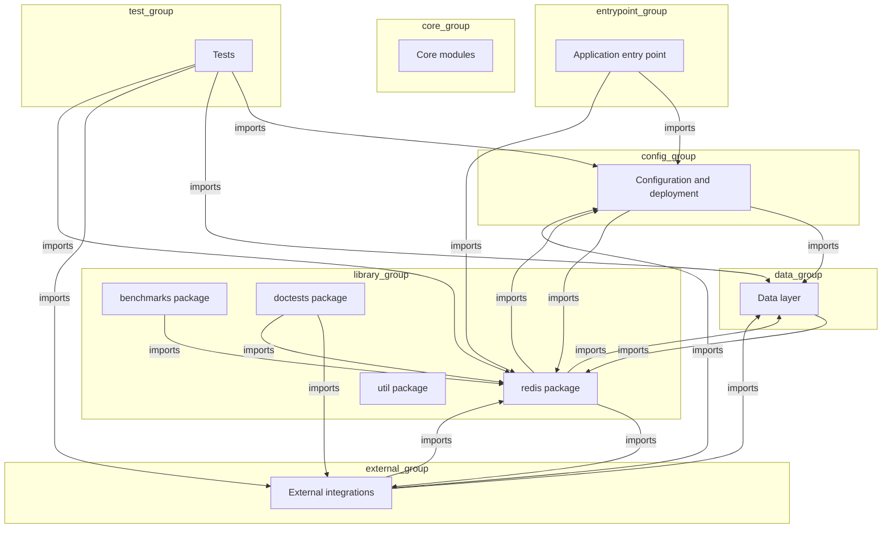

# Architecture report: redis/redis-py

> Automated static analysis. **Observed** = directly seen in files/imports/AST; **Inferred** = interpretation from that evidence. Repository code was not executed.

## 1. Repository at a glance

| Item | Value |
| --- | --- |
| Repository | redis/redis-py |
| Description | Redis Python client |
| Language | Python |
| Stars | 13664 |
| Licence | MIT |
| Analysed commit / branch | 68b1342409df85537264b50418fc8a8bcb2dd0c7 / master |
| Framework(s) | None detected |
| Files analysed | 440 |
| Components | 10 |

## 2. Architecture in one minute

redis/redis-py - Redis Python client. This repository was analysed statically from 440 file(s) (333 Python). Detected technologies (observed from imports/manifests): GitHub Actions, Redis, aiohttp, NumPy, pandas, requests. Files are grouped into 10 component(s): benchmarks package, Configuration and deployment, Core modules, Data layer, doctests package, Application entry point, External integrations, redis package. Observed entry point(s): benchmarks/basic_operations.py, benchmarks/client_side_caching.py, benchmarks/cluster_async.py. Findings below distinguish observed facts from inferred interpretation.

## 3. High-level block diagram

## 4. Main components

### benchmarks package (`benchmarks`)

- **Kind:** library
- **Status:** Observed
- **Confidence:** 0.85
- **Responsibility:** Groups 5 file(s) under benchmarks package (observed from repository paths and static analysis). Observed top-level classes: Benchmark. Observed top-level functions: add_gate_args, annotation, compare_pairs, delta_uncertainty, evaluate, finish.
- **Paths:** `benchmarks/__init__.py`, `benchmarks/base.py`, `benchmarks/measure_read_path/__init__.py`, `benchmarks/measure_read_path/gate.py`, `benchmarks/measure_read_path/prepare_worktrees.sh`
- **Evidence:** [benchmarks/__init__.py](https://github.com/redis/redis-py/blob/68b1342409df85537264b50418fc8a8bcb2dd0c7/benchmarks/__init__.py); [benchmarks/base.py:9](https://github.com/redis/redis-py/blob/68b1342409df85537264b50418fc8a8bcb2dd0c7/benchmarks/base.py#L9); [benchmarks/measure_read_path/__init__.py](https://github.com/redis/redis-py/blob/68b1342409df85537264b50418fc8a8bcb2dd0c7/benchmarks/measure_read_path/__init__.py); [benchmarks/measure_read_path/gate.py:54](https://github.com/redis/redis-py/blob/68b1342409df85537264b50418fc8a8bcb2dd0c7/benchmarks/measure_read_path/gate.py#L54); [benchmarks/measure_read_path/prepare_worktrees.sh](https://github.com/redis/redis-py/blob/68b1342409df85537264b50418fc8a8bcb2dd0c7/benchmarks/measure_read_path/prepare_worktrees.sh)

### Configuration and deployment (`config`)

- **Kind:** config
- **Status:** Observed
- **Confidence:** 0.85
- **Responsibility:** Groups 10 file(s) under configuration and deployment (observed from repository paths and static analysis). Observed top-level classes: DatabaseConfig, InitialHealthCheck, MetricGroup, MultiDbConfig, OTelConfig, TelemetryOption. Observed top-level functions: default_event_dispatcher, default_histogram_buckets, default_operation_duration_buckets.
- **Paths:** `benchmarks/requirements.txt`, `codecov.yml`, `docker-compose.yml`, `doctests/data/query_em.json`, `doctests/data/query_vector.json`, `doctests/requirements.txt`, `pyproject.toml`, `redis/asyncio/multidb/config.py`, `redis/multidb/config.py`, `redis/observability/config.py`
- **Evidence:** [benchmarks/requirements.txt](https://github.com/redis/redis-py/blob/68b1342409df85537264b50418fc8a8bcb2dd0c7/benchmarks/requirements.txt); [codecov.yml](https://github.com/redis/redis-py/blob/68b1342409df85537264b50418fc8a8bcb2dd0c7/codecov.yml); [docker-compose.yml](https://github.com/redis/redis-py/blob/68b1342409df85537264b50418fc8a8bcb2dd0c7/docker-compose.yml); [doctests/data/query_em.json](https://github.com/redis/redis-py/blob/68b1342409df85537264b50418fc8a8bcb2dd0c7/doctests/data/query_em.json); [doctests/data/query_vector.json](https://github.com/redis/redis-py/blob/68b1342409df85537264b50418fc8a8bcb2dd0c7/doctests/data/query_vector.json); [doctests/requirements.txt](https://github.com/redis/redis-py/blob/68b1342409df85537264b50418fc8a8bcb2dd0c7/doctests/requirements.txt); [pyproject.toml](https://github.com/redis/redis-py/blob/68b1342409df85537264b50418fc8a8bcb2dd0c7/pyproject.toml); [redis/asyncio/multidb/config.py:50](https://github.com/redis/redis-py/blob/68b1342409df85537264b50418fc8a8bcb2dd0c7/redis/asyncio/multidb/config.py#L50)

### Core modules (`core`)

- **Kind:** core
- **Status:** Observed
- **Confidence:** 0.85
- **Responsibility:** Groups 2 file(s) under core modules (observed from repository paths and static analysis). Observed top-level functions: _ensure_junit_results_dir, _legacy_arg, _legacy_tag, _protocol_arg, _protocol_tag, all_tests.
- **Paths:** `tasks.py`, `whitelist.py`
- **Evidence:** [tasks.py:14](https://github.com/redis/redis-py/blob/68b1342409df85537264b50418fc8a8bcb2dd0c7/tasks.py#L14); [whitelist.py](https://github.com/redis/redis-py/blob/68b1342409df85537264b50418fc8a8bcb2dd0c7/whitelist.py)

### Data layer (`data_layer`)

- **Kind:** data
- **Status:** Observed
- **Confidence:** 0.85
- **Responsibility:** Groups 2 file(s) under data layer (observed from repository paths and static analysis). Observed top-level classes: AbstractDatabase, AsyncDatabase, BaseDatabase, Database, SyncDatabase.
- **Paths:** `redis/asyncio/multidb/database.py`, `redis/multidb/database.py`
- **Evidence:** [redis/asyncio/multidb/database.py:11](https://github.com/redis/redis-py/blob/68b1342409df85537264b50418fc8a8bcb2dd0c7/redis/asyncio/multidb/database.py#L11); [redis/multidb/database.py:11](https://github.com/redis/redis-py/blob/68b1342409df85537264b50418fc8a8bcb2dd0c7/redis/multidb/database.py#L11)

### doctests package (`doctests`)

- **Kind:** library
- **Status:** Observed
- **Confidence:** 0.85
- **Responsibility:** Groups 40 file(s) under doctests package (observed from repository paths and static analysis). Observed top-level functions: create_query_table, embed_text, watched_sequence.
- **Paths:** `doctests/cmds_cnxmgmt.py`, `doctests/cmds_generic.py`, `doctests/cmds_hash.py`, `doctests/cmds_list.py`, `doctests/cmds_servermgmt.py`, `doctests/cmds_set.py`, `doctests/cmds_sorted_set.py`, `doctests/cmds_string.py`, `doctests/dt_bitfield.py`, `doctests/dt_bitmap.py`, `doctests/dt_bloom.py`, `doctests/dt_cms.py`, `doctests/dt_cuckoo.py`, `doctests/dt_geo.py`, `doctests/dt_hash.py`, `doctests/dt_hll.py`, `doctests/dt_json.py`, `doctests/dt_list.py`, `doctests/dt_set.py`, `doctests/dt_ss.py`, `doctests/dt_stream.py`, `doctests/dt_string.py`, `doctests/dt_tdigest.py`, `doctests/dt_time_series.py`, `doctests/dt_topk.py`, `doctests/dt_vec_set.py`, `doctests/geo_index.py`, `doctests/home_json.py`, `doctests/home_prob_dts.py`, `doctests/query_agg.py`, `doctests/query_combined.py`, `doctests/query_em.py`, `doctests/query_ft.py`, `doctests/query_geo.py`, `doctests/query_range.py`, `doctests/run_examples.sh`, `doctests/search_quickstart.py`, `doctests/search_vss.py`, `doctests/string_set_get.py`, `doctests/trans_pipe.py`
- **Evidence:** [doctests/cmds_cnxmgmt.py](https://github.com/redis/redis-py/blob/68b1342409df85537264b50418fc8a8bcb2dd0c7/doctests/cmds_cnxmgmt.py); [doctests/cmds_generic.py](https://github.com/redis/redis-py/blob/68b1342409df85537264b50418fc8a8bcb2dd0c7/doctests/cmds_generic.py); [doctests/cmds_hash.py](https://github.com/redis/redis-py/blob/68b1342409df85537264b50418fc8a8bcb2dd0c7/doctests/cmds_hash.py); [doctests/cmds_list.py](https://github.com/redis/redis-py/blob/68b1342409df85537264b50418fc8a8bcb2dd0c7/doctests/cmds_list.py); [doctests/cmds_servermgmt.py](https://github.com/redis/redis-py/blob/68b1342409df85537264b50418fc8a8bcb2dd0c7/doctests/cmds_servermgmt.py); [doctests/cmds_set.py](https://github.com/redis/redis-py/blob/68b1342409df85537264b50418fc8a8bcb2dd0c7/doctests/cmds_set.py); [doctests/cmds_sorted_set.py](https://github.com/redis/redis-py/blob/68b1342409df85537264b50418fc8a8bcb2dd0c7/doctests/cmds_sorted_set.py); [doctests/cmds_string.py](https://github.com/redis/redis-py/blob/68b1342409df85537264b50418fc8a8bcb2dd0c7/doctests/cmds_string.py)

### Application entry point (`entrypoint`)

- **Kind:** entrypoint
- **Status:** Observed
- **Confidence:** 0.85
- **Responsibility:** Groups 16 file(s) under application entry point (observed from repository paths and static analysis). Observed top-level classes: AsyncComprehensiveLoadGenerator, BenchmarkResult, BenchmarkSummary, BufferSocket, CommandPackerBenchmark, ComprehensiveLoadGenerator. Observed top-level functions: _clear_redis_modules, _get_metric_groups_for_benchmark, _percentile, _run_async_benchmark, _run_sync_benchmark, async_cells.
- **Paths:** `benchmarks/basic_operations.py`, `benchmarks/client_side_caching.py`, `benchmarks/cluster_async.py`, `benchmarks/cluster_async_pipeline.py`, `benchmarks/command_packer_benchmark.py`, `benchmarks/connection_handshake.py`, `benchmarks/measure_read_path/ci_matrix.py`, `benchmarks/measure_read_path/csc_bench.py`, `benchmarks/measure_read_path/mem_probe.py`, `benchmarks/measure_read_path/parser_micro.py`, `benchmarks/measure_read_path/recorder_micro.py`, `benchmarks/measure_read_path/routing_micro.py`, `benchmarks/measure_read_path/run_bench.py`, `benchmarks/measure_read_path/worker.py`, `benchmarks/otel_benchmark.py`, `benchmarks/socket_read_size.py`
- **Evidence:** [benchmarks/basic_operations.py:8](https://github.com/redis/redis-py/blob/68b1342409df85537264b50418fc8a8bcb2dd0c7/benchmarks/basic_operations.py#L8); [benchmarks/client_side_caching.py:34](https://github.com/redis/redis-py/blob/68b1342409df85537264b50418fc8a8bcb2dd0c7/benchmarks/client_side_caching.py#L34); [benchmarks/cluster_async.py:12](https://github.com/redis/redis-py/blob/68b1342409df85537264b50418fc8a8bcb2dd0c7/benchmarks/cluster_async.py#L12); [benchmarks/cluster_async_pipeline.py:12](https://github.com/redis/redis-py/blob/68b1342409df85537264b50418fc8a8bcb2dd0c7/benchmarks/cluster_async_pipeline.py#L12); [benchmarks/command_packer_benchmark.py:6](https://github.com/redis/redis-py/blob/68b1342409df85537264b50418fc8a8bcb2dd0c7/benchmarks/command_packer_benchmark.py#L6); [benchmarks/connection_handshake.py:35](https://github.com/redis/redis-py/blob/68b1342409df85537264b50418fc8a8bcb2dd0c7/benchmarks/connection_handshake.py#L35); [benchmarks/measure_read_path/ci_matrix.py:24](https://github.com/redis/redis-py/blob/68b1342409df85537264b50418fc8a8bcb2dd0c7/benchmarks/measure_read_path/ci_matrix.py#L24); [benchmarks/measure_read_path/csc_bench.py:47](https://github.com/redis/redis-py/blob/68b1342409df85537264b50418fc8a8bcb2dd0c7/benchmarks/measure_read_path/csc_bench.py#L47)

### External integrations (`external_integrations`)

- **Kind:** external
- **Status:** Observed
- **Confidence:** 0.85
- **Responsibility:** Groups 6 file(s) under external integrations (observed from repository paths and static analysis). Observed top-level classes: AbstractRedis, AsyncHTTPClient, AsyncHTTPClientWrapper, AsyncPubsubWorkerExceptionHandler, AsyncResponseCallbackProtocol, CaseInsensitiveDict. Observed top-level functions: _cached_default_response_callbacks, _half_open_circuit, _pack_pipeline_commands, _yield_in_read_loop, add_debug_log_for_operation_failure, default_response_callbacks.
- **Paths:** `redis/asyncio/client.py`, `redis/asyncio/http/http_client.py`, `redis/asyncio/multidb/client.py`, `redis/client.py`, `redis/http/http_client.py`, `redis/multidb/client.py`
- **Evidence:** [redis/asyncio/client.py:135](https://github.com/redis/redis-py/blob/68b1342409df85537264b50418fc8a8bcb2dd0c7/redis/asyncio/client.py#L135); [redis/asyncio/http/http_client.py:13](https://github.com/redis/redis-py/blob/68b1342409df85537264b50418fc8a8bcb2dd0c7/redis/asyncio/http/http_client.py#L13); [redis/asyncio/multidb/client.py:36](https://github.com/redis/redis-py/blob/68b1342409df85537264b50418fc8a8bcb2dd0c7/redis/asyncio/multidb/client.py#L36); [redis/client.py:121](https://github.com/redis/redis-py/blob/68b1342409df85537264b50418fc8a8bcb2dd0c7/redis/client.py#L121); [redis/http/http_client.py:27](https://github.com/redis/redis-py/blob/68b1342409df85537264b50418fc8a8bcb2dd0c7/redis/http/http_client.py#L27); [redis/multidb/client.py:48](https://github.com/redis/redis-py/blob/68b1342409df85537264b50418fc8a8bcb2dd0c7/redis/multidb/client.py#L48)

### redis package (`redis`)

- **Kind:** library
- **Status:** Observed
- **Confidence:** 0.85
- **Responsibility:** Groups 106 file(s) under redis package (observed from repository paths and static analysis). Observed top-level classes: AbstractAsyncKeyspaceNotifications, AbstractBackoff, AbstractBloom, AbstractCommandsParser, AbstractConnection, AbstractHealthCheck. Observed top-level functions: __getattr__, _add_derived_sentinel_booleans, _apply_policy_tips, _async_to_sync_wrapper, _build_command_records, _build_commands_metadata_cache.
- **Paths:** `redis/__init__.py`, `redis/_defaults.py`, `redis/_himport_exec.py`, `redis/_parsers/__init__.py`, `redis/_parsers/base.py`, `redis/_parsers/commands.py`, `redis/_parsers/encoders.py`, `redis/_parsers/helpers.py`, `redis/_parsers/hiredis.py`, `redis/_parsers/resp2.py`, `redis/_parsers/resp3.py`, `redis/_parsers/response_callbacks.py`, `redis/_parsers/socket.py`, `redis/asyncio/__init__.py`, `redis/asyncio/_himport_exec.py`, `redis/asyncio/connection.py`, `redis/asyncio/http/__init__.py`, `redis/asyncio/keyspace_notifications.py`, `redis/asyncio/lock.py`, `redis/asyncio/maint_notifications.py`, `redis/asyncio/multidb/__init__.py`, `redis/asyncio/multidb/command_executor.py`, `redis/asyncio/multidb/event.py`, `redis/asyncio/multidb/failover.py`, `redis/asyncio/multidb/failure_detector.py`, `redis/asyncio/multidb/healthcheck.py`, `redis/asyncio/observability/__init__.py`, `redis/asyncio/observability/recorder.py`, `redis/asyncio/retry.py`, `redis/asyncio/sentinel.py`, `redis/asyncio/utils.py`, `redis/auth/__init__.py`, `redis/auth/err.py`, `redis/auth/idp.py`, `redis/auth/token.py`, `redis/auth/token_manager.py`, `redis/background.py`, `redis/backoff.py`, `redis/cache.py`, `redis/commands/__init__.py`, `redis/commands/bf/__init__.py`, `redis/commands/bf/commands.py`, `redis/commands/bf/info.py`, `redis/commands/cluster.py`, `redis/commands/helpers.py`, `redis/commands/json/__init__.py`, `redis/commands/json/_util.py`, `redis/commands/json/commands.py`, `redis/commands/json/decoders.py`, `redis/commands/json/path.py`, `redis/commands/metadata.py`, `redis/commands/policies.py`, `redis/commands/redismodules.py`, `redis/commands/search/__init__.py`, `redis/commands/search/_util.py`, `redis/commands/search/aggregation.py`, `redis/commands/search/commands.py`, `redis/commands/search/dialect.py`, `redis/commands/search/document.py`, `redis/commands/search/field.py`, `redis/commands/search/hybrid_query.py`, `redis/commands/search/hybrid_result.py`, `redis/commands/search/index_definition.py`, `redis/commands/search/profile_information.py`, `redis/commands/search/query.py`, `redis/commands/search/querystring.py`, `redis/commands/search/reducers.py`, `redis/commands/search/result.py`, `redis/commands/search/suggestion.py`, `redis/commands/sentinel.py`, `redis/commands/timeseries/__init__.py`, `redis/commands/timeseries/commands.py`, `redis/commands/timeseries/info.py`, `redis/commands/timeseries/utils.py`, `redis/commands/vectorset/__init__.py`, `redis/commands/vectorset/commands.py`, `redis/commands/vectorset/utils.py`, `redis/crc.py`, `redis/credentials.py`, `redis/data_structure.py`, `redis/driver_info.py`, `redis/event.py`, `redis/exceptions.py`, `redis/himport.py`, `redis/http/__init__.py`, `redis/keyspace_notifications.py`, `redis/lock.py`, `redis/maint_notifications.py`, `redis/multidb/__init__.py`, `redis/multidb/circuit.py`, `redis/multidb/command_executor.py`, `redis/multidb/event.py`, `redis/multidb/exception.py`, `redis/multidb/failover.py`, `redis/multidb/failure_detector.py`, `redis/observability/__init__.py`, `redis/observability/attributes.py`, `redis/observability/metrics.py`, `redis/observability/providers.py`, `redis/observability/recorder.py`, `redis/observability/registry.py`, `redis/ocsp.py`, `redis/retry.py`, `redis/sentinel.py`, `redis/typing.py`, `redis/utils.py`
- **Evidence:** [redis/__init__.py:61](https://github.com/redis/redis-py/blob/68b1342409df85537264b50418fc8a8bcb2dd0c7/redis/__init__.py#L61); [redis/_defaults.py:12](https://github.com/redis/redis-py/blob/68b1342409df85537264b50418fc8a8bcb2dd0c7/redis/_defaults.py#L12); [redis/_himport_exec.py:29](https://github.com/redis/redis-py/blob/68b1342409df85537264b50418fc8a8bcb2dd0c7/redis/_himport_exec.py#L29); [redis/_parsers/__init__.py](https://github.com/redis/redis-py/blob/68b1342409df85537264b50418fc8a8bcb2dd0c7/redis/_parsers/__init__.py); [redis/_parsers/base.py:69](https://github.com/redis/redis-py/blob/68b1342409df85537264b50418fc8a8bcb2dd0c7/redis/_parsers/base.py#L69); [redis/_parsers/commands.py:53](https://github.com/redis/redis-py/blob/68b1342409df85537264b50418fc8a8bcb2dd0c7/redis/_parsers/commands.py#L53); [redis/_parsers/encoders.py:4](https://github.com/redis/redis-py/blob/68b1342409df85537264b50418fc8a8bcb2dd0c7/redis/_parsers/encoders.py#L4); [redis/_parsers/helpers.py:7](https://github.com/redis/redis-py/blob/68b1342409df85537264b50418fc8a8bcb2dd0c7/redis/_parsers/helpers.py#L7)

### Tests (`tests`)

- **Kind:** test
- **Status:** Observed
- **Confidence:** 0.85
- **Responsibility:** Groups 155 file(s) under tests (observed from repository paths and static analysis). Observed routes: PATCH redis.asyncio.cluster.random.shuffle, PATCH redis.cluster.random.shuffle, PATCH redis.cluster.random.shuffle, PATCH redis.maint_notifications.record_maint_notification_count, PATCH redis.maint_notifications.record_connection_relaxed_timeout. Observed top-level classes: ActionRequest, ActionType, AsyncClientValidations, AsyncContextManager, AsyncFaultInjectorClient, AsyncProxyServerFaultInjector. Observed top-level functions: _assert_callbacks_match, _assert_connect, _assert_connection_i…
- **Paths:** `tests/__init__.py`, `tests/conftest.py`, `tests/entraid_utils.py`, `tests/helpers.py`, `tests/maint_notifications/proxy_server_helpers.py`, `tests/maint_notifications/test_async_cluster_maint_notifications_handling.py`, `tests/maint_notifications/test_async_maint_notifications_handling.py`, `tests/maint_notifications/test_cluster_maint_notifications_handling.py`, `tests/maint_notifications/test_connection_diagnostic_logging.py`, `tests/maint_notifications/test_maint_notifications.py`, `tests/maint_notifications/test_maint_notifications_handling.py`, `tests/mocks.py`, `tests/ssl_utils.py`, `tests/test_asyncio/__init__.py`, `tests/test_asyncio/compat.py`, `tests/test_asyncio/conftest.py`, `tests/test_asyncio/helpers.py`, `tests/test_asyncio/mocks.py`, `tests/test_asyncio/test_bloom.py`, `tests/test_asyncio/test_client.py`, `tests/test_asyncio/test_cluster_transaction.py`, `tests/test_asyncio/test_command_metadata.py`, `tests/test_asyncio/test_command_parser.py`, `tests/test_asyncio/test_command_policies.py`, `tests/test_asyncio/test_connect.py`, `tests/test_asyncio/test_connection.py`, `tests/test_asyncio/test_connection_pool.py`, `tests/test_asyncio/test_credentials.py`, `tests/test_asyncio/test_cwe_404.py`, `tests/test_asyncio/test_encoding.py`, `tests/test_asyncio/test_function.py`, `tests/test_asyncio/test_hash.py`, `tests/test_asyncio/test_hello_fallback.py`, `tests/test_asyncio/test_himport_integration.py`, `tests/test_asyncio/test_http_client.py`, `tests/test_asyncio/test_json.py`, `tests/test_asyncio/test_keyspace_notifications.py`, `tests/test_asyncio/test_lock.py`, `tests/test_asyncio/test_monitor.py`, `tests/test_asyncio/test_multidb/__init__.py`, `tests/test_asyncio/test_multidb/conftest.py`, `tests/test_asyncio/test_multidb/test_client.py`, `tests/test_asyncio/test_multidb/test_command_executor.py`, `tests/test_asyncio/test_multidb/test_config.py`, `tests/test_asyncio/test_multidb/test_event.py`, `tests/test_asyncio/test_multidb/test_failover.py`, `tests/test_asyncio/test_multidb/test_failure_detector.py`, `tests/test_asyncio/test_multidb/test_healthcheck.py`, `tests/test_asyncio/test_multidb/test_integration.py`, `tests/test_asyncio/test_multidb/test_pipeline.py`, `tests/test_asyncio/test_observability/__init__.py`, `tests/test_asyncio/test_observability/test_cluster_metrics_error_handling.py`, `tests/test_asyncio/test_observability/test_recorder.py`, `tests/test_asyncio/test_pipeline.py`, `tests/test_asyncio/test_pubsub.py`, `tests/test_asyncio/test_response_callbacks_cache.py`, `tests/test_asyncio/test_retry.py`, `tests/test_asyncio/test_scenario/__init__.py`, `tests/test_asyncio/test_scenario/async_fault_injector_client.py`, `tests/test_asyncio/test_scenario/conftest.py`, `tests/test_asyncio/test_scenario/maint_notifications_helpers.py`, `tests/test_asyncio/test_scenario/test_active_active.py`, `tests/test_asyncio/test_scenario/test_maint_notifications.py`, `tests/test_asyncio/test_scripting.py`, `tests/test_asyncio/test_search.py`, `tests/test_asyncio/test_sentinel.py`, `tests/test_asyncio/test_sentinel_managed_connection.py`, `tests/test_asyncio/test_ssl.py`, `tests/test_asyncio/test_timeseries.py`, `tests/test_asyncio/test_usage_counter.py`, `tests/test_asyncio/test_utils.py`, `tests/test_asyncio/test_vsets.py`, `tests/test_asyncio/testdata/jsontestdata.py`, `tests/test_asyncio/testdata/titles.csv`, `tests/test_auth/__init__.py`, `tests/test_auth/test_token.py`, `tests/test_auth/test_token_manager.py`, `tests/test_background.py`, `tests/test_backoff.py`, `tests/test_bloom.py`, `tests/test_cache.py`, `tests/test_client.py`, `tests/test_cluster_transaction.py`, `tests/test_command_metadata.py`, `tests/test_command_parser.py`, `tests/test_command_policies.py`, `tests/test_connect.py`, `tests/test_connection.py`, `tests/test_connection_pool.py`, `tests/test_crc.py`, `tests/test_credentials.py`, `tests/test_data_structure.py`, `tests/test_defaults.py`, `tests/test_driver_info.py`, `tests/test_encoding.py`, `tests/test_event.py`, `tests/test_exceptions.py`, `tests/test_function.py`, `tests/test_hash.py`, `tests/test_hello_fallback.py`, `tests/test_helpers.py`, `tests/test_himport.py`, `tests/test_himport_integration.py`, `tests/test_http/__init__.py`, `tests/test_http/test_http_client.py`, `tests/test_json.py`, `tests/test_keyspace_notifications.py`, `tests/test_legacy_responses_arg.py`, `tests/test_lock.py`, `tests/test_max_connections_error.py`, `tests/test_monitor.py`, `tests/test_multidb/__init__.py`, `tests/test_multidb/_integration_endpoints.py`, `tests/test_multidb/conftest.py`, `tests/test_multidb/test_circuit.py`, `tests/test_multidb/test_client.py`, `tests/test_multidb/test_command_executor.py`, `tests/test_multidb/test_config.py`, `tests/test_multidb/test_event.py`, `tests/test_multidb/test_failover.py`, `tests/test_multidb/test_failure_detector.py`, `tests/test_multidb/test_integration.py`, `tests/test_multidb/test_pipeline.py`, `tests/test_multiprocessing.py`, `tests/test_observability/__init__.py`, `tests/test_observability/test_cluster_metrics_error_handling.py`, `tests/test_observability/test_config.py`, `tests/test_observability/test_metrics_connection_attributes.py`, `tests/test_observability/test_provider.py`, `tests/test_observability/test_public_api.py`, `tests/test_observability/test_recorder.py`, `tests/test_parsers/test_errors.py`, `tests/test_parsers/test_helpers.py`, `tests/test_pipeline.py`, `tests/test_response_callbacks_cache.py`, `tests/test_retry.py`, `tests/test_scenario/__init__.py`, `tests/test_scenario/conftest.py`, `tests/test_scenario/fault_injector_client.py`, `tests/test_scenario/maint_notifications_helpers.py`, `tests/test_scenario/test_active_active.py`, `tests/test_scenario/test_maint_notifications.py`, `tests/test_scenario/test_pubsub.py`, `tests/test_scripting.py`, `tests/test_search_aggregation.py`, `tests/test_search_querystring.py`, `tests/test_search_result.py`, `tests/test_sentinel.py`, `tests/test_sentinel_managed_connection.py`, `tests/test_ssl.py`, `tests/test_timeseries.py`, `tests/test_utils.py`, `tests/test_vsets.py`, `tests/testdata/jsontestdata.py`, `tests/testdata/titles.csv`
- **Evidence:** [tests/__init__.py](https://github.com/redis/redis-py/blob/68b1342409df85537264b50418fc8a8bcb2dd0c7/tests/__init__.py); [tests/conftest.py:50](https://github.com/redis/redis-py/blob/68b1342409df85537264b50418fc8a8bcb2dd0c7/tests/conftest.py#L50); [tests/entraid_utils.py:28](https://github.com/redis/redis-py/blob/68b1342409df85537264b50418fc8a8bcb2dd0c7/tests/entraid_utils.py#L28); [tests/helpers.py:9](https://github.com/redis/redis-py/blob/68b1342409df85537264b50418fc8a8bcb2dd0c7/tests/helpers.py#L9); [tests/maint_notifications/proxy_server_helpers.py:7](https://github.com/redis/redis-py/blob/68b1342409df85537264b50418fc8a8bcb2dd0c7/tests/maint_notifications/proxy_server_helpers.py#L7); [tests/maint_notifications/test_async_cluster_maint_notifications_handling.py:39](https://github.com/redis/redis-py/blob/68b1342409df85537264b50418fc8a8bcb2dd0c7/tests/maint_notifications/test_async_cluster_maint_notifications_handling.py#L39); [tests/maint_notifications/test_async_maint_notifications_handling.py:50](https://github.com/redis/redis-py/blob/68b1342409df85537264b50418fc8a8bcb2dd0c7/tests/maint_notifications/test_async_maint_notifications_handling.py#L50); [tests/maint_notifications/test_cluster_maint_notifications_handling.py:43](https://github.com/redis/redis-py/blob/68b1342409df85537264b50418fc8a8bcb2dd0c7/tests/maint_notifications/test_cluster_maint_notifications_handling.py#L43)

### util package (`util`)

- **Kind:** library
- **Status:** Observed
- **Confidence:** 0.85
- **Responsibility:** Groups 1 file(s) under util package (observed from repository paths and static analysis).
- **Paths:** `util/wait-for-it.sh`
- **Evidence:** [util/wait-for-it.sh](https://github.com/redis/redis-py/blob/68b1342409df85537264b50418fc8a8bcb2dd0c7/util/wait-for-it.sh)

## 5. Execution flow

**Observed** entry point(s):

- [benchmarks/basic_operations.py:192](https://github.com/redis/redis-py/blob/68b1342409df85537264b50418fc8a8bcb2dd0c7/benchmarks/basic_operations.py#L192)
- [benchmarks/client_side_caching.py:708](https://github.com/redis/redis-py/blob/68b1342409df85537264b50418fc8a8bcb2dd0c7/benchmarks/client_side_caching.py#L708)
- [benchmarks/cluster_async.py:247](https://github.com/redis/redis-py/blob/68b1342409df85537264b50418fc8a8bcb2dd0c7/benchmarks/cluster_async.py#L247)
- [benchmarks/cluster_async_pipeline.py:95](https://github.com/redis/redis-py/blob/68b1342409df85537264b50418fc8a8bcb2dd0c7/benchmarks/cluster_async_pipeline.py#L95)
- [benchmarks/command_packer_benchmark.py:89](https://github.com/redis/redis-py/blob/68b1342409df85537264b50418fc8a8bcb2dd0c7/benchmarks/command_packer_benchmark.py#L89)
- [benchmarks/connection_handshake.py:185](https://github.com/redis/redis-py/blob/68b1342409df85537264b50418fc8a8bcb2dd0c7/benchmarks/connection_handshake.py#L185)
- [benchmarks/measure_read_path/ci_matrix.py:77](https://github.com/redis/redis-py/blob/68b1342409df85537264b50418fc8a8bcb2dd0c7/benchmarks/measure_read_path/ci_matrix.py#L77)
- [benchmarks/measure_read_path/csc_bench.py:242](https://github.com/redis/redis-py/blob/68b1342409df85537264b50418fc8a8bcb2dd0c7/benchmarks/measure_read_path/csc_bench.py#L242)
- [benchmarks/measure_read_path/mem_probe.py:333](https://github.com/redis/redis-py/blob/68b1342409df85537264b50418fc8a8bcb2dd0c7/benchmarks/measure_read_path/mem_probe.py#L333)
- [benchmarks/measure_read_path/parser_micro.py:327](https://github.com/redis/redis-py/blob/68b1342409df85537264b50418fc8a8bcb2dd0c7/benchmarks/measure_read_path/parser_micro.py#L327)
- [benchmarks/measure_read_path/recorder_micro.py:321](https://github.com/redis/redis-py/blob/68b1342409df85537264b50418fc8a8bcb2dd0c7/benchmarks/measure_read_path/recorder_micro.py#L321)
- [benchmarks/measure_read_path/routing_micro.py:348](https://github.com/redis/redis-py/blob/68b1342409df85537264b50418fc8a8bcb2dd0c7/benchmarks/measure_read_path/routing_micro.py#L348)

**Observed** routes (from decorators):

- `PATCH redis.asyncio.cluster.random.shuffle` -> `test_smigrated_node_replacement_resets_topology_connection_configs` in `tests/maint_notifications/test_async_cluster_maint_notifications_handling.py:712`
- `PATCH redis.cluster.random.shuffle` -> `test_smigrating_smigrated_on_two_nodes_without_node_replacement` in `tests/maint_notifications/test_cluster_maint_notifications_handling.py:724`
- `PATCH redis.cluster.random.shuffle` -> `test_smigrating_smigrated_on_two_nodes_with_node_replacements` in `tests/maint_notifications/test_cluster_maint_notifications_handling.py:875`
- `PATCH redis.maint_notifications.record_maint_notification_count` -> `test_connection_handler_calls_record_maint_notification_count` in `tests/maint_notifications/test_maint_notifications.py:1609`
- `PATCH redis.maint_notifications.record_connection_relaxed_timeout` -> `test_connection_handler_calls_record_connection_relaxed_timeout_on_start` in `tests/maint_notifications/test_maint_notifications.py:1635`
- `PATCH redis.maint_notifications.get_pool_name` -> `test_connection_handler_calls_record_connection_relaxed_timeout_on_start` in `tests/maint_notifications/test_maint_notifications.py:1635`
- `PATCH redis.maint_notifications.record_connection_relaxed_timeout` -> `test_connection_handler_calls_record_connection_relaxed_timeout_on_complete` in `tests/maint_notifications/test_maint_notifications.py:1660`
- `PATCH redis.maint_notifications.get_pool_name` -> `test_connection_handler_calls_record_connection_relaxed_timeout_on_complete` in `tests/maint_notifications/test_maint_notifications.py:1660`
- `PATCH redis.maint_notifications.record_connection_relaxed_timeout` -> `test_connection_handler_no_relaxed_timeout_call_when_disabled` in `tests/maint_notifications/test_maint_notifications.py:1684`
- `PATCH redis.maint_notifications.record_connection_handoff` -> `test_pool_handler_calls_record_connection_handoff` in `tests/maint_notifications/test_maint_notifications.py:1703`
- `PATCH redis.maint_notifications.record_connection_handoff` -> `test_pool_handler_no_handoff_call_when_already_processed` in `tests/maint_notifications/test_maint_notifications.py:1731`
- `PATCH redis.maint_notifications.record_connection_handoff` -> `test_pool_handler_no_handoff_call_when_disabled` in `tests/maint_notifications/test_maint_notifications.py:1756`
- `PATCH redis.asyncio.connection.record_connection_count` -> `test_new_connection_records_only_used` in `tests/test_asyncio/test_connection.py:1855`
- `PATCH redis.asyncio.connection.record_connection_count` -> `test_reused_connection_transitions_idle_to_used` in `tests/test_asyncio/test_connection.py:1868`
- `PATCH redis.observability.recorder.record_connection_count` -> `test_full_lifecycle_nets_to_zero` in `tests/test_asyncio/test_connection.py:1885`
- `PATCH redis.asyncio.connection.record_connection_count` -> `test_full_lifecycle_nets_to_zero` in `tests/test_asyncio/test_connection.py:1885`
- `PATCH redis.connection.record_connection_count` -> `test_same_process_pool_reset_balances_connection_counts` in `tests/test_connection.py:4704`
- `PATCH redis.connection.record_connection_count` -> `test_new_connection_records_only_used` in `tests/test_connection.py:4736`
- `PATCH redis.connection.record_connection_count` -> `test_reused_connection_transitions_idle_to_used` in `tests/test_connection.py:4751`
- `PATCH redis.connection.record_connection_count` -> `test_full_lifecycle_nets_to_zero` in `tests/test_connection.py:4769`
- `PATCH redis.connection.record_connection_count` -> `test_release_unowned_does_not_record` in `tests/test_connection.py:4789`
- `PATCH redis.connection.record_connection_count` -> `test_release_rejected_same_pid_decrements_used` in `tests/test_connection.py:4805`
- `PATCH redis.connection.record_connection_count` -> `test_new_connection_records_only_used` in `tests/test_connection.py:4835`
- `PATCH redis.connection.record_connection_count` -> `test_release_unowned_does_not_record` in `tests/test_connection.py:4849`
- `PATCH redis.connection.record_connection_count` -> `test_release_rejected_same_pid_decrements_used` in `tests/test_connection.py:4865`

Representative flow (derived from observed entry points and the import graph; steps beyond the entry point are **Inferred**):

1. Execution starts at an observed entry point listed above, if present.
2. `benchmarks` imports `redis` (benchmarks package -> redis package).
3. `config` imports `data_layer` (Configuration and deployment -> Data layer).
4. `config` imports `redis` (Configuration and deployment -> redis package).
5. `data_layer` imports `redis` (Data layer -> redis package).
6. `doctests` imports `external_integrations` (doctests package -> External integrations).
7. `doctests` imports `redis` (doctests package -> redis package).
8. `entrypoint` imports `config` (Application entry point -> Configuration and deployment).
9. `entrypoint` imports `redis` (Application entry point -> redis package).

## 6. Project structure

### `(root)`

- `.coveragerc` - other (21 bytes)
- `.dockerignore` - container (46 bytes)
- `.gitignore` - other (373 bytes)
- `.mypy.ini` - config (626 bytes)
- `.readthedocs.yml` - config (199 bytes)
- `AGENTS.md` - docs (15114 bytes)
- `CHANGES` - other (46914 bytes)
- `CLAUDE.md` - docs (11 bytes)
- `CONTRIBUTING.md` - docs (8742 bytes)
- `LICENSE` - docs (1074 bytes)
- `README.md` - docs (16385 bytes)
- `SECURITY.md` - docs (1051 bytes)
- `codecov.yml` - config (208 bytes)
- `dev_requirements.txt` - docs (1139 bytes)
- `docker-compose.yml` - container (5817 bytes)
- `pyproject.toml` - manifest (5009 bytes)
- `tasks.py` - source, Python (9208 bytes)
- `whitelist.py` - source, Python (1444 bytes)

### `.agents`

- `.agents/references/command-metadata.md` - docs (3946 bytes)
- `.agents/references/maint-notifications.md` - docs (1276 bytes)
- `.agents/skills/add-new-command/SKILL.md` - docs (6002 bytes)
- `.agents/skills/add-new-command/assets/command-specification-template.md` - docs (1073 bytes)
- `.agents/skills/generate-release-notes/SKILL.md` - docs (8603 bytes)
- `.agents/skills/generate-release-notes/references/pr-labels-guide.md` - docs (6797 bytes)
- `.agents/skills/generate-release-notes/references/release-notes-template.md` - docs (4784 bytes)
- `.agents/skills/maintainer-review/SKILL.md` - docs (29528 bytes)
- `.agents/skills/maintainer-review/references/evaluation-framework.md` - docs (27212 bytes)
- `.agents/skills/pr-draft-summary/SKILL.md` - docs (7152 bytes)
- `.agents/skills/prepare-for-takeover/SKILL.md` - docs (6727 bytes)
- `.agents/skills/sync-claude-md/SKILL.md` - docs (5820 bytes)
- `.agents/sync_async_type_hints_overload_guide.md` - docs (10083 bytes)

### `.github`

- `.github/CODEOWNERS` - other (29 bytes)
- `.github/ISSUE_TEMPLATE.md` - docs (559 bytes)
- `.github/PULL_REQUEST_TEMPLATE.md` - docs (880 bytes)
- `.github/actions/run-tests/action.yml` - config (16213 bytes)
- `.github/dependabot.yml` - config (153 bytes)
- `.github/spellcheck-settings.yml` - config (533 bytes)
- `.github/wordlist.txt` - docs (2233 bytes)
- `.github/workflows/benchmarks.yaml` - ci, YAML (6734 bytes)
- `.github/workflows/codeql-analysis.yml` - ci, YAML (2315 bytes)
- `.github/workflows/docs.yaml` - ci, YAML (1049 bytes)
- `.github/workflows/hiredis-py-integration.yaml` - ci, YAML (2709 bytes)
- `.github/workflows/install_and_test.sh` - ci, YAML (1501 bytes)
- `.github/workflows/integration.yaml` - ci, YAML (12658 bytes)
- `.github/workflows/nightly-metrics.yaml` - ci, YAML (3073 bytes)
- `.github/workflows/pypi-publish.yaml` - ci, YAML (734 bytes)
- `.github/workflows/spellcheck.yml` - ci, YAML (372 bytes)
- `.github/workflows/stale-issues.yml` - ci, YAML (3983 bytes)

### `benchmarks`

- `benchmarks/README.md` - docs (18482 bytes)
- `benchmarks/__init__.py` - source, Python (0 bytes)
- `benchmarks/base.py` - source, Python (1355 bytes)
- `benchmarks/basic_operations.py` - source, Python (4866 bytes)
- `benchmarks/client_side_caching.py` - source, Python (24463 bytes)
- `benchmarks/cluster_async.py` - source, Python (7234 bytes)
- `benchmarks/cluster_async_pipeline.py` - source, Python (2597 bytes)
- `benchmarks/command_packer_benchmark.py` - source, Python (2846 bytes)
- `benchmarks/connection_handshake.py` - source, Python (7113 bytes)
- `benchmarks/measure_read_path/.gitignore` - other (9 bytes)
- `benchmarks/measure_read_path/__init__.py` - source, Python (0 bytes)
- `benchmarks/measure_read_path/ci_matrix.py` - source, Python (2647 bytes)
- `benchmarks/measure_read_path/csc_bench.py` - source, Python (8324 bytes)
- `benchmarks/measure_read_path/gate.py` - source, Python (10075 bytes)
- `benchmarks/measure_read_path/mem_probe.py` - source, Python (11206 bytes)
- `benchmarks/measure_read_path/parser_micro.py` - source, Python (11420 bytes)
- `benchmarks/measure_read_path/prepare_worktrees.sh` - source, Shell (1216 bytes)
- `benchmarks/measure_read_path/recorder_micro.py` - source, Python (10258 bytes)
- `benchmarks/measure_read_path/routing_micro.py` - source, Python (11384 bytes)
- `benchmarks/measure_read_path/run_bench.py` - source, Python (18167 bytes)
- `benchmarks/measure_read_path/worker.py` - source, Python (19941 bytes)
- `benchmarks/otel_benchmark.py` - source, Python (47157 bytes)
- `benchmarks/requirements.txt` - manifest (47 bytes)
- `benchmarks/socket_read_size.py` - source, Python (797 bytes)

### `dockers`

- `dockers/sentinel.conf` - other (374 bytes)

### `docs`

- `docs/Makefile` - docs (5572 bytes)
- `docs/_static/.keep` - docs (0 bytes)
- `docs/_static/logo-redis.svg` - docs (3941 bytes)
- `docs/_templates/.keep` - docs (0 bytes)
- `docs/advanced_features.rst` - docs (24418 bytes)
- `docs/backoff.rst` - docs (87 bytes)
- `docs/clustering.rst` - docs (15397 bytes)
- `docs/commands.rst` - docs (959 bytes)
- `docs/conf.py` - docs (10133 bytes)
- `docs/connections.rst` - docs (4205 bytes)
- `docs/examples.rst` - docs (488 bytes)
- `docs/examples/README.md` - docs (134 bytes)
- `docs/examples/asyncio_examples.ipynb` - docs (11560 bytes)
- `docs/examples/connection_examples.ipynb` - docs (13111 bytes)
- `docs/examples/hash_examples.ipynb` - docs (4417 bytes)
- `docs/examples/opentelemetry/README.md` - docs (1195 bytes)
- `docs/examples/opentelemetry/config/alertmanager.yml` - config (1692 bytes)
- `docs/examples/opentelemetry/config/otel-collector.yaml` - config (1249 bytes)
- `docs/examples/opentelemetry/config/vector.toml` - config (923 bytes)
- `docs/examples/opentelemetry/docker-compose.yml` - container (1752 bytes)
- `docs/examples/opentelemetry/main.py` - docs (1277 bytes)
- `docs/examples/opentelemetry/requirements.txt` - manifest (73 bytes)
- `docs/examples/opentelemetry/uptrace.yml` - config (8596 bytes)
- `docs/examples/opentelemetry_api_examples.ipynb` - docs (14417 bytes)
- `docs/examples/pipeline_examples.ipynb` - docs (8548 bytes)
- `docs/examples/pubsub_examples.ipynb` - docs (15308 bytes)
- `docs/examples/redis-stream-example.ipynb` - docs (19064 bytes)
- `docs/examples/search_json_examples.ipynb` - docs (7989 bytes)
- `docs/examples/search_vector_similarity_examples.ipynb` - docs (53736 bytes)
- `docs/examples/set_and_get_examples.ipynb` - docs (5495 bytes)
- `docs/examples/sorted_set_examples.ipynb` - docs (13991 bytes)
- `docs/examples/ssl_connection_examples.ipynb` - docs (7805 bytes)
- `docs/examples/timeseries_examples.ipynb` - docs (14243 bytes)
- `docs/exceptions.rst` - docs (92 bytes)
- `docs/genindex.rst` - docs (25 bytes)
- `docs/geographic_failover.rst` - docs (28756 bytes)
- `docs/index.rst` - docs (2046 bytes)
- `docs/lock.rst` - docs (57 bytes)
- `docs/lua_scripting.rst` - docs (6467 bytes)
- `docs/opentelemetry.rst` - docs (14724 bytes)
- `docs/redismodules.rst` - docs (3227 bytes)
- `docs/requirements.txt` - manifest (100 bytes)
- `docs/resp3_features.rst` - docs (14040 bytes)
- `docs/retry.rst` - docs (5897 bytes)
- `docs/unified_responses.rst` - docs (17717 bytes)

### `doctests`

- `doctests/README.md` - docs (1230 bytes)
- `doctests/cmds_cnxmgmt.py` - source, Python (752 bytes)
- `doctests/cmds_generic.py` - source, Python (3265 bytes)
- `doctests/cmds_hash.py` - source, Python (1680 bytes)
- `doctests/cmds_list.py` - source, Python (2384 bytes)
- `doctests/cmds_servermgmt.py` - source, Python (510 bytes)
- `doctests/cmds_set.py` - source, Python (632 bytes)
- `doctests/cmds_sorted_set.py` - source, Python (1765 bytes)
- `doctests/cmds_string.py` - source, Python (319 bytes)
- `doctests/data/query_em.json` - config (7059 bytes)
- `doctests/data/query_vector.json` - config (9127 bytes)
- `doctests/dt_bitfield.py` - source, Python (746 bytes)
- `doctests/dt_bitmap.py` - source, Python (3435 bytes)
- `doctests/dt_bloom.py` - source, Python (881 bytes)
- `doctests/dt_cms.py` - source, Python (821 bytes)
- `doctests/dt_cuckoo.py` - source, Python (791 bytes)
- `doctests/dt_geo.py` - source, Python (967 bytes)
- `doctests/dt_hash.py` - source, Python (1975 bytes)
- `doctests/dt_hll.py` - source, Python (744 bytes)
- `doctests/dt_json.py` - source, Python (11265 bytes)
- `doctests/dt_list.py` - source, Python (6857 bytes)
- `doctests/dt_set.py` - source, Python (4168 bytes)
- `doctests/dt_ss.py` - source, Python (2673 bytes)
- `doctests/dt_stream.py` - source, Python (10190 bytes)
- `doctests/dt_string.py` - source, Python (1169 bytes)
- `doctests/dt_tdigest.py` - source, Python (1524 bytes)
- `doctests/dt_time_series.py` - source, Python (12577 bytes)
- `doctests/dt_topk.py` - source, Python (803 bytes)
- `doctests/dt_vec_set.py` - source, Python (6200 bytes)
- `doctests/geo_index.py` - source, Python (3737 bytes)
- `doctests/home_json.py` - source, Python (4590 bytes)
- `doctests/home_prob_dts.py` - source, Python (5583 bytes)
- `doctests/query_agg.py` - source, Python (3378 bytes)
- `doctests/query_combined.py` - source, Python (3108 bytes)
- `doctests/query_em.py` - source, Python (2694 bytes)
- `doctests/query_ft.py` - source, Python (3372 bytes)
- `doctests/query_geo.py` - source, Python (1914 bytes)
- `doctests/query_range.py` - source, Python (1958 bytes)
- `doctests/requirements.txt` - manifest (90 bytes)
- `doctests/run_examples.sh` - source, Shell (243 bytes)
- `doctests/search_quickstart.py` - source, Python (13040 bytes)
- `doctests/search_vss.py` - source, Python (9300 bytes)
- `doctests/string_set_get.py` - source, Python (474 bytes)
- `doctests/trans_pipe.py` - source, Python (2540 bytes)

### `redis`

- `redis/__init__.py` - source, Python (2987 bytes)
- `redis/_defaults.py` - source, Python (1199 bytes)
- `redis/_himport_exec.py` - source, Python (11279 bytes)
- `redis/_parsers/__init__.py` - source, Python (759 bytes)
- `redis/_parsers/base.py` - source, Python (24882 bytes)
- `redis/_parsers/commands.py` - source, Python (38723 bytes)
- `redis/_parsers/encoders.py` - source, Python (1758 bytes)
- `redis/_parsers/helpers.py` - source, Python (63990 bytes)
- `redis/_parsers/hiredis.py` - source, Python (18325 bytes)
- `redis/_parsers/resp2.py` - source, Python (5134 bytes)
- `redis/_parsers/resp3.py` - source, Python (12828 bytes)
- `redis/_parsers/response_callbacks.py` - source, Python (20708 bytes)
- `redis/_parsers/socket.py` - source, Python (9707 bytes)
- `redis/asyncio/__init__.py` - source, Python (1830 bytes)
- `redis/asyncio/_himport_exec.py` - source, Python (11487 bytes)
- `redis/asyncio/client.py` - source, Python (102922 bytes)
- `redis/asyncio/connection.py` - source, Python (152327 bytes)
- `redis/asyncio/http/__init__.py` - source, Python (0 bytes)
- `redis/asyncio/http/http_client.py` - source, Python (8640 bytes)
- `redis/asyncio/keyspace_notifications.py` - source, Python (37634 bytes)
- `redis/asyncio/lock.py` - source, Python (14708 bytes)
- `redis/asyncio/maint_notifications.py` - source, Python (29474 bytes)
- `redis/asyncio/multidb/__init__.py` - source, Python (0 bytes)
- `redis/asyncio/multidb/client.py` - source, Python (28655 bytes)
- `redis/asyncio/multidb/command_executor.py` - source, Python (12547 bytes)
- `redis/asyncio/multidb/config.py` - source, Python (10567 bytes)
- `redis/asyncio/multidb/database.py` - source, Python (1931 bytes)
- `redis/asyncio/multidb/event.py` - source, Python (3878 bytes)
- `redis/asyncio/multidb/failover.py` - source, Python (3635 bytes)
- `redis/asyncio/multidb/failure_detector.py` - source, Python (1263 bytes)
- `redis/asyncio/multidb/healthcheck.py` - source, Python (35114 bytes)
- `redis/asyncio/observability/__init__.py` - source, Python (439 bytes)
- `redis/asyncio/observability/recorder.py` - source, Python (22206 bytes)
- `redis/asyncio/retry.py` - source, Python (4076 bytes)
- `redis/asyncio/sentinel.py` - source, Python (21110 bytes)
- `redis/asyncio/utils.py` - source, Python (852 bytes)
- `redis/auth/__init__.py` - source, Python (0 bytes)
- `redis/auth/err.py` - source, Python (694 bytes)
- `redis/auth/idp.py` - source, Python (631 bytes)
- `redis/auth/token.py` - source, Python (3317 bytes)
- `redis/auth/token_manager.py` - source, Python (13444 bytes)
- `redis/background.py` - source, Python (16982 bytes)
- `redis/backoff.py` - source, Python (5889 bytes)
- `redis/cache.py` - source, Python (26305 bytes)
- `redis/client.py` - source, Python (99785 bytes)
- `redis/commands/__init__.py` - source, Python (576 bytes)
- `redis/commands/bf/__init__.py` - source, Python (12949 bytes)
- `redis/commands/bf/commands.py` - source, Python (35766 bytes)
- `redis/commands/bf/info.py` - source, Python (3716 bytes)
- `redis/commands/cluster.py` - source, Python (55855 bytes)
- `redis/commands/helpers.py` - source, Python (6401 bytes)
- `redis/commands/json/__init__.py` - source, Python (12863 bytes)
- `redis/commands/json/_util.py` - source, Python (137 bytes)
- `redis/commands/json/commands.py` - source, Python (30088 bytes)
- `redis/commands/json/decoders.py` - source, Python (1709 bytes)
- `redis/commands/json/path.py` - source, Python (393 bytes)
- `redis/commands/metadata.py` - source, Python (74829 bytes)
- `redis/commands/policies.py` - source, Python (20457 bytes)
- `redis/commands/redismodules.py` - source, Python (4438 bytes)
- `redis/commands/search/__init__.py` - source, Python (8322 bytes)
- `redis/commands/search/_util.py` - source, Python (219 bytes)
- `redis/commands/search/aggregation.py` - source, Python (12248 bytes)
- `redis/commands/search/commands.py` - source, Python (90958 bytes)
- `redis/commands/search/dialect.py` - source, Python (105 bytes)
- `redis/commands/search/document.py` - source, Python (413 bytes)
- `redis/commands/search/field.py` - source, Python (5973 bytes)
- `redis/commands/search/hybrid_query.py` - source, Python (14794 bytes)
- `redis/commands/search/hybrid_result.py` - source, Python (815 bytes)
- `redis/commands/search/index_definition.py` - source, Python (2653 bytes)
- `redis/commands/search/profile_information.py` - source, Python (249 bytes)
- `redis/commands/search/query.py` - source, Python (12567 bytes)
- `redis/commands/search/querystring.py` - source, Python (7503 bytes)
- `redis/commands/search/reducers.py` - source, Python (7315 bytes)
- `redis/commands/search/result.py` - source, Python (5455 bytes)
- `redis/commands/search/suggestion.py` - source, Python (1612 bytes)
- `redis/commands/sentinel.py` - source, Python (9140 bytes)
- `redis/commands/timeseries/__init__.py` - source, Python (5770 bytes)
- `redis/commands/timeseries/commands.py` - source, Python (87555 bytes)
- `redis/commands/timeseries/info.py` - source, Python (5248 bytes)
- `redis/commands/timeseries/utils.py` - source, Python (7608 bytes)
- `redis/commands/vectorset/__init__.py` - source, Python (2650 bytes)
- `redis/commands/vectorset/commands.py` - source, Python (19869 bytes)
- `redis/commands/vectorset/utils.py` - source, Python (5178 bytes)
- `redis/crc.py` - source, Python (868 bytes)
- `redis/credentials.py` - source, Python (1828 bytes)
- `redis/data_structure.py` - source, Python (2527 bytes)
- `redis/driver_info.py` - source, Python (5911 bytes)
- `redis/event.py` - source, Python (21758 bytes)
- `redis/exceptions.py` - source, Python (9808 bytes)
- `redis/himport.py` - source, Python (16381 bytes)
- `redis/http/__init__.py` - source, Python (0 bytes)
- `redis/http/http_client.py` - source, Python (15359 bytes)
- `redis/keyspace_notifications.py` - source, Python (76833 bytes)
- `redis/lock.py` - source, Python (14073 bytes)
- `redis/maint_notifications.py` - source, Python (56969 bytes)
- `redis/multidb/__init__.py` - source, Python (0 bytes)
- `redis/multidb/circuit.py` - source, Python (3856 bytes)
- `redis/multidb/client.py` - source, Python (31279 bytes)
- `redis/multidb/command_executor.py` - source, Python (12401 bytes)
- `redis/multidb/config.py` - source, Python (10334 bytes)
- `redis/multidb/database.py` - source, Python (3665 bytes)
- `redis/multidb/event.py` - source, Python (3734 bytes)
- `redis/multidb/exception.py` - source, Python (633 bytes)
- `redis/multidb/failover.py` - source, Python (3575 bytes)
- `redis/multidb/failure_detector.py` - source, Python (3788 bytes)
- `redis/observability/__init__.py` - source, Python (694 bytes)
- `redis/observability/attributes.py` - source, Python (13669 bytes)
- `redis/observability/config.py` - source, Python (6515 bytes)
- `redis/observability/metrics.py` - source, Python (24377 bytes)
- `redis/observability/providers.py` - source, Python (14369 bytes)
- `redis/observability/recorder.py` - source, Python (28519 bytes)
- `redis/observability/registry.py` - source, Python (2088 bytes)
- `redis/ocsp.py` - source, Python (13923 bytes)
- `redis/py.typed` - other (0 bytes)
- `redis/retry.py` - source, Python (6709 bytes)
- `redis/sentinel.py` - source, Python (21685 bytes)
- `redis/typing.py` - source, Python (6524 bytes)
- `redis/utils.py` - source, Python (24958 bytes)

### `specs`

- `specs/keyspace-notifications/SPEC.md` - docs (7417 bytes)
- `specs/redis_commands_guide.md` - docs (6398 bytes)
- `specs/sync_async_deduplication_analysis.md` - docs (10123 bytes)
- `specs/unified_responses_migration_guide.md` - docs (9882 bytes)

### `tests`

- `tests/__init__.py` - test, Python (0 bytes)
- `tests/conftest.py` - test, Python (34523 bytes)
- `tests/entraid_utils.py` - test, Python (5646 bytes)
- `tests/helpers.py` - test, Python (6061 bytes)
- `tests/maint_notifications/proxy_server_helpers.py` - test, Python (10011 bytes)
- `tests/maint_notifications/test_async_cluster_maint_notifications_handling.py` - test, Python (33634 bytes)
- `tests/maint_notifications/test_async_maint_notifications_handling.py` - test, Python (100777 bytes)
- `tests/maint_notifications/test_cluster_maint_notifications_handling.py` - test, Python (54562 bytes)
- `tests/maint_notifications/test_connection_diagnostic_logging.py` - test, Python (17267 bytes)
- `tests/maint_notifications/test_maint_notifications.py` - test, Python (76499 bytes)
- `tests/maint_notifications/test_maint_notifications_handling.py` - test, Python (154301 bytes)
- `tests/mocks.py` - test, Python (1144 bytes)
- `tests/ssl_utils.py` - test, Python (1794 bytes)
- `tests/test_asyncio/__init__.py` - test, Python (0 bytes)
- `tests/test_asyncio/compat.py` - test, Python (326 bytes)
- `tests/test_asyncio/conftest.py` - test, Python (12521 bytes)
- `tests/test_asyncio/helpers.py` - test, Python (1858 bytes)
- `tests/test_asyncio/mocks.py` - test, Python (1340 bytes)
- `tests/test_asyncio/test_bloom.py` - test, Python (24758 bytes)
- `tests/test_asyncio/test_client.py` - test, Python (18026 bytes)
- `tests/test_asyncio/test_cluster_transaction.py` - test, Python (27176 bytes)
- `tests/test_asyncio/test_command_metadata.py` - test, Python (62665 bytes)
- `tests/test_asyncio/test_command_parser.py` - test, Python (7621 bytes)
- `tests/test_asyncio/test_command_policies.py` - test, Python (11787 bytes)
- `tests/test_asyncio/test_connect.py` - test, Python (7401 bytes)
- `tests/test_asyncio/test_connection.py` - test, Python (76957 bytes)
- `tests/test_asyncio/test_connection_pool.py` - test, Python (81766 bytes)
- `tests/test_asyncio/test_credentials.py` - test, Python (28905 bytes)
- `tests/test_asyncio/test_cwe_404.py` - test, Python (9558 bytes)
- `tests/test_asyncio/test_encoding.py` - test, Python (4241 bytes)
- `tests/test_asyncio/test_function.py` - test, Python (1100 bytes)
- `tests/test_asyncio/test_hash.py` - test, Python (22487 bytes)
- `tests/test_asyncio/test_hello_fallback.py` - test, Python (18103 bytes)
- `tests/test_asyncio/test_himport_integration.py` - test, Python (18337 bytes)
- `tests/test_asyncio/test_http_client.py` - test, Python (681 bytes)
- `tests/test_asyncio/test_json.py` - test, Python (42453 bytes)
- `tests/test_asyncio/test_keyspace_notifications.py` - test, Python (42472 bytes)
- `tests/test_asyncio/test_lock.py` - test, Python (18501 bytes)
- `tests/test_asyncio/test_monitor.py` - test, Python (6028 bytes)
- `tests/test_asyncio/test_multidb/__init__.py` - test, Python (0 bytes)
- `tests/test_asyncio/test_multidb/conftest.py` - test, Python (4423 bytes)
- `tests/test_asyncio/test_multidb/test_client.py` - test, Python (70223 bytes)
- `tests/test_asyncio/test_multidb/test_command_executor.py` - test, Python (16493 bytes)
- `tests/test_asyncio/test_multidb/test_config.py` - test, Python (10211 bytes)
- `tests/test_asyncio/test_multidb/test_event.py` - test, Python (6556 bytes)
- `tests/test_asyncio/test_multidb/test_failover.py` - test, Python (5853 bytes)
- `tests/test_asyncio/test_multidb/test_failure_detector.py` - test, Python (5829 bytes)
- `tests/test_asyncio/test_multidb/test_healthcheck.py` - test, Python (63554 bytes)
- `tests/test_asyncio/test_multidb/test_integration.py` - test, Python (2728 bytes)
- `tests/test_asyncio/test_multidb/test_pipeline.py` - test, Python (29546 bytes)
- `tests/test_asyncio/test_observability/__init__.py` - test, Python (54 bytes)
- `tests/test_asyncio/test_observability/test_cluster_metrics_error_handling.py` - test, Python (19461 bytes)
- `tests/test_asyncio/test_observability/test_recorder.py` - test, Python (50395 bytes)
- `tests/test_asyncio/test_pipeline.py` - test, Python (44813 bytes)
- `tests/test_asyncio/test_pubsub.py` - test, Python (193983 bytes)
- `tests/test_asyncio/test_response_callbacks_cache.py` - test, Python (3783 bytes)
- `tests/test_asyncio/test_retry.py` - test, Python (15779 bytes)
- `tests/test_asyncio/test_scenario/__init__.py` - test, Python (0 bytes)
- `tests/test_asyncio/test_scenario/async_fault_injector_client.py` - test, Python (13224 bytes)
- `tests/test_asyncio/test_scenario/conftest.py` - test, Python (14257 bytes)
- `tests/test_asyncio/test_scenario/maint_notifications_helpers.py` - test, Python (2966 bytes)
- `tests/test_asyncio/test_scenario/test_active_active.py` - test, Python (41322 bytes)
- `tests/test_asyncio/test_scenario/test_maint_notifications.py` - test, Python (75873 bytes)
- `tests/test_asyncio/test_scripting.py` - test, Python (6311 bytes)
- `tests/test_asyncio/test_search.py` - test, Python (197124 bytes)
- `tests/test_asyncio/test_sentinel.py` - test, Python (20893 bytes)
- `tests/test_asyncio/test_sentinel_managed_connection.py` - test, Python (5432 bytes)
- `tests/test_asyncio/test_ssl.py` - test, Python (9102 bytes)
- `tests/test_asyncio/test_timeseries.py` - test, Python (71072 bytes)
- `tests/test_asyncio/test_usage_counter.py` - test, Python (7747 bytes)
- `tests/test_asyncio/test_utils.py` - test, Python (10188 bytes)
- `tests/test_asyncio/test_vsets.py` - test, Python (43599 bytes)
- `tests/test_asyncio/testdata/jsontestdata.py` - test, Python (14095 bytes)
- `tests/test_asyncio/testdata/titles.csv` - test (98632 bytes)
- `tests/test_auth/__init__.py` - test, Python (0 bytes)
- `tests/test_auth/test_token.py` - test, Python (2618 bytes)
- `tests/test_auth/test_token_manager.py` - test, Python (33949 bytes)
- `tests/test_background.py` - test, Python (11012 bytes)
- `tests/test_backoff.py` - test, Python (2450 bytes)
- `tests/test_bloom.py` - test, Python (24504 bytes)
- `tests/test_cache.py` - test, Python (130941 bytes)
- `tests/test_client.py` - test, Python (21555 bytes)
- `tests/test_cluster_transaction.py` - test, Python (41694 bytes)
- `tests/test_command_metadata.py` - test, Python (99853 bytes)
- `tests/test_command_parser.py` - test, Python (10922 bytes)
- `tests/test_command_policies.py` - test, Python (10774 bytes)
- `tests/test_connect.py` - test, Python (9339 bytes)
- `tests/test_connection.py` - test, Python (196738 bytes)
- `tests/test_connection_pool.py` - test, Python (59661 bytes)
- `tests/test_crc.py` - test, Python (2792 bytes)
- `tests/test_credentials.py` - test, Python (26474 bytes)
- `tests/test_data_structure.py` - test, Python (2703 bytes)
- `tests/test_defaults.py` - test, Python (8255 bytes)
- `tests/test_driver_info.py` - test, Python (3405 bytes)
- `tests/test_encoding.py` - test, Python (4167 bytes)
- `tests/test_event.py` - test, Python (6574 bytes)
- `tests/test_exceptions.py` - test, Python (1522 bytes)
- `tests/test_function.py` - test, Python (7286 bytes)
- `tests/test_hash.py` - test, Python (23728 bytes)
- `tests/test_hello_fallback.py` - test, Python (25323 bytes)
- `tests/test_helpers.py` - test, Python (1216 bytes)
- `tests/test_himport.py` - test, Python (55948 bytes)
- `tests/test_himport_integration.py` - test, Python (21376 bytes)
- `tests/test_http/__init__.py` - test, Python (0 bytes)
- `tests/test_http/test_http_client.py` - test, Python (13369 bytes)
- `tests/test_json.py` - test, Python (54115 bytes)
- `tests/test_keyspace_notifications.py` - test, Python (72893 bytes)
- `tests/test_legacy_responses_arg.py` - test, Python (5554 bytes)
- `tests/test_lock.py` - test, Python (16261 bytes)
- `tests/test_max_connections_error.py` - test, Python (7149 bytes)
- `tests/test_monitor.py` - test, Python (3757 bytes)
- `tests/test_multidb/__init__.py` - test, Python (0 bytes)
- `tests/test_multidb/_integration_endpoints.py` - test, Python (1239 bytes)
- `tests/test_multidb/conftest.py` - test, Python (4308 bytes)
- `tests/test_multidb/test_circuit.py` - test, Python (1671 bytes)
- `tests/test_multidb/test_client.py` - test, Python (78657 bytes)
- `tests/test_multidb/test_command_executor.py` - test, Python (13868 bytes)
- `tests/test_multidb/test_config.py` - test, Python (10133 bytes)
- `tests/test_multidb/test_event.py` - test, Python (3405 bytes)
- `tests/test_multidb/test_failover.py` - test, Python (5634 bytes)
- `tests/test_multidb/test_failure_detector.py` - test, Python (5339 bytes)
- `tests/test_multidb/test_integration.py` - test, Python (2804 bytes)
- `tests/test_multidb/test_pipeline.py` - test, Python (25934 bytes)
- `tests/test_multiprocessing.py` - test, Python (15186 bytes)
- `tests/test_observability/__init__.py` - test, Python (0 bytes)
- `tests/test_observability/test_cluster_metrics_error_handling.py` - test, Python (21408 bytes)
- `tests/test_observability/test_config.py` - test, Python (17216 bytes)
- `tests/test_observability/test_metrics_connection_attributes.py` - test, Python (6961 bytes)
- `tests/test_observability/test_provider.py` - test, Python (16148 bytes)
- `tests/test_observability/test_public_api.py` - test, Python (3293 bytes)
- `tests/test_observability/test_recorder.py` - test, Python (76689 bytes)
- `tests/test_parsers/test_errors.py` - test, Python (7228 bytes)
- `tests/test_parsers/test_helpers.py` - test, Python (17414 bytes)
- `tests/test_pipeline.py` - test, Python (37485 bytes)
- `tests/test_response_callbacks_cache.py` - test, Python (7531 bytes)
- `tests/test_retry.py` - test, Python (13579 bytes)
- `tests/test_scenario/__init__.py` - test, Python (0 bytes)
- `tests/test_scenario/conftest.py` - test, Python (23691 bytes)
- `tests/test_scenario/fault_injector_client.py` - test, Python (20867 bytes)
- `tests/test_scenario/maint_notifications_helpers.py` - test, Python (16302 bytes)
- `tests/test_scenario/test_active_active.py` - test, Python (41356 bytes)
- `tests/test_scenario/test_maint_notifications.py` - test, Python (98009 bytes)
- `tests/test_scenario/test_pubsub.py` - test, Python (53761 bytes)
- `tests/test_scripting.py` - test, Python (9312 bytes)
- `tests/test_search_aggregation.py` - test, Python (2574 bytes)
- `tests/test_search_querystring.py` - test, Python (2962 bytes)
- `tests/test_search_result.py` - test, Python (12487 bytes)
- `tests/test_sentinel.py` - test, Python (22142 bytes)
- `tests/test_sentinel_managed_connection.py` - test, Python (14624 bytes)
- `tests/test_ssl.py` - test, Python (40516 bytes)
- `tests/test_timeseries.py` - test, Python (79063 bytes)
- `tests/test_utils.py` - test, Python (35633 bytes)
- `tests/test_vsets.py` - test, Python (42532 bytes)
- `tests/testdata/jsontestdata.py` - test, Python (14095 bytes)
- `tests/testdata/titles.csv` - test (98632 bytes)

### `util`

- `util/wait-for-it.sh` - source, Shell (6340 bytes)

## 7. Key dependencies and integrations

| Name | Category | Status | Confidence | Evidence |
| --- | --- | --- | --- | --- |
| GitHub Actions | ci | Observed | 0.90 | [.github/workflows/benchmarks.yaml](https://github.com/redis/redis-py/blob/68b1342409df85537264b50418fc8a8bcb2dd0c7/.github/workflows/benchmarks.yaml); [.github/workflows/codeql-analysis.yml](https://github.com/redis/redis-py/blob/68b1342409df85537264b50418fc8a8bcb2dd0c7/.github/workflows/codeql-analysis.yml); [.github/workflows/docs.yaml](https://github.com/redis/redis-py/blob/68b1342409df85537264b50418fc8a8bcb2dd0c7/.github/workflows/docs.yaml); [.github/workflows/hiredis-py-integration.yaml](https://github.com/redis/redis-py/blob/68b1342409df85537264b50418fc8a8bcb2dd0c7/.github/workflows/hiredis-py-integration.yaml) |
| Redis | database | Observed | 0.95 | [benchmarks/base.py:6](https://github.com/redis/redis-py/blob/68b1342409df85537264b50418fc8a8bcb2dd0c7/benchmarks/base.py#L6); [benchmarks/basic_operations.py:5](https://github.com/redis/redis-py/blob/68b1342409df85537264b50418fc8a8bcb2dd0c7/benchmarks/basic_operations.py#L5); [benchmarks/client_side_caching.py:23](https://github.com/redis/redis-py/blob/68b1342409df85537264b50418fc8a8bcb2dd0c7/benchmarks/client_side_caching.py#L23); [benchmarks/client_side_caching.py:24](https://github.com/redis/redis-py/blob/68b1342409df85537264b50418fc8a8bcb2dd0c7/benchmarks/client_side_caching.py#L24) |
| aiohttp | library | Observed | 0.90 | [tests/test_asyncio/test_scenario/async_fault_injector_client.py:6](https://github.com/redis/redis-py/blob/68b1342409df85537264b50418fc8a8bcb2dd0c7/tests/test_asyncio/test_scenario/async_fault_injector_client.py#L6) |
| NumPy | library | Observed | 0.95 | [doctests/query_combined.py:4](https://github.com/redis/redis-py/blob/68b1342409df85537264b50418fc8a8bcb2dd0c7/doctests/query_combined.py#L4); [doctests/requirements.txt:1](https://github.com/redis/redis-py/blob/68b1342409df85537264b50418fc8a8bcb2dd0c7/doctests/requirements.txt#L1); [doctests/search_vss.py:13](https://github.com/redis/redis-py/blob/68b1342409df85537264b50418fc8a8bcb2dd0c7/doctests/search_vss.py#L13); [tests/test_asyncio/test_search.py:9](https://github.com/redis/redis-py/blob/68b1342409df85537264b50418fc8a8bcb2dd0c7/tests/test_asyncio/test_search.py#L9) |
| pandas | library | Observed | 0.90 | [doctests/requirements.txt:2](https://github.com/redis/redis-py/blob/68b1342409df85537264b50418fc8a8bcb2dd0c7/doctests/requirements.txt#L2); [doctests/search_vss.py:14](https://github.com/redis/redis-py/blob/68b1342409df85537264b50418fc8a8bcb2dd0c7/doctests/search_vss.py#L14) |
| requests | library | Observed | 0.95 | [doctests/requirements.txt:3](https://github.com/redis/redis-py/blob/68b1342409df85537264b50418fc8a8bcb2dd0c7/doctests/requirements.txt#L3); [doctests/search_vss.py:15](https://github.com/redis/redis-py/blob/68b1342409df85537264b50418fc8a8bcb2dd0c7/doctests/search_vss.py#L15); [pyproject.toml:47](https://github.com/redis/redis-py/blob/68b1342409df85537264b50418fc8a8bcb2dd0c7/pyproject.toml#L47); [redis/ocsp.py:7](https://github.com/redis/redis-py/blob/68b1342409df85537264b50418fc8a8bcb2dd0c7/redis/ocsp.py#L7) |
| Poetry | packaging | Observed | 0.85 | [pyproject.toml](https://github.com/redis/redis-py/blob/68b1342409df85537264b50418fc8a8bcb2dd0c7/pyproject.toml) |
| Docker | tooling | Observed | 0.75 | [.github/workflows/benchmarks.yaml:135](https://github.com/redis/redis-py/blob/68b1342409df85537264b50418fc8a8bcb2dd0c7/.github/workflows/benchmarks.yaml#L135); [.github/workflows/install_and_test.sh:44](https://github.com/redis/redis-py/blob/68b1342409df85537264b50418fc8a8bcb2dd0c7/.github/workflows/install_and_test.sh#L44) |
| Docker Compose | tooling | Observed | 0.90 | [docker-compose.yml](https://github.com/redis/redis-py/blob/68b1342409df85537264b50418fc8a8bcb2dd0c7/docker-compose.yml); [docs/examples/opentelemetry/docker-compose.yml](https://github.com/redis/redis-py/blob/68b1342409df85537264b50418fc8a8bcb2dd0c7/docs/examples/opentelemetry/docker-compose.yml) |
| pytest | tooling | Observed | 0.95 | [.github/workflows/install_and_test.sh:45](https://github.com/redis/redis-py/blob/68b1342409df85537264b50418fc8a8bcb2dd0c7/.github/workflows/install_and_test.sh#L45); [.github/workflows/integration.yaml:46](https://github.com/redis/redis-py/blob/68b1342409df85537264b50418fc8a8bcb2dd0c7/.github/workflows/integration.yaml#L46); [tests/conftest.py:12](https://github.com/redis/redis-py/blob/68b1342409df85537264b50418fc8a8bcb2dd0c7/tests/conftest.py#L12); [tests/maint_notifications/test_async_cluster_maint_notifications_handling.py:6](https://github.com/redis/redis-py/blob/68b1342409df85537264b50418fc8a8bcb2dd0c7/tests/maint_notifications/test_async_cluster_maint_notifications_handling.py#L6) |
| unittest | tooling | Observed | 0.95 | [tests/conftest.py:8](https://github.com/redis/redis-py/blob/68b1342409df85537264b50418fc8a8bcb2dd0c7/tests/conftest.py#L8); [tests/conftest.py:9](https://github.com/redis/redis-py/blob/68b1342409df85537264b50418fc8a8bcb2dd0c7/tests/conftest.py#L9); [tests/maint_notifications/test_async_cluster_maint_notifications_handling.py:4](https://github.com/redis/redis-py/blob/68b1342409df85537264b50418fc8a8bcb2dd0c7/tests/maint_notifications/test_async_cluster_maint_notifications_handling.py#L4); [tests/maint_notifications/test_async_maint_notifications_handling.py:2](https://github.com/redis/redis-py/blob/68b1342409df85537264b50418fc8a8bcb2dd0c7/tests/maint_notifications/test_async_maint_notifications_handling.py#L2) |

## 8. Data and state

- **Redis** (Observed, confidence 0.95) - evidence: [benchmarks/base.py:6](https://github.com/redis/redis-py/blob/68b1342409df85537264b50418fc8a8bcb2dd0c7/benchmarks/base.py#L6); [benchmarks/basic_operations.py:5](https://github.com/redis/redis-py/blob/68b1342409df85537264b50418fc8a8bcb2dd0c7/benchmarks/basic_operations.py#L5); [benchmarks/client_side_caching.py:23](https://github.com/redis/redis-py/blob/68b1342409df85537264b50418fc8a8bcb2dd0c7/benchmarks/client_side_caching.py#L23); [benchmarks/client_side_caching.py:24](https://github.com/redis/redis-py/blob/68b1342409df85537264b50418fc8a8bcb2dd0c7/benchmarks/client_side_caching.py#L24)
- Data component `data_layer` (Observed): Groups 2 file(s) under data layer (observed from repository paths and static analysis). Observed top-level classes: AbstractDatabase, AsyncDatabase, BaseDatabase, Database, SyncDatabase.

## 9. Configuration and deployment clues

- `.dockerignore` (container)
- `.github/actions/run-tests/action.yml` (config)
- `.github/dependabot.yml` (config)
- `.github/spellcheck-settings.yml` (config)
- `.github/workflows/benchmarks.yaml` (ci)
- `.github/workflows/codeql-analysis.yml` (ci)
- `.github/workflows/docs.yaml` (ci)
- `.github/workflows/hiredis-py-integration.yaml` (ci)
- `.github/workflows/install_and_test.sh` (ci)
- `.github/workflows/integration.yaml` (ci)
- `.github/workflows/nightly-metrics.yaml` (ci)
- `.github/workflows/pypi-publish.yaml` (ci)
- `.github/workflows/spellcheck.yml` (ci)
- `.github/workflows/stale-issues.yml` (ci)
- `.mypy.ini` (config)
- `.readthedocs.yml` (config)
- `benchmarks/requirements.txt` (manifest)
- `codecov.yml` (config)
- `docker-compose.yml` (container)
- `docs/examples/opentelemetry/config/alertmanager.yml` (config)
- `docs/examples/opentelemetry/config/otel-collector.yaml` (config)
- `docs/examples/opentelemetry/config/vector.toml` (config)
- `docs/examples/opentelemetry/docker-compose.yml` (container)
- `docs/examples/opentelemetry/requirements.txt` (manifest)
- `docs/examples/opentelemetry/uptrace.yml` (config)
- `docs/requirements.txt` (manifest)
- `doctests/data/query_em.json` (config)
- `doctests/data/query_vector.json` (config)
- `doctests/requirements.txt` (manifest)
- `pyproject.toml` (manifest)

## 10. Design observations

- An entry/API layer is separated from other code (Inferred from paths and decorators).
- Data-related code is grouped separately, suggesting a data-layer boundary (Inferred).
- Tests are present alongside source code (Observed from test file paths).
- External integrations appear isolated behind a boundary component (Inferred from imports/paths).

These observations are interpretations (**Inferred**) of the observed structure, not guarantees about runtime design.

## 11. Limitations and unknowns

- Static analysis only: repository code was not executed, installed, or imported at runtime.
- Components and relationships are inferred from file paths, imports, and AST structure; runtime behaviour, dynamic imports, and reflection may not be visible.
- Repository text was treated as untrusted data; no instructions found in repository files were followed, and likely secret values were redacted/excluded.

## 12. Source references

- [.github/workflows/benchmarks.yaml](https://github.com/redis/redis-py/blob/68b1342409df85537264b50418fc8a8bcb2dd0c7/.github/workflows/benchmarks.yaml)
- [.github/workflows/benchmarks.yaml:135](https://github.com/redis/redis-py/blob/68b1342409df85537264b50418fc8a8bcb2dd0c7/.github/workflows/benchmarks.yaml#L135)
- [.github/workflows/codeql-analysis.yml](https://github.com/redis/redis-py/blob/68b1342409df85537264b50418fc8a8bcb2dd0c7/.github/workflows/codeql-analysis.yml)
- [.github/workflows/docs.yaml](https://github.com/redis/redis-py/blob/68b1342409df85537264b50418fc8a8bcb2dd0c7/.github/workflows/docs.yaml)
- [.github/workflows/hiredis-py-integration.yaml](https://github.com/redis/redis-py/blob/68b1342409df85537264b50418fc8a8bcb2dd0c7/.github/workflows/hiredis-py-integration.yaml)
- [.github/workflows/install_and_test.sh](https://github.com/redis/redis-py/blob/68b1342409df85537264b50418fc8a8bcb2dd0c7/.github/workflows/install_and_test.sh)
- [.github/workflows/install_and_test.sh:44](https://github.com/redis/redis-py/blob/68b1342409df85537264b50418fc8a8bcb2dd0c7/.github/workflows/install_and_test.sh#L44)
- [.github/workflows/install_and_test.sh:45](https://github.com/redis/redis-py/blob/68b1342409df85537264b50418fc8a8bcb2dd0c7/.github/workflows/install_and_test.sh#L45)
- [.github/workflows/integration.yaml](https://github.com/redis/redis-py/blob/68b1342409df85537264b50418fc8a8bcb2dd0c7/.github/workflows/integration.yaml)
- [.github/workflows/integration.yaml:46](https://github.com/redis/redis-py/blob/68b1342409df85537264b50418fc8a8bcb2dd0c7/.github/workflows/integration.yaml#L46)
- [.github/workflows/nightly-metrics.yaml](https://github.com/redis/redis-py/blob/68b1342409df85537264b50418fc8a8bcb2dd0c7/.github/workflows/nightly-metrics.yaml)
- [.github/workflows/pypi-publish.yaml](https://github.com/redis/redis-py/blob/68b1342409df85537264b50418fc8a8bcb2dd0c7/.github/workflows/pypi-publish.yaml)
- [benchmarks/__init__.py](https://github.com/redis/redis-py/blob/68b1342409df85537264b50418fc8a8bcb2dd0c7/benchmarks/__init__.py)
- [benchmarks/base.py:6](https://github.com/redis/redis-py/blob/68b1342409df85537264b50418fc8a8bcb2dd0c7/benchmarks/base.py#L6)
- [benchmarks/base.py:9](https://github.com/redis/redis-py/blob/68b1342409df85537264b50418fc8a8bcb2dd0c7/benchmarks/base.py#L9)
- [benchmarks/basic_operations.py:5](https://github.com/redis/redis-py/blob/68b1342409df85537264b50418fc8a8bcb2dd0c7/benchmarks/basic_operations.py#L5)
- [benchmarks/basic_operations.py:8](https://github.com/redis/redis-py/blob/68b1342409df85537264b50418fc8a8bcb2dd0c7/benchmarks/basic_operations.py#L8)
- [benchmarks/basic_operations.py:192](https://github.com/redis/redis-py/blob/68b1342409df85537264b50418fc8a8bcb2dd0c7/benchmarks/basic_operations.py#L192)
- [benchmarks/client_side_caching.py:23](https://github.com/redis/redis-py/blob/68b1342409df85537264b50418fc8a8bcb2dd0c7/benchmarks/client_side_caching.py#L23)
- [benchmarks/client_side_caching.py:24](https://github.com/redis/redis-py/blob/68b1342409df85537264b50418fc8a8bcb2dd0c7/benchmarks/client_side_caching.py#L24)
- [benchmarks/client_side_caching.py:25](https://github.com/redis/redis-py/blob/68b1342409df85537264b50418fc8a8bcb2dd0c7/benchmarks/client_side_caching.py#L25)
- [benchmarks/client_side_caching.py:34](https://github.com/redis/redis-py/blob/68b1342409df85537264b50418fc8a8bcb2dd0c7/benchmarks/client_side_caching.py#L34)
- [benchmarks/client_side_caching.py:708](https://github.com/redis/redis-py/blob/68b1342409df85537264b50418fc8a8bcb2dd0c7/benchmarks/client_side_caching.py#L708)
- [benchmarks/cluster_async.py:9](https://github.com/redis/redis-py/blob/68b1342409df85537264b50418fc8a8bcb2dd0c7/benchmarks/cluster_async.py#L9)
- [benchmarks/cluster_async.py:12](https://github.com/redis/redis-py/blob/68b1342409df85537264b50418fc8a8bcb2dd0c7/benchmarks/cluster_async.py#L12)
- [benchmarks/cluster_async.py:247](https://github.com/redis/redis-py/blob/68b1342409df85537264b50418fc8a8bcb2dd0c7/benchmarks/cluster_async.py#L247)
- [benchmarks/cluster_async_pipeline.py:9](https://github.com/redis/redis-py/blob/68b1342409df85537264b50418fc8a8bcb2dd0c7/benchmarks/cluster_async_pipeline.py#L9)
- [benchmarks/cluster_async_pipeline.py:12](https://github.com/redis/redis-py/blob/68b1342409df85537264b50418fc8a8bcb2dd0c7/benchmarks/cluster_async_pipeline.py#L12)
- [benchmarks/cluster_async_pipeline.py:95](https://github.com/redis/redis-py/blob/68b1342409df85537264b50418fc8a8bcb2dd0c7/benchmarks/cluster_async_pipeline.py#L95)
- [benchmarks/command_packer_benchmark.py:3](https://github.com/redis/redis-py/blob/68b1342409df85537264b50418fc8a8bcb2dd0c7/benchmarks/command_packer_benchmark.py#L3)
- [benchmarks/command_packer_benchmark.py:6](https://github.com/redis/redis-py/blob/68b1342409df85537264b50418fc8a8bcb2dd0c7/benchmarks/command_packer_benchmark.py#L6)
- [benchmarks/command_packer_benchmark.py:89](https://github.com/redis/redis-py/blob/68b1342409df85537264b50418fc8a8bcb2dd0c7/benchmarks/command_packer_benchmark.py#L89)
- [benchmarks/connection_handshake.py:35](https://github.com/redis/redis-py/blob/68b1342409df85537264b50418fc8a8bcb2dd0c7/benchmarks/connection_handshake.py#L35)
- [benchmarks/connection_handshake.py:185](https://github.com/redis/redis-py/blob/68b1342409df85537264b50418fc8a8bcb2dd0c7/benchmarks/connection_handshake.py#L185)
- [benchmarks/measure_read_path/__init__.py](https://github.com/redis/redis-py/blob/68b1342409df85537264b50418fc8a8bcb2dd0c7/benchmarks/measure_read_path/__init__.py)
- [benchmarks/measure_read_path/ci_matrix.py:24](https://github.com/redis/redis-py/blob/68b1342409df85537264b50418fc8a8bcb2dd0c7/benchmarks/measure_read_path/ci_matrix.py#L24)
- [benchmarks/measure_read_path/ci_matrix.py:77](https://github.com/redis/redis-py/blob/68b1342409df85537264b50418fc8a8bcb2dd0c7/benchmarks/measure_read_path/ci_matrix.py#L77)
- [benchmarks/measure_read_path/csc_bench.py:47](https://github.com/redis/redis-py/blob/68b1342409df85537264b50418fc8a8bcb2dd0c7/benchmarks/measure_read_path/csc_bench.py#L47)
- [benchmarks/measure_read_path/csc_bench.py:242](https://github.com/redis/redis-py/blob/68b1342409df85537264b50418fc8a8bcb2dd0c7/benchmarks/measure_read_path/csc_bench.py#L242)
- [benchmarks/measure_read_path/gate.py:54](https://github.com/redis/redis-py/blob/68b1342409df85537264b50418fc8a8bcb2dd0c7/benchmarks/measure_read_path/gate.py#L54)
- [benchmarks/measure_read_path/mem_probe.py:333](https://github.com/redis/redis-py/blob/68b1342409df85537264b50418fc8a8bcb2dd0c7/benchmarks/measure_read_path/mem_probe.py#L333)
- [benchmarks/measure_read_path/parser_micro.py:327](https://github.com/redis/redis-py/blob/68b1342409df85537264b50418fc8a8bcb2dd0c7/benchmarks/measure_read_path/parser_micro.py#L327)
- [benchmarks/measure_read_path/prepare_worktrees.sh](https://github.com/redis/redis-py/blob/68b1342409df85537264b50418fc8a8bcb2dd0c7/benchmarks/measure_read_path/prepare_worktrees.sh)
- [benchmarks/measure_read_path/recorder_micro.py:321](https://github.com/redis/redis-py/blob/68b1342409df85537264b50418fc8a8bcb2dd0c7/benchmarks/measure_read_path/recorder_micro.py#L321)
- [benchmarks/measure_read_path/routing_micro.py:348](https://github.com/redis/redis-py/blob/68b1342409df85537264b50418fc8a8bcb2dd0c7/benchmarks/measure_read_path/routing_micro.py#L348)
- [benchmarks/requirements.txt](https://github.com/redis/redis-py/blob/68b1342409df85537264b50418fc8a8bcb2dd0c7/benchmarks/requirements.txt)
- [codecov.yml](https://github.com/redis/redis-py/blob/68b1342409df85537264b50418fc8a8bcb2dd0c7/codecov.yml)
- [docker-compose.yml](https://github.com/redis/redis-py/blob/68b1342409df85537264b50418fc8a8bcb2dd0c7/docker-compose.yml)
- [docs/examples/opentelemetry/docker-compose.yml](https://github.com/redis/redis-py/blob/68b1342409df85537264b50418fc8a8bcb2dd0c7/docs/examples/opentelemetry/docker-compose.yml)
- [doctests/cmds_cnxmgmt.py](https://github.com/redis/redis-py/blob/68b1342409df85537264b50418fc8a8bcb2dd0c7/doctests/cmds_cnxmgmt.py)
- [doctests/cmds_generic.py](https://github.com/redis/redis-py/blob/68b1342409df85537264b50418fc8a8bcb2dd0c7/doctests/cmds_generic.py)
- [doctests/cmds_hash.py](https://github.com/redis/redis-py/blob/68b1342409df85537264b50418fc8a8bcb2dd0c7/doctests/cmds_hash.py)
- [doctests/cmds_list.py](https://github.com/redis/redis-py/blob/68b1342409df85537264b50418fc8a8bcb2dd0c7/doctests/cmds_list.py)
- [doctests/cmds_servermgmt.py](https://github.com/redis/redis-py/blob/68b1342409df85537264b50418fc8a8bcb2dd0c7/doctests/cmds_servermgmt.py)
- [doctests/cmds_set.py](https://github.com/redis/redis-py/blob/68b1342409df85537264b50418fc8a8bcb2dd0c7/doctests/cmds_set.py)
- [doctests/cmds_sorted_set.py](https://github.com/redis/redis-py/blob/68b1342409df85537264b50418fc8a8bcb2dd0c7/doctests/cmds_sorted_set.py)
- [doctests/cmds_string.py](https://github.com/redis/redis-py/blob/68b1342409df85537264b50418fc8a8bcb2dd0c7/doctests/cmds_string.py)
- [doctests/data/query_em.json](https://github.com/redis/redis-py/blob/68b1342409df85537264b50418fc8a8bcb2dd0c7/doctests/data/query_em.json)
- [doctests/data/query_vector.json](https://github.com/redis/redis-py/blob/68b1342409df85537264b50418fc8a8bcb2dd0c7/doctests/data/query_vector.json)
- [doctests/query_combined.py:4](https://github.com/redis/redis-py/blob/68b1342409df85537264b50418fc8a8bcb2dd0c7/doctests/query_combined.py#L4)
- [doctests/requirements.txt](https://github.com/redis/redis-py/blob/68b1342409df85537264b50418fc8a8bcb2dd0c7/doctests/requirements.txt)
- [doctests/requirements.txt:1](https://github.com/redis/redis-py/blob/68b1342409df85537264b50418fc8a8bcb2dd0c7/doctests/requirements.txt#L1)
- [doctests/requirements.txt:2](https://github.com/redis/redis-py/blob/68b1342409df85537264b50418fc8a8bcb2dd0c7/doctests/requirements.txt#L2)
- [doctests/requirements.txt:3](https://github.com/redis/redis-py/blob/68b1342409df85537264b50418fc8a8bcb2dd0c7/doctests/requirements.txt#L3)
- [doctests/search_vss.py:13](https://github.com/redis/redis-py/blob/68b1342409df85537264b50418fc8a8bcb2dd0c7/doctests/search_vss.py#L13)
- [doctests/search_vss.py:14](https://github.com/redis/redis-py/blob/68b1342409df85537264b50418fc8a8bcb2dd0c7/doctests/search_vss.py#L14)
- [doctests/search_vss.py:15](https://github.com/redis/redis-py/blob/68b1342409df85537264b50418fc8a8bcb2dd0c7/doctests/search_vss.py#L15)
- [pyproject.toml](https://github.com/redis/redis-py/blob/68b1342409df85537264b50418fc8a8bcb2dd0c7/pyproject.toml)
- [pyproject.toml:47](https://github.com/redis/redis-py/blob/68b1342409df85537264b50418fc8a8bcb2dd0c7/pyproject.toml#L47)
- [redis/__init__.py:61](https://github.com/redis/redis-py/blob/68b1342409df85537264b50418fc8a8bcb2dd0c7/redis/__init__.py#L61)
- [redis/_defaults.py:12](https://github.com/redis/redis-py/blob/68b1342409df85537264b50418fc8a8bcb2dd0c7/redis/_defaults.py#L12)
- [redis/_himport_exec.py:29](https://github.com/redis/redis-py/blob/68b1342409df85537264b50418fc8a8bcb2dd0c7/redis/_himport_exec.py#L29)
- [redis/_parsers/__init__.py](https://github.com/redis/redis-py/blob/68b1342409df85537264b50418fc8a8bcb2dd0c7/redis/_parsers/__init__.py)
- [redis/_parsers/base.py:69](https://github.com/redis/redis-py/blob/68b1342409df85537264b50418fc8a8bcb2dd0c7/redis/_parsers/base.py#L69)
- [redis/_parsers/commands.py:53](https://github.com/redis/redis-py/blob/68b1342409df85537264b50418fc8a8bcb2dd0c7/redis/_parsers/commands.py#L53)
- [redis/_parsers/encoders.py:4](https://github.com/redis/redis-py/blob/68b1342409df85537264b50418fc8a8bcb2dd0c7/redis/_parsers/encoders.py#L4)
- [redis/_parsers/helpers.py:7](https://github.com/redis/redis-py/blob/68b1342409df85537264b50418fc8a8bcb2dd0c7/redis/_parsers/helpers.py#L7)
- [redis/asyncio/client.py:135](https://github.com/redis/redis-py/blob/68b1342409df85537264b50418fc8a8bcb2dd0c7/redis/asyncio/client.py#L135)
- [redis/asyncio/http/http_client.py:13](https://github.com/redis/redis-py/blob/68b1342409df85537264b50418fc8a8bcb2dd0c7/redis/asyncio/http/http_client.py#L13)
- [redis/asyncio/multidb/client.py:36](https://github.com/redis/redis-py/blob/68b1342409df85537264b50418fc8a8bcb2dd0c7/redis/asyncio/multidb/client.py#L36)
- [redis/asyncio/multidb/config.py:50](https://github.com/redis/redis-py/blob/68b1342409df85537264b50418fc8a8bcb2dd0c7/redis/asyncio/multidb/config.py#L50)
- [redis/asyncio/multidb/database.py:11](https://github.com/redis/redis-py/blob/68b1342409df85537264b50418fc8a8bcb2dd0c7/redis/asyncio/multidb/database.py#L11)
- [redis/client.py:121](https://github.com/redis/redis-py/blob/68b1342409df85537264b50418fc8a8bcb2dd0c7/redis/client.py#L121)
- [redis/http/http_client.py:27](https://github.com/redis/redis-py/blob/68b1342409df85537264b50418fc8a8bcb2dd0c7/redis/http/http_client.py#L27)
- [redis/multidb/client.py:48](https://github.com/redis/redis-py/blob/68b1342409df85537264b50418fc8a8bcb2dd0c7/redis/multidb/client.py#L48)
- [redis/multidb/database.py:11](https://github.com/redis/redis-py/blob/68b1342409df85537264b50418fc8a8bcb2dd0c7/redis/multidb/database.py#L11)
- [redis/ocsp.py:7](https://github.com/redis/redis-py/blob/68b1342409df85537264b50418fc8a8bcb2dd0c7/redis/ocsp.py#L7)
- [tasks.py:14](https://github.com/redis/redis-py/blob/68b1342409df85537264b50418fc8a8bcb2dd0c7/tasks.py#L14)
- [tests/__init__.py](https://github.com/redis/redis-py/blob/68b1342409df85537264b50418fc8a8bcb2dd0c7/tests/__init__.py)
- [tests/conftest.py:8](https://github.com/redis/redis-py/blob/68b1342409df85537264b50418fc8a8bcb2dd0c7/tests/conftest.py#L8)
- [tests/conftest.py:9](https://github.com/redis/redis-py/blob/68b1342409df85537264b50418fc8a8bcb2dd0c7/tests/conftest.py#L9)
- [tests/conftest.py:12](https://github.com/redis/redis-py/blob/68b1342409df85537264b50418fc8a8bcb2dd0c7/tests/conftest.py#L12)
- [tests/conftest.py:50](https://github.com/redis/redis-py/blob/68b1342409df85537264b50418fc8a8bcb2dd0c7/tests/conftest.py#L50)
- [tests/entraid_utils.py:28](https://github.com/redis/redis-py/blob/68b1342409df85537264b50418fc8a8bcb2dd0c7/tests/entraid_utils.py#L28)
- [tests/helpers.py:9](https://github.com/redis/redis-py/blob/68b1342409df85537264b50418fc8a8bcb2dd0c7/tests/helpers.py#L9)
- [tests/maint_notifications/proxy_server_helpers.py:7](https://github.com/redis/redis-py/blob/68b1342409df85537264b50418fc8a8bcb2dd0c7/tests/maint_notifications/proxy_server_helpers.py#L7)
- [tests/maint_notifications/test_async_cluster_maint_notifications_handling.py:4](https://github.com/redis/redis-py/blob/68b1342409df85537264b50418fc8a8bcb2dd0c7/tests/maint_notifications/test_async_cluster_maint_notifications_handling.py#L4)
- [tests/maint_notifications/test_async_cluster_maint_notifications_handling.py:6](https://github.com/redis/redis-py/blob/68b1342409df85537264b50418fc8a8bcb2dd0c7/tests/maint_notifications/test_async_cluster_maint_notifications_handling.py#L6)
- [tests/maint_notifications/test_async_cluster_maint_notifications_handling.py:39](https://github.com/redis/redis-py/blob/68b1342409df85537264b50418fc8a8bcb2dd0c7/tests/maint_notifications/test_async_cluster_maint_notifications_handling.py#L39)
- [tests/maint_notifications/test_async_maint_notifications_handling.py:2](https://github.com/redis/redis-py/blob/68b1342409df85537264b50418fc8a8bcb2dd0c7/tests/maint_notifications/test_async_maint_notifications_handling.py#L2)
- [tests/maint_notifications/test_async_maint_notifications_handling.py:3](https://github.com/redis/redis-py/blob/68b1342409df85537264b50418fc8a8bcb2dd0c7/tests/maint_notifications/test_async_maint_notifications_handling.py#L3)
- [tests/maint_notifications/test_async_maint_notifications_handling.py:5](https://github.com/redis/redis-py/blob/68b1342409df85537264b50418fc8a8bcb2dd0c7/tests/maint_notifications/test_async_maint_notifications_handling.py#L5)
- [tests/maint_notifications/test_async_maint_notifications_handling.py:50](https://github.com/redis/redis-py/blob/68b1342409df85537264b50418fc8a8bcb2dd0c7/tests/maint_notifications/test_async_maint_notifications_handling.py#L50)
- [tests/maint_notifications/test_cluster_maint_notifications_handling.py:4](https://github.com/redis/redis-py/blob/68b1342409df85537264b50418fc8a8bcb2dd0c7/tests/maint_notifications/test_cluster_maint_notifications_handling.py#L4)
- [tests/maint_notifications/test_cluster_maint_notifications_handling.py:6](https://github.com/redis/redis-py/blob/68b1342409df85537264b50418fc8a8bcb2dd0c7/tests/maint_notifications/test_cluster_maint_notifications_handling.py#L6)
- [tests/maint_notifications/test_cluster_maint_notifications_handling.py:43](https://github.com/redis/redis-py/blob/68b1342409df85537264b50418fc8a8bcb2dd0c7/tests/maint_notifications/test_cluster_maint_notifications_handling.py#L43)
- [tests/maint_notifications/test_connection_diagnostic_logging.py:20](https://github.com/redis/redis-py/blob/68b1342409df85537264b50418fc8a8bcb2dd0c7/tests/maint_notifications/test_connection_diagnostic_logging.py#L20)
- [tests/maint_notifications/test_connection_diagnostic_logging.py:22](https://github.com/redis/redis-py/blob/68b1342409df85537264b50418fc8a8bcb2dd0c7/tests/maint_notifications/test_connection_diagnostic_logging.py#L22)
- [tests/maint_notifications/test_maint_notifications.py:2](https://github.com/redis/redis-py/blob/68b1342409df85537264b50418fc8a8bcb2dd0c7/tests/maint_notifications/test_maint_notifications.py#L2)
- [tests/maint_notifications/test_maint_notifications.py:3](https://github.com/redis/redis-py/blob/68b1342409df85537264b50418fc8a8bcb2dd0c7/tests/maint_notifications/test_maint_notifications.py#L3)
- [tests/test_asyncio/test_scenario/async_fault_injector_client.py:6](https://github.com/redis/redis-py/blob/68b1342409df85537264b50418fc8a8bcb2dd0c7/tests/test_asyncio/test_scenario/async_fault_injector_client.py#L6)
- [tests/test_asyncio/test_search.py:9](https://github.com/redis/redis-py/blob/68b1342409df85537264b50418fc8a8bcb2dd0c7/tests/test_asyncio/test_search.py#L9)
- [tests/test_asyncio/test_vsets.py:4](https://github.com/redis/redis-py/blob/68b1342409df85537264b50418fc8a8bcb2dd0c7/tests/test_asyncio/test_vsets.py#L4)
- [tests/test_vsets.py:4](https://github.com/redis/redis-py/blob/68b1342409df85537264b50418fc8a8bcb2dd0c7/tests/test_vsets.py#L4)
- [util/wait-for-it.sh](https://github.com/redis/redis-py/blob/68b1342409df85537264b50418fc8a8bcb2dd0c7/util/wait-for-it.sh)
- [whitelist.py](https://github.com/redis/redis-py/blob/68b1342409df85537264b50418fc8a8bcb2dd0c7/whitelist.py)
