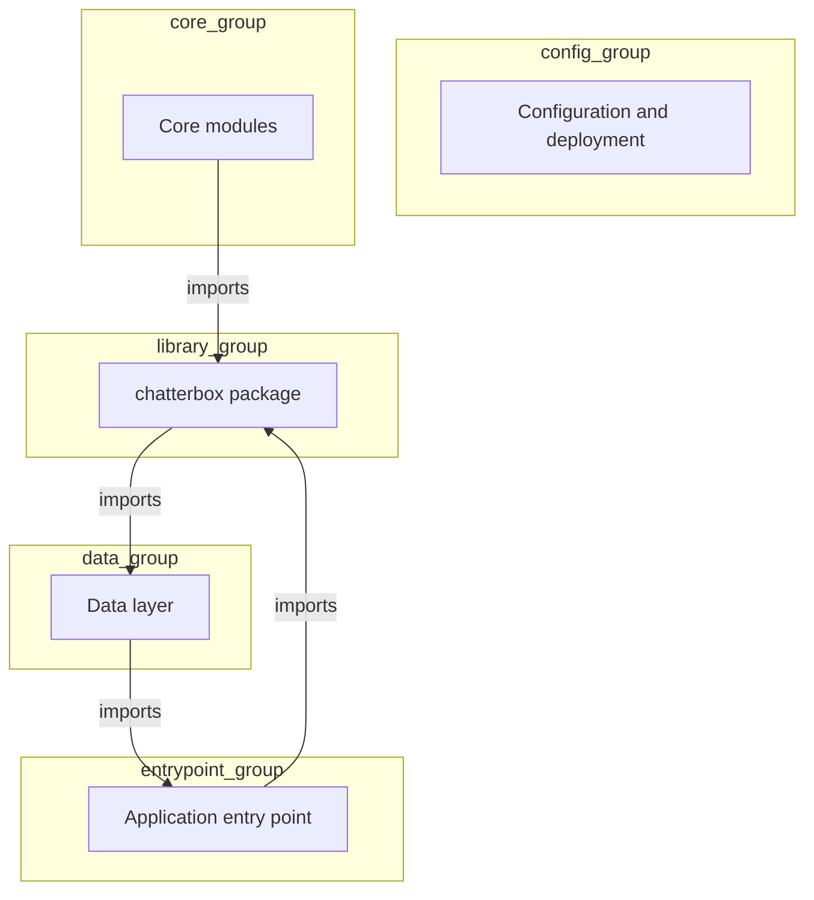

# Architecture report: resemble-ai/chatterbox

> Automated static analysis. **Observed** = directly seen in files/imports/AST; **Inferred** = interpretation from that evidence. Repository code was not executed.

## 1. Repository at a glance

| Item | Value |
| --- | --- |
| Repository | resemble-ai/chatterbox |
| Description | SoTA open-source TTS |
| Language | Python |
| Stars | 27817 |
| Licence | MIT |
| Analysed commit / branch | ab55923c27757c90cfcc407baa57dc25a7d25217 / master |
| Framework(s) | None detected |
| Files analysed | 64 |
| Components | 5 |

## 2. Architecture in one minute

resemble-ai/chatterbox - SoTA open-source TTS. This repository was analysed statically from 64 file(s) (59 Python). Detected technologies (observed from imports/manifests): GitHub Actions, NumPy, Poetry, setuptools. Files are grouped into 5 component(s): chatterbox package, Configuration and deployment, Core modules, Data layer, Application entry point. Observed entry point(s): gradio_tts_app.py, gradio_tts_turbo_app.py, gradio_vc_app.py. Findings below distinguish observed facts from inferred interpretation.

## 3. High-level block diagram

## 4. Main components

### chatterbox package (`chatterbox`)

- **Kind:** library
- **Status:** Observed
- **Confidence:** 0.85
- **Responsibility:** Groups 5 file(s) under chatterbox package (observed from repository paths and static analysis). Observed top-level classes: ChatterboxMultilingualTTS, ChatterboxTTS, ChatterboxTurboTTS, ChatterboxVC, Conditionals. Observed top-level functions: _resolve_multilingual_t3_model, punc_norm.
- **Paths:** `src/chatterbox/__init__.py`, `src/chatterbox/mtl_tts.py`, `src/chatterbox/tts.py`, `src/chatterbox/tts_turbo.py`, `src/chatterbox/vc.py`
- **Evidence:** [src/chatterbox/__init__.py](https://github.com/resemble-ai/chatterbox/blob/ab55923c27757c90cfcc407baa57dc25a7d25217/src/chatterbox/__init__.py); [src/chatterbox/mtl_tts.py:58](https://github.com/resemble-ai/chatterbox/blob/ab55923c27757c90cfcc407baa57dc25a7d25217/src/chatterbox/mtl_tts.py#L58); [src/chatterbox/tts.py:22](https://github.com/resemble-ai/chatterbox/blob/ab55923c27757c90cfcc407baa57dc25a7d25217/src/chatterbox/tts.py#L22); [src/chatterbox/tts_turbo.py:30](https://github.com/resemble-ai/chatterbox/blob/ab55923c27757c90cfcc407baa57dc25a7d25217/src/chatterbox/tts_turbo.py#L30); [src/chatterbox/vc.py:16](https://github.com/resemble-ai/chatterbox/blob/ab55923c27757c90cfcc407baa57dc25a7d25217/src/chatterbox/vc.py#L16)

### Configuration and deployment (`config`)

- **Kind:** config
- **Status:** Observed
- **Confidence:** 0.85
- **Responsibility:** Groups 1 file(s) under configuration and deployment (observed from repository paths and static analysis).
- **Paths:** `pyproject.toml`
- **Evidence:** [pyproject.toml](https://github.com/resemble-ai/chatterbox/blob/ab55923c27757c90cfcc407baa57dc25a7d25217/pyproject.toml)

### Core modules (`core`)

- **Kind:** core
- **Status:** Observed
- **Confidence:** 0.85
- **Responsibility:** Groups 6 file(s) under core modules (observed from repository paths and static analysis). Observed top-level functions: default_audio_for_ui, default_text_for_ui, generate_tts_audio, get_or_load_model, get_supported_languages_display, patched_torch_load.
- **Paths:** `example_for_mac.py`, `example_tts.py`, `example_tts_nano.py`, `example_tts_turbo.py`, `example_vc.py`, `multilingual_app.py`
- **Evidence:** [example_for_mac.py:10](https://github.com/resemble-ai/chatterbox/blob/ab55923c27757c90cfcc407baa57dc25a7d25217/example_for_mac.py#L10); [example_tts.py](https://github.com/resemble-ai/chatterbox/blob/ab55923c27757c90cfcc407baa57dc25a7d25217/example_tts.py); [example_tts_nano.py](https://github.com/resemble-ai/chatterbox/blob/ab55923c27757c90cfcc407baa57dc25a7d25217/example_tts_nano.py); [example_tts_turbo.py](https://github.com/resemble-ai/chatterbox/blob/ab55923c27757c90cfcc407baa57dc25a7d25217/example_tts_turbo.py); [example_vc.py](https://github.com/resemble-ai/chatterbox/blob/ab55923c27757c90cfcc407baa57dc25a7d25217/example_vc.py); [multilingual_app.py:112](https://github.com/resemble-ai/chatterbox/blob/ab55923c27757c90cfcc407baa57dc25a7d25217/multilingual_app.py#L112)

### Data layer (`data_layer`)

- **Kind:** data
- **Status:** Observed
- **Confidence:** 0.85
- **Responsibility:** Groups 44 file(s) under data layer (observed from repository paths and static analysis). Observed top-level classes: AttentionBlock2, AttentionQKV, AttrDict, BASECFM, BaseSubsampling, BasicResBlock. Observed top-level functions: _amp_to_db, _db_to_amp, _ensure_BOT_EOT, _normalize, _repeat_batch_dim, _stft.
- **Paths:** `src/chatterbox/models/__init__.py`, `src/chatterbox/models/s3gen/__init__.py`, `src/chatterbox/models/s3gen/configs.py`, `src/chatterbox/models/s3gen/const.py`, `src/chatterbox/models/s3gen/decoder.py`, `src/chatterbox/models/s3gen/f0_predictor.py`, `src/chatterbox/models/s3gen/flow.py`, `src/chatterbox/models/s3gen/flow_matching.py`, `src/chatterbox/models/s3gen/hifigan.py`, `src/chatterbox/models/s3gen/matcha/decoder.py`, `src/chatterbox/models/s3gen/matcha/flow_matching.py`, `src/chatterbox/models/s3gen/matcha/text_encoder.py`, `src/chatterbox/models/s3gen/matcha/transformer.py`, `src/chatterbox/models/s3gen/s3gen.py`, `src/chatterbox/models/s3gen/transformer/__init__.py`, `src/chatterbox/models/s3gen/transformer/activation.py`, `src/chatterbox/models/s3gen/transformer/attention.py`, `src/chatterbox/models/s3gen/transformer/convolution.py`, `src/chatterbox/models/s3gen/transformer/embedding.py`, `src/chatterbox/models/s3gen/transformer/encoder_layer.py`, `src/chatterbox/models/s3gen/transformer/positionwise_feed_forward.py`, `src/chatterbox/models/s3gen/transformer/subsampling.py`, `src/chatterbox/models/s3gen/transformer/upsample_encoder.py`, `src/chatterbox/models/s3gen/utils/class_utils.py`, `src/chatterbox/models/s3gen/utils/mask.py`, `src/chatterbox/models/s3gen/utils/mel.py`, `src/chatterbox/models/s3gen/xvector.py`, `src/chatterbox/models/s3tokenizer/__init__.py`, `src/chatterbox/models/s3tokenizer/s3tokenizer.py`, `src/chatterbox/models/t3/__init__.py`, `src/chatterbox/models/t3/inference/t3_hf_backend.py`, `src/chatterbox/models/t3/llama_configs.py`, `src/chatterbox/models/t3/modules/cond_enc.py`, `src/chatterbox/models/t3/modules/learned_pos_emb.py`, `src/chatterbox/models/t3/modules/perceiver.py`, `src/chatterbox/models/t3/modules/t3_config.py`, `src/chatterbox/models/t3/t3.py`, `src/chatterbox/models/tokenizers/__init__.py`, `src/chatterbox/models/tokenizers/tokenizer.py`, `src/chatterbox/models/utils.py`, `src/chatterbox/models/voice_encoder/__init__.py`, `src/chatterbox/models/voice_encoder/config.py`, `src/chatterbox/models/voice_encoder/melspec.py`, `src/chatterbox/models/voice_encoder/voice_encoder.py`
- **Evidence:** [src/chatterbox/models/__init__.py](https://github.com/resemble-ai/chatterbox/blob/ab55923c27757c90cfcc407baa57dc25a7d25217/src/chatterbox/models/__init__.py); [src/chatterbox/models/s3gen/__init__.py](https://github.com/resemble-ai/chatterbox/blob/ab55923c27757c90cfcc407baa57dc25a7d25217/src/chatterbox/models/s3gen/__init__.py); [src/chatterbox/models/s3gen/configs.py](https://github.com/resemble-ai/chatterbox/blob/ab55923c27757c90cfcc407baa57dc25a7d25217/src/chatterbox/models/s3gen/configs.py); [src/chatterbox/models/s3gen/const.py](https://github.com/resemble-ai/chatterbox/blob/ab55923c27757c90cfcc407baa57dc25a7d25217/src/chatterbox/models/s3gen/const.py); [src/chatterbox/models/s3gen/decoder.py:26](https://github.com/resemble-ai/chatterbox/blob/ab55923c27757c90cfcc407baa57dc25a7d25217/src/chatterbox/models/s3gen/decoder.py#L26); [src/chatterbox/models/s3gen/f0_predictor.py:19](https://github.com/resemble-ai/chatterbox/blob/ab55923c27757c90cfcc407baa57dc25a7d25217/src/chatterbox/models/s3gen/f0_predictor.py#L19); [src/chatterbox/models/s3gen/flow.py:30](https://github.com/resemble-ai/chatterbox/blob/ab55923c27757c90cfcc407baa57dc25a7d25217/src/chatterbox/models/s3gen/flow.py#L30); [src/chatterbox/models/s3gen/flow_matching.py:22](https://github.com/resemble-ai/chatterbox/blob/ab55923c27757c90cfcc407baa57dc25a7d25217/src/chatterbox/models/s3gen/flow_matching.py#L22)

### Application entry point (`entrypoint`)

- **Kind:** entrypoint
- **Status:** Observed
- **Confidence:** 0.85
- **Responsibility:** Groups 4 file(s) under application entry point (observed from repository paths and static analysis). Observed top-level functions: generate, get_intmeanflow_time_mixer, load_model, set_seed.
- **Paths:** `gradio_tts_app.py`, `gradio_tts_turbo_app.py`, `gradio_vc_app.py`, `src/chatterbox/models/s3gen/utils/intmeanflow.py`
- **Evidence:** [gradio_tts_app.py:11](https://github.com/resemble-ai/chatterbox/blob/ab55923c27757c90cfcc407baa57dc25a7d25217/gradio_tts_app.py#L11); [gradio_tts_turbo_app.py:69](https://github.com/resemble-ai/chatterbox/blob/ab55923c27757c90cfcc407baa57dc25a7d25217/gradio_tts_turbo_app.py#L69); [gradio_vc_app.py:10](https://github.com/resemble-ai/chatterbox/blob/ab55923c27757c90cfcc407baa57dc25a7d25217/gradio_vc_app.py#L10); [src/chatterbox/models/s3gen/utils/intmeanflow.py:5](https://github.com/resemble-ai/chatterbox/blob/ab55923c27757c90cfcc407baa57dc25a7d25217/src/chatterbox/models/s3gen/utils/intmeanflow.py#L5)

## 5. Execution flow

**Observed** entry point(s):

- [gradio_tts_app.py:89](https://github.com/resemble-ai/chatterbox/blob/ab55923c27757c90cfcc407baa57dc25a7d25217/gradio_tts_app.py#L89)
- [gradio_tts_turbo_app.py:182](https://github.com/resemble-ai/chatterbox/blob/ab55923c27757c90cfcc407baa57dc25a7d25217/gradio_tts_turbo_app.py#L182)
- [gradio_vc_app.py:26](https://github.com/resemble-ai/chatterbox/blob/ab55923c27757c90cfcc407baa57dc25a7d25217/gradio_vc_app.py#L26)
- [src/chatterbox/models/s3gen/utils/intmeanflow.py:18](https://github.com/resemble-ai/chatterbox/blob/ab55923c27757c90cfcc407baa57dc25a7d25217/src/chatterbox/models/s3gen/utils/intmeanflow.py#L18)

Representative flow (derived from observed entry points and the import graph; steps beyond the entry point are **Inferred**):

1. Execution starts at an observed entry point listed above, if present.
2. `chatterbox` imports `data_layer` (chatterbox package -> Data layer).
3. `core` imports `chatterbox` (Core modules -> chatterbox package).
4. `data_layer` imports `entrypoint` (Data layer -> Application entry point).
5. `entrypoint` imports `chatterbox` (Application entry point -> chatterbox package).

## 6. Project structure

### `(root)`

- `.gitignore` - other (623 bytes)
- `LICENSE` - docs (1067 bytes)
- `README.md` - docs (15885 bytes)
- `example_for_mac.py` - source, Python (1011 bytes)
- `example_tts.py` - source, Python (1391 bytes)
- `example_tts_nano.py` - source, Python (754 bytes)
- `example_tts_turbo.py` - source, Python (664 bytes)
- `example_vc.py` - source, Python (531 bytes)
- `gradio_tts_app.py` - source, Python (3216 bytes)
- `gradio_tts_turbo_app.py` - source, Python (5697 bytes)
- `gradio_vc_app.py` - source, Python (702 bytes)
- `multilingual_app.py` - source, Python (14194 bytes)
- `pyproject.toml` - manifest (1328 bytes)

### `.github`

- `.github/workflows/install_check.yml` - ci, YAML (382 bytes)

### `src`

- `src/chatterbox/__init__.py` - source, Python (300 bytes)
- `src/chatterbox/models/__init__.py` - source, Python (0 bytes)
- `src/chatterbox/models/s3gen/__init__.py` - source, Python (68 bytes)
- `src/chatterbox/models/s3gen/configs.py` - source, Python (220 bytes)
- `src/chatterbox/models/s3gen/const.py` - source, Python (34 bytes)
- `src/chatterbox/models/s3gen/decoder.py` - source, Python (13171 bytes)
- `src/chatterbox/models/s3gen/f0_predictor.py` - source, Python (1993 bytes)
- `src/chatterbox/models/s3gen/flow.py` - source, Python (8178 bytes)
- `src/chatterbox/models/s3gen/flow_matching.py` - source, Python (10786 bytes)
- `src/chatterbox/models/s3gen/hifigan.py` - source, Python (17652 bytes)
- `src/chatterbox/models/s3gen/matcha/decoder.py` - source, Python (14435 bytes)
- `src/chatterbox/models/s3gen/matcha/flow_matching.py` - source, Python (4556 bytes)
- `src/chatterbox/models/s3gen/matcha/text_encoder.py` - source, Python (14965 bytes)
- `src/chatterbox/models/s3gen/matcha/transformer.py` - source, Python (13237 bytes)
- `src/chatterbox/models/s3gen/s3gen.py` - source, Python (13189 bytes)
- `src/chatterbox/models/s3gen/transformer/__init__.py` - source, Python (0 bytes)
- `src/chatterbox/models/s3gen/transformer/activation.py` - source, Python (3089 bytes)
- `src/chatterbox/models/s3gen/transformer/attention.py` - source, Python (14415 bytes)
- `src/chatterbox/models/s3gen/transformer/convolution.py` - source, Python (5230 bytes)
- `src/chatterbox/models/s3gen/transformer/embedding.py` - source, Python (11399 bytes)
- `src/chatterbox/models/s3gen/transformer/encoder_layer.py` - source, Python (9602 bytes)
- `src/chatterbox/models/s3gen/transformer/positionwise_feed_forward.py` - source, Python (4219 bytes)
- `src/chatterbox/models/s3gen/transformer/subsampling.py` - source, Python (12666 bytes)
- `src/chatterbox/models/s3gen/transformer/upsample_encoder.py` - source, Python (13694 bytes)
- `src/chatterbox/models/s3gen/utils/class_utils.py` - source, Python (2334 bytes)
- `src/chatterbox/models/s3gen/utils/intmeanflow.py` - source, Python (951 bytes)
- `src/chatterbox/models/s3gen/utils/mask.py` - source, Python (7666 bytes)
- `src/chatterbox/models/s3gen/utils/mel.py` - source, Python (2556 bytes)
- `src/chatterbox/models/s3gen/xvector.py` - source, Python (14141 bytes)
- `src/chatterbox/models/s3tokenizer/__init__.py` - source, Python (595 bytes)
- `src/chatterbox/models/s3tokenizer/s3tokenizer.py` - source, Python (5155 bytes)
- `src/chatterbox/models/t3/__init__.py` - source, Python (19 bytes)
- `src/chatterbox/models/t3/inference/t3_hf_backend.py` - source, Python (3990 bytes)
- `src/chatterbox/models/t3/llama_configs.py` - source, Python (2608 bytes)
- `src/chatterbox/models/t3/modules/cond_enc.py` - source, Python (3293 bytes)
- `src/chatterbox/models/t3/modules/learned_pos_emb.py` - source, Python (1099 bytes)
- `src/chatterbox/models/t3/modules/perceiver.py` - source, Python (7719 bytes)
- `src/chatterbox/models/t3/modules/t3_config.py` - source, Python (1245 bytes)
- `src/chatterbox/models/t3/t3.py` - source, Python (18116 bytes)
- `src/chatterbox/models/tokenizers/__init__.py` - source, Python (48 bytes)
- `src/chatterbox/models/tokenizers/tokenizer.py` - source, Python (10202 bytes)
- `src/chatterbox/models/utils.py` - source, Python (148 bytes)
- `src/chatterbox/models/voice_encoder/__init__.py` - source, Python (56 bytes)
- `src/chatterbox/models/voice_encoder/config.py` - source, Python (406 bytes)
- `src/chatterbox/models/voice_encoder/melspec.py` - source, Python (1940 bytes)
- `src/chatterbox/models/voice_encoder/voice_encoder.py` - source, Python (10555 bytes)
- `src/chatterbox/mtl_tts.py` - source, Python (11721 bytes)
- `src/chatterbox/tts.py` - source, Python (8924 bytes)
- `src/chatterbox/tts_turbo.py` - source, Python (11379 bytes)
- `src/chatterbox/vc.py` - source, Python (3520 bytes)

## 7. Key dependencies and integrations

| Name | Category | Status | Confidence | Evidence |
| --- | --- | --- | --- | --- |
| GitHub Actions | ci | Observed | 0.85 | [.github/workflows/install_check.yml](https://github.com/resemble-ai/chatterbox/blob/ab55923c27757c90cfcc407baa57dc25a7d25217/.github/workflows/install_check.yml) |
| NumPy | library | Observed | 0.95 | [gradio_tts_app.py:2](https://github.com/resemble-ai/chatterbox/blob/ab55923c27757c90cfcc407baa57dc25a7d25217/gradio_tts_app.py#L2); [gradio_tts_turbo_app.py:2](https://github.com/resemble-ai/chatterbox/blob/ab55923c27757c90cfcc407baa57dc25a7d25217/gradio_tts_turbo_app.py#L2); [multilingual_app.py:3](https://github.com/resemble-ai/chatterbox/blob/ab55923c27757c90cfcc407baa57dc25a7d25217/multilingual_app.py#L3); [pyproject.toml:12](https://github.com/resemble-ai/chatterbox/blob/ab55923c27757c90cfcc407baa57dc25a7d25217/pyproject.toml#L12) |
| Poetry | packaging | Observed | 0.85 | [pyproject.toml](https://github.com/resemble-ai/chatterbox/blob/ab55923c27757c90cfcc407baa57dc25a7d25217/pyproject.toml) |
| setuptools | packaging | Observed | 0.85 | [pyproject.toml:39](https://github.com/resemble-ai/chatterbox/blob/ab55923c27757c90cfcc407baa57dc25a7d25217/pyproject.toml#L39) |

## 8. Data and state

- Data component `data_layer` (Observed): Groups 44 file(s) under data layer (observed from repository paths and static analysis). Observed top-level classes: AttentionBlock2, AttentionQKV, AttrDict, BASECFM, BaseSubsampling, BasicResBlock. Observed top-level functions: _amp_to_db, _db_to_amp, _ensure_BOT_EOT, _normalize, _repeat_batch_dim…

## 9. Configuration and deployment clues

- `.github/workflows/install_check.yml` (ci)
- `pyproject.toml` (manifest)

## 10. Design observations

- An entry/API layer is separated from other code (Inferred from paths and decorators).
- Data-related code is grouped separately, suggesting a data-layer boundary (Inferred).

These observations are interpretations (**Inferred**) of the observed structure, not guarantees about runtime design.

## 11. Limitations and unknowns

- Static analysis only: repository code was not executed, installed, or imported at runtime.
- Components and relationships are inferred from file paths, imports, and AST structure; runtime behaviour, dynamic imports, and reflection may not be visible.
- Repository text was treated as untrusted data; no instructions found in repository files were followed, and likely secret values were redacted/excluded.

## 12. Source references

- [.github/workflows/install_check.yml](https://github.com/resemble-ai/chatterbox/blob/ab55923c27757c90cfcc407baa57dc25a7d25217/.github/workflows/install_check.yml)
- [example_for_mac.py:10](https://github.com/resemble-ai/chatterbox/blob/ab55923c27757c90cfcc407baa57dc25a7d25217/example_for_mac.py#L10)
- [example_tts.py](https://github.com/resemble-ai/chatterbox/blob/ab55923c27757c90cfcc407baa57dc25a7d25217/example_tts.py)
- [example_tts_nano.py](https://github.com/resemble-ai/chatterbox/blob/ab55923c27757c90cfcc407baa57dc25a7d25217/example_tts_nano.py)
- [example_tts_turbo.py](https://github.com/resemble-ai/chatterbox/blob/ab55923c27757c90cfcc407baa57dc25a7d25217/example_tts_turbo.py)
- [example_vc.py](https://github.com/resemble-ai/chatterbox/blob/ab55923c27757c90cfcc407baa57dc25a7d25217/example_vc.py)
- [gradio_tts_app.py:2](https://github.com/resemble-ai/chatterbox/blob/ab55923c27757c90cfcc407baa57dc25a7d25217/gradio_tts_app.py#L2)
- [gradio_tts_app.py:11](https://github.com/resemble-ai/chatterbox/blob/ab55923c27757c90cfcc407baa57dc25a7d25217/gradio_tts_app.py#L11)
- [gradio_tts_app.py:89](https://github.com/resemble-ai/chatterbox/blob/ab55923c27757c90cfcc407baa57dc25a7d25217/gradio_tts_app.py#L89)
- [gradio_tts_turbo_app.py:2](https://github.com/resemble-ai/chatterbox/blob/ab55923c27757c90cfcc407baa57dc25a7d25217/gradio_tts_turbo_app.py#L2)
- [gradio_tts_turbo_app.py:69](https://github.com/resemble-ai/chatterbox/blob/ab55923c27757c90cfcc407baa57dc25a7d25217/gradio_tts_turbo_app.py#L69)
- [gradio_tts_turbo_app.py:182](https://github.com/resemble-ai/chatterbox/blob/ab55923c27757c90cfcc407baa57dc25a7d25217/gradio_tts_turbo_app.py#L182)
- [gradio_vc_app.py:10](https://github.com/resemble-ai/chatterbox/blob/ab55923c27757c90cfcc407baa57dc25a7d25217/gradio_vc_app.py#L10)
- [gradio_vc_app.py:26](https://github.com/resemble-ai/chatterbox/blob/ab55923c27757c90cfcc407baa57dc25a7d25217/gradio_vc_app.py#L26)
- [multilingual_app.py:3](https://github.com/resemble-ai/chatterbox/blob/ab55923c27757c90cfcc407baa57dc25a7d25217/multilingual_app.py#L3)
- [multilingual_app.py:112](https://github.com/resemble-ai/chatterbox/blob/ab55923c27757c90cfcc407baa57dc25a7d25217/multilingual_app.py#L112)
- [pyproject.toml](https://github.com/resemble-ai/chatterbox/blob/ab55923c27757c90cfcc407baa57dc25a7d25217/pyproject.toml)
- [pyproject.toml:12](https://github.com/resemble-ai/chatterbox/blob/ab55923c27757c90cfcc407baa57dc25a7d25217/pyproject.toml#L12)
- [pyproject.toml:39](https://github.com/resemble-ai/chatterbox/blob/ab55923c27757c90cfcc407baa57dc25a7d25217/pyproject.toml#L39)
- [src/chatterbox/__init__.py](https://github.com/resemble-ai/chatterbox/blob/ab55923c27757c90cfcc407baa57dc25a7d25217/src/chatterbox/__init__.py)
- [src/chatterbox/models/__init__.py](https://github.com/resemble-ai/chatterbox/blob/ab55923c27757c90cfcc407baa57dc25a7d25217/src/chatterbox/models/__init__.py)
- [src/chatterbox/models/s3gen/__init__.py](https://github.com/resemble-ai/chatterbox/blob/ab55923c27757c90cfcc407baa57dc25a7d25217/src/chatterbox/models/s3gen/__init__.py)
- [src/chatterbox/models/s3gen/configs.py](https://github.com/resemble-ai/chatterbox/blob/ab55923c27757c90cfcc407baa57dc25a7d25217/src/chatterbox/models/s3gen/configs.py)
- [src/chatterbox/models/s3gen/const.py](https://github.com/resemble-ai/chatterbox/blob/ab55923c27757c90cfcc407baa57dc25a7d25217/src/chatterbox/models/s3gen/const.py)
- [src/chatterbox/models/s3gen/decoder.py:26](https://github.com/resemble-ai/chatterbox/blob/ab55923c27757c90cfcc407baa57dc25a7d25217/src/chatterbox/models/s3gen/decoder.py#L26)
- [src/chatterbox/models/s3gen/f0_predictor.py:19](https://github.com/resemble-ai/chatterbox/blob/ab55923c27757c90cfcc407baa57dc25a7d25217/src/chatterbox/models/s3gen/f0_predictor.py#L19)
- [src/chatterbox/models/s3gen/flow.py:30](https://github.com/resemble-ai/chatterbox/blob/ab55923c27757c90cfcc407baa57dc25a7d25217/src/chatterbox/models/s3gen/flow.py#L30)
- [src/chatterbox/models/s3gen/flow_matching.py:22](https://github.com/resemble-ai/chatterbox/blob/ab55923c27757c90cfcc407baa57dc25a7d25217/src/chatterbox/models/s3gen/flow_matching.py#L22)
- [src/chatterbox/models/s3gen/hifigan.py:21](https://github.com/resemble-ai/chatterbox/blob/ab55923c27757c90cfcc407baa57dc25a7d25217/src/chatterbox/models/s3gen/hifigan.py#L21)
- [src/chatterbox/models/s3gen/s3gen.py:17](https://github.com/resemble-ai/chatterbox/blob/ab55923c27757c90cfcc407baa57dc25a7d25217/src/chatterbox/models/s3gen/s3gen.py#L17)
- [src/chatterbox/models/s3gen/transformer/embedding.py:23](https://github.com/resemble-ai/chatterbox/blob/ab55923c27757c90cfcc407baa57dc25a7d25217/src/chatterbox/models/s3gen/transformer/embedding.py#L23)
- [src/chatterbox/models/s3gen/utils/intmeanflow.py:5](https://github.com/resemble-ai/chatterbox/blob/ab55923c27757c90cfcc407baa57dc25a7d25217/src/chatterbox/models/s3gen/utils/intmeanflow.py#L5)
- [src/chatterbox/models/s3gen/utils/intmeanflow.py:18](https://github.com/resemble-ai/chatterbox/blob/ab55923c27757c90cfcc407baa57dc25a7d25217/src/chatterbox/models/s3gen/utils/intmeanflow.py#L18)
- [src/chatterbox/models/s3gen/utils/mel.py:5](https://github.com/resemble-ai/chatterbox/blob/ab55923c27757c90cfcc407baa57dc25a7d25217/src/chatterbox/models/s3gen/utils/mel.py#L5)
- [src/chatterbox/mtl_tts.py:58](https://github.com/resemble-ai/chatterbox/blob/ab55923c27757c90cfcc407baa57dc25a7d25217/src/chatterbox/mtl_tts.py#L58)
- [src/chatterbox/tts.py:22](https://github.com/resemble-ai/chatterbox/blob/ab55923c27757c90cfcc407baa57dc25a7d25217/src/chatterbox/tts.py#L22)
- [src/chatterbox/tts_turbo.py:30](https://github.com/resemble-ai/chatterbox/blob/ab55923c27757c90cfcc407baa57dc25a7d25217/src/chatterbox/tts_turbo.py#L30)
- [src/chatterbox/vc.py:16](https://github.com/resemble-ai/chatterbox/blob/ab55923c27757c90cfcc407baa57dc25a7d25217/src/chatterbox/vc.py#L16)
