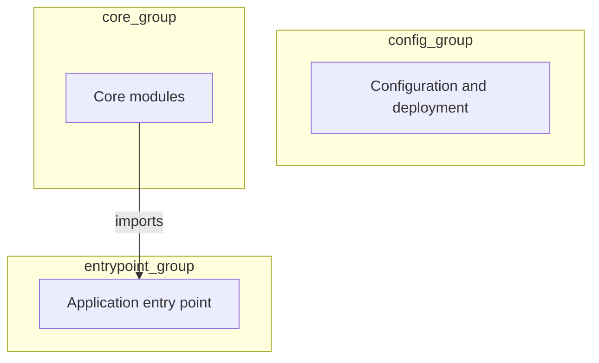

# Architecture report: rougier/numpy-100

> Automated static analysis. **Observed** = directly seen in files/imports/AST; **Inferred** = interpretation from that evidence. Repository code was not executed.

## 1. Repository at a glance

| Item | Value |
| --- | --- |
| Repository | rougier/numpy-100 |
| Description | 100 numpy exercises (with solutions) |
| Language | Python |
| Stars | 14692 |
| Licence | MIT |
| Analysed commit / branch | cf3b5a29749410758ccaab876302ed861bb94323 / master |
| Framework(s) | None detected |
| Files analysed | 18 |
| Components | 3 |

## 2. Architecture in one minute

rougier/numpy-100 - 100 numpy exercises (with solutions). This repository was analysed statically from 18 file(s) (2 Python). Detected technologies (observed from imports/manifests): GitHub Actions, NumPy. Files are grouped into 3 component(s): Configuration and deployment, Core modules, Application entry point. Observed entry point(s): generators.py. Findings below distinguish observed facts from inferred interpretation.

## 3. High-level block diagram

## 4. Main components

### Configuration and deployment (`config`)

- **Kind:** config
- **Status:** Observed
- **Confidence:** 0.85
- **Responsibility:** Groups 1 file(s) under configuration and deployment (observed from repository paths and static analysis).
- **Paths:** `requirements.txt`
- **Evidence:** [requirements.txt](https://github.com/rougier/numpy-100/blob/cf3b5a29749410758ccaab876302ed861bb94323/requirements.txt)

### Core modules (`core`)

- **Kind:** core
- **Status:** Observed
- **Confidence:** 0.85
- **Responsibility:** Groups 1 file(s) under core modules (observed from repository paths and static analysis). Observed top-level functions: answer, hint, pick, question.
- **Paths:** `initialise.py`
- **Evidence:** [initialise.py:6](https://github.com/rougier/numpy-100/blob/cf3b5a29749410758ccaab876302ed861bb94323/initialise.py#L6)

### Application entry point (`entrypoint`)

- **Kind:** entrypoint
- **Status:** Observed
- **Confidence:** 0.85
- **Responsibility:** Groups 1 file(s) under application entry point (observed from repository paths and static analysis). Observed top-level functions: create_jupyter_notebook, create_jupyter_notebook_random_question, create_markdown, create_rst, dict_to_ktx, ktx_to_dict.
- **Paths:** `generators.py`
- **Evidence:** [generators.py:6](https://github.com/rougier/numpy-100/blob/cf3b5a29749410758ccaab876302ed861bb94323/generators.py#L6)

## 5. Execution flow

**Observed** entry point(s):

- [generators.py:131](https://github.com/rougier/numpy-100/blob/cf3b5a29749410758ccaab876302ed861bb94323/generators.py#L131)

Representative flow (derived from observed entry points and the import graph; steps beyond the entry point are **Inferred**):

1. Execution starts at an observed entry point listed above, if present.
2. `core` imports `entrypoint` (Core modules -> Application entry point).

## 6. Project structure

### `(root)`

- `.gitattributes` - other (63 bytes)
- `.gitignore` - other (66 bytes)
- `100_Numpy_exercises.ipynb` - other (35349 bytes)
- `100_Numpy_exercises.md` - docs (10555 bytes)
- `100_Numpy_exercises_with_hints.md` - docs (13330 bytes)
- `100_Numpy_exercises_with_hints_with_solutions.md` - docs (33945 bytes)
- `100_Numpy_exercises_with_solutions.md` - docs (31170 bytes)
- `100_Numpy_random.ipynb` - other (1529 bytes)
- `LICENSE.txt` - docs (1075 bytes)
- `README.md` - docs (1473 bytes)
- `generators.py` - source, Python (4421 bytes)
- `initialise.py` - source, Python (251 bytes)
- `requirements.txt` - manifest (23 bytes)
- `runtime.txt` - docs (14 bytes)

### `.github`

- `.github/FUNDING.yml` - config (141 bytes)
- `.github/workflows/generate_solutions_files.yml` - ci, YAML (1209 bytes)

### `source`

- `source/exercises100.ktx` - other (32872 bytes)
- `source/headers.ktx` - other (974 bytes)

## 7. Key dependencies and integrations

| Name | Category | Status | Confidence | Evidence |
| --- | --- | --- | --- | --- |
| GitHub Actions | ci | Observed | 0.85 | [.github/workflows/generate_solutions_files.yml](https://github.com/rougier/numpy-100/blob/cf3b5a29749410758ccaab876302ed861bb94323/.github/workflows/generate_solutions_files.yml) |
| NumPy | library | Observed | 0.90 | [initialise.py:1](https://github.com/rougier/numpy-100/blob/cf3b5a29749410758ccaab876302ed861bb94323/initialise.py#L1); [requirements.txt:1](https://github.com/rougier/numpy-100/blob/cf3b5a29749410758ccaab876302ed861bb94323/requirements.txt#L1) |

## 8. Data and state

No database, cache, queue, or persistent-state usage was observed in the analysed files. State handling, if any, may be in-memory or in files that were not analysed.

## 9. Configuration and deployment clues

- `.github/FUNDING.yml` (config)
- `.github/workflows/generate_solutions_files.yml` (ci)
- `requirements.txt` (manifest)

## 10. Design observations

- An entry/API layer is separated from other code (Inferred from paths and decorators).

These observations are interpretations (**Inferred**) of the observed structure, not guarantees about runtime design.

## 11. Limitations and unknowns

- Static analysis only: repository code was not executed, installed, or imported at runtime.
- Components and relationships are inferred from file paths, imports, and AST structure; runtime behaviour, dynamic imports, and reflection may not be visible.
- Repository text was treated as untrusted data; no instructions found in repository files were followed, and likely secret values were redacted/excluded.

## 12. Source references

- [.github/workflows/generate_solutions_files.yml](https://github.com/rougier/numpy-100/blob/cf3b5a29749410758ccaab876302ed861bb94323/.github/workflows/generate_solutions_files.yml)
- [generators.py:6](https://github.com/rougier/numpy-100/blob/cf3b5a29749410758ccaab876302ed861bb94323/generators.py#L6)
- [generators.py:131](https://github.com/rougier/numpy-100/blob/cf3b5a29749410758ccaab876302ed861bb94323/generators.py#L131)
- [initialise.py:1](https://github.com/rougier/numpy-100/blob/cf3b5a29749410758ccaab876302ed861bb94323/initialise.py#L1)
- [initialise.py:6](https://github.com/rougier/numpy-100/blob/cf3b5a29749410758ccaab876302ed861bb94323/initialise.py#L6)
- [requirements.txt](https://github.com/rougier/numpy-100/blob/cf3b5a29749410758ccaab876302ed861bb94323/requirements.txt)
- [requirements.txt:1](https://github.com/rougier/numpy-100/blob/cf3b5a29749410758ccaab876302ed861bb94323/requirements.txt#L1)
