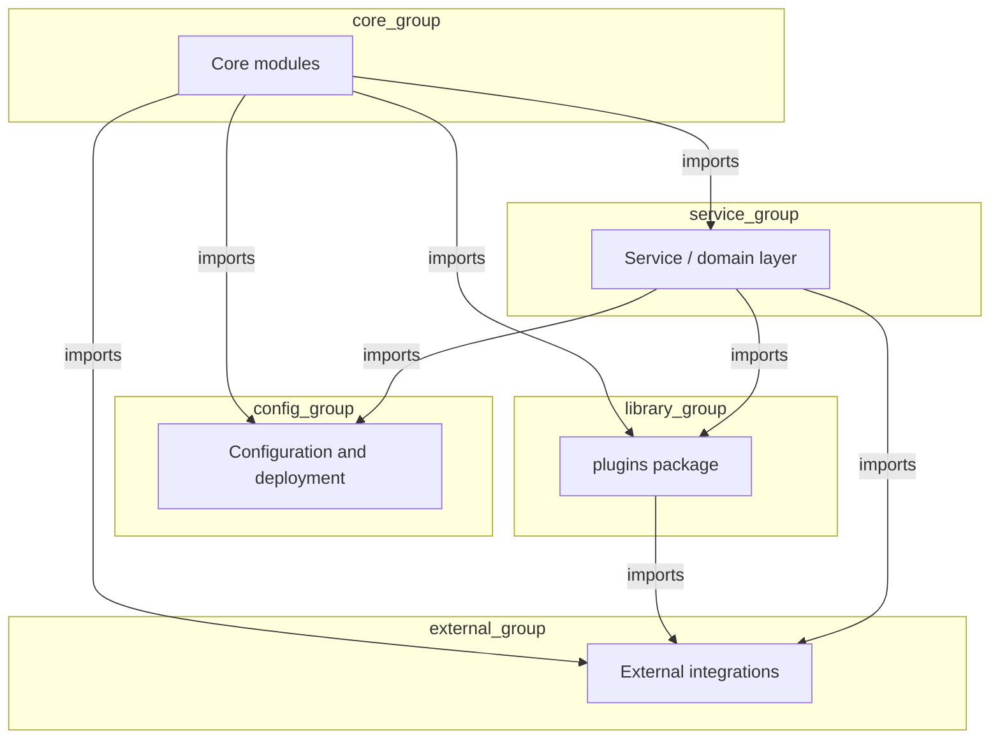

# Architecture report: s0md3v/Photon

> Automated static analysis. **Observed** = directly seen in files/imports/AST; **Inferred** = interpretation from that evidence. Repository code was not executed.

## 1. Repository at a glance

| Item | Value |
| --- | --- |
| Repository | s0md3v/Photon |
| Description | Incredibly fast crawler designed for OSINT. |
| Language | Python |
| Stars | 13346 |
| Licence | GPL-3.0 |
| Analysed commit / branch | c8d2566841d69a268b244609921143d84b72b0c6 / master |
| Framework(s) | None detected |
| Files analysed | 27 |
| Components | 5 |

## 2. Architecture in one minute

s0md3v/Photon - Incredibly fast crawler designed for OSINT.. This repository was analysed statically from 27 file(s) (17 Python). Detected technologies (observed from imports/manifests): requests, Docker. Files are grouped into 5 component(s): Configuration and deployment, Core modules, External integrations, plugins package, Service / domain layer. Findings below distinguish observed facts from inferred interpretation.

## 3. High-level block diagram

## 4. Main components

### Configuration and deployment (`config`)

- **Kind:** config
- **Status:** Observed
- **Confidence:** 0.85
- **Responsibility:** Groups 4 file(s) under configuration and deployment (observed from repository paths and static analysis).
- **Paths:** `Dockerfile`, `MANIFEST.in`, `core/config.py`, `requirements.txt`
- **Evidence:** [Dockerfile](https://github.com/s0md3v/Photon/blob/c8d2566841d69a268b244609921143d84b72b0c6/Dockerfile); [MANIFEST.in](https://github.com/s0md3v/Photon/blob/c8d2566841d69a268b244609921143d84b72b0c6/MANIFEST.in); [core/config.py](https://github.com/s0md3v/Photon/blob/c8d2566841d69a268b244609921143d84b72b0c6/core/config.py); [requirements.txt](https://github.com/s0md3v/Photon/blob/c8d2566841d69a268b244609921143d84b72b0c6/requirements.txt)

### Core modules (`core`)

- **Kind:** core
- **Status:** Observed
- **Confidence:** 0.85
- **Responsibility:** Groups 1 file(s) under core modules (observed from repository paths and static analysis). Observed top-level functions: extractor, intel_extractor, js_extractor, jscanner, remove_file.
- **Paths:** `photon.py`
- **Evidence:** [photon.py:208](https://github.com/s0md3v/Photon/blob/c8d2566841d69a268b244609921143d84b72b0c6/photon.py#L208)

### External integrations (`external_integrations`)

- **Kind:** external
- **Status:** Inferred
- **Confidence:** 0.70
- **Responsibility:** Groups 0 file(s) under external integrations (observed from repository paths and static analysis).
- **Evidence:** [core/requester.py:4](https://github.com/s0md3v/Photon/blob/c8d2566841d69a268b244609921143d84b72b0c6/core/requester.py#L4); [core/requester.py:5](https://github.com/s0md3v/Photon/blob/c8d2566841d69a268b244609921143d84b72b0c6/core/requester.py#L5); [core/utils.py:1](https://github.com/s0md3v/Photon/blob/c8d2566841d69a268b244609921143d84b72b0c6/core/utils.py#L1); [core/zap.py:2](https://github.com/s0md3v/Photon/blob/c8d2566841d69a268b244609921143d84b72b0c6/core/zap.py#L2); [photon.py:9](https://github.com/s0md3v/Photon/blob/c8d2566841d69a268b244609921143d84b72b0c6/photon.py#L9); [plugins/dnsdumpster.py:4](https://github.com/s0md3v/Photon/blob/c8d2566841d69a268b244609921143d84b72b0c6/plugins/dnsdumpster.py#L4)

### plugins package (`plugins`)

- **Kind:** library
- **Status:** Observed
- **Confidence:** 0.85
- **Responsibility:** Groups 5 file(s) under plugins package (observed from repository paths and static analysis). Observed top-level functions: dnsdumpster, exporter, find_subdomains, time_machine.
- **Paths:** `plugins/__init__.py`, `plugins/dnsdumpster.py`, `plugins/exporter.py`, `plugins/find_subdomains.py`, `plugins/wayback.py`
- **Evidence:** [plugins/__init__.py](https://github.com/s0md3v/Photon/blob/c8d2566841d69a268b244609921143d84b72b0c6/plugins/__init__.py); [plugins/dnsdumpster.py:7](https://github.com/s0md3v/Photon/blob/c8d2566841d69a268b244609921143d84b72b0c6/plugins/dnsdumpster.py#L7); [plugins/exporter.py:6](https://github.com/s0md3v/Photon/blob/c8d2566841d69a268b244609921143d84b72b0c6/plugins/exporter.py#L6); [plugins/find_subdomains.py:7](https://github.com/s0md3v/Photon/blob/c8d2566841d69a268b244609921143d84b72b0c6/plugins/find_subdomains.py#L7); [plugins/wayback.py:8](https://github.com/s0md3v/Photon/blob/c8d2566841d69a268b244609921143d84b72b0c6/plugins/wayback.py#L8)

### Service / domain layer (`service_layer`)

- **Kind:** service
- **Status:** Observed
- **Confidence:** 0.85
- **Responsibility:** Groups 10 file(s) under service / domain layer (observed from repository paths and static analysis). Observed top-level functions: entropy, extract_headers, flash, is_good_proxy, is_link, is_proxy_list.
- **Paths:** `core/__init__.py`, `core/colors.py`, `core/flash.py`, `core/mirror.py`, `core/prompt.py`, `core/regex.py`, `core/requester.py`, `core/updater.py`, `core/utils.py`, `core/zap.py`
- **Evidence:** [core/__init__.py](https://github.com/s0md3v/Photon/blob/c8d2566841d69a268b244609921143d84b72b0c6/core/__init__.py); [core/colors.py](https://github.com/s0md3v/Photon/blob/c8d2566841d69a268b244609921143d84b72b0c6/core/colors.py); [core/flash.py:6](https://github.com/s0md3v/Photon/blob/c8d2566841d69a268b244609921143d84b72b0c6/core/flash.py#L6); [core/mirror.py:4](https://github.com/s0md3v/Photon/blob/c8d2566841d69a268b244609921143d84b72b0c6/core/mirror.py#L4); [core/prompt.py:6](https://github.com/s0md3v/Photon/blob/c8d2566841d69a268b244609921143d84b72b0c6/core/prompt.py#L6); [core/regex.py](https://github.com/s0md3v/Photon/blob/c8d2566841d69a268b244609921143d84b72b0c6/core/regex.py); [core/requester.py:11](https://github.com/s0md3v/Photon/blob/c8d2566841d69a268b244609921143d84b72b0c6/core/requester.py#L11); [core/updater.py:8](https://github.com/s0md3v/Photon/blob/c8d2566841d69a268b244609921143d84b72b0c6/core/updater.py#L8)

## 5. Execution flow

No entry point was observed; the startup flow below is therefore limited.

Representative flow (derived from observed entry points and the import graph; steps beyond the entry point are **Inferred**):

1. Execution starts at an observed entry point listed above, if present.
2. `core` imports `config` (Core modules -> Configuration and deployment).
3. `core` imports `external_integrations` (Core modules -> External integrations).
4. `core` imports `plugins` (Core modules -> plugins package).
5. `core` imports `service_layer` (Core modules -> Service / domain layer).
6. `plugins` imports `external_integrations` (plugins package -> External integrations).
7. `service_layer` imports `config` (Service / domain layer -> Configuration and deployment).
8. `service_layer` imports `external_integrations` (Service / domain layer -> External integrations).
9. `service_layer` imports `plugins` (Service / domain layer -> plugins package).

## 6. Project structure

### `(root)`

- `.gitignore` - other (7 bytes)
- `.travis.yml` - ci, YAML (686 bytes)
- `.whitesource` - other (137 bytes)
- `CHANGELOG.md` - docs (3628 bytes)
- `Dockerfile` - container (428 bytes)
- `LICENSE.md` - docs (35156 bytes)
- `MANIFEST.in` - manifest (19 bytes)
- `README.md` - docs (7955 bytes)
- `photon.py` - source, Python (15862 bytes)
- `requirements.txt` - manifest (36 bytes)

### `core`

- `core/__init__.py` - source, Python (23 bytes)
- `core/colors.py` - source, Python (510 bytes)
- `core/config.py` - source, Python (322 bytes)
- `core/flash.py` - source, Python (673 bytes)
- `core/mirror.py` - source, Python (1143 bytes)
- `core/prompt.py` - source, Python (551 bytes)
- `core/regex.py` - source, Python (7508 bytes)
- `core/requester.py` - source, Python (1989 bytes)
- `core/updater.py` - source, Python (1767 bytes)
- `core/user-agents.txt` - docs (1607 bytes)
- `core/utils.py` - source, Python (5805 bytes)
- `core/zap.py` - source, Python (2365 bytes)

### `plugins`

- `plugins/__init__.py` - source, Python (26 bytes)
- `plugins/dnsdumpster.py` - source, Python (806 bytes)
- `plugins/exporter.py` - source, Python (849 bytes)
- `plugins/find_subdomains.py` - source, Python (462 bytes)
- `plugins/wayback.py` - source, Python (735 bytes)

## 7. Key dependencies and integrations

| Name | Category | Status | Confidence | Evidence |
| --- | --- | --- | --- | --- |
| requests | library | Observed | 0.95 | [core/requester.py:4](https://github.com/s0md3v/Photon/blob/c8d2566841d69a268b244609921143d84b72b0c6/core/requester.py#L4); [core/requester.py:5](https://github.com/s0md3v/Photon/blob/c8d2566841d69a268b244609921143d84b72b0c6/core/requester.py#L5); [core/utils.py:1](https://github.com/s0md3v/Photon/blob/c8d2566841d69a268b244609921143d84b72b0c6/core/utils.py#L1); [core/zap.py:2](https://github.com/s0md3v/Photon/blob/c8d2566841d69a268b244609921143d84b72b0c6/core/zap.py#L2) |
| Docker | tooling | Observed | 0.85 | [Dockerfile](https://github.com/s0md3v/Photon/blob/c8d2566841d69a268b244609921143d84b72b0c6/Dockerfile) |

## 8. Data and state

No database, cache, queue, or persistent-state usage was observed in the analysed files. State handling, if any, may be in-memory or in files that were not analysed.

## 9. Configuration and deployment clues

- `.travis.yml` (ci)
- `Dockerfile` (container)
- `MANIFEST.in` (manifest)
- `requirements.txt` (manifest)

## 10. Design observations

- Service/domain code is distinct from entry and data code, suggesting layered separation (Inferred).
- External integrations appear isolated behind a boundary component (Inferred from imports/paths).

These observations are interpretations (**Inferred**) of the observed structure, not guarantees about runtime design.

## 11. Limitations and unknowns

- Static analysis only: repository code was not executed, installed, or imported at runtime.
- Components and relationships are inferred from file paths, imports, and AST structure; runtime behaviour, dynamic imports, and reflection may not be visible.
- No clear application entry point was observed in the analysed files.
- Repository text was treated as untrusted data; no instructions found in repository files were followed, and likely secret values were redacted/excluded.

## 12. Source references

- [Dockerfile](https://github.com/s0md3v/Photon/blob/c8d2566841d69a268b244609921143d84b72b0c6/Dockerfile)
- [MANIFEST.in](https://github.com/s0md3v/Photon/blob/c8d2566841d69a268b244609921143d84b72b0c6/MANIFEST.in)
- [core/__init__.py](https://github.com/s0md3v/Photon/blob/c8d2566841d69a268b244609921143d84b72b0c6/core/__init__.py)
- [core/colors.py](https://github.com/s0md3v/Photon/blob/c8d2566841d69a268b244609921143d84b72b0c6/core/colors.py)
- [core/config.py](https://github.com/s0md3v/Photon/blob/c8d2566841d69a268b244609921143d84b72b0c6/core/config.py)
- [core/flash.py:6](https://github.com/s0md3v/Photon/blob/c8d2566841d69a268b244609921143d84b72b0c6/core/flash.py#L6)
- [core/mirror.py:4](https://github.com/s0md3v/Photon/blob/c8d2566841d69a268b244609921143d84b72b0c6/core/mirror.py#L4)
- [core/prompt.py:6](https://github.com/s0md3v/Photon/blob/c8d2566841d69a268b244609921143d84b72b0c6/core/prompt.py#L6)
- [core/regex.py](https://github.com/s0md3v/Photon/blob/c8d2566841d69a268b244609921143d84b72b0c6/core/regex.py)
- [core/requester.py:4](https://github.com/s0md3v/Photon/blob/c8d2566841d69a268b244609921143d84b72b0c6/core/requester.py#L4)
- [core/requester.py:5](https://github.com/s0md3v/Photon/blob/c8d2566841d69a268b244609921143d84b72b0c6/core/requester.py#L5)
- [core/requester.py:11](https://github.com/s0md3v/Photon/blob/c8d2566841d69a268b244609921143d84b72b0c6/core/requester.py#L11)
- [core/updater.py:8](https://github.com/s0md3v/Photon/blob/c8d2566841d69a268b244609921143d84b72b0c6/core/updater.py#L8)
- [core/utils.py:1](https://github.com/s0md3v/Photon/blob/c8d2566841d69a268b244609921143d84b72b0c6/core/utils.py#L1)
- [core/zap.py:2](https://github.com/s0md3v/Photon/blob/c8d2566841d69a268b244609921143d84b72b0c6/core/zap.py#L2)
- [photon.py:9](https://github.com/s0md3v/Photon/blob/c8d2566841d69a268b244609921143d84b72b0c6/photon.py#L9)
- [photon.py:208](https://github.com/s0md3v/Photon/blob/c8d2566841d69a268b244609921143d84b72b0c6/photon.py#L208)
- [plugins/__init__.py](https://github.com/s0md3v/Photon/blob/c8d2566841d69a268b244609921143d84b72b0c6/plugins/__init__.py)
- [plugins/dnsdumpster.py:4](https://github.com/s0md3v/Photon/blob/c8d2566841d69a268b244609921143d84b72b0c6/plugins/dnsdumpster.py#L4)
- [plugins/dnsdumpster.py:7](https://github.com/s0md3v/Photon/blob/c8d2566841d69a268b244609921143d84b72b0c6/plugins/dnsdumpster.py#L7)
- [plugins/exporter.py:6](https://github.com/s0md3v/Photon/blob/c8d2566841d69a268b244609921143d84b72b0c6/plugins/exporter.py#L6)
- [plugins/find_subdomains.py:4](https://github.com/s0md3v/Photon/blob/c8d2566841d69a268b244609921143d84b72b0c6/plugins/find_subdomains.py#L4)
- [plugins/find_subdomains.py:7](https://github.com/s0md3v/Photon/blob/c8d2566841d69a268b244609921143d84b72b0c6/plugins/find_subdomains.py#L7)
- [plugins/wayback.py:5](https://github.com/s0md3v/Photon/blob/c8d2566841d69a268b244609921143d84b72b0c6/plugins/wayback.py#L5)
- [plugins/wayback.py:8](https://github.com/s0md3v/Photon/blob/c8d2566841d69a268b244609921143d84b72b0c6/plugins/wayback.py#L8)
- [requirements.txt](https://github.com/s0md3v/Photon/blob/c8d2566841d69a268b244609921143d84b72b0c6/requirements.txt)
