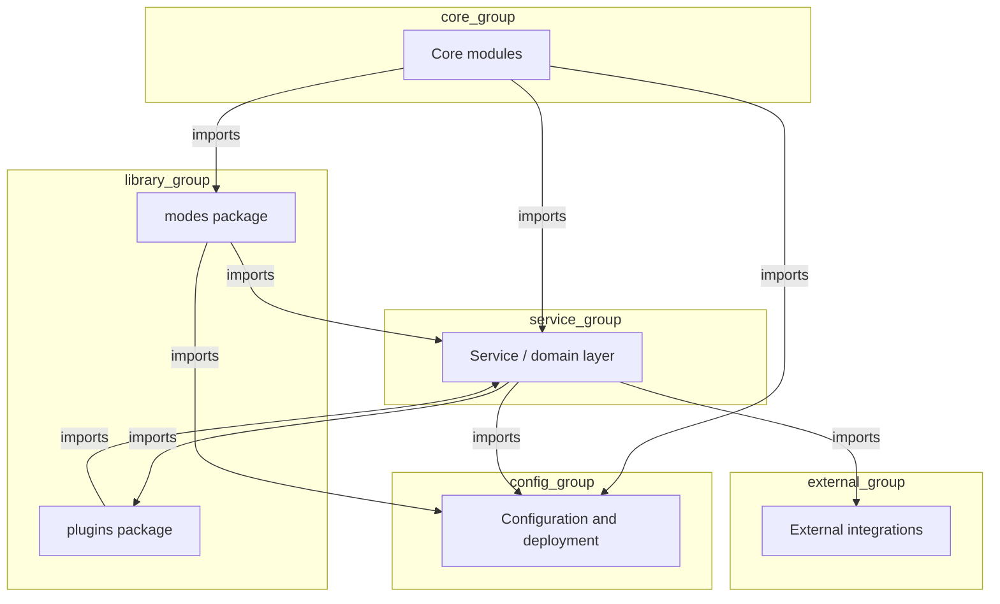

# Architecture report: s0md3v/XSStrike

> Automated static analysis. **Observed** = directly seen in files/imports/AST; **Inferred** = interpretation from that evidence. Repository code was not executed.

## 1. Repository at a glance

| Item | Value |
| --- | --- |
| Repository | s0md3v/XSStrike |
| Description | Most advanced XSS scanner. |
| Language | Python |
| Stars | 15264 |
| Licence | GPL-3.0 |
| Analysed commit / branch | ab27955d367432f944d8f29897e09c15356e76f7 / master |
| Framework(s) | None detected |
| Files analysed | 39 |
| Components | 6 |

## 2. Architecture in one minute

s0md3v/XSStrike - Most advanced XSS scanner.. This repository was analysed statically from 39 file(s) (27 Python). Detected technologies (observed from imports/manifests): requests. Files are grouped into 6 component(s): Configuration and deployment, Core modules, External integrations, modes package, plugins package, Service / domain layer. Findings below distinguish observed facts from inferred interpretation.

## 3. High-level block diagram

## 4. Main components

### Configuration and deployment (`config`)

- **Kind:** config
- **Status:** Observed
- **Confidence:** 0.85
- **Responsibility:** Groups 4 file(s) under configuration and deployment (observed from repository paths and static analysis).
- **Paths:** `core/config.py`, `db/definitions.json`, `db/wafSignatures.json`, `requirements.txt`
- **Evidence:** [core/config.py](https://github.com/s0md3v/XSStrike/blob/ab27955d367432f944d8f29897e09c15356e76f7/core/config.py); [db/definitions.json](https://github.com/s0md3v/XSStrike/blob/ab27955d367432f944d8f29897e09c15356e76f7/db/definitions.json); [db/wafSignatures.json](https://github.com/s0md3v/XSStrike/blob/ab27955d367432f944d8f29897e09c15356e76f7/db/wafSignatures.json); [requirements.txt](https://github.com/s0md3v/XSStrike/blob/ab27955d367432f944d8f29897e09c15356e76f7/requirements.txt)

### Core modules (`core`)

- **Kind:** core
- **Status:** Observed
- **Confidence:** 0.85
- **Responsibility:** Groups 1 file(s) under core modules (observed from repository paths and static analysis).
- **Paths:** `xsstrike.py`
- **Evidence:** [xsstrike.py](https://github.com/s0md3v/XSStrike/blob/ab27955d367432f944d8f29897e09c15356e76f7/xsstrike.py)

### External integrations (`external_integrations`)

- **Kind:** external
- **Status:** Inferred
- **Confidence:** 0.70
- **Responsibility:** Groups 0 file(s) under external integrations (observed from repository paths and static analysis).
- **Evidence:** [core/requester.py:2](https://github.com/s0md3v/XSStrike/blob/ab27955d367432f944d8f29897e09c15356e76f7/core/requester.py#L2); [core/requester.py:4](https://github.com/s0md3v/XSStrike/blob/ab27955d367432f944d8f29897e09c15356e76f7/core/requester.py#L4); [core/updater.py:3](https://github.com/s0md3v/XSStrike/blob/ab27955d367432f944d8f29897e09c15356e76f7/core/updater.py#L3)

### modes package (`modes`)

- **Kind:** library
- **Status:** Observed
- **Confidence:** 0.85
- **Responsibility:** Groups 5 file(s) under modes package (observed from repository paths and static analysis). Observed top-level functions: bruteforcer, crawl, scan, singleFuzz.
- **Paths:** `modes/__init__.py`, `modes/bruteforcer.py`, `modes/crawl.py`, `modes/scan.py`, `modes/singleFuzz.py`
- **Evidence:** [modes/__init__.py](https://github.com/s0md3v/XSStrike/blob/ab27955d367432f944d8f29897e09c15356e76f7/modes/__init__.py); [modes/bruteforcer.py:12](https://github.com/s0md3v/XSStrike/blob/ab27955d367432f944d8f29897e09c15356e76f7/modes/bruteforcer.py#L12); [modes/crawl.py:16](https://github.com/s0md3v/XSStrike/blob/ab27955d367432f944d8f29897e09c15356e76f7/modes/crawl.py#L16); [modes/scan.py:21](https://github.com/s0md3v/XSStrike/blob/ab27955d367432f944d8f29897e09c15356e76f7/modes/scan.py#L21); [modes/singleFuzz.py:15](https://github.com/s0md3v/XSStrike/blob/ab27955d367432f944d8f29897e09c15356e76f7/modes/singleFuzz.py#L15)

### plugins package (`plugins`)

- **Kind:** library
- **Status:** Observed
- **Confidence:** 0.85
- **Responsibility:** Groups 2 file(s) under plugins package (observed from repository paths and static analysis). Observed top-level functions: _is_at_or_above, _replace_version, _replacement_match, _scanhash, _simple_match, _to_comparable.
- **Paths:** `plugins/__init__.py`, `plugins/retireJs.py`
- **Evidence:** [plugins/__init__.py](https://github.com/s0md3v/XSStrike/blob/ab27955d367432f944d8f29897e09c15356e76f7/plugins/__init__.py); [plugins/retireJs.py:14](https://github.com/s0md3v/XSStrike/blob/ab27955d367432f944d8f29897e09c15356e76f7/plugins/retireJs.py#L14)

### Service / domain layer (`service_layer`)

- **Kind:** service
- **Status:** Observed
- **Confidence:** 0.85
- **Responsibility:** Groups 18 file(s) under service / domain layer (observed from repository paths and static analysis). Observed top-level classes: CustomFormatter, CustomStreamHandler. Observed top-level functions: _get_level_and_log, _good, _run, _switch_to_default_loggers, _switch_to_no_format_loggers, _vuln.
- **Paths:** `core/__init__.py`, `core/checker.py`, `core/colors.py`, `core/dom.py`, `core/encoders.py`, `core/filterChecker.py`, `core/fuzzer.py`, `core/generator.py`, `core/htmlParser.py`, `core/jsContexter.py`, `core/log.py`, `core/photon.py`, `core/prompt.py`, `core/requester.py`, `core/updater.py`, `core/utils.py`, `core/wafDetector.py`, `core/zetanize.py`
- **Evidence:** [core/__init__.py](https://github.com/s0md3v/XSStrike/blob/ab27955d367432f944d8f29897e09c15356e76f7/core/__init__.py); [core/checker.py:11](https://github.com/s0md3v/XSStrike/blob/ab27955d367432f944d8f29897e09c15356e76f7/core/checker.py#L11); [core/colors.py](https://github.com/s0md3v/XSStrike/blob/ab27955d367432f944d8f29897e09c15356e76f7/core/colors.py); [core/dom.py:8](https://github.com/s0md3v/XSStrike/blob/ab27955d367432f944d8f29897e09c15356e76f7/core/dom.py#L8); [core/encoders.py:5](https://github.com/s0md3v/XSStrike/blob/ab27955d367432f944d8f29897e09c15356e76f7/core/encoders.py#L5); [core/filterChecker.py:4](https://github.com/s0md3v/XSStrike/blob/ab27955d367432f944d8f29897e09c15356e76f7/core/filterChecker.py#L4); [core/fuzzer.py:15](https://github.com/s0md3v/XSStrike/blob/ab27955d367432f944d8f29897e09c15356e76f7/core/fuzzer.py#L15); [core/generator.py:6](https://github.com/s0md3v/XSStrike/blob/ab27955d367432f944d8f29897e09c15356e76f7/core/generator.py#L6)

## 5. Execution flow

No entry point was observed; the startup flow below is therefore limited.

Representative flow (derived from observed entry points and the import graph; steps beyond the entry point are **Inferred**):

1. Execution starts at an observed entry point listed above, if present.
2. `core` imports `config` (Core modules -> Configuration and deployment).
3. `core` imports `modes` (Core modules -> modes package).
4. `core` imports `service_layer` (Core modules -> Service / domain layer).
5. `modes` imports `config` (modes package -> Configuration and deployment).
6. `modes` imports `service_layer` (modes package -> Service / domain layer).
7. `plugins` imports `service_layer` (plugins package -> Service / domain layer).
8. `service_layer` imports `config` (Service / domain layer -> Configuration and deployment).
9. `service_layer` imports `external_integrations` (Service / domain layer -> External integrations).

## 6. Project structure

### `(root)`

- `.gitignore` - other (1221 bytes)
- `.travis.yml` - ci, YAML (933 bytes)
- `CHANGELOG.md` - docs (2495 bytes)
- `LICENSE` - docs (35149 bytes)
- `README.md` - docs (5614 bytes)
- `requirements.txt` - manifest (24 bytes)
- `test.html` - other (1017 bytes)
- `xsstrike.py` - source, Python (7847 bytes)

### `.github`

- `.github/ISSUE_TEMPLATE/bug_report.md` - docs (1141 bytes)
- `.github/ISSUE_TEMPLATE/feature_request.md` - docs (432 bytes)
- `.github/PULL_REQUEST_TEMPLATE.md` - docs (652 bytes)

### `core`

- `core/__init__.py` - source, Python (1 bytes)
- `core/checker.py` - source, Python (1759 bytes)
- `core/colors.py` - source, Python (877 bytes)
- `core/config.py` - source, Python (4374 bytes)
- `core/dom.py` - source, Python (3139 bytes)
- `core/encoders.py` - source, Python (276 bytes)
- `core/filterChecker.py` - source, Python (1613 bytes)
- `core/fuzzer.py` - source, Python (2166 bytes)
- `core/generator.py` - source, Python (8653 bytes)
- `core/htmlParser.py` - source, Python (4637 bytes)
- `core/jsContexter.py` - source, Python (1304 bytes)
- `core/log.py` - source, Python (5957 bytes)
- `core/photon.py` - source, Python (3651 bytes)
- `core/prompt.py` - source, Python (1220 bytes)
- `core/requester.py` - source, Python (2213 bytes)
- `core/updater.py` - source, Python (1562 bytes)
- `core/utils.py` - source, Python (7898 bytes)
- `core/wafDetector.py` - source, Python (1841 bytes)
- `core/zetanize.py` - source, Python (1693 bytes)

### `db`

- `db/definitions.json` - config (51358 bytes)
- `db/wafSignatures.json` - config (9489 bytes)

### `modes`

- `modes/__init__.py` - source, Python (1 bytes)
- `modes/bruteforcer.py` - source, Python (1529 bytes)
- `modes/crawl.py` - source, Python (3151 bytes)
- `modes/scan.py` - source, Python (5018 bytes)
- `modes/singleFuzz.py` - source, Python (1783 bytes)

### `plugins`

- `plugins/__init__.py` - source, Python (1 bytes)
- `plugins/retireJs.py` - source, Python (6902 bytes)

## 7. Key dependencies and integrations

| Name | Category | Status | Confidence | Evidence |
| --- | --- | --- | --- | --- |
| requests | library | Observed | 0.95 | [core/requester.py:2](https://github.com/s0md3v/XSStrike/blob/ab27955d367432f944d8f29897e09c15356e76f7/core/requester.py#L2); [core/updater.py:3](https://github.com/s0md3v/XSStrike/blob/ab27955d367432f944d8f29897e09c15356e76f7/core/updater.py#L3); [requirements.txt:3](https://github.com/s0md3v/XSStrike/blob/ab27955d367432f944d8f29897e09c15356e76f7/requirements.txt#L3) |

## 8. Data and state

No database, cache, queue, or persistent-state usage was observed in the analysed files. State handling, if any, may be in-memory or in files that were not analysed.

## 9. Configuration and deployment clues

- `.travis.yml` (ci)
- `db/definitions.json` (config)
- `db/wafSignatures.json` (config)
- `requirements.txt` (manifest)

## 10. Design observations

- Service/domain code is distinct from entry and data code, suggesting layered separation (Inferred).
- External integrations appear isolated behind a boundary component (Inferred from imports/paths).

These observations are interpretations (**Inferred**) of the observed structure, not guarantees about runtime design.

## 11. Limitations and unknowns

- Static analysis only: repository code was not executed, installed, or imported at runtime.
- Components and relationships are inferred from file paths, imports, and AST structure; runtime behaviour, dynamic imports, and reflection may not be visible.
- No clear application entry point was observed in the analysed files.
- Repository text was treated as untrusted data; no instructions found in repository files were followed, and likely secret values were redacted/excluded.

## 12. Source references

- [core/__init__.py](https://github.com/s0md3v/XSStrike/blob/ab27955d367432f944d8f29897e09c15356e76f7/core/__init__.py)
- [core/checker.py:11](https://github.com/s0md3v/XSStrike/blob/ab27955d367432f944d8f29897e09c15356e76f7/core/checker.py#L11)
- [core/colors.py](https://github.com/s0md3v/XSStrike/blob/ab27955d367432f944d8f29897e09c15356e76f7/core/colors.py)
- [core/config.py](https://github.com/s0md3v/XSStrike/blob/ab27955d367432f944d8f29897e09c15356e76f7/core/config.py)
- [core/dom.py:8](https://github.com/s0md3v/XSStrike/blob/ab27955d367432f944d8f29897e09c15356e76f7/core/dom.py#L8)
- [core/encoders.py:5](https://github.com/s0md3v/XSStrike/blob/ab27955d367432f944d8f29897e09c15356e76f7/core/encoders.py#L5)
- [core/filterChecker.py:4](https://github.com/s0md3v/XSStrike/blob/ab27955d367432f944d8f29897e09c15356e76f7/core/filterChecker.py#L4)
- [core/fuzzer.py:15](https://github.com/s0md3v/XSStrike/blob/ab27955d367432f944d8f29897e09c15356e76f7/core/fuzzer.py#L15)
- [core/generator.py:6](https://github.com/s0md3v/XSStrike/blob/ab27955d367432f944d8f29897e09c15356e76f7/core/generator.py#L6)
- [core/requester.py:2](https://github.com/s0md3v/XSStrike/blob/ab27955d367432f944d8f29897e09c15356e76f7/core/requester.py#L2)
- [core/requester.py:4](https://github.com/s0md3v/XSStrike/blob/ab27955d367432f944d8f29897e09c15356e76f7/core/requester.py#L4)
- [core/updater.py:3](https://github.com/s0md3v/XSStrike/blob/ab27955d367432f944d8f29897e09c15356e76f7/core/updater.py#L3)
- [db/definitions.json](https://github.com/s0md3v/XSStrike/blob/ab27955d367432f944d8f29897e09c15356e76f7/db/definitions.json)
- [db/wafSignatures.json](https://github.com/s0md3v/XSStrike/blob/ab27955d367432f944d8f29897e09c15356e76f7/db/wafSignatures.json)
- [modes/__init__.py](https://github.com/s0md3v/XSStrike/blob/ab27955d367432f944d8f29897e09c15356e76f7/modes/__init__.py)
- [modes/bruteforcer.py:12](https://github.com/s0md3v/XSStrike/blob/ab27955d367432f944d8f29897e09c15356e76f7/modes/bruteforcer.py#L12)
- [modes/crawl.py:16](https://github.com/s0md3v/XSStrike/blob/ab27955d367432f944d8f29897e09c15356e76f7/modes/crawl.py#L16)
- [modes/scan.py:21](https://github.com/s0md3v/XSStrike/blob/ab27955d367432f944d8f29897e09c15356e76f7/modes/scan.py#L21)
- [modes/singleFuzz.py:15](https://github.com/s0md3v/XSStrike/blob/ab27955d367432f944d8f29897e09c15356e76f7/modes/singleFuzz.py#L15)
- [plugins/__init__.py](https://github.com/s0md3v/XSStrike/blob/ab27955d367432f944d8f29897e09c15356e76f7/plugins/__init__.py)
- [plugins/retireJs.py:14](https://github.com/s0md3v/XSStrike/blob/ab27955d367432f944d8f29897e09c15356e76f7/plugins/retireJs.py#L14)
- [requirements.txt](https://github.com/s0md3v/XSStrike/blob/ab27955d367432f944d8f29897e09c15356e76f7/requirements.txt)
- [requirements.txt:3](https://github.com/s0md3v/XSStrike/blob/ab27955d367432f944d8f29897e09c15356e76f7/requirements.txt#L3)
- [xsstrike.py](https://github.com/s0md3v/XSStrike/blob/ab27955d367432f944d8f29897e09c15356e76f7/xsstrike.py)
