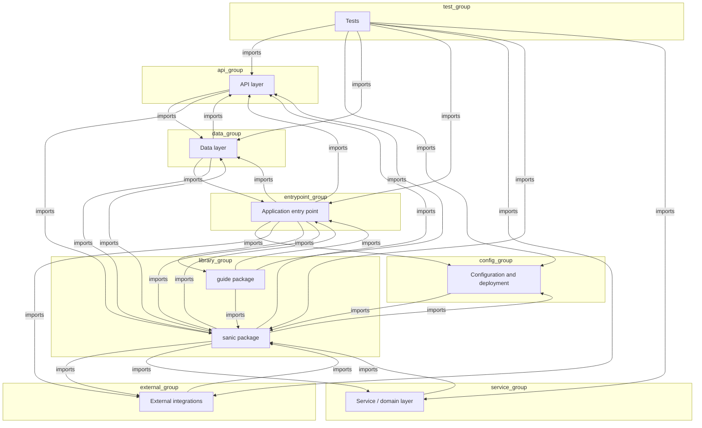

# Architecture report: sanic-org/sanic

> Automated static analysis. **Observed** = directly seen in files/imports/AST; **Inferred** = interpretation from that evidence. Repository code was not executed.

## 1. Repository at a glance

| Item | Value |
| --- | --- |
| Repository | sanic-org/sanic |
| Description |  Accelerate your web app development  | Build fast. Run fast. |
| Language | Python |
| Stars | 18633 |
| Licence | MIT |
| Analysed commit / branch | 5ffc7b3710838eaf016d2f9612a86a08626915e5 / main |
| Framework(s) | None detected |
| Files analysed | 635 |
| Components | 9 |

## 2. Architecture in one minute

sanic-org/sanic -  Accelerate your web app development  | Build fast. Run fast.. This repository was analysed statically from 635 file(s) (332 Python). Detected technologies (observed from imports/manifests): GitHub Actions, Click, httpx, requests, Uvicorn, Poetry. Files are grouped into 9 component(s): API layer, Configuration and deployment, Data layer, Application entry point, External integrations, guide package, sanic package, Service / domain layer. Observed entry point(s): guide/content/en/migrate.py, sanic/__main__.py, scripts/changelog.py. Findings below distinguish observed facts from inferred interpretation.

## 3. High-level block diagram

## 4. Main components

### API layer (`api_layer`)

- **Kind:** api
- **Status:** Observed
- **Confidence:** 0.85
- **Responsibility:** Groups 5 file(s) under api layer (observed from repository paths and static analysis). Observed routes: GET (path not a literal). Observed top-level classes: ContentRangeHandler, DirectoryHandler, ErrorHandler. Observed top-level functions: _is_path_within_root, _search, setup_search.
- **Paths:** `guide/webapp/endpoint/search.py`, `sanic/handlers/__init__.py`, `sanic/handlers/content_range.py`, `sanic/handlers/directory.py`, `sanic/handlers/error.py`
- **Evidence:** [guide/webapp/endpoint/search.py:13](https://github.com/sanic-org/sanic/blob/5ffc7b3710838eaf016d2f9612a86a08626915e5/guide/webapp/endpoint/search.py#L13); [sanic/handlers/__init__.py](https://github.com/sanic-org/sanic/blob/5ffc7b3710838eaf016d2f9612a86a08626915e5/sanic/handlers/__init__.py); [sanic/handlers/content_range.py:19](https://github.com/sanic-org/sanic/blob/5ffc7b3710838eaf016d2f9612a86a08626915e5/sanic/handlers/content_range.py#L19); [sanic/handlers/directory.py:17](https://github.com/sanic-org/sanic/blob/5ffc7b3710838eaf016d2f9612a86a08626915e5/sanic/handlers/directory.py#L17); [sanic/handlers/error.py:12](https://github.com/sanic-org/sanic/blob/5ffc7b3710838eaf016d2f9612a86a08626915e5/sanic/handlers/error.py#L12)

### Configuration and deployment (`config`)

- **Kind:** config
- **Status:** Observed
- **Confidence:** 0.85
- **Responsibility:** Groups 17 file(s) under configuration and deployment (observed from repository paths and static analysis). Observed top-level classes: Config, DescriptorMeta, DetailedConverter, PyTest. Observed top-level functions: _auto_format, load_config, load_menu, open_local, setup_logging, str_to_bool.
- **Paths:** `MANIFEST.in`, `codecov.yml`, `crowdin.yml`, `docker/Dockerfile`, `docker/Dockerfile-base`, `guide/config/en/general.yaml`, `guide/config/en/navbar.yaml`, `guide/config/en/sidebar.yaml`, `guide/requirements.txt`, `guide/webapp/worker/config.py`, `pyproject.toml`, `readthedocs.yml`, `sanic/config.py`, `sanic/logging/setup.py`, `scripts/pyproject.toml`, `setup.py`, `tox.ini`
- **Evidence:** [MANIFEST.in](https://github.com/sanic-org/sanic/blob/5ffc7b3710838eaf016d2f9612a86a08626915e5/MANIFEST.in); [codecov.yml](https://github.com/sanic-org/sanic/blob/5ffc7b3710838eaf016d2f9612a86a08626915e5/codecov.yml); [crowdin.yml](https://github.com/sanic-org/sanic/blob/5ffc7b3710838eaf016d2f9612a86a08626915e5/crowdin.yml); [docker/Dockerfile](https://github.com/sanic-org/sanic/blob/5ffc7b3710838eaf016d2f9612a86a08626915e5/docker/Dockerfile); [docker/Dockerfile-base](https://github.com/sanic-org/sanic/blob/5ffc7b3710838eaf016d2f9612a86a08626915e5/docker/Dockerfile-base); [guide/config/en/general.yaml](https://github.com/sanic-org/sanic/blob/5ffc7b3710838eaf016d2f9612a86a08626915e5/guide/config/en/general.yaml); [guide/config/en/navbar.yaml](https://github.com/sanic-org/sanic/blob/5ffc7b3710838eaf016d2f9612a86a08626915e5/guide/config/en/navbar.yaml); [guide/config/en/sidebar.yaml](https://github.com/sanic-org/sanic/blob/5ffc7b3710838eaf016d2f9612a86a08626915e5/guide/config/en/sidebar.yaml)

### Data layer (`data_layer`)

- **Kind:** data
- **Status:** Observed
- **Confidence:** 0.85
- **Responsibility:** Groups 8 file(s) under data layer (observed from repository paths and static analysis). Observed top-level classes: ConnInfo, Credentials, FutureCommand, FutureException, FutureListener, FutureMiddleware.
- **Paths:** `guide/webapp/display/layouts/models.py`, `sanic/models/__init__.py`, `sanic/models/ctx_types.py`, `sanic/models/futures.py`, `sanic/models/handler_types.py`, `sanic/models/http_types.py`, `sanic/models/protocol_types.py`, `sanic/models/server_types.py`
- **Evidence:** [guide/webapp/display/layouts/models.py:6](https://github.com/sanic-org/sanic/blob/5ffc7b3710838eaf016d2f9612a86a08626915e5/guide/webapp/display/layouts/models.py#L6); [sanic/models/__init__.py](https://github.com/sanic-org/sanic/blob/5ffc7b3710838eaf016d2f9612a86a08626915e5/sanic/models/__init__.py); [sanic/models/ctx_types.py:4](https://github.com/sanic-org/sanic/blob/5ffc7b3710838eaf016d2f9612a86a08626915e5/sanic/models/ctx_types.py#L4); [sanic/models/futures.py:15](https://github.com/sanic-org/sanic/blob/5ffc7b3710838eaf016d2f9612a86a08626915e5/sanic/models/futures.py#L15); [sanic/models/handler_types.py](https://github.com/sanic-org/sanic/blob/5ffc7b3710838eaf016d2f9612a86a08626915e5/sanic/models/handler_types.py); [sanic/models/http_types.py:8](https://github.com/sanic-org/sanic/blob/5ffc7b3710838eaf016d2f9612a86a08626915e5/sanic/models/http_types.py#L8); [sanic/models/protocol_types.py:12](https://github.com/sanic-org/sanic/blob/5ffc7b3710838eaf016d2f9612a86a08626915e5/sanic/models/protocol_types.py#L12); [sanic/models/server_types.py:10](https://github.com/sanic-org/sanic/blob/5ffc7b3710838eaf016d2f9612a86a08626915e5/sanic/models/server_types.py#L10)

### Application entry point (`entrypoint`)

- **Kind:** entrypoint
- **Status:** Observed
- **Confidence:** 0.85
- **Responsibility:** Groups 10 file(s) under application entry point (observed from repository paths and static analysis). Observed top-level classes: ASGIApp, Directory, Lifespan, MainLayout, MockProtocol, MockTransport. Observed top-level functions: _change_micro_version, _fetch_current_version, _fetch_default_calendar_release_version, _generate_change_log, _generate_markdown_document, _get_current_tag.
- **Paths:** `guide/content/en/migrate.py`, `guide/server.py`, `guide/webapp/display/layouts/main.py`, `sanic/__main__.py`, `sanic/app.py`, `sanic/asgi.py`, `sanic/cli/app.py`, `sanic/models/asgi.py`, `scripts/changelog.py`, `scripts/release.py`
- **Evidence:** [guide/content/en/migrate.py:22](https://github.com/sanic-org/sanic/blob/5ffc7b3710838eaf016d2f9612a86a08626915e5/guide/content/en/migrate.py#L22); [guide/server.py](https://github.com/sanic-org/sanic/blob/5ffc7b3710838eaf016d2f9612a86a08626915e5/guide/server.py); [guide/webapp/display/layouts/main.py:12](https://github.com/sanic-org/sanic/blob/5ffc7b3710838eaf016d2f9612a86a08626915e5/guide/webapp/display/layouts/main.py#L12); [sanic/__main__.py:19](https://github.com/sanic-org/sanic/blob/5ffc7b3710838eaf016d2f9612a86a08626915e5/sanic/__main__.py#L19); [sanic/app.py:109](https://github.com/sanic-org/sanic/blob/5ffc7b3710838eaf016d2f9612a86a08626915e5/sanic/app.py#L109); [sanic/asgi.py:23](https://github.com/sanic-org/sanic/blob/5ffc7b3710838eaf016d2f9612a86a08626915e5/sanic/asgi.py#L23); [sanic/cli/app.py:36](https://github.com/sanic-org/sanic/blob/5ffc7b3710838eaf016d2f9612a86a08626915e5/sanic/cli/app.py#L36); [sanic/models/asgi.py:17](https://github.com/sanic-org/sanic/blob/5ffc7b3710838eaf016d2f9612a86a08626915e5/sanic/models/asgi.py#L17)

### External integrations (`external_integrations`)

- **Kind:** external
- **Status:** Observed
- **Confidence:** 0.85
- **Responsibility:** Groups 1 file(s) under external integrations (observed from repository paths and static analysis). Observed top-level classes: InspectorClient.
- **Paths:** `sanic/cli/inspector_client.py`
- **Evidence:** [sanic/cli/inspector_client.py:23](https://github.com/sanic-org/sanic/blob/5ffc7b3710838eaf016d2f9612a86a08626915e5/sanic/cli/inspector_client.py#L23)

### guide package (`guide`)

- **Kind:** library
- **Status:** Observed
- **Confidence:** 0.85
- **Responsibility:** Groups 39 file(s) under guide package (observed from repository paths and static analysis). Observed top-level classes: Attributes, BaseLayout, BaseRenderer, Column, DocObject, DocsRenderer. Observed top-level functions: _compile_sidebar_order, _compile_sitemap, _content, _cosine_similarity, _define_heading_and_class, _detect_decorators.
- **Paths:** `guide/content/en/emoji.py`, `guide/public/assets/docs.js`, `guide/webapp/__init__.py`, `guide/webapp/display/__init__.py`, `guide/webapp/display/base.py`, `guide/webapp/display/code_style.py`, `guide/webapp/display/layouts/__init__.py`, `guide/webapp/display/layouts/base.py`, `guide/webapp/display/layouts/elements/__init__.py`, `guide/webapp/display/layouts/elements/footer.py`, `guide/webapp/display/layouts/elements/navbar.py`, `guide/webapp/display/layouts/elements/sidebar.py`, `guide/webapp/display/layouts/home.py`, `guide/webapp/display/markdown.py`, `guide/webapp/display/page/__init__.py`, `guide/webapp/display/page/docobject.py`, `guide/webapp/display/page/page.py`, `guide/webapp/display/page/renderer.py`, `guide/webapp/display/plugins/__init__.py`, `guide/webapp/display/plugins/attrs.py`, `guide/webapp/display/plugins/columns.py`, `guide/webapp/display/plugins/hook.py`, `guide/webapp/display/plugins/inline_directive.py`, `guide/webapp/display/plugins/mermaid.py`, `guide/webapp/display/plugins/notification.py`, `guide/webapp/display/plugins/span.py`, `guide/webapp/display/plugins/tabs.py`, `guide/webapp/display/search/__init__.py`, `guide/webapp/display/search/renderer.py`, `guide/webapp/display/search/search.py`, `guide/webapp/display/text.py`, `guide/webapp/endpoint/__init__.py`, `guide/webapp/endpoint/sitemap.py`, `guide/webapp/endpoint/view.py`, `guide/webapp/worker/__init__.py`, `guide/webapp/worker/factory.py`, `guide/webapp/worker/livereload.js`, `guide/webapp/worker/reload.py`, `guide/webapp/worker/style.py`
- **Evidence:** [guide/content/en/emoji.py](https://github.com/sanic-org/sanic/blob/5ffc7b3710838eaf016d2f9612a86a08626915e5/guide/content/en/emoji.py); [guide/public/assets/docs.js](https://github.com/sanic-org/sanic/blob/5ffc7b3710838eaf016d2f9612a86a08626915e5/guide/public/assets/docs.js); [guide/webapp/__init__.py](https://github.com/sanic-org/sanic/blob/5ffc7b3710838eaf016d2f9612a86a08626915e5/guide/webapp/__init__.py); [guide/webapp/display/__init__.py](https://github.com/sanic-org/sanic/blob/5ffc7b3710838eaf016d2f9612a86a08626915e5/guide/webapp/display/__init__.py); [guide/webapp/display/base.py:8](https://github.com/sanic-org/sanic/blob/5ffc7b3710838eaf016d2f9612a86a08626915e5/guide/webapp/display/base.py#L8); [guide/webapp/display/code_style.py:11](https://github.com/sanic-org/sanic/blob/5ffc7b3710838eaf016d2f9612a86a08626915e5/guide/webapp/display/code_style.py#L11); [guide/webapp/display/layouts/__init__.py](https://github.com/sanic-org/sanic/blob/5ffc7b3710838eaf016d2f9612a86a08626915e5/guide/webapp/display/layouts/__init__.py); [guide/webapp/display/layouts/base.py:11](https://github.com/sanic-org/sanic/blob/5ffc7b3710838eaf016d2f9612a86a08626915e5/guide/webapp/display/layouts/base.py#L11)

### sanic package (`sanic`)

- **Kind:** library
- **Status:** Observed
- **Confidence:** 0.85
- **Responsibility:** Groups 112 file(s) under sanic package (observed from repository paths and static analysis). Observed top-level classes: AcceptList, AltSvcCheck, AppLoader, ApplicationGroup, ApplicationServerInfo, ApplicationState. Observed top-level functions: _add_shared, _add_target_args, _async_protocol_transport_close, _blank, _build_protocol_kwargs, _extract_style.
- **Paths:** `sanic/__init__.py`, `sanic/__version__.py`, `sanic/application/__init__.py`, `sanic/application/constants.py`, `sanic/application/ext.py`, `sanic/application/logo.py`, `sanic/application/motd.py`, `sanic/application/spinner.py`, `sanic/application/state.py`, `sanic/base/__init__.py`, `sanic/base/meta.py`, `sanic/base/root.py`, `sanic/blueprint_group.py`, `sanic/blueprints.py`, `sanic/cli/__init__.py`, `sanic/cli/arguments.py`, `sanic/cli/base.py`, `sanic/cli/console.py`, `sanic/cli/daemon.py`, `sanic/cli/executor.py`, `sanic/cli/inspector.py`, `sanic/compat.py`, `sanic/constants.py`, `sanic/cookies/__init__.py`, `sanic/cookies/request.py`, `sanic/cookies/response.py`, `sanic/errorpages.py`, `sanic/exceptions.py`, `sanic/headers.py`, `sanic/helpers.py`, `sanic/http/__init__.py`, `sanic/http/constants.py`, `sanic/http/http1.py`, `sanic/http/http3.py`, `sanic/http/stream.py`, `sanic/http/tls/__init__.py`, `sanic/http/tls/context.py`, `sanic/http/tls/creators.py`, `sanic/log.py`, `sanic/logging/__init__.py`, `sanic/logging/color.py`, `sanic/logging/default.py`, `sanic/logging/deprecation.py`, `sanic/logging/filter.py`, `sanic/logging/formatter.py`, `sanic/logging/loggers.py`, `sanic/middleware.py`, `sanic/mixins/__init__.py`, `sanic/mixins/base.py`, `sanic/mixins/commands.py`, `sanic/mixins/exceptions.py`, `sanic/mixins/listeners.py`, `sanic/mixins/middleware.py`, `sanic/mixins/routes.py`, `sanic/mixins/signals.py`, `sanic/mixins/startup.py`, `sanic/mixins/static.py`, `sanic/pages/__init__.py`, `sanic/pages/base.py`, `sanic/pages/css.py`, `sanic/pages/directory_page.py`, `sanic/pages/error.py`, `sanic/request/__init__.py`, `sanic/request/form.py`, `sanic/request/parameters.py`, `sanic/request/types.py`, `sanic/response/__init__.py`, `sanic/response/convenience.py`, `sanic/response/types.py`, `sanic/router.py`, `sanic/server/__init__.py`, `sanic/server/async_server.py`, `sanic/server/events.py`, `sanic/server/goodbye.py`, `sanic/server/loop.py`, `sanic/server/protocols/__init__.py`, `sanic/server/protocols/base_protocol.py`, `sanic/server/protocols/http_protocol.py`, `sanic/server/protocols/websocket_protocol.py`, `sanic/server/runners.py`, `sanic/server/socket.py`, `sanic/server/websockets/__init__.py`, `sanic/server/websockets/connection.py`, `sanic/server/websockets/frame.py`, `sanic/server/websockets/impl.py`, `sanic/signals.py`, `sanic/simple.py`, `sanic/startup/__init__.py`, `sanic/startup/errors.py`, `sanic/touchup/__init__.py`, `sanic/touchup/meta.py`, `sanic/touchup/schemes/__init__.py`, `sanic/touchup/schemes/altsvc.py`, `sanic/touchup/schemes/base.py`, `sanic/touchup/schemes/ode.py`, `sanic/types/__init__.py`, `sanic/types/hashable_dict.py`, `sanic/types/shared_ctx.py`, `sanic/utils.py`, `sanic/views.py`, `sanic/worker/__init__.py`, `sanic/worker/constants.py`, `sanic/worker/daemon.py`, `sanic/worker/inspector.py`, `sanic/worker/loader.py`, `sanic/worker/manager.py`, `sanic/worker/multiplexer.py`, `sanic/worker/process.py`, `sanic/worker/reloader.py`, `sanic/worker/restarter.py`, `sanic/worker/serve.py`, `sanic/worker/state.py`
- **Evidence:** [sanic/__init__.py](https://github.com/sanic-org/sanic/blob/5ffc7b3710838eaf016d2f9612a86a08626915e5/sanic/__init__.py); [sanic/__version__.py](https://github.com/sanic-org/sanic/blob/5ffc7b3710838eaf016d2f9612a86a08626915e5/sanic/__version__.py); [sanic/application/__init__.py](https://github.com/sanic-org/sanic/blob/5ffc7b3710838eaf016d2f9612a86a08626915e5/sanic/application/__init__.py); [sanic/application/constants.py:4](https://github.com/sanic-org/sanic/blob/5ffc7b3710838eaf016d2f9612a86a08626915e5/sanic/application/constants.py#L4); [sanic/application/ext.py:12](https://github.com/sanic-org/sanic/blob/5ffc7b3710838eaf016d2f9612a86a08626915e5/sanic/application/ext.py#L12); [sanic/application/logo.py:48](https://github.com/sanic-org/sanic/blob/5ffc7b3710838eaf016d2f9612a86a08626915e5/sanic/application/logo.py#L48); [sanic/application/motd.py:10](https://github.com/sanic-org/sanic/blob/5ffc7b3710838eaf016d2f9612a86a08626915e5/sanic/application/motd.py#L10); [sanic/application/spinner.py:17](https://github.com/sanic-org/sanic/blob/5ffc7b3710838eaf016d2f9612a86a08626915e5/sanic/application/spinner.py#L17)

### Service / domain layer (`service_layer`)

- **Kind:** service
- **Status:** Observed
- **Confidence:** 0.85
- **Responsibility:** Groups 1 file(s) under service / domain layer (observed from repository paths and static analysis). Observed top-level classes: TouchUp.
- **Paths:** `sanic/touchup/service.py`
- **Evidence:** [sanic/touchup/service.py:6](https://github.com/sanic-org/sanic/blob/5ffc7b3710838eaf016d2f9612a86a08626915e5/sanic/touchup/service.py#L6)

### Tests (`tests`)

- **Kind:** test
- **Status:** Observed
- **Confidence:** 0.85
- **Responsibility:** Groups 125 file(s) under tests (observed from repository paths and static analysis). Observed routes: GET /, ROUTE /, ROUTE /, ROUTE /sync, ROUTE /text/<name>/<butt:int>. Observed top-level classes: AsyncMock, ConfigTest, CustomConfig, CustomHttpProtocol, CustomRequest, ErrorWithRequestCtx. Observed top-level functions: MockMkcertCreator, MockTrustmeCreator, _chunked_trailer_payload, _generate_handlers_from_names, _generate_ticket, _handler.
- **Paths:** `tests/__init__.py`, `tests/asyncmock.py`, `tests/benchmark/test_route_resolution_benchmark.py`, `tests/certs/createcerts.py`, `tests/client.py`, `tests/conftest.py`, `tests/fake/server.py`, `tests/http3/__init__.py`, `tests/http3/test_http_receiver.py`, `tests/http3/test_server.py`, `tests/http3/test_session_ticket_store.py`, `tests/performance/sanic/http_response.py`, `tests/performance/sanic/simple_server.py`, `tests/performance/sanic/varied_server.py`, `tests/skip_test_custom_protocol.py`, `tests/static/app_test_config.py`, `tests/static/bp/decode me.txt`, `tests/static/bp/test.file`, `tests/static/decode me.txt`, `tests/static/nested/dir/foo.txt`, `tests/static/test.file`, `tests/static/test.html`, `tests/test_app.py`, `tests/test_asgi.py`, `tests/test_bad_request.py`, `tests/test_base.py`, `tests/test_blueprint_copy.py`, `tests/test_blueprint_group.py`, `tests/test_blueprints.py`, `tests/test_cancellederror.py`, `tests/test_cli.py`, `tests/test_coffee.py`, `tests/test_config.py`, `tests/test_constants.py`, `tests/test_cookies.py`, `tests/test_create_task.py`, `tests/test_custom_request.py`, `tests/test_daemon.py`, `tests/test_deprecation.py`, `tests/test_dynamic_routes.py`, `tests/test_errorpages.py`, `tests/test_exceptions.py`, `tests/test_exceptions_handler.py`, `tests/test_ext_integration.py`, `tests/test_graceful_shutdown.py`, `tests/test_handler.py`, `tests/test_handler_annotations.py`, `tests/test_headers.py`, `tests/test_helpers.py`, `tests/test_http.py`, `tests/test_http_alt_svc.py`, `tests/test_init.py`, `tests/test_json_decoding.py`, `tests/test_json_encoding.py`, `tests/test_keep_alive_timeout.py`, `tests/test_late_adds.py`, `tests/test_logging.py`, `tests/test_logo.py`, `tests/test_middleware.py`, `tests/test_middleware_priority.py`, `tests/test_motd.py`, `tests/test_multi_serve.py`, `tests/test_multiprocessing.py`, `tests/test_named_routes.py`, `tests/test_naming.py`, `tests/test_payload_too_large.py`, `tests/test_pipelining.py`, `tests/test_prepare.py`, `tests/test_redirect.py`, `tests/test_reloader.py`, `tests/test_request.py`, `tests/test_request_cancel.py`, `tests/test_request_data.py`, `tests/test_request_stream.py`, `tests/test_requests.py`, `tests/test_response.py`, `tests/test_response_file.py`, `tests/test_response_header_injection.py`, `tests/test_response_json.py`, `tests/test_response_timeout.py`, `tests/test_routes.py`, `tests/test_server_events.py`, `tests/test_server_loop.py`, `tests/test_signal_handlers.py`, `tests/test_signals.py`, `tests/test_startup_errors.py`, `tests/test_static.py`, `tests/test_static_directory.py`, `tests/test_tasks.py`, `tests/test_test_client_port.py`, `tests/test_timeout_logic.py`, `tests/test_tls.py`, `tests/test_touchup.py`, `tests/test_unix_socket.py`, `tests/test_url_building.py`, `tests/test_url_for.py`, `tests/test_url_for_static.py`, `tests/test_utf8.py`, `tests/test_utils.py`, `tests/test_versioning.py`, `tests/test_vhosts.py`, `tests/test_views.py`, `tests/test_websockets.py`, `tests/test_ws_handlers.py`, `tests/typing/samples/app_custom_config.py`, `tests/typing/samples/app_custom_ctx.py`, `tests/typing/samples/app_default.py`, `tests/typing/samples/app_fully_custom.py`, `tests/typing/samples/request_custom_ctx.py`, `tests/typing/samples/request_custom_sanic.py`, `tests/typing/samples/request_fully_custom.py`, `tests/typing/test_typing.py`, `tests/worker/conftest.py`, `tests/worker/test_inspector.py`, `tests/worker/test_loader.py`, `tests/worker/test_manager.py`, `tests/worker/test_multiplexer.py`, `tests/worker/test_reloader.py`, `tests/worker/test_restarter.py`, `tests/worker/test_runner.py`, `tests/worker/test_shared_ctx.py`, `tests/worker/test_socket.py`, `tests/worker/test_startup.py`, `tests/worker/test_state.py`, `tests/worker/test_worker_serve.py`
- **Evidence:** [tests/__init__.py](https://github.com/sanic-org/sanic/blob/5ffc7b3710838eaf016d2f9612a86a08626915e5/tests/__init__.py); [tests/asyncmock.py:9](https://github.com/sanic-org/sanic/blob/5ffc7b3710838eaf016d2f9612a86a08626915e5/tests/asyncmock.py#L9); [tests/benchmark/test_route_resolution_benchmark.py:16](https://github.com/sanic-org/sanic/blob/5ffc7b3710838eaf016d2f9612a86a08626915e5/tests/benchmark/test_route_resolution_benchmark.py#L16); [tests/certs/createcerts.py:22](https://github.com/sanic-org/sanic/blob/5ffc7b3710838eaf016d2f9612a86a08626915e5/tests/certs/createcerts.py#L22); [tests/client.py:7](https://github.com/sanic-org/sanic/blob/5ffc7b3710838eaf016d2f9612a86a08626915e5/tests/client.py#L7); [tests/conftest.py:37](https://github.com/sanic-org/sanic/blob/5ffc7b3710838eaf016d2f9612a86a08626915e5/tests/conftest.py#L37); [tests/fake/server.py:17](https://github.com/sanic-org/sanic/blob/5ffc7b3710838eaf016d2f9612a86a08626915e5/tests/fake/server.py#L17); [tests/http3/__init__.py](https://github.com/sanic-org/sanic/blob/5ffc7b3710838eaf016d2f9612a86a08626915e5/tests/http3/__init__.py)

## 5. Execution flow

**Observed** entry point(s):

- [guide/content/en/migrate.py:120](https://github.com/sanic-org/sanic/blob/5ffc7b3710838eaf016d2f9612a86a08626915e5/guide/content/en/migrate.py#L120)
- [sanic/__main__.py](https://github.com/sanic-org/sanic/blob/5ffc7b3710838eaf016d2f9612a86a08626915e5/sanic/__main__.py)
- [scripts/changelog.py:8](https://github.com/sanic-org/sanic/blob/5ffc7b3710838eaf016d2f9612a86a08626915e5/scripts/changelog.py#L8)
- [scripts/release.py:283](https://github.com/sanic-org/sanic/blob/5ffc7b3710838eaf016d2f9612a86a08626915e5/scripts/release.py#L283)

**Observed** routes (from decorators):

- `GET /pop` -> `pop_handler` in `examples/amending_request_object.py:16`
- `GET /key_exist` -> `key_exist_handler` in `examples/amending_request_object.py:21`
- `ROUTE /` -> `test` in `examples/authorized_sanic.py:39`
- `ROUTE /` -> `pop_handler` in `examples/blueprint_middlware_execution_order.py:47`
- `ROUTE /foo` -> `foo` in `examples/blueprints.py:12`
- `ROUTE /foo` -> `foo2` in `examples/blueprints.py:17`
- `ROUTE /foo` -> `index` in `examples/blueprints.py:22`
- `GET /` -> `handler` in `examples/delayed_response.py:11`
- `GET /sleep/<t:float>` -> `handler2` in `examples/delayed_response.py:16`
- `ROUTE /` -> `test` in `examples/exception_monitoring.py:48`
- `ROUTE /` -> `test` in `examples/hello_world.py:8`
- `GET /foo` -> `foo` in `examples/http_redirect.py:16`
- `GET /bar` -> `bar` in `examples/http_redirect.py:21`
- `GET /<path:path>` -> `proxy` in `examples/http_redirect.py:26`
- `ROUTE /` -> `test` in `examples/limit_concurrency.py:31`
- `ROUTE /` -> `test` in `examples/log_request_id.py:65`
- `ROUTE /` -> `default` in `examples/logdna_example.py:55`
- `ROUTE /` -> `handle_request` in `examples/modify_header_example.py:12`
- `ROUTE /unauthorized` -> `handle_unauthorized_request` in `examples/modify_header_example.py:21`
- `ROUTE /` -> `test` in `examples/override_logging.py:18`
- `ROUTE /raise` -> `test` in `examples/raygun_example.py:28`
- `ROUTE /` -> `handle_request` in `examples/redirect_example.py:8`
- `ROUTE /redirect` -> `test` in `examples/redirect_example.py:13`
- `POST /stream` -> `handler` in `examples/request_stream/server.py:25`
- `PUT /bp_stream` -> `bp_handler` in `examples/request_stream/server.py:38`
- `ROUTE /` -> `test` in `examples/request_timeout.py:13`
- `ROUTE /raise` -> `create_error` in `examples/rollbar_example.py:23`
- `ROUTE /text` -> `handler_text` in `examples/run_asgi.py:18`
- `ROUTE /json` -> `handler_json` in `examples/run_asgi.py:23`
- `ROUTE /file` -> `handler_file` in `examples/run_asgi.py:40`
- `ROUTE /file_stream` -> `handler_file_stream` in `examples/run_asgi.py:45`
- `POST /stream` -> `handler_stream` in `examples/run_asgi.py:52`
- `ROUTE /` -> `test` in `examples/run_async.py:12`
- `ROUTE /` -> `test` in `examples/run_async_advanced.py:35`
- `ROUTE /working` -> `working_path` in `examples/sentry_example.py:20`
- `ROUTE /raise-error` -> `raise_error` in `examples/sentry_example.py:26`
- `ROUTE /` -> `test` in `examples/teapot.py:9`
- `ROUTE /` -> `test_async` in `examples/try_everything.py:12`
- `ROUTE /sync` -> `test_sync` in `examples/try_everything.py:17`
- `ROUTE /dynamic/<name>/<i:int>` -> `test_params` in `examples/try_everything.py:22`
- `ROUTE /exception` -> `exception` in `examples/try_everything.py:27`
- `ROUTE /await` -> `test_await` in `examples/try_everything.py:32`
- `ROUTE /file` -> `test_file` in `examples/try_everything.py:40`
- `ROUTE /file_stream` -> `test_file_stream` in `examples/try_everything.py:45`
- `ROUTE /json` -> `post_json` in `examples/try_everything.py:70`
- `ROUTE /form` -> `post_form_json` in `examples/try_everything.py:75`
- `ROUTE /query_string` -> `query_string` in `examples/try_everything.py:86`
- `ROUTE /test` -> `test` in `examples/unix_socket.py:8`
- `ROUTE /` -> `index` in `examples/url_for_example.py:8`
- `ROUTE /posts/<post_id>` -> `post_handler` in `examples/url_for_example.py:16`
- `GET /name` -> `bp1_name` in `examples/versioned_blueprint_group.py:17`
- `GET /name` -> `bp2_name` in `examples/versioned_blueprint_group.py:23`
- `GET /name` -> `bp2_revised_name` in `examples/versioned_blueprint_group.py:29`
- `ROUTE /` -> `hello_0` in `examples/vhosts.py:18`
- `ROUTE /` -> `hello_1` in `examples/vhosts.py:23`
- `ROUTE /question` -> `hello_2` in `examples/vhosts.py:28`
- `ROUTE /answer` -> `hello_3` in `examples/vhosts.py:33`
- `GET /name` -> `name` in `examples/vhosts.py:38`
- `ROUTE /` -> `index` in `examples/websocket.py:12`
- `GET ` -> `_search` in `guide/webapp/endpoint/search.py:13`
- `GET /` -> `handler` in `tests/fake/server.py:17`
- `ROUTE /` -> `test` in `tests/performance/sanic/simple_server.py:19`
- `ROUTE /` -> `test` in `tests/performance/sanic/varied_server.py:20`
- `ROUTE /sync` -> `test_json_response` in `tests/performance/sanic/varied_server.py:25`
- `ROUTE /text/<name>/<butt:int>` -> `rtext` in `tests/performance/sanic/varied_server.py:30`
- `ROUTE /exception` -> `exception` in `tests/performance/sanic/varied_server.py:35`
- `ROUTE /exception/async` -> `test_server_error` in `tests/performance/sanic/varied_server.py:40`
- `ROUTE /post_json` -> `post_json` in `tests/performance/sanic/varied_server.py:45`
- `ROUTE /query_string` -> `query_string` in `tests/performance/sanic/varied_server.py:50`
- `PATCH sanic.mixins.startup.WebSocketProtocol` -> `test_app_websocket_parameters` in `tests/test_app.py:204`
- `ROUTE /1` -> `handler1` in `tests/test_keep_alive_timeout.py:40`
- `ROUTE /1` -> `handler2` in `tests/test_keep_alive_timeout.py:45`
- `ROUTE /1` -> `handler3` in `tests/test_keep_alive_timeout.py:50`
- `POST /ctx` -> `set_ctx` in `tests/test_keep_alive_timeout.py:55`
- `GET /ctx` -> `get_ctx` in `tests/test_keep_alive_timeout.py:61`
- `ROUTE /1` -> `handler_disabled` in `tests/test_keep_alive_timeout.py:66`
- `GET /` -> `handler` in `tests/typing/samples/request_custom_ctx.py:15`
- `GET /` -> `handler` in `tests/typing/samples/request_custom_sanic.py:15`
- `GET /` -> `handler` in `tests/typing/samples/request_fully_custom.py:31`
- `PATCH sanic.cli.inspector_client.sys.stdout.write` -> `test_send_inspect` in `tests/worker/test_inspector.py:61`
- `PATCH sanic.cli.inspector_client.sys` -> `test_send_inspect_conn_refused` in `tests/worker/test_inspector.py:71`
- `PATCH sanic.worker.loader.TrustmeCreator` -> `test_cert_loader` in `tests/worker/test_loader.py:77`
- `PATCH sanic.worker.loader.MkcertCreator` -> `test_cert_loader` in `tests/worker/test_loader.py:77`
- `PATCH sanic.worker.process.os` -> `test_terminate` in `tests/worker/test_manager.py:41`
- `PATCH sanic.worker.process.os` -> `test_shutown` in `tests/worker/test_manager.py:52`
- `PATCH sanic.worker.manager.os` -> `test_kill` in `tests/worker/test_manager.py:64`
- `PATCH sanic.worker.process.os` -> `test_shutdown_signal_send_kill` in `tests/worker/test_manager.py:79`
- `PATCH sanic.worker.manager.os` -> `test_shutdown_signal_send_kill` in `tests/worker/test_manager.py:79`
- `PATCH sanic.server.runners._serve_http_1` -> `test_run_http_1` in `tests/worker/test_runner.py:11`
- `PATCH sanic.server.runners._serve_http_3` -> `test_run_http_1` in `tests/worker/test_runner.py:11`
- `PATCH sanic.server.runners._serve_http_1` -> `test_run_http_3` in `tests/worker/test_runner.py:19`
- `PATCH sanic.server.runners._serve_http_3` -> `test_run_http_3` in `tests/worker/test_runner.py:19`
- `PATCH sanic.server.runners.remove_unix_socket` -> `test_run_server_forever` in `tests/worker/test_runner.py:27`
- `PATCH sanic.mixins.startup.WorkerManager` -> `test_serve_app_implicit` in `tests/worker/test_worker_serve.py:79`
- `PATCH sanic.mixins.startup.WorkerManager` -> `test_serve_app_explicit` in `tests/worker/test_worker_serve.py:86`
- `PATCH sanic.mixins.startup.WorkerManager` -> `test_serve_app_loader` in `tests/worker/test_worker_serve.py:92`
- `PATCH sanic.mixins.startup.WorkerManager` -> `test_serve_app_factory` in `tests/worker/test_worker_serve.py:99`
- `PATCH sanic.mixins.startup.WorkerManager` -> `test_serve_with_inspector` in `tests/worker/test_worker_serve.py:106`

Representative flow (derived from observed entry points and the import graph; steps beyond the entry point are **Inferred**):

1. Execution starts at an observed entry point listed above, if present.
2. `api_layer` imports `data_layer` (API layer -> Data layer).
3. `api_layer` imports `sanic` (API layer -> sanic package).
4. `config` imports `sanic` (Configuration and deployment -> sanic package).
5. `data_layer` imports `api_layer` (Data layer -> API layer).
6. `data_layer` imports `entrypoint` (Data layer -> Application entry point).
7. `data_layer` imports `sanic` (Data layer -> sanic package).
8. `entrypoint` imports `api_layer` (Application entry point -> API layer).
9. `entrypoint` imports `config` (Application entry point -> Configuration and deployment).

## 6. Project structure

### `(root)`

- `.appveyor.yml` - config (773 bytes)
- `.coveragerc` - other (349 bytes)
- `.gitattributes` - other (12 bytes)
- `.gitignore` - other (270 bytes)
- `CHANGELOG.md` - docs (67 bytes)
- `CODE_OF_CONDUCT.md` - docs (99 bytes)
- `CONTRIBUTING.md` - docs (72 bytes)
- `LICENSE` - docs (1080 bytes)
- `MANIFEST.in` - manifest (221 bytes)
- `Makefile` - other (2144 bytes)
- `README.rst` - docs (5717 bytes)
- `SECURITY.md` - docs (71 bytes)
- `bandit.baseline` - other (50376 bytes)
- `codecov.yml` - config (479 bytes)
- `crowdin.yml` - config (120 bytes)
- `pyproject.toml` - manifest (864 bytes)
- `readthedocs.yml` - config (170 bytes)
- `setup.py` - manifest, Python (4647 bytes)
- `tox.ini` - config (1449 bytes)

### `.github`

- `.github/CODEOWNERS` - other (95 bytes)
- `.github/FUNDING.yml` - config (721 bytes)
- `.github/ISSUE_TEMPLATE/bug-report.yml` - config (2158 bytes)
- `.github/ISSUE_TEMPLATE/config.yml` - config (355 bytes)
- `.github/ISSUE_TEMPLATE/feature-request.yml` - config (1090 bytes)
- `.github/ISSUE_TEMPLATE/rfc.yml` - config (999 bytes)
- `.github/stale.yml` - config (770 bytes)
- `.github/workflows/codeql-analysis.yml` - ci, YAML (822 bytes)
- `.github/workflows/coverage-upload.yml` - ci, YAML (1996 bytes)
- `.github/workflows/coverage.yml` - ci, YAML (746 bytes)
- `.github/workflows/publish-release.yml` - ci, YAML (5806 bytes)
- `.github/workflows/tests.yml` - ci, YAML (2694 bytes)

### `changelogs`

- `changelogs/.gitignore` - other (30 bytes)
- `changelogs/1892.removal.rst` - docs (26 bytes)
- `changelogs/1904.feature.rst` - docs (182 bytes)
- `changelogs/1970.misc.rst` - docs (65 bytes)

### `docker`

- `docker/Dockerfile` - container (277 bytes)
- `docker/Dockerfile-base` - container (214 bytes)

### `docs`

- `docs/Makefile` - docs (7626 bytes)
- `docs/_static/.gitkeep` - docs (0 bytes)
- `docs/_static/custom.css` - docs (178 bytes)
- `docs/_templates/banner.html` - docs (111 bytes)
- `docs/conf.py` - docs (5078 bytes)
- `docs/index.html` - docs (12944 bytes)
- `docs/index.rst` - docs (556 bytes)
- `docs/make.bat` - docs (7461 bytes)
- `docs/sanic/api/app.rst` - docs (547 bytes)
- `docs/sanic/api/blueprints.rst` - docs (272 bytes)
- `docs/sanic/api/core.rst` - docs (597 bytes)
- `docs/sanic/api/exceptions.rst` - docs (234 bytes)
- `docs/sanic/api/router.rst` - docs (272 bytes)
- `docs/sanic/api/server.rst` - docs (210 bytes)
- `docs/sanic/api/utility.rst` - docs (195 bytes)
- `docs/sanic/api_reference.rst` - docs (169 bytes)
- `docs/sanic/changelog.rst` - docs (412 bytes)
- `docs/sanic/contributing.rst` - docs (73 bytes)
- `docs/sanic/releases/21/21.12.md` - docs (5641 bytes)
- `docs/sanic/releases/21/21.9.md` - docs (3625 bytes)
- `docs/sanic/releases/22/22.12.md` - docs (3240 bytes)
- `docs/sanic/releases/22/22.3.md` - docs (4561 bytes)
- `docs/sanic/releases/22/22.6.md` - docs (3623 bytes)
- `docs/sanic/releases/22/22.9.md` - docs (3774 bytes)
- `docs/sanic/releases/23/23.3.md` - docs (3520 bytes)
- `docs/sanic/releases/23/23.6.md` - docs (2423 bytes)

### `examples`

- `examples/Dockerfile` - container (108 bytes)
- `examples/add_task_sanic.py` - source, Python (341 bytes)
- `examples/amending_request_object.py` - source, Python (586 bytes)
- `examples/authorized_sanic.py` - source, Python (1070 bytes)
- `examples/blueprint_middlware_execution_order.py` - source, Python (985 bytes)
- `examples/blueprints.py` - source, Python (968 bytes)
- `examples/delayed_response.py` - source, Python (442 bytes)
- `examples/docker-compose.yml` - container (75 bytes)
- `examples/exception_monitoring.py` - source, Python (1785 bytes)
- `examples/hello_world.py` - source, Python (211 bytes)
- `examples/http_redirect.py` - source, Python (1734 bytes)
- `examples/limit_concurrency.py` - source, Python (835 bytes)
- `examples/log_request_id.py` - source, Python (1686 bytes)
- `examples/logdna_example.py` - source, Python (1272 bytes)
- `examples/modify_header_example.py` - source, Python (575 bytes)
- `examples/override_logging.py` - source, Python (541 bytes)
- `examples/pytest_xdist.py` - source, Python (1070 bytes)
- `examples/raygun_example.py` - source, Python (879 bytes)
- `examples/redirect_example.py` - source, Python (314 bytes)
- `examples/request_stream/client.py` - source, Python (185 bytes)
- `examples/request_stream/server.py` - source, Python (1512 bytes)
- `examples/request_timeout.py` - source, Python (492 bytes)
- `examples/rollbar_example.py` - source, Python (644 bytes)
- `examples/run_asgi.py` - source, Python (1825 bytes)
- `examples/run_async.py` - source, Python (507 bytes)
- `examples/run_async_advanced.py` - source, Python (1813 bytes)
- `examples/sentry_example.py` - source, Python (657 bytes)
- `examples/simple_async_view.py` - source, Python (964 bytes)
- `examples/static/robots.txt` - docs (26 bytes)
- `examples/static_assets.py` - source, Python (78 bytes)
- `examples/teapot.py` - source, Python (238 bytes)
- `examples/try_everything.py` - source, Python (2586 bytes)
- `examples/unix_socket.py` - source, Python (199 bytes)
- `examples/url_for_example.py` - source, Python (492 bytes)
- `examples/versioned_blueprint_group.py` - source, Python (967 bytes)
- `examples/vhosts.py` - source, Python (1011 bytes)
- `examples/websocket.html` - other (1141 bytes)
- `examples/websocket.py` - source, Python (505 bytes)

### `guide`

- `guide/Procfile` - other (63 bytes)
- `guide/config/en/general.yaml` - config (25 bytes)
- `guide/config/en/navbar.yaml` - config (428 bytes)
- `guide/config/en/sidebar.yaml` - config (11337 bytes)
- `guide/content/en/built-with-sanic.md` - docs (4011 bytes)
- `guide/content/en/emoji.py` - source, Python (169279 bytes)
- `guide/content/en/guide/advanced/class-based-views.md` - docs (5021 bytes)
- `guide/content/en/guide/advanced/commands.md` - docs (1589 bytes)
- `guide/content/en/guide/advanced/proxy-headers.md` - docs (10930 bytes)
- `guide/content/en/guide/advanced/signals.md` - docs (9982 bytes)
- `guide/content/en/guide/advanced/streaming.md` - docs (4089 bytes)
- `guide/content/en/guide/advanced/versioning.md` - docs (4798 bytes)
- `guide/content/en/guide/advanced/websockets.md` - docs (1839 bytes)
- `guide/content/en/guide/basics/README.md` - docs (9 bytes)
- `guide/content/en/guide/basics/app.md` - docs (14628 bytes)
- `guide/content/en/guide/basics/cookies.md` - docs (3799 bytes)
- `guide/content/en/guide/basics/handlers.md` - docs (6072 bytes)
- `guide/content/en/guide/basics/headers.md` - docs (6715 bytes)
- `guide/content/en/guide/basics/listeners.md` - docs (9689 bytes)
- `guide/content/en/guide/basics/middleware.md` - docs (6149 bytes)
- `guide/content/en/guide/basics/request.md` - docs (14499 bytes)
- `guide/content/en/guide/basics/response.md` - docs (6751 bytes)
- `guide/content/en/guide/basics/routing.md` - docs (19486 bytes)
- `guide/content/en/guide/basics/tasks.md` - docs (4200 bytes)
- `guide/content/en/guide/best-practices/blueprints.md` - docs (10640 bytes)
- `guide/content/en/guide/best-practices/decorators.md` - docs (4948 bytes)
- `guide/content/en/guide/best-practices/exceptions.md` - docs (15789 bytes)
- `guide/content/en/guide/best-practices/logging.md` - docs (7372 bytes)
- `guide/content/en/guide/best-practices/testing.md` - docs (79 bytes)
- `guide/content/en/guide/deployment/caddy.md` - docs (3349 bytes)
- `guide/content/en/guide/deployment/docker.md` - docs (3460 bytes)
- `guide/content/en/guide/deployment/kubernetes.md` - docs (13 bytes)
- `guide/content/en/guide/deployment/nginx.md` - docs (5356 bytes)
- `guide/content/en/guide/getting-started.md` - docs (3680 bytes)
- `guide/content/en/guide/how-to/README.md` - docs (13 bytes)
- `guide/content/en/guide/how-to/authentication.md` - docs (3037 bytes)
- `guide/content/en/guide/how-to/autodiscovery.md` - docs (5203 bytes)
- `guide/content/en/guide/how-to/cors.md` - docs (3756 bytes)
- `guide/content/en/guide/how-to/csrf.md` - docs (5 bytes)
- `guide/content/en/guide/how-to/db.md` - docs (27 bytes)
- `guide/content/en/guide/how-to/decorators.md` - docs (11 bytes)
- `guide/content/en/guide/how-to/ipv6.md` - docs (0 bytes)
- `guide/content/en/guide/how-to/mounting.md` - docs (891 bytes)
- `guide/content/en/guide/how-to/orm.md` - docs (11204 bytes)
- `guide/content/en/guide/how-to/request-id-logging.md` - docs (0 bytes)
- `guide/content/en/guide/how-to/serialization.md` - docs (16 bytes)
- `guide/content/en/guide/how-to/server-sent-events.md` - docs (4 bytes)
- `guide/content/en/guide/how-to/static-redirects.md` - docs (2551 bytes)
- `guide/content/en/guide/how-to/table-of-contents.md` - docs (965 bytes)
- `guide/content/en/guide/how-to/task-queue.md` - docs (11 bytes)
- `guide/content/en/guide/how-to/tls.md` - docs (6648 bytes)
- `guide/content/en/guide/how-to/validation.md` - docs (11 bytes)
- `guide/content/en/guide/how-to/websocket-feed.md` - docs (15 bytes)
- `guide/content/en/guide/introduction.md` - docs (4134 bytes)
- `guide/content/en/guide/running/app-loader.md` - docs (2519 bytes)
- `guide/content/en/guide/running/configuration.md` - docs (15805 bytes)
- `guide/content/en/guide/running/development.md` - docs (9265 bytes)
- `guide/content/en/guide/running/inspector.md` - docs (5901 bytes)
- `guide/content/en/guide/running/manager.md` - docs (22156 bytes)
- `guide/content/en/guide/running/running.md` - docs (19751 bytes)
- `guide/content/en/help.md` - docs (699 bytes)
- `guide/content/en/index.md` - docs (11744 bytes)
- `guide/content/en/migrate.py` - source, Python (3000 bytes)
- `guide/content/en/organization/code-of-conduct.md` - docs (3231 bytes)
- `guide/content/en/organization/contributing.md` - docs (5322 bytes)
- `guide/content/en/organization/policies.md` - docs (4271 bytes)
- `guide/content/en/organization/scope.md` - docs (24333 bytes)
- `guide/content/en/plugins/sanic-ext/configuration.md` - docs (6967 bytes)
- `guide/content/en/plugins/sanic-ext/convenience.md` - docs (2692 bytes)
- `guide/content/en/plugins/sanic-ext/custom.md` - docs (2179 bytes)
- `guide/content/en/plugins/sanic-ext/getting-started.md` - docs (2340 bytes)
- `guide/content/en/plugins/sanic-ext/health-monitor.md` - docs (2908 bytes)
- `guide/content/en/plugins/sanic-ext/http/cors.md` - docs (4791 bytes)
- `guide/content/en/plugins/sanic-ext/http/methods.md` - docs (4328 bytes)
- `guide/content/en/plugins/sanic-ext/injection.md` - docs (11743 bytes)
- `guide/content/en/plugins/sanic-ext/logger.md` - docs (1474 bytes)
- `guide/content/en/plugins/sanic-ext/openapi.md` - docs (172 bytes)
- `guide/content/en/plugins/sanic-ext/openapi/advanced.md` - docs (126 bytes)
- `guide/content/en/plugins/sanic-ext/openapi/autodoc.md` - docs (3745 bytes)
- `guide/content/en/plugins/sanic-ext/openapi/basics.md` - docs (2384 bytes)
- `guide/content/en/plugins/sanic-ext/openapi/decorators.md` - docs (9877 bytes)
- `guide/content/en/plugins/sanic-ext/openapi/security.md` - docs (2306 bytes)
- `guide/content/en/plugins/sanic-ext/openapi/ui.md` - docs (2326 bytes)
- `guide/content/en/plugins/sanic-ext/templating/html5tagger.md` - docs (143 bytes)
- `guide/content/en/plugins/sanic-ext/templating/jinja.md` - docs (4219 bytes)
- `guide/content/en/plugins/sanic-ext/validation.md` - docs (3504 bytes)
- `guide/content/en/plugins/sanic-testing/README.md` - docs (0 bytes)
- `guide/content/en/plugins/sanic-testing/clients.md` - docs (4302 bytes)
- `guide/content/en/plugins/sanic-testing/getting-started.md` - docs (1930 bytes)
- `guide/content/en/release-notes/2021/v21.12.md` - docs (17682 bytes)
- `guide/content/en/release-notes/2021/v21.3.md` - docs (11130 bytes)
- `guide/content/en/release-notes/2021/v21.6.md` - docs (12392 bytes)
- `guide/content/en/release-notes/2021/v21.9.md` - docs (9847 bytes)
- `guide/content/en/release-notes/2022/v22.12.md` - docs (8219 bytes)
- `guide/content/en/release-notes/2022/v22.3.md` - docs (9274 bytes)
- `guide/content/en/release-notes/2022/v22.6.md` - docs (6167 bytes)
- `guide/content/en/release-notes/2022/v22.9.md` - docs (12768 bytes)
- `guide/content/en/release-notes/2023/v23.12.md` - docs (6983 bytes)
- `guide/content/en/release-notes/2023/v23.3.md` - docs (13966 bytes)
- `guide/content/en/release-notes/2023/v23.6.md` - docs (8580 bytes)
- `guide/content/en/release-notes/2023/v23.9.md` - docs (101 bytes)
- `guide/content/en/release-notes/2024/v24.12.md` - docs (2569 bytes)
- `guide/content/en/release-notes/2024/v24.6.md` - docs (4475 bytes)
- `guide/content/en/release-notes/2025/v25.12.md` - docs (5522 bytes)
- `guide/content/en/release-notes/2025/v25.3.md` - docs (2030 bytes)
- `guide/content/en/release-notes/changelog.md` - docs (81098 bytes)
- `guide/public/assets/.gitkeep` - other (0 bytes)
- `guide/public/assets/code.css` - other (4365 bytes)
- `guide/public/assets/docs.js` - source, JavaScript (6842 bytes)
- `guide/public/assets/images/logo-white.svg` - other (30661 bytes)
- `guide/public/assets/images/logo.svg` - other (30742 bytes)
- `guide/public/assets/images/zuplo.svg` - other (2744 bytes)
- `guide/public/index.html` - other (327 bytes)
- `guide/public/web/browserconfig.xml` - other (246 bytes)
- `guide/public/web/robots.txt` - docs (86 bytes)
- `guide/public/web/safari-pinned-tab.svg` - other (1777 bytes)
- `guide/public/web/site.webmanifest` - other (436 bytes)
- `guide/requirements.txt` - manifest (99 bytes)
- `guide/server.py` - source, Python (214 bytes)
- `guide/style/bulma-prefers-dark/LICENSE` - docs (1066 bytes)
- `guide/style/bulma-prefers-dark/bulma-prefers-dark.sass` - other (268 bytes)
- `guide/style/bulma-prefers-dark/sass/base/_all.sass` - other (64 bytes)
- `guide/style/bulma-prefers-dark/sass/base/generic.sass` - other (628 bytes)
- `guide/style/bulma-prefers-dark/sass/base/helpers.sass` - other (437 bytes)
- `guide/style/bulma-prefers-dark/sass/components/_all.sass` - other (282 bytes)
- `guide/style/bulma-prefers-dark/sass/components/breadcrumb.sass` - other (497 bytes)
- `guide/style/bulma-prefers-dark/sass/components/card.sass` - other (710 bytes)
- `guide/style/bulma-prefers-dark/sass/components/dropdown.sass` - other (1091 bytes)
- `guide/style/bulma-prefers-dark/sass/components/list.sass` - other (950 bytes)
- `guide/style/bulma-prefers-dark/sass/components/media.sass` - other (129 bytes)
- `guide/style/bulma-prefers-dark/sass/components/menu.sass` - other (708 bytes)
- `guide/style/bulma-prefers-dark/sass/components/message.sass` - other (1331 bytes)
- `guide/style/bulma-prefers-dark/sass/components/modal.sass` - other (849 bytes)
- `guide/style/bulma-prefers-dark/sass/components/navbar.sass` - other (6749 bytes)
- `guide/style/bulma-prefers-dark/sass/components/pagination.sass` - other (1762 bytes)
- `guide/style/bulma-prefers-dark/sass/components/panel.sass` - other (1775 bytes)
- `guide/style/bulma-prefers-dark/sass/components/tabs.sass` - other (2262 bytes)
- `guide/style/bulma-prefers-dark/sass/elements/_all.sass` - other (237 bytes)
- `guide/style/bulma-prefers-dark/sass/elements/box.sass` - other (586 bytes)
- `guide/style/bulma-prefers-dark/sass/elements/button.sass` - other (6831 bytes)
- `guide/style/bulma-prefers-dark/sass/elements/content.sass` - other (960 bytes)
- `guide/style/bulma-prefers-dark/sass/elements/form.sass` - other (6278 bytes)
- `guide/style/bulma-prefers-dark/sass/elements/notification.sass` - other (552 bytes)
- `guide/style/bulma-prefers-dark/sass/elements/other.sass` - other (45 bytes)
- `guide/style/bulma-prefers-dark/sass/elements/progress.sass` - other (1439 bytes)
- `guide/style/bulma-prefers-dark/sass/elements/table.sass` - other (2321 bytes)
- `guide/style/bulma-prefers-dark/sass/elements/tag.sass` - other (754 bytes)
- `guide/style/bulma-prefers-dark/sass/elements/title.sass` - other (262 bytes)
- `guide/style/bulma-prefers-dark/sass/layout/_all.sass` - other (60 bytes)
- `guide/style/bulma-prefers-dark/sass/layout/footer.sass` - other (110 bytes)
- `guide/style/bulma-prefers-dark/sass/layout/hero.sass` - other (4299 bytes)
- `guide/style/bulma-prefers-dark/sass/utilities/_all.sass` - other (106 bytes)
- `guide/style/bulma-prefers-dark/sass/utilities/derived-variables.sass` - other (1918 bytes)
- `guide/style/bulma-prefers-dark/sass/utilities/initial-variables.sass` - other (111 bytes)
- `guide/style/bulma-prefers-dark/sass/utilities/mixins.sass` - other (97 bytes)
- `guide/style/bulma/LICENSE` - docs (1080 bytes)
- `guide/style/bulma/bulma.sass` - other (300 bytes)
- `guide/style/bulma/sass/base/_all.sass` - other (94 bytes)
- `guide/style/bulma/sass/base/animations.sass` - other (92 bytes)
- `guide/style/bulma/sass/base/generic.sass` - other (2640 bytes)
- `guide/style/bulma/sass/base/helpers.sass` - other (129 bytes)
- `guide/style/bulma/sass/base/minireset.sass` - other (709 bytes)
- `guide/style/bulma/sass/components/_all.sass` - other (246 bytes)
- `guide/style/bulma/sass/components/breadcrumb.sass` - other (1786 bytes)
- `guide/style/bulma/sass/components/card.sass` - other (2489 bytes)
- `guide/style/bulma/sass/components/dropdown.sass` - other (2191 bytes)
- `guide/style/bulma/sass/components/level.sass` - other (1487 bytes)
- `guide/style/bulma/sass/components/media.sass` - other (1439 bytes)
- `guide/style/bulma/sass/components/menu.sass` - other (1714 bytes)
- `guide/style/bulma/sass/components/message.sass` - other (3025 bytes)
- `guide/style/bulma/sass/components/modal.sass` - other (3000 bytes)
- `guide/style/bulma/sass/components/navbar.sass` - other (12197 bytes)
- `guide/style/bulma/sass/components/pagination.sass` - other (4133 bytes)
- `guide/style/bulma/sass/components/panel.sass` - other (3288 bytes)
- `guide/style/bulma/sass/components/tabs.sass` - other (5717 bytes)
- `guide/style/bulma/sass/elements/_all.sass` - other (244 bytes)
- `guide/style/bulma/sass/elements/box.sass` - other (690 bytes)
- `guide/style/bulma/sass/elements/button.sass` - other (10853 bytes)
- `guide/style/bulma/sass/elements/container.sass` - other (886 bytes)
- `guide/style/bulma/sass/elements/content.sass` - other (3913 bytes)
- `guide/style/bulma/sass/elements/form.sass` - other (120 bytes)
- `guide/style/bulma/sass/elements/icon.sass` - other (1054 bytes)
- `guide/style/bulma/sass/elements/image.sass` - other (1263 bytes)
- `guide/style/bulma/sass/elements/notification.sass` - other (1445 bytes)
- `guide/style/bulma/sass/elements/other.sass` - other (521 bytes)
- `guide/style/bulma/sass/elements/progress.sass` - other (2050 bytes)
- `guide/style/bulma/sass/elements/table.sass` - other (3475 bytes)
- `guide/style/bulma/sass/elements/tag.sass` - other (3491 bytes)
- `guide/style/bulma/sass/elements/title.sass` - other (1743 bytes)
- `guide/style/bulma/sass/form/_all.sass` - other (150 bytes)
- `guide/style/bulma/sass/form/checkbox-radio.sass` - other (407 bytes)
- `guide/style/bulma/sass/form/file.sass` - other (4263 bytes)
- `guide/style/bulma/sass/form/input-textarea.sass` - other (1453 bytes)
- `guide/style/bulma/sass/form/select.sass` - other (1999 bytes)
- `guide/style/bulma/sass/form/shared.sass` - other (1792 bytes)
- `guide/style/bulma/sass/form/tools.sass` - other (4674 bytes)
- `guide/style/bulma/sass/grid/_all.sass` - other (69 bytes)
- `guide/style/bulma/sass/grid/columns.sass` - other (14019 bytes)
- `guide/style/bulma/sass/grid/tiles.sass` - other (815 bytes)
- `guide/style/bulma/sass/helpers/_all.sass` - other (202 bytes)
- `guide/style/bulma/sass/helpers/color.sass` - other (1096 bytes)
- `guide/style/bulma/sass/helpers/flexbox.sass` - other (1317 bytes)
- `guide/style/bulma/sass/helpers/float.sass` - other (142 bytes)
- `guide/style/bulma/sass/helpers/other.sass` - other (241 bytes)
- `guide/style/bulma/sass/helpers/overflow.sass` - other (42 bytes)
- `guide/style/bulma/sass/helpers/position.sass` - other (108 bytes)
- `guide/style/bulma/sass/helpers/spacing.sass` - other (1164 bytes)
- `guide/style/bulma/sass/helpers/typography.sass` - other (2474 bytes)
- `guide/style/bulma/sass/helpers/visibility.sass` - other (2448 bytes)
- `guide/style/bulma/sass/layout/_all.sass` - other (87 bytes)
- `guide/style/bulma/sass/layout/footer.sass` - other (293 bytes)
- `guide/style/bulma/sass/layout/hero.sass` - other (3651 bytes)
- `guide/style/bulma/sass/layout/section.sass` - other (433 bytes)
- `guide/style/bulma/sass/utilities/_all.sass` - other (170 bytes)
- `guide/style/bulma/sass/utilities/animations.sass` - other (119 bytes)
- `guide/style/bulma/sass/utilities/controls.sass` - other (1296 bytes)
- `guide/style/bulma/sass/utilities/derived-variables.sass` - other (4005 bytes)
- `guide/style/bulma/sass/utilities/extends.sass` - other (179 bytes)
- `guide/style/bulma/sass/utilities/functions.sass` - other (4896 bytes)
- `guide/style/bulma/sass/utilities/initial-variables.sass` - other (2691 bytes)
- `guide/style/bulma/sass/utilities/mixins.sass` - other (6291 bytes)
- `guide/style/colors.scss` - other (293 bytes)
- `guide/style/elements.scss` - other (7653 bytes)
- `guide/style/general.scss` - other (1511 bytes)
- `guide/style/home.scss` - other (1806 bytes)
- `guide/style/index.scss` - other (281 bytes)
- `guide/style/menu.scss` - other (3428 bytes)
- `guide/style/overrides.scss` - other (411 bytes)
- `guide/style/theme.scss` - other (2112 bytes)
- `guide/webapp/__init__.py` - source, Python (0 bytes)
- `guide/webapp/display/__init__.py` - source, Python (0 bytes)
- `guide/webapp/display/base.py` - source, Python (2887 bytes)
- `guide/webapp/display/code_style.py` - source, Python (428 bytes)
- `guide/webapp/display/layouts/__init__.py` - source, Python (0 bytes)
- `guide/webapp/display/layouts/base.py` - source, Python (606 bytes)
- `guide/webapp/display/layouts/elements/__init__.py` - source, Python (0 bytes)
- `guide/webapp/display/layouts/elements/footer.py` - source, Python (2827 bytes)
- `guide/webapp/display/layouts/elements/navbar.py` - source, Python (1943 bytes)
- `guide/webapp/display/layouts/elements/sidebar.py` - source, Python (4598 bytes)
- `guide/webapp/display/layouts/home.py` - source, Python (2362 bytes)
- `guide/webapp/display/layouts/main.py` - source, Python (1897 bytes)
- `guide/webapp/display/layouts/models.py` - source, Python (329 bytes)
- `guide/webapp/display/markdown.py` - source, Python (5543 bytes)
- `guide/webapp/display/page/__init__.py` - source, Python (95 bytes)
- `guide/webapp/display/page/docobject.py` - source, Python (13840 bytes)
- `guide/webapp/display/page/page.py` - source, Python (5170 bytes)
- `guide/webapp/display/page/renderer.py` - source, Python (2007 bytes)
- `guide/webapp/display/plugins/__init__.py` - source, Python (0 bytes)
- `guide/webapp/display/plugins/attrs.py` - source, Python (1184 bytes)
- `guide/webapp/display/plugins/columns.py` - source, Python (1344 bytes)
- `guide/webapp/display/plugins/hook.py` - source, Python (1146 bytes)
- `guide/webapp/display/plugins/inline_directive.py` - source, Python (602 bytes)
- `guide/webapp/display/plugins/mermaid.py` - source, Python (1224 bytes)
- `guide/webapp/display/plugins/notification.py` - source, Python (1202 bytes)
- `guide/webapp/display/plugins/span.py` - source, Python (514 bytes)
- `guide/webapp/display/plugins/tabs.py` - source, Python (1562 bytes)
- `guide/webapp/display/search/__init__.py` - source, Python (0 bytes)
- `guide/webapp/display/search/renderer.py` - source, Python (2071 bytes)
- `guide/webapp/display/search/search.py` - source, Python (6128 bytes)
- `guide/webapp/display/text.py` - source, Python (159 bytes)
- `guide/webapp/endpoint/__init__.py` - source, Python (0 bytes)
- `guide/webapp/endpoint/search.py` - source, Python (908 bytes)
- `guide/webapp/endpoint/sitemap.py` - source, Python (941 bytes)
- `guide/webapp/endpoint/view.py` - source, Python (99 bytes)
- `guide/webapp/worker/__init__.py` - source, Python (0 bytes)
- `guide/webapp/worker/config.py` - source, Python (397 bytes)
- `guide/webapp/worker/factory.py` - source, Python (3891 bytes)
- `guide/webapp/worker/livereload.js` - source, JavaScript (156155 bytes)
- `guide/webapp/worker/reload.py` - source, Python (3276 bytes)
- `guide/webapp/worker/style.py` - source, Python (905 bytes)

### `sanic`

- `sanic/__init__.py` - source, Python (1752 bytes)
- `sanic/__main__.py` - source, Python (675 bytes)
- `sanic/__version__.py` - source, Python (24 bytes)
- `sanic/app.py` - source, Python (92936 bytes)
- `sanic/application/__init__.py` - source, Python (0 bytes)
- `sanic/application/constants.py` - source, Python (711 bytes)
- `sanic/application/ext.py` - source, Python (1241 bytes)
- `sanic/application/logo.py` - source, Python (4030 bytes)
- `sanic/application/motd.py` - source, Python (6026 bytes)
- `sanic/application/spinner.py` - source, Python (2347 bytes)
- `sanic/application/state.py` - source, Python (3575 bytes)
- `sanic/asgi.py` - source, Python (9383 bytes)
- `sanic/base/__init__.py` - source, Python (0 bytes)
- `sanic/base/meta.py` - source, Python (208 bytes)
- `sanic/base/root.py` - source, Python (2127 bytes)
- `sanic/blueprint_group.py` - source, Python (84 bytes)
- `sanic/blueprints.py` - source, Python (32509 bytes)
- `sanic/cli/__init__.py` - source, Python (0 bytes)
- `sanic/cli/app.py` - source, Python (16814 bytes)
- `sanic/cli/arguments.py` - source, Python (12052 bytes)
- `sanic/cli/base.py` - source, Python (1075 bytes)
- `sanic/cli/console.py` - source, Python (9189 bytes)
- `sanic/cli/daemon.py` - source, Python (4308 bytes)
- `sanic/cli/executor.py` - source, Python (3296 bytes)
- `sanic/cli/inspector.py` - source, Python (3266 bytes)
- `sanic/cli/inspector_client.py` - source, Python (3779 bytes)
- `sanic/compat.py` - source, Python (5907 bytes)
- `sanic/config.py` - source, Python (16111 bytes)
- `sanic/constants.py` - source, Python (862 bytes)
- `sanic/cookies/__init__.py` - source, Python (76 bytes)
- `sanic/cookies/request.py` - source, Python (4988 bytes)
- `sanic/cookies/response.py` - source, Python (21455 bytes)
- `sanic/errorpages.py` - source, Python (12859 bytes)
- `sanic/exceptions.py` - source, Python (27513 bytes)
- `sanic/handlers/__init__.py` - source, Python (206 bytes)
- `sanic/handlers/content_range.py` - source, Python (2534 bytes)
- `sanic/handlers/directory.py` - source, Python (5652 bytes)
- `sanic/handlers/error.py` - source, Python (7243 bytes)
- `sanic/headers.py` - source, Python (18775 bytes)
- `sanic/helpers.py` - source, Python (4593 bytes)
- `sanic/http/__init__.py` - source, Python (117 bytes)
- `sanic/http/constants.py` - source, Python (890 bytes)
- `sanic/http/http1.py` - source, Python (22168 bytes)
- `sanic/http/http3.py` - source, Python (13601 bytes)
- `sanic/http/stream.py` - source, Python (657 bytes)
- `sanic/http/tls/__init__.py` - source, Python (132 bytes)
- `sanic/http/tls/context.py` - source, Python (7361 bytes)
- `sanic/http/tls/creators.py` - source, Python (9501 bytes)
- `sanic/log.py` - source, Python (529 bytes)
- `sanic/logging/__init__.py` - source, Python (0 bytes)
- `sanic/logging/color.py` - source, Python (1586 bytes)
- `sanic/logging/default.py` - source, Python (1637 bytes)
- `sanic/logging/deprecation.py` - source, Python (934 bytes)
- `sanic/logging/filter.py` - source, Python (298 bytes)
- `sanic/logging/formatter.py` - source, Python (12112 bytes)
- `sanic/logging/loggers.py` - source, Python (951 bytes)
- `sanic/logging/setup.py` - manifest, Python (1453 bytes)
- `sanic/middleware.py` - source, Python (2989 bytes)
- `sanic/mixins/__init__.py` - source, Python (0 bytes)
- `sanic/mixins/base.py` - source, Python (1071 bytes)
- `sanic/mixins/commands.py` - source, Python (1000 bytes)
- `sanic/mixins/exceptions.py` - source, Python (3911 bytes)
- `sanic/mixins/listeners.py` - source, Python (16442 bytes)
- `sanic/mixins/middleware.py` - source, Python (8406 bytes)
- `sanic/mixins/routes.py` - source, Python (31298 bytes)
- `sanic/mixins/signals.py` - source, Python (5235 bytes)
- `sanic/mixins/startup.py` - source, Python (53793 bytes)
- `sanic/mixins/static.py` - source, Python (16399 bytes)
- `sanic/models/__init__.py` - source, Python (0 bytes)
- `sanic/models/asgi.py` - source, Python (3046 bytes)
- `sanic/models/ctx_types.py` - source, Python (1948 bytes)
- `sanic/models/futures.py` - source, Python (1690 bytes)
- `sanic/models/handler_types.py` - source, Python (1013 bytes)
- `sanic/models/http_types.py` - source, Python (941 bytes)
- `sanic/models/protocol_types.py` - source, Python (570 bytes)
- `sanic/models/server_types.py` - source, Python (2390 bytes)
- `sanic/pages/__init__.py` - source, Python (0 bytes)
- `sanic/pages/base.py` - source, Python (2301 bytes)
- `sanic/pages/css.py` - source, Python (1074 bytes)
- `sanic/pages/directory_page.py` - source, Python (1669 bytes)
- `sanic/pages/error.py` - source, Python (3943 bytes)
- `sanic/pages/styles/BasePage.css` - other (2852 bytes)
- `sanic/pages/styles/DirectoryPage.css` - other (909 bytes)
- `sanic/pages/styles/ErrorPage.css` - other (2126 bytes)
- `sanic/py.typed` - other (0 bytes)
- `sanic/request/__init__.py` - source, Python (210 bytes)
- `sanic/request/form.py` - source, Python (3830 bytes)
- `sanic/request/parameters.py` - source, Python (1102 bytes)
- `sanic/request/types.py` - source, Python (37315 bytes)
- `sanic/response/__init__.py` - source, Python (504 bytes)
- `sanic/response/convenience.py` - source, Python (14202 bytes)
- `sanic/response/types.py` - source, Python (18570 bytes)
- `sanic/router.py` - source, Python (9283 bytes)
- `sanic/server/__init__.py` - source, Python (375 bytes)
- `sanic/server/async_server.py` - source, Python (3443 bytes)
- `sanic/server/events.py` - source, Python (1005 bytes)
- `sanic/server/goodbye.py` - source, Python (1096 bytes)
- `sanic/server/loop.py` - source, Python (2515 bytes)
- `sanic/server/protocols/__init__.py` - source, Python (0 bytes)
- `sanic/server/protocols/base_protocol.py` - source, Python (9304 bytes)
- `sanic/server/protocols/http_protocol.py` - source, Python (11287 bytes)
- `sanic/server/protocols/websocket_protocol.py` - source, Python (8306 bytes)
- `sanic/server/runners.py` - source, Python (13052 bytes)
- `sanic/server/socket.py` - source, Python (3743 bytes)
- `sanic/server/websockets/__init__.py` - source, Python (0 bytes)
- `sanic/server/websockets/connection.py` - source, Python (2283 bytes)
- `sanic/server/websockets/frame.py` - source, Python (11459 bytes)
- `sanic/server/websockets/impl.py` - source, Python (36260 bytes)
- `sanic/signals.py` - source, Python (14735 bytes)
- `sanic/simple.py` - source, Python (435 bytes)
- `sanic/startup/__init__.py` - source, Python (0 bytes)
- `sanic/startup/errors.py` - source, Python (1446 bytes)
- `sanic/touchup/__init__.py` - source, Python (109 bytes)
- `sanic/touchup/meta.py` - source, Python (702 bytes)
- `sanic/touchup/schemes/__init__.py` - source, Python (144 bytes)
- `sanic/touchup/schemes/altsvc.py` - source, Python (1584 bytes)
- `sanic/touchup/schemes/base.py` - source, Python (992 bytes)
- `sanic/touchup/schemes/ode.py` - source, Python (2857 bytes)
- `sanic/touchup/service.py` - source, Python (907 bytes)
- `sanic/types/__init__.py` - source, Python (70 bytes)
- `sanic/types/hashable_dict.py` - source, Python (99 bytes)
- `sanic/types/shared_ctx.py` - source, Python (1893 bytes)
- `sanic/utils.py` - source, Python (4484 bytes)
- `sanic/views.py` - source, Python (8507 bytes)
- `sanic/worker/__init__.py` - source, Python (0 bytes)
- `sanic/worker/constants.py` - source, Python (465 bytes)
- `sanic/worker/daemon.py` - source, Python (14773 bytes)
- `sanic/worker/inspector.py` - source, Python (5439 bytes)
- `sanic/worker/loader.py` - source, Python (5958 bytes)
- `sanic/worker/manager.py` - source, Python (19322 bytes)
- `sanic/worker/multiplexer.py` - source, Python (5490 bytes)
- `sanic/worker/process.py` - source, Python (9103 bytes)
- `sanic/worker/reloader.py` - source, Python (3955 bytes)
- `sanic/worker/restarter.py` - source, Python (3042 bytes)
- `sanic/worker/serve.py` - source, Python (4776 bytes)
- `sanic/worker/state.py` - source, Python (2375 bytes)

### `scripts`

- `scripts/changelog.py` - source, Python (1449 bytes)
- `scripts/pyproject.toml` - manifest (725 bytes)
- `scripts/release.py` - source, Python (10635 bytes)

### `tests`

- `tests/__init__.py` - test, Python (0 bytes)
- `tests/asyncmock.py` - test, Python (1227 bytes)
- `tests/benchmark/test_route_resolution_benchmark.py` - test, Python (2214 bytes)
- `tests/certs/createcerts.py` - test, Python (3049 bytes)
- `tests/client.py` - test, Python (1217 bytes)
- `tests/conftest.py` - test, Python (7393 bytes)
- `tests/fake/server.py` - test, Python (1438 bytes)
- `tests/http3/__init__.py` - test, Python (0 bytes)
- `tests/http3/test_http_receiver.py` - test, Python (10080 bytes)
- `tests/http3/test_server.py` - test, Python (2427 bytes)
- `tests/http3/test_session_ticket_store.py` - test, Python (924 bytes)
- `tests/performance/sanic/http_response.py` - test, Python (943 bytes)
- `tests/performance/sanic/simple_server.py` - test, Python (406 bytes)
- `tests/performance/sanic/varied_server.py` - test, Python (2366 bytes)
- `tests/skip_test_custom_protocol.py` - test, Python (639 bytes)
- `tests/static/app_test_config.py` - test, Python (23 bytes)
- `tests/static/bp/decode me.txt` - test (67 bytes)
- `tests/static/bp/test.file` - test (32 bytes)
- `tests/static/decode me.txt` - test (67 bytes)
- `tests/static/nested/dir/foo.txt` - test (4 bytes)
- `tests/static/test.file` - test (32 bytes)
- `tests/static/test.html` - test (1173 bytes)
- `tests/test_app.py` - test, Python (18538 bytes)
- `tests/test_asgi.py` - test, Python (18191 bytes)
- `tests/test_bad_request.py` - test, Python (708 bytes)
- `tests/test_base.py` - test, Python (2071 bytes)
- `tests/test_blueprint_copy.py` - test, Python (4489 bytes)
- `tests/test_blueprint_group.py` - test, Python (11917 bytes)
- `tests/test_blueprints.py` - test, Python (30164 bytes)
- `tests/test_cancellederror.py` - test, Python (506 bytes)
- `tests/test_cli.py` - test, Python (12325 bytes)
- `tests/test_coffee.py` - test, Python (1178 bytes)
- `tests/test_config.py` - test, Python (14176 bytes)
- `tests/test_constants.py` - test, Python (1015 bytes)
- `tests/test_cookies.py` - test, Python (17853 bytes)
- `tests/test_create_task.py` - test, Python (2462 bytes)
- `tests/test_custom_request.py` - test, Python (1218 bytes)
- `tests/test_daemon.py` - test, Python (36364 bytes)
- `tests/test_deprecation.py` - test, Python (614 bytes)
- `tests/test_dynamic_routes.py` - test, Python (1356 bytes)
- `tests/test_errorpages.py` - test, Python (17682 bytes)
- `tests/test_exceptions.py` - test, Python (13688 bytes)
- `tests/test_exceptions_handler.py` - test, Python (8912 bytes)
- `tests/test_ext_integration.py` - test, Python (2223 bytes)
- `tests/test_graceful_shutdown.py` - test, Python (1845 bytes)
- `tests/test_handler.py` - test, Python (844 bytes)
- `tests/test_handler_annotations.py` - test, Python (943 bytes)
- `tests/test_headers.py` - test, Python (13909 bytes)
- `tests/test_helpers.py` - test, Python (1254 bytes)
- `tests/test_http.py` - test, Python (8383 bytes)
- `tests/test_http_alt_svc.py` - test, Python (1383 bytes)
- `tests/test_init.py` - test, Python (411 bytes)
- `tests/test_json_decoding.py` - test, Python (1159 bytes)
- `tests/test_json_encoding.py` - test, Python (2477 bytes)
- `tests/test_keep_alive_timeout.py` - test, Python (8267 bytes)
- `tests/test_late_adds.py` - test, Python (1413 bytes)
- `tests/test_logging.py` - test, Python (8424 bytes)
- `tests/test_logo.py` - test, Python (959 bytes)
- `tests/test_middleware.py` - test, Python (8808 bytes)
- `tests/test_middleware_priority.py` - test, Python (4931 bytes)
- `tests/test_motd.py` - test, Python (2396 bytes)
- `tests/test_multi_serve.py` - test, Python (5423 bytes)
- `tests/test_multiprocessing.py` - test, Python (4916 bytes)
- `tests/test_named_routes.py` - test, Python (11794 bytes)
- `tests/test_naming.py` - test, Python (1609 bytes)
- `tests/test_payload_too_large.py` - test, Python (1242 bytes)
- `tests/test_pipelining.py` - test, Python (2999 bytes)
- `tests/test_prepare.py` - test, Python (2063 bytes)
- `tests/test_redirect.py` - test, Python (3651 bytes)
- `tests/test_reloader.py` - test, Python (7379 bytes)
- `tests/test_request.py` - test, Python (8459 bytes)
- `tests/test_request_cancel.py` - test, Python (2066 bytes)
- `tests/test_request_data.py` - test, Python (2272 bytes)
- `tests/test_request_stream.py` - test, Python (18128 bytes)
- `tests/test_requests.py` - test, Python (68435 bytes)
- `tests/test_response.py` - test, Python (33025 bytes)
- `tests/test_response_file.py` - test, Python (2666 bytes)
- `tests/test_response_header_injection.py` - test, Python (2010 bytes)
- `tests/test_response_json.py` - test, Python (6758 bytes)
- `tests/test_response_timeout.py` - test, Python (3127 bytes)
- `tests/test_routes.py` - test, Python (35971 bytes)
- `tests/test_server_events.py` - test, Python (7314 bytes)
- `tests/test_server_loop.py` - test, Python (3883 bytes)
- `tests/test_signal_handlers.py` - test, Python (5124 bytes)
- `tests/test_signals.py` - test, Python (18249 bytes)
- `tests/test_startup_errors.py` - test, Python (2201 bytes)
- `tests/test_static.py` - test, Python (23003 bytes)
- `tests/test_static_directory.py` - test, Python (11830 bytes)
- `tests/test_tasks.py` - test, Python (2859 bytes)
- `tests/test_test_client_port.py` - test, Python (955 bytes)
- `tests/test_timeout_logic.py` - test, Python (2063 bytes)
- `tests/test_tls.py` - test, Python (21984 bytes)
- `tests/test_touchup.py` - test, Python (2383 bytes)
- `tests/test_unix_socket.py` - test, Python (7961 bytes)
- `tests/test_url_building.py` - test, Python (10404 bytes)
- `tests/test_url_for.py` - test, Python (2748 bytes)
- `tests/test_url_for_static.py` - test, Python (16385 bytes)
- `tests/test_utf8.py` - test, Python (1250 bytes)
- `tests/test_utils.py` - test, Python (1451 bytes)
- `tests/test_versioning.py` - test, Python (3938 bytes)
- `tests/test_vhosts.py` - test, Python (1639 bytes)
- `tests/test_views.py` - test, Python (5955 bytes)
- `tests/test_websockets.py` - test, Python (7458 bytes)
- `tests/test_ws_handlers.py` - test, Python (5158 bytes)
- `tests/typing/samples/app_custom_config.py` - test, Python (165 bytes)
- `tests/typing/samples/app_custom_ctx.py` - test, Python (104 bytes)
- `tests/typing/samples/app_default.py` - test, Python (71 bytes)
- `tests/typing/samples/app_fully_custom.py` - test, Python (198 bytes)
- `tests/typing/samples/request_custom_ctx.py` - test, Python (308 bytes)
- `tests/typing/samples/request_custom_sanic.py` - test, Python (373 bytes)
- `tests/typing/samples/request_fully_custom.py` - test, Python (628 bytes)
- `tests/typing/test_typing.py` - test, Python (3372 bytes)
- `tests/worker/conftest.py` - test, Python (344 bytes)
- `tests/worker/test_inspector.py` - test, Python (4844 bytes)
- `tests/worker/test_loader.py` - test, Python (2646 bytes)
- `tests/worker/test_manager.py` - test, Python (13173 bytes)
- `tests/worker/test_multiplexer.py` - test, Python (4118 bytes)
- `tests/worker/test_reloader.py` - test, Python (6504 bytes)
- `tests/worker/test_restarter.py` - test, Python (2504 bytes)
- `tests/worker/test_runner.py` - test, Python (1769 bytes)
- `tests/worker/test_shared_ctx.py` - test, Python (1658 bytes)
- `tests/worker/test_socket.py` - test, Python (691 bytes)
- `tests/worker/test_startup.py` - test, Python (1294 bytes)
- `tests/worker/test_state.py` - test, Python (2103 bytes)
- `tests/worker/test_worker_serve.py` - test, Python (3735 bytes)

## 7. Key dependencies and integrations

| Name | Category | Status | Confidence | Evidence |
| --- | --- | --- | --- | --- |
| GitHub Actions | ci | Observed | 0.90 | [.github/workflows/codeql-analysis.yml](https://github.com/sanic-org/sanic/blob/5ffc7b3710838eaf016d2f9612a86a08626915e5/.github/workflows/codeql-analysis.yml); [.github/workflows/coverage-upload.yml](https://github.com/sanic-org/sanic/blob/5ffc7b3710838eaf016d2f9612a86a08626915e5/.github/workflows/coverage-upload.yml); [.github/workflows/coverage.yml](https://github.com/sanic-org/sanic/blob/5ffc7b3710838eaf016d2f9612a86a08626915e5/.github/workflows/coverage.yml); [.github/workflows/publish-release.yml](https://github.com/sanic-org/sanic/blob/5ffc7b3710838eaf016d2f9612a86a08626915e5/.github/workflows/publish-release.yml) |
| Click | library | Observed | 0.90 | [scripts/changelog.py:10](https://github.com/sanic-org/sanic/blob/5ffc7b3710838eaf016d2f9612a86a08626915e5/scripts/changelog.py#L10) |
| httpx | library | Observed | 0.95 | [examples/limit_concurrency.py:3](https://github.com/sanic-org/sanic/blob/5ffc7b3710838eaf016d2f9612a86a08626915e5/examples/limit_concurrency.py#L3); [sanic/cli/console.py:40](https://github.com/sanic-org/sanic/blob/5ffc7b3710838eaf016d2f9612a86a08626915e5/sanic/cli/console.py#L40); [tests/test_asgi.py:10](https://github.com/sanic-org/sanic/blob/5ffc7b3710838eaf016d2f9612a86a08626915e5/tests/test_asgi.py#L10); [tests/test_unix_socket.py:11](https://github.com/sanic-org/sanic/blob/5ffc7b3710838eaf016d2f9612a86a08626915e5/tests/test_unix_socket.py#L11) |
| requests | library | Observed | 0.95 | [examples/request_stream/client.py:1](https://github.com/sanic-org/sanic/blob/5ffc7b3710838eaf016d2f9612a86a08626915e5/examples/request_stream/client.py#L1); [scripts/release.py:16](https://github.com/sanic-org/sanic/blob/5ffc7b3710838eaf016d2f9612a86a08626915e5/scripts/release.py#L16) |
| Uvicorn | library | Observed | 0.90 | [setup.py:146](https://github.com/sanic-org/sanic/blob/5ffc7b3710838eaf016d2f9612a86a08626915e5/setup.py#L146); [tests/test_asgi.py:8](https://github.com/sanic-org/sanic/blob/5ffc7b3710838eaf016d2f9612a86a08626915e5/tests/test_asgi.py#L8) |
| Poetry | packaging | Observed | 0.90 | [pyproject.toml](https://github.com/sanic-org/sanic/blob/5ffc7b3710838eaf016d2f9612a86a08626915e5/pyproject.toml); [scripts/pyproject.toml](https://github.com/sanic-org/sanic/blob/5ffc7b3710838eaf016d2f9612a86a08626915e5/scripts/pyproject.toml) |
| setuptools | packaging | Observed | 0.95 | [pyproject.toml:2](https://github.com/sanic-org/sanic/blob/5ffc7b3710838eaf016d2f9612a86a08626915e5/pyproject.toml#L2); [setup.py:10](https://github.com/sanic-org/sanic/blob/5ffc7b3710838eaf016d2f9612a86a08626915e5/setup.py#L10); [setup.py:11](https://github.com/sanic-org/sanic/blob/5ffc7b3710838eaf016d2f9612a86a08626915e5/setup.py#L11) |
| Docker | tooling | Observed | 0.90 | [.github/workflows/publish-release.yml:9](https://github.com/sanic-org/sanic/blob/5ffc7b3710838eaf016d2f9612a86a08626915e5/.github/workflows/publish-release.yml#L9); [docker/Dockerfile](https://github.com/sanic-org/sanic/blob/5ffc7b3710838eaf016d2f9612a86a08626915e5/docker/Dockerfile); [docker/Dockerfile-base](https://github.com/sanic-org/sanic/blob/5ffc7b3710838eaf016d2f9612a86a08626915e5/docker/Dockerfile-base); [examples/Dockerfile](https://github.com/sanic-org/sanic/blob/5ffc7b3710838eaf016d2f9612a86a08626915e5/examples/Dockerfile) |
| Docker Compose | tooling | Observed | 0.85 | [examples/docker-compose.yml](https://github.com/sanic-org/sanic/blob/5ffc7b3710838eaf016d2f9612a86a08626915e5/examples/docker-compose.yml) |
| pytest | tooling | Observed | 0.95 | [examples/pytest_xdist.py:14](https://github.com/sanic-org/sanic/blob/5ffc7b3710838eaf016d2f9612a86a08626915e5/examples/pytest_xdist.py#L14); [setup.py:14](https://github.com/sanic-org/sanic/blob/5ffc7b3710838eaf016d2f9612a86a08626915e5/setup.py#L14); [setup.py:28](https://github.com/sanic-org/sanic/blob/5ffc7b3710838eaf016d2f9612a86a08626915e5/setup.py#L28); [tests/benchmark/test_route_resolution_benchmark.py:3](https://github.com/sanic-org/sanic/blob/5ffc7b3710838eaf016d2f9612a86a08626915e5/tests/benchmark/test_route_resolution_benchmark.py#L3) |
| unittest | tooling | Observed | 0.95 | [tests/asyncmock.py:6](https://github.com/sanic-org/sanic/blob/5ffc7b3710838eaf016d2f9612a86a08626915e5/tests/asyncmock.py#L6); [tests/conftest.py:15](https://github.com/sanic-org/sanic/blob/5ffc7b3710838eaf016d2f9612a86a08626915e5/tests/conftest.py#L15); [tests/http3/test_http_receiver.py:1](https://github.com/sanic-org/sanic/blob/5ffc7b3710838eaf016d2f9612a86a08626915e5/tests/http3/test_http_receiver.py#L1); [tests/http3/test_http_receiver.py:23](https://github.com/sanic-org/sanic/blob/5ffc7b3710838eaf016d2f9612a86a08626915e5/tests/http3/test_http_receiver.py#L23) |

## 8. Data and state

- Data component `data_layer` (Observed): Groups 8 file(s) under data layer (observed from repository paths and static analysis). Observed top-level classes: ConnInfo, Credentials, FutureCommand, FutureException, FutureListener, FutureMiddleware.

## 9. Configuration and deployment clues

- `.appveyor.yml` (config)
- `.github/FUNDING.yml` (config)
- `.github/ISSUE_TEMPLATE/bug-report.yml` (config)
- `.github/ISSUE_TEMPLATE/config.yml` (config)
- `.github/ISSUE_TEMPLATE/feature-request.yml` (config)
- `.github/ISSUE_TEMPLATE/rfc.yml` (config)
- `.github/stale.yml` (config)
- `.github/workflows/codeql-analysis.yml` (ci)
- `.github/workflows/coverage-upload.yml` (ci)
- `.github/workflows/coverage.yml` (ci)
- `.github/workflows/publish-release.yml` (ci)
- `.github/workflows/tests.yml` (ci)
- `MANIFEST.in` (manifest)
- `codecov.yml` (config)
- `crowdin.yml` (config)
- `docker/Dockerfile` (container)
- `docker/Dockerfile-base` (container)
- `examples/Dockerfile` (container)
- `examples/docker-compose.yml` (container)
- `guide/config/en/general.yaml` (config)
- `guide/config/en/navbar.yaml` (config)
- `guide/config/en/sidebar.yaml` (config)
- `guide/requirements.txt` (manifest)
- `pyproject.toml` (manifest)
- `readthedocs.yml` (config)
- `sanic/logging/setup.py` (manifest)
- `scripts/pyproject.toml` (manifest)
- `setup.py` (manifest)
- `tox.ini` (config)

Console scripts declared in packaging metadata (**Observed**):

- `sanic` -> `sanic.__main__:main`

## 10. Design observations

- An entry/API layer is separated from other code (Inferred from paths and decorators).
- Data-related code is grouped separately, suggesting a data-layer boundary (Inferred).
- Service/domain code is distinct from entry and data code, suggesting layered separation (Inferred).
- Tests are present alongside source code (Observed from test file paths).
- External integrations appear isolated behind a boundary component (Inferred from imports/paths).

These observations are interpretations (**Inferred**) of the observed structure, not guarantees about runtime design.

## 11. Limitations and unknowns

- Static analysis only: repository code was not executed, installed, or imported at runtime.
- Components and relationships are inferred from file paths, imports, and AST structure; runtime behaviour, dynamic imports, and reflection may not be visible.
- 7 file(s) were skipped during inventory (7 x likely secret file excluded).
- Repository text was treated as untrusted data; no instructions found in repository files were followed, and likely secret values were redacted/excluded.

## 12. Source references

- [.github/workflows/codeql-analysis.yml](https://github.com/sanic-org/sanic/blob/5ffc7b3710838eaf016d2f9612a86a08626915e5/.github/workflows/codeql-analysis.yml)
- [.github/workflows/coverage-upload.yml](https://github.com/sanic-org/sanic/blob/5ffc7b3710838eaf016d2f9612a86a08626915e5/.github/workflows/coverage-upload.yml)
- [.github/workflows/coverage.yml](https://github.com/sanic-org/sanic/blob/5ffc7b3710838eaf016d2f9612a86a08626915e5/.github/workflows/coverage.yml)
- [.github/workflows/publish-release.yml](https://github.com/sanic-org/sanic/blob/5ffc7b3710838eaf016d2f9612a86a08626915e5/.github/workflows/publish-release.yml)
- [.github/workflows/publish-release.yml:9](https://github.com/sanic-org/sanic/blob/5ffc7b3710838eaf016d2f9612a86a08626915e5/.github/workflows/publish-release.yml#L9)
- [.github/workflows/tests.yml](https://github.com/sanic-org/sanic/blob/5ffc7b3710838eaf016d2f9612a86a08626915e5/.github/workflows/tests.yml)
- [MANIFEST.in](https://github.com/sanic-org/sanic/blob/5ffc7b3710838eaf016d2f9612a86a08626915e5/MANIFEST.in)
- [codecov.yml](https://github.com/sanic-org/sanic/blob/5ffc7b3710838eaf016d2f9612a86a08626915e5/codecov.yml)
- [crowdin.yml](https://github.com/sanic-org/sanic/blob/5ffc7b3710838eaf016d2f9612a86a08626915e5/crowdin.yml)
- [docker/Dockerfile](https://github.com/sanic-org/sanic/blob/5ffc7b3710838eaf016d2f9612a86a08626915e5/docker/Dockerfile)
- [docker/Dockerfile-base](https://github.com/sanic-org/sanic/blob/5ffc7b3710838eaf016d2f9612a86a08626915e5/docker/Dockerfile-base)
- [examples/Dockerfile](https://github.com/sanic-org/sanic/blob/5ffc7b3710838eaf016d2f9612a86a08626915e5/examples/Dockerfile)
- [examples/docker-compose.yml](https://github.com/sanic-org/sanic/blob/5ffc7b3710838eaf016d2f9612a86a08626915e5/examples/docker-compose.yml)
- [examples/limit_concurrency.py:3](https://github.com/sanic-org/sanic/blob/5ffc7b3710838eaf016d2f9612a86a08626915e5/examples/limit_concurrency.py#L3)
- [examples/pytest_xdist.py:14](https://github.com/sanic-org/sanic/blob/5ffc7b3710838eaf016d2f9612a86a08626915e5/examples/pytest_xdist.py#L14)
- [examples/request_stream/client.py:1](https://github.com/sanic-org/sanic/blob/5ffc7b3710838eaf016d2f9612a86a08626915e5/examples/request_stream/client.py#L1)
- [guide/config/en/general.yaml](https://github.com/sanic-org/sanic/blob/5ffc7b3710838eaf016d2f9612a86a08626915e5/guide/config/en/general.yaml)
- [guide/config/en/navbar.yaml](https://github.com/sanic-org/sanic/blob/5ffc7b3710838eaf016d2f9612a86a08626915e5/guide/config/en/navbar.yaml)
- [guide/config/en/sidebar.yaml](https://github.com/sanic-org/sanic/blob/5ffc7b3710838eaf016d2f9612a86a08626915e5/guide/config/en/sidebar.yaml)
- [guide/content/en/emoji.py](https://github.com/sanic-org/sanic/blob/5ffc7b3710838eaf016d2f9612a86a08626915e5/guide/content/en/emoji.py)
- [guide/content/en/migrate.py:22](https://github.com/sanic-org/sanic/blob/5ffc7b3710838eaf016d2f9612a86a08626915e5/guide/content/en/migrate.py#L22)
- [guide/content/en/migrate.py:120](https://github.com/sanic-org/sanic/blob/5ffc7b3710838eaf016d2f9612a86a08626915e5/guide/content/en/migrate.py#L120)
- [guide/public/assets/docs.js](https://github.com/sanic-org/sanic/blob/5ffc7b3710838eaf016d2f9612a86a08626915e5/guide/public/assets/docs.js)
- [guide/server.py](https://github.com/sanic-org/sanic/blob/5ffc7b3710838eaf016d2f9612a86a08626915e5/guide/server.py)
- [guide/webapp/__init__.py](https://github.com/sanic-org/sanic/blob/5ffc7b3710838eaf016d2f9612a86a08626915e5/guide/webapp/__init__.py)
- [guide/webapp/display/__init__.py](https://github.com/sanic-org/sanic/blob/5ffc7b3710838eaf016d2f9612a86a08626915e5/guide/webapp/display/__init__.py)
- [guide/webapp/display/base.py:8](https://github.com/sanic-org/sanic/blob/5ffc7b3710838eaf016d2f9612a86a08626915e5/guide/webapp/display/base.py#L8)
- [guide/webapp/display/code_style.py:11](https://github.com/sanic-org/sanic/blob/5ffc7b3710838eaf016d2f9612a86a08626915e5/guide/webapp/display/code_style.py#L11)
- [guide/webapp/display/layouts/__init__.py](https://github.com/sanic-org/sanic/blob/5ffc7b3710838eaf016d2f9612a86a08626915e5/guide/webapp/display/layouts/__init__.py)
- [guide/webapp/display/layouts/base.py:11](https://github.com/sanic-org/sanic/blob/5ffc7b3710838eaf016d2f9612a86a08626915e5/guide/webapp/display/layouts/base.py#L11)
- [guide/webapp/display/layouts/main.py:12](https://github.com/sanic-org/sanic/blob/5ffc7b3710838eaf016d2f9612a86a08626915e5/guide/webapp/display/layouts/main.py#L12)
- [guide/webapp/display/layouts/models.py:6](https://github.com/sanic-org/sanic/blob/5ffc7b3710838eaf016d2f9612a86a08626915e5/guide/webapp/display/layouts/models.py#L6)
- [guide/webapp/endpoint/search.py:13](https://github.com/sanic-org/sanic/blob/5ffc7b3710838eaf016d2f9612a86a08626915e5/guide/webapp/endpoint/search.py#L13)
- [pyproject.toml](https://github.com/sanic-org/sanic/blob/5ffc7b3710838eaf016d2f9612a86a08626915e5/pyproject.toml)
- [pyproject.toml:2](https://github.com/sanic-org/sanic/blob/5ffc7b3710838eaf016d2f9612a86a08626915e5/pyproject.toml#L2)
- [sanic/__init__.py](https://github.com/sanic-org/sanic/blob/5ffc7b3710838eaf016d2f9612a86a08626915e5/sanic/__init__.py)
- [sanic/__main__.py](https://github.com/sanic-org/sanic/blob/5ffc7b3710838eaf016d2f9612a86a08626915e5/sanic/__main__.py)
- [sanic/__main__.py:19](https://github.com/sanic-org/sanic/blob/5ffc7b3710838eaf016d2f9612a86a08626915e5/sanic/__main__.py#L19)
- [sanic/__version__.py](https://github.com/sanic-org/sanic/blob/5ffc7b3710838eaf016d2f9612a86a08626915e5/sanic/__version__.py)
- [sanic/app.py:109](https://github.com/sanic-org/sanic/blob/5ffc7b3710838eaf016d2f9612a86a08626915e5/sanic/app.py#L109)
- [sanic/application/__init__.py](https://github.com/sanic-org/sanic/blob/5ffc7b3710838eaf016d2f9612a86a08626915e5/sanic/application/__init__.py)
- [sanic/application/constants.py:4](https://github.com/sanic-org/sanic/blob/5ffc7b3710838eaf016d2f9612a86a08626915e5/sanic/application/constants.py#L4)
- [sanic/application/ext.py:12](https://github.com/sanic-org/sanic/blob/5ffc7b3710838eaf016d2f9612a86a08626915e5/sanic/application/ext.py#L12)
- [sanic/application/logo.py:48](https://github.com/sanic-org/sanic/blob/5ffc7b3710838eaf016d2f9612a86a08626915e5/sanic/application/logo.py#L48)
- [sanic/application/motd.py:10](https://github.com/sanic-org/sanic/blob/5ffc7b3710838eaf016d2f9612a86a08626915e5/sanic/application/motd.py#L10)
- [sanic/application/spinner.py:17](https://github.com/sanic-org/sanic/blob/5ffc7b3710838eaf016d2f9612a86a08626915e5/sanic/application/spinner.py#L17)
- [sanic/asgi.py:23](https://github.com/sanic-org/sanic/blob/5ffc7b3710838eaf016d2f9612a86a08626915e5/sanic/asgi.py#L23)
- [sanic/cli/app.py:36](https://github.com/sanic-org/sanic/blob/5ffc7b3710838eaf016d2f9612a86a08626915e5/sanic/cli/app.py#L36)
- [sanic/cli/console.py:40](https://github.com/sanic-org/sanic/blob/5ffc7b3710838eaf016d2f9612a86a08626915e5/sanic/cli/console.py#L40)
- [sanic/cli/inspector_client.py:23](https://github.com/sanic-org/sanic/blob/5ffc7b3710838eaf016d2f9612a86a08626915e5/sanic/cli/inspector_client.py#L23)
- [sanic/handlers/__init__.py](https://github.com/sanic-org/sanic/blob/5ffc7b3710838eaf016d2f9612a86a08626915e5/sanic/handlers/__init__.py)
- [sanic/handlers/content_range.py:19](https://github.com/sanic-org/sanic/blob/5ffc7b3710838eaf016d2f9612a86a08626915e5/sanic/handlers/content_range.py#L19)
- [sanic/handlers/directory.py:17](https://github.com/sanic-org/sanic/blob/5ffc7b3710838eaf016d2f9612a86a08626915e5/sanic/handlers/directory.py#L17)
- [sanic/handlers/error.py:12](https://github.com/sanic-org/sanic/blob/5ffc7b3710838eaf016d2f9612a86a08626915e5/sanic/handlers/error.py#L12)
- [sanic/models/__init__.py](https://github.com/sanic-org/sanic/blob/5ffc7b3710838eaf016d2f9612a86a08626915e5/sanic/models/__init__.py)
- [sanic/models/asgi.py:17](https://github.com/sanic-org/sanic/blob/5ffc7b3710838eaf016d2f9612a86a08626915e5/sanic/models/asgi.py#L17)
- [sanic/models/ctx_types.py:4](https://github.com/sanic-org/sanic/blob/5ffc7b3710838eaf016d2f9612a86a08626915e5/sanic/models/ctx_types.py#L4)
- [sanic/models/futures.py:15](https://github.com/sanic-org/sanic/blob/5ffc7b3710838eaf016d2f9612a86a08626915e5/sanic/models/futures.py#L15)
- [sanic/models/handler_types.py](https://github.com/sanic-org/sanic/blob/5ffc7b3710838eaf016d2f9612a86a08626915e5/sanic/models/handler_types.py)
- [sanic/models/http_types.py:8](https://github.com/sanic-org/sanic/blob/5ffc7b3710838eaf016d2f9612a86a08626915e5/sanic/models/http_types.py#L8)
- [sanic/models/protocol_types.py:12](https://github.com/sanic-org/sanic/blob/5ffc7b3710838eaf016d2f9612a86a08626915e5/sanic/models/protocol_types.py#L12)
- [sanic/models/server_types.py:10](https://github.com/sanic-org/sanic/blob/5ffc7b3710838eaf016d2f9612a86a08626915e5/sanic/models/server_types.py#L10)
- [sanic/touchup/service.py:6](https://github.com/sanic-org/sanic/blob/5ffc7b3710838eaf016d2f9612a86a08626915e5/sanic/touchup/service.py#L6)
- [scripts/changelog.py:8](https://github.com/sanic-org/sanic/blob/5ffc7b3710838eaf016d2f9612a86a08626915e5/scripts/changelog.py#L8)
- [scripts/changelog.py:10](https://github.com/sanic-org/sanic/blob/5ffc7b3710838eaf016d2f9612a86a08626915e5/scripts/changelog.py#L10)
- [scripts/pyproject.toml](https://github.com/sanic-org/sanic/blob/5ffc7b3710838eaf016d2f9612a86a08626915e5/scripts/pyproject.toml)
- [scripts/release.py:16](https://github.com/sanic-org/sanic/blob/5ffc7b3710838eaf016d2f9612a86a08626915e5/scripts/release.py#L16)
- [scripts/release.py:283](https://github.com/sanic-org/sanic/blob/5ffc7b3710838eaf016d2f9612a86a08626915e5/scripts/release.py#L283)
- [setup.py:10](https://github.com/sanic-org/sanic/blob/5ffc7b3710838eaf016d2f9612a86a08626915e5/setup.py#L10)
- [setup.py:11](https://github.com/sanic-org/sanic/blob/5ffc7b3710838eaf016d2f9612a86a08626915e5/setup.py#L11)
- [setup.py:14](https://github.com/sanic-org/sanic/blob/5ffc7b3710838eaf016d2f9612a86a08626915e5/setup.py#L14)
- [setup.py:28](https://github.com/sanic-org/sanic/blob/5ffc7b3710838eaf016d2f9612a86a08626915e5/setup.py#L28)
- [setup.py:146](https://github.com/sanic-org/sanic/blob/5ffc7b3710838eaf016d2f9612a86a08626915e5/setup.py#L146)
- [tests/__init__.py](https://github.com/sanic-org/sanic/blob/5ffc7b3710838eaf016d2f9612a86a08626915e5/tests/__init__.py)
- [tests/asyncmock.py:6](https://github.com/sanic-org/sanic/blob/5ffc7b3710838eaf016d2f9612a86a08626915e5/tests/asyncmock.py#L6)
- [tests/asyncmock.py:9](https://github.com/sanic-org/sanic/blob/5ffc7b3710838eaf016d2f9612a86a08626915e5/tests/asyncmock.py#L9)
- [tests/benchmark/test_route_resolution_benchmark.py:3](https://github.com/sanic-org/sanic/blob/5ffc7b3710838eaf016d2f9612a86a08626915e5/tests/benchmark/test_route_resolution_benchmark.py#L3)
- [tests/benchmark/test_route_resolution_benchmark.py:16](https://github.com/sanic-org/sanic/blob/5ffc7b3710838eaf016d2f9612a86a08626915e5/tests/benchmark/test_route_resolution_benchmark.py#L16)
- [tests/certs/createcerts.py:22](https://github.com/sanic-org/sanic/blob/5ffc7b3710838eaf016d2f9612a86a08626915e5/tests/certs/createcerts.py#L22)
- [tests/client.py:7](https://github.com/sanic-org/sanic/blob/5ffc7b3710838eaf016d2f9612a86a08626915e5/tests/client.py#L7)
- [tests/conftest.py:15](https://github.com/sanic-org/sanic/blob/5ffc7b3710838eaf016d2f9612a86a08626915e5/tests/conftest.py#L15)
- [tests/conftest.py:17](https://github.com/sanic-org/sanic/blob/5ffc7b3710838eaf016d2f9612a86a08626915e5/tests/conftest.py#L17)
- [tests/conftest.py:37](https://github.com/sanic-org/sanic/blob/5ffc7b3710838eaf016d2f9612a86a08626915e5/tests/conftest.py#L37)
- [tests/fake/server.py:17](https://github.com/sanic-org/sanic/blob/5ffc7b3710838eaf016d2f9612a86a08626915e5/tests/fake/server.py#L17)
- [tests/http3/__init__.py](https://github.com/sanic-org/sanic/blob/5ffc7b3710838eaf016d2f9612a86a08626915e5/tests/http3/__init__.py)
- [tests/http3/test_http_receiver.py:1](https://github.com/sanic-org/sanic/blob/5ffc7b3710838eaf016d2f9612a86a08626915e5/tests/http3/test_http_receiver.py#L1)
- [tests/http3/test_http_receiver.py:3](https://github.com/sanic-org/sanic/blob/5ffc7b3710838eaf016d2f9612a86a08626915e5/tests/http3/test_http_receiver.py#L3)
- [tests/http3/test_http_receiver.py:23](https://github.com/sanic-org/sanic/blob/5ffc7b3710838eaf016d2f9612a86a08626915e5/tests/http3/test_http_receiver.py#L23)
- [tests/http3/test_server.py:6](https://github.com/sanic-org/sanic/blob/5ffc7b3710838eaf016d2f9612a86a08626915e5/tests/http3/test_server.py#L6)
- [tests/test_app.py:8](https://github.com/sanic-org/sanic/blob/5ffc7b3710838eaf016d2f9612a86a08626915e5/tests/test_app.py#L8)
- [tests/test_app.py:10](https://github.com/sanic-org/sanic/blob/5ffc7b3710838eaf016d2f9612a86a08626915e5/tests/test_app.py#L10)
- [tests/test_asgi.py:5](https://github.com/sanic-org/sanic/blob/5ffc7b3710838eaf016d2f9612a86a08626915e5/tests/test_asgi.py#L5)
- [tests/test_asgi.py:8](https://github.com/sanic-org/sanic/blob/5ffc7b3710838eaf016d2f9612a86a08626915e5/tests/test_asgi.py#L8)
- [tests/test_asgi.py:10](https://github.com/sanic-org/sanic/blob/5ffc7b3710838eaf016d2f9612a86a08626915e5/tests/test_asgi.py#L10)
- [tests/test_asgi.py:26](https://github.com/sanic-org/sanic/blob/5ffc7b3710838eaf016d2f9612a86a08626915e5/tests/test_asgi.py#L26)
- [tests/test_cli.py:7](https://github.com/sanic-org/sanic/blob/5ffc7b3710838eaf016d2f9612a86a08626915e5/tests/test_cli.py#L7)
- [tests/test_unix_socket.py:11](https://github.com/sanic-org/sanic/blob/5ffc7b3710838eaf016d2f9612a86a08626915e5/tests/test_unix_socket.py#L11)
