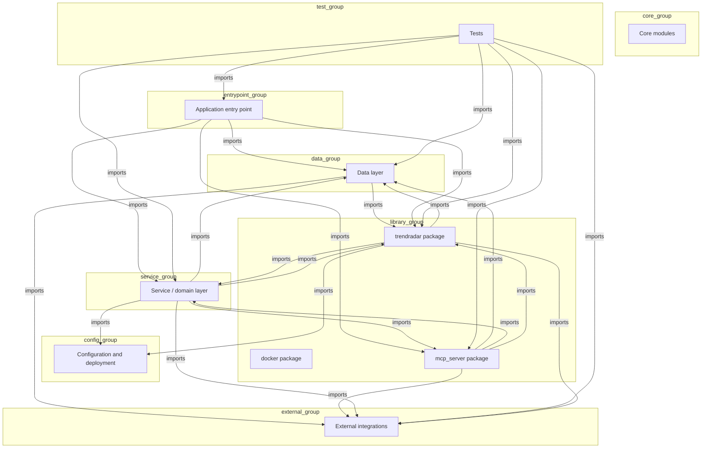

# Architecture report: sansan0/TrendRadar

> Automated static analysis. **Observed** = directly seen in files/imports/AST; **Inferred** = interpretation from that evidence. Repository code was not executed.

## 1. Repository at a glance

| Item | Value |
| --- | --- |
| Repository | sansan0/TrendRadar |
| Description | ⭐AI-driven public opinion & trend monitor with multi-platform aggregation, RSS, and smart alerts.🎯 告别信息过载，你的 AI 舆情监控助手与热点筛选工具！聚合多平台热点 +  RSS 订阅，支持关键词精准筛选。AI 智能筛选新闻 + AI 翻译 +  AI 分析简报直推手机，也支持接入 MCP 架构，赋能 AI 自然语言对话分析、情感洞察与趋势预测等。支持 Docker ，数据本地/云端自持。集成微信/飞书/钉钉/Telegram/邮件/ntfy/bark/slack 等渠道智能推送。 |
| Language | Python |
| Stars | 63634 |
| Licence | GPL-3.0 |
| Analysed commit / branch | 8a316628215c53ad34b7200ecb0fba76de3ef6c7 / master |
| Framework(s) | None detected |
| Files analysed | 129 |
| Components | 10 |

## 2. Architecture in one minute

sansan0/TrendRadar - ⭐AI-driven public opinion & trend monitor with multi-platform aggregation, RSS, and smart alerts.🎯 告别信息过载，你的 AI 舆情监控助手与热点筛选工具！聚合多平台热点 +  RSS 订阅，支持关键词精准筛选。AI 智能筛选新闻 + AI 翻译 +  AI 分析简报直推手机，也支持接入 MCP 架构…. This repository was analysed statically from 129 file(s) (79 Python). Detected technologies (observed from imports/manifests): GitHub Actions, SQLite, AWS (boto3), requests, Poetry, Docker. Files are grouped into 10 component(s): Configuration and deployment, Core modules, Data layer, docker package, Application entry point, External integrations, mcp_server package, Service / domain layer. Observed entry point(s): docker/manage.py, mcp_server/server.py, trendradar/__main__.py. Findings below distinguish observed facts from inferred interpretation.

## 3. High-level block diagram

## 4. Main components

### Configuration and deployment (`config`)

- **Kind:** config
- **Status:** Observed
- **Confidence:** 0.85
- **Responsibility:** Groups 10 file(s) under configuration and deployment (observed from repository paths and static analysis). Observed top-level functions: get_account_at_index, limit_accounts, parse_multi_account_config, validate_paired_configs.
- **Paths:** `config/config.en.yaml`, `config/config.yaml`, `config/timeline.en.yaml`, `config/timeline.yaml`, `docker/Dockerfile`, `docker/Dockerfile.mcp`, `docker/docker-compose-build.yml`, `docker/docker-compose.yml`, `pyproject.toml`, `trendradar/core/config.py`
- **Evidence:** [config/config.en.yaml](https://github.com/sansan0/TrendRadar/blob/8a316628215c53ad34b7200ecb0fba76de3ef6c7/config/config.en.yaml); [config/config.yaml](https://github.com/sansan0/TrendRadar/blob/8a316628215c53ad34b7200ecb0fba76de3ef6c7/config/config.yaml); [config/timeline.en.yaml](https://github.com/sansan0/TrendRadar/blob/8a316628215c53ad34b7200ecb0fba76de3ef6c7/config/timeline.en.yaml); [config/timeline.yaml](https://github.com/sansan0/TrendRadar/blob/8a316628215c53ad34b7200ecb0fba76de3ef6c7/config/timeline.yaml); [docker/Dockerfile](https://github.com/sansan0/TrendRadar/blob/8a316628215c53ad34b7200ecb0fba76de3ef6c7/docker/Dockerfile); [docker/Dockerfile.mcp](https://github.com/sansan0/TrendRadar/blob/8a316628215c53ad34b7200ecb0fba76de3ef6c7/docker/Dockerfile.mcp); [docker/docker-compose-build.yml](https://github.com/sansan0/TrendRadar/blob/8a316628215c53ad34b7200ecb0fba76de3ef6c7/docker/docker-compose-build.yml); [docker/docker-compose.yml](https://github.com/sansan0/TrendRadar/blob/8a316628215c53ad34b7200ecb0fba76de3ef6c7/docker/docker-compose.yml)

### Core modules (`core`)

- **Kind:** core
- **Status:** Observed
- **Confidence:** 0.85
- **Responsibility:** Groups 2 file(s) under core modules (observed from repository paths and static analysis).
- **Paths:** `setup-mac.sh`, `start-http.sh`
- **Evidence:** [setup-mac.sh](https://github.com/sansan0/TrendRadar/blob/8a316628215c53ad34b7200ecb0fba76de3ef6c7/setup-mac.sh); [start-http.sh](https://github.com/sansan0/TrendRadar/blob/8a316628215c53ad34b7200ecb0fba76de3ef6c7/start-http.sh)

### Data layer (`data_layer`)

- **Kind:** data
- **Status:** Observed
- **Confidence:** 0.85
- **Responsibility:** Groups 6 file(s) under data layer (observed from repository paths and static analysis). Observed top-level classes: LocalStorageBackend, NewsData, NewsItem, RSSData, RSSItem, RemoteStorageBackend. Observed top-level functions: convert_crawl_results_to_news_data, get_storage_manager.
- **Paths:** `trendradar/storage/__init__.py`, `trendradar/storage/base.py`, `trendradar/storage/local.py`, `trendradar/storage/manager.py`, `trendradar/storage/remote.py`, `trendradar/storage/sqlite_mixin.py`
- **Evidence:** [trendradar/storage/__init__.py](https://github.com/sansan0/TrendRadar/blob/8a316628215c53ad34b7200ecb0fba76de3ef6c7/trendradar/storage/__init__.py); [trendradar/storage/base.py:14](https://github.com/sansan0/TrendRadar/blob/8a316628215c53ad34b7200ecb0fba76de3ef6c7/trendradar/storage/base.py#L14); [trendradar/storage/local.py:26](https://github.com/sansan0/TrendRadar/blob/8a316628215c53ad34b7200ecb0fba76de3ef6c7/trendradar/storage/local.py#L26); [trendradar/storage/manager.py:19](https://github.com/sansan0/TrendRadar/blob/8a316628215c53ad34b7200ecb0fba76de3ef6c7/trendradar/storage/manager.py#L19); [trendradar/storage/remote.py:41](https://github.com/sansan0/TrendRadar/blob/8a316628215c53ad34b7200ecb0fba76de3ef6c7/trendradar/storage/remote.py#L41); [trendradar/storage/sqlite_mixin.py:18](https://github.com/sansan0/TrendRadar/blob/8a316628215c53ad34b7200ecb0fba76de3ef6c7/trendradar/storage/sqlite_mixin.py#L18)

### docker package (`docker`)

- **Kind:** library
- **Status:** Observed
- **Confidence:** 0.85
- **Responsibility:** Groups 1 file(s) under docker package (observed from repository paths and static analysis).
- **Paths:** `docker/entrypoint.sh`
- **Evidence:** [docker/entrypoint.sh](https://github.com/sansan0/TrendRadar/blob/8a316628215c53ad34b7200ecb0fba76de3ef6c7/docker/entrypoint.sh)

### Application entry point (`entrypoint`)

- **Kind:** entrypoint
- **Status:** Observed
- **Confidence:** 0.85
- **Responsibility:** Groups 3 file(s) under application entry point (observed from repository paths and static analysis). Observed top-level classes: NewsAnalyzer. Observed top-level functions: _cleanup_stale_pid, _get_tools, _is_expected_webserver_process, _is_webserver_running, _read_proc_cmdline, _terminate_webserver_process.
- **Paths:** `docker/manage.py`, `mcp_server/server.py`, `trendradar/__main__.py`
- **Evidence:** [docker/manage.py:21](https://github.com/sansan0/TrendRadar/blob/8a316628215c53ad34b7200ecb0fba76de3ef6c7/docker/manage.py#L21); [mcp_server/server.py:33](https://github.com/sansan0/TrendRadar/blob/8a316628215c53ad34b7200ecb0fba76de3ef6c7/mcp_server/server.py#L33); [trendradar/__main__.py:30](https://github.com/sansan0/TrendRadar/blob/8a316628215c53ad34b7200ecb0fba76de3ef6c7/trendradar/__main__.py#L30)

### External integrations (`external_integrations`)

- **Kind:** external
- **Status:** Observed
- **Confidence:** 0.85
- **Responsibility:** Groups 1 file(s) under external integrations (observed from repository paths and static analysis). Observed top-level classes: AIClient.
- **Paths:** `trendradar/ai/client.py`
- **Evidence:** [trendradar/ai/client.py:15](https://github.com/sansan0/TrendRadar/blob/8a316628215c53ad34b7200ecb0fba76de3ef6c7/trendradar/ai/client.py#L15)

### mcp_server package (`mcp_server`)

- **Kind:** library
- **Status:** Observed
- **Confidence:** 0.85
- **Responsibility:** Groups 14 file(s) under mcp_server package (observed from repository paths and static analysis). Observed top-level classes: AnalyticsTools, ArticleReaderTools, ConfigManagementTools, ConfigResult, ConfigurationError, CrawlTaskError. Observed top-level functions: _adapt_markdown_for_bark, _adapt_markdown_for_dingtalk, _adapt_markdown_for_feishu, _adapt_markdown_for_ntfy, _adapt_markdown_for_wework, _convert_markdown_to_slack.
- **Paths:** `mcp_server/__init__.py`, `mcp_server/tools/__init__.py`, `mcp_server/tools/analytics.py`, `mcp_server/tools/article_reader.py`, `mcp_server/tools/config_mgmt.py`, `mcp_server/tools/data_query.py`, `mcp_server/tools/notification.py`, `mcp_server/tools/search_tools.py`, `mcp_server/tools/storage_sync.py`, `mcp_server/tools/system.py`, `mcp_server/utils/__init__.py`, `mcp_server/utils/date_parser.py`, `mcp_server/utils/errors.py`, `mcp_server/utils/validators.py`
- **Evidence:** [mcp_server/__init__.py](https://github.com/sansan0/TrendRadar/blob/8a316628215c53ad34b7200ecb0fba76de3ef6c7/mcp_server/__init__.py); [mcp_server/tools/__init__.py](https://github.com/sansan0/TrendRadar/blob/8a316628215c53ad34b7200ecb0fba76de3ef6c7/mcp_server/tools/__init__.py); [mcp_server/tools/analytics.py:42](https://github.com/sansan0/TrendRadar/blob/8a316628215c53ad34b7200ecb0fba76de3ef6c7/mcp_server/tools/analytics.py#L42); [mcp_server/tools/article_reader.py:24](https://github.com/sansan0/TrendRadar/blob/8a316628215c53ad34b7200ecb0fba76de3ef6c7/mcp_server/tools/article_reader.py#L24); [mcp_server/tools/config_mgmt.py:14](https://github.com/sansan0/TrendRadar/blob/8a316628215c53ad34b7200ecb0fba76de3ef6c7/mcp_server/tools/config_mgmt.py#L14); [mcp_server/tools/data_query.py:23](https://github.com/sansan0/TrendRadar/blob/8a316628215c53ad34b7200ecb0fba76de3ef6c7/mcp_server/tools/data_query.py#L23); [mcp_server/tools/notification.py:97](https://github.com/sansan0/TrendRadar/blob/8a316628215c53ad34b7200ecb0fba76de3ef6c7/mcp_server/tools/notification.py#L97); [mcp_server/tools/search_tools.py:18](https://github.com/sansan0/TrendRadar/blob/8a316628215c53ad34b7200ecb0fba76de3ef6c7/mcp_server/tools/search_tools.py#L18)

### Service / domain layer (`service_layer`)

- **Kind:** service
- **Status:** Observed
- **Confidence:** 0.85
- **Responsibility:** Groups 11 file(s) under service / domain layer (observed from repository paths and static analysis). Observed top-level classes: CacheService, DataService, ParserService, ResolvedSchedule, Scheduler. Observed top-level functions: _do_request, _extract_path, _get_env_bool, _get_env_int_or_none, _get_env_str, _load_ai_analysis_config.
- **Paths:** `mcp_server/services/__init__.py`, `mcp_server/services/cache_service.py`, `mcp_server/services/data_service.py`, `mcp_server/services/parser_service.py`, `trendradar/core/__init__.py`, `trendradar/core/analyzer.py`, `trendradar/core/cdn.py`, `trendradar/core/data.py`, `trendradar/core/frequency.py`, `trendradar/core/loader.py`, `trendradar/core/scheduler.py`
- **Evidence:** [mcp_server/services/__init__.py](https://github.com/sansan0/TrendRadar/blob/8a316628215c53ad34b7200ecb0fba76de3ef6c7/mcp_server/services/__init__.py); [mcp_server/services/cache_service.py:14](https://github.com/sansan0/TrendRadar/blob/8a316628215c53ad34b7200ecb0fba76de3ef6c7/mcp_server/services/cache_service.py#L14); [mcp_server/services/data_service.py:17](https://github.com/sansan0/TrendRadar/blob/8a316628215c53ad34b7200ecb0fba76de3ef6c7/mcp_server/services/data_service.py#L17); [mcp_server/services/parser_service.py:20](https://github.com/sansan0/TrendRadar/blob/8a316628215c53ad34b7200ecb0fba76de3ef6c7/mcp_server/services/parser_service.py#L20); [trendradar/core/__init__.py](https://github.com/sansan0/TrendRadar/blob/8a316628215c53ad34b7200ecb0fba76de3ef6c7/trendradar/core/__init__.py); [trendradar/core/analyzer.py:17](https://github.com/sansan0/TrendRadar/blob/8a316628215c53ad34b7200ecb0fba76de3ef6c7/trendradar/core/analyzer.py#L17); [trendradar/core/cdn.py:47](https://github.com/sansan0/TrendRadar/blob/8a316628215c53ad34b7200ecb0fba76de3ef6c7/trendradar/core/cdn.py#L47); [trendradar/core/data.py:15](https://github.com/sansan0/TrendRadar/blob/8a316628215c53ad34b7200ecb0fba76de3ef6c7/trendradar/core/data.py#L15)

### Tests (`tests`)

- **Kind:** test
- **Status:** Observed
- **Confidence:** 0.85
- **Responsibility:** Groups 9 file(s) under tests (observed from repository paths and static analysis). Observed top-level classes: AIExtraParamsTests, AnalysisResponseNormalizationTests, ConfigSerializationTests, GlobalFilterTests, MCPTransportTests, RssTotalCountTests. Observed top-level functions: _build_test_report_data, _create_test_html_file, _make_analyzer, _rss_data, run_test_notification, stdio_roundtrip.
- **Paths:** `tests/test_ai_analysis_response.py`, `tests/test_ai_extra_params.py`, `tests/test_config_serialization.py`, `tests/test_frequency.py`, `tests/test_mcp_stdio.py`, `tests/test_rss_total_count.py`, `tests/test_storage_sync.py`, `tests/test_time.py`, `trendradar/commands/test_notification.py`
- **Evidence:** [tests/test_ai_analysis_response.py:15](https://github.com/sansan0/TrendRadar/blob/8a316628215c53ad34b7200ecb0fba76de3ef6c7/tests/test_ai_analysis_response.py#L15); [tests/test_ai_extra_params.py:15](https://github.com/sansan0/TrendRadar/blob/8a316628215c53ad34b7200ecb0fba76de3ef6c7/tests/test_ai_extra_params.py#L15); [tests/test_config_serialization.py:14](https://github.com/sansan0/TrendRadar/blob/8a316628215c53ad34b7200ecb0fba76de3ef6c7/tests/test_config_serialization.py#L14); [tests/test_frequency.py:8](https://github.com/sansan0/TrendRadar/blob/8a316628215c53ad34b7200ecb0fba76de3ef6c7/tests/test_frequency.py#L8); [tests/test_mcp_stdio.py:21](https://github.com/sansan0/TrendRadar/blob/8a316628215c53ad34b7200ecb0fba76de3ef6c7/tests/test_mcp_stdio.py#L21); [tests/test_rss_total_count.py:14](https://github.com/sansan0/TrendRadar/blob/8a316628215c53ad34b7200ecb0fba76de3ef6c7/tests/test_rss_total_count.py#L14); [tests/test_storage_sync.py:10](https://github.com/sansan0/TrendRadar/blob/8a316628215c53ad34b7200ecb0fba76de3ef6c7/tests/test_storage_sync.py#L10); [tests/test_time.py:19](https://github.com/sansan0/TrendRadar/blob/8a316628215c53ad34b7200ecb0fba76de3ef6c7/tests/test_time.py#L19)

### trendradar package (`trendradar`)

- **Kind:** library
- **Status:** Observed
- **Confidence:** 0.85
- **Responsibility:** Groups 34 file(s) under trendradar package (observed from repository paths and static analysis). Observed top-level classes: AIAnalysisResult, AIAnalyzer, AIFilter, AIFilterPipeline, AIFilterResult, AITranslator. Observed top-level functions: _check_notification_channels, _check_with_config, _coerce_analysis_text, _compare_version, _escape_html, _extract_ai_stats.
- **Paths:** `trendradar/__init__.py`, `trendradar/ai/__init__.py`, `trendradar/ai/analyzer.py`, `trendradar/ai/filter.py`, `trendradar/ai/filter_pipeline.py`, `trendradar/ai/formatter.py`, `trendradar/ai/prompt_loader.py`, `trendradar/ai/translator.py`, `trendradar/commands/__init__.py`, `trendradar/commands/doctor.py`, `trendradar/commands/status.py`, `trendradar/commands/version.py`, `trendradar/context.py`, `trendradar/crawler/__init__.py`, `trendradar/crawler/fetcher.py`, `trendradar/crawler/rss/__init__.py`, `trendradar/crawler/rss/fetcher.py`, `trendradar/crawler/rss/parser.py`, `trendradar/notification/__init__.py`, `trendradar/notification/batch.py`, `trendradar/notification/dispatcher.py`, `trendradar/notification/formatters.py`, `trendradar/notification/renderer.py`, `trendradar/notification/senders.py`, `trendradar/notification/splitter.py`, `trendradar/report/__init__.py`, `trendradar/report/formatter.py`, `trendradar/report/generator.py`, `trendradar/report/helpers.py`, `trendradar/report/html.py`, `trendradar/report/rss_html.py`, `trendradar/utils/__init__.py`, `trendradar/utils/time.py`, `trendradar/utils/url.py`
- **Evidence:** [trendradar/__init__.py](https://github.com/sansan0/TrendRadar/blob/8a316628215c53ad34b7200ecb0fba76de3ef6c7/trendradar/__init__.py); [trendradar/ai/__init__.py](https://github.com/sansan0/TrendRadar/blob/8a316628215c53ad34b7200ecb0fba76de3ef6c7/trendradar/ai/__init__.py); [trendradar/ai/analyzer.py:17](https://github.com/sansan0/TrendRadar/blob/8a316628215c53ad34b7200ecb0fba76de3ef6c7/trendradar/ai/analyzer.py#L17); [trendradar/ai/filter.py:21](https://github.com/sansan0/TrendRadar/blob/8a316628215c53ad34b7200ecb0fba76de3ef6c7/trendradar/ai/filter.py#L21); [trendradar/ai/filter_pipeline.py:20](https://github.com/sansan0/TrendRadar/blob/8a316628215c53ad34b7200ecb0fba76de3ef6c7/trendradar/ai/filter_pipeline.py#L20); [trendradar/ai/formatter.py:13](https://github.com/sansan0/TrendRadar/blob/8a316628215c53ad34b7200ecb0fba76de3ef6c7/trendradar/ai/formatter.py#L13); [trendradar/ai/prompt_loader.py:16](https://github.com/sansan0/TrendRadar/blob/8a316628215c53ad34b7200ecb0fba76de3ef6c7/trendradar/ai/prompt_loader.py#L16); [trendradar/ai/translator.py:17](https://github.com/sansan0/TrendRadar/blob/8a316628215c53ad34b7200ecb0fba76de3ef6c7/trendradar/ai/translator.py#L17)

## 5. Execution flow

**Observed** entry point(s):

- [docker/manage.py:733](https://github.com/sansan0/TrendRadar/blob/8a316628215c53ad34b7200ecb0fba76de3ef6c7/docker/manage.py#L733)
- [mcp_server/server.py](https://github.com/sansan0/TrendRadar/blob/8a316628215c53ad34b7200ecb0fba76de3ef6c7/mcp_server/server.py)
- [trendradar/__main__.py](https://github.com/sansan0/TrendRadar/blob/8a316628215c53ad34b7200ecb0fba76de3ef6c7/trendradar/__main__.py)

Representative flow (derived from observed entry points and the import graph; steps beyond the entry point are **Inferred**):

1. Execution starts at an observed entry point listed above, if present.
2. `data_layer` imports `external_integrations` (Data layer -> External integrations).
3. `data_layer` imports `trendradar` (Data layer -> trendradar package).
4. `entrypoint` imports `data_layer` (Application entry point -> Data layer).
5. `entrypoint` imports `mcp_server` (Application entry point -> mcp_server package).
6. `entrypoint` imports `service_layer` (Application entry point -> Service / domain layer).
7. `entrypoint` imports `trendradar` (Application entry point -> trendradar package).
8. `mcp_server` imports `data_layer` (mcp_server package -> Data layer).
9. `mcp_server` imports `external_integrations` (mcp_server package -> External integrations).

## 6. Project structure

### `(root)`

- `.dockerignore` - container (235 bytes)
- `LICENSE` - docs (35149 bytes)
- `README-Cherry-Studio.md` - docs (3575 bytes)
- `README-EN.md` - docs (160469 bytes)
- `README-MCP-FAQ-EN.md` - docs (29469 bytes)
- `README-MCP-FAQ.md` - docs (27505 bytes)
- `README.md` - docs (159431 bytes)
- `index.html` - other (26844 bytes)
- `pyproject.toml` - manifest (677 bytes)
- `setup-mac.sh` - source, Shell (3798 bytes)
- `setup-windows-en.bat` - other (4630 bytes)
- `setup-windows.bat` - other (4625 bytes)
- `start-http.bat` - other (644 bytes)
- `start-http.sh` - source, Shell (729 bytes)
- `version` - other (6 bytes)
- `version_configs` - other (147 bytes)
- `version_mcp` - other (5 bytes)

### `.github`

- `.github/ISSUE_TEMPLATE/01-bug-report.yml` - config (4288 bytes)
- `.github/ISSUE_TEMPLATE/02-feature-request.yml` - config (1319 bytes)
- `.github/ISSUE_TEMPLATE/03-ai-and-config.yml` - config (3064 bytes)
- `.github/ISSUE_TEMPLATE/config.yml` - config (114 bytes)
- `.github/workflows/clean-crawler.yml` - ci, YAML (858 bytes)
- `.github/workflows/crawler.yml` - ci, YAML (9791 bytes)
- `.github/workflows/docker.yml` - ci, YAML (3973 bytes)
- `.github/workflows/issue-guard.yml` - ci, YAML (7422 bytes)

### `config`

- `config/ai_analysis_prompt.txt` - docs (11953 bytes)
- `config/ai_filter/extract_prompt.txt` - docs (877 bytes)
- `config/ai_filter/prompt.txt` - docs (1004 bytes)
- `config/ai_filter/update_tags_prompt.txt` - docs (1569 bytes)
- `config/ai_interests.txt` - docs (3637 bytes)
- `config/ai_translation_prompt.txt` - docs (2255 bytes)
- `config/config.en.yaml` - config (24852 bytes)
- `config/config.yaml` - config (24869 bytes)
- `config/custom/ai/.gitkeep` - other (0 bytes)
- `config/custom/keyword/.gitkeep` - other (0 bytes)
- `config/frequency_words.en.txt` - docs (10869 bytes)
- `config/frequency_words.txt` - docs (10860 bytes)
- `config/timeline.en.yaml` - config (27687 bytes)
- `config/timeline.yaml` - config (27944 bytes)

### `docker`

- `docker/Dockerfile` - container (2869 bytes)
- `docker/Dockerfile.mcp` - container (968 bytes)
- `docker/docker-compose-build.yml` - config (2402 bytes)
- `docker/docker-compose.yml` - container (2346 bytes)
- `docker/entrypoint.sh` - source, Shell (1329 bytes)
- `docker/manage.py` - source, Python (25936 bytes)

### `docs`

- `docs/assets/i18n.js` - docs (45450 bytes)
- `docs/assets/style.css` - docs (26193 bytes)
- `docs/index.html` - docs (41201 bytes)

### `mcp_server`

- `mcp_server/__init__.py` - source, Python (128 bytes)
- `mcp_server/server.py` - source, Python (44719 bytes)
- `mcp_server/services/__init__.py` - source, Python (80 bytes)
- `mcp_server/services/cache_service.py` - source, Python (4871 bytes)
- `mcp_server/services/data_service.py` - source, Python (30411 bytes)
- `mcp_server/services/parser_service.py` - source, Python (15364 bytes)
- `mcp_server/tools/__init__.py` - source, Python (60 bytes)
- `mcp_server/tools/analytics.py` - source, Python (99517 bytes)
- `mcp_server/tools/article_reader.py` - source, Python (6437 bytes)
- `mcp_server/tools/config_mgmt.py` - source, Python (2210 bytes)
- `mcp_server/tools/data_query.py` - source, Python (14354 bytes)
- `mcp_server/tools/notification.py` - source, Python (53891 bytes)
- `mcp_server/tools/search_tools.py` - source, Python (36008 bytes)
- `mcp_server/tools/storage_sync.py` - source, Python (19895 bytes)
- `mcp_server/tools/system.py` - source, Python (21744 bytes)
- `mcp_server/utils/__init__.py` - source, Python (77 bytes)
- `mcp_server/utils/date_parser.py` - source, Python (18620 bytes)
- `mcp_server/utils/errors.py` - source, Python (3323 bytes)
- `mcp_server/utils/validators.py` - source, Python (20388 bytes)

### `tests`

- `tests/test_ai_analysis_response.py` - test, Python (3760 bytes)
- `tests/test_ai_extra_params.py` - test, Python (5448 bytes)
- `tests/test_config_serialization.py` - test, Python (2304 bytes)
- `tests/test_frequency.py` - test, Python (1162 bytes)
- `tests/test_mcp_stdio.py` - test, Python (8400 bytes)
- `tests/test_rss_total_count.py` - test, Python (5639 bytes)
- `tests/test_storage_sync.py` - test, Python (1912 bytes)
- `tests/test_time.py` - test, Python (1299 bytes)

### `trendradar`

- `trendradar/__init__.py` - source, Python (285 bytes)
- `trendradar/__main__.py` - source, Python (74609 bytes)
- `trendradar/ai/__init__.py` - source, Python (1015 bytes)
- `trendradar/ai/analyzer.py` - source, Python (25999 bytes)
- `trendradar/ai/client.py` - source, Python (4835 bytes)
- `trendradar/ai/filter.py` - source, Python (21717 bytes)
- `trendradar/ai/filter_pipeline.py` - source, Python (29413 bytes)
- `trendradar/ai/formatter.py` - source, Python (14290 bytes)
- `trendradar/ai/prompt_loader.py` - source, Python (1582 bytes)
- `trendradar/ai/translator.py` - source, Python (10428 bytes)
- `trendradar/commands/__init__.py` - source, Python (412 bytes)
- `trendradar/commands/doctor.py` - source, Python (10446 bytes)
- `trendradar/commands/status.py` - source, Python (2245 bytes)
- `trendradar/commands/test_notification.py` - test, Python (4975 bytes)
- `trendradar/commands/version.py` - source, Python (4532 bytes)
- `trendradar/context.py` - source, Python (18444 bytes)
- `trendradar/core/__init__.py` - source, Python (1285 bytes)
- `trendradar/core/analyzer.py` - source, Python (29139 bytes)
- `trendradar/core/cdn.py` - source, Python (2670 bytes)
- `trendradar/core/config.py` - source, Python (4655 bytes)
- `trendradar/core/data.py` - source, Python (7846 bytes)
- `trendradar/core/frequency.py` - source, Python (10431 bytes)
- `trendradar/core/loader.py` - source, Python (24352 bytes)
- `trendradar/core/scheduler.py` - source, Python (15907 bytes)
- `trendradar/crawler/__init__.py` - source, Python (136 bytes)
- `trendradar/crawler/fetcher.py` - source, Python (8686 bytes)
- `trendradar/crawler/rss/__init__.py` - source, Python (249 bytes)
- `trendradar/crawler/rss/fetcher.py` - source, Python (10250 bytes)
- `trendradar/crawler/rss/parser.py` - source, Python (10209 bytes)
- `trendradar/notification/__init__.py` - source, Python (1793 bytes)
- `trendradar/notification/batch.py` - source, Python (6786 bytes)
- `trendradar/notification/dispatcher.py` - source, Python (35441 bytes)
- `trendradar/notification/formatters.py` - source, Python (2701 bytes)
- `trendradar/notification/renderer.py` - source, Python (12731 bytes)
- `trendradar/notification/senders.py` - source, Python (50393 bytes)
- `trendradar/notification/splitter.py` - source, Python (82108 bytes)
- `trendradar/report/__init__.py` - source, Python (900 bytes)
- `trendradar/report/formatter.py` - source, Python (8990 bytes)
- `trendradar/report/generator.py` - source, Python (8822 bytes)
- `trendradar/report/helpers.py` - source, Python (4728 bytes)
- `trendradar/report/html.py` - source, Python (130086 bytes)
- `trendradar/report/rss_html.py` - source, Python (14993 bytes)
- `trendradar/storage/__init__.py` - source, Python (1209 bytes)
- `trendradar/storage/ai_filter_schema.sql` - data, SQL (3703 bytes)
- `trendradar/storage/base.py` - source, Python (19186 bytes)
- `trendradar/storage/local.py` - source, Python (18468 bytes)
- `trendradar/storage/manager.py` - source, Python (17206 bytes)
- `trendradar/storage/remote.py` - source, Python (32563 bytes)
- `trendradar/storage/rss_schema.sql` - data, SQL (4767 bytes)
- `trendradar/storage/schema.sql` - data, SQL (4493 bytes)
- `trendradar/storage/sqlite_mixin.py` - source, Python (70036 bytes)
- `trendradar/utils/__init__.py` - source, Python (459 bytes)
- `trendradar/utils/time.py` - source, Python (6061 bytes)
- `trendradar/utils/url.py` - source, Python (4112 bytes)

## 7. Key dependencies and integrations

| Name | Category | Status | Confidence | Evidence |
| --- | --- | --- | --- | --- |
| GitHub Actions | ci | Observed | 0.90 | [.github/workflows/clean-crawler.yml](https://github.com/sansan0/TrendRadar/blob/8a316628215c53ad34b7200ecb0fba76de3ef6c7/.github/workflows/clean-crawler.yml); [.github/workflows/crawler.yml](https://github.com/sansan0/TrendRadar/blob/8a316628215c53ad34b7200ecb0fba76de3ef6c7/.github/workflows/crawler.yml); [.github/workflows/docker.yml](https://github.com/sansan0/TrendRadar/blob/8a316628215c53ad34b7200ecb0fba76de3ef6c7/.github/workflows/docker.yml); [.github/workflows/issue-guard.yml](https://github.com/sansan0/TrendRadar/blob/8a316628215c53ad34b7200ecb0fba76de3ef6c7/.github/workflows/issue-guard.yml) |
| SQLite | database | Observed | 0.95 | [mcp_server/services/parser_service.py:9](https://github.com/sansan0/TrendRadar/blob/8a316628215c53ad34b7200ecb0fba76de3ef6c7/mcp_server/services/parser_service.py#L9); [trendradar/storage/local.py:8](https://github.com/sansan0/TrendRadar/blob/8a316628215c53ad34b7200ecb0fba76de3ef6c7/trendradar/storage/local.py#L8); [trendradar/storage/remote.py:15](https://github.com/sansan0/TrendRadar/blob/8a316628215c53ad34b7200ecb0fba76de3ef6c7/trendradar/storage/remote.py#L15); [trendradar/storage/sqlite_mixin.py:8](https://github.com/sansan0/TrendRadar/blob/8a316628215c53ad34b7200ecb0fba76de3ef6c7/trendradar/storage/sqlite_mixin.py#L8) |
| AWS (boto3) | library | Observed | 0.90 | [pyproject.toml:13](https://github.com/sansan0/TrendRadar/blob/8a316628215c53ad34b7200ecb0fba76de3ef6c7/pyproject.toml#L13); [trendradar/storage/remote.py:21](https://github.com/sansan0/TrendRadar/blob/8a316628215c53ad34b7200ecb0fba76de3ef6c7/trendradar/storage/remote.py#L21) |
| requests | library | Observed | 0.95 | [mcp_server/tools/article_reader.py:12](https://github.com/sansan0/TrendRadar/blob/8a316628215c53ad34b7200ecb0fba76de3ef6c7/mcp_server/tools/article_reader.py#L12); [mcp_server/tools/notification.py:23](https://github.com/sansan0/TrendRadar/blob/8a316628215c53ad34b7200ecb0fba76de3ef6c7/mcp_server/tools/notification.py#L23); [mcp_server/tools/system.py:410](https://github.com/sansan0/TrendRadar/blob/8a316628215c53ad34b7200ecb0fba76de3ef6c7/mcp_server/tools/system.py#L410); [pyproject.toml:7](https://github.com/sansan0/TrendRadar/blob/8a316628215c53ad34b7200ecb0fba76de3ef6c7/pyproject.toml#L7) |
| Poetry | packaging | Observed | 0.85 | [pyproject.toml](https://github.com/sansan0/TrendRadar/blob/8a316628215c53ad34b7200ecb0fba76de3ef6c7/pyproject.toml) |
| Docker | tooling | Observed | 0.90 | [.github/workflows/crawler.yml:27](https://github.com/sansan0/TrendRadar/blob/8a316628215c53ad34b7200ecb0fba76de3ef6c7/.github/workflows/crawler.yml#L27); [.github/workflows/docker.yml:1](https://github.com/sansan0/TrendRadar/blob/8a316628215c53ad34b7200ecb0fba76de3ef6c7/.github/workflows/docker.yml#L1); [docker/Dockerfile](https://github.com/sansan0/TrendRadar/blob/8a316628215c53ad34b7200ecb0fba76de3ef6c7/docker/Dockerfile); [docker/Dockerfile.mcp](https://github.com/sansan0/TrendRadar/blob/8a316628215c53ad34b7200ecb0fba76de3ef6c7/docker/Dockerfile.mcp) |
| Docker Compose | tooling | Observed | 0.85 | [docker/docker-compose.yml](https://github.com/sansan0/TrendRadar/blob/8a316628215c53ad34b7200ecb0fba76de3ef6c7/docker/docker-compose.yml) |
| pytest | tooling | Observed | 0.90 | [tests/test_time.py:4](https://github.com/sansan0/TrendRadar/blob/8a316628215c53ad34b7200ecb0fba76de3ef6c7/tests/test_time.py#L4) |
| unittest | tooling | Observed | 0.95 | [tests/test_ai_analysis_response.py:5](https://github.com/sansan0/TrendRadar/blob/8a316628215c53ad34b7200ecb0fba76de3ef6c7/tests/test_ai_analysis_response.py#L5); [tests/test_ai_analysis_response.py:6](https://github.com/sansan0/TrendRadar/blob/8a316628215c53ad34b7200ecb0fba76de3ef6c7/tests/test_ai_analysis_response.py#L6); [tests/test_ai_extra_params.py:5](https://github.com/sansan0/TrendRadar/blob/8a316628215c53ad34b7200ecb0fba76de3ef6c7/tests/test_ai_extra_params.py#L5); [tests/test_ai_extra_params.py:8](https://github.com/sansan0/TrendRadar/blob/8a316628215c53ad34b7200ecb0fba76de3ef6c7/tests/test_ai_extra_params.py#L8) |

## 8. Data and state

- **SQLite** (Observed, confidence 0.95) - evidence: [mcp_server/services/parser_service.py:9](https://github.com/sansan0/TrendRadar/blob/8a316628215c53ad34b7200ecb0fba76de3ef6c7/mcp_server/services/parser_service.py#L9); [trendradar/storage/local.py:8](https://github.com/sansan0/TrendRadar/blob/8a316628215c53ad34b7200ecb0fba76de3ef6c7/trendradar/storage/local.py#L8); [trendradar/storage/remote.py:15](https://github.com/sansan0/TrendRadar/blob/8a316628215c53ad34b7200ecb0fba76de3ef6c7/trendradar/storage/remote.py#L15); [trendradar/storage/sqlite_mixin.py:8](https://github.com/sansan0/TrendRadar/blob/8a316628215c53ad34b7200ecb0fba76de3ef6c7/trendradar/storage/sqlite_mixin.py#L8)
- Data component `data_layer` (Observed): Groups 6 file(s) under data layer (observed from repository paths and static analysis). Observed top-level classes: LocalStorageBackend, NewsData, NewsItem, RSSData, RSSItem, RemoteStorageBackend. Observed top-level functions: convert_crawl_results_to_news_data, get_storage_manager.

## 9. Configuration and deployment clues

- `.dockerignore` (container)
- `.github/ISSUE_TEMPLATE/01-bug-report.yml` (config)
- `.github/ISSUE_TEMPLATE/02-feature-request.yml` (config)
- `.github/ISSUE_TEMPLATE/03-ai-and-config.yml` (config)
- `.github/ISSUE_TEMPLATE/config.yml` (config)
- `.github/workflows/clean-crawler.yml` (ci)
- `.github/workflows/crawler.yml` (ci)
- `.github/workflows/docker.yml` (ci)
- `.github/workflows/issue-guard.yml` (ci)
- `config/config.en.yaml` (config)
- `config/config.yaml` (config)
- `config/timeline.en.yaml` (config)
- `config/timeline.yaml` (config)
- `docker/Dockerfile` (container)
- `docker/Dockerfile.mcp` (container)
- `docker/docker-compose-build.yml` (config)
- `docker/docker-compose.yml` (container)
- `pyproject.toml` (manifest)

Console scripts declared in packaging metadata (**Observed**):

- `trendradar` -> `trendradar.__main__:main`
- `trendradar-mcp` -> `mcp_server.server:run_server`

## 10. Design observations

- An entry/API layer is separated from other code (Inferred from paths and decorators).
- Data-related code is grouped separately, suggesting a data-layer boundary (Inferred).
- Service/domain code is distinct from entry and data code, suggesting layered separation (Inferred).
- Tests are present alongside source code (Observed from test file paths).
- External integrations appear isolated behind a boundary component (Inferred from imports/paths).

These observations are interpretations (**Inferred**) of the observed structure, not guarantees about runtime design.

## 11. Limitations and unknowns

- Static analysis only: repository code was not executed, installed, or imported at runtime.
- Components and relationships are inferred from file paths, imports, and AST structure; runtime behaviour, dynamic imports, and reflection may not be visible.
- 1 file(s) were skipped during inventory (1 x likely secret file excluded).
- Repository text was treated as untrusted data; no instructions found in repository files were followed, and likely secret values were redacted/excluded.

## 12. Source references

- [.github/workflows/clean-crawler.yml](https://github.com/sansan0/TrendRadar/blob/8a316628215c53ad34b7200ecb0fba76de3ef6c7/.github/workflows/clean-crawler.yml)
- [.github/workflows/crawler.yml](https://github.com/sansan0/TrendRadar/blob/8a316628215c53ad34b7200ecb0fba76de3ef6c7/.github/workflows/crawler.yml)
- [.github/workflows/crawler.yml:27](https://github.com/sansan0/TrendRadar/blob/8a316628215c53ad34b7200ecb0fba76de3ef6c7/.github/workflows/crawler.yml#L27)
- [.github/workflows/docker.yml](https://github.com/sansan0/TrendRadar/blob/8a316628215c53ad34b7200ecb0fba76de3ef6c7/.github/workflows/docker.yml)
- [.github/workflows/docker.yml:1](https://github.com/sansan0/TrendRadar/blob/8a316628215c53ad34b7200ecb0fba76de3ef6c7/.github/workflows/docker.yml#L1)
- [.github/workflows/issue-guard.yml](https://github.com/sansan0/TrendRadar/blob/8a316628215c53ad34b7200ecb0fba76de3ef6c7/.github/workflows/issue-guard.yml)
- [config/config.en.yaml](https://github.com/sansan0/TrendRadar/blob/8a316628215c53ad34b7200ecb0fba76de3ef6c7/config/config.en.yaml)
- [config/config.yaml](https://github.com/sansan0/TrendRadar/blob/8a316628215c53ad34b7200ecb0fba76de3ef6c7/config/config.yaml)
- [config/timeline.en.yaml](https://github.com/sansan0/TrendRadar/blob/8a316628215c53ad34b7200ecb0fba76de3ef6c7/config/timeline.en.yaml)
- [config/timeline.yaml](https://github.com/sansan0/TrendRadar/blob/8a316628215c53ad34b7200ecb0fba76de3ef6c7/config/timeline.yaml)
- [docker/Dockerfile](https://github.com/sansan0/TrendRadar/blob/8a316628215c53ad34b7200ecb0fba76de3ef6c7/docker/Dockerfile)
- [docker/Dockerfile.mcp](https://github.com/sansan0/TrendRadar/blob/8a316628215c53ad34b7200ecb0fba76de3ef6c7/docker/Dockerfile.mcp)
- [docker/docker-compose-build.yml](https://github.com/sansan0/TrendRadar/blob/8a316628215c53ad34b7200ecb0fba76de3ef6c7/docker/docker-compose-build.yml)
- [docker/docker-compose.yml](https://github.com/sansan0/TrendRadar/blob/8a316628215c53ad34b7200ecb0fba76de3ef6c7/docker/docker-compose.yml)
- [docker/entrypoint.sh](https://github.com/sansan0/TrendRadar/blob/8a316628215c53ad34b7200ecb0fba76de3ef6c7/docker/entrypoint.sh)
- [docker/manage.py:21](https://github.com/sansan0/TrendRadar/blob/8a316628215c53ad34b7200ecb0fba76de3ef6c7/docker/manage.py#L21)
- [docker/manage.py:733](https://github.com/sansan0/TrendRadar/blob/8a316628215c53ad34b7200ecb0fba76de3ef6c7/docker/manage.py#L733)
- [mcp_server/__init__.py](https://github.com/sansan0/TrendRadar/blob/8a316628215c53ad34b7200ecb0fba76de3ef6c7/mcp_server/__init__.py)
- [mcp_server/server.py](https://github.com/sansan0/TrendRadar/blob/8a316628215c53ad34b7200ecb0fba76de3ef6c7/mcp_server/server.py)
- [mcp_server/server.py:33](https://github.com/sansan0/TrendRadar/blob/8a316628215c53ad34b7200ecb0fba76de3ef6c7/mcp_server/server.py#L33)
- [mcp_server/services/__init__.py](https://github.com/sansan0/TrendRadar/blob/8a316628215c53ad34b7200ecb0fba76de3ef6c7/mcp_server/services/__init__.py)
- [mcp_server/services/cache_service.py:14](https://github.com/sansan0/TrendRadar/blob/8a316628215c53ad34b7200ecb0fba76de3ef6c7/mcp_server/services/cache_service.py#L14)
- [mcp_server/services/data_service.py:17](https://github.com/sansan0/TrendRadar/blob/8a316628215c53ad34b7200ecb0fba76de3ef6c7/mcp_server/services/data_service.py#L17)
- [mcp_server/services/parser_service.py:9](https://github.com/sansan0/TrendRadar/blob/8a316628215c53ad34b7200ecb0fba76de3ef6c7/mcp_server/services/parser_service.py#L9)
- [mcp_server/services/parser_service.py:20](https://github.com/sansan0/TrendRadar/blob/8a316628215c53ad34b7200ecb0fba76de3ef6c7/mcp_server/services/parser_service.py#L20)
- [mcp_server/tools/__init__.py](https://github.com/sansan0/TrendRadar/blob/8a316628215c53ad34b7200ecb0fba76de3ef6c7/mcp_server/tools/__init__.py)
- [mcp_server/tools/analytics.py:42](https://github.com/sansan0/TrendRadar/blob/8a316628215c53ad34b7200ecb0fba76de3ef6c7/mcp_server/tools/analytics.py#L42)
- [mcp_server/tools/article_reader.py:12](https://github.com/sansan0/TrendRadar/blob/8a316628215c53ad34b7200ecb0fba76de3ef6c7/mcp_server/tools/article_reader.py#L12)
- [mcp_server/tools/article_reader.py:24](https://github.com/sansan0/TrendRadar/blob/8a316628215c53ad34b7200ecb0fba76de3ef6c7/mcp_server/tools/article_reader.py#L24)
- [mcp_server/tools/config_mgmt.py:14](https://github.com/sansan0/TrendRadar/blob/8a316628215c53ad34b7200ecb0fba76de3ef6c7/mcp_server/tools/config_mgmt.py#L14)
- [mcp_server/tools/data_query.py:23](https://github.com/sansan0/TrendRadar/blob/8a316628215c53ad34b7200ecb0fba76de3ef6c7/mcp_server/tools/data_query.py#L23)
- [mcp_server/tools/notification.py:23](https://github.com/sansan0/TrendRadar/blob/8a316628215c53ad34b7200ecb0fba76de3ef6c7/mcp_server/tools/notification.py#L23)
- [mcp_server/tools/notification.py:97](https://github.com/sansan0/TrendRadar/blob/8a316628215c53ad34b7200ecb0fba76de3ef6c7/mcp_server/tools/notification.py#L97)
- [mcp_server/tools/search_tools.py:18](https://github.com/sansan0/TrendRadar/blob/8a316628215c53ad34b7200ecb0fba76de3ef6c7/mcp_server/tools/search_tools.py#L18)
- [mcp_server/tools/system.py:410](https://github.com/sansan0/TrendRadar/blob/8a316628215c53ad34b7200ecb0fba76de3ef6c7/mcp_server/tools/system.py#L410)
- [pyproject.toml](https://github.com/sansan0/TrendRadar/blob/8a316628215c53ad34b7200ecb0fba76de3ef6c7/pyproject.toml)
- [pyproject.toml:7](https://github.com/sansan0/TrendRadar/blob/8a316628215c53ad34b7200ecb0fba76de3ef6c7/pyproject.toml#L7)
- [pyproject.toml:13](https://github.com/sansan0/TrendRadar/blob/8a316628215c53ad34b7200ecb0fba76de3ef6c7/pyproject.toml#L13)
- [setup-mac.sh](https://github.com/sansan0/TrendRadar/blob/8a316628215c53ad34b7200ecb0fba76de3ef6c7/setup-mac.sh)
- [start-http.sh](https://github.com/sansan0/TrendRadar/blob/8a316628215c53ad34b7200ecb0fba76de3ef6c7/start-http.sh)
- [tests/test_ai_analysis_response.py:5](https://github.com/sansan0/TrendRadar/blob/8a316628215c53ad34b7200ecb0fba76de3ef6c7/tests/test_ai_analysis_response.py#L5)
- [tests/test_ai_analysis_response.py:6](https://github.com/sansan0/TrendRadar/blob/8a316628215c53ad34b7200ecb0fba76de3ef6c7/tests/test_ai_analysis_response.py#L6)
- [tests/test_ai_analysis_response.py:15](https://github.com/sansan0/TrendRadar/blob/8a316628215c53ad34b7200ecb0fba76de3ef6c7/tests/test_ai_analysis_response.py#L15)
- [tests/test_ai_extra_params.py:5](https://github.com/sansan0/TrendRadar/blob/8a316628215c53ad34b7200ecb0fba76de3ef6c7/tests/test_ai_extra_params.py#L5)
- [tests/test_ai_extra_params.py:8](https://github.com/sansan0/TrendRadar/blob/8a316628215c53ad34b7200ecb0fba76de3ef6c7/tests/test_ai_extra_params.py#L8)
- [tests/test_ai_extra_params.py:15](https://github.com/sansan0/TrendRadar/blob/8a316628215c53ad34b7200ecb0fba76de3ef6c7/tests/test_ai_extra_params.py#L15)
- [tests/test_config_serialization.py:6](https://github.com/sansan0/TrendRadar/blob/8a316628215c53ad34b7200ecb0fba76de3ef6c7/tests/test_config_serialization.py#L6)
- [tests/test_config_serialization.py:8](https://github.com/sansan0/TrendRadar/blob/8a316628215c53ad34b7200ecb0fba76de3ef6c7/tests/test_config_serialization.py#L8)
- [tests/test_config_serialization.py:14](https://github.com/sansan0/TrendRadar/blob/8a316628215c53ad34b7200ecb0fba76de3ef6c7/tests/test_config_serialization.py#L14)
- [tests/test_frequency.py:2](https://github.com/sansan0/TrendRadar/blob/8a316628215c53ad34b7200ecb0fba76de3ef6c7/tests/test_frequency.py#L2)
- [tests/test_frequency.py:8](https://github.com/sansan0/TrendRadar/blob/8a316628215c53ad34b7200ecb0fba76de3ef6c7/tests/test_frequency.py#L8)
- [tests/test_mcp_stdio.py:13](https://github.com/sansan0/TrendRadar/blob/8a316628215c53ad34b7200ecb0fba76de3ef6c7/tests/test_mcp_stdio.py#L13)
- [tests/test_mcp_stdio.py:21](https://github.com/sansan0/TrendRadar/blob/8a316628215c53ad34b7200ecb0fba76de3ef6c7/tests/test_mcp_stdio.py#L21)
- [tests/test_rss_total_count.py:14](https://github.com/sansan0/TrendRadar/blob/8a316628215c53ad34b7200ecb0fba76de3ef6c7/tests/test_rss_total_count.py#L14)
- [tests/test_storage_sync.py:10](https://github.com/sansan0/TrendRadar/blob/8a316628215c53ad34b7200ecb0fba76de3ef6c7/tests/test_storage_sync.py#L10)
- [tests/test_time.py:4](https://github.com/sansan0/TrendRadar/blob/8a316628215c53ad34b7200ecb0fba76de3ef6c7/tests/test_time.py#L4)
- [tests/test_time.py:19](https://github.com/sansan0/TrendRadar/blob/8a316628215c53ad34b7200ecb0fba76de3ef6c7/tests/test_time.py#L19)
- [trendradar/__init__.py](https://github.com/sansan0/TrendRadar/blob/8a316628215c53ad34b7200ecb0fba76de3ef6c7/trendradar/__init__.py)
- [trendradar/__main__.py](https://github.com/sansan0/TrendRadar/blob/8a316628215c53ad34b7200ecb0fba76de3ef6c7/trendradar/__main__.py)
- [trendradar/__main__.py:30](https://github.com/sansan0/TrendRadar/blob/8a316628215c53ad34b7200ecb0fba76de3ef6c7/trendradar/__main__.py#L30)
- [trendradar/ai/__init__.py](https://github.com/sansan0/TrendRadar/blob/8a316628215c53ad34b7200ecb0fba76de3ef6c7/trendradar/ai/__init__.py)
- [trendradar/ai/analyzer.py:17](https://github.com/sansan0/TrendRadar/blob/8a316628215c53ad34b7200ecb0fba76de3ef6c7/trendradar/ai/analyzer.py#L17)
- [trendradar/ai/client.py:15](https://github.com/sansan0/TrendRadar/blob/8a316628215c53ad34b7200ecb0fba76de3ef6c7/trendradar/ai/client.py#L15)
- [trendradar/ai/filter.py:21](https://github.com/sansan0/TrendRadar/blob/8a316628215c53ad34b7200ecb0fba76de3ef6c7/trendradar/ai/filter.py#L21)
- [trendradar/ai/filter_pipeline.py:20](https://github.com/sansan0/TrendRadar/blob/8a316628215c53ad34b7200ecb0fba76de3ef6c7/trendradar/ai/filter_pipeline.py#L20)
- [trendradar/ai/formatter.py:13](https://github.com/sansan0/TrendRadar/blob/8a316628215c53ad34b7200ecb0fba76de3ef6c7/trendradar/ai/formatter.py#L13)
- [trendradar/ai/prompt_loader.py:16](https://github.com/sansan0/TrendRadar/blob/8a316628215c53ad34b7200ecb0fba76de3ef6c7/trendradar/ai/prompt_loader.py#L16)
- [trendradar/ai/translator.py:17](https://github.com/sansan0/TrendRadar/blob/8a316628215c53ad34b7200ecb0fba76de3ef6c7/trendradar/ai/translator.py#L17)
- [trendradar/core/__init__.py](https://github.com/sansan0/TrendRadar/blob/8a316628215c53ad34b7200ecb0fba76de3ef6c7/trendradar/core/__init__.py)
- [trendradar/core/analyzer.py:17](https://github.com/sansan0/TrendRadar/blob/8a316628215c53ad34b7200ecb0fba76de3ef6c7/trendradar/core/analyzer.py#L17)
- [trendradar/core/cdn.py:14](https://github.com/sansan0/TrendRadar/blob/8a316628215c53ad34b7200ecb0fba76de3ef6c7/trendradar/core/cdn.py#L14)
- [trendradar/core/cdn.py:47](https://github.com/sansan0/TrendRadar/blob/8a316628215c53ad34b7200ecb0fba76de3ef6c7/trendradar/core/cdn.py#L47)
- [trendradar/core/data.py:15](https://github.com/sansan0/TrendRadar/blob/8a316628215c53ad34b7200ecb0fba76de3ef6c7/trendradar/core/data.py#L15)
- [trendradar/crawler/fetcher.py:18](https://github.com/sansan0/TrendRadar/blob/8a316628215c53ad34b7200ecb0fba76de3ef6c7/trendradar/crawler/fetcher.py#L18)
- [trendradar/crawler/rss/fetcher.py:13](https://github.com/sansan0/TrendRadar/blob/8a316628215c53ad34b7200ecb0fba76de3ef6c7/trendradar/crawler/rss/fetcher.py#L13)
- [trendradar/crawler/rss/parser.py:207](https://github.com/sansan0/TrendRadar/blob/8a316628215c53ad34b7200ecb0fba76de3ef6c7/trendradar/crawler/rss/parser.py#L207)
- [trendradar/storage/__init__.py](https://github.com/sansan0/TrendRadar/blob/8a316628215c53ad34b7200ecb0fba76de3ef6c7/trendradar/storage/__init__.py)
- [trendradar/storage/base.py:14](https://github.com/sansan0/TrendRadar/blob/8a316628215c53ad34b7200ecb0fba76de3ef6c7/trendradar/storage/base.py#L14)
- [trendradar/storage/local.py:8](https://github.com/sansan0/TrendRadar/blob/8a316628215c53ad34b7200ecb0fba76de3ef6c7/trendradar/storage/local.py#L8)
- [trendradar/storage/local.py:26](https://github.com/sansan0/TrendRadar/blob/8a316628215c53ad34b7200ecb0fba76de3ef6c7/trendradar/storage/local.py#L26)
- [trendradar/storage/manager.py:19](https://github.com/sansan0/TrendRadar/blob/8a316628215c53ad34b7200ecb0fba76de3ef6c7/trendradar/storage/manager.py#L19)
- [trendradar/storage/remote.py:15](https://github.com/sansan0/TrendRadar/blob/8a316628215c53ad34b7200ecb0fba76de3ef6c7/trendradar/storage/remote.py#L15)
- [trendradar/storage/remote.py:21](https://github.com/sansan0/TrendRadar/blob/8a316628215c53ad34b7200ecb0fba76de3ef6c7/trendradar/storage/remote.py#L21)
- [trendradar/storage/remote.py:41](https://github.com/sansan0/TrendRadar/blob/8a316628215c53ad34b7200ecb0fba76de3ef6c7/trendradar/storage/remote.py#L41)
- [trendradar/storage/sqlite_mixin.py:8](https://github.com/sansan0/TrendRadar/blob/8a316628215c53ad34b7200ecb0fba76de3ef6c7/trendradar/storage/sqlite_mixin.py#L8)
- [trendradar/storage/sqlite_mixin.py:18](https://github.com/sansan0/TrendRadar/blob/8a316628215c53ad34b7200ecb0fba76de3ef6c7/trendradar/storage/sqlite_mixin.py#L18)
