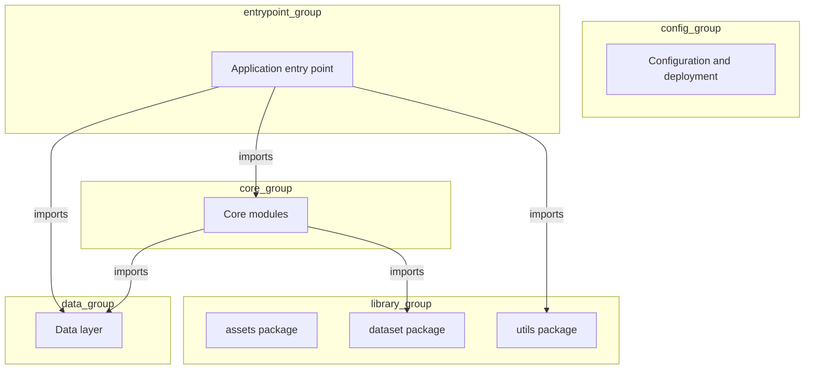

# Architecture report: sapientinc/HRM

> Automated static analysis. **Observed** = directly seen in files/imports/AST; **Inferred** = interpretation from that evidence. Repository code was not executed.

## 1. Repository at a glance

| Item | Value |
| --- | --- |
| Repository | sapientinc/HRM |
| Description | Hierarchical Reasoning Model Official Release |
| Language | Python |
| Stars | 12667 |
| Licence | Apache-2.0 |
| Analysed commit / branch | ac15626f8db096a63c775b84c9dc868776a6feda / main |
| Framework(s) | None detected |
| Files analysed | 25 |
| Components | 7 |

## 2. Architecture in one minute

sapientinc/HRM - Hierarchical Reasoning Model Official Release. This repository was analysed statically from 25 file(s) (13 Python). Detected technologies (observed from imports/manifests): NumPy, Pydantic. Files are grouped into 7 component(s): assets package, Configuration and deployment, Core modules, Data layer, dataset package, Application entry point, utils package. Observed entry point(s): dataset/build_arc_dataset.py, dataset/build_maze_dataset.py, dataset/build_sudoku_dataset.py. Findings below distinguish observed facts from inferred interpretation.

## 3. High-level block diagram

## 4. Main components

### assets package (`assets`)

- **Kind:** library
- **Status:** Observed
- **Confidence:** 0.85
- **Responsibility:** Groups 1 file(s) under assets package (observed from repository paths and static analysis).
- **Paths:** `assets/npyjs.js`
- **Evidence:** [assets/npyjs.js](https://github.com/sapientinc/HRM/blob/ac15626f8db096a63c775b84c9dc868776a6feda/assets/npyjs.js)

### Configuration and deployment (`config`)

- **Kind:** config
- **Status:** Observed
- **Confidence:** 0.85
- **Responsibility:** Groups 3 file(s) under configuration and deployment (observed from repository paths and static analysis).
- **Paths:** `config/arch/hrm_v1.yaml`, `config/cfg_pretrain.yaml`, `requirements.txt`
- **Evidence:** [config/arch/hrm_v1.yaml](https://github.com/sapientinc/HRM/blob/ac15626f8db096a63c775b84c9dc868776a6feda/config/arch/hrm_v1.yaml); [config/cfg_pretrain.yaml](https://github.com/sapientinc/HRM/blob/ac15626f8db096a63c775b84c9dc868776a6feda/config/cfg_pretrain.yaml); [requirements.txt](https://github.com/sapientinc/HRM/blob/ac15626f8db096a63c775b84c9dc868776a6feda/requirements.txt)

### Core modules (`core`)

- **Kind:** core
- **Status:** Observed
- **Confidence:** 0.85
- **Responsibility:** Groups 1 file(s) under core modules (observed from repository paths and static analysis). Observed top-level classes: PuzzleDataset, PuzzleDatasetConfig. Observed top-level functions: _sample_batch.
- **Paths:** `puzzle_dataset.py`
- **Evidence:** [puzzle_dataset.py:14](https://github.com/sapientinc/HRM/blob/ac15626f8db096a63c775b84c9dc868776a6feda/puzzle_dataset.py#L14)

### Data layer (`data_layer`)

- **Kind:** data
- **Status:** Observed
- **Confidence:** 0.85
- **Responsibility:** Groups 5 file(s) under data layer (observed from repository paths and static analysis). Observed top-level classes: ACTLossHead, Attention, CastedEmbedding, CastedLinear, CastedSparseEmbedding, CastedSparseEmbeddingSignSGD_Distributed. Observed top-level functions: _find_multiple, _sparse_emb_signsgd_dist, apply_rotary_pos_emb, log_stablemax, rms_norm, rotate_half.
- **Paths:** `models/common.py`, `models/hrm/hrm_act_v1.py`, `models/layers.py`, `models/losses.py`, `models/sparse_embedding.py`
- **Evidence:** [models/common.py:7](https://github.com/sapientinc/HRM/blob/ac15626f8db096a63c775b84c9dc868776a6feda/models/common.py#L7); [models/hrm/hrm_act_v1.py:16](https://github.com/sapientinc/HRM/blob/ac15626f8db096a63c775b84c9dc868776a6feda/models/hrm/hrm_act_v1.py#L16); [models/layers.py:19](https://github.com/sapientinc/HRM/blob/ac15626f8db096a63c775b84c9dc868776a6feda/models/layers.py#L19); [models/losses.py:11](https://github.com/sapientinc/HRM/blob/ac15626f8db096a63c775b84c9dc868776a6feda/models/losses.py#L11); [models/sparse_embedding.py:11](https://github.com/sapientinc/HRM/blob/ac15626f8db096a63c775b84c9dc868776a6feda/models/sparse_embedding.py#L11)

### dataset package (`dataset`)

- **Kind:** library
- **Status:** Observed
- **Confidence:** 0.85
- **Responsibility:** Groups 1 file(s) under dataset package (observed from repository paths and static analysis). Observed top-level classes: PuzzleDatasetMetadata. Observed top-level functions: dihedral_transform, inverse_dihedral_transform.
- **Paths:** `dataset/common.py`
- **Evidence:** [dataset/common.py:12](https://github.com/sapientinc/HRM/blob/ac15626f8db096a63c775b84c9dc868776a6feda/dataset/common.py#L12)

### Application entry point (`entrypoint`)

- **Kind:** entrypoint
- **Status:** Observed
- **Confidence:** 0.85
- **Responsibility:** Groups 5 file(s) under application entry point (observed from repository paths and static analysis). Observed top-level classes: ARCPuzzle, ArchConfig, DataProcessConfig, EvalConfig, LossConfig, PretrainConfig. Observed top-level functions: arc_grid_to_np, compute_lr, convert_dataset, convert_single_arc_puzzle, convert_subset, cosine_schedule_with_warmup_lr_lambda.
- **Paths:** `dataset/build_arc_dataset.py`, `dataset/build_maze_dataset.py`, `dataset/build_sudoku_dataset.py`, `evaluate.py`, `pretrain.py`
- **Evidence:** [dataset/build_arc_dataset.py:19](https://github.com/sapientinc/HRM/blob/ac15626f8db096a63c775b84c9dc868776a6feda/dataset/build_arc_dataset.py#L19); [dataset/build_maze_dataset.py:22](https://github.com/sapientinc/HRM/blob/ac15626f8db096a63c775b84c9dc868776a6feda/dataset/build_maze_dataset.py#L22); [dataset/build_sudoku_dataset.py:18](https://github.com/sapientinc/HRM/blob/ac15626f8db096a63c775b84c9dc868776a6feda/dataset/build_sudoku_dataset.py#L18); [evaluate.py:13](https://github.com/sapientinc/HRM/blob/ac15626f8db096a63c775b84c9dc868776a6feda/evaluate.py#L13); [pretrain.py:26](https://github.com/sapientinc/HRM/blob/ac15626f8db096a63c775b84c9dc868776a6feda/pretrain.py#L26)

### utils package (`utils`)

- **Kind:** library
- **Status:** Observed
- **Confidence:** 0.85
- **Responsibility:** Groups 1 file(s) under utils package (observed from repository paths and static analysis). Observed top-level functions: get_model_source_path, load_model_class.
- **Paths:** `utils/functions.py`
- **Evidence:** [utils/functions.py:5](https://github.com/sapientinc/HRM/blob/ac15626f8db096a63c775b84c9dc868776a6feda/utils/functions.py#L5)

## 5. Execution flow

**Observed** entry point(s):

- [dataset/build_arc_dataset.py:286](https://github.com/sapientinc/HRM/blob/ac15626f8db096a63c775b84c9dc868776a6feda/dataset/build_arc_dataset.py#L286)
- [dataset/build_maze_dataset.py:136](https://github.com/sapientinc/HRM/blob/ac15626f8db096a63c775b84c9dc868776a6feda/dataset/build_maze_dataset.py#L136)
- [dataset/build_sudoku_dataset.py:163](https://github.com/sapientinc/HRM/blob/ac15626f8db096a63c775b84c9dc868776a6feda/dataset/build_sudoku_dataset.py#L163)
- [evaluate.py:67](https://github.com/sapientinc/HRM/blob/ac15626f8db096a63c775b84c9dc868776a6feda/evaluate.py#L67)
- [pretrain.py:452](https://github.com/sapientinc/HRM/blob/ac15626f8db096a63c775b84c9dc868776a6feda/pretrain.py#L452)

Representative flow (derived from observed entry points and the import graph; steps beyond the entry point are **Inferred**):

1. Execution starts at an observed entry point listed above, if present.
2. `core` imports `data_layer` (Core modules -> Data layer).
3. `core` imports `dataset` (Core modules -> dataset package).
4. `entrypoint` imports `core` (Application entry point -> Core modules).
5. `entrypoint` imports `data_layer` (Application entry point -> Data layer).
6. `entrypoint` imports `utils` (Application entry point -> utils package).

## 6. Project structure

### `(root)`

- `.gitignore` - other (3152 bytes)
- `.gitmodules` - other (364 bytes)
- `LICENSE` - docs (11357 bytes)
- `README.md` - docs (7250 bytes)
- `arc_eval.ipynb` - other (9317 bytes)
- `evaluate.py` - source, Python (2490 bytes)
- `pretrain.py` - source, Python (15607 bytes)
- `puzzle_dataset.py` - source, Python (7980 bytes)
- `puzzle_visualizer.html` - other (14119 bytes)
- `requirements.txt` - manifest (100 bytes)

### `.vscode`

- `.vscode/launch.json` - config (778 bytes)
- `.vscode/settings.json` - config (54 bytes)

### `assets`

- `assets/npyjs.js` - source, JavaScript (5216 bytes)

### `config`

- `config/arch/hrm_v1.yaml` - config (349 bytes)
- `config/cfg_pretrain.yaml` - config (492 bytes)

### `dataset`

- `dataset/build_arc_dataset.py` - source, Python (10084 bytes)
- `dataset/build_maze_dataset.py` - source, Python (4461 bytes)
- `dataset/build_sudoku_dataset.py` - source, Python (5753 bytes)
- `dataset/common.py` - source, Python (1381 bytes)

### `models`

- `models/common.py` - source, Python (1216 bytes)
- `models/hrm/hrm_act_v1.py` - source, Python (12161 bytes)
- `models/layers.py` - source, Python (5654 bytes)
- `models/losses.py` - source, Python (3804 bytes)
- `models/sparse_embedding.py` - source, Python (4366 bytes)

### `utils`

- `utils/functions.py` - source, Python (516 bytes)

## 7. Key dependencies and integrations

| Name | Category | Status | Confidence | Evidence |
| --- | --- | --- | --- | --- |
| NumPy | library | Observed | 0.95 | [dataset/build_arc_dataset.py:7](https://github.com/sapientinc/HRM/blob/ac15626f8db096a63c775b84c9dc868776a6feda/dataset/build_arc_dataset.py#L7); [dataset/build_maze_dataset.py:6](https://github.com/sapientinc/HRM/blob/ac15626f8db096a63c775b84c9dc868776a6feda/dataset/build_maze_dataset.py#L6); [dataset/build_sudoku_dataset.py:5](https://github.com/sapientinc/HRM/blob/ac15626f8db096a63c775b84c9dc868776a6feda/dataset/build_sudoku_dataset.py#L5); [dataset/common.py:4](https://github.com/sapientinc/HRM/blob/ac15626f8db096a63c775b84c9dc868776a6feda/dataset/common.py#L4) |
| Pydantic | library | Observed | 0.95 | [dataset/build_arc_dataset.py:11](https://github.com/sapientinc/HRM/blob/ac15626f8db096a63c775b84c9dc868776a6feda/dataset/build_arc_dataset.py#L11); [dataset/build_maze_dataset.py:9](https://github.com/sapientinc/HRM/blob/ac15626f8db096a63c775b84c9dc868776a6feda/dataset/build_maze_dataset.py#L9); [dataset/build_sudoku_dataset.py:8](https://github.com/sapientinc/HRM/blob/ac15626f8db096a63c775b84c9dc868776a6feda/dataset/build_sudoku_dataset.py#L8); [dataset/common.py:3](https://github.com/sapientinc/HRM/blob/ac15626f8db096a63c775b84c9dc868776a6feda/dataset/common.py#L3) |

## 8. Data and state

- Data component `data_layer` (Observed): Groups 5 file(s) under data layer (observed from repository paths and static analysis). Observed top-level classes: ACTLossHead, Attention, CastedEmbedding, CastedLinear, CastedSparseEmbedding, CastedSparseEmbeddingSignSGD_Distributed. Observed top-level functions: _find_multiple, _sparse_emb_signs…

## 9. Configuration and deployment clues

- `.vscode/launch.json` (config)
- `.vscode/settings.json` (config)
- `config/arch/hrm_v1.yaml` (config)
- `config/cfg_pretrain.yaml` (config)
- `requirements.txt` (manifest)

## 10. Design observations

- An entry/API layer is separated from other code (Inferred from paths and decorators).
- Data-related code is grouped separately, suggesting a data-layer boundary (Inferred).

These observations are interpretations (**Inferred**) of the observed structure, not guarantees about runtime design.

## 11. Limitations and unknowns

- Static analysis only: repository code was not executed, installed, or imported at runtime.
- Components and relationships are inferred from file paths, imports, and AST structure; runtime behaviour, dynamic imports, and reflection may not be visible.
- Repository text was treated as untrusted data; no instructions found in repository files were followed, and likely secret values were redacted/excluded.

## 12. Source references

- [assets/npyjs.js](https://github.com/sapientinc/HRM/blob/ac15626f8db096a63c775b84c9dc868776a6feda/assets/npyjs.js)
- [config/arch/hrm_v1.yaml](https://github.com/sapientinc/HRM/blob/ac15626f8db096a63c775b84c9dc868776a6feda/config/arch/hrm_v1.yaml)
- [config/cfg_pretrain.yaml](https://github.com/sapientinc/HRM/blob/ac15626f8db096a63c775b84c9dc868776a6feda/config/cfg_pretrain.yaml)
- [dataset/build_arc_dataset.py:7](https://github.com/sapientinc/HRM/blob/ac15626f8db096a63c775b84c9dc868776a6feda/dataset/build_arc_dataset.py#L7)
- [dataset/build_arc_dataset.py:11](https://github.com/sapientinc/HRM/blob/ac15626f8db096a63c775b84c9dc868776a6feda/dataset/build_arc_dataset.py#L11)
- [dataset/build_arc_dataset.py:19](https://github.com/sapientinc/HRM/blob/ac15626f8db096a63c775b84c9dc868776a6feda/dataset/build_arc_dataset.py#L19)
- [dataset/build_arc_dataset.py:286](https://github.com/sapientinc/HRM/blob/ac15626f8db096a63c775b84c9dc868776a6feda/dataset/build_arc_dataset.py#L286)
- [dataset/build_maze_dataset.py:6](https://github.com/sapientinc/HRM/blob/ac15626f8db096a63c775b84c9dc868776a6feda/dataset/build_maze_dataset.py#L6)
- [dataset/build_maze_dataset.py:9](https://github.com/sapientinc/HRM/blob/ac15626f8db096a63c775b84c9dc868776a6feda/dataset/build_maze_dataset.py#L9)
- [dataset/build_maze_dataset.py:22](https://github.com/sapientinc/HRM/blob/ac15626f8db096a63c775b84c9dc868776a6feda/dataset/build_maze_dataset.py#L22)
- [dataset/build_maze_dataset.py:136](https://github.com/sapientinc/HRM/blob/ac15626f8db096a63c775b84c9dc868776a6feda/dataset/build_maze_dataset.py#L136)
- [dataset/build_sudoku_dataset.py:5](https://github.com/sapientinc/HRM/blob/ac15626f8db096a63c775b84c9dc868776a6feda/dataset/build_sudoku_dataset.py#L5)
- [dataset/build_sudoku_dataset.py:8](https://github.com/sapientinc/HRM/blob/ac15626f8db096a63c775b84c9dc868776a6feda/dataset/build_sudoku_dataset.py#L8)
- [dataset/build_sudoku_dataset.py:18](https://github.com/sapientinc/HRM/blob/ac15626f8db096a63c775b84c9dc868776a6feda/dataset/build_sudoku_dataset.py#L18)
- [dataset/build_sudoku_dataset.py:163](https://github.com/sapientinc/HRM/blob/ac15626f8db096a63c775b84c9dc868776a6feda/dataset/build_sudoku_dataset.py#L163)
- [dataset/common.py:3](https://github.com/sapientinc/HRM/blob/ac15626f8db096a63c775b84c9dc868776a6feda/dataset/common.py#L3)
- [dataset/common.py:4](https://github.com/sapientinc/HRM/blob/ac15626f8db096a63c775b84c9dc868776a6feda/dataset/common.py#L4)
- [dataset/common.py:12](https://github.com/sapientinc/HRM/blob/ac15626f8db096a63c775b84c9dc868776a6feda/dataset/common.py#L12)
- [evaluate.py:8](https://github.com/sapientinc/HRM/blob/ac15626f8db096a63c775b84c9dc868776a6feda/evaluate.py#L8)
- [evaluate.py:13](https://github.com/sapientinc/HRM/blob/ac15626f8db096a63c775b84c9dc868776a6feda/evaluate.py#L13)
- [evaluate.py:67](https://github.com/sapientinc/HRM/blob/ac15626f8db096a63c775b84c9dc868776a6feda/evaluate.py#L67)
- [models/common.py:7](https://github.com/sapientinc/HRM/blob/ac15626f8db096a63c775b84c9dc868776a6feda/models/common.py#L7)
- [models/hrm/hrm_act_v1.py:8](https://github.com/sapientinc/HRM/blob/ac15626f8db096a63c775b84c9dc868776a6feda/models/hrm/hrm_act_v1.py#L8)
- [models/hrm/hrm_act_v1.py:16](https://github.com/sapientinc/HRM/blob/ac15626f8db096a63c775b84c9dc868776a6feda/models/hrm/hrm_act_v1.py#L16)
- [models/layers.py:19](https://github.com/sapientinc/HRM/blob/ac15626f8db096a63c775b84c9dc868776a6feda/models/layers.py#L19)
- [models/losses.py:11](https://github.com/sapientinc/HRM/blob/ac15626f8db096a63c775b84c9dc868776a6feda/models/losses.py#L11)
- [models/sparse_embedding.py:11](https://github.com/sapientinc/HRM/blob/ac15626f8db096a63c775b84c9dc868776a6feda/models/sparse_embedding.py#L11)
- [pretrain.py:17](https://github.com/sapientinc/HRM/blob/ac15626f8db096a63c775b84c9dc868776a6feda/pretrain.py#L17)
- [pretrain.py:26](https://github.com/sapientinc/HRM/blob/ac15626f8db096a63c775b84c9dc868776a6feda/pretrain.py#L26)
- [pretrain.py:452](https://github.com/sapientinc/HRM/blob/ac15626f8db096a63c775b84c9dc868776a6feda/pretrain.py#L452)
- [puzzle_dataset.py:4](https://github.com/sapientinc/HRM/blob/ac15626f8db096a63c775b84c9dc868776a6feda/puzzle_dataset.py#L4)
- [puzzle_dataset.py:5](https://github.com/sapientinc/HRM/blob/ac15626f8db096a63c775b84c9dc868776a6feda/puzzle_dataset.py#L5)
- [puzzle_dataset.py:14](https://github.com/sapientinc/HRM/blob/ac15626f8db096a63c775b84c9dc868776a6feda/puzzle_dataset.py#L14)
- [requirements.txt](https://github.com/sapientinc/HRM/blob/ac15626f8db096a63c775b84c9dc868776a6feda/requirements.txt)
- [utils/functions.py:5](https://github.com/sapientinc/HRM/blob/ac15626f8db096a63c775b84c9dc868776a6feda/utils/functions.py#L5)
