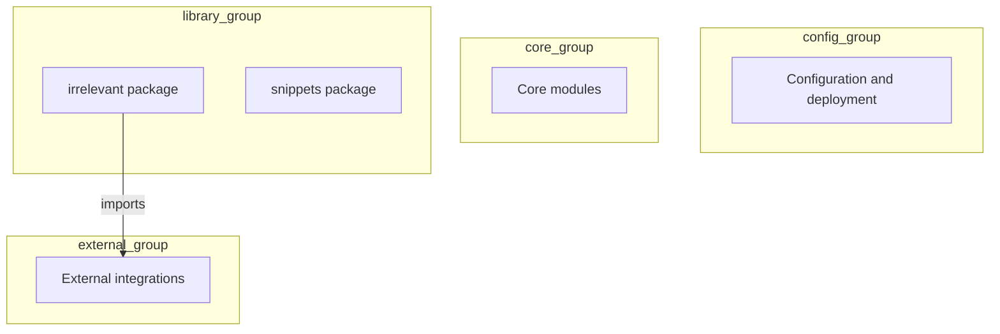

# Architecture report: satwikkansal/wtfpython

> Automated static analysis. **Observed** = directly seen in files/imports/AST; **Inferred** = interpretation from that evidence. Repository code was not executed.

## 1. Repository at a glance

| Item | Value |
| --- | --- |
| Repository | satwikkansal/wtfpython |
| Description | What the f*ck Python? 😱 |
| Language | Python |
| Stars | 37144 |
| Licence | WTFPL |
| Analysed commit / branch | 9323b863218670404405e0a0b9f54d2841a7452e / master |
| Framework(s) | None detected |
| Files analysed | 42 |
| Components | 5 |

## 2. Architecture in one minute

satwikkansal/wtfpython - What the f*ck Python? 😱. This repository was analysed statically from 42 file(s) (8 Python). Detected technologies (observed from imports/manifests): GitHub Actions, requests, Poetry. Files are grouped into 5 component(s): Configuration and deployment, Core modules, External integrations, irrelevant package, snippets package. Findings below distinguish observed facts from inferred interpretation.

## 3. High-level block diagram

## 4. Main components

### Configuration and deployment (`config`)

- **Kind:** config
- **Status:** Observed
- **Confidence:** 0.85
- **Responsibility:** Groups 1 file(s) under configuration and deployment (observed from repository paths and static analysis).
- **Paths:** `pyproject.toml`
- **Evidence:** [pyproject.toml](https://github.com/satwikkansal/wtfpython/blob/9323b863218670404405e0a0b9f54d2841a7452e/pyproject.toml)

### Core modules (`core`)

- **Kind:** core
- **Status:** Observed
- **Confidence:** 0.85
- **Responsibility:** Groups 2 file(s) under core modules (observed from repository paths and static analysis). Observed top-level functions: tests.
- **Paths:** `mixed_tabs_and_spaces.py`, `noxfile.py`
- **Evidence:** [mixed_tabs_and_spaces.py](https://github.com/satwikkansal/wtfpython/blob/9323b863218670404405e0a0b9f54d2841a7452e/mixed_tabs_and_spaces.py); [noxfile.py:12](https://github.com/satwikkansal/wtfpython/blob/9323b863218670404405e0a0b9f54d2841a7452e/noxfile.py#L12)

### External integrations (`external_integrations`)

- **Kind:** external
- **Status:** Inferred
- **Confidence:** 0.70
- **Responsibility:** Groups 0 file(s) under external integrations (observed from repository paths and static analysis).
- **Evidence:** [irrelevant/obsolete/generate_contributions.py:10](https://github.com/satwikkansal/wtfpython/blob/9323b863218670404405e0a0b9f54d2841a7452e/irrelevant/obsolete/generate_contributions.py#L10)

### irrelevant package (`irrelevant`)

- **Kind:** library
- **Status:** Observed
- **Confidence:** 0.85
- **Responsibility:** Groups 4 file(s) under irrelevant package (observed from repository paths and static analysis). Observed top-level functions: convert_to_cells, convert_to_notebook, generate_code_block, generate_markdown_block, generate_random_id_comment, inspect_and_sanitize_code_lines.
- **Paths:** `irrelevant/insert_ids.py`, `irrelevant/notebook_generator.py`, `irrelevant/obsolete/generate_contributions.py`, `irrelevant/obsolete/parse_readme.py`
- **Evidence:** [irrelevant/insert_ids.py:9](https://github.com/satwikkansal/wtfpython/blob/9323b863218670404405e0a0b9f54d2841a7452e/irrelevant/insert_ids.py#L9); [irrelevant/notebook_generator.py:57](https://github.com/satwikkansal/wtfpython/blob/9323b863218670404405e0a0b9f54d2841a7452e/irrelevant/notebook_generator.py#L57); [irrelevant/obsolete/generate_contributions.py](https://github.com/satwikkansal/wtfpython/blob/9323b863218670404405e0a0b9f54d2841a7452e/irrelevant/obsolete/generate_contributions.py); [irrelevant/obsolete/parse_readme.py](https://github.com/satwikkansal/wtfpython/blob/9323b863218670404405e0a0b9f54d2841a7452e/irrelevant/obsolete/parse_readme.py)

### snippets package (`snippets`)

- **Kind:** library
- **Status:** Observed
- **Confidence:** 0.85
- **Responsibility:** Groups 2 file(s) under snippets package (observed from repository paths and static analysis).
- **Paths:** `snippets/2_tricky_strings.py`, `snippets/__init__.py`
- **Evidence:** [snippets/2_tricky_strings.py](https://github.com/satwikkansal/wtfpython/blob/9323b863218670404405e0a0b9f54d2841a7452e/snippets/2_tricky_strings.py); [snippets/__init__.py](https://github.com/satwikkansal/wtfpython/blob/9323b863218670404405e0a0b9f54d2841a7452e/snippets/__init__.py)

## 5. Execution flow

No entry point was observed; the startup flow below is therefore limited.

Representative flow (derived from observed entry points and the import graph; steps beyond the entry point are **Inferred**):

1. Execution starts at an observed entry point listed above, if present.
2. `irrelevant` imports `external_integrations` (irrelevant package -> External integrations).

## 6. Project structure

### `(root)`

- `.gitattributes` - other (84 bytes)
- `.gitignore` - other (243 bytes)
- `.markdownlint.yaml` - config (662 bytes)
- `.pre-commit-config.yaml` - config (172 bytes)
- `.travis.yml` - ci, YAML (120 bytes)
- `CONTRIBUTING.md` - docs (5160 bytes)
- `CONTRIBUTORS.md` - docs (3955 bytes)
- `LICENSE` - docs (460 bytes)
- `README.md` - docs (125482 bytes)
- `code-of-conduct.md` - docs (3231 bytes)
- `mixed_tabs_and_spaces.py` - source, Python (205 bytes)
- `noxfile.py` - source, Python (317 bytes)
- `pyproject.toml` - manifest (336 bytes)

### `.github`

- `.github/ISSUE_TEMPLATE/bug.md` - docs (507 bytes)
- `.github/ISSUE_TEMPLATE/new_snippet.md` - docs (777 bytes)
- `.github/ISSUE_TEMPLATE/translation.md` - docs (420 bytes)
- `.github/PULL_REQUEST_TEMPLATE/common.md` - docs (519 bytes)
- `.github/PULL_REQUEST_TEMPLATE/new_snippet.md` - docs (714 bytes)
- `.github/PULL_REQUEST_TEMPLATE/translation.md` - docs (531 bytes)
- `.github/workflows/pr.yml` - ci, YAML (726 bytes)

### `images`

- `images/logo.svg` - other (17176 bytes)
- `images/logo_dark_theme.svg` - other (17176 bytes)
- `images/string-intern/string_interning.svg` - other (27986 bytes)
- `images/string-intern/string_interning_dark_theme.svg` - other (28728 bytes)
- `images/tic-tac-toe/after_board_initialized.svg` - other (18222 bytes)
- `images/tic-tac-toe/after_board_initialized_dark_theme.svg` - other (19244 bytes)
- `images/tic-tac-toe/after_row_initialized.svg` - other (11403 bytes)
- `images/tic-tac-toe/after_row_initialized_dark_theme.svg` - other (12092 bytes)

### `irrelevant`

- `irrelevant/insert_ids.py` - source, Python (456 bytes)
- `irrelevant/notebook_generator.py` - source, Python (14499 bytes)
- `irrelevant/notebook_instructions.md` - docs (351 bytes)
- `irrelevant/obsolete/add_categories` - other (1628 bytes)
- `irrelevant/obsolete/generate_contributions.py` - source, Python (1532 bytes)
- `irrelevant/obsolete/initial.md` - docs (70597 bytes)
- `irrelevant/obsolete/parse_readme.py` - source, Python (4129 bytes)

### `snippets`

- `snippets/2_tricky_strings.py` - source, Python (261 bytes)
- `snippets/__init__.py` - source, Python (0 bytes)

### `translations`

- `translations/fa-farsi/README.md` - docs (178918 bytes)
- `translations/ru-russian/CONTRIBUTING.md` - docs (7930 bytes)
- `translations/ru-russian/CONTRIBUTORS.md` - docs (4246 bytes)
- `translations/ru-russian/README.md` - docs (185540 bytes)
- `translations/ru-russian/code-of-conduct.md` - docs (6036 bytes)

## 7. Key dependencies and integrations

| Name | Category | Status | Confidence | Evidence |
| --- | --- | --- | --- | --- |
| GitHub Actions | ci | Observed | 0.85 | [.github/workflows/pr.yml](https://github.com/satwikkansal/wtfpython/blob/9323b863218670404405e0a0b9f54d2841a7452e/.github/workflows/pr.yml) |
| requests | library | Observed | 0.90 | [irrelevant/obsolete/generate_contributions.py:10](https://github.com/satwikkansal/wtfpython/blob/9323b863218670404405e0a0b9f54d2841a7452e/irrelevant/obsolete/generate_contributions.py#L10) |
| Poetry | packaging | Observed | 0.85 | [pyproject.toml:1](https://github.com/satwikkansal/wtfpython/blob/9323b863218670404405e0a0b9f54d2841a7452e/pyproject.toml#L1) |

## 8. Data and state

No database, cache, queue, or persistent-state usage was observed in the analysed files. State handling, if any, may be in-memory or in files that were not analysed.

## 9. Configuration and deployment clues

- `.github/workflows/pr.yml` (ci)
- `.markdownlint.yaml` (config)
- `.pre-commit-config.yaml` (config)
- `.travis.yml` (ci)
- `pyproject.toml` (manifest)

## 10. Design observations

- External integrations appear isolated behind a boundary component (Inferred from imports/paths).

These observations are interpretations (**Inferred**) of the observed structure, not guarantees about runtime design.

## 11. Limitations and unknowns

- Static analysis only: repository code was not executed, installed, or imported at runtime.
- Components and relationships are inferred from file paths, imports, and AST structure; runtime behaviour, dynamic imports, and reflection may not be visible.
- 1 file(s) were skipped during inventory (1 x lockfile excluded).
- File mixed_tabs_and_spaces.py could not be parsed as Python (possible SyntaxError) and was skipped for AST analysis.
- No clear application entry point was observed in the analysed files.
- Repository text was treated as untrusted data; no instructions found in repository files were followed, and likely secret values were redacted/excluded.

## 12. Source references

- [.github/workflows/pr.yml](https://github.com/satwikkansal/wtfpython/blob/9323b863218670404405e0a0b9f54d2841a7452e/.github/workflows/pr.yml)
- [irrelevant/insert_ids.py:9](https://github.com/satwikkansal/wtfpython/blob/9323b863218670404405e0a0b9f54d2841a7452e/irrelevant/insert_ids.py#L9)
- [irrelevant/notebook_generator.py:57](https://github.com/satwikkansal/wtfpython/blob/9323b863218670404405e0a0b9f54d2841a7452e/irrelevant/notebook_generator.py#L57)
- [irrelevant/obsolete/generate_contributions.py](https://github.com/satwikkansal/wtfpython/blob/9323b863218670404405e0a0b9f54d2841a7452e/irrelevant/obsolete/generate_contributions.py)
- [irrelevant/obsolete/generate_contributions.py:10](https://github.com/satwikkansal/wtfpython/blob/9323b863218670404405e0a0b9f54d2841a7452e/irrelevant/obsolete/generate_contributions.py#L10)
- [irrelevant/obsolete/parse_readme.py](https://github.com/satwikkansal/wtfpython/blob/9323b863218670404405e0a0b9f54d2841a7452e/irrelevant/obsolete/parse_readme.py)
- [mixed_tabs_and_spaces.py](https://github.com/satwikkansal/wtfpython/blob/9323b863218670404405e0a0b9f54d2841a7452e/mixed_tabs_and_spaces.py)
- [noxfile.py:12](https://github.com/satwikkansal/wtfpython/blob/9323b863218670404405e0a0b9f54d2841a7452e/noxfile.py#L12)
- [pyproject.toml](https://github.com/satwikkansal/wtfpython/blob/9323b863218670404405e0a0b9f54d2841a7452e/pyproject.toml)
- [pyproject.toml:1](https://github.com/satwikkansal/wtfpython/blob/9323b863218670404405e0a0b9f54d2841a7452e/pyproject.toml#L1)
- [snippets/2_tricky_strings.py](https://github.com/satwikkansal/wtfpython/blob/9323b863218670404405e0a0b9f54d2841a7452e/snippets/2_tricky_strings.py)
- [snippets/__init__.py](https://github.com/satwikkansal/wtfpython/blob/9323b863218670404405e0a0b9f54d2841a7452e/snippets/__init__.py)
