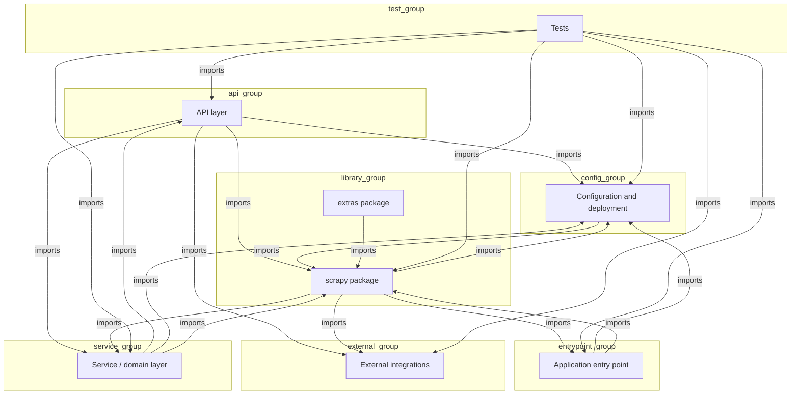

# Architecture report: scrapy/scrapy

> Automated static analysis. **Observed** = directly seen in files/imports/AST; **Inferred** = interpretation from that evidence. Repository code was not executed.

## 1. Repository at a glance

| Item | Value |
| --- | --- |
| Repository | scrapy/scrapy |
| Description | Scrapy, a fast high-level web crawling & scraping framework for Python. |
| Language | Python |
| Stars | 65389 |
| Licence | BSD-3-Clause |
| Analysed commit / branch | e63a574c767d7a9438c21db158f605f1c44c6e6a / master |
| Framework(s) | None detected |
| Files analysed | 708 |
| Components | 8 |

## 2. Architecture in one minute

scrapy/scrapy - Scrapy, a fast high-level web crawling & scraping framework for Python.. This repository was analysed statically from 708 file(s) (546 Python). Detected technologies (observed from imports/manifests): GitHub Actions, SQLite, aiohttp, AWS (boto3), Poetry, pytest. Files are grouped into 8 component(s): API layer, Configuration and deployment, Application entry point, External integrations, extras package, scrapy package, Service / domain layer, Tests. Observed entry point(s): extras/github-release-notes.py, extras/pre-bump.py, extras/upgrade-ci-pins.py. Findings below distinguish observed facts from inferred interpretation.

## 3. High-level block diagram

## 4. Main components

### API layer (`api_layer`)

- **Kind:** api
- **Status:** Observed
- **Confidence:** 0.85
- **Responsibility:** Groups 14 file(s) under api layer (observed from repository paths and static analysis). Observed top-level classes: AioftpDownloadHandler, AiohttpDownloadHandler, BaseDownloadHandler, BaseHttpDownloadHandler, BaseStreamingDownloadHandler, DataURIDownloadHandler. Observed top-level functions: _auto_connection_limit, _get_connection_limit, _is_headers_too_large_exception, _is_ipv6_literal, _limit_response_headers, _tunnel_request_data.
- **Paths:** `scrapy/core/downloader/handlers/__init__.py`, `scrapy/core/downloader/handlers/_aioftp.py`, `scrapy/core/downloader/handlers/_aiohttp.py`, `scrapy/core/downloader/handlers/_base_http.py`, `scrapy/core/downloader/handlers/_base_streaming.py`, `scrapy/core/downloader/handlers/_httpx.py`, `scrapy/core/downloader/handlers/base.py`, `scrapy/core/downloader/handlers/datauri.py`, `scrapy/core/downloader/handlers/file.py`, `scrapy/core/downloader/handlers/ftp.py`, `scrapy/core/downloader/handlers/http.py`, `scrapy/core/downloader/handlers/http11.py`, `scrapy/core/downloader/handlers/http2.py`, `scrapy/core/downloader/handlers/s3.py`
- **Evidence:** [scrapy/core/downloader/handlers/__init__.py:51](https://github.com/scrapy/scrapy/blob/e63a574c767d7a9438c21db158f605f1c44c6e6a/scrapy/core/downloader/handlers/__init__.py#L51); [scrapy/core/downloader/handlers/_aioftp.py:63](https://github.com/scrapy/scrapy/blob/e63a574c767d7a9438c21db158f605f1c44c6e6a/scrapy/core/downloader/handlers/_aioftp.py#L63); [scrapy/core/downloader/handlers/_aiohttp.py:49](https://github.com/scrapy/scrapy/blob/e63a574c767d7a9438c21db158f605f1c44c6e6a/scrapy/core/downloader/handlers/_aiohttp.py#L49); [scrapy/core/downloader/handlers/_base_http.py:33](https://github.com/scrapy/scrapy/blob/e63a574c767d7a9438c21db158f605f1c44c6e6a/scrapy/core/downloader/handlers/_base_http.py#L33); [scrapy/core/downloader/handlers/_base_streaming.py:63](https://github.com/scrapy/scrapy/blob/e63a574c767d7a9438c21db158f605f1c44c6e6a/scrapy/core/downloader/handlers/_base_streaming.py#L63); [scrapy/core/downloader/handlers/_httpx.py:77](https://github.com/scrapy/scrapy/blob/e63a574c767d7a9438c21db158f605f1c44c6e6a/scrapy/core/downloader/handlers/_httpx.py#L77); [scrapy/core/downloader/handlers/base.py:14](https://github.com/scrapy/scrapy/blob/e63a574c767d7a9438c21db158f605f1c44c6e6a/scrapy/core/downloader/handlers/base.py#L14); [scrapy/core/downloader/handlers/datauri.py:15](https://github.com/scrapy/scrapy/blob/e63a574c767d7a9438c21db158f605f1c44c6e6a/scrapy/core/downloader/handlers/datauri.py#L15)

### Configuration and deployment (`config`)

- **Kind:** config
- **Status:** Observed
- **Confidence:** 0.85
- **Responsibility:** Groups 7 file(s) under configuration and deployment (observed from repository paths and static analysis). Observed top-level classes: BaseSettings, Command, Settings, SettingsAttribute. Observed top-level functions: __getattr__, get_settings_priority, iter_default_settings, overridden_settings.
- **Paths:** `codecov.yml`, `pyproject.toml`, `scrapy/commands/settings.py`, `scrapy/settings/__init__.py`, `scrapy/settings/default_settings.py`, `scrapy/templates/project/scrapy.cfg`, `tox.ini`
- **Evidence:** [codecov.yml](https://github.com/scrapy/scrapy/blob/e63a574c767d7a9438c21db158f605f1c44c6e6a/codecov.yml); [pyproject.toml](https://github.com/scrapy/scrapy/blob/e63a574c767d7a9438c21db158f605f1c44c6e6a/pyproject.toml); [scrapy/commands/settings.py:21](https://github.com/scrapy/scrapy/blob/e63a574c767d7a9438c21db158f605f1c44c6e6a/scrapy/commands/settings.py#L21); [scrapy/settings/__init__.py:42](https://github.com/scrapy/scrapy/blob/e63a574c767d7a9438c21db158f605f1c44c6e6a/scrapy/settings/__init__.py#L42); [scrapy/settings/default_settings.py:688](https://github.com/scrapy/scrapy/blob/e63a574c767d7a9438c21db158f605f1c44c6e6a/scrapy/settings/default_settings.py#L688); [scrapy/templates/project/scrapy.cfg](https://github.com/scrapy/scrapy/blob/e63a574c767d7a9438c21db158f605f1c44c6e6a/scrapy/templates/project/scrapy.cfg); [tox.ini](https://github.com/scrapy/scrapy/blob/e63a574c767d7a9438c21db158f605f1c44c6e6a/tox.ini)

### Application entry point (`entrypoint`)

- **Kind:** entrypoint
- **Status:** Observed
- **Confidence:** 0.85
- **Responsibility:** Groups 7 file(s) under application entry point (observed from repository paths and static analysis). Observed top-level classes: Root, ScrapyArgumentParser. Observed top-level functions: _build_parser, _deps, _get_commands_dict, _get_commands_from_entry_points, _get_commands_from_module, _get_project_only_cmds.
- **Paths:** `extras/github-release-notes.py`, `extras/pre-bump.py`, `extras/upgrade-ci-pins.py`, `scrapy/__main__.py`, `scrapy/cmdline.py`, `scrapy/utils/_benchserver.py`, `scrapy/utils/benchserver.py`
- **Evidence:** [extras/github-release-notes.py:8](https://github.com/scrapy/scrapy/blob/e63a574c767d7a9438c21db158f605f1c44c6e6a/extras/github-release-notes.py#L8); [extras/pre-bump.py:12](https://github.com/scrapy/scrapy/blob/e63a574c767d7a9438c21db158f605f1c44c6e6a/extras/pre-bump.py#L12); [extras/upgrade-ci-pins.py:22](https://github.com/scrapy/scrapy/blob/e63a574c767d7a9438c21db158f605f1c44c6e6a/extras/upgrade-ci-pins.py#L22); [scrapy/__main__.py](https://github.com/scrapy/scrapy/blob/e63a574c767d7a9438c21db158f605f1c44c6e6a/scrapy/__main__.py); [scrapy/cmdline.py:28](https://github.com/scrapy/scrapy/blob/e63a574c767d7a9438c21db158f605f1c44c6e6a/scrapy/cmdline.py#L28); [scrapy/utils/_benchserver.py:9](https://github.com/scrapy/scrapy/blob/e63a574c767d7a9438c21db158f605f1c44c6e6a/scrapy/utils/_benchserver.py#L9); [scrapy/utils/benchserver.py](https://github.com/scrapy/scrapy/blob/e63a574c767d7a9438c21db158f605f1c44c6e6a/scrapy/utils/benchserver.py)

### External integrations (`external_integrations`)

- **Kind:** external
- **Status:** Inferred
- **Confidence:** 0.70
- **Responsibility:** Groups 0 file(s) under external integrations (observed from repository paths and static analysis).
- **Evidence:** [conftest.py:20](https://github.com/scrapy/scrapy/blob/e63a574c767d7a9438c21db158f605f1c44c6e6a/conftest.py#L20); [scrapy/core/downloader/handlers/_aioftp.py:6](https://github.com/scrapy/scrapy/blob/e63a574c767d7a9438c21db158f605f1c44c6e6a/scrapy/core/downloader/handlers/_aioftp.py#L6); [scrapy/core/downloader/handlers/_aiohttp.py:5](https://github.com/scrapy/scrapy/blob/e63a574c767d7a9438c21db158f605f1c44c6e6a/scrapy/core/downloader/handlers/_aiohttp.py#L5); [scrapy/core/downloader/handlers/_aiohttp.py:11](https://github.com/scrapy/scrapy/blob/e63a574c767d7a9438c21db158f605f1c44c6e6a/scrapy/core/downloader/handlers/_aiohttp.py#L11); [scrapy/core/downloader/handlers/_aiohttp.py:12](https://github.com/scrapy/scrapy/blob/e63a574c767d7a9438c21db158f605f1c44c6e6a/scrapy/core/downloader/handlers/_aiohttp.py#L12); [scrapy/core/downloader/handlers/_aiohttp.py:37](https://github.com/scrapy/scrapy/blob/e63a574c767d7a9438c21db158f605f1c44c6e6a/scrapy/core/downloader/handlers/_aiohttp.py#L37)

### extras package (`extras`)

- **Kind:** library
- **Status:** Observed
- **Confidence:** 0.85
- **Responsibility:** Groups 3 file(s) under extras package (observed from repository paths and static analysis). Observed top-level classes: QPSSpider, Root.
- **Paths:** `extras/coverage-report.sh`, `extras/qps-bench-server.py`, `extras/qpsclient.py`
- **Evidence:** [extras/coverage-report.sh](https://github.com/scrapy/scrapy/blob/e63a574c767d7a9438c21db158f605f1c44c6e6a/extras/coverage-report.sh); [extras/qps-bench-server.py:10](https://github.com/scrapy/scrapy/blob/e63a574c767d7a9438c21db158f605f1c44c6e6a/extras/qps-bench-server.py#L10); [extras/qpsclient.py:15](https://github.com/scrapy/scrapy/blob/e63a574c767d7a9438c21db158f605f1c44c6e6a/extras/qpsclient.py#L15)

### scrapy package (`scrapy`)

- **Kind:** library
- **Status:** Observed
- **Confidence:** 0.85
- **Responsibility:** Groups 166 file(s) under scrapy package (observed from repository paths and static analysis). Observed top-level classes: AddonManager, AsyncCrawlerProcess, AsyncCrawlerRunner, AsyncioLoopingCall, AutoThrottle, BaseDupeFilter. Observed top-level functions: NO_CALLBACK, __getattr__, _active_crawler_scope, _add_curl_option, _address_with_port, _aiter_errback.
- **Paths:** `scrapy/__init__.py`, `scrapy/_logging/__init__.py`, `scrapy/addons.py`, `scrapy/commands/__init__.py`, `scrapy/commands/bench.py`, `scrapy/commands/check.py`, `scrapy/commands/complete.py`, `scrapy/commands/crawl.py`, `scrapy/commands/edit.py`, `scrapy/commands/fetch.py`, `scrapy/commands/genrequest.py`, `scrapy/commands/genspider.py`, `scrapy/commands/list.py`, `scrapy/commands/parse.py`, `scrapy/commands/runspider.py`, `scrapy/commands/shell.py`, `scrapy/commands/startproject.py`, `scrapy/commands/version.py`, `scrapy/commands/view.py`, `scrapy/contracts/__init__.py`, `scrapy/contracts/default.py`, `scrapy/crawler.py`, `scrapy/downloadermiddlewares/__init__.py`, `scrapy/downloadermiddlewares/cookies.py`, `scrapy/downloadermiddlewares/defaultheaders.py`, `scrapy/downloadermiddlewares/downloadtimeout.py`, `scrapy/downloadermiddlewares/httpauth.py`, `scrapy/downloadermiddlewares/httpcache.py`, `scrapy/downloadermiddlewares/httpcompression.py`, `scrapy/downloadermiddlewares/httpproxy.py`, `scrapy/downloadermiddlewares/jsonvalidation.py`, `scrapy/downloadermiddlewares/offsite.py`, `scrapy/downloadermiddlewares/redirect.py`, `scrapy/downloadermiddlewares/retry.py`, `scrapy/downloadermiddlewares/robotstxt.py`, `scrapy/downloadermiddlewares/stats.py`, `scrapy/downloadermiddlewares/uriuserinfo.py`, `scrapy/downloadermiddlewares/useragent.py`, `scrapy/dupefilters.py`, `scrapy/exceptions.py`, `scrapy/exporters.py`, `scrapy/extension.py`, `scrapy/extensions/__init__.py`, `scrapy/extensions/closespider.py`, `scrapy/extensions/corestats.py`, `scrapy/extensions/debug.py`, `scrapy/extensions/event_loop_lag.py`, `scrapy/extensions/feedexport.py`, `scrapy/extensions/httpcache.py`, `scrapy/extensions/logcount.py`, `scrapy/extensions/logstats.py`, `scrapy/extensions/memdebug.py`, `scrapy/extensions/memusage.py`, `scrapy/extensions/periodic_log.py`, `scrapy/extensions/postprocessing.py`, `scrapy/extensions/remote_control.py`, `scrapy/extensions/spiderstate.py`, `scrapy/extensions/statsmailer.py`, `scrapy/extensions/telnet.py`, `scrapy/extensions/throttle.py`, `scrapy/http/__init__.py`, `scrapy/http/cookies.py`, `scrapy/http/headers.py`, `scrapy/http/request/__init__.py`, `scrapy/http/request/form.py`, `scrapy/http/request/json_request.py`, `scrapy/http/request/rpc.py`, `scrapy/http/response/__init__.py`, `scrapy/http/response/body_file.py`, `scrapy/http/response/html.py`, `scrapy/http/response/json.py`, `scrapy/http/response/text.py`, `scrapy/http/response/xml.py`, `scrapy/interfaces.py`, `scrapy/item.py`, `scrapy/link.py`, `scrapy/linkextractors/__init__.py`, `scrapy/linkextractors/lxmlhtml.py`, `scrapy/loader/__init__.py`, `scrapy/logformatter.py`, `scrapy/mail.py`, `scrapy/middleware.py`, `scrapy/pipelines/__init__.py`, `scrapy/pipelines/files.py`, `scrapy/pipelines/images.py`, `scrapy/pipelines/media.py`, `scrapy/pqueues.py`, `scrapy/resolver.py`, `scrapy/responsetypes.py`, `scrapy/robotstxt.py`, `scrapy/selector/__init__.py`, `scrapy/selector/unified.py`, `scrapy/shell.py`, `scrapy/signalmanager.py`, `scrapy/signals.py`, `scrapy/spiderloader.py`, `scrapy/spidermiddlewares/__init__.py`, `scrapy/spidermiddlewares/base.py`, `scrapy/spidermiddlewares/depth.py`, `scrapy/spidermiddlewares/httperror.py`, `scrapy/spidermiddlewares/metacopy.py`, `scrapy/spidermiddlewares/referer.py`, `scrapy/spidermiddlewares/start.py`, `scrapy/spidermiddlewares/stickymeta.py`, `scrapy/spidermiddlewares/urllength.py`, `scrapy/spiders/__init__.py`, `scrapy/spiders/crawl.py`, `scrapy/spiders/feed.py`, `scrapy/spiders/sitemap.py`, `scrapy/squeues.py`, `scrapy/statscollectors.py`, `scrapy/templates/project/module/__init__.py`, `scrapy/templates/project/module/spiders/__init__.py`, `scrapy/utils/__init__.py`, `scrapy/utils/_colorize.py`, `scrapy/utils/_compression.py`, `scrapy/utils/_datatypes.py`, `scrapy/utils/_deps_compat.py`, `scrapy/utils/_download_handlers.py`, `scrapy/utils/_ftp.py`, `scrapy/utils/_httpstatus.py`, `scrapy/utils/_ossignals.py`, `scrapy/utils/_remote_control.py`, `scrapy/utils/_secrets.py`, `scrapy/utils/_shell.py`, `scrapy/utils/_sitemap.py`, `scrapy/utils/_ssl.py`, `scrapy/utils/_stopmode.py`, `scrapy/utils/_template.py`, `scrapy/utils/_versions.py`, `scrapy/utils/asyncgen.py`, `scrapy/utils/asyncio.py`, `scrapy/utils/boto.py`, `scrapy/utils/conf.py`, `scrapy/utils/console.py`, `scrapy/utils/curl.py`, `scrapy/utils/datatypes.py`, `scrapy/utils/decorators.py`, `scrapy/utils/defer.py`, `scrapy/utils/deprecate.py`, `scrapy/utils/display.py`, `scrapy/utils/engine.py`, `scrapy/utils/ftp.py`, `scrapy/utils/gz.py`, `scrapy/utils/httpobj.py`, `scrapy/utils/iterators.py`, `scrapy/utils/job.py`, `scrapy/utils/log.py`, `scrapy/utils/misc.py`, `scrapy/utils/ossignal.py`, `scrapy/utils/project.py`, `scrapy/utils/python.py`, `scrapy/utils/reactor.py`, `scrapy/utils/reactorless.py`, `scrapy/utils/request.py`, `scrapy/utils/response.py`, `scrapy/utils/serialize.py`, `scrapy/utils/signal.py`, `scrapy/utils/sitemap.py`, `scrapy/utils/spider.py`, `scrapy/utils/ssl.py`, `scrapy/utils/template.py`, `scrapy/utils/test.py`, `scrapy/utils/trackref.py`, `scrapy/utils/url.py`, `scrapy/utils/versions.py`
- **Evidence:** [scrapy/__init__.py](https://github.com/scrapy/scrapy/blob/e63a574c767d7a9438c21db158f605f1c44c6e6a/scrapy/__init__.py); [scrapy/_logging/__init__.py:10](https://github.com/scrapy/scrapy/blob/e63a574c767d7a9438c21db158f605f1c44c6e6a/scrapy/_logging/__init__.py#L10); [scrapy/addons.py:18](https://github.com/scrapy/scrapy/blob/e63a574c767d7a9438c21db158f605f1c44c6e6a/scrapy/addons.py#L18); [scrapy/commands/__init__.py:37](https://github.com/scrapy/scrapy/blob/e63a574c767d7a9438c21db158f605f1c44c6e6a/scrapy/commands/__init__.py#L37); [scrapy/commands/bench.py:21](https://github.com/scrapy/scrapy/blob/e63a574c767d7a9438c21db158f605f1c44c6e6a/scrapy/commands/bench.py#L21); [scrapy/commands/check.py:22](https://github.com/scrapy/scrapy/blob/e63a574c767d7a9438c21db158f605f1c44c6e6a/scrapy/commands/check.py#L22); [scrapy/commands/complete.py:58](https://github.com/scrapy/scrapy/blob/e63a574c767d7a9438c21db158f605f1c44c6e6a/scrapy/commands/complete.py#L58); [scrapy/commands/crawl.py:13](https://github.com/scrapy/scrapy/blob/e63a574c767d7a9438c21db158f605f1c44c6e6a/scrapy/commands/crawl.py#L13)

### Service / domain layer (`service_layer`)

- **Kind:** service
- **Status:** Observed
- **Confidence:** 0.85
- **Responsibility:** Groups 14 file(s) under service / domain layer (observed from repository paths and static analysis). Observed top-level classes: BaseScheduler, BaseSchedulerMeta, BrowserLikeContextFactory, Downloader, DownloaderMiddlewareManager, EngineState. Observed top-level functions: __getattr__, _aset_parent_id, _call_dupefilter, _default_jitter, _examples, _get_creator_context.
- **Paths:** `scrapy/core/__init__.py`, `scrapy/core/_http2/__init__.py`, `scrapy/core/_http2/agent.py`, `scrapy/core/_http2/protocol.py`, `scrapy/core/_http2/stream.py`, `scrapy/core/downloader/__init__.py`, `scrapy/core/downloader/_idna_patch.py`, `scrapy/core/downloader/contextfactory.py`, `scrapy/core/downloader/middleware.py`, `scrapy/core/downloader/tls.py`, `scrapy/core/engine.py`, `scrapy/core/scheduler.py`, `scrapy/core/scraper.py`, `scrapy/core/spidermw.py`
- **Evidence:** [scrapy/core/__init__.py](https://github.com/scrapy/scrapy/blob/e63a574c767d7a9438c21db158f605f1c44c6e6a/scrapy/core/__init__.py); [scrapy/core/_http2/__init__.py](https://github.com/scrapy/scrapy/blob/e63a574c767d7a9438c21db158f605f1c44c6e6a/scrapy/core/_http2/__init__.py); [scrapy/core/_http2/agent.py:28](https://github.com/scrapy/scrapy/blob/e63a574c767d7a9438c21db158f605f1c44c6e6a/scrapy/core/_http2/agent.py#L28); [scrapy/core/_http2/protocol.py:59](https://github.com/scrapy/scrapy/blob/e63a574c767d7a9438c21db158f605f1c44c6e6a/scrapy/core/_http2/protocol.py#L59); [scrapy/core/_http2/stream.py:43](https://github.com/scrapy/scrapy/blob/e63a574c767d7a9438c21db158f605f1c44c6e6a/scrapy/core/_http2/stream.py#L43); [scrapy/core/downloader/__init__.py:59](https://github.com/scrapy/scrapy/blob/e63a574c767d7a9438c21db158f605f1c44c6e6a/scrapy/core/downloader/__init__.py#L59); [scrapy/core/downloader/_idna_patch.py:27](https://github.com/scrapy/scrapy/blob/e63a574c767d7a9438c21db158f605f1c44c6e6a/scrapy/core/downloader/_idna_patch.py#L27); [scrapy/core/downloader/contextfactory.py:42](https://github.com/scrapy/scrapy/blob/e63a574c767d7a9438c21db158f605f1c44c6e6a/scrapy/core/downloader/contextfactory.py#L42)

### Tests (`tests`)

- **Kind:** test
- **Status:** Observed
- **Confidence:** 0.85
- **Responsibility:** Groups 366 file(s) under tests (observed from repository paths and static analysis). Observed application object created via Command. Observed routes: PATCH scrapy.commands.check.ContractsManager, PATCH scrapy.commands.check.ContractsManager, PATCH scrapy.shell.start_python_console, PATCH scrapy.shell.start_python_console, PATCH scrapy.settings.default_settings. Observed top-level classes: AiohttpDownloadHandlerMixin, AlternativeCallbacksMiddleware, AlternativeCallbacksSpider, AlwaysStalePolicy, ArbitraryLengthPayloadResource, AsyncAwaitRequestInItemPipelineSpider. Observed top-level function…
- **Paths:** `conftest.py`, `docs/conftest.py`, `tests/AsyncCrawlerProcess/args_settings.py`, `tests/AsyncCrawlerProcess/asyncio_custom_loop.py`, `tests/AsyncCrawlerProcess/asyncio_custom_loop_custom_settings_different.py`, `tests/AsyncCrawlerProcess/asyncio_custom_loop_custom_settings_same.py`, `tests/AsyncCrawlerProcess/asyncio_deferred_signal.py`, `tests/AsyncCrawlerProcess/asyncio_enabled_no_reactor.py`, `tests/AsyncCrawlerProcess/asyncio_enabled_reactor.py`, `tests/AsyncCrawlerProcess/asyncio_enabled_reactor_different_loop.py`, `tests/AsyncCrawlerProcess/asyncio_enabled_reactor_loop_not_current.py`, `tests/AsyncCrawlerProcess/asyncio_enabled_reactor_same_loop.py`, `tests/AsyncCrawlerProcess/asyncio_enabled_reactor_same_loop_default.py`, `tests/AsyncCrawlerProcess/caching_hostname_resolver.py`, `tests/AsyncCrawlerProcess/caching_hostname_resolver_ipv6.py`, `tests/AsyncCrawlerProcess/closespider_timeout_no_item.py`, `tests/AsyncCrawlerProcess/default_name_resolver.py`, `tests/AsyncCrawlerProcess/dns_resolver_deprecated.py`, `tests/AsyncCrawlerProcess/multi.py`, `tests/AsyncCrawlerProcess/reactor_default.py`, `tests/AsyncCrawlerProcess/reactor_settings.py`, `tests/AsyncCrawlerProcess/reactorless_custom_settings.py`, `tests/AsyncCrawlerProcess/reactorless_datauri.py`, `tests/AsyncCrawlerProcess/reactorless_import_hook.py`, `tests/AsyncCrawlerProcess/reactorless_import_hook_multiple.py`, `tests/AsyncCrawlerProcess/reactorless_import_hook_uninstall.py`, `tests/AsyncCrawlerProcess/reactorless_reactor.py`, `tests/AsyncCrawlerProcess/reactorless_simple.py`, `tests/AsyncCrawlerProcess/reactorless_sleeping.py`, `tests/AsyncCrawlerProcess/reactorless_sleeping_no_stop_after_crawl.py`, `tests/AsyncCrawlerProcess/reactorless_telnetconsole_disabled.py`, `tests/AsyncCrawlerProcess/reactorless_telnetconsole_enabled.py`, `tests/AsyncCrawlerProcess/reactorless_then_reactor.py`, `tests/AsyncCrawlerProcess/simple.py`, `tests/AsyncCrawlerProcess/sleeping.py`, `tests/AsyncCrawlerProcess/twisted_reactor_asyncio.py`, `tests/AsyncCrawlerProcess/twisted_reactor_custom_settings.py`, `tests/AsyncCrawlerProcess/twisted_reactor_custom_settings_same.py`, `tests/AsyncCrawlerProcess/twisted_reactor_custom_settings_select.py`, `tests/AsyncCrawlerRunner/custom_loop_different.py`, `tests/AsyncCrawlerRunner/custom_loop_same.py`, `tests/AsyncCrawlerRunner/multi_parallel.py`, `tests/AsyncCrawlerRunner/multi_seq.py`, `tests/AsyncCrawlerRunner/no_reactor.py`, `tests/AsyncCrawlerRunner/reactorless_custom_settings.py`, `tests/AsyncCrawlerRunner/reactorless_datauri.py`, `tests/AsyncCrawlerRunner/reactorless_loop_not_running.py`, `tests/AsyncCrawlerRunner/reactorless_reactor.py`, `tests/AsyncCrawlerRunner/reactorless_simple.py`, `tests/AsyncCrawlerRunner/simple.py`, `tests/AsyncCrawlerRunner/simple_default_reactor.py`, `tests/CrawlerProcess/args_settings.py`, `tests/CrawlerProcess/asyncio_custom_loop.py`, `tests/CrawlerProcess/asyncio_deferred_signal.py`, `tests/CrawlerProcess/asyncio_enabled_no_reactor.py`, `tests/CrawlerProcess/asyncio_enabled_reactor.py`, `tests/CrawlerProcess/asyncio_enabled_reactor_different_loop.py`, `tests/CrawlerProcess/asyncio_enabled_reactor_loop_not_current.py`, `tests/CrawlerProcess/asyncio_enabled_reactor_same_loop.py`, `tests/CrawlerProcess/caching_hostname_resolver.py`, `tests/CrawlerProcess/caching_hostname_resolver_ipv6.py`, `tests/CrawlerProcess/default_name_resolver.py`, `tests/CrawlerProcess/dns_resolver_deprecated.py`, `tests/CrawlerProcess/multi.py`, `tests/CrawlerProcess/reactor_default.py`, `tests/CrawlerProcess/reactor_default_twisted_reactor_select.py`, `tests/CrawlerProcess/reactor_select.py`, `tests/CrawlerProcess/reactor_select_subclass_twisted_reactor_select.py`, `tests/CrawlerProcess/reactor_select_twisted_reactor_select.py`, `tests/CrawlerProcess/reactor_settings.py`, `tests/CrawlerProcess/reactorless.py`, `tests/CrawlerProcess/simple.py`, `tests/CrawlerProcess/sleeping.py`, `tests/CrawlerProcess/twisted_reactor_asyncio.py`, `tests/CrawlerProcess/twisted_reactor_custom_settings.py`, `tests/CrawlerProcess/twisted_reactor_custom_settings_conflict.py`, `tests/CrawlerProcess/twisted_reactor_custom_settings_same.py`, `tests/CrawlerProcess/twisted_reactor_poll.py`, `tests/CrawlerProcess/twisted_reactor_select.py`, `tests/CrawlerRunner/change_reactor.py`, `tests/CrawlerRunner/custom_loop_different.py`, `tests/CrawlerRunner/custom_loop_same.py`, `tests/CrawlerRunner/explicit_default_reactor.py`, `tests/CrawlerRunner/install_reactor_select.py`, `tests/CrawlerRunner/ip_address.py`, `tests/CrawlerRunner/multi_parallel.py`, `tests/CrawlerRunner/multi_seq.py`, `tests/CrawlerRunner/no_reactor.py`, `tests/CrawlerRunner/reactorless.py`, `tests/CrawlerRunner/simple.py`, `tests/__init__.py`, `tests/benchmarks/__init__.py`, `tests/benchmarks/conftest.py`, `tests/benchmarks/test_crawl.py`, `tests/benchmarks/test_encoding.py`, `tests/benchmarks/test_exporters.py`, `tests/benchmarks/test_httpcompression.py`, `tests/benchmarks/test_urls.py`, `tests/benchmarks/urls.txt`, `tests/ignores.txt`, `tests/keys/__init__.py`, `tests/keys/example-com.conf`, `tests/keys/example-com.gen.README`, `tests/keys/localhost-ip.gen.README`, `tests/keys/localhost.gen.README`, `tests/keys/localhost.ip.crt`, `tests/mocks/__init__.py`, `tests/mocks/dummydbm.py`, `tests/mockserver/__init__.py`, `tests/mockserver/dns.py`, `tests/mockserver/ftp.py`, `tests/mockserver/http.py`, `tests/mockserver/http_base.py`, `tests/mockserver/http_resources.py`, `tests/mockserver/mitm_proxy.py`, `tests/mockserver/mitm_proxy_addon.py`, `tests/mockserver/proxy_echo.py`, `tests/mockserver/proxy_stalling.py`, `tests/mockserver/raw_http.py`, `tests/mockserver/simple_https.py`, `tests/mockserver/utils.py`, `tests/pipelines.py`, `tests/sample_data/books/book.html`, `tests/sample_data/books/listing.html`, `tests/sample_data/compressed/feed-sample1.xml`, `tests/sample_data/compressed/unexpected-eof-output.txt`, `tests/sample_data/feeds/feed-sample1.xml`, `tests/sample_data/feeds/feed-sample2.xml`, `tests/sample_data/feeds/feed-sample3.csv`, `tests/sample_data/feeds/feed-sample4.csv`, `tests/sample_data/feeds/feed-sample5.csv`, `tests/sample_data/feeds/feed-sample6.csv`, `tests/sample_data/link_extractor/linkextractor.html`, `tests/sample_data/link_extractor/linkextractor_latin1.html`, `tests/sample_data/link_extractor/linkextractor_no_href.html`, `tests/sample_data/link_extractor/linkextractor_noenc.html`, `tests/sample_data/test_site/index.html`, `tests/sample_data/test_site/item1.html`, `tests/sample_data/test_site/item2.html`, `tests/sample_data/test_site/sitemap-comments/robots.txt`, `tests/sample_data/test_site/sitemap-comments/sitemap.xml`, `tests/spiders.py`, `tests/test_addons.py`, `tests/test_closespider.py`, `tests/test_cmdline/__init__.py`, `tests/test_cmdline/extensions.py`, `tests/test_cmdline/settings.py`, `tests/test_cmdline_crawl_with_pipeline/__init__.py`, `tests/test_cmdline_crawl_with_pipeline/scrapy.cfg`, `tests/test_cmdline_crawl_with_pipeline/test_spider/__init__.py`, `tests/test_cmdline_crawl_with_pipeline/test_spider/pipelines.py`, `tests/test_cmdline_crawl_with_pipeline/test_spider/settings.py`, `tests/test_cmdline_crawl_with_pipeline/test_spider/spiders/__init__.py`, `tests/test_cmdline_crawl_with_pipeline/test_spider/spiders/exception.py`, `tests/test_cmdline_crawl_with_pipeline/test_spider/spiders/normal.py`, `tests/test_command_check.py`, `tests/test_command_complete.py`, `tests/test_command_crawl.py`, `tests/test_command_fetch.py`, `tests/test_command_genrequest.py`, `tests/test_command_genspider.py`, `tests/test_command_parse.py`, `tests/test_command_runspider.py`, `tests/test_command_shell.py`, `tests/test_command_startproject.py`, `tests/test_command_version.py`, `tests/test_commands.py`, `tests/test_contracts.py`, `tests/test_core_downloader.py`, `tests/test_core_scraper.py`, `tests/test_crash.py`, `tests/test_crawl.py`, `tests/test_crawler.py`, `tests/test_crawler_runners.py`, `tests/test_crawler_subprocess.py`, `tests/test_dependencies.py`, `tests/test_downloader.py`, `tests/test_downloader_handler_aioftp.py`, `tests/test_downloader_handler_aiohttp.py`, `tests/test_downloader_handler_httpx.py`, `tests/test_downloader_handler_twisted_ftp.py`, `tests/test_downloader_handler_twisted_http11.py`, `tests/test_downloader_handler_twisted_http2.py`, `tests/test_downloader_handlers.py`, `tests/test_downloadermiddleware.py`, `tests/test_downloadermiddleware_cookies.py`, `tests/test_downloadermiddleware_defaultheaders.py`, `tests/test_downloadermiddleware_downloadtimeout.py`, `tests/test_downloadermiddleware_httpauth.py`, `tests/test_downloadermiddleware_httpcache.py`, `tests/test_downloadermiddleware_httpcompression.py`, `tests/test_downloadermiddleware_httpproxy.py`, `tests/test_downloadermiddleware_jsonvalidation.py`, `tests/test_downloadermiddleware_offsite.py`, `tests/test_downloadermiddleware_redirect.py`, `tests/test_downloadermiddleware_redirect_metarefresh.py`, `tests/test_downloadermiddleware_retry.py`, `tests/test_downloadermiddleware_robotstxt.py`, `tests/test_downloadermiddleware_stats.py`, `tests/test_downloadermiddleware_uriuserinfo.py`, `tests/test_downloadermiddleware_useragent.py`, `tests/test_downloaderslotssettings.py`, `tests/test_dupefilters.py`, `tests/test_engine.py`, `tests/test_engine_close_spider.py`, `tests/test_engine_download.py`, `tests/test_engine_lifecycle.py`, `tests/test_engine_loop.py`, `tests/test_engine_stop_download_bytes.py`, `tests/test_engine_stop_download_headers.py`, `tests/test_exporters.py`, `tests/test_extension_debug.py`, `tests/test_extension_event_loop_lag.py`, `tests/test_extension_memdebug.py`, `tests/test_extension_memusage.py`, `tests/test_extension_periodic_log.py`, `tests/test_extension_remote_control.py`, `tests/test_extension_statsmailer.py`, `tests/test_extension_telnet.py`, `tests/test_extension_throttle.py`, `tests/test_feedexport.py`, `tests/test_feedexport_async.py`, `tests/test_feedexport_batch.py`, `tests/test_feedexport_empty.py`, `tests/test_feedexport_fields.py`, `tests/test_feedexport_filters_processors.py`, `tests/test_feedexport_formats.py`, `tests/test_feedexport_lifecycle.py`, `tests/test_feedexport_mode.py`, `tests/test_feedexport_postprocess.py`, `tests/test_feedexport_reporting.py`, `tests/test_feedexport_storages.py`, `tests/test_feedexport_uri_params.py`, `tests/test_http2_client_protocol.py`, `tests/test_http_cookies.py`, `tests/test_http_headers.py`, `tests/test_http_request.py`, `tests/test_http_request_form.py`, `tests/test_http_request_json.py`, `tests/test_http_response.py`, `tests/test_http_response_body_file.py`, `tests/test_http_response_text.py`, `tests/test_item.py`, `tests/test_link.py`, `tests/test_linkextractors.py`, `tests/test_loader.py`, `tests/test_logformatter.py`, `tests/test_logstats.py`, `tests/test_mail.py`, `tests/test_middleware.py`, `tests/test_pipeline_crawl.py`, `tests/test_pipeline_files.py`, `tests/test_pipeline_images.py`, `tests/test_pipeline_media.py`, `tests/test_pipelines.py`, `tests/test_poet.py`, `tests/test_pqueues.py`, `tests/test_request_attribute_binding.py`, `tests/test_request_cb_kwargs.py`, `tests/test_request_dict.py`, `tests/test_request_left.py`, `tests/test_request_lineage.py`, `tests/test_resolver.py`, `tests/test_response_dict.py`, `tests/test_responsetypes.py`, `tests/test_robotstxt_interface.py`, `tests/test_scheduler.py`, `tests/test_scheduler_base.py`, `tests/test_scrapy__getattr__.py`, `tests/test_selector.py`, `tests/test_settings/__init__.py`, `tests/test_settings/default_settings.py`, `tests/test_settings/test_secrets.py`, `tests/test_signalmanager.py`, `tests/test_signals.py`, `tests/test_spider.py`, `tests/test_spider_crawl.py`, `tests/test_spider_sitemap.py`, `tests/test_spider_start.py`, `tests/test_spiderloader/__init__.py`, `tests/test_spiderloader/spiders_from_addons/__init__.py`, `tests/test_spiderloader/spiders_from_addons/spider0.py`, `tests/test_spiderloader/test_spiders/__init__.py`, `tests/test_spiderloader/test_spiders/nested/__init__.py`, `tests/test_spiderloader/test_spiders/nested/spider4.py`, `tests/test_spiderloader/test_spiders/spider0.py`, `tests/test_spiderloader/test_spiders/spider1.py`, `tests/test_spiderloader/test_spiders/spider2.py`, `tests/test_spiderloader/test_spiders/spider3.py`, `tests/test_spidermiddleware.py`, `tests/test_spidermiddleware_base.py`, `tests/test_spidermiddleware_depth.py`, `tests/test_spidermiddleware_httperror.py`, `tests/test_spidermiddleware_metacopy.py`, `tests/test_spidermiddleware_output_chain.py`, `tests/test_spidermiddleware_process_start.py`, `tests/test_spidermiddleware_referer.py`, `tests/test_spidermiddleware_start.py`, `tests/test_spidermiddleware_stickymeta.py`, `tests/test_spidermiddleware_urllength.py`, `tests/test_spiderstate.py`, `tests/test_squeues.py`, `tests/test_squeues_request.py`, `tests/test_stats.py`, `tests/test_toplevel.py`, `tests/test_utils_asyncgen.py`, `tests/test_utils_asyncio.py`, `tests/test_utils_benchserver.py`, `tests/test_utils_compression.py`, `tests/test_utils_conf.py`, `tests/test_utils_curl.py`, `tests/test_utils_datatypes.py`, `tests/test_utils_decorators.py`, `tests/test_utils_defer.py`, `tests/test_utils_deprecate.py`, `tests/test_utils_display.py`, `tests/test_utils_httpobj.py`, `tests/test_utils_iterators.py`, `tests/test_utils_log.py`, `tests/test_utils_misc/__init__.py`, `tests/test_utils_misc/test_return_with_argument_inside_generator.py`, `tests/test_utils_misc/test_walk_modules/__init__.py`, `tests/test_utils_misc/test_walk_modules/mod/__init__.py`, `tests/test_utils_misc/test_walk_modules/mod/mod0.py`, `tests/test_utils_misc/test_walk_modules/mod1.py`, `tests/test_utils_ossignal.py`, `tests/test_utils_project.py`, `tests/test_utils_python.py`, `tests/test_utils_reactor.py`, `tests/test_utils_reactorless.py`, `tests/test_utils_remote_control.py`, `tests/test_utils_request.py`, `tests/test_utils_response.py`, `tests/test_utils_serialize.py`, `tests/test_utils_shell.py`, `tests/test_utils_signal.py`, `tests/test_utils_sitemap.py`, `tests/test_utils_spider.py`, `tests/test_utils_ssl.py`, `tests/test_utils_template.py`, `tests/test_utils_trackref.py`, `tests/test_utils_url.py`, `tests/test_utils_versions.py`, `tests/test_zz_resources.py`, `tests/utils/__init__.py`, `tests/utils/bases/__init__.py`, `tests/utils/bases/commands.py`, `tests/utils/bases/download_handlers_http.py`, `tests/utils/bases/engine.py`, `tests/utils/bases/http_request.py`, `tests/utils/bases/http_response.py`, `tests/utils/bases/redirect.py`, `tests/utils/bases/spider.py`, `tests/utils/cloud.py`, `tests/utils/cmdline.py`, `tests/utils/crawl.py`, `tests/utils/decorators.py`, `tests/utils/downloader.py`, `tests/utils/engine.py`, `tests/utils/feedexport.py`, `tests/utils/media_pipelines.py`, `tests/utils/redirect.py`, `tests/utils/robotstxt.py`, `tests_typing/test_http_request.mypy-testing`, `tests_typing/test_http_response.mypy-testing`, `tests_typing/test_spiders.mypy-testing`
- **Evidence:** [conftest.py:28](https://github.com/scrapy/scrapy/blob/e63a574c767d7a9438c21db158f605f1c44c6e6a/conftest.py#L28); [docs/conftest.py:17](https://github.com/scrapy/scrapy/blob/e63a574c767d7a9438c21db158f605f1c44c6e6a/docs/conftest.py#L17); [tests/AsyncCrawlerProcess/args_settings.py:7](https://github.com/scrapy/scrapy/blob/e63a574c767d7a9438c21db158f605f1c44c6e6a/tests/AsyncCrawlerProcess/args_settings.py#L7); [tests/AsyncCrawlerProcess/asyncio_custom_loop.py:5](https://github.com/scrapy/scrapy/blob/e63a574c767d7a9438c21db158f605f1c44c6e6a/tests/AsyncCrawlerProcess/asyncio_custom_loop.py#L5); [tests/AsyncCrawlerProcess/asyncio_custom_loop_custom_settings_different.py:5](https://github.com/scrapy/scrapy/blob/e63a574c767d7a9438c21db158f605f1c44c6e6a/tests/AsyncCrawlerProcess/asyncio_custom_loop_custom_settings_different.py#L5); [tests/AsyncCrawlerProcess/asyncio_custom_loop_custom_settings_same.py:5](https://github.com/scrapy/scrapy/blob/e63a574c767d7a9438c21db158f605f1c44c6e6a/tests/AsyncCrawlerProcess/asyncio_custom_loop_custom_settings_same.py#L5); [tests/AsyncCrawlerProcess/asyncio_deferred_signal.py:11](https://github.com/scrapy/scrapy/blob/e63a574c767d7a9438c21db158f605f1c44c6e6a/tests/AsyncCrawlerProcess/asyncio_deferred_signal.py#L11); [tests/AsyncCrawlerProcess/asyncio_enabled_no_reactor.py:6](https://github.com/scrapy/scrapy/blob/e63a574c767d7a9438c21db158f605f1c44c6e6a/tests/AsyncCrawlerProcess/asyncio_enabled_no_reactor.py#L6)

## 5. Execution flow

**Observed** entry point(s):

- [extras/github-release-notes.py:31](https://github.com/scrapy/scrapy/blob/e63a574c767d7a9438c21db158f605f1c44c6e6a/extras/github-release-notes.py#L31)
- [extras/pre-bump.py:56](https://github.com/scrapy/scrapy/blob/e63a574c767d7a9438c21db158f605f1c44c6e6a/extras/pre-bump.py#L56)
- [extras/upgrade-ci-pins.py:185](https://github.com/scrapy/scrapy/blob/e63a574c767d7a9438c21db158f605f1c44c6e6a/extras/upgrade-ci-pins.py#L185)
- [scrapy/__main__.py:4](https://github.com/scrapy/scrapy/blob/e63a574c767d7a9438c21db158f605f1c44c6e6a/scrapy/__main__.py#L4)
- [scrapy/cmdline.py](https://github.com/scrapy/scrapy/blob/e63a574c767d7a9438c21db158f605f1c44c6e6a/scrapy/cmdline.py)
- [scrapy/utils/_benchserver.py:55](https://github.com/scrapy/scrapy/blob/e63a574c767d7a9438c21db158f605f1c44c6e6a/scrapy/utils/_benchserver.py#L55)
- [scrapy/utils/benchserver.py:19](https://github.com/scrapy/scrapy/blob/e63a574c767d7a9438c21db158f605f1c44c6e6a/scrapy/utils/benchserver.py#L19)

**Observed** routes (from decorators):

- `PATCH scrapy.commands.check.ContractsManager` -> `test_run_with_opts_list_prints_spider` in `tests/test_command_check.py:303`
- `PATCH scrapy.commands.check.ContractsManager` -> `test_run_without_opts_list_does_not_crawl_spider_with_no_tested_methods` in `tests/test_command_check.py:330`
- `PATCH scrapy.shell.start_python_console` -> `test_inspect_response` in `tests/test_command_shell.py:444`
- `PATCH scrapy.shell.start_python_console` -> `test_inspect_response_no_reactor` in `tests/test_command_shell.py:473`
- `PATCH scrapy.settings.default_settings` -> `test_initial_defaults` in `tests/test_settings/__init__.py:638`
- `PATCH scrapy.settings.default_settings` -> `test_initial_values` in `tests/test_settings/__init__.py:650`
- `PATCH scrapy.settings.default_settings` -> `test_autopromote_dicts` in `tests/test_settings/__init__.py:661`
- `PATCH scrapy.settings.default_settings` -> `test_getdict_autodegrade_basesettings` in `tests/test_settings/__init__.py:670`
- `PATCH scrapy.extensions.corestats.monotonic` -> `test_core_stats_default_stats_collector` in `tests/test_stats.py:35`
- `PATCH scrapy.extensions.corestats.datetime` -> `test_core_stats_default_stats_collector` in `tests/test_stats.py:35`
- `PATCH sys.platform` -> `test_pformat` in `tests/test_utils_display.py:37`
- `PATCH sys.stdout.isatty` -> `test_pformat` in `tests/test_utils_display.py:37`
- `PATCH sys.stdout.isatty` -> `test_pformat_dont_colorize` in `tests/test_utils_display.py:43`
- `PATCH sys.platform` -> `test_pformat_old_windows` in `tests/test_utils_display.py:55`
- `PATCH platform.version` -> `test_pformat_old_windows` in `tests/test_utils_display.py:55`
- `PATCH sys.stdout.isatty` -> `test_pformat_old_windows` in `tests/test_utils_display.py:55`
- `PATCH sys.platform` -> `test_pformat_windows_no_terminal_processing` in `tests/test_utils_display.py:65`
- `PATCH scrapy.utils._colorize._enable_windows_terminal_processing` -> `test_pformat_windows_no_terminal_processing` in `tests/test_utils_display.py:65`
- `PATCH platform.version` -> `test_pformat_windows_no_terminal_processing` in `tests/test_utils_display.py:65`
- `PATCH sys.stdout.isatty` -> `test_pformat_windows_no_terminal_processing` in `tests/test_utils_display.py:65`
- `PATCH sys.platform` -> `test_pformat_windows` in `tests/test_utils_display.py:78`
- `PATCH scrapy.utils._colorize._enable_windows_terminal_processing` -> `test_pformat_windows` in `tests/test_utils_display.py:78`
- `PATCH platform.version` -> `test_pformat_windows` in `tests/test_utils_display.py:78`
- `PATCH sys.stdout.isatty` -> `test_pformat_windows` in `tests/test_utils_display.py:78`
- `PATCH sys.platform` -> `test_pformat_no_pygments` in `tests/test_utils_display.py:97`
- `PATCH sys.stdout.isatty` -> `test_pformat_no_pygments` in `tests/test_utils_display.py:97`
- `PATCH scrapy.utils.misc.is_generator_with_return_value` -> `test_indentation_error` in `tests/test_utils_misc/test_return_with_argument_inside_generator.py:243`
- `PATCH sys.stdout` -> `test_print_live_refs_empty` in `tests/test_utils_trackref.py:50`
- `PATCH sys.stdout` -> `test_print_live_refs_with_objects` in `tests/test_utils_trackref.py:56`

Representative flow (derived from observed entry points and the import graph; steps beyond the entry point are **Inferred**):

1. Execution starts at an observed entry point listed above, if present.
2. `api_layer` imports `config` (API layer -> Configuration and deployment).
3. `api_layer` imports `external_integrations` (API layer -> External integrations).
4. `api_layer` imports `scrapy` (API layer -> scrapy package).
5. `api_layer` imports `service_layer` (API layer -> Service / domain layer).
6. `config` imports `scrapy` (Configuration and deployment -> scrapy package).
7. `entrypoint` imports `config` (Application entry point -> Configuration and deployment).
8. `entrypoint` imports `scrapy` (Application entry point -> scrapy package).
9. `extras` imports `scrapy` (extras package -> scrapy package).

## 6. Project structure

### `(root)`

- `.git-blame-ignore-revs` - other (322 bytes)
- `.gitattributes` - other (28 bytes)
- `.gitignore` - other (332 bytes)
- `.pre-commit-config.yaml` - config (841 bytes)
- `.readthedocs.yml` - config (145 bytes)
- `AGENTS.md` - docs (4920 bytes)
- `AUTHORS` - other (1284 bytes)
- `CITATION.cff` - other (171 bytes)
- `CODE_OF_CONDUCT.md` - docs (5485 bytes)
- `CONTRIBUTING.md` - docs (303 bytes)
- `INSTALL.md` - docs (155 bytes)
- `LICENSE` - docs (1517 bytes)
- `NEWS` - other (18 bytes)
- `README.rst` - docs (1793 bytes)
- `SECURITY.md` - docs (307 bytes)
- `codecov.yml` - config (368 bytes)
- `conftest.py` - test, Python (10971 bytes)
- `pyproject.toml` - manifest (15726 bytes)
- `tox.ini` - config (11014 bytes)

### `.github`

- `.github/ISSUE_TEMPLATE/bug_report.md` - docs (1524 bytes)
- `.github/ISSUE_TEMPLATE/feature_request.md` - docs (1274 bytes)
- `.github/ISSUE_TEMPLATE/question.md` - docs (420 bytes)
- `.github/dependabot.yml` - config (219 bytes)
- `.github/pull_request_template.md` - docs (202 bytes)
- `.github/workflows/ci.yml` - ci, YAML (7679 bytes)
- `.github/workflows/close-spam-prs.yml` - ci, YAML (827 bytes)
- `.github/workflows/codspeed-walltime.yml` - ci, YAML (2495 bytes)
- `.github/workflows/codspeed.yml` - ci, YAML (1924 bytes)
- `.github/workflows/publish.yml` - ci, YAML (4283 bytes)
- `.github/workflows/tests-vcs-deps.yml` - ci, YAML (1656 bytes)
- `.github/workflows/upgrade-ci-pins.yml` - ci, YAML (2132 bytes)

### `docs`

- `docs/Makefile` - docs (633 bytes)
- `docs/_ext/scrapydocs.py` - docs (4820 bytes)
- `docs/_ext/scrapyfixautodoc.py` - docs (1585 bytes)
- `docs/_static/custom.css` - docs (1687 bytes)
- `docs/_static/logo.svg` - docs (7647 bytes)
- `docs/_static/selectors-sample1.html` - docs (667 bytes)
- `docs/_templates/layout.html` - docs (851 bytes)
- `docs/_tests/quotes.html` - docs (10333 bytes)
- `docs/_tests/quotes1.html` - docs (10333 bytes)
- `docs/conf.py` - docs (6426 bytes)
- `docs/conftest.py` - test, Python (921 bytes)
- `docs/contributing.rst` - docs (18158 bytes)
- `docs/faq.rst` - docs (16886 bytes)
- `docs/index.rst` - docs (6950 bytes)
- `docs/intro/examples.rst` - docs (746 bytes)
- `docs/intro/getting-help.rst` - docs (1476 bytes)
- `docs/intro/install.rst` - docs (8407 bytes)
- `docs/intro/overview.rst` - docs (6705 bytes)
- `docs/intro/tutorial.rst` - docs (32083 bytes)
- `docs/news.rst` - docs (193475 bytes)
- `docs/news/0.x.rst` - docs (52656 bytes)
- `docs/news/1.x.rst` - docs (95747 bytes)
- `docs/news/2.x.rst` - docs (155519 bytes)
- `docs/topics/addons.rst` - docs (7539 bytes)
- `docs/topics/agents.rst` - docs (2057 bytes)
- `docs/topics/api.rst` - docs (5935 bytes)
- `docs/topics/architecture.rst` - docs (5561 bytes)
- `docs/topics/asyncio.rst` - docs (15199 bytes)
- `docs/topics/autothrottle.rst` - docs (6964 bytes)
- `docs/topics/benchmarking.rst` - docs (5267 bytes)
- `docs/topics/commands.rst` - docs (28191 bytes)
- `docs/topics/components.rst` - docs (5777 bytes)
- `docs/topics/concepts.rst` - docs (4077 bytes)
- `docs/topics/contracts.rst` - docs (4699 bytes)
- `docs/topics/cookies.rst` - docs (4105 bytes)
- `docs/topics/coroutines.rst` - docs (10484 bytes)
- `docs/topics/debug.rst` - docs (8395 bytes)
- `docs/topics/deploy.rst` - docs (2274 bytes)
- `docs/topics/developer-tools.rst` - docs (13826 bytes)
- `docs/topics/djangoitem.rst` - docs (194 bytes)
- `docs/topics/download-handlers.rst` - docs (21073 bytes)
- `docs/topics/downloader-middleware.rst` - docs (45896 bytes)
- `docs/topics/dynamic-content.rst` - docs (11079 bytes)
- `docs/topics/exceptions.rst` - docs (536 bytes)
- `docs/topics/exporters.rst` - docs (18993 bytes)
- `docs/topics/extensions.rst` - docs (17549 bytes)
- `docs/topics/extraction.rst` - docs (6882 bytes)
- `docs/topics/feed-exports.rst` - docs (30121 bytes)
- `docs/topics/item-pipeline.rst` - docs (12360 bytes)
- `docs/topics/items.rst` - docs (12324 bytes)
- `docs/topics/jobs.rst` - docs (7137 bytes)
- `docs/topics/leaks.rst` - docs (11144 bytes)
- `docs/topics/link-extractors.rst` - docs (1673 bytes)
- `docs/topics/loaders.rst` - docs (17120 bytes)
- `docs/topics/logging.rst` - docs (12832 bytes)
- `docs/topics/media-pipeline.rst` - docs (37283 bytes)
- `docs/topics/optimize.rst` - docs (15845 bytes)
- `docs/topics/practices.rst` - docs (20089 bytes)
- `docs/topics/request-response.rst` - docs (55306 bytes)
- `docs/topics/scheduler.rst` - docs (1065 bytes)
- `docs/topics/scrapyd.rst` - docs (188 bytes)
- `docs/topics/security.rst` - docs (12887 bytes)
- `docs/topics/selectors.rst` - docs (38278 bytes)
- `docs/topics/settings.rst` - docs (87067 bytes)
- `docs/topics/shell.rst` - docs (12098 bytes)
- `docs/topics/signals.rst` - docs (23214 bytes)
- `docs/topics/spider-middleware.rst` - docs (16708 bytes)
- `docs/topics/spiders.rst` - docs (17253 bytes)
- `docs/topics/stats.rst` - docs (27458 bytes)
- `docs/topics/telnetconsole.rst` - docs (8154 bytes)
- `docs/utils/linkfix.py` - docs (1975 bytes)
- `docs/versioning.rst` - docs (2012 bytes)

### `extras`

- `extras/coverage-report.sh` - source, Shell (252 bytes)
- `extras/github-release-notes.py` - source, Python (1331 bytes)
- `extras/pre-bump.py` - source, Python (2146 bytes)
- `extras/qps-bench-server.py` - source, Python (1634 bytes)
- `extras/qpsclient.py` - source, Python (1397 bytes)
- `extras/scrapy.1` - other (2010 bytes)
- `extras/upgrade-ci-pins.py` - source, Python (6434 bytes)

### `scrapy`

- `scrapy/VERSION` - other (7 bytes)
- `scrapy/__init__.py` - source, Python (958 bytes)
- `scrapy/__main__.py` - source, Python (101 bytes)
- `scrapy/_logging/__init__.py` - source, Python (2244 bytes)
- `scrapy/addons.py` - source, Python (2846 bytes)
- `scrapy/cmdline.py` - source, Python (8008 bytes)
- `scrapy/commands/__init__.py` - source, Python (12557 bytes)
- `scrapy/commands/bench.py` - source, Python (2390 bytes)
- `scrapy/commands/check.py` - source, Python (7046 bytes)
- `scrapy/commands/complete.py` - source, Python (5428 bytes)
- `scrapy/commands/crawl.py` - source, Python (910 bytes)
- `scrapy/commands/edit.py` - source, Python (2155 bytes)
- `scrapy/commands/fetch.py` - source, Python (4038 bytes)
- `scrapy/commands/genrequest.py` - source, Python (2275 bytes)
- `scrapy/commands/genspider.py` - source, Python (8322 bytes)
- `scrapy/commands/list.py` - source, Python (683 bytes)
- `scrapy/commands/parse.py` - source, Python (14876 bytes)
- `scrapy/commands/runspider.py` - source, Python (2807 bytes)
- `scrapy/commands/settings.py` - source, Python (3781 bytes)
- `scrapy/commands/shell.py` - source, Python (5654 bytes)
- `scrapy/commands/startproject.py` - source, Python (4503 bytes)
- `scrapy/commands/version.py` - source, Python (1104 bytes)
- `scrapy/commands/view.py` - source, Python (892 bytes)
- `scrapy/contracts/__init__.py` - source, Python (12839 bytes)
- `scrapy/contracts/default.py` - source, Python (6166 bytes)
- `scrapy/core/__init__.py` - source, Python (51 bytes)
- `scrapy/core/_http2/__init__.py` - source, Python (0 bytes)
- `scrapy/core/_http2/agent.py` - source, Python (7599 bytes)
- `scrapy/core/_http2/protocol.py` - source, Python (21391 bytes)
- `scrapy/core/_http2/stream.py` - source, Python (21931 bytes)
- `scrapy/core/downloader/__init__.py` - source, Python (33719 bytes)
- `scrapy/core/downloader/_idna_patch.py` - source, Python (2870 bytes)
- `scrapy/core/downloader/contextfactory.py` - source, Python (13040 bytes)
- `scrapy/core/downloader/handlers/__init__.py` - source, Python (11004 bytes)
- `scrapy/core/downloader/handlers/_aioftp.py` - source, Python (10443 bytes)
- `scrapy/core/downloader/handlers/_aiohttp.py` - source, Python (9856 bytes)
- `scrapy/core/downloader/handlers/_base_http.py` - source, Python (2892 bytes)
- `scrapy/core/downloader/handlers/_base_streaming.py` - source, Python (15037 bytes)
- `scrapy/core/downloader/handlers/_httpx.py` - source, Python (11157 bytes)
- `scrapy/core/downloader/handlers/base.py` - source, Python (787 bytes)
- `scrapy/core/downloader/handlers/datauri.py` - source, Python (832 bytes)
- `scrapy/core/downloader/handlers/file.py` - source, Python (737 bytes)
- `scrapy/core/downloader/handlers/ftp.py` - source, Python (8137 bytes)
- `scrapy/core/downloader/handlers/http.py` - source, Python (557 bytes)
- `scrapy/core/downloader/handlers/http11.py` - source, Python (49629 bytes)
- `scrapy/core/downloader/handlers/http2.py` - source, Python (5166 bytes)
- `scrapy/core/downloader/handlers/s3.py` - source, Python (3470 bytes)
- `scrapy/core/downloader/middleware.py` - source, Python (14384 bytes)
- `scrapy/core/downloader/tls.py` - source, Python (5579 bytes)
- `scrapy/core/engine.py` - source, Python (44328 bytes)
- `scrapy/core/scheduler.py` - source, Python (23214 bytes)
- `scrapy/core/scraper.py` - source, Python (25268 bytes)
- `scrapy/core/spidermw.py` - source, Python (13380 bytes)
- `scrapy/crawler.py` - source, Python (55804 bytes)
- `scrapy/downloadermiddlewares/__init__.py` - source, Python (0 bytes)
- `scrapy/downloadermiddlewares/cookies.py` - source, Python (6319 bytes)
- `scrapy/downloadermiddlewares/defaultheaders.py` - source, Python (1051 bytes)
- `scrapy/downloadermiddlewares/downloadtimeout.py` - source, Python (1333 bytes)
- `scrapy/downloadermiddlewares/httpauth.py` - source, Python (4134 bytes)
- `scrapy/downloadermiddlewares/httpcache.py` - source, Python (10065 bytes)
- `scrapy/downloadermiddlewares/httpcompression.py` - source, Python (9009 bytes)
- `scrapy/downloadermiddlewares/httpproxy.py` - source, Python (3834 bytes)
- `scrapy/downloadermiddlewares/jsonvalidation.py` - source, Python (1410 bytes)
- `scrapy/downloadermiddlewares/offsite.py` - source, Python (4976 bytes)
- `scrapy/downloadermiddlewares/redirect.py` - source, Python (13780 bytes)
- `scrapy/downloadermiddlewares/retry.py` - source, Python (7859 bytes)
- `scrapy/downloadermiddlewares/robotstxt.py` - source, Python (10040 bytes)
- `scrapy/downloadermiddlewares/stats.py` - source, Python (2739 bytes)
- `scrapy/downloadermiddlewares/uriuserinfo.py` - source, Python (1840 bytes)
- `scrapy/downloadermiddlewares/useragent.py` - source, Python (1348 bytes)
- `scrapy/dupefilters.py` - source, Python (8457 bytes)
- `scrapy/exceptions.py` - source, Python (6659 bytes)
- `scrapy/exporters.py` - source, Python (17494 bytes)
- `scrapy/extension.py` - source, Python (638 bytes)
- `scrapy/extensions/__init__.py` - source, Python (0 bytes)
- `scrapy/extensions/closespider.py` - source, Python (5573 bytes)
- `scrapy/extensions/corestats.py` - source, Python (2364 bytes)
- `scrapy/extensions/debug.py` - source, Python (2301 bytes)
- `scrapy/extensions/event_loop_lag.py` - source, Python (2571 bytes)
- `scrapy/extensions/feedexport.py` - source, Python (43957 bytes)
- `scrapy/extensions/httpcache.py` - source, Python (18115 bytes)
- `scrapy/extensions/logcount.py` - source, Python (1336 bytes)
- `scrapy/extensions/logstats.py` - source, Python (3330 bytes)
- `scrapy/extensions/memdebug.py` - source, Python (1151 bytes)
- `scrapy/extensions/memusage.py` - source, Python (7501 bytes)
- `scrapy/extensions/periodic_log.py` - source, Python (6298 bytes)
- `scrapy/extensions/postprocessing.py` - source, Python (4816 bytes)
- `scrapy/extensions/remote_control.py` - source, Python (13464 bytes)
- `scrapy/extensions/spiderstate.py` - source, Python (3077 bytes)
- `scrapy/extensions/statsmailer.py` - source, Python (1891 bytes)
- `scrapy/extensions/telnet.py` - source, Python (5657 bytes)
- `scrapy/extensions/throttle.py` - source, Python (4541 bytes)
- `scrapy/http/__init__.py` - source, Python (934 bytes)
- `scrapy/http/cookies.py` - source, Python (7864 bytes)
- `scrapy/http/headers.py` - source, Python (7876 bytes)
- `scrapy/http/request/__init__.py` - source, Python (21738 bytes)
- `scrapy/http/request/form.py` - source, Python (11006 bytes)
- `scrapy/http/request/json_request.py` - source, Python (2522 bytes)
- `scrapy/http/request/rpc.py` - source, Python (1198 bytes)
- `scrapy/http/response/__init__.py` - source, Python (13077 bytes)
- `scrapy/http/response/body_file.py` - source, Python (1214 bytes)
- `scrapy/http/response/html.py` - source, Python (346 bytes)
- `scrapy/http/response/json.py` - source, Python (296 bytes)
- `scrapy/http/response/text.py` - source, Python (15542 bytes)
- `scrapy/http/response/xml.py` - source, Python (344 bytes)
- `scrapy/interfaces.py` - source, Python (468 bytes)
- `scrapy/item.py` - source, Python (5415 bytes)
- `scrapy/link.py` - source, Python (2082 bytes)
- `scrapy/linkextractors/__init__.py` - source, Python (2234 bytes)
- `scrapy/linkextractors/lxmlhtml.py` - source, Python (17733 bytes)
- `scrapy/loader/__init__.py` - source, Python (3772 bytes)
- `scrapy/logformatter.py` - source, Python (6663 bytes)
- `scrapy/mail.py` - source, Python (7467 bytes)
- `scrapy/middleware.py` - source, Python (6196 bytes)
- `scrapy/mime.types` - other (20392 bytes)
- `scrapy/pipelines/__init__.py` - source, Python (5834 bytes)
- `scrapy/pipelines/files.py` - source, Python (35161 bytes)
- `scrapy/pipelines/images.py` - source, Python (11118 bytes)
- `scrapy/pipelines/media.py` - source, Python (12866 bytes)
- `scrapy/pqueues.py` - source, Python (18229 bytes)
- `scrapy/py.typed` - other (0 bytes)
- `scrapy/resolver.py` - source, Python (5417 bytes)
- `scrapy/responsetypes.py` - source, Python (5408 bytes)
- `scrapy/robotstxt.py` - source, Python (5599 bytes)
- `scrapy/selector/__init__.py` - source, Python (149 bytes)
- `scrapy/selector/unified.py` - source, Python (5154 bytes)
- `scrapy/settings/__init__.py` - source, Python (28427 bytes)
- `scrapy/settings/default_settings.py` - source, Python (20464 bytes)
- `scrapy/shell.py` - source, Python (11742 bytes)
- `scrapy/signalmanager.py` - source, Python (5951 bytes)
- `scrapy/signals.py` - source, Python (2466 bytes)
- `scrapy/spiderloader.py` - source, Python (5313 bytes)
- `scrapy/spidermiddlewares/__init__.py` - source, Python (0 bytes)
- `scrapy/spidermiddlewares/base.py` - source, Python (3907 bytes)
- `scrapy/spidermiddlewares/depth.py` - source, Python (4376 bytes)
- `scrapy/spidermiddlewares/httperror.py` - source, Python (4315 bytes)
- `scrapy/spidermiddlewares/metacopy.py` - source, Python (2208 bytes)
- `scrapy/spidermiddlewares/referer.py` - source, Python (16914 bytes)
- `scrapy/spidermiddlewares/start.py` - source, Python (870 bytes)
- `scrapy/spidermiddlewares/stickymeta.py` - source, Python (1410 bytes)
- `scrapy/spidermiddlewares/urllength.py` - source, Python (1387 bytes)
- `scrapy/spiders/__init__.py` - source, Python (12844 bytes)
- `scrapy/spiders/crawl.py` - source, Python (14093 bytes)
- `scrapy/spiders/feed.py` - source, Python (9373 bytes)
- `scrapy/spiders/sitemap.py` - source, Python (16430 bytes)
- `scrapy/squeues.py` - source, Python (6985 bytes)
- `scrapy/statscollectors.py` - source, Python (5943 bytes)
- `scrapy/templates/project/module/__init__.py` - source, Python (0 bytes)
- `scrapy/templates/project/module/items.py.tmpl` - other (290 bytes)
- `scrapy/templates/project/module/middlewares.py.tmpl` - other (3559 bytes)
- `scrapy/templates/project/module/pipelines.py.tmpl` - other (360 bytes)
- `scrapy/templates/project/module/settings.py.tmpl` - other (3016 bytes)
- `scrapy/templates/project/module/spiders/__init__.py` - source, Python (161 bytes)
- `scrapy/templates/project/scrapy.cfg` - config (273 bytes)
- `scrapy/templates/spiders/basic.tmpl` - other (173 bytes)
- `scrapy/templates/spiders/crawl.tmpl` - other (608 bytes)
- `scrapy/templates/spiders/csvfeed.tmpl` - other (526 bytes)
- `scrapy/templates/spiders/xmlfeed.tmpl` - other (524 bytes)
- `scrapy/utils/__init__.py` - source, Python (0 bytes)
- `scrapy/utils/_benchserver.py` - source, Python (1660 bytes)
- `scrapy/utils/_colorize.py` - source, Python (1479 bytes)
- `scrapy/utils/_compression.py` - source, Python (4469 bytes)
- `scrapy/utils/_datatypes.py` - source, Python (4243 bytes)
- `scrapy/utils/_deps_compat.py` - source, Python (1288 bytes)
- `scrapy/utils/_download_handlers.py` - source, Python (7305 bytes)
- `scrapy/utils/_ftp.py` - source, Python (2859 bytes)
- `scrapy/utils/_httpstatus.py` - source, Python (6676 bytes)
- `scrapy/utils/_ossignals.py` - source, Python (1136 bytes)
- `scrapy/utils/_remote_control.py` - source, Python (2343 bytes)
- `scrapy/utils/_secrets.py` - source, Python (2351 bytes)
- `scrapy/utils/_shell.py` - source, Python (5109 bytes)
- `scrapy/utils/_sitemap.py` - source, Python (3323 bytes)
- `scrapy/utils/_ssl.py` - source, Python (6476 bytes)
- `scrapy/utils/_stopmode.py` - source, Python (772 bytes)
- `scrapy/utils/_template.py` - source, Python (933 bytes)
- `scrapy/utils/_versions.py` - source, Python (1147 bytes)
- `scrapy/utils/asyncgen.py` - source, Python (561 bytes)
- `scrapy/utils/asyncio.py` - source, Python (12872 bytes)
- `scrapy/utils/benchserver.py` - source, Python (337 bytes)
- `scrapy/utils/boto.py` - source, Python (751 bytes)
- `scrapy/utils/conf.py` - source, Python (8573 bytes)
- `scrapy/utils/console.py` - source, Python (503 bytes)
- `scrapy/utils/curl.py` - source, Python (8390 bytes)
- `scrapy/utils/datatypes.py` - source, Python (465 bytes)
- `scrapy/utils/decorators.py` - source, Python (4981 bytes)
- `scrapy/utils/defer.py` - source, Python (26103 bytes)
- `scrapy/utils/deprecate.py` - source, Python (5062 bytes)
- `scrapy/utils/display.py` - source, Python (311 bytes)
- `scrapy/utils/engine.py` - source, Python (1377 bytes)
- `scrapy/utils/ftp.py` - source, Python (336 bytes)
- `scrapy/utils/gz.py` - source, Python (329 bytes)
- `scrapy/utils/httpobj.py` - source, Python (2677 bytes)
- `scrapy/utils/iterators.py` - source, Python (5815 bytes)
- `scrapy/utils/job.py` - source, Python (292 bytes)
- `scrapy/utils/log.py` - source, Python (12231 bytes)
- `scrapy/utils/misc.py` - source, Python (10072 bytes)
- `scrapy/utils/ossignal.py` - source, Python (416 bytes)
- `scrapy/utils/project.py` - source, Python (4425 bytes)
- `scrapy/utils/python.py` - source, Python (12408 bytes)
- `scrapy/utils/reactor.py` - source, Python (10708 bytes)
- `scrapy/utils/reactorless.py` - source, Python (2462 bytes)
- `scrapy/utils/request.py` - source, Python (10330 bytes)
- `scrapy/utils/response.py` - source, Python (5658 bytes)
- `scrapy/utils/serialize.py` - source, Python (873 bytes)
- `scrapy/utils/signal.py` - source, Python (7447 bytes)
- `scrapy/utils/sitemap.py` - source, Python (346 bytes)
- `scrapy/utils/spider.py` - source, Python (4553 bytes)
- `scrapy/utils/ssl.py` - source, Python (1183 bytes)
- `scrapy/utils/template.py` - source, Python (429 bytes)
- `scrapy/utils/test.py` - source, Python (4260 bytes)
- `scrapy/utils/trackref.py` - source, Python (2765 bytes)
- `scrapy/utils/url.py` - source, Python (6478 bytes)
- `scrapy/utils/versions.py` - source, Python (300 bytes)

### `sep`

- `sep/README.rst` - docs (202 bytes)
- `sep/sep-001.rst` - docs (7028 bytes)
- `sep/sep-002.rst` - docs (2696 bytes)
- `sep/sep-003.rst` - docs (5184 bytes)
- `sep/sep-004.rst` - docs (2774 bytes)
- `sep/sep-005.rst` - docs (3561 bytes)
- `sep/sep-006.rst` - docs (2569 bytes)
- `sep/sep-007.rst` - docs (3122 bytes)
- `sep/sep-008.rst` - docs (3442 bytes)
- `sep/sep-009.rst` - docs (5448 bytes)
- `sep/sep-010.rst` - docs (1239 bytes)
- `sep/sep-011.rst` - docs (1240 bytes)
- `sep/sep-012.rst` - docs (2212 bytes)
- `sep/sep-013.rst` - docs (6932 bytes)
- `sep/sep-014.rst` - docs (20500 bytes)
- `sep/sep-015.rst` - docs (1665 bytes)
- `sep/sep-016.rst` - docs (9586 bytes)
- `sep/sep-017.rst` - docs (3137 bytes)
- `sep/sep-018.rst` - docs (23515 bytes)
- `sep/sep-019.rst` - docs (12566 bytes)
- `sep/sep-020.rst` - docs (7167 bytes)

### `tests`

- `tests/AsyncCrawlerProcess/args_settings.py` - test, Python (627 bytes)
- `tests/AsyncCrawlerProcess/asyncio_custom_loop.py` - test, Python (417 bytes)
- `tests/AsyncCrawlerProcess/asyncio_custom_loop_custom_settings_different.py` - test, Python (483 bytes)
- `tests/AsyncCrawlerProcess/asyncio_custom_loop_custom_settings_same.py` - test, Python (492 bytes)
- `tests/AsyncCrawlerProcess/asyncio_deferred_signal.py` - test, Python (1196 bytes)
- `tests/AsyncCrawlerProcess/asyncio_enabled_no_reactor.py` - test, Python (674 bytes)
- `tests/AsyncCrawlerProcess/asyncio_enabled_reactor.py` - test, Python (1296 bytes)
- `tests/AsyncCrawlerProcess/asyncio_enabled_reactor_different_loop.py` - test, Python (619 bytes)
- `tests/AsyncCrawlerProcess/asyncio_enabled_reactor_loop_not_current.py` - test, Python (446 bytes)
- `tests/AsyncCrawlerProcess/asyncio_enabled_reactor_same_loop.py` - test, Python (690 bytes)
- `tests/AsyncCrawlerProcess/asyncio_enabled_reactor_same_loop_default.py` - test, Python (701 bytes)
- `tests/AsyncCrawlerProcess/caching_hostname_resolver.py` - test, Python (941 bytes)
- `tests/AsyncCrawlerProcess/caching_hostname_resolver_ipv6.py` - test, Python (608 bytes)
- `tests/AsyncCrawlerProcess/closespider_timeout_no_item.py` - test, Python (918 bytes)
- `tests/AsyncCrawlerProcess/default_name_resolver.py` - test, Python (476 bytes)
- `tests/AsyncCrawlerProcess/dns_resolver_deprecated.py` - test, Python (875 bytes)
- `tests/AsyncCrawlerProcess/multi.py` - test, Python (309 bytes)
- `tests/AsyncCrawlerProcess/reactor_default.py` - test, Python (340 bytes)
- `tests/AsyncCrawlerProcess/reactor_settings.py` - test, Python (916 bytes)
- `tests/AsyncCrawlerProcess/reactorless_custom_settings.py` - test, Python (806 bytes)
- `tests/AsyncCrawlerProcess/reactorless_datauri.py` - test, Python (415 bytes)
- `tests/AsyncCrawlerProcess/reactorless_import_hook.py` - test, Python (364 bytes)
- `tests/AsyncCrawlerProcess/reactorless_import_hook_multiple.py` - test, Python (685 bytes)
- `tests/AsyncCrawlerProcess/reactorless_import_hook_uninstall.py` - test, Python (692 bytes)
- `tests/AsyncCrawlerProcess/reactorless_reactor.py` - test, Python (181 bytes)
- `tests/AsyncCrawlerProcess/reactorless_simple.py` - test, Python (460 bytes)
- `tests/AsyncCrawlerProcess/reactorless_sleeping.py` - test, Python (431 bytes)
- `tests/AsyncCrawlerProcess/reactorless_sleeping_no_stop_after_crawl.py` - test, Python (409 bytes)
- `tests/AsyncCrawlerProcess/reactorless_telnetconsole_disabled.py` - test, Python (370 bytes)
- `tests/AsyncCrawlerProcess/reactorless_telnetconsole_enabled.py` - test, Python (369 bytes)
- `tests/AsyncCrawlerProcess/reactorless_then_reactor.py` - test, Python (392 bytes)
- `tests/AsyncCrawlerProcess/simple.py` - test, Python (395 bytes)
- `tests/AsyncCrawlerProcess/sleeping.py` - test, Python (399 bytes)
- `tests/AsyncCrawlerProcess/twisted_reactor_asyncio.py` - test, Python (328 bytes)
- `tests/AsyncCrawlerProcess/twisted_reactor_custom_settings.py` - test, Python (336 bytes)
- `tests/AsyncCrawlerProcess/twisted_reactor_custom_settings_same.py` - test, Python (567 bytes)
- `tests/AsyncCrawlerProcess/twisted_reactor_custom_settings_select.py` - test, Python (677 bytes)
- `tests/AsyncCrawlerRunner/custom_loop_different.py` - test, Python (721 bytes)
- `tests/AsyncCrawlerRunner/custom_loop_same.py` - test, Python (792 bytes)
- `tests/AsyncCrawlerRunner/multi_parallel.py` - test, Python (613 bytes)
- `tests/AsyncCrawlerRunner/multi_seq.py` - test, Python (601 bytes)
- `tests/AsyncCrawlerRunner/no_reactor.py` - test, Python (399 bytes)
- `tests/AsyncCrawlerRunner/reactorless_custom_settings.py` - test, Python (589 bytes)
- `tests/AsyncCrawlerRunner/reactorless_datauri.py` - test, Python (551 bytes)
- `tests/AsyncCrawlerRunner/reactorless_loop_not_running.py` - test, Python (509 bytes)
- `tests/AsyncCrawlerRunner/reactorless_reactor.py` - test, Python (509 bytes)
- `tests/AsyncCrawlerRunner/reactorless_simple.py` - test, Python (601 bytes)
- `tests/AsyncCrawlerRunner/simple.py` - test, Python (678 bytes)
- `tests/AsyncCrawlerRunner/simple_default_reactor.py` - test, Python (493 bytes)
- `tests/CrawlerProcess/args_settings.py` - test, Python (617 bytes)
- `tests/CrawlerProcess/asyncio_custom_loop.py` - test, Python (407 bytes)
- `tests/CrawlerProcess/asyncio_deferred_signal.py` - test, Python (1186 bytes)
- `tests/CrawlerProcess/asyncio_enabled_no_reactor.py` - test, Python (664 bytes)
- `tests/CrawlerProcess/asyncio_enabled_reactor.py` - test, Python (1607 bytes)
- `tests/CrawlerProcess/asyncio_enabled_reactor_different_loop.py` - test, Python (666 bytes)
- `tests/CrawlerProcess/asyncio_enabled_reactor_loop_not_current.py` - test, Python (436 bytes)
- `tests/CrawlerProcess/asyncio_enabled_reactor_same_loop.py` - test, Python (680 bytes)
- `tests/CrawlerProcess/caching_hostname_resolver.py` - test, Python (931 bytes)
- `tests/CrawlerProcess/caching_hostname_resolver_ipv6.py` - test, Python (598 bytes)
- `tests/CrawlerProcess/default_name_resolver.py` - test, Python (466 bytes)
- `tests/CrawlerProcess/dns_resolver_deprecated.py` - test, Python (860 bytes)
- `tests/CrawlerProcess/multi.py` - test, Python (299 bytes)
- `tests/CrawlerProcess/reactor_default.py` - test, Python (383 bytes)
- `tests/CrawlerProcess/reactor_default_twisted_reactor_select.py` - test, Python (469 bytes)
- `tests/CrawlerProcess/reactor_select.py` - test, Python (393 bytes)
- `tests/CrawlerProcess/reactor_select_subclass_twisted_reactor_select.py` - test, Python (632 bytes)
- `tests/CrawlerProcess/reactor_select_twisted_reactor_select.py` - test, Python (422 bytes)
- `tests/CrawlerProcess/reactor_settings.py` - test, Python (906 bytes)
- `tests/CrawlerProcess/reactorless.py` - test, Python (103 bytes)
- `tests/CrawlerProcess/simple.py` - test, Python (385 bytes)
- `tests/CrawlerProcess/sleeping.py` - test, Python (618 bytes)
- `tests/CrawlerProcess/twisted_reactor_asyncio.py` - test, Python (318 bytes)
- `tests/CrawlerProcess/twisted_reactor_custom_settings.py` - test, Python (326 bytes)
- `tests/CrawlerProcess/twisted_reactor_custom_settings_conflict.py` - test, Python (626 bytes)
- `tests/CrawlerProcess/twisted_reactor_custom_settings_same.py` - test, Python (557 bytes)
- `tests/CrawlerProcess/twisted_reactor_poll.py` - test, Python (295 bytes)
- `tests/CrawlerProcess/twisted_reactor_select.py` - test, Python (304 bytes)
- `tests/CrawlerRunner/change_reactor.py` - test, Python (689 bytes)
- `tests/CrawlerRunner/custom_loop_different.py` - test, Python (628 bytes)
- `tests/CrawlerRunner/custom_loop_same.py` - test, Python (699 bytes)
- `tests/CrawlerRunner/explicit_default_reactor.py` - test, Python (544 bytes)
- `tests/CrawlerRunner/install_reactor_select.py` - test, Python (699 bytes)
- `tests/CrawlerRunner/ip_address.py` - test, Python (2031 bytes)
- `tests/CrawlerRunner/multi_parallel.py` - test, Python (520 bytes)
- `tests/CrawlerRunner/multi_seq.py` - test, Python (575 bytes)
- `tests/CrawlerRunner/no_reactor.py` - test, Python (365 bytes)
- `tests/CrawlerRunner/reactorless.py` - test, Python (101 bytes)
- `tests/CrawlerRunner/simple.py` - test, Python (585 bytes)
- `tests/__init__.py` - test, Python (1128 bytes)
- `tests/benchmarks/__init__.py` - test, Python (2194 bytes)
- `tests/benchmarks/conftest.py` - test, Python (683 bytes)
- `tests/benchmarks/test_crawl.py` - test, Python (13682 bytes)
- `tests/benchmarks/test_encoding.py` - test, Python (1845 bytes)
- `tests/benchmarks/test_exporters.py` - test, Python (3036 bytes)
- `tests/benchmarks/test_httpcompression.py` - test, Python (5400 bytes)
- `tests/benchmarks/test_urls.py` - test, Python (5043 bytes)
- `tests/benchmarks/urls.txt` - test (4835 bytes)
- `tests/ignores.txt` - test (389 bytes)
- `tests/keys/__init__.py` - test, Python (1960 bytes)
- `tests/keys/example-com.conf` - test (3126 bytes)
- `tests/keys/example-com.gen.README` - test (932 bytes)
- `tests/keys/localhost-ip.gen.README` - test (944 bytes)
- `tests/keys/localhost.gen.README` - test (944 bytes)
- `tests/keys/localhost.ip.crt` - test (1176 bytes)
- `tests/mocks/__init__.py` - test, Python (0 bytes)
- `tests/mocks/dummydbm.py` - test, Python (539 bytes)
- `tests/mockserver/__init__.py` - test, Python (0 bytes)
- `tests/mockserver/dns.py` - test, Python (2506 bytes)
- `tests/mockserver/ftp.py` - test, Python (2700 bytes)
- `tests/mockserver/http.py` - test, Python (4599 bytes)
- `tests/mockserver/http_base.py` - test, Python (6124 bytes)
- `tests/mockserver/http_resources.py` - test, Python (22952 bytes)
- `tests/mockserver/mitm_proxy.py` - test, Python (4152 bytes)
- `tests/mockserver/mitm_proxy_addon.py` - test, Python (803 bytes)
- `tests/mockserver/proxy_echo.py` - test, Python (379 bytes)
- `tests/mockserver/proxy_stalling.py` - test, Python (3568 bytes)
- `tests/mockserver/raw_http.py` - test, Python (2328 bytes)
- `tests/mockserver/simple_https.py` - test, Python (1798 bytes)
- `tests/mockserver/utils.py` - test, Python (2088 bytes)
- `tests/pipelines.py` - test, Python (265 bytes)
- `tests/sample_data/books/book.html` - test (9279 bytes)
- `tests/sample_data/books/listing.html` - test (51294 bytes)
- `tests/sample_data/compressed/feed-sample1.xml` - test (9950 bytes)
- `tests/sample_data/compressed/unexpected-eof-output.txt` - test (16782 bytes)
- `tests/sample_data/feeds/feed-sample1.xml` - test (9950 bytes)
- `tests/sample_data/feeds/feed-sample2.xml` - test (6388 bytes)
- `tests/sample_data/feeds/feed-sample3.csv` - test (81 bytes)
- `tests/sample_data/feeds/feed-sample4.csv` - test (53 bytes)
- `tests/sample_data/feeds/feed-sample5.csv` - test (57 bytes)
- `tests/sample_data/feeds/feed-sample6.csv` - test (101 bytes)
- `tests/sample_data/link_extractor/linkextractor.html` - test (830 bytes)
- `tests/sample_data/link_extractor/linkextractor_latin1.html` - test (585 bytes)
- `tests/sample_data/link_extractor/linkextractor_no_href.html` - test (740 bytes)
- `tests/sample_data/link_extractor/linkextractor_noenc.html` - test (390 bytes)
- `tests/sample_data/test_site/index.html` - test (311 bytes)
- `tests/sample_data/test_site/item1.html` - test (225 bytes)
- `tests/sample_data/test_site/item2.html` - test (209 bytes)
- `tests/sample_data/test_site/sitemap-comments/robots.txt` - test (65 bytes)
- `tests/sample_data/test_site/sitemap-comments/sitemap.xml` - test (140 bytes)
- `tests/spiders.py` - test, Python (25845 bytes)
- `tests/test_addons.py` - test, Python (8777 bytes)
- `tests/test_closespider.py` - test, Python (4309 bytes)
- `tests/test_cmdline/__init__.py` - test, Python (2145 bytes)
- `tests/test_cmdline/extensions.py` - test, Python (31 bytes)
- `tests/test_cmdline/settings.py` - test, Python (224 bytes)
- `tests/test_cmdline_crawl_with_pipeline/__init__.py` - test, Python (672 bytes)
- `tests/test_cmdline_crawl_with_pipeline/scrapy.cfg` - test (42 bytes)
- `tests/test_cmdline_crawl_with_pipeline/test_spider/__init__.py` - test, Python (0 bytes)
- `tests/test_cmdline_crawl_with_pipeline/test_spider/pipelines.py` - test, Python (296 bytes)
- `tests/test_cmdline_crawl_with_pipeline/test_spider/settings.py` - test, Python (66 bytes)
- `tests/test_cmdline_crawl_with_pipeline/test_spider/spiders/__init__.py` - test, Python (0 bytes)
- `tests/test_cmdline_crawl_with_pipeline/test_spider/spiders/exception.py` - test, Python (238 bytes)
- `tests/test_cmdline_crawl_with_pipeline/test_spider/spiders/normal.py` - test, Python (223 bytes)
- `tests/test_command_check.py` - test, Python (12046 bytes)
- `tests/test_command_complete.py` - test, Python (7737 bytes)
- `tests/test_command_crawl.py` - test, Python (6644 bytes)
- `tests/test_command_fetch.py` - test, Python (3370 bytes)
- `tests/test_command_genrequest.py` - test, Python (3646 bytes)
- `tests/test_command_genspider.py` - test, Python (12375 bytes)
- `tests/test_command_parse.py` - test, Python (22535 bytes)
- `tests/test_command_runspider.py` - test, Python (16631 bytes)
- `tests/test_command_shell.py` - test, Python (18059 bytes)
- `tests/test_command_startproject.py` - test, Python (10292 bytes)
- `tests/test_command_version.py` - test, Python (569 bytes)
- `tests/test_commands.py` - test, Python (35233 bytes)
- `tests/test_contracts.py` - test, Python (32905 bytes)
- `tests/test_core_downloader.py` - test, Python (36939 bytes)
- `tests/test_core_scraper.py` - test, Python (6081 bytes)
- `tests/test_crash.py` - test, Python (3233 bytes)
- `tests/test_crawl.py` - test, Python (47727 bytes)
- `tests/test_crawler.py` - test, Python (41196 bytes)
- `tests/test_crawler_runners.py` - test, Python (9051 bytes)
- `tests/test_crawler_subprocess.py` - test, Python (30234 bytes)
- `tests/test_dependencies.py` - test, Python (927 bytes)
- `tests/test_downloader.py` - test, Python (41483 bytes)
- `tests/test_downloader_handler_aioftp.py` - test, Python (15442 bytes)
- `tests/test_downloader_handler_aiohttp.py` - test, Python (4375 bytes)
- `tests/test_downloader_handler_httpx.py` - test, Python (10335 bytes)
- `tests/test_downloader_handler_twisted_ftp.py` - test, Python (11939 bytes)
- `tests/test_downloader_handler_twisted_http11.py` - test, Python (25266 bytes)
- `tests/test_downloader_handler_twisted_http2.py` - test, Python (8462 bytes)
- `tests/test_downloader_handlers.py` - test, Python (23908 bytes)
- `tests/test_downloadermiddleware.py` - test, Python (21468 bytes)
- `tests/test_downloadermiddleware_cookies.py` - test, Python (46134 bytes)
- `tests/test_downloadermiddleware_defaultheaders.py` - test, Python (1191 bytes)
- `tests/test_downloadermiddleware_downloadtimeout.py` - test, Python (1763 bytes)
- `tests/test_downloadermiddleware_httpauth.py` - test, Python (10376 bytes)
- `tests/test_downloadermiddleware_httpcache.py` - test, Python (57356 bytes)
- `tests/test_downloadermiddleware_httpcompression.py` - test, Python (39047 bytes)
- `tests/test_downloadermiddleware_httpproxy.py` - test, Python (19532 bytes)
- `tests/test_downloadermiddleware_jsonvalidation.py` - test, Python (2731 bytes)
- `tests/test_downloadermiddleware_offsite.py` - test, Python (11053 bytes)
- `tests/test_downloadermiddleware_redirect.py` - test, Python (29287 bytes)
- `tests/test_downloadermiddleware_redirect_metarefresh.py` - test, Python (8913 bytes)
- `tests/test_downloadermiddleware_retry.py` - test, Python (29955 bytes)
- `tests/test_downloadermiddleware_robotstxt.py` - test, Python (21230 bytes)
- `tests/test_downloadermiddleware_stats.py` - test, Python (3923 bytes)
- `tests/test_downloadermiddleware_uriuserinfo.py` - test, Python (2635 bytes)
- `tests/test_downloadermiddleware_useragent.py` - test, Python (1298 bytes)
- `tests/test_downloaderslotssettings.py` - test, Python (7243 bytes)
- `tests/test_dupefilters.py` - test, Python (10498 bytes)
- `tests/test_engine.py` - test, Python (23459 bytes)
- `tests/test_engine_close_spider.py` - test, Python (6244 bytes)
- `tests/test_engine_download.py` - test, Python (5595 bytes)
- `tests/test_engine_lifecycle.py` - test, Python (42788 bytes)
- `tests/test_engine_loop.py` - test, Python (17122 bytes)
- `tests/test_engine_stop_download_bytes.py` - test, Python (2333 bytes)
- `tests/test_engine_stop_download_headers.py` - test, Python (2125 bytes)
- `tests/test_exporters.py` - test, Python (26705 bytes)
- `tests/test_extension_debug.py` - test, Python (4842 bytes)
- `tests/test_extension_event_loop_lag.py` - test, Python (1672 bytes)
- `tests/test_extension_memdebug.py` - test, Python (1648 bytes)
- `tests/test_extension_memusage.py` - test, Python (7404 bytes)
- `tests/test_extension_periodic_log.py` - test, Python (8599 bytes)
- `tests/test_extension_remote_control.py` - test, Python (21684 bytes)
- `tests/test_extension_statsmailer.py` - test, Python (3087 bytes)
- `tests/test_extension_telnet.py` - test, Python (5483 bytes)
- `tests/test_extension_throttle.py` - test, Python (9904 bytes)
- `tests/test_feedexport.py` - test, Python (7862 bytes)
- `tests/test_feedexport_async.py` - test, Python (8580 bytes)
- `tests/test_feedexport_batch.py` - test, Python (19290 bytes)
- `tests/test_feedexport_empty.py` - test, Python (2740 bytes)
- `tests/test_feedexport_fields.py` - test, Python (7046 bytes)
- `tests/test_feedexport_filters_processors.py` - test, Python (5962 bytes)
- `tests/test_feedexport_formats.py` - test, Python (7681 bytes)
- `tests/test_feedexport_lifecycle.py` - test, Python (5260 bytes)
- `tests/test_feedexport_mode.py` - test, Python (13533 bytes)
- `tests/test_feedexport_postprocess.py` - test, Python (19723 bytes)
- `tests/test_feedexport_reporting.py` - test, Python (4742 bytes)
- `tests/test_feedexport_storages.py` - test, Python (40780 bytes)
- `tests/test_feedexport_uri_params.py` - test, Python (9698 bytes)
- `tests/test_http2_client_protocol.py` - test, Python (29285 bytes)
- `tests/test_http_cookies.py` - test, Python (6879 bytes)
- `tests/test_http_headers.py` - test, Python (8306 bytes)
- `tests/test_http_request.py` - test, Python (2738 bytes)
- `tests/test_http_request_form.py` - test, Python (43190 bytes)
- `tests/test_http_request_json.py` - test, Python (6342 bytes)
- `tests/test_http_response.py` - test, Python (200 bytes)
- `tests/test_http_response_body_file.py` - test, Python (672 bytes)
- `tests/test_http_response_text.py` - test, Python (33385 bytes)
- `tests/test_item.py` - test, Python (10172 bytes)
- `tests/test_link.py` - test, Python (1780 bytes)
- `tests/test_linkextractors.py` - test, Python (36442 bytes)
- `tests/test_loader.py` - test, Python (19861 bytes)
- `tests/test_logformatter.py` - test, Python (12107 bytes)
- `tests/test_logstats.py` - test, Python (3337 bytes)
- `tests/test_mail.py` - test, Python (5305 bytes)
- `tests/test_middleware.py` - test, Python (3096 bytes)
- `tests/test_pipeline_crawl.py` - test, Python (13154 bytes)
- `tests/test_pipeline_files.py` - test, Python (72714 bytes)
- `tests/test_pipeline_images.py` - test, Python (31604 bytes)
- `tests/test_pipeline_media.py` - test, Python (24321 bytes)
- `tests/test_pipelines.py` - test, Python (19862 bytes)
- `tests/test_poet.py` - test, Python (774 bytes)
- `tests/test_pqueues.py` - test, Python (19592 bytes)
- `tests/test_request_attribute_binding.py` - test, Python (8200 bytes)
- `tests/test_request_cb_kwargs.py` - test, Python (6975 bytes)
- `tests/test_request_dict.py` - test, Python (7983 bytes)
- `tests/test_request_left.py` - test, Python (2162 bytes)
- `tests/test_request_lineage.py` - test, Python (2237 bytes)
- `tests/test_resolver.py` - test, Python (4693 bytes)
- `tests/test_response_dict.py` - test, Python (3763 bytes)
- `tests/test_responsetypes.py` - test, Python (5266 bytes)
- `tests/test_robotstxt_interface.py` - test, Python (9382 bytes)
- `tests/test_scheduler.py` - test, Python (17155 bytes)
- `tests/test_scheduler_base.py` - test, Python (8990 bytes)
- `tests/test_scrapy__getattr__.py` - test, Python (548 bytes)
- `tests/test_selector.py` - test, Python (10176 bytes)
- `tests/test_settings/__init__.py` - test, Python (47852 bytes)
- `tests/test_settings/default_settings.py` - test, Python (54 bytes)
- `tests/test_settings/test_secrets.py` - test, Python (4077 bytes)
- `tests/test_signalmanager.py` - test, Python (2056 bytes)
- `tests/test_signals.py` - test, Python (1477 bytes)
- `tests/test_spider.py` - test, Python (10348 bytes)
- `tests/test_spider_crawl.py` - test, Python (14297 bytes)
- `tests/test_spider_sitemap.py` - test, Python (43850 bytes)
- `tests/test_spider_start.py` - test, Python (3234 bytes)
- `tests/test_spiderloader/__init__.py` - test, Python (8268 bytes)
- `tests/test_spiderloader/spiders_from_addons/__init__.py` - test, Python (0 bytes)
- `tests/test_spiderloader/spiders_from_addons/spider0.py` - test, Python (151 bytes)
- `tests/test_spiderloader/test_spiders/__init__.py` - test, Python (0 bytes)
- `tests/test_spiderloader/test_spiders/nested/__init__.py` - test, Python (0 bytes)
- `tests/test_spiderloader/test_spiders/nested/spider4.py` - test, Python (235 bytes)
- `tests/test_spiderloader/test_spiders/spider0.py` - test, Python (112 bytes)
- `tests/test_spiderloader/test_spiders/spider1.py` - test, Python (133 bytes)
- `tests/test_spiderloader/test_spiders/spider2.py` - test, Python (133 bytes)
- `tests/test_spiderloader/test_spiders/spider3.py` - test, Python (235 bytes)
- `tests/test_spidermiddleware.py` - test, Python (19056 bytes)
- `tests/test_spidermiddleware_base.py` - test, Python (5199 bytes)
- `tests/test_spidermiddleware_depth.py` - test, Python (4385 bytes)
- `tests/test_spidermiddleware_httperror.py` - test, Python (18739 bytes)
- `tests/test_spidermiddleware_metacopy.py` - test, Python (7502 bytes)
- `tests/test_spidermiddleware_output_chain.py` - test, Python (20835 bytes)
- `tests/test_spidermiddleware_process_start.py` - test, Python (3750 bytes)
- `tests/test_spidermiddleware_referer.py` - test, Python (37246 bytes)
- `tests/test_spidermiddleware_start.py` - test, Python (1423 bytes)
- `tests/test_spidermiddleware_stickymeta.py` - test, Python (3395 bytes)
- `tests/test_spidermiddleware_urllength.py` - test, Python (1840 bytes)
- `tests/test_spiderstate.py` - test, Python (2976 bytes)
- `tests/test_squeues.py` - test, Python (4609 bytes)
- `tests/test_squeues_request.py` - test, Python (8400 bytes)
- `tests/test_stats.py` - test, Python (9421 bytes)
- `tests/test_toplevel.py` - test, Python (741 bytes)
- `tests/test_utils_asyncgen.py` - test, Python (496 bytes)
- `tests/test_utils_asyncio.py` - test, Python (11672 bytes)
- `tests/test_utils_benchserver.py` - test, Python (1284 bytes)
- `tests/test_utils_compression.py` - test, Python (1709 bytes)
- `tests/test_utils_conf.py` - test, Python (9462 bytes)
- `tests/test_utils_curl.py` - test, Python (17647 bytes)
- `tests/test_utils_datatypes.py` - test, Python (12020 bytes)
- `tests/test_utils_decorators.py` - test, Python (5631 bytes)
- `tests/test_utils_defer.py` - test, Python (17495 bytes)
- `tests/test_utils_deprecate.py` - test, Python (3620 bytes)
- `tests/test_utils_display.py` - test, Python (3672 bytes)
- `tests/test_utils_httpobj.py` - test, Python (2292 bytes)
- `tests/test_utils_iterators.py` - test, Python (20427 bytes)
- `tests/test_utils_log.py` - test, Python (20956 bytes)
- `tests/test_utils_misc/__init__.py` - test, Python (5944 bytes)
- `tests/test_utils_misc/test_return_with_argument_inside_generator.py` - test, Python (7495 bytes)
- `tests/test_utils_misc/test_walk_modules/__init__.py` - test, Python (0 bytes)
- `tests/test_utils_misc/test_walk_modules/mod/__init__.py` - test, Python (0 bytes)
- `tests/test_utils_misc/test_walk_modules/mod/mod0.py` - test, Python (0 bytes)
- `tests/test_utils_misc/test_walk_modules/mod1.py` - test, Python (0 bytes)
- `tests/test_utils_ossignal.py` - test, Python (1451 bytes)
- `tests/test_utils_project.py` - test, Python (6052 bytes)
- `tests/test_utils_python.py` - test, Python (7694 bytes)
- `tests/test_utils_reactor.py` - test, Python (4554 bytes)
- `tests/test_utils_reactorless.py` - test, Python (2640 bytes)
- `tests/test_utils_remote_control.py` - test, Python (3749 bytes)
- `tests/test_utils_request.py` - test, Python (20567 bytes)
- `tests/test_utils_response.py` - test, Python (10278 bytes)
- `tests/test_utils_serialize.py` - test, Python (3299 bytes)
- `tests/test_utils_shell.py` - test, Python (7389 bytes)
- `tests/test_utils_signal.py` - test, Python (5799 bytes)
- `tests/test_utils_sitemap.py` - test, Python (9362 bytes)
- `tests/test_utils_spider.py` - test, Python (3566 bytes)
- `tests/test_utils_ssl.py` - test, Python (867 bytes)
- `tests/test_utils_template.py` - test, Python (879 bytes)
- `tests/test_utils_trackref.py` - test, Python (2295 bytes)
- `tests/test_utils_url.py` - test, Python (16070 bytes)
- `tests/test_utils_versions.py` - test, Python (145 bytes)
- `tests/test_zz_resources.py` - test, Python (1978 bytes)
- `tests/utils/__init__.py` - test, Python (2101 bytes)
- `tests/utils/bases/__init__.py` - test, Python (0 bytes)
- `tests/utils/bases/commands.py` - test, Python (1840 bytes)
- `tests/utils/bases/download_handlers_http.py` - test, Python (103023 bytes)
- `tests/utils/bases/engine.py` - test, Python (6446 bytes)
- `tests/utils/bases/http_request.py` - test, Python (22547 bytes)
- `tests/utils/bases/http_response.py` - test, Python (17062 bytes)
- `tests/utils/bases/redirect.py` - test, Python (18045 bytes)
- `tests/utils/bases/spider.py` - test, Python (4994 bytes)
- `tests/utils/cloud.py` - test, Python (845 bytes)
- `tests/utils/cmdline.py` - test, Python (2183 bytes)
- `tests/utils/crawl.py` - test, Python (845 bytes)
- `tests/utils/decorators.py` - test, Python (2301 bytes)
- `tests/utils/downloader.py` - test, Python (931 bytes)
- `tests/utils/engine.py` - test, Python (6077 bytes)
- `tests/utils/feedexport.py` - test, Python (4638 bytes)
- `tests/utils/media_pipelines.py` - test, Python (707 bytes)
- `tests/utils/redirect.py` - test, Python (1227 bytes)
- `tests/utils/robotstxt.py` - test, Python (167 bytes)

### `tests_typing`

- `tests_typing/test_http_request.mypy-testing` - test (2638 bytes)
- `tests_typing/test_http_response.mypy-testing` - test (2229 bytes)
- `tests_typing/test_spiders.mypy-testing` - test (1990 bytes)

## 7. Key dependencies and integrations

| Name | Category | Status | Confidence | Evidence |
| --- | --- | --- | --- | --- |
| GitHub Actions | ci | Observed | 0.90 | [.github/workflows/ci.yml](https://github.com/scrapy/scrapy/blob/e63a574c767d7a9438c21db158f605f1c44c6e6a/.github/workflows/ci.yml); [.github/workflows/close-spam-prs.yml](https://github.com/scrapy/scrapy/blob/e63a574c767d7a9438c21db158f605f1c44c6e6a/.github/workflows/close-spam-prs.yml); [.github/workflows/codspeed-walltime.yml](https://github.com/scrapy/scrapy/blob/e63a574c767d7a9438c21db158f605f1c44c6e6a/.github/workflows/codspeed-walltime.yml); [.github/workflows/codspeed.yml](https://github.com/scrapy/scrapy/blob/e63a574c767d7a9438c21db158f605f1c44c6e6a/.github/workflows/codspeed.yml) |
| SQLite | database | Observed | 0.95 | [scrapy/dupefilters.py:4](https://github.com/scrapy/scrapy/blob/e63a574c767d7a9438c21db158f605f1c44c6e6a/scrapy/dupefilters.py#L4); [tests/test_dupefilters.py:6](https://github.com/scrapy/scrapy/blob/e63a574c767d7a9438c21db158f605f1c44c6e6a/tests/test_dupefilters.py#L6) |
| aiohttp | library | Observed | 0.95 | [conftest.py:20](https://github.com/scrapy/scrapy/blob/e63a574c767d7a9438c21db158f605f1c44c6e6a/conftest.py#L20); [pyproject.toml:14](https://github.com/scrapy/scrapy/blob/e63a574c767d7a9438c21db158f605f1c44c6e6a/pyproject.toml#L14); [scrapy/core/downloader/handlers/_aiohttp.py:11](https://github.com/scrapy/scrapy/blob/e63a574c767d7a9438c21db158f605f1c44c6e6a/scrapy/core/downloader/handlers/_aiohttp.py#L11); [scrapy/core/downloader/handlers/_aiohttp.py:12](https://github.com/scrapy/scrapy/blob/e63a574c767d7a9438c21db158f605f1c44c6e6a/scrapy/core/downloader/handlers/_aiohttp.py#L12) |
| AWS (boto3) | library | Observed | 0.90 | [pyproject.toml:80](https://github.com/scrapy/scrapy/blob/e63a574c767d7a9438c21db158f605f1c44c6e6a/pyproject.toml#L80); [scrapy/extensions/feedexport.py:298](https://github.com/scrapy/scrapy/blob/e63a574c767d7a9438c21db158f605f1c44c6e6a/scrapy/extensions/feedexport.py#L298) |
| Poetry | packaging | Observed | 0.85 | [pyproject.toml](https://github.com/scrapy/scrapy/blob/e63a574c767d7a9438c21db158f605f1c44c6e6a/pyproject.toml) |
| pytest | tooling | Observed | 0.95 | [.github/workflows/ci.yml:108](https://github.com/scrapy/scrapy/blob/e63a574c767d7a9438c21db158f605f1c44c6e6a/.github/workflows/ci.yml#L108); [.github/workflows/tests-vcs-deps.yml:24](https://github.com/scrapy/scrapy/blob/e63a574c767d7a9438c21db158f605f1c44c6e6a/.github/workflows/tests-vcs-deps.yml#L24); [conftest.py:9](https://github.com/scrapy/scrapy/blob/e63a574c767d7a9438c21db158f605f1c44c6e6a/conftest.py#L9); [tests/benchmarks/conftest.py:5](https://github.com/scrapy/scrapy/blob/e63a574c767d7a9438c21db158f605f1c44c6e6a/tests/benchmarks/conftest.py#L5) |
| unittest | tooling | Observed | 0.95 | [scrapy/commands/check.py:7](https://github.com/scrapy/scrapy/blob/e63a574c767d7a9438c21db158f605f1c44c6e6a/scrapy/commands/check.py#L7); [scrapy/commands/check.py:8](https://github.com/scrapy/scrapy/blob/e63a574c767d7a9438c21db158f605f1c44c6e6a/scrapy/commands/check.py#L8); [scrapy/contracts/__init__.py:11](https://github.com/scrapy/scrapy/blob/e63a574c767d7a9438c21db158f605f1c44c6e6a/scrapy/contracts/__init__.py#L11); [tests/test_addons.py:3](https://github.com/scrapy/scrapy/blob/e63a574c767d7a9438c21db158f605f1c44c6e6a/tests/test_addons.py#L3) |

## 8. Data and state

- **SQLite** (Observed, confidence 0.95) - evidence: [scrapy/dupefilters.py:4](https://github.com/scrapy/scrapy/blob/e63a574c767d7a9438c21db158f605f1c44c6e6a/scrapy/dupefilters.py#L4); [tests/test_dupefilters.py:6](https://github.com/scrapy/scrapy/blob/e63a574c767d7a9438c21db158f605f1c44c6e6a/tests/test_dupefilters.py#L6)

## 9. Configuration and deployment clues

- `.github/dependabot.yml` (config)
- `.github/workflows/ci.yml` (ci)
- `.github/workflows/close-spam-prs.yml` (ci)
- `.github/workflows/codspeed-walltime.yml` (ci)
- `.github/workflows/codspeed.yml` (ci)
- `.github/workflows/publish.yml` (ci)
- `.github/workflows/tests-vcs-deps.yml` (ci)
- `.github/workflows/upgrade-ci-pins.yml` (ci)
- `.pre-commit-config.yaml` (config)
- `.readthedocs.yml` (config)
- `codecov.yml` (config)
- `pyproject.toml` (manifest)
- `scrapy/templates/project/scrapy.cfg` (config)
- `tox.ini` (config)

Console scripts declared in packaging metadata (**Observed**):

- `scrapy` -> `scrapy.cmdline:execute`

## 10. Design observations

- An entry/API layer is separated from other code (Inferred from paths and decorators).
- Service/domain code is distinct from entry and data code, suggesting layered separation (Inferred).
- Tests are present alongside source code (Observed from test file paths).
- External integrations appear isolated behind a boundary component (Inferred from imports/paths).

These observations are interpretations (**Inferred**) of the observed structure, not guarantees about runtime design.

## 11. Limitations and unknowns

- Static analysis only: repository code was not executed, installed, or imported at runtime.
- Components and relationships are inferred from file paths, imports, and AST structure; runtime behaviour, dynamic imports, and reflection may not be visible.
- 5 file(s) were skipped during inventory (5 x likely secret file excluded).
- Repository text was treated as untrusted data; no instructions found in repository files were followed, and likely secret values were redacted/excluded.

## 12. Source references

- [.github/workflows/ci.yml](https://github.com/scrapy/scrapy/blob/e63a574c767d7a9438c21db158f605f1c44c6e6a/.github/workflows/ci.yml)
- [.github/workflows/ci.yml:108](https://github.com/scrapy/scrapy/blob/e63a574c767d7a9438c21db158f605f1c44c6e6a/.github/workflows/ci.yml#L108)
- [.github/workflows/close-spam-prs.yml](https://github.com/scrapy/scrapy/blob/e63a574c767d7a9438c21db158f605f1c44c6e6a/.github/workflows/close-spam-prs.yml)
- [.github/workflows/codspeed-walltime.yml](https://github.com/scrapy/scrapy/blob/e63a574c767d7a9438c21db158f605f1c44c6e6a/.github/workflows/codspeed-walltime.yml)
- [.github/workflows/codspeed.yml](https://github.com/scrapy/scrapy/blob/e63a574c767d7a9438c21db158f605f1c44c6e6a/.github/workflows/codspeed.yml)
- [.github/workflows/publish.yml](https://github.com/scrapy/scrapy/blob/e63a574c767d7a9438c21db158f605f1c44c6e6a/.github/workflows/publish.yml)
- [.github/workflows/tests-vcs-deps.yml](https://github.com/scrapy/scrapy/blob/e63a574c767d7a9438c21db158f605f1c44c6e6a/.github/workflows/tests-vcs-deps.yml)
- [.github/workflows/tests-vcs-deps.yml:24](https://github.com/scrapy/scrapy/blob/e63a574c767d7a9438c21db158f605f1c44c6e6a/.github/workflows/tests-vcs-deps.yml#L24)
- [.github/workflows/upgrade-ci-pins.yml](https://github.com/scrapy/scrapy/blob/e63a574c767d7a9438c21db158f605f1c44c6e6a/.github/workflows/upgrade-ci-pins.yml)
- [codecov.yml](https://github.com/scrapy/scrapy/blob/e63a574c767d7a9438c21db158f605f1c44c6e6a/codecov.yml)
- [conftest.py:9](https://github.com/scrapy/scrapy/blob/e63a574c767d7a9438c21db158f605f1c44c6e6a/conftest.py#L9)
- [conftest.py:20](https://github.com/scrapy/scrapy/blob/e63a574c767d7a9438c21db158f605f1c44c6e6a/conftest.py#L20)
- [conftest.py:28](https://github.com/scrapy/scrapy/blob/e63a574c767d7a9438c21db158f605f1c44c6e6a/conftest.py#L28)
- [docs/conftest.py:17](https://github.com/scrapy/scrapy/blob/e63a574c767d7a9438c21db158f605f1c44c6e6a/docs/conftest.py#L17)
- [extras/coverage-report.sh](https://github.com/scrapy/scrapy/blob/e63a574c767d7a9438c21db158f605f1c44c6e6a/extras/coverage-report.sh)
- [extras/github-release-notes.py:8](https://github.com/scrapy/scrapy/blob/e63a574c767d7a9438c21db158f605f1c44c6e6a/extras/github-release-notes.py#L8)
- [extras/github-release-notes.py:31](https://github.com/scrapy/scrapy/blob/e63a574c767d7a9438c21db158f605f1c44c6e6a/extras/github-release-notes.py#L31)
- [extras/pre-bump.py:12](https://github.com/scrapy/scrapy/blob/e63a574c767d7a9438c21db158f605f1c44c6e6a/extras/pre-bump.py#L12)
- [extras/pre-bump.py:56](https://github.com/scrapy/scrapy/blob/e63a574c767d7a9438c21db158f605f1c44c6e6a/extras/pre-bump.py#L56)
- [extras/qps-bench-server.py:10](https://github.com/scrapy/scrapy/blob/e63a574c767d7a9438c21db158f605f1c44c6e6a/extras/qps-bench-server.py#L10)
- [extras/qpsclient.py:15](https://github.com/scrapy/scrapy/blob/e63a574c767d7a9438c21db158f605f1c44c6e6a/extras/qpsclient.py#L15)
- [extras/upgrade-ci-pins.py:22](https://github.com/scrapy/scrapy/blob/e63a574c767d7a9438c21db158f605f1c44c6e6a/extras/upgrade-ci-pins.py#L22)
- [extras/upgrade-ci-pins.py:185](https://github.com/scrapy/scrapy/blob/e63a574c767d7a9438c21db158f605f1c44c6e6a/extras/upgrade-ci-pins.py#L185)
- [pyproject.toml](https://github.com/scrapy/scrapy/blob/e63a574c767d7a9438c21db158f605f1c44c6e6a/pyproject.toml)
- [pyproject.toml:14](https://github.com/scrapy/scrapy/blob/e63a574c767d7a9438c21db158f605f1c44c6e6a/pyproject.toml#L14)
- [pyproject.toml:80](https://github.com/scrapy/scrapy/blob/e63a574c767d7a9438c21db158f605f1c44c6e6a/pyproject.toml#L80)
- [scrapy/__init__.py](https://github.com/scrapy/scrapy/blob/e63a574c767d7a9438c21db158f605f1c44c6e6a/scrapy/__init__.py)
- [scrapy/__main__.py](https://github.com/scrapy/scrapy/blob/e63a574c767d7a9438c21db158f605f1c44c6e6a/scrapy/__main__.py)
- [scrapy/__main__.py:4](https://github.com/scrapy/scrapy/blob/e63a574c767d7a9438c21db158f605f1c44c6e6a/scrapy/__main__.py#L4)
- [scrapy/_logging/__init__.py:10](https://github.com/scrapy/scrapy/blob/e63a574c767d7a9438c21db158f605f1c44c6e6a/scrapy/_logging/__init__.py#L10)
- [scrapy/addons.py:18](https://github.com/scrapy/scrapy/blob/e63a574c767d7a9438c21db158f605f1c44c6e6a/scrapy/addons.py#L18)
- [scrapy/cmdline.py](https://github.com/scrapy/scrapy/blob/e63a574c767d7a9438c21db158f605f1c44c6e6a/scrapy/cmdline.py)
- [scrapy/cmdline.py:28](https://github.com/scrapy/scrapy/blob/e63a574c767d7a9438c21db158f605f1c44c6e6a/scrapy/cmdline.py#L28)
- [scrapy/commands/__init__.py:37](https://github.com/scrapy/scrapy/blob/e63a574c767d7a9438c21db158f605f1c44c6e6a/scrapy/commands/__init__.py#L37)
- [scrapy/commands/bench.py:21](https://github.com/scrapy/scrapy/blob/e63a574c767d7a9438c21db158f605f1c44c6e6a/scrapy/commands/bench.py#L21)
- [scrapy/commands/check.py:7](https://github.com/scrapy/scrapy/blob/e63a574c767d7a9438c21db158f605f1c44c6e6a/scrapy/commands/check.py#L7)
- [scrapy/commands/check.py:8](https://github.com/scrapy/scrapy/blob/e63a574c767d7a9438c21db158f605f1c44c6e6a/scrapy/commands/check.py#L8)
- [scrapy/commands/check.py:22](https://github.com/scrapy/scrapy/blob/e63a574c767d7a9438c21db158f605f1c44c6e6a/scrapy/commands/check.py#L22)
- [scrapy/commands/complete.py:58](https://github.com/scrapy/scrapy/blob/e63a574c767d7a9438c21db158f605f1c44c6e6a/scrapy/commands/complete.py#L58)
- [scrapy/commands/crawl.py:13](https://github.com/scrapy/scrapy/blob/e63a574c767d7a9438c21db158f605f1c44c6e6a/scrapy/commands/crawl.py#L13)
- [scrapy/commands/settings.py:21](https://github.com/scrapy/scrapy/blob/e63a574c767d7a9438c21db158f605f1c44c6e6a/scrapy/commands/settings.py#L21)
- [scrapy/contracts/__init__.py:11](https://github.com/scrapy/scrapy/blob/e63a574c767d7a9438c21db158f605f1c44c6e6a/scrapy/contracts/__init__.py#L11)
- [scrapy/core/__init__.py](https://github.com/scrapy/scrapy/blob/e63a574c767d7a9438c21db158f605f1c44c6e6a/scrapy/core/__init__.py)
- [scrapy/core/_http2/__init__.py](https://github.com/scrapy/scrapy/blob/e63a574c767d7a9438c21db158f605f1c44c6e6a/scrapy/core/_http2/__init__.py)
- [scrapy/core/_http2/agent.py:28](https://github.com/scrapy/scrapy/blob/e63a574c767d7a9438c21db158f605f1c44c6e6a/scrapy/core/_http2/agent.py#L28)
- [scrapy/core/_http2/protocol.py:59](https://github.com/scrapy/scrapy/blob/e63a574c767d7a9438c21db158f605f1c44c6e6a/scrapy/core/_http2/protocol.py#L59)
- [scrapy/core/_http2/stream.py:43](https://github.com/scrapy/scrapy/blob/e63a574c767d7a9438c21db158f605f1c44c6e6a/scrapy/core/_http2/stream.py#L43)
- [scrapy/core/downloader/__init__.py:59](https://github.com/scrapy/scrapy/blob/e63a574c767d7a9438c21db158f605f1c44c6e6a/scrapy/core/downloader/__init__.py#L59)
- [scrapy/core/downloader/_idna_patch.py:27](https://github.com/scrapy/scrapy/blob/e63a574c767d7a9438c21db158f605f1c44c6e6a/scrapy/core/downloader/_idna_patch.py#L27)
- [scrapy/core/downloader/contextfactory.py:42](https://github.com/scrapy/scrapy/blob/e63a574c767d7a9438c21db158f605f1c44c6e6a/scrapy/core/downloader/contextfactory.py#L42)
- [scrapy/core/downloader/handlers/__init__.py:51](https://github.com/scrapy/scrapy/blob/e63a574c767d7a9438c21db158f605f1c44c6e6a/scrapy/core/downloader/handlers/__init__.py#L51)
- [scrapy/core/downloader/handlers/_aioftp.py:6](https://github.com/scrapy/scrapy/blob/e63a574c767d7a9438c21db158f605f1c44c6e6a/scrapy/core/downloader/handlers/_aioftp.py#L6)
- [scrapy/core/downloader/handlers/_aioftp.py:63](https://github.com/scrapy/scrapy/blob/e63a574c767d7a9438c21db158f605f1c44c6e6a/scrapy/core/downloader/handlers/_aioftp.py#L63)
- [scrapy/core/downloader/handlers/_aiohttp.py:5](https://github.com/scrapy/scrapy/blob/e63a574c767d7a9438c21db158f605f1c44c6e6a/scrapy/core/downloader/handlers/_aiohttp.py#L5)
- [scrapy/core/downloader/handlers/_aiohttp.py:11](https://github.com/scrapy/scrapy/blob/e63a574c767d7a9438c21db158f605f1c44c6e6a/scrapy/core/downloader/handlers/_aiohttp.py#L11)
- [scrapy/core/downloader/handlers/_aiohttp.py:12](https://github.com/scrapy/scrapy/blob/e63a574c767d7a9438c21db158f605f1c44c6e6a/scrapy/core/downloader/handlers/_aiohttp.py#L12)
- [scrapy/core/downloader/handlers/_aiohttp.py:37](https://github.com/scrapy/scrapy/blob/e63a574c767d7a9438c21db158f605f1c44c6e6a/scrapy/core/downloader/handlers/_aiohttp.py#L37)
- [scrapy/core/downloader/handlers/_aiohttp.py:38](https://github.com/scrapy/scrapy/blob/e63a574c767d7a9438c21db158f605f1c44c6e6a/scrapy/core/downloader/handlers/_aiohttp.py#L38)
- [scrapy/core/downloader/handlers/_aiohttp.py:39](https://github.com/scrapy/scrapy/blob/e63a574c767d7a9438c21db158f605f1c44c6e6a/scrapy/core/downloader/handlers/_aiohttp.py#L39)
- [scrapy/core/downloader/handlers/_aiohttp.py:40](https://github.com/scrapy/scrapy/blob/e63a574c767d7a9438c21db158f605f1c44c6e6a/scrapy/core/downloader/handlers/_aiohttp.py#L40)
- [scrapy/core/downloader/handlers/_aiohttp.py:49](https://github.com/scrapy/scrapy/blob/e63a574c767d7a9438c21db158f605f1c44c6e6a/scrapy/core/downloader/handlers/_aiohttp.py#L49)
- [scrapy/core/downloader/handlers/_base_http.py:33](https://github.com/scrapy/scrapy/blob/e63a574c767d7a9438c21db158f605f1c44c6e6a/scrapy/core/downloader/handlers/_base_http.py#L33)
- [scrapy/core/downloader/handlers/_base_streaming.py:63](https://github.com/scrapy/scrapy/blob/e63a574c767d7a9438c21db158f605f1c44c6e6a/scrapy/core/downloader/handlers/_base_streaming.py#L63)
- [scrapy/core/downloader/handlers/_httpx.py:77](https://github.com/scrapy/scrapy/blob/e63a574c767d7a9438c21db158f605f1c44c6e6a/scrapy/core/downloader/handlers/_httpx.py#L77)
- [scrapy/core/downloader/handlers/base.py:14](https://github.com/scrapy/scrapy/blob/e63a574c767d7a9438c21db158f605f1c44c6e6a/scrapy/core/downloader/handlers/base.py#L14)
- [scrapy/core/downloader/handlers/datauri.py:15](https://github.com/scrapy/scrapy/blob/e63a574c767d7a9438c21db158f605f1c44c6e6a/scrapy/core/downloader/handlers/datauri.py#L15)
- [scrapy/dupefilters.py:4](https://github.com/scrapy/scrapy/blob/e63a574c767d7a9438c21db158f605f1c44c6e6a/scrapy/dupefilters.py#L4)
- [scrapy/extensions/feedexport.py:298](https://github.com/scrapy/scrapy/blob/e63a574c767d7a9438c21db158f605f1c44c6e6a/scrapy/extensions/feedexport.py#L298)
- [scrapy/settings/__init__.py:42](https://github.com/scrapy/scrapy/blob/e63a574c767d7a9438c21db158f605f1c44c6e6a/scrapy/settings/__init__.py#L42)
- [scrapy/settings/default_settings.py:688](https://github.com/scrapy/scrapy/blob/e63a574c767d7a9438c21db158f605f1c44c6e6a/scrapy/settings/default_settings.py#L688)
- [scrapy/templates/project/scrapy.cfg](https://github.com/scrapy/scrapy/blob/e63a574c767d7a9438c21db158f605f1c44c6e6a/scrapy/templates/project/scrapy.cfg)
- [scrapy/utils/_benchserver.py:9](https://github.com/scrapy/scrapy/blob/e63a574c767d7a9438c21db158f605f1c44c6e6a/scrapy/utils/_benchserver.py#L9)
- [scrapy/utils/_benchserver.py:55](https://github.com/scrapy/scrapy/blob/e63a574c767d7a9438c21db158f605f1c44c6e6a/scrapy/utils/_benchserver.py#L55)
- [scrapy/utils/benchserver.py](https://github.com/scrapy/scrapy/blob/e63a574c767d7a9438c21db158f605f1c44c6e6a/scrapy/utils/benchserver.py)
- [scrapy/utils/benchserver.py:19](https://github.com/scrapy/scrapy/blob/e63a574c767d7a9438c21db158f605f1c44c6e6a/scrapy/utils/benchserver.py#L19)
- [tests/AsyncCrawlerProcess/args_settings.py:7](https://github.com/scrapy/scrapy/blob/e63a574c767d7a9438c21db158f605f1c44c6e6a/tests/AsyncCrawlerProcess/args_settings.py#L7)
- [tests/AsyncCrawlerProcess/asyncio_custom_loop.py:5](https://github.com/scrapy/scrapy/blob/e63a574c767d7a9438c21db158f605f1c44c6e6a/tests/AsyncCrawlerProcess/asyncio_custom_loop.py#L5)
- [tests/AsyncCrawlerProcess/asyncio_custom_loop_custom_settings_different.py:5](https://github.com/scrapy/scrapy/blob/e63a574c767d7a9438c21db158f605f1c44c6e6a/tests/AsyncCrawlerProcess/asyncio_custom_loop_custom_settings_different.py#L5)
- [tests/AsyncCrawlerProcess/asyncio_custom_loop_custom_settings_same.py:5](https://github.com/scrapy/scrapy/blob/e63a574c767d7a9438c21db158f605f1c44c6e6a/tests/AsyncCrawlerProcess/asyncio_custom_loop_custom_settings_same.py#L5)
- [tests/AsyncCrawlerProcess/asyncio_deferred_signal.py:11](https://github.com/scrapy/scrapy/blob/e63a574c767d7a9438c21db158f605f1c44c6e6a/tests/AsyncCrawlerProcess/asyncio_deferred_signal.py#L11)
- [tests/AsyncCrawlerProcess/asyncio_enabled_no_reactor.py:6](https://github.com/scrapy/scrapy/blob/e63a574c767d7a9438c21db158f605f1c44c6e6a/tests/AsyncCrawlerProcess/asyncio_enabled_no_reactor.py#L6)
- [tests/benchmarks/conftest.py:5](https://github.com/scrapy/scrapy/blob/e63a574c767d7a9438c21db158f605f1c44c6e6a/tests/benchmarks/conftest.py#L5)
- [tests/benchmarks/test_crawl.py:8](https://github.com/scrapy/scrapy/blob/e63a574c767d7a9438c21db158f605f1c44c6e6a/tests/benchmarks/test_crawl.py#L8)
- [tests/benchmarks/test_encoding.py:5](https://github.com/scrapy/scrapy/blob/e63a574c767d7a9438c21db158f605f1c44c6e6a/tests/benchmarks/test_encoding.py#L5)
- [tests/benchmarks/test_exporters.py:6](https://github.com/scrapy/scrapy/blob/e63a574c767d7a9438c21db158f605f1c44c6e6a/tests/benchmarks/test_exporters.py#L6)
- [tests/benchmarks/test_httpcompression.py:9](https://github.com/scrapy/scrapy/blob/e63a574c767d7a9438c21db158f605f1c44c6e6a/tests/benchmarks/test_httpcompression.py#L9)
- [tests/test_addons.py:3](https://github.com/scrapy/scrapy/blob/e63a574c767d7a9438c21db158f605f1c44c6e6a/tests/test_addons.py#L3)
- [tests/test_command_check.py:6](https://github.com/scrapy/scrapy/blob/e63a574c767d7a9438c21db158f605f1c44c6e6a/tests/test_command_check.py#L6)
- [tests/test_command_check.py:7](https://github.com/scrapy/scrapy/blob/e63a574c767d7a9438c21db158f605f1c44c6e6a/tests/test_command_check.py#L7)
- [tests/test_command_shell.py:10](https://github.com/scrapy/scrapy/blob/e63a574c767d7a9438c21db158f605f1c44c6e6a/tests/test_command_shell.py#L10)
- [tests/test_contracts.py:4](https://github.com/scrapy/scrapy/blob/e63a574c767d7a9438c21db158f605f1c44c6e6a/tests/test_contracts.py#L4)
- [tests/test_dupefilters.py:6](https://github.com/scrapy/scrapy/blob/e63a574c767d7a9438c21db158f605f1c44c6e6a/tests/test_dupefilters.py#L6)
- [tox.ini](https://github.com/scrapy/scrapy/blob/e63a574c767d7a9438c21db158f605f1c44c6e6a/tox.ini)
