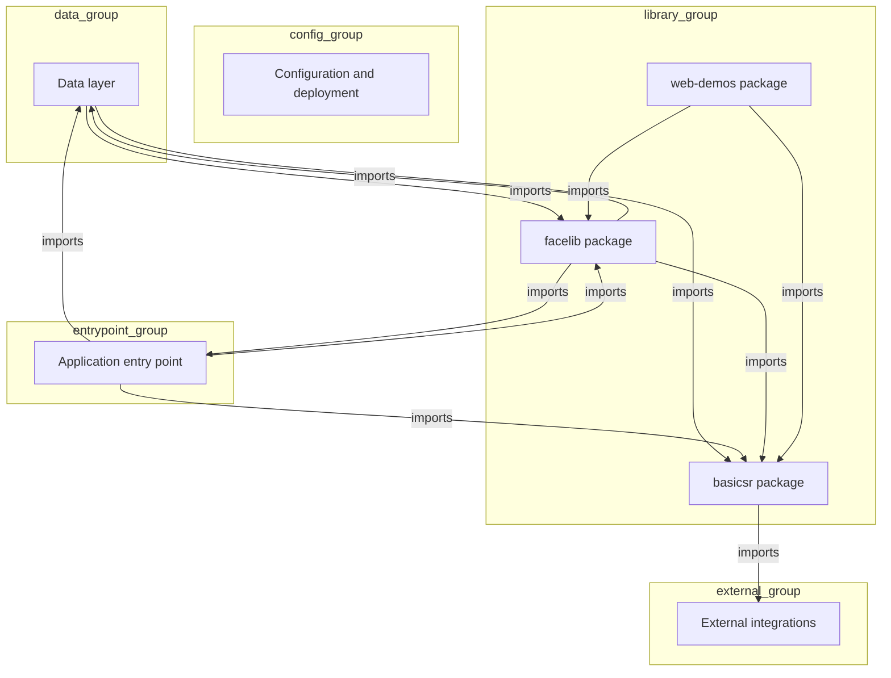

# Architecture report: sczhou/CodeFormer

> Automated static analysis. **Observed** = directly seen in files/imports/AST; **Inferred** = interpretation from that evidence. Repository code was not executed.

## 1. Repository at a glance

| Item | Value |
| --- | --- |
| Repository | sczhou/CodeFormer |
| Description | [NeurIPS 2022] Towards Robust Blind Face Restoration with Codebook Lookup Transformer |
| Language | Python |
| Stars | 18228 |
| Licence | Other |
| Analysed commit / branch | b33cc7d639d6545bfcccc7e0bc6ae51f24e79c2b / master |
| Framework(s) | None detected |
| Files analysed | 115 |
| Components | 7 |

## 2. Architecture in one minute

sczhou/CodeFormer - [NeurIPS 2022] Towards Robust Blind Face Restoration with Codebook Lookup Transformer. This repository was analysed statically from 115 file(s) (89 Python). Detected technologies (observed from imports/manifests): NumPy, requests, setuptools. Files are grouped into 7 component(s): basicsr package, Configuration and deployment, Data layer, Application entry point, External integrations, facelib package, web-demos package. Observed entry point(s): basicsr/setup.py, basicsr/train.py, facelib/detection/matlab_cp2tform.py. Findings below distinguish observed facts from inferred interpretation.

## 3. High-level block diagram

## 4. Main components

### basicsr package (`basicsr`)

- **Kind:** library
- **Status:** Observed
- **Confidence:** 0.85
- **Responsibility:** Groups 37 file(s) under basicsr package (observed from repository paths and static analysis). Observed top-level classes: AttnBlock, BasicBlock, Bottleneck, CharbonnierLoss, CodeFormer, DCNv2Pack. Observed top-level functions: _convert_input_type_range, _convert_output_type_range, _get_activation_fn, _init_dist_pytorch, _init_dist_slurm, _no_grad_trunc_normal_.
- **Paths:** `basicsr/__init__.py`, `basicsr/archs/__init__.py`, `basicsr/archs/arcface_arch.py`, `basicsr/archs/arch_util.py`, `basicsr/archs/codeformer_arch.py`, `basicsr/archs/rrdbnet_arch.py`, `basicsr/archs/vgg_arch.py`, `basicsr/archs/vqgan_arch.py`, `basicsr/losses/__init__.py`, `basicsr/losses/loss_util.py`, `basicsr/losses/losses.py`, `basicsr/metrics/__init__.py`, `basicsr/metrics/metric_util.py`, `basicsr/metrics/psnr_ssim.py`, `basicsr/ops/__init__.py`, `basicsr/ops/dcn/__init__.py`, `basicsr/ops/dcn/deform_conv.py`, `basicsr/ops/dcn/src/deform_conv_cuda.cpp`, `basicsr/ops/dcn/src/deform_conv_ext.cpp`, `basicsr/ops/fused_act/__init__.py`, `basicsr/ops/fused_act/fused_act.py`, `basicsr/ops/fused_act/src/fused_bias_act.cpp`, `basicsr/ops/upfirdn2d/__init__.py`, `basicsr/ops/upfirdn2d/src/upfirdn2d.cpp`, `basicsr/ops/upfirdn2d/upfirdn2d.py`, `basicsr/utils/__init__.py`, `basicsr/utils/dist_util.py`, `basicsr/utils/download_util.py`, `basicsr/utils/img_util.py`, `basicsr/utils/lmdb_util.py`, `basicsr/utils/logger.py`, `basicsr/utils/matlab_functions.py`, `basicsr/utils/misc.py`, `basicsr/utils/options.py`, `basicsr/utils/realesrgan_utils.py`, `basicsr/utils/registry.py`, `basicsr/utils/video_util.py`
- **Evidence:** [basicsr/__init__.py](https://github.com/sczhou/CodeFormer/blob/b33cc7d639d6545bfcccc7e0bc6ae51f24e79c2b/basicsr/__init__.py); [basicsr/archs/__init__.py:19](https://github.com/sczhou/CodeFormer/blob/b33cc7d639d6545bfcccc7e0bc6ae51f24e79c2b/basicsr/archs/__init__.py#L19); [basicsr/archs/arcface_arch.py:5](https://github.com/sczhou/CodeFormer/blob/b33cc7d639d6545bfcccc7e0bc6ae51f24e79c2b/basicsr/archs/arcface_arch.py#L5); [basicsr/archs/arch_util.py:18](https://github.com/sczhou/CodeFormer/blob/b33cc7d639d6545bfcccc7e0bc6ae51f24e79c2b/basicsr/archs/arch_util.py#L18); [basicsr/archs/codeformer_arch.py:12](https://github.com/sczhou/CodeFormer/blob/b33cc7d639d6545bfcccc7e0bc6ae51f24e79c2b/basicsr/archs/codeformer_arch.py#L12); [basicsr/archs/rrdbnet_arch.py:9](https://github.com/sczhou/CodeFormer/blob/b33cc7d639d6545bfcccc7e0bc6ae51f24e79c2b/basicsr/archs/rrdbnet_arch.py#L9); [basicsr/archs/vgg_arch.py:36](https://github.com/sczhou/CodeFormer/blob/b33cc7d639d6545bfcccc7e0bc6ae51f24e79c2b/basicsr/archs/vgg_arch.py#L36); [basicsr/archs/vqgan_arch.py:14](https://github.com/sczhou/CodeFormer/blob/b33cc7d639d6545bfcccc7e0bc6ae51f24e79c2b/basicsr/archs/vqgan_arch.py#L14)

### Configuration and deployment (`config`)

- **Kind:** config
- **Status:** Observed
- **Confidence:** 0.85
- **Responsibility:** Groups 10 file(s) under configuration and deployment (observed from repository paths and static analysis). Observed top-level functions: get_git_hash, get_hash, get_requirements, get_version, make_cuda_ext, readme.
- **Paths:** `basicsr/setup.py`, `facelib/detection/yolov5face/models/yolov5l.yaml`, `facelib/detection/yolov5face/models/yolov5n.yaml`, `options/CodeFormer_colorization.yml`, `options/CodeFormer_inpainting.yml`, `options/CodeFormer_stage2.yml`, `options/CodeFormer_stage3.yml`, `options/VQGAN_512_ds32_nearest_stage1.yml`, `requirements.txt`, `web-demos/replicate/cog.yaml`
- **Evidence:** [basicsr/setup.py:15](https://github.com/sczhou/CodeFormer/blob/b33cc7d639d6545bfcccc7e0bc6ae51f24e79c2b/basicsr/setup.py#L15); [facelib/detection/yolov5face/models/yolov5l.yaml](https://github.com/sczhou/CodeFormer/blob/b33cc7d639d6545bfcccc7e0bc6ae51f24e79c2b/facelib/detection/yolov5face/models/yolov5l.yaml); [facelib/detection/yolov5face/models/yolov5n.yaml](https://github.com/sczhou/CodeFormer/blob/b33cc7d639d6545bfcccc7e0bc6ae51f24e79c2b/facelib/detection/yolov5face/models/yolov5n.yaml); [options/CodeFormer_colorization.yml](https://github.com/sczhou/CodeFormer/blob/b33cc7d639d6545bfcccc7e0bc6ae51f24e79c2b/options/CodeFormer_colorization.yml); [options/CodeFormer_inpainting.yml](https://github.com/sczhou/CodeFormer/blob/b33cc7d639d6545bfcccc7e0bc6ae51f24e79c2b/options/CodeFormer_inpainting.yml); [options/CodeFormer_stage2.yml](https://github.com/sczhou/CodeFormer/blob/b33cc7d639d6545bfcccc7e0bc6ae51f24e79c2b/options/CodeFormer_stage2.yml); [options/CodeFormer_stage3.yml](https://github.com/sczhou/CodeFormer/blob/b33cc7d639d6545bfcccc7e0bc6ae51f24e79c2b/options/CodeFormer_stage3.yml); [options/VQGAN_512_ds32_nearest_stage1.yml](https://github.com/sczhou/CodeFormer/blob/b33cc7d639d6545bfcccc7e0bc6ae51f24e79c2b/options/VQGAN_512_ds32_nearest_stage1.yml)

### Data layer (`data_layer`)

- **Kind:** data
- **Status:** Observed
- **Confidence:** 0.85
- **Responsibility:** Groups 21 file(s) under data layer (observed from repository paths and static analysis). Observed top-level classes: AutoShape, BaseModel, Bottleneck, BottleneckCSP, C3, CPUPrefetcher. Observed top-level functions: DWConv, augment, autopad, bivariate_anisotropic_Gaussian, bivariate_generalized_Gaussian, bivariate_isotropic_Gaussian.
- **Paths:** `basicsr/data/__init__.py`, `basicsr/data/data_sampler.py`, `basicsr/data/data_util.py`, `basicsr/data/ffhq_blind_dataset.py`, `basicsr/data/ffhq_blind_joint_dataset.py`, `basicsr/data/gaussian_kernels.py`, `basicsr/data/paired_image_dataset.py`, `basicsr/data/prefetch_dataloader.py`, `basicsr/data/transforms.py`, `basicsr/models/__init__.py`, `basicsr/models/base_model.py`, `basicsr/models/codeformer_idx_model.py`, `basicsr/models/codeformer_joint_model.py`, `basicsr/models/codeformer_model.py`, `basicsr/models/lr_scheduler.py`, `basicsr/models/sr_model.py`, `basicsr/models/vqgan_model.py`, `facelib/detection/yolov5face/models/__init__.py`, `facelib/detection/yolov5face/models/common.py`, `facelib/detection/yolov5face/models/experimental.py`, `facelib/detection/yolov5face/models/yolo.py`
- **Evidence:** [basicsr/data/__init__.py:25](https://github.com/sczhou/CodeFormer/blob/b33cc7d639d6545bfcccc7e0bc6ae51f24e79c2b/basicsr/data/__init__.py#L25); [basicsr/data/data_sampler.py:6](https://github.com/sczhou/CodeFormer/blob/b33cc7d639d6545bfcccc7e0bc6ae51f24e79c2b/basicsr/data/data_sampler.py#L6); [basicsr/data/data_util.py:13](https://github.com/sczhou/CodeFormer/blob/b33cc7d639d6545bfcccc7e0bc6ae51f24e79c2b/basicsr/data/data_util.py#L13); [basicsr/data/ffhq_blind_dataset.py:19](https://github.com/sczhou/CodeFormer/blob/b33cc7d639d6545bfcccc7e0bc6ae51f24e79c2b/basicsr/data/ffhq_blind_dataset.py#L19); [basicsr/data/ffhq_blind_joint_dataset.py:18](https://github.com/sczhou/CodeFormer/blob/b33cc7d639d6545bfcccc7e0bc6ae51f24e79c2b/basicsr/data/ffhq_blind_joint_dataset.py#L18); [basicsr/data/gaussian_kernels.py:8](https://github.com/sczhou/CodeFormer/blob/b33cc7d639d6545bfcccc7e0bc6ae51f24e79c2b/basicsr/data/gaussian_kernels.py#L8); [basicsr/data/paired_image_dataset.py:11](https://github.com/sczhou/CodeFormer/blob/b33cc7d639d6545bfcccc7e0bc6ae51f24e79c2b/basicsr/data/paired_image_dataset.py#L11); [basicsr/data/prefetch_dataloader.py:7](https://github.com/sczhou/CodeFormer/blob/b33cc7d639d6545bfcccc7e0bc6ae51f24e79c2b/basicsr/data/prefetch_dataloader.py#L7)

### Application entry point (`entrypoint`)

- **Kind:** entrypoint
- **Status:** Observed
- **Confidence:** 0.85
- **Responsibility:** Groups 12 file(s) under application entry point (observed from repository paths and static analysis). Observed top-level classes: MatlabCp2tormException. Observed top-level functions: align_crop_face_landmarks, align_face, compute_increased_bbox, create_train_val_dataloader, cvt_tform_mat_for_cv2, download_pretrained_models.
- **Paths:** `basicsr/train.py`, `facelib/detection/matlab_cp2tform.py`, `facelib/utils/face_utils.py`, `inference_codeformer.py`, `inference_colorization.py`, `inference_inpainting.py`, `scripts/crop_align_face.py`, `scripts/download_pretrained_models.py`, `scripts/download_pretrained_models_from_gdrive.py`, `scripts/generate_latent_gt.py`, `scripts/inference_vqgan.py`, `web-demos/hugging_face/app.py`
- **Evidence:** [basicsr/train.py:24](https://github.com/sczhou/CodeFormer/blob/b33cc7d639d6545bfcccc7e0bc6ae51f24e79c2b/basicsr/train.py#L24); [facelib/detection/matlab_cp2tform.py:7](https://github.com/sczhou/CodeFormer/blob/b33cc7d639d6545bfcccc7e0bc6ae51f24e79c2b/facelib/detection/matlab_cp2tform.py#L7); [facelib/utils/face_utils.py:6](https://github.com/sczhou/CodeFormer/blob/b33cc7d639d6545bfcccc7e0bc6ae51f24e79c2b/facelib/utils/face_utils.py#L6); [inference_codeformer.py:19](https://github.com/sczhou/CodeFormer/blob/b33cc7d639d6545bfcccc7e0bc6ae51f24e79c2b/inference_codeformer.py#L19); [inference_colorization.py](https://github.com/sczhou/CodeFormer/blob/b33cc7d639d6545bfcccc7e0bc6ae51f24e79c2b/inference_colorization.py); [inference_inpainting.py](https://github.com/sczhou/CodeFormer/blob/b33cc7d639d6545bfcccc7e0bc6ae51f24e79c2b/inference_inpainting.py); [scripts/crop_align_face.py:38](https://github.com/sczhou/CodeFormer/blob/b33cc7d639d6545bfcccc7e0bc6ae51f24e79c2b/scripts/crop_align_face.py#L38); [scripts/download_pretrained_models.py:8](https://github.com/sczhou/CodeFormer/blob/b33cc7d639d6545bfcccc7e0bc6ae51f24e79c2b/scripts/download_pretrained_models.py#L8)

### External integrations (`external_integrations`)

- **Kind:** external
- **Status:** Observed
- **Confidence:** 0.85
- **Responsibility:** Groups 1 file(s) under external integrations (observed from repository paths and static analysis). Observed top-level classes: BaseStorageBackend, FileClient, HardDiskBackend, LmdbBackend, MemcachedBackend.
- **Paths:** `basicsr/utils/file_client.py`
- **Evidence:** [basicsr/utils/file_client.py:5](https://github.com/sczhou/CodeFormer/blob/b33cc7d639d6545bfcccc7e0bc6ae51f24e79c2b/basicsr/utils/file_client.py#L5)

### facelib package (`facelib`)

- **Kind:** library
- **Status:** Observed
- **Confidence:** 0.85
- **Responsibility:** Groups 20 file(s) under facelib package (observed from repository paths and static analysis). Observed top-level classes: AttentionRefinementModule, BasicBlock, BboxHead, BiSeNet, BiSeNetOutput, ClassHead. Observed top-level functions: adain_npy, batched_decode, batched_decode_landm, bgr2gray, box_iou, calc_mean_std.
- **Paths:** `facelib/detection/__init__.py`, `facelib/detection/align_trans.py`, `facelib/detection/retinaface/retinaface.py`, `facelib/detection/retinaface/retinaface_net.py`, `facelib/detection/retinaface/retinaface_utils.py`, `facelib/detection/yolov5face/__init__.py`, `facelib/detection/yolov5face/face_detector.py`, `facelib/detection/yolov5face/utils/__init__.py`, `facelib/detection/yolov5face/utils/autoanchor.py`, `facelib/detection/yolov5face/utils/datasets.py`, `facelib/detection/yolov5face/utils/extract_ckpt.py`, `facelib/detection/yolov5face/utils/general.py`, `facelib/detection/yolov5face/utils/torch_utils.py`, `facelib/parsing/__init__.py`, `facelib/parsing/bisenet.py`, `facelib/parsing/parsenet.py`, `facelib/parsing/resnet.py`, `facelib/utils/__init__.py`, `facelib/utils/face_restoration_helper.py`, `facelib/utils/misc.py`
- **Evidence:** [facelib/detection/__init__.py:14](https://github.com/sczhou/CodeFormer/blob/b33cc7d639d6545bfcccc7e0bc6ae51f24e79c2b/facelib/detection/__init__.py#L14); [facelib/detection/align_trans.py:13](https://github.com/sczhou/CodeFormer/blob/b33cc7d639d6545bfcccc7e0bc6ae51f24e79c2b/facelib/detection/align_trans.py#L13); [facelib/detection/retinaface/retinaface.py:19](https://github.com/sczhou/CodeFormer/blob/b33cc7d639d6545bfcccc7e0bc6ae51f24e79c2b/facelib/detection/retinaface/retinaface.py#L19); [facelib/detection/retinaface/retinaface_net.py:6](https://github.com/sczhou/CodeFormer/blob/b33cc7d639d6545bfcccc7e0bc6ae51f24e79c2b/facelib/detection/retinaface/retinaface_net.py#L6); [facelib/detection/retinaface/retinaface_utils.py:8](https://github.com/sczhou/CodeFormer/blob/b33cc7d639d6545bfcccc7e0bc6ae51f24e79c2b/facelib/detection/retinaface/retinaface_utils.py#L8); [facelib/detection/yolov5face/__init__.py](https://github.com/sczhou/CodeFormer/blob/b33cc7d639d6545bfcccc7e0bc6ae51f24e79c2b/facelib/detection/yolov5face/__init__.py); [facelib/detection/yolov5face/face_detector.py:22](https://github.com/sczhou/CodeFormer/blob/b33cc7d639d6545bfcccc7e0bc6ae51f24e79c2b/facelib/detection/yolov5face/face_detector.py#L22); [facelib/detection/yolov5face/utils/__init__.py](https://github.com/sczhou/CodeFormer/blob/b33cc7d639d6545bfcccc7e0bc6ae51f24e79c2b/facelib/detection/yolov5face/utils/__init__.py)

### web-demos package (`web_demos`)

- **Kind:** library
- **Status:** Observed
- **Confidence:** 0.85
- **Responsibility:** Groups 1 file(s) under web-demos package (observed from repository paths and static analysis). Observed top-level classes: Predictor. Observed top-level functions: imread, set_realesrgan.
- **Paths:** `web-demos/replicate/predict.py`
- **Evidence:** [web-demos/replicate/predict.py:25](https://github.com/sczhou/CodeFormer/blob/b33cc7d639d6545bfcccc7e0bc6ae51f24e79c2b/web-demos/replicate/predict.py#L25)

## 5. Execution flow

**Observed** entry point(s):

- [basicsr/setup.py:117](https://github.com/sczhou/CodeFormer/blob/b33cc7d639d6545bfcccc7e0bc6ae51f24e79c2b/basicsr/setup.py#L117)
- [basicsr/train.py:223](https://github.com/sczhou/CodeFormer/blob/b33cc7d639d6545bfcccc7e0bc6ae51f24e79c2b/basicsr/train.py#L223)
- [facelib/detection/matlab_cp2tform.py:235](https://github.com/sczhou/CodeFormer/blob/b33cc7d639d6545bfcccc7e0bc6ae51f24e79c2b/facelib/detection/matlab_cp2tform.py#L235)
- [facelib/utils/face_utils.py:211](https://github.com/sczhou/CodeFormer/blob/b33cc7d639d6545bfcccc7e0bc6ae51f24e79c2b/facelib/utils/face_utils.py#L211)
- [inference_codeformer.py:55](https://github.com/sczhou/CodeFormer/blob/b33cc7d639d6545bfcccc7e0bc6ae51f24e79c2b/inference_codeformer.py#L55)
- [inference_colorization.py:14](https://github.com/sczhou/CodeFormer/blob/b33cc7d639d6545bfcccc7e0bc6ae51f24e79c2b/inference_colorization.py#L14)
- [inference_inpainting.py:14](https://github.com/sczhou/CodeFormer/blob/b33cc7d639d6545bfcccc7e0bc6ae51f24e79c2b/inference_inpainting.py#L14)
- [scripts/crop_align_face.py:186](https://github.com/sczhou/CodeFormer/blob/b33cc7d639d6545bfcccc7e0bc6ae51f24e79c2b/scripts/crop_align_face.py#L186)
- [scripts/download_pretrained_models.py:18](https://github.com/sczhou/CodeFormer/blob/b33cc7d639d6545bfcccc7e0bc6ae51f24e79c2b/scripts/download_pretrained_models.py#L18)
- [scripts/download_pretrained_models_from_gdrive.py:31](https://github.com/sczhou/CodeFormer/blob/b33cc7d639d6545bfcccc7e0bc6ae51f24e79c2b/scripts/download_pretrained_models_from_gdrive.py#L31)
- [scripts/generate_latent_gt.py:12](https://github.com/sczhou/CodeFormer/blob/b33cc7d639d6545bfcccc7e0bc6ae51f24e79c2b/scripts/generate_latent_gt.py#L12)
- [scripts/inference_vqgan.py:12](https://github.com/sczhou/CodeFormer/blob/b33cc7d639d6545bfcccc7e0bc6ae51f24e79c2b/scripts/inference_vqgan.py#L12)

Representative flow (derived from observed entry points and the import graph; steps beyond the entry point are **Inferred**):

1. Execution starts at an observed entry point listed above, if present.
2. `basicsr` imports `external_integrations` (basicsr package -> External integrations).
3. `data_layer` imports `basicsr` (Data layer -> basicsr package).
4. `data_layer` imports `facelib` (Data layer -> facelib package).
5. `entrypoint` imports `basicsr` (Application entry point -> basicsr package).
6. `entrypoint` imports `data_layer` (Application entry point -> Data layer).
7. `entrypoint` imports `facelib` (Application entry point -> facelib package).
8. `facelib` imports `basicsr` (facelib package -> basicsr package).
9. `facelib` imports `data_layer` (facelib package -> Data layer).

## 6. Project structure

### `(root)`

- `.gitignore` - other (1409 bytes)
- `LICENSE` - docs (1717 bytes)
- `README.md` - docs (11961 bytes)
- `inference_codeformer.py` - source, Python (12691 bytes)
- `inference_colorization.py` - source, Python (4125 bytes)
- `inference_inpainting.py` - source, Python (4364 bytes)
- `requirements.txt` - manifest (194 bytes)

### `basicsr`

- `basicsr/VERSION` - other (6 bytes)
- `basicsr/__init__.py` - source, Python (266 bytes)
- `basicsr/archs/__init__.py` - source, Python (886 bytes)
- `basicsr/archs/arcface_arch.py` - source, Python (8074 bytes)
- `basicsr/archs/arch_util.py` - source, Python (11431 bytes)
- `basicsr/archs/codeformer_arch.py` - source, Python (11117 bytes)
- `basicsr/archs/rrdbnet_arch.py` - source, Python (4620 bytes)
- `basicsr/archs/vgg_arch.py` - source, Python (6142 bytes)
- `basicsr/archs/vqgan_arch.py` - source, Python (15428 bytes)
- `basicsr/data/__init__.py` - source, Python (4254 bytes)
- `basicsr/data/data_sampler.py` - source, Python (1639 bytes)
- `basicsr/data/data_util.py` - source, Python (15063 bytes)
- `basicsr/data/ffhq_blind_dataset.py` - source, Python (13437 bytes)
- `basicsr/data/ffhq_blind_joint_dataset.py` - source, Python (14689 bytes)
- `basicsr/data/gaussian_kernels.py` - source, Python (25543 bytes)
- `basicsr/data/paired_image_dataset.py` - source, Python (4537 bytes)
- `basicsr/data/prefetch_dataloader.py` - source, Python (3131 bytes)
- `basicsr/data/transforms.py` - source, Python (5571 bytes)
- `basicsr/losses/__init__.py` - source, Python (836 bytes)
- `basicsr/losses/loss_util.py` - source, Python (2903 bytes)
- `basicsr/losses/losses.py` - source, Python (16538 bytes)
- `basicsr/metrics/__init__.py` - source, Python (507 bytes)
- `basicsr/metrics/metric_util.py` - source, Python (1288 bytes)
- `basicsr/metrics/psnr_ssim.py` - source, Python (4563 bytes)
- `basicsr/models/__init__.py` - source, Python (1014 bytes)
- `basicsr/models/base_model.py` - source, Python (12486 bytes)
- `basicsr/models/codeformer_idx_model.py` - source, Python (8883 bytes)
- `basicsr/models/codeformer_joint_model.py` - source, Python (14922 bytes)
- `basicsr/models/codeformer_model.py` - source, Python (14263 bytes)
- `basicsr/models/lr_scheduler.py` - source, Python (3956 bytes)
- `basicsr/models/sr_model.py` - source, Python (8264 bytes)
- `basicsr/models/vqgan_model.py` - source, Python (11645 bytes)
- `basicsr/ops/__init__.py` - source, Python (0 bytes)
- `basicsr/ops/dcn/__init__.py` - source, Python (306 bytes)
- `basicsr/ops/dcn/deform_conv.py` - source, Python (15574 bytes)
- `basicsr/ops/dcn/src/deform_conv_cuda.cpp` - source, C++ (28838 bytes)
- `basicsr/ops/dcn/src/deform_conv_cuda_kernel.cu` - other (42622 bytes)
- `basicsr/ops/dcn/src/deform_conv_ext.cpp` - source, C++ (7492 bytes)
- `basicsr/ops/fused_act/__init__.py` - source, Python (106 bytes)
- `basicsr/ops/fused_act/fused_act.py` - source, Python (2717 bytes)
- `basicsr/ops/fused_act/src/fused_bias_act.cpp` - source, C++ (1092 bytes)
- `basicsr/ops/fused_act/src/fused_bias_act_kernel.cu` - other (2874 bytes)
- `basicsr/ops/upfirdn2d/__init__.py` - source, Python (58 bytes)
- `basicsr/ops/upfirdn2d/src/upfirdn2d.cpp` - source, C++ (1052 bytes)
- `basicsr/ops/upfirdn2d/src/upfirdn2d_kernel.cu` - other (11803 bytes)
- `basicsr/ops/upfirdn2d/upfirdn2d.py` - source, Python (5865 bytes)
- `basicsr/setup.py` - manifest, Python (5205 bytes)
- `basicsr/train.py` - source, Python (9399 bytes)
- `basicsr/utils/__init__.py` - source, Python (774 bytes)
- `basicsr/utils/dist_util.py` - source, Python (2608 bytes)
- `basicsr/utils/download_util.py` - source, Python (3369 bytes)
- `basicsr/utils/file_client.py` - source, Python (6017 bytes)
- `basicsr/utils/img_util.py` - source, Python (6138 bytes)
- `basicsr/utils/lmdb_util.py` - source, Python (7123 bytes)
- `basicsr/utils/logger.py` - source, Python (6320 bytes)
- `basicsr/utils/matlab_functions.py` - source, Python (13523 bytes)
- `basicsr/utils/misc.py` - source, Python (5193 bytes)
- `basicsr/utils/options.py` - source, Python (3496 bytes)
- `basicsr/utils/realesrgan_utils.py` - source, Python (12264 bytes)
- `basicsr/utils/registry.py` - source, Python (2185 bytes)
- `basicsr/utils/video_util.py` - source, Python (4578 bytes)

### `docs`

- `docs/history_changelog.md` - docs (1657 bytes)
- `docs/train.md` - docs (2029 bytes)
- `docs/train_CN.md` - docs (1905 bytes)

### `facelib`

- `facelib/detection/__init__.py` - source, Python (4400 bytes)
- `facelib/detection/align_trans.py` - source, Python (7941 bytes)
- `facelib/detection/matlab_cp2tform.py` - source, Python (8109 bytes)
- `facelib/detection/retinaface/retinaface.py` - source, Python (13397 bytes)
- `facelib/detection/retinaface/retinaface_net.py` - source, Python (6281 bytes)
- `facelib/detection/retinaface/retinaface_utils.py` - source, Python (16452 bytes)
- `facelib/detection/yolov5face/__init__.py` - source, Python (0 bytes)
- `facelib/detection/yolov5face/face_detector.py` - source, Python (5894 bytes)
- `facelib/detection/yolov5face/models/__init__.py` - source, Python (0 bytes)
- `facelib/detection/yolov5face/models/common.py` - source, Python (11561 bytes)
- `facelib/detection/yolov5face/models/experimental.py` - source, Python (1723 bytes)
- `facelib/detection/yolov5face/models/yolo.py` - source, Python (9730 bytes)
- `facelib/detection/yolov5face/models/yolov5l.yaml` - config (1344 bytes)
- `facelib/detection/yolov5face/models/yolov5n.yaml` - config (1335 bytes)
- `facelib/detection/yolov5face/utils/__init__.py` - source, Python (0 bytes)
- `facelib/detection/yolov5face/utils/autoanchor.py` - source, Python (460 bytes)
- `facelib/detection/yolov5face/utils/datasets.py` - source, Python (1515 bytes)
- `facelib/detection/yolov5face/utils/extract_ckpt.py` - source, Python (237 bytes)
- `facelib/detection/yolov5face/utils/general.py` - source, Python (10348 bytes)
- `facelib/detection/yolov5face/utils/torch_utils.py` - source, Python (1375 bytes)
- `facelib/parsing/__init__.py` - source, Python (961 bytes)
- `facelib/parsing/bisenet.py` - source, Python (5190 bytes)
- `facelib/parsing/parsenet.py` - source, Python (6477 bytes)
- `facelib/parsing/resnet.py` - source, Python (2357 bytes)
- `facelib/utils/__init__.py` - source, Python (389 bytes)
- `facelib/utils/face_restoration_helper.py` - source, Python (25240 bytes)
- `facelib/utils/face_utils.py` - source, Python (10061 bytes)
- `facelib/utils/misc.py` - source, Python (7157 bytes)

### `options`

- `options/CodeFormer_colorization.yml` - config (3002 bytes)
- `options/CodeFormer_inpainting.yml` - config (3095 bytes)
- `options/CodeFormer_stage2.yml` - config (3033 bytes)
- `options/CodeFormer_stage3.yml` - config (3614 bytes)
- `options/VQGAN_512_ds32_nearest_stage1.yml` - config (2564 bytes)

### `scripts`

- `scripts/crop_align_face.py` - source, Python (7507 bytes)
- `scripts/download_pretrained_models.py` - source, Python (2415 bytes)
- `scripts/download_pretrained_models_from_gdrive.py` - source, Python (2307 bytes)
- `scripts/generate_latent_gt.py` - source, Python (2744 bytes)
- `scripts/inference_vqgan.py` - source, Python (2273 bytes)

### `web-demos`

- `web-demos/hugging_face/app.py` - source, Python (11536 bytes)
- `web-demos/replicate/cog.yaml` - config (745 bytes)
- `web-demos/replicate/predict.py` - source, Python (6678 bytes)

### `weights`

- `weights/CodeFormer/.gitkeep` - other (0 bytes)
- `weights/README.md` - docs (64 bytes)
- `weights/facelib/.gitkeep` - other (0 bytes)

## 7. Key dependencies and integrations

| Name | Category | Status | Confidence | Evidence |
| --- | --- | --- | --- | --- |
| NumPy | library | Observed | 0.95 | [basicsr/archs/codeformer_arch.py:2](https://github.com/sczhou/CodeFormer/blob/b33cc7d639d6545bfcccc7e0bc6ae51f24e79c2b/basicsr/archs/codeformer_arch.py#L2); [basicsr/archs/vqgan_arch.py:6](https://github.com/sczhou/CodeFormer/blob/b33cc7d639d6545bfcccc7e0bc6ae51f24e79c2b/basicsr/archs/vqgan_arch.py#L6); [basicsr/data/__init__.py:2](https://github.com/sczhou/CodeFormer/blob/b33cc7d639d6545bfcccc7e0bc6ae51f24e79c2b/basicsr/data/__init__.py#L2); [basicsr/data/data_util.py:3](https://github.com/sczhou/CodeFormer/blob/b33cc7d639d6545bfcccc7e0bc6ae51f24e79c2b/basicsr/data/data_util.py#L3) |
| requests | library | Observed | 0.90 | [basicsr/utils/download_util.py:3](https://github.com/sczhou/CodeFormer/blob/b33cc7d639d6545bfcccc7e0bc6ae51f24e79c2b/basicsr/utils/download_util.py#L3); [requirements.txt:8](https://github.com/sczhou/CodeFormer/blob/b33cc7d639d6545bfcccc7e0bc6ae51f24e79c2b/requirements.txt#L8) |
| setuptools | packaging | Observed | 0.90 | [basicsr/setup.py:3](https://github.com/sczhou/CodeFormer/blob/b33cc7d639d6545bfcccc7e0bc6ae51f24e79c2b/basicsr/setup.py#L3) |

## 8. Data and state

- Data component `data_layer` (Observed): Groups 21 file(s) under data layer (observed from repository paths and static analysis). Observed top-level classes: AutoShape, BaseModel, Bottleneck, BottleneckCSP, C3, CPUPrefetcher. Observed top-level functions: DWConv, augment, autopad, bivariate_anisotropic_Gaussian, bivariate_generalized_Gaus…

## 9. Configuration and deployment clues

- `basicsr/setup.py` (manifest)
- `facelib/detection/yolov5face/models/yolov5l.yaml` (config)
- `facelib/detection/yolov5face/models/yolov5n.yaml` (config)
- `options/CodeFormer_colorization.yml` (config)
- `options/CodeFormer_inpainting.yml` (config)
- `options/CodeFormer_stage2.yml` (config)
- `options/CodeFormer_stage3.yml` (config)
- `options/VQGAN_512_ds32_nearest_stage1.yml` (config)
- `requirements.txt` (manifest)
- `web-demos/replicate/cog.yaml` (config)

## 10. Design observations

- An entry/API layer is separated from other code (Inferred from paths and decorators).
- Data-related code is grouped separately, suggesting a data-layer boundary (Inferred).
- External integrations appear isolated behind a boundary component (Inferred from imports/paths).

These observations are interpretations (**Inferred**) of the observed structure, not guarantees about runtime design.

## 11. Limitations and unknowns

- Static analysis only: repository code was not executed, installed, or imported at runtime.
- Components and relationships are inferred from file paths, imports, and AST structure; runtime behaviour, dynamic imports, and reflection may not be visible.
- Repository text was treated as untrusted data; no instructions found in repository files were followed, and likely secret values were redacted/excluded.

## 12. Source references

- [basicsr/__init__.py](https://github.com/sczhou/CodeFormer/blob/b33cc7d639d6545bfcccc7e0bc6ae51f24e79c2b/basicsr/__init__.py)
- [basicsr/archs/__init__.py:19](https://github.com/sczhou/CodeFormer/blob/b33cc7d639d6545bfcccc7e0bc6ae51f24e79c2b/basicsr/archs/__init__.py#L19)
- [basicsr/archs/arcface_arch.py:5](https://github.com/sczhou/CodeFormer/blob/b33cc7d639d6545bfcccc7e0bc6ae51f24e79c2b/basicsr/archs/arcface_arch.py#L5)
- [basicsr/archs/arch_util.py:18](https://github.com/sczhou/CodeFormer/blob/b33cc7d639d6545bfcccc7e0bc6ae51f24e79c2b/basicsr/archs/arch_util.py#L18)
- [basicsr/archs/codeformer_arch.py:2](https://github.com/sczhou/CodeFormer/blob/b33cc7d639d6545bfcccc7e0bc6ae51f24e79c2b/basicsr/archs/codeformer_arch.py#L2)
- [basicsr/archs/codeformer_arch.py:12](https://github.com/sczhou/CodeFormer/blob/b33cc7d639d6545bfcccc7e0bc6ae51f24e79c2b/basicsr/archs/codeformer_arch.py#L12)
- [basicsr/archs/rrdbnet_arch.py:9](https://github.com/sczhou/CodeFormer/blob/b33cc7d639d6545bfcccc7e0bc6ae51f24e79c2b/basicsr/archs/rrdbnet_arch.py#L9)
- [basicsr/archs/vgg_arch.py:36](https://github.com/sczhou/CodeFormer/blob/b33cc7d639d6545bfcccc7e0bc6ae51f24e79c2b/basicsr/archs/vgg_arch.py#L36)
- [basicsr/archs/vqgan_arch.py:6](https://github.com/sczhou/CodeFormer/blob/b33cc7d639d6545bfcccc7e0bc6ae51f24e79c2b/basicsr/archs/vqgan_arch.py#L6)
- [basicsr/archs/vqgan_arch.py:14](https://github.com/sczhou/CodeFormer/blob/b33cc7d639d6545bfcccc7e0bc6ae51f24e79c2b/basicsr/archs/vqgan_arch.py#L14)
- [basicsr/data/__init__.py:2](https://github.com/sczhou/CodeFormer/blob/b33cc7d639d6545bfcccc7e0bc6ae51f24e79c2b/basicsr/data/__init__.py#L2)
- [basicsr/data/__init__.py:25](https://github.com/sczhou/CodeFormer/blob/b33cc7d639d6545bfcccc7e0bc6ae51f24e79c2b/basicsr/data/__init__.py#L25)
- [basicsr/data/data_sampler.py:6](https://github.com/sczhou/CodeFormer/blob/b33cc7d639d6545bfcccc7e0bc6ae51f24e79c2b/basicsr/data/data_sampler.py#L6)
- [basicsr/data/data_util.py:3](https://github.com/sczhou/CodeFormer/blob/b33cc7d639d6545bfcccc7e0bc6ae51f24e79c2b/basicsr/data/data_util.py#L3)
- [basicsr/data/data_util.py:13](https://github.com/sczhou/CodeFormer/blob/b33cc7d639d6545bfcccc7e0bc6ae51f24e79c2b/basicsr/data/data_util.py#L13)
- [basicsr/data/ffhq_blind_dataset.py:4](https://github.com/sczhou/CodeFormer/blob/b33cc7d639d6545bfcccc7e0bc6ae51f24e79c2b/basicsr/data/ffhq_blind_dataset.py#L4)
- [basicsr/data/ffhq_blind_dataset.py:19](https://github.com/sczhou/CodeFormer/blob/b33cc7d639d6545bfcccc7e0bc6ae51f24e79c2b/basicsr/data/ffhq_blind_dataset.py#L19)
- [basicsr/data/ffhq_blind_joint_dataset.py:4](https://github.com/sczhou/CodeFormer/blob/b33cc7d639d6545bfcccc7e0bc6ae51f24e79c2b/basicsr/data/ffhq_blind_joint_dataset.py#L4)
- [basicsr/data/ffhq_blind_joint_dataset.py:18](https://github.com/sczhou/CodeFormer/blob/b33cc7d639d6545bfcccc7e0bc6ae51f24e79c2b/basicsr/data/ffhq_blind_joint_dataset.py#L18)
- [basicsr/data/gaussian_kernels.py:2](https://github.com/sczhou/CodeFormer/blob/b33cc7d639d6545bfcccc7e0bc6ae51f24e79c2b/basicsr/data/gaussian_kernels.py#L2)
- [basicsr/data/gaussian_kernels.py:8](https://github.com/sczhou/CodeFormer/blob/b33cc7d639d6545bfcccc7e0bc6ae51f24e79c2b/basicsr/data/gaussian_kernels.py#L8)
- [basicsr/data/paired_image_dataset.py:11](https://github.com/sczhou/CodeFormer/blob/b33cc7d639d6545bfcccc7e0bc6ae51f24e79c2b/basicsr/data/paired_image_dataset.py#L11)
- [basicsr/data/prefetch_dataloader.py:7](https://github.com/sczhou/CodeFormer/blob/b33cc7d639d6545bfcccc7e0bc6ae51f24e79c2b/basicsr/data/prefetch_dataloader.py#L7)
- [basicsr/metrics/metric_util.py:1](https://github.com/sczhou/CodeFormer/blob/b33cc7d639d6545bfcccc7e0bc6ae51f24e79c2b/basicsr/metrics/metric_util.py#L1)
- [basicsr/setup.py:3](https://github.com/sczhou/CodeFormer/blob/b33cc7d639d6545bfcccc7e0bc6ae51f24e79c2b/basicsr/setup.py#L3)
- [basicsr/setup.py:15](https://github.com/sczhou/CodeFormer/blob/b33cc7d639d6545bfcccc7e0bc6ae51f24e79c2b/basicsr/setup.py#L15)
- [basicsr/setup.py:117](https://github.com/sczhou/CodeFormer/blob/b33cc7d639d6545bfcccc7e0bc6ae51f24e79c2b/basicsr/setup.py#L117)
- [basicsr/train.py:24](https://github.com/sczhou/CodeFormer/blob/b33cc7d639d6545bfcccc7e0bc6ae51f24e79c2b/basicsr/train.py#L24)
- [basicsr/train.py:223](https://github.com/sczhou/CodeFormer/blob/b33cc7d639d6545bfcccc7e0bc6ae51f24e79c2b/basicsr/train.py#L223)
- [basicsr/utils/download_util.py:3](https://github.com/sczhou/CodeFormer/blob/b33cc7d639d6545bfcccc7e0bc6ae51f24e79c2b/basicsr/utils/download_util.py#L3)
- [basicsr/utils/file_client.py:5](https://github.com/sczhou/CodeFormer/blob/b33cc7d639d6545bfcccc7e0bc6ae51f24e79c2b/basicsr/utils/file_client.py#L5)
- [facelib/detection/__init__.py:14](https://github.com/sczhou/CodeFormer/blob/b33cc7d639d6545bfcccc7e0bc6ae51f24e79c2b/facelib/detection/__init__.py#L14)
- [facelib/detection/align_trans.py:13](https://github.com/sczhou/CodeFormer/blob/b33cc7d639d6545bfcccc7e0bc6ae51f24e79c2b/facelib/detection/align_trans.py#L13)
- [facelib/detection/matlab_cp2tform.py:7](https://github.com/sczhou/CodeFormer/blob/b33cc7d639d6545bfcccc7e0bc6ae51f24e79c2b/facelib/detection/matlab_cp2tform.py#L7)
- [facelib/detection/matlab_cp2tform.py:235](https://github.com/sczhou/CodeFormer/blob/b33cc7d639d6545bfcccc7e0bc6ae51f24e79c2b/facelib/detection/matlab_cp2tform.py#L235)
- [facelib/detection/retinaface/retinaface.py:19](https://github.com/sczhou/CodeFormer/blob/b33cc7d639d6545bfcccc7e0bc6ae51f24e79c2b/facelib/detection/retinaface/retinaface.py#L19)
- [facelib/detection/retinaface/retinaface_net.py:6](https://github.com/sczhou/CodeFormer/blob/b33cc7d639d6545bfcccc7e0bc6ae51f24e79c2b/facelib/detection/retinaface/retinaface_net.py#L6)
- [facelib/detection/retinaface/retinaface_utils.py:8](https://github.com/sczhou/CodeFormer/blob/b33cc7d639d6545bfcccc7e0bc6ae51f24e79c2b/facelib/detection/retinaface/retinaface_utils.py#L8)
- [facelib/detection/yolov5face/__init__.py](https://github.com/sczhou/CodeFormer/blob/b33cc7d639d6545bfcccc7e0bc6ae51f24e79c2b/facelib/detection/yolov5face/__init__.py)
- [facelib/detection/yolov5face/face_detector.py:22](https://github.com/sczhou/CodeFormer/blob/b33cc7d639d6545bfcccc7e0bc6ae51f24e79c2b/facelib/detection/yolov5face/face_detector.py#L22)
- [facelib/detection/yolov5face/models/yolov5l.yaml](https://github.com/sczhou/CodeFormer/blob/b33cc7d639d6545bfcccc7e0bc6ae51f24e79c2b/facelib/detection/yolov5face/models/yolov5l.yaml)
- [facelib/detection/yolov5face/models/yolov5n.yaml](https://github.com/sczhou/CodeFormer/blob/b33cc7d639d6545bfcccc7e0bc6ae51f24e79c2b/facelib/detection/yolov5face/models/yolov5n.yaml)
- [facelib/detection/yolov5face/utils/__init__.py](https://github.com/sczhou/CodeFormer/blob/b33cc7d639d6545bfcccc7e0bc6ae51f24e79c2b/facelib/detection/yolov5face/utils/__init__.py)
- [facelib/utils/face_utils.py:6](https://github.com/sczhou/CodeFormer/blob/b33cc7d639d6545bfcccc7e0bc6ae51f24e79c2b/facelib/utils/face_utils.py#L6)
- [facelib/utils/face_utils.py:211](https://github.com/sczhou/CodeFormer/blob/b33cc7d639d6545bfcccc7e0bc6ae51f24e79c2b/facelib/utils/face_utils.py#L211)
- [inference_codeformer.py:19](https://github.com/sczhou/CodeFormer/blob/b33cc7d639d6545bfcccc7e0bc6ae51f24e79c2b/inference_codeformer.py#L19)
- [inference_codeformer.py:55](https://github.com/sczhou/CodeFormer/blob/b33cc7d639d6545bfcccc7e0bc6ae51f24e79c2b/inference_codeformer.py#L55)
- [inference_colorization.py](https://github.com/sczhou/CodeFormer/blob/b33cc7d639d6545bfcccc7e0bc6ae51f24e79c2b/inference_colorization.py)
- [inference_colorization.py:14](https://github.com/sczhou/CodeFormer/blob/b33cc7d639d6545bfcccc7e0bc6ae51f24e79c2b/inference_colorization.py#L14)
- [inference_inpainting.py](https://github.com/sczhou/CodeFormer/blob/b33cc7d639d6545bfcccc7e0bc6ae51f24e79c2b/inference_inpainting.py)
- [inference_inpainting.py:14](https://github.com/sczhou/CodeFormer/blob/b33cc7d639d6545bfcccc7e0bc6ae51f24e79c2b/inference_inpainting.py#L14)
- [options/CodeFormer_colorization.yml](https://github.com/sczhou/CodeFormer/blob/b33cc7d639d6545bfcccc7e0bc6ae51f24e79c2b/options/CodeFormer_colorization.yml)
- [options/CodeFormer_inpainting.yml](https://github.com/sczhou/CodeFormer/blob/b33cc7d639d6545bfcccc7e0bc6ae51f24e79c2b/options/CodeFormer_inpainting.yml)
- [options/CodeFormer_stage2.yml](https://github.com/sczhou/CodeFormer/blob/b33cc7d639d6545bfcccc7e0bc6ae51f24e79c2b/options/CodeFormer_stage2.yml)
- [options/CodeFormer_stage3.yml](https://github.com/sczhou/CodeFormer/blob/b33cc7d639d6545bfcccc7e0bc6ae51f24e79c2b/options/CodeFormer_stage3.yml)
- [options/VQGAN_512_ds32_nearest_stage1.yml](https://github.com/sczhou/CodeFormer/blob/b33cc7d639d6545bfcccc7e0bc6ae51f24e79c2b/options/VQGAN_512_ds32_nearest_stage1.yml)
- [requirements.txt:8](https://github.com/sczhou/CodeFormer/blob/b33cc7d639d6545bfcccc7e0bc6ae51f24e79c2b/requirements.txt#L8)
- [scripts/crop_align_face.py:38](https://github.com/sczhou/CodeFormer/blob/b33cc7d639d6545bfcccc7e0bc6ae51f24e79c2b/scripts/crop_align_face.py#L38)
- [scripts/crop_align_face.py:186](https://github.com/sczhou/CodeFormer/blob/b33cc7d639d6545bfcccc7e0bc6ae51f24e79c2b/scripts/crop_align_face.py#L186)
- [scripts/download_pretrained_models.py:8](https://github.com/sczhou/CodeFormer/blob/b33cc7d639d6545bfcccc7e0bc6ae51f24e79c2b/scripts/download_pretrained_models.py#L8)
- [scripts/download_pretrained_models.py:18](https://github.com/sczhou/CodeFormer/blob/b33cc7d639d6545bfcccc7e0bc6ae51f24e79c2b/scripts/download_pretrained_models.py#L18)
- [scripts/download_pretrained_models_from_gdrive.py:31](https://github.com/sczhou/CodeFormer/blob/b33cc7d639d6545bfcccc7e0bc6ae51f24e79c2b/scripts/download_pretrained_models_from_gdrive.py#L31)
- [scripts/generate_latent_gt.py:12](https://github.com/sczhou/CodeFormer/blob/b33cc7d639d6545bfcccc7e0bc6ae51f24e79c2b/scripts/generate_latent_gt.py#L12)
- [scripts/inference_vqgan.py:12](https://github.com/sczhou/CodeFormer/blob/b33cc7d639d6545bfcccc7e0bc6ae51f24e79c2b/scripts/inference_vqgan.py#L12)
- [web-demos/replicate/predict.py:25](https://github.com/sczhou/CodeFormer/blob/b33cc7d639d6545bfcccc7e0bc6ae51f24e79c2b/web-demos/replicate/predict.py#L25)
