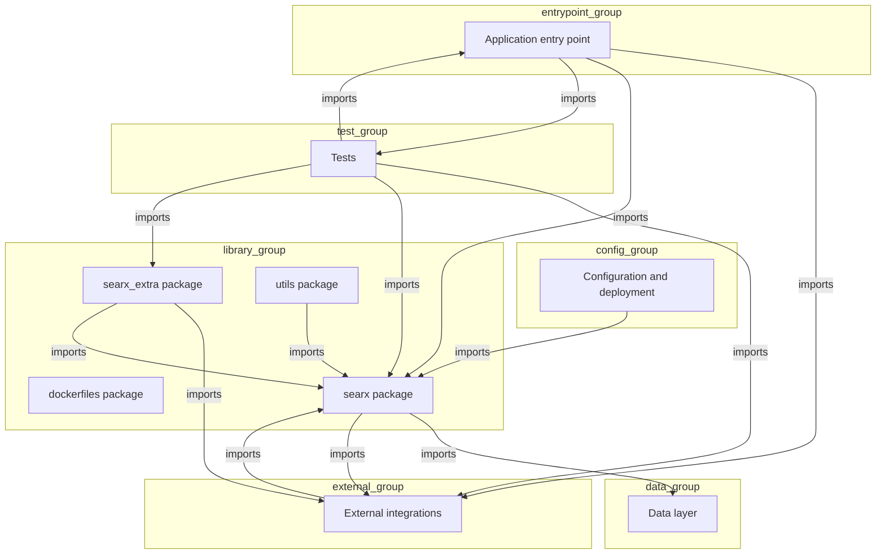

# Architecture report: searx/searx

> Automated static analysis. **Observed** = directly seen in files/imports/AST; **Inferred** = interpretation from that evidence. Repository code was not executed.

## 1. Repository at a glance

| Item | Value |
| --- | --- |
| Repository | searx/searx |
| Description | Privacy-respecting metasearch engine |
| Language | Python |
| Stars | 13566 |
| Licence | AGPL-3.0 |
| Analysed commit / branch | 00abe3df3857f70875543e766223bc7bc0ccce93 / master |
| Framework(s) | Flask |
| Files analysed | 567 |
| Components | 9 |

## 2. Architecture in one minute

searx/searx - Privacy-respecting metasearch engine. This repository was analysed statically from 567 file(s) (208 Python). Detected technologies (observed from imports/manifests): GitHub Actions, MongoDB, MySQL, PostgreSQL, Redis, SQLite. Files are grouped into 9 component(s): Configuration and deployment, Data layer, dockerfiles package, Application entry point, External integrations, searx package, searx_extra package, Tests. Observed entry point(s): searx/search/checker/__main__.py, searx/testing.py, searx/webapp.py. Findings below distinguish observed facts from inferred interpretation.

## 3. High-level block diagram

## 4. Main components

### Configuration and deployment (`config`)

- **Kind:** config
- **Status:** Observed
- **Confidence:** 0.85
- **Responsibility:** Groups 18 file(s) under configuration and deployment (observed from repository paths and static analysis).
- **Paths:** `Dockerfile`, `babel.cfg`, `dockerfiles/uwsgi.ini`, `requirements-dev.txt`, `requirements.txt`, `searx/data/external_urls.json`, `searx/data/useragents.json`, `searx/data/wikidata_units.json`, `searx/settings.yml`, `searx/settings_robot.yml`, `searx/static/themes/oscar/package.json`, `searx/static/themes/simple/package.json`, `setup.py`, `tox.ini`, `utils/templates/etc/filtron/rules.json`, `utils/templates/etc/searx/use_default_settings.yml`, `utils/templates/etc/uwsgi/apps-archlinux/searx.ini`, `utils/templates/etc/uwsgi/apps-available/searx.ini`
- **Evidence:** [Dockerfile](https://github.com/searx/searx/blob/00abe3df3857f70875543e766223bc7bc0ccce93/Dockerfile); [babel.cfg](https://github.com/searx/searx/blob/00abe3df3857f70875543e766223bc7bc0ccce93/babel.cfg); [dockerfiles/uwsgi.ini](https://github.com/searx/searx/blob/00abe3df3857f70875543e766223bc7bc0ccce93/dockerfiles/uwsgi.ini); [requirements-dev.txt](https://github.com/searx/searx/blob/00abe3df3857f70875543e766223bc7bc0ccce93/requirements-dev.txt); [requirements.txt](https://github.com/searx/searx/blob/00abe3df3857f70875543e766223bc7bc0ccce93/requirements.txt); [searx/data/external_urls.json](https://github.com/searx/searx/blob/00abe3df3857f70875543e766223bc7bc0ccce93/searx/data/external_urls.json); [searx/data/useragents.json](https://github.com/searx/searx/blob/00abe3df3857f70875543e766223bc7bc0ccce93/searx/data/useragents.json); [searx/data/wikidata_units.json](https://github.com/searx/searx/blob/00abe3df3857f70875543e766223bc7bc0ccce93/searx/data/wikidata_units.json)

### Data layer (`data_layer`)

- **Kind:** data
- **Status:** Observed
- **Confidence:** 0.85
- **Responsibility:** Groups 2 file(s) under data layer (observed from repository paths and static analysis). Observed top-level classes: EngineRef, SearchQuery. Observed top-level functions: _load, ahmia_blacklist_loader.
- **Paths:** `searx/data/__init__.py`, `searx/search/models.py`
- **Evidence:** [searx/data/__init__.py:26](https://github.com/searx/searx/blob/00abe3df3857f70875543e766223bc7bc0ccce93/searx/data/__init__.py#L26); [searx/search/models.py:6](https://github.com/searx/searx/blob/00abe3df3857f70875543e766223bc7bc0ccce93/searx/search/models.py#L6)

### dockerfiles package (`dockerfiles`)

- **Kind:** library
- **Status:** Observed
- **Confidence:** 0.85
- **Responsibility:** Groups 1 file(s) under dockerfiles package (observed from repository paths and static analysis).
- **Paths:** `dockerfiles/docker-entrypoint.sh`
- **Evidence:** [dockerfiles/docker-entrypoint.sh](https://github.com/searx/searx/blob/00abe3df3857f70875543e766223bc7bc0ccce93/dockerfiles/docker-entrypoint.sh)

### Application entry point (`entrypoint`)

- **Kind:** entrypoint
- **Status:** Observed
- **Confidence:** 0.85
- **Responsibility:** Groups 10 file(s) under application entry point (observed from repository paths and static analysis). Observed application object created via Flask. Observed routes: ROUTE /, ROUTE /healthz, ROUTE /search, ROUTE /about, ROUTE /autocompleter. Observed top-level classes: LogicodevStyle, ReverseProxyPathFix, SearxRobotLayer, SearxTestCase, SearxTestLayer. Observed top-level functions: __get_translated_errors, _get_browser_or_settings_language, _get_ordered_categories, _get_translations, _is_selected_language_supported, _normalize_name.
- **Paths:** `searx/search/checker/__main__.py`, `searx/testing.py`, `searx/webapp.py`, `searx_extra/standalone_searx.py`, `searx_extra/update/update_currencies.py`, `searx_extra/update/update_engine_descriptions.py`, `searx_extra/update/update_external_bangs.py`, `searx_extra/update/update_languages.py`, `searx_extra/update/update_osm_keys_tags.py`, `searx_extra/update/update_pygments.py`
- **Evidence:** [searx/search/checker/__main__.py:40](https://github.com/searx/searx/blob/00abe3df3857f70875543e766223bc7bc0ccce93/searx/search/checker/__main__.py#L40); [searx/testing.py:17](https://github.com/searx/searx/blob/00abe3df3857f70875543e766223bc7bc0ccce93/searx/testing.py#L17); [searx/webapp.py:116](https://github.com/searx/searx/blob/00abe3df3857f70875543e766223bc7bc0ccce93/searx/webapp.py#L116); [searx_extra/standalone_searx.py:93](https://github.com/searx/searx/blob/00abe3df3857f70875543e766223bc7bc0ccce93/searx_extra/standalone_searx.py#L93); [searx_extra/update/update_currencies.py:51](https://github.com/searx/searx/blob/00abe3df3857f70875543e766223bc7bc0ccce93/searx_extra/update/update_currencies.py#L51); [searx_extra/update/update_engine_descriptions.py:46](https://github.com/searx/searx/blob/00abe3df3857f70875543e766223bc7bc0ccce93/searx_extra/update/update_engine_descriptions.py#L46); [searx_extra/update/update_external_bangs.py:32](https://github.com/searx/searx/blob/00abe3df3857f70875543e766223bc7bc0ccce93/searx_extra/update/update_external_bangs.py#L32); [searx_extra/update/update_languages.py:22](https://github.com/searx/searx/blob/00abe3df3857f70875543e766223bc7bc0ccce93/searx_extra/update/update_languages.py#L22)

### External integrations (`external_integrations`)

- **Kind:** external
- **Status:** Observed
- **Confidence:** 0.85
- **Responsibility:** Groups 2 file(s) under external integrations (observed from repository paths and static analysis). Observed top-level functions: replace_pua_chars, request, response.
- **Paths:** `searx/engines/wolframalpha_api.py`, `searx/engines/youtube_api.py`
- **Evidence:** [searx/engines/wolframalpha_api.py:44](https://github.com/searx/searx/blob/00abe3df3857f70875543e766223bc7bc0ccce93/searx/engines/wolframalpha_api.py#L44); [searx/engines/youtube_api.py:38](https://github.com/searx/searx/blob/00abe3df3857f70875543e766223bc7bc0ccce93/searx/engines/youtube_api.py#L38)

### searx package (`searx`)

- **Kind:** library
- **Status:** Observed
- **Confidence:** 0.85
- **Responsibility:** Groups 188 file(s) under searx package (observed from repository paths and static analysis). Observed top-level classes: BangParser, Checker, CheckerTests, EngineProcessor, EnginesSetting, EnumStringSetting. Observed top-level functions: __check_query_params, __get_response, __get_results_limits, __parse_single_result, _custom_query, _fetch_results.
- **Paths:** `searx/__init__.py`, `searx/answerers/__init__.py`, `searx/answerers/random/answerer.py`, `searx/answerers/statistics/answerer.py`, `searx/autocomplete.py`, `searx/engines/1337x.py`, `searx/engines/__init__.py`, `searx/engines/ahmia.py`, `searx/engines/apkmirror.py`, `searx/engines/archlinux.py`, `searx/engines/arxiv.py`, `searx/engines/bandcamp.py`, `searx/engines/base.py`, `searx/engines/bing.py`, `searx/engines/bing_images.py`, `searx/engines/bing_news.py`, `searx/engines/bing_videos.py`, `searx/engines/btdigg.py`, `searx/engines/command.py`, `searx/engines/core.py`, `searx/engines/currency_convert.py`, `searx/engines/dailymotion.py`, `searx/engines/deezer.py`, `searx/engines/deviantart.py`, `searx/engines/dictzone.py`, `searx/engines/digbt.py`, `searx/engines/digg.py`, `searx/engines/doku.py`, `searx/engines/duckduckgo.py`, `searx/engines/duckduckgo_definitions.py`, `searx/engines/duckduckgo_images.py`, `searx/engines/duden.py`, `searx/engines/dummy-offline.py`, `searx/engines/dummy.py`, `searx/engines/ebay.py`, `searx/engines/elasticsearch.py`, `searx/engines/emojipedia.py`, `searx/engines/etools.py`, `searx/engines/fdroid.py`, `searx/engines/flickr.py`, `searx/engines/flickr_noapi.py`, `searx/engines/framalibre.py`, `searx/engines/freesound.py`, `searx/engines/frinkiac.py`, `searx/engines/genius.py`, `searx/engines/gentoo.py`, `searx/engines/gigablast.py`, `searx/engines/github.py`, `searx/engines/google.py`, `searx/engines/google_images.py`, `searx/engines/google_news.py`, `searx/engines/google_play_apps.py`, `searx/engines/google_scholar.py`, `searx/engines/google_videos.py`, `searx/engines/imdb.py`, `searx/engines/ina.py`, `searx/engines/invidious.py`, `searx/engines/ipfs_search.py`, `searx/engines/json_engine.py`, `searx/engines/kickass.py`, `searx/engines/lingva.py`, `searx/engines/loc.py`, `searx/engines/mediathekviewweb.py`, `searx/engines/mediawiki.py`, `searx/engines/meilisearch.py`, `searx/engines/microsoft_academic.py`, `searx/engines/mixcloud.py`, `searx/engines/mongodb.py`, `searx/engines/mysql_server.py`, `searx/engines/nyaa.py`, `searx/engines/omnom.py`, `searx/engines/onesearch.py`, `searx/engines/opensemantic.py`, `searx/engines/openstreetmap.py`, `searx/engines/openverse.py`, `searx/engines/pdbe.py`, `searx/engines/peertube.py`, `searx/engines/photon.py`, `searx/engines/piratebay.py`, `searx/engines/postgresql.py`, `searx/engines/prowlarr.py`, `searx/engines/pubmed.py`, `searx/engines/qwant.py`, `searx/engines/recoll.py`, `searx/engines/reddit.py`, `searx/engines/redis_server.py`, `searx/engines/rumble.py`, `searx/engines/scanr_structures.py`, `searx/engines/searchcode_code.py`, `searx/engines/searx_engine.py`, `searx/engines/semantic_scholar.py`, `searx/engines/sepiasearch.py`, `searx/engines/seznam.py`, `searx/engines/sjp.py`, `searx/engines/solidtorrents.py`, `searx/engines/solr.py`, `searx/engines/soundcloud.py`, `searx/engines/spotify.py`, `searx/engines/springer.py`, `searx/engines/sqlite.py`, `searx/engines/stackexchange.py`, `searx/engines/stackoverflow.py`, `searx/engines/startpage.py`, `searx/engines/tineye.py`, `searx/engines/tokyotoshokan.py`, `searx/engines/torrentz.py`, `searx/engines/translated.py`, `searx/engines/tvmaze.py`, `searx/engines/unsplash.py`, `searx/engines/vimeo.py`, `searx/engines/wikidata.py`, `searx/engines/wikipedia.py`, `searx/engines/wolframalpha_noapi.py`, `searx/engines/wordnik.py`, `searx/engines/www1x.py`, `searx/engines/xpath.py`, `searx/engines/xpath_flex.py`, `searx/engines/yacy.py`, `searx/engines/yahoo.py`, `searx/engines/yahoo_news.py`, `searx/engines/yggtorrent.py`, `searx/engines/youtube_noapi.py`, `searx/exceptions.py`, `searx/external_bang.py`, `searx/external_urls.py`, `searx/languages.py`, `searx/metrology/__init__.py`, `searx/metrology/error_recorder.py`, `searx/plugins/__init__.py`, `searx/plugins/ahmia_filter.py`, `searx/plugins/hash_plugin.py`, `searx/plugins/hostname_replace.py`, `searx/plugins/https_rewrite.py`, `searx/plugins/infinite_scroll.py`, `searx/plugins/oa_doi_rewrite.py`, `searx/plugins/search_on_category_select.py`, `searx/plugins/search_operators.py`, `searx/plugins/self_info.py`, `searx/plugins/tracker_url_remover.py`, `searx/plugins/vim_hotkeys.py`, `searx/poolrequests.py`, `searx/preferences.py`, `searx/query.py`, `searx/raise_for_httperror.py`, `searx/results.py`, `searx/search/__init__.py`, `searx/search/checker/__init__.py`, `searx/search/checker/background.py`, `searx/search/checker/impl.py`, `searx/search/processors/__init__.py`, `searx/search/processors/abstract.py`, `searx/search/processors/offline.py`, `searx/search/processors/online.py`, `searx/search/processors/online_currency.py`, `searx/search/processors/online_dictionary.py`, `searx/settings_loader.py`, `searx/shared/__init__.py`, `searx/shared/shared_abstract.py`, `searx/shared/shared_simple.py`, `searx/shared/shared_uwsgi.py`, `searx/static/plugins/js/infinite_scroll.js`, `searx/static/plugins/js/search_on_category_select.js`, `searx/static/plugins/js/vim_hotkeys.js`, `searx/static/themes/__common__/js/image_layout.js`, `searx/static/themes/oscar/gruntfile.js`, `searx/static/themes/oscar/js/leaflet.js`, `searx/static/themes/oscar/js/searx.js`, `searx/static/themes/oscar/src/js/01_init.js`, `searx/static/themes/oscar/src/js/autocompleter.js`, `searx/static/themes/oscar/src/js/element_modifiers.js`, `searx/static/themes/oscar/src/js/infobox.js`, `searx/static/themes/oscar/src/js/leaflet_map.js`, `searx/static/themes/oscar/src/js/toggleall.js`, `searx/static/themes/simple/gruntfile.js`, `searx/static/themes/simple/js/searx.head.js`, `searx/static/themes/simple/js/searx.js`, `searx/static/themes/simple/js/searx_head/00_init.js`, `searx/static/themes/simple/js/searx_src/00_searx_toolkit.js`, `searx/static/themes/simple/js/searx_src/autocomplete.js`, `searx/static/themes/simple/js/searx_src/searx_keyboard.js`, `searx/static/themes/simple/js/searx_src/searx_mapresult.js`, `searx/static/themes/simple/js/searx_src/searx_results.js`, `searx/static/themes/simple/js/searx_src/searx_search.js`, `searx/static/themes/simple/leaflet/leaflet.js`, `searx/utils.py`, `searx/version.py`, `searx/webadapter.py`, `searx/webutils.py`
- **Evidence:** [searx/__init__.py:75](https://github.com/searx/searx/blob/00abe3df3857f70875543e766223bc7bc0ccce93/searx/__init__.py#L75); [searx/answerers/__init__.py:10](https://github.com/searx/searx/blob/00abe3df3857f70875543e766223bc7bc0ccce93/searx/answerers/__init__.py#L10); [searx/answerers/random/answerer.py:15](https://github.com/searx/searx/blob/00abe3df3857f70875543e766223bc7bc0ccce93/searx/answerers/random/answerer.py#L15); [searx/answerers/statistics/answerer.py:16](https://github.com/searx/searx/blob/00abe3df3857f70875543e766223bc7bc0ccce93/searx/answerers/statistics/answerer.py#L16); [searx/autocomplete.py:30](https://github.com/searx/searx/blob/00abe3df3857f70875543e766223bc7bc0ccce93/searx/autocomplete.py#L30); [searx/engines/1337x.py:26](https://github.com/searx/searx/blob/00abe3df3857f70875543e766223bc7bc0ccce93/searx/engines/1337x.py#L26); [searx/engines/__init__.py:62](https://github.com/searx/searx/blob/00abe3df3857f70875543e766223bc7bc0ccce93/searx/engines/__init__.py#L62); [searx/engines/ahmia.py:41](https://github.com/searx/searx/blob/00abe3df3857f70875543e766223bc7bc0ccce93/searx/engines/ahmia.py#L41)

### searx_extra package (`searx_extra`)

- **Kind:** library
- **Status:** Observed
- **Confidence:** 0.85
- **Responsibility:** Groups 7 file(s) under searx_extra package (observed from repository paths and static analysis). Observed top-level functions: fetch_ahmia_blacklist, fetch_firefox_last_versions, fetch_firefox_versions, get_ahmia_blacklist_filename, get_data, get_useragents_filename.
- **Paths:** `searx_extra/__init__.py`, `searx_extra/google_search.py`, `searx_extra/update/__init__.py`, `searx_extra/update/update_ahmia_blacklist.py`, `searx_extra/update/update_firefox_version.py`, `searx_extra/update/update_translations.sh`, `searx_extra/update/update_wikidata_units.py`
- **Evidence:** [searx_extra/__init__.py](https://github.com/searx/searx/blob/00abe3df3857f70875543e766223bc7bc0ccce93/searx_extra/__init__.py); [searx_extra/google_search.py](https://github.com/searx/searx/blob/00abe3df3857f70875543e766223bc7bc0ccce93/searx_extra/google_search.py); [searx_extra/update/__init__.py](https://github.com/searx/searx/blob/00abe3df3857f70875543e766223bc7bc0ccce93/searx_extra/update/__init__.py); [searx_extra/update/update_ahmia_blacklist.py:15](https://github.com/searx/searx/blob/00abe3df3857f70875543e766223bc7bc0ccce93/searx_extra/update/update_ahmia_blacklist.py#L15); [searx_extra/update/update_firefox_version.py:28](https://github.com/searx/searx/blob/00abe3df3857f70875543e766223bc7bc0ccce93/searx_extra/update/update_firefox_version.py#L28); [searx_extra/update/update_translations.sh](https://github.com/searx/searx/blob/00abe3df3857f70875543e766223bc7bc0ccce93/searx_extra/update/update_translations.sh); [searx_extra/update/update_wikidata_units.py:37](https://github.com/searx/searx/blob/00abe3df3857f70875543e766223bc7bc0ccce93/searx_extra/update/update_wikidata_units.py#L37)

### Tests (`tests`)

- **Kind:** test
- **Status:** Observed
- **Confidence:** 0.85
- **Responsibility:** Groups 27 file(s) under tests (observed from repository paths and static analysis). Observed routes: PATCH searx.poolrequests.get_global_proxies. Observed top-level classes: AnswererTest, HashPluginTest, PluginStoreTest, PluginStub, ResultContainerTestCase, SearchQueryTestCase. Observed top-level functions: fake_result, get_search_mock, test_404, test_about, test_index, test_preferences.
- **Paths:** `tests/__init__.py`, `tests/robot/__init__.py`, `tests/unit/__init__.py`, `tests/unit/engines/test_command.py`, `tests/unit/engines/test_xpath.py`, `tests/unit/settings/empty_settings.yml`, `tests/unit/settings/syntaxerror_settings.yml`, `tests/unit/settings/user_settings.yml`, `tests/unit/settings/user_settings_keep_only.yml`, `tests/unit/settings/user_settings_remove.yml`, `tests/unit/settings/user_settings_remove2.yml`, `tests/unit/settings/user_settings_simple.yml`, `tests/unit/test_answerers.py`, `tests/unit/test_engines_init.py`, `tests/unit/test_external_bangs.py`, `tests/unit/test_plugins.py`, `tests/unit/test_poolrequests.py`, `tests/unit/test_preferences.py`, `tests/unit/test_query.py`, `tests/unit/test_results.py`, `tests/unit/test_search.py`, `tests/unit/test_settings_loader.py`, `tests/unit/test_standalone_searx.py`, `tests/unit/test_utils.py`, `tests/unit/test_webadapter.py`, `tests/unit/test_webapp.py`, `tests/unit/test_webutils.py`
- **Evidence:** [tests/__init__.py](https://github.com/searx/searx/blob/00abe3df3857f70875543e766223bc7bc0ccce93/tests/__init__.py); [tests/robot/__init__.py:8](https://github.com/searx/searx/blob/00abe3df3857f70875543e766223bc7bc0ccce93/tests/robot/__init__.py#L8); [tests/unit/__init__.py](https://github.com/searx/searx/blob/00abe3df3857f70875543e766223bc7bc0ccce93/tests/unit/__init__.py); [tests/unit/engines/test_command.py:22](https://github.com/searx/searx/blob/00abe3df3857f70875543e766223bc7bc0ccce93/tests/unit/engines/test_command.py#L22); [tests/unit/engines/test_xpath.py:8](https://github.com/searx/searx/blob/00abe3df3857f70875543e766223bc7bc0ccce93/tests/unit/engines/test_xpath.py#L8); [tests/unit/settings/empty_settings.yml](https://github.com/searx/searx/blob/00abe3df3857f70875543e766223bc7bc0ccce93/tests/unit/settings/empty_settings.yml); [tests/unit/settings/syntaxerror_settings.yml](https://github.com/searx/searx/blob/00abe3df3857f70875543e766223bc7bc0ccce93/tests/unit/settings/syntaxerror_settings.yml); [tests/unit/settings/user_settings.yml](https://github.com/searx/searx/blob/00abe3df3857f70875543e766223bc7bc0ccce93/tests/unit/settings/user_settings.yml)

### utils package (`utils`)

- **Kind:** library
- **Status:** Observed
- **Confidence:** 0.85
- **Responsibility:** Groups 6 file(s) under utils package (observed from repository paths and static analysis).
- **Paths:** `utils/build_env.py`, `utils/filtron.sh`, `utils/lib.sh`, `utils/lxc.sh`, `utils/morty.sh`, `utils/searx.sh`
- **Evidence:** [utils/build_env.py](https://github.com/searx/searx/blob/00abe3df3857f70875543e766223bc7bc0ccce93/utils/build_env.py); [utils/filtron.sh](https://github.com/searx/searx/blob/00abe3df3857f70875543e766223bc7bc0ccce93/utils/filtron.sh); [utils/lib.sh](https://github.com/searx/searx/blob/00abe3df3857f70875543e766223bc7bc0ccce93/utils/lib.sh); [utils/lxc.sh](https://github.com/searx/searx/blob/00abe3df3857f70875543e766223bc7bc0ccce93/utils/lxc.sh); [utils/morty.sh](https://github.com/searx/searx/blob/00abe3df3857f70875543e766223bc7bc0ccce93/utils/morty.sh); [utils/searx.sh](https://github.com/searx/searx/blob/00abe3df3857f70875543e766223bc7bc0ccce93/utils/searx.sh)

## 5. Execution flow

**Observed** entry point(s):

- [searx/search/checker/__main__.py](https://github.com/searx/searx/blob/00abe3df3857f70875543e766223bc7bc0ccce93/searx/search/checker/__main__.py)
- [searx/testing.py:103](https://github.com/searx/searx/blob/00abe3df3857f70875543e766223bc7bc0ccce93/searx/testing.py#L103)
- [searx/webapp.py](https://github.com/searx/searx/blob/00abe3df3857f70875543e766223bc7bc0ccce93/searx/webapp.py)
- [searx_extra/standalone_searx.py:209](https://github.com/searx/searx/blob/00abe3df3857f70875543e766223bc7bc0ccce93/searx_extra/standalone_searx.py#L209)
- [searx_extra/update/update_currencies.py:149](https://github.com/searx/searx/blob/00abe3df3857f70875543e766223bc7bc0ccce93/searx_extra/update/update_currencies.py#L149)
- [searx_extra/update/update_engine_descriptions.py:201](https://github.com/searx/searx/blob/00abe3df3857f70875543e766223bc7bc0ccce93/searx_extra/update/update_engine_descriptions.py#L201)
- [searx_extra/update/update_external_bangs.py:149](https://github.com/searx/searx/blob/00abe3df3857f70875543e766223bc7bc0ccce93/searx_extra/update/update_external_bangs.py#L149)
- [searx_extra/update/update_languages.py:200](https://github.com/searx/searx/blob/00abe3df3857f70875543e766223bc7bc0ccce93/searx_extra/update/update_languages.py#L200)
- [searx_extra/update/update_osm_keys_tags.py:201](https://github.com/searx/searx/blob/00abe3df3857f70875543e766223bc7bc0ccce93/searx_extra/update/update_osm_keys_tags.py#L201)
- [searx_extra/update/update_pygments.py:137](https://github.com/searx/searx/blob/00abe3df3857f70875543e766223bc7bc0ccce93/searx_extra/update/update_pygments.py#L137)

**Observed** routes (from decorators):

- `ROUTE /` -> `index` in `searx/webapp.py:560`
- `ROUTE /healthz` -> `health` in `searx/webapp.py:579`
- `ROUTE /search` -> `search` in `searx/webapp.py:584`
- `ROUTE /about` -> `about` in `searx/webapp.py:770`
- `ROUTE /autocompleter` -> `autocompleter` in `searx/webapp.py:778`
- `ROUTE /preferences` -> `preferences` in `searx/webapp.py:832`
- `ROUTE /image_proxy` -> `image_proxy` in `searx/webapp.py:913`
- `ROUTE /stats` -> `stats` in `searx/webapp.py:967`
- `ROUTE /stats/errors` -> `stats_errors` in `searx/webapp.py:979`
- `ROUTE /stats/checker` -> `stats_checker` in `searx/webapp.py:1007`
- `ROUTE /robots.txt` -> `robots` in `searx/webapp.py:1013`
- `ROUTE /opensearch.xml` -> `opensearch` in `searx/webapp.py:1024`
- `ROUTE /favicon.ico` -> `favicon` in `searx/webapp.py:1047`
- `ROUTE /clear_cookies` -> `clear_cookies` in `searx/webapp.py:1058`
- `ROUTE /config` -> `config` in `searx/webapp.py:1066`
- `PATCH searx.poolrequests.get_global_proxies` -> `test_request` in `tests/unit/test_poolrequests.py:69`

Representative flow (derived from observed entry points and the import graph; steps beyond the entry point are **Inferred**):

1. Execution starts at an observed entry point listed above, if present.
2. `config` imports `searx` (Configuration and deployment -> searx package).
3. `entrypoint` imports `external_integrations` (Application entry point -> External integrations).
4. `entrypoint` imports `searx` (Application entry point -> searx package).
5. `entrypoint` imports `tests` (Application entry point -> Tests).
6. `external_integrations` imports `searx` (External integrations -> searx package).
7. `searx` imports `data_layer` (searx package -> Data layer).
8. `searx` imports `external_integrations` (searx package -> External integrations).
9. `searx_extra` imports `external_integrations` (searx_extra package -> External integrations).

## 6. Project structure

### `(root)`

- `.codecov.yml` - config (641 bytes)
- `.config.sh` - source, Shell (1899 bytes)
- `.coveragerc` - other (141 bytes)
- `.dir-locals.el` - other (4957 bytes)
- `.dockerignore` - container (597 bytes)
- `.gitattributes` - other (494 bytes)
- `.gitignore` - other (281 bytes)
- `.landscape.yaml` - config (48 bytes)
- `.pylintrc` - other (13080 bytes)
- `AUTHORS.rst` - docs (4012 bytes)
- `CHANGELOG.rst` - docs (23199 bytes)
- `CONTRIBUTING.md` - docs (1898 bytes)
- `Dockerfile` - container (2984 bytes)
- `LICENSE` - docs (34520 bytes)
- `Makefile` - other (2805 bytes)
- `PULL_REQUEST_TEMPLATE.md` - docs (431 bytes)
- `README.rst` - docs (6306 bytes)
- `babel.cfg` - config (97 bytes)
- `manage` - other (15071 bytes)
- `requirements-dev.txt` - manifest (441 bytes)
- `requirements.txt` - manifest (219 bytes)
- `setup.py` - manifest, Python (2187 bytes)
- `tox.ini` - config (31 bytes)

### `.github`

- `.github/ISSUE_TEMPLATE/bug-report.md` - docs (1263 bytes)
- `.github/ISSUE_TEMPLATE/config.yml` - config (971 bytes)
- `.github/ISSUE_TEMPLATE/engine-request.md` - docs (1134 bytes)
- `.github/ISSUE_TEMPLATE/feature-request.md` - docs (714 bytes)
- `.github/dependabot.yml` - config (292 bytes)
- `.github/workflows/data-update.yml` - ci, YAML (1956 bytes)
- `.github/workflows/integration.yml` - ci, YAML (4588 bytes)

### `dockerfiles`

- `dockerfiles/docker-entrypoint.sh` - source, Shell (4320 bytes)
- `dockerfiles/uwsgi.ini` - config (1077 bytes)

### `docs`

- `docs/_themes/searx/static/searx.css` - docs (2530 bytes)
- `docs/_themes/searx/theme.conf` - docs (71 bytes)
- `docs/admin/api.rst` - docs (2055 bytes)
- `docs/admin/arch_public.dot` - docs (1248 bytes)
- `docs/admin/architecture.rst` - docs (764 bytes)
- `docs/admin/buildhosts.rst` - docs (3657 bytes)
- `docs/admin/command-engine.rst` - docs (4387 bytes)
- `docs/admin/engines.rst` - docs (3136 bytes)
- `docs/admin/engines/recoll.rst` - docs (1208 bytes)
- `docs/admin/filtron.rst` - docs (6063 bytes)
- `docs/admin/index.rst` - docs (446 bytes)
- `docs/admin/indexer-engines.rst` - docs (2557 bytes)
- `docs/admin/installation-apache.rst` - docs (14263 bytes)
- `docs/admin/installation-docker.rst` - docs (1326 bytes)
- `docs/admin/installation-nginx.rst` - docs (10587 bytes)
- `docs/admin/installation-searx.rst` - docs (3351 bytes)
- `docs/admin/installation-uwsgi.rst` - docs (4912 bytes)
- `docs/admin/installation.rst` - docs (2585 bytes)
- `docs/admin/morty.rst` - docs (1271 bytes)
- `docs/admin/no-sql-engines.rst` - docs (4680 bytes)
- `docs/admin/plugins.rst` - docs (715 bytes)
- `docs/admin/private-engines.rst` - docs (1500 bytes)
- `docs/admin/settings.rst` - docs (10796 bytes)
- `docs/admin/update-searx.rst` - docs (1170 bytes)
- `docs/blog/admin.rst` - docs (1538 bytes)
- `docs/blog/command-line-engines.rst` - docs (2764 bytes)
- `docs/blog/documentation-offline-engines.rst` - docs (1430 bytes)
- `docs/blog/index.rst` - docs (258 bytes)
- `docs/blog/intro-offline.rst` - docs (2412 bytes)
- `docs/blog/lxcdev-202006.rst` - docs (11988 bytes)
- `docs/blog/private-engines.rst` - docs (2261 bytes)
- `docs/blog/python3.rst` - docs (1836 bytes)
- `docs/blog/search-database-engines.rst` - docs (2687 bytes)
- `docs/blog/search-indexer-engines.rst` - docs (3343 bytes)
- `docs/blog/sql-engines.rst` - docs (3428 bytes)
- `docs/build-templates/filtron.rst` - docs (1278 bytes)
- `docs/build-templates/morty.rst` - docs (1272 bytes)
- `docs/build-templates/searx.rst` - docs (4513 bytes)
- `docs/conf.py` - docs (4736 bytes)
- `docs/dev/contribution_guide.rst` - docs (5451 bytes)
- `docs/dev/csv_table.txt` - docs (384 bytes)
- `docs/dev/engine_overview.rst` - docs (13023 bytes)
- `docs/dev/hello.dot` - docs (33 bytes)
- `docs/dev/index.rst` - docs (240 bytes)
- `docs/dev/makefile.rst` - docs (6601 bytes)
- `docs/dev/plugins.rst` - docs (1836 bytes)
- `docs/dev/quickstart.rst` - docs (1159 bytes)
- `docs/dev/reST.rst` - docs (39188 bytes)
- `docs/dev/search_api.rst` - docs (3457 bytes)
- `docs/dev/svg_image.svg` - docs (580 bytes)
- `docs/dev/translation.rst` - docs (1562 bytes)
- `docs/index.rst` - docs (793 bytes)
- `docs/searx_extra/index.rst` - docs (351 bytes)
- `docs/searx_extra/standalone_searx.py.rst` - docs (193 bytes)
- `docs/user/index.rst` - docs (143 bytes)
- `docs/user/own-instance.rst` - docs (3553 bytes)
- `docs/user/search_syntax.rst` - docs (1711 bytes)
- `docs/utils/filtron.sh.rst` - docs (2251 bytes)
- `docs/utils/index.rst` - docs (1372 bytes)
- `docs/utils/lxc.sh.rst` - docs (4828 bytes)
- `docs/utils/morty.sh.rst` - docs (1975 bytes)
- `docs/utils/searx.sh.rst` - docs (830 bytes)

### `examples`

- `examples/basic_engine.py` - source, Python (521 bytes)

### `searx`

- `searx/__init__.py` - source, Python (3378 bytes)
- `searx/answerers/__init__.py` - source, Python (1370 bytes)
- `searx/answerers/random/answerer.py` - source, Python (1604 bytes)
- `searx/answerers/statistics/answerer.py` - source, Python (1162 bytes)
- `searx/autocomplete.py` - source, Python (4348 bytes)
- `searx/data/__init__.py` - source, Python (1212 bytes)
- `searx/data/external_urls.json` - config (4295 bytes)
- `searx/data/useragents.json` - config (258 bytes)
- `searx/data/wikidata_units.json` - config (29921 bytes)
- `searx/engines/1337x.py` - source, Python (1734 bytes)
- `searx/engines/__init__.py` - source, Python (11363 bytes)
- `searx/engines/ahmia.py` - source, Python (2669 bytes)
- `searx/engines/apkmirror.py` - source, Python (1606 bytes)
- `searx/engines/archlinux.py` - source, Python (4098 bytes)
- `searx/engines/arxiv.py` - source, Python (2124 bytes)
- `searx/engines/bandcamp.py` - source, Python (2450 bytes)
- `searx/engines/base.py` - source, Python (3273 bytes)
- `searx/engines/bing.py` - source, Python (4021 bytes)
- `searx/engines/bing_images.py` - source, Python (3425 bytes)
- `searx/engines/bing_news.py` - source, Python (4331 bytes)
- `searx/engines/bing_videos.py` - source, Python (3122 bytes)
- `searx/engines/btdigg.py` - source, Python (2675 bytes)
- `searx/engines/command.py` - source, Python (5340 bytes)
- `searx/engines/core.py` - source, Python (2144 bytes)
- `searx/engines/currency_convert.py` - source, Python (1454 bytes)
- `searx/engines/dailymotion.py` - source, Python (2908 bytes)
- `searx/engines/deezer.py` - source, Python (1781 bytes)
- `searx/engines/deviantart.py` - source, Python (1922 bytes)
- `searx/engines/dictzone.py` - source, Python (1458 bytes)
- `searx/engines/digbt.py` - source, Python (1731 bytes)
- `searx/engines/digg.py` - source, Python (1791 bytes)
- `searx/engines/doku.py` - source, Python (2282 bytes)
- `searx/engines/duckduckgo.py` - source, Python (5441 bytes)
- `searx/engines/duckduckgo_definitions.py` - source, Python (10105 bytes)
- `searx/engines/duckduckgo_images.py` - source, Python (2872 bytes)
- `searx/engines/duden.py` - source, Python (2363 bytes)
- `searx/engines/dummy-offline.py` - source, Python (339 bytes)
- `searx/engines/dummy.py` - source, Python (397 bytes)
- `searx/engines/ebay.py` - source, Python (2209 bytes)
- `searx/engines/elasticsearch.py` - source, Python (4241 bytes)
- `searx/engines/emojipedia.py` - source, Python (1399 bytes)
- `searx/engines/etools.py` - source, Python (1345 bytes)
- `searx/engines/fdroid.py` - source, Python (1538 bytes)
- `searx/engines/flickr.py` - source, Python (2536 bytes)
- `searx/engines/flickr_noapi.py` - source, Python (4059 bytes)
- `searx/engines/framalibre.py` - source, Python (2104 bytes)
- `searx/engines/freesound.py` - source, Python (1672 bytes)
- `searx/engines/frinkiac.py` - source, Python (1524 bytes)
- `searx/engines/genius.py` - source, Python (2563 bytes)
- `searx/engines/gentoo.py` - source, Python (3541 bytes)
- `searx/engines/gigablast.py` - source, Python (3917 bytes)
- `searx/engines/github.py` - source, Python (1390 bytes)
- `searx/engines/google.py` - source, Python (11180 bytes)
- `searx/engines/google_images.py` - source, Python (6740 bytes)
- `searx/engines/google_news.py` - source, Python (6438 bytes)
- `searx/engines/google_play_apps.py` - source, Python (2201 bytes)
- `searx/engines/google_scholar.py` - source, Python (4463 bytes)
- `searx/engines/google_videos.py` - source, Python (6301 bytes)
- `searx/engines/imdb.py` - source, Python (1390 bytes)
- `searx/engines/ina.py` - source, Python (2526 bytes)
- `searx/engines/invidious.py` - source, Python (3307 bytes)
- `searx/engines/ipfs_search.py` - source, Python (2504 bytes)
- `searx/engines/json_engine.py` - source, Python (3440 bytes)
- `searx/engines/kickass.py` - source, Python (2978 bytes)
- `searx/engines/lingva.py` - source, Python (1906 bytes)
- `searx/engines/loc.py` - source, Python (1769 bytes)
- `searx/engines/mediathekviewweb.py` - source, Python (1547 bytes)
- `searx/engines/mediawiki.py` - source, Python (2429 bytes)
- `searx/engines/meilisearch.py` - source, Python (1230 bytes)
- `searx/engines/microsoft_academic.py` - source, Python (1770 bytes)
- `searx/engines/mixcloud.py` - source, Python (1695 bytes)
- `searx/engines/mongodb.py` - source, Python (1325 bytes)
- `searx/engines/mysql_server.py` - source, Python (1437 bytes)
- `searx/engines/nyaa.py` - source, Python (3232 bytes)
- `searx/engines/omnom.py` - source, Python (1239 bytes)
- `searx/engines/onesearch.py` - source, Python (1380 bytes)
- `searx/engines/opensemantic.py` - source, Python (1146 bytes)
- `searx/engines/openstreetmap.py` - source, Python (15495 bytes)
- `searx/engines/openverse.py` - source, Python (1219 bytes)
- `searx/engines/pdbe.py` - source, Python (3636 bytes)
- `searx/engines/peertube.py` - source, Python (2758 bytes)
- `searx/engines/photon.py` - source, Python (4162 bytes)
- `searx/engines/piratebay.py` - source, Python (2804 bytes)
- `searx/engines/postgresql.py` - source, Python (1574 bytes)
- `searx/engines/prowlarr.py` - source, Python (1827 bytes)
- `searx/engines/pubmed.py` - source, Python (3267 bytes)
- `searx/engines/qwant.py` - source, Python (7936 bytes)
- `searx/engines/recoll.py` - source, Python (2854 bytes)
- `searx/engines/reddit.py` - source, Python (2143 bytes)
- `searx/engines/redis_server.py` - source, Python (1585 bytes)
- `searx/engines/rumble.py` - source, Python (2803 bytes)
- `searx/engines/scanr_structures.py` - source, Python (2130 bytes)
- `searx/engines/searchcode_code.py` - source, Python (1846 bytes)
- `searx/engines/searx_engine.py` - source, Python (1356 bytes)
- `searx/engines/semantic_scholar.py` - source, Python (2170 bytes)
- `searx/engines/sepiasearch.py` - source, Python (2928 bytes)
- `searx/engines/seznam.py` - source, Python (1903 bytes)
- `searx/engines/sjp.py` - source, Python (2874 bytes)
- `searx/engines/solidtorrents.py` - source, Python (1376 bytes)
- `searx/engines/solr.py` - source, Python (1825 bytes)
- `searx/engines/soundcloud.py` - source, Python (3457 bytes)
- `searx/engines/spotify.py` - source, Python (2250 bytes)
- `searx/engines/springer.py` - source, Python (2076 bytes)
- `searx/engines/sqlite.py` - source, Python (1218 bytes)
- `searx/engines/stackexchange.py` - source, Python (1528 bytes)
- `searx/engines/stackoverflow.py` - source, Python (1712 bytes)
- `searx/engines/startpage.py` - source, Python (8949 bytes)
- `searx/engines/tineye.py` - source, Python (6247 bytes)
- `searx/engines/tokyotoshokan.py` - source, Python (3396 bytes)
- `searx/engines/torrentz.py` - source, Python (2745 bytes)
- `searx/engines/translated.py` - source, Python (1492 bytes)
- `searx/engines/tvmaze.py` - source, Python (967 bytes)
- `searx/engines/unsplash.py` - source, Python (1601 bytes)
- `searx/engines/vimeo.py` - source, Python (1989 bytes)
- `searx/engines/wikidata.py` - source, Python (25547 bytes)
- `searx/engines/wikipedia.py` - source, Python (3509 bytes)
- `searx/engines/wolframalpha_api.py` - source, Python (4301 bytes)
- `searx/engines/wolframalpha_noapi.py` - source, Python (3722 bytes)
- `searx/engines/wordnik.py` - source, Python (2003 bytes)
- `searx/engines/www1x.py` - source, Python (1624 bytes)
- `searx/engines/xpath.py` - source, Python (5371 bytes)
- `searx/engines/xpath_flex.py` - source, Python (4552 bytes)
- `searx/engines/yacy.py` - source, Python (3294 bytes)
- `searx/engines/yahoo.py` - source, Python (4100 bytes)
- `searx/engines/yahoo_news.py` - source, Python (2914 bytes)
- `searx/engines/yggtorrent.py` - source, Python (3573 bytes)
- `searx/engines/youtube_api.py` - source, Python (2572 bytes)
- `searx/engines/youtube_noapi.py` - source, Python (6205 bytes)
- `searx/exceptions.py` - source, Python (3416 bytes)
- `searx/external_bang.py` - source, Python (2962 bytes)
- `searx/external_urls.py` - source, Python (2557 bytes)
- `searx/languages.py` - source, Python (3237 bytes)
- `searx/metrology/__init__.py` - source, Python (0 bytes)
- `searx/metrology/error_recorder.py` - source, Python (5430 bytes)
- `searx/plugins/__init__.py` - source, Python (6682 bytes)
- `searx/plugins/ahmia_filter.py` - source, Python (944 bytes)
- `searx/plugins/hash_plugin.py` - source, Python (1684 bytes)
- `searx/plugins/hostname_replace.py` - source, Python (853 bytes)
- `searx/plugins/https_rewrite.py` - source, Python (7152 bytes)
- `searx/plugins/https_rules/00README` - other (663 bytes)
- `searx/plugins/https_rules/Bing.xml` - other (905 bytes)
- `searx/plugins/https_rules/Dailymotion.xml` - other (1853 bytes)
- `searx/plugins/https_rules/Deviantart.xml` - other (1327 bytes)
- `searx/plugins/https_rules/DuckDuckGo.xml` - other (1030 bytes)
- `searx/plugins/https_rules/Flickr.xml` - other (966 bytes)
- `searx/plugins/https_rules/Github-Pages.xml` - other (207 bytes)
- `searx/plugins/https_rules/Github.xml` - other (2202 bytes)
- `searx/plugins/https_rules/Google-mismatches.xml` - other (612 bytes)
- `searx/plugins/https_rules/Google.org.xml` - other (243 bytes)
- `searx/plugins/https_rules/GoogleAPIs.xml` - other (3853 bytes)
- `searx/plugins/https_rules/GoogleCanada.xml` - other (192 bytes)
- `searx/plugins/https_rules/GoogleImages.xml` - other (1808 bytes)
- `searx/plugins/https_rules/GoogleMainSearch.xml` - other (2801 bytes)
- `searx/plugins/https_rules/GoogleMaps.xml` - other (2064 bytes)
- `searx/plugins/https_rules/GoogleMelange.xml` - other (217 bytes)
- `searx/plugins/https_rules/GoogleSearch.xml` - other (4555 bytes)
- `searx/plugins/https_rules/GoogleServices.xml` - other (9997 bytes)
- `searx/plugins/https_rules/GoogleShopping.xml` - other (946 bytes)
- `searx/plugins/https_rules/GoogleSorry.xml` - other (242 bytes)
- `searx/plugins/https_rules/GoogleTranslate.xml` - other (353 bytes)
- `searx/plugins/https_rules/GoogleVideos.xml` - other (4342 bytes)
- `searx/plugins/https_rules/GoogleWatchBlog.xml` - other (324 bytes)
- `searx/plugins/https_rules/Google_App_Engine.xml` - other (435 bytes)
- `searx/plugins/https_rules/Googleplex.com.xml` - other (802 bytes)
- `searx/plugins/https_rules/OpenStreetMap.xml` - other (450 bytes)
- `searx/plugins/https_rules/Rawgithub.com.xml` - other (246 bytes)
- `searx/plugins/https_rules/Soundcloud.xml` - other (1978 bytes)
- `searx/plugins/https_rules/ThePirateBay.xml` - other (977 bytes)
- `searx/plugins/https_rules/Torproject.xml` - other (449 bytes)
- `searx/plugins/https_rules/Twitter.xml` - other (3077 bytes)
- `searx/plugins/https_rules/Vimeo.xml` - other (1941 bytes)
- `searx/plugins/https_rules/WikiLeaks.xml` - other (274 bytes)
- `searx/plugins/https_rules/Wikimedia.xml` - other (3812 bytes)
- `searx/plugins/https_rules/Yahoo.xml` - other (46260 bytes)
- `searx/plugins/https_rules/YouTube.xml` - other (1464 bytes)
- `searx/plugins/infinite_scroll.py` - source, Python (317 bytes)
- `searx/plugins/oa_doi_rewrite.py` - source, Python (1500 bytes)
- `searx/plugins/search_on_category_select.py` - source, Python (1014 bytes)
- `searx/plugins/search_operators.py` - source, Python (1331 bytes)
- `searx/plugins/self_info.py` - source, Python (1646 bytes)
- `searx/plugins/tracker_url_remover.py` - source, Python (1776 bytes)
- `searx/plugins/vim_hotkeys.py` - source, Python (409 bytes)
- `searx/poolrequests.py` - source, Python (7417 bytes)
- `searx/preferences.py` - source, Python (20475 bytes)
- `searx/query.py` - source, Python (11898 bytes)
- `searx/raise_for_httperror.py` - source, Python (2679 bytes)
- `searx/results.py` - source, Python (14972 bytes)
- `searx/search/__init__.py` - source, Python (7663 bytes)
- `searx/search/checker/__init__.py` - source, Python (119 bytes)
- `searx/search/checker/__main__.py` - source, Python (3703 bytes)
- `searx/search/checker/background.py` - source, Python (3708 bytes)
- `searx/search/checker/impl.py` - source, Python (16146 bytes)
- `searx/search/models.py` - source, Python (2603 bytes)
- `searx/search/processors/__init__.py` - source, Python (1374 bytes)
- `searx/search/processors/abstract.py` - source, Python (1609 bytes)
- `searx/search/processors/offline.py` - source, Python (2039 bytes)
- `searx/search/processors/online.py` - source, Python (10741 bytes)
- `searx/search/processors/online_currency.py` - source, Python (1877 bytes)
- `searx/search/processors/online_dictionary.py` - source, Python (1494 bytes)
- `searx/settings.yml` - config (51037 bytes)
- `searx/settings_loader.py` - source, Python (5179 bytes)
- `searx/settings_robot.yml` - config (1026 bytes)
- `searx/shared/__init__.py` - source, Python (995 bytes)
- `searx/shared/shared_abstract.py` - source, Python (368 bytes)
- `searx/shared/shared_simple.py` - source, Python (714 bytes)
- `searx/shared/shared_uwsgi.py` - source, Python (1689 bytes)
- `searx/static/plugins/css/infinite_scroll.css` - other (473 bytes)
- `searx/static/plugins/css/vim_hotkeys.css` - other (773 bytes)
- `searx/static/plugins/external_plugins/.gitignore` - other (17 bytes)
- `searx/static/plugins/js/infinite_scroll.js` - source, JavaScript (1252 bytes)
- `searx/static/plugins/js/search_on_category_select.js` - source, JavaScript (1457 bytes)
- `searx/static/plugins/js/vim_hotkeys.js` - source, JavaScript (9972 bytes)
- `searx/static/themes/__common__/js/image_layout.js` - source, JavaScript (5419 bytes)
- `searx/static/themes/oscar/.gitignore` - other (14 bytes)
- `searx/static/themes/oscar/README.rst` - docs (1027 bytes)
- `searx/static/themes/oscar/css/bootstrap-theme.css` - other (25682 bytes)
- `searx/static/themes/oscar/css/bootstrap.css` - other (150618 bytes)
- `searx/static/themes/oscar/css/leaflet.css` - other (14661 bytes)
- `searx/static/themes/oscar/css/logicodev-dark.css` - other (18813 bytes)
- `searx/static/themes/oscar/css/logicodev.css` - other (23282 bytes)
- `searx/static/themes/oscar/css/pointhi.css` - other (13414 bytes)
- `searx/static/themes/oscar/fonts/glyphicons-halflings-regular.svg` - other (108738 bytes)
- `searx/static/themes/oscar/gruntfile.js` - source, JavaScript (4419 bytes)
- `searx/static/themes/oscar/img/icons/README.md` - docs (110 bytes)
- `searx/static/themes/oscar/js/leaflet.js` - source, JavaScript (143908 bytes)
- `searx/static/themes/oscar/js/searx.js` - source, JavaScript (16952 bytes)
- `searx/static/themes/oscar/package.json` - manifest (614 bytes)
- `searx/static/themes/oscar/src/js/01_init.js` - source, JavaScript (1232 bytes)
- `searx/static/themes/oscar/src/js/autocompleter.js` - source, JavaScript (2042 bytes)
- `searx/static/themes/oscar/src/js/element_modifiers.js` - source, JavaScript (4236 bytes)
- `searx/static/themes/oscar/src/js/infobox.js` - source, JavaScript (509 bytes)
- `searx/static/themes/oscar/src/js/leaflet_map.js` - source, JavaScript (3205 bytes)
- `searx/static/themes/oscar/src/js/toggleall.js` - source, JavaScript (303 bytes)
- `searx/static/themes/oscar/src/less/bootstrap/bootstrap.less` - other (90 bytes)
- `searx/static/themes/oscar/src/less/bootstrap/typeahead.less` - other (4358 bytes)
- `searx/static/themes/oscar/src/less/logicodev-dark/oscar.less` - other (5404 bytes)
- `searx/static/themes/oscar/src/less/logicodev/advanced.less` - other (1007 bytes)
- `searx/static/themes/oscar/src/less/logicodev/checkbox.less` - other (415 bytes)
- `searx/static/themes/oscar/src/less/logicodev/code.less` - other (293 bytes)
- `searx/static/themes/oscar/src/less/logicodev/cursor.less` - other (117 bytes)
- `searx/static/themes/oscar/src/less/logicodev/footer.less` - other (476 bytes)
- `searx/static/themes/oscar/src/less/logicodev/infobox.less` - other (1937 bytes)
- `searx/static/themes/oscar/src/less/logicodev/navbar.less` - other (501 bytes)
- `searx/static/themes/oscar/src/less/logicodev/onoff.less` - other (1616 bytes)
- `searx/static/themes/oscar/src/less/logicodev/oscar.less` - other (298 bytes)
- `searx/static/themes/oscar/src/less/logicodev/preferences.less` - other (531 bytes)
- `searx/static/themes/oscar/src/less/logicodev/pygments.less` - other (5869 bytes)
- `searx/static/themes/oscar/src/less/logicodev/results.less` - other (4352 bytes)
- `searx/static/themes/oscar/src/less/logicodev/search.less` - other (2863 bytes)
- `searx/static/themes/oscar/src/less/logicodev/variables.less` - other (304 bytes)
- `searx/static/themes/oscar/src/less/pointhi/advanced.less` - other (949 bytes)
- `searx/static/themes/oscar/src/less/pointhi/checkbox.less` - other (415 bytes)
- `searx/static/themes/oscar/src/less/pointhi/code.less` - other (26 bytes)
- `searx/static/themes/oscar/src/less/pointhi/cursor.less` - other (117 bytes)
- `searx/static/themes/oscar/src/less/pointhi/footer.less` - other (275 bytes)
- `searx/static/themes/oscar/src/less/pointhi/infobox.less` - other (1424 bytes)
- `searx/static/themes/oscar/src/less/pointhi/navbar.less` - other (356 bytes)
- `searx/static/themes/oscar/src/less/pointhi/onoff.less` - other (1227 bytes)
- `searx/static/themes/oscar/src/less/pointhi/oscar.less` - other (320 bytes)
- `searx/static/themes/oscar/src/less/pointhi/preferences.less` - other (411 bytes)
- `searx/static/themes/oscar/src/less/pointhi/pygments.less` - other (5811 bytes)
- `searx/static/themes/oscar/src/less/pointhi/results.less` - other (1656 bytes)
- `searx/static/themes/oscar/src/less/pointhi/search.less` - other (1209 bytes)
- `searx/static/themes/simple/.gitignore` - other (14 bytes)
- `searx/static/themes/simple/.jshintignore` - other (29 bytes)
- `searx/static/themes/simple/css/searx-rtl.css` - other (43602 bytes)
- `searx/static/themes/simple/css/searx.css` - other (43555 bytes)
- `searx/static/themes/simple/fonts/ion.css` - other (1824 bytes)
- `searx/static/themes/simple/fonts/ion.html` - other (5772 bytes)
- `searx/static/themes/simple/fonts/ion.svg` - other (12614 bytes)
- `searx/static/themes/simple/gruntfile.js` - source, JavaScript (5251 bytes)
- `searx/static/themes/simple/img/searx_logo.svg` - other (7320 bytes)
- `searx/static/themes/simple/js/searx.head.js` - source, JavaScript (1642 bytes)
- `searx/static/themes/simple/js/searx.js` - source, JavaScript (48849 bytes)
- `searx/static/themes/simple/js/searx_head/00_init.js` - source, JavaScript (1642 bytes)
- `searx/static/themes/simple/js/searx_src/00_searx_toolkit.js` - source, JavaScript (4795 bytes)
- `searx/static/themes/simple/js/searx_src/autocomplete.js` - source, JavaScript (19786 bytes)
- `searx/static/themes/simple/js/searx_src/searx_keyboard.js` - source, JavaScript (9300 bytes)
- `searx/static/themes/simple/js/searx_src/searx_mapresult.js` - source, JavaScript (3526 bytes)
- `searx/static/themes/simple/js/searx_src/searx_results.js` - source, JavaScript (2400 bytes)
- `searx/static/themes/simple/js/searx_src/searx_search.js` - source, JavaScript (3617 bytes)
- `searx/static/themes/simple/leaflet/leaflet.css` - other (13562 bytes)
- `searx/static/themes/simple/leaflet/leaflet.js` - source, JavaScript (140360 bytes)
- `searx/static/themes/simple/less/autocomplete.less` - other (1314 bytes)
- `searx/static/themes/simple/less/code.less` - other (142 bytes)
- `searx/static/themes/simple/less/definitions.less` - other (3167 bytes)
- `searx/static/themes/simple/less/index.less` - other (562 bytes)
- `searx/static/themes/simple/less/ion.less` - other (2018 bytes)
- `searx/static/themes/simple/less/mixins.less` - other (1361 bytes)
- `searx/static/themes/simple/less/normalize.less` - other (6052 bytes)
- `searx/static/themes/simple/less/preferences.less` - other (1820 bytes)
- `searx/static/themes/simple/less/pygments.less` - other (5811 bytes)
- `searx/static/themes/simple/less/search.less` - other (4294 bytes)
- `searx/static/themes/simple/less/stats.less` - other (117 bytes)
- `searx/static/themes/simple/less/style-rtl.less` - other (67 bytes)
- `searx/static/themes/simple/less/style.less` - other (10941 bytes)
- `searx/static/themes/simple/less/toolkit.less` - other (8787 bytes)
- `searx/static/themes/simple/less/toolkit_loader.less` - other (955 bytes)
- `searx/static/themes/simple/magnet.svg` - other (1159 bytes)
- `searx/static/themes/simple/package.json` - manifest (508 bytes)
- `searx/templates/__common__/about.html` - other (3884 bytes)
- `searx/templates/__common__/opensearch.xml` - other (1063 bytes)
- `searx/templates/__common__/opensearch_response_rss.xml` - other (1709 bytes)
- `searx/templates/oscar/404.html` - other (313 bytes)
- `searx/templates/oscar/about.html` - other (156 bytes)
- `searx/templates/oscar/advanced.html` - other (559 bytes)
- `searx/templates/oscar/base.html` - other (5077 bytes)
- `searx/templates/oscar/categories.html` - other (817 bytes)
- `searx/templates/oscar/index.html` - other (931 bytes)
- `searx/templates/oscar/infobox.html` - other (2266 bytes)
- `searx/templates/oscar/languages.html` - other (692 bytes)
- `searx/templates/oscar/macros.html` - other (6637 bytes)
- `searx/templates/oscar/messages/first_time.html` - other (371 bytes)
- `searx/templates/oscar/messages/no_cookies.html` - other (240 bytes)
- `searx/templates/oscar/messages/no_data_available.html` - other (235 bytes)
- `searx/templates/oscar/messages/no_results.html` - other (870 bytes)
- `searx/templates/oscar/messages/save_settings_successfull.html` - other (400 bytes)
- `searx/templates/oscar/messages/unknow_error.html` - other (399 bytes)
- `searx/templates/oscar/navbar.html` - other (491 bytes)
- `searx/templates/oscar/preferences.html` - other (26406 bytes)
- `searx/templates/oscar/result_templates/code.html` - other (768 bytes)
- `searx/templates/oscar/result_templates/default.html` - other (1504 bytes)
- `searx/templates/oscar/result_templates/files.html` - other (2718 bytes)
- `searx/templates/oscar/result_templates/images.html` - other (3057 bytes)
- `searx/templates/oscar/result_templates/key-value.html` - other (599 bytes)
- `searx/templates/oscar/result_templates/map.html` - other (3870 bytes)
- `searx/templates/oscar/result_templates/products.html` - other (1271 bytes)
- `searx/templates/oscar/result_templates/torrent.html` - other (1445 bytes)
- `searx/templates/oscar/result_templates/videos.html` - other (1697 bytes)
- `searx/templates/oscar/results.html` - other (10377 bytes)
- `searx/templates/oscar/search.html` - other (1312 bytes)
- `searx/templates/oscar/search_full.html` - other (1173 bytes)
- `searx/templates/oscar/stats.html` - other (1364 bytes)
- `searx/templates/oscar/time-range.html` - other (1017 bytes)
- `searx/templates/simple/404.html` - other (309 bytes)
- `searx/templates/simple/about.html` - other (106 bytes)
- `searx/templates/simple/base.html` - other (3147 bytes)
- `searx/templates/simple/categories.html` - other (595 bytes)
- `searx/templates/simple/index.html` - other (452 bytes)
- `searx/templates/simple/infobox.html` - other (1963 bytes)
- `searx/templates/simple/languages.html` - other (522 bytes)
- `searx/templates/simple/macros.html` - other (3905 bytes)
- `searx/templates/simple/messages/no_results.html` - other (760 bytes)
- `searx/templates/simple/preferences.html` - other (11543 bytes)
- `searx/templates/simple/result_templates/code.html` - other (713 bytes)
- `searx/templates/simple/result_templates/default.html` - other (832 bytes)
- `searx/templates/simple/result_templates/images.html` - other (753 bytes)
- `searx/templates/simple/result_templates/key-value.html` - other (385 bytes)
- `searx/templates/simple/result_templates/map.html` - other (2761 bytes)
- `searx/templates/simple/result_templates/torrent.html` - other (1740 bytes)
- `searx/templates/simple/result_templates/videos.html` - other (824 bytes)
- `searx/templates/simple/results.html` - other (8915 bytes)
- `searx/templates/simple/search.html` - other (1193 bytes)
- `searx/templates/simple/simple.spec.txt` - docs (346 bytes)
- `searx/templates/simple/stats.html` - other (665 bytes)
- `searx/templates/simple/time-range.html` - other (847 bytes)
- `searx/testing.py` - source, Python (3215 bytes)
- `searx/translations/ar/LC_MESSAGES/messages.po` - other (34431 bytes)
- `searx/translations/bg/LC_MESSAGES/messages.po` - other (34287 bytes)
- `searx/translations/bo/LC_MESSAGES/messages.po` - other (40931 bytes)
- `searx/translations/ca/LC_MESSAGES/messages.po` - other (35006 bytes)
- `searx/translations/cs/LC_MESSAGES/messages.po` - other (35038 bytes)
- `searx/translations/cy/LC_MESSAGES/messages.po` - other (32034 bytes)
- `searx/translations/da/LC_MESSAGES/messages.po` - other (34348 bytes)
- `searx/translations/de/LC_MESSAGES/messages.po` - other (35401 bytes)
- `searx/translations/el_GR/LC_MESSAGES/messages.po` - other (34116 bytes)
- `searx/translations/en/LC_MESSAGES/messages.po` - other (18059 bytes)
- `searx/translations/eo/LC_MESSAGES/messages.po` - other (34094 bytes)
- `searx/translations/es/LC_MESSAGES/messages.po` - other (35351 bytes)
- `searx/translations/et/LC_MESSAGES/messages.po` - other (34012 bytes)
- `searx/translations/eu/LC_MESSAGES/messages.po` - other (34620 bytes)
- `searx/translations/fa_IR/LC_MESSAGES/messages.po` - other (37088 bytes)
- `searx/translations/fi/LC_MESSAGES/messages.po` - other (34227 bytes)
- `searx/translations/fil/LC_MESSAGES/messages.po` - other (34499 bytes)
- `searx/translations/fr/LC_MESSAGES/messages.po` - other (35339 bytes)
- `searx/translations/gl/LC_MESSAGES/messages.po` - other (34584 bytes)
- `searx/translations/he/LC_MESSAGES/messages.po` - other (35671 bytes)
- `searx/translations/hr/LC_MESSAGES/messages.po` - other (34670 bytes)
- `searx/translations/hu/LC_MESSAGES/messages.po` - other (34426 bytes)
- `searx/translations/ia/LC_MESSAGES/messages.po` - other (34380 bytes)
- `searx/translations/it/LC_MESSAGES/messages.po` - other (34743 bytes)
- `searx/translations/ja/LC_MESSAGES/messages.po` - other (36131 bytes)
- `searx/translations/lt/LC_MESSAGES/messages.po` - other (35002 bytes)
- `searx/translations/nl/LC_MESSAGES/messages.po` - other (34615 bytes)
- `searx/translations/nl_BE/LC_MESSAGES/messages.po` - other (34634 bytes)
- `searx/translations/oc/LC_MESSAGES/messages.po` - other (34581 bytes)
- `searx/translations/pl/LC_MESSAGES/messages.po` - other (33175 bytes)
- `searx/translations/pt/LC_MESSAGES/messages.po` - other (34428 bytes)
- `searx/translations/pt_BR/LC_MESSAGES/messages.po` - other (35029 bytes)
- `searx/translations/ro/LC_MESSAGES/messages.po` - other (34895 bytes)
- `searx/translations/ru/LC_MESSAGES/messages.po` - other (38616 bytes)
- `searx/translations/sk/LC_MESSAGES/messages.po` - other (33802 bytes)
- `searx/translations/sl/LC_MESSAGES/messages.po` - other (34006 bytes)
- `searx/translations/sr/LC_MESSAGES/messages.po` - other (37611 bytes)
- `searx/translations/sv/LC_MESSAGES/messages.po` - other (34385 bytes)
- `searx/translations/ta/LC_MESSAGES/messages.po` - other (39993 bytes)
- `searx/translations/te/LC_MESSAGES/messages.po` - other (32984 bytes)
- `searx/translations/tr/LC_MESSAGES/messages.po` - other (34811 bytes)
- `searx/translations/uk/LC_MESSAGES/messages.po` - other (38776 bytes)
- `searx/translations/vi/LC_MESSAGES/messages.po` - other (35383 bytes)
- `searx/translations/zh_CN/LC_MESSAGES/messages.po` - other (33914 bytes)
- `searx/translations/zh_Hant_TW/LC_MESSAGES/messages.po` - other (32034 bytes)
- `searx/translations/zh_TW/LC_MESSAGES/messages.po` - other (33870 bytes)
- `searx/utils.py` - source, Python (19439 bytes)
- `searx/version.py` - source, Python (927 bytes)
- `searx/webadapter.py` - source, Python (9797 bytes)
- `searx/webapp.py` - source, Python (44182 bytes)
- `searx/webutils.py` - source, Python (4467 bytes)

### `searx_extra`

- `searx_extra/__init__.py` - source, Python (0 bytes)
- `searx_extra/google_search.py` - source, Python (877 bytes)
- `searx_extra/standalone_searx.py` - source, Python (7479 bytes)
- `searx_extra/update/__init__.py` - source, Python (0 bytes)
- `searx_extra/update/update_ahmia_blacklist.py` - source, Python (741 bytes)
- `searx_extra/update/update_currencies.py` - source, Python (4728 bytes)
- `searx_extra/update/update_engine_descriptions.py` - source, Python (7345 bytes)
- `searx_extra/update/update_external_bangs.py` - source, Python (4461 bytes)
- `searx_extra/update/update_firefox_version.py` - source, Python (1937 bytes)
- `searx_extra/update/update_languages.py` - source, Python (8559 bytes)
- `searx_extra/update/update_osm_keys_tags.py` - source, Python (6972 bytes)
- `searx_extra/update/update_pygments.py` - source, Python (4754 bytes)
- `searx_extra/update/update_translations.sh` - source, Shell (451 bytes)
- `searx_extra/update/update_wikidata_units.py` - source, Python (1581 bytes)

### `tests`

- `tests/__init__.py` - test, Python (42 bytes)
- `tests/robot/__init__.py` - test, Python (2265 bytes)
- `tests/unit/__init__.py` - test, Python (0 bytes)
- `tests/unit/engines/test_command.py` - test, Python (9670 bytes)
- `tests/unit/engines/test_xpath.py` - test, Python (5218 bytes)
- `tests/unit/settings/empty_settings.yml` - test (0 bytes)
- `tests/unit/settings/syntaxerror_settings.yml` - test (19 bytes)
- `tests/unit/settings/user_settings.yml` - test (2848 bytes)
- `tests/unit/settings/user_settings_keep_only.yml` - test (306 bytes)
- `tests/unit/settings/user_settings_remove.yml` - test (230 bytes)
- `tests/unit/settings/user_settings_remove2.yml` - test (334 bytes)
- `tests/unit/settings/user_settings_simple.yml` - test (227 bytes)
- `tests/unit/test_answerers.py` - test, Python (466 bytes)
- `tests/unit/test_engines_init.py` - test, Python (2066 bytes)
- `tests/unit/test_external_bangs.py` - test, Python (4460 bytes)
- `tests/unit/test_plugins.py` - test, Python (5891 bytes)
- `tests/unit/test_poolrequests.py` - test, Python (3591 bytes)
- `tests/unit/test_preferences.py` - test, Python (6329 bytes)
- `tests/unit/test_query.py` - test, Python (10561 bytes)
- `tests/unit/test_results.py` - test, Python (1253 bytes)
- `tests/unit/test_search.py` - test, Python (3960 bytes)
- `tests/unit/test_settings_loader.py` - test, Python (6679 bytes)
- `tests/unit/test_standalone_searx.py` - test, Python (3816 bytes)
- `tests/unit/test_utils.py` - test, Python (9618 bytes)
- `tests/unit/test_webadapter.py` - test, Python (1978 bytes)
- `tests/unit/test_webapp.py` - test, Python (9504 bytes)
- `tests/unit/test_webutils.py` - test, Python (3504 bytes)

### `utils`

- `utils/brand.env` - other (376 bytes)
- `utils/build_env.py` - source, Python (1357 bytes)
- `utils/filtron.sh` - source, Shell (15888 bytes)
- `utils/lib.sh` - source, Shell (49041 bytes)
- `utils/lxc-searx.env` - other (3184 bytes)
- `utils/lxc.sh` - source, Shell (17861 bytes)
- `utils/makefile.include` - other (3558 bytes)
- `utils/makefile.lxc` - other (863 bytes)
- `utils/morty.sh` - source, Shell (15593 bytes)
- `utils/searx.sh` - source, Shell (29584 bytes)
- `utils/templates/etc/filtron/rules.json` - config (3746 bytes)
- `utils/templates/etc/httpd/sites-available/morty.conf` - other (803 bytes)
- `utils/templates/etc/httpd/sites-available/searx.conf:filtron` - other (899 bytes)
- `utils/templates/etc/httpd/sites-available/searx.conf:uwsgi` - other (754 bytes)
- `utils/templates/etc/nginx/default.apps-available/morty.conf` - other (378 bytes)
- `utils/templates/etc/nginx/default.apps-available/searx.conf:filtron` - other (526 bytes)
- `utils/templates/etc/searx/use_default_settings.yml` - config (971 bytes)
- `utils/templates/etc/uwsgi/apps-archlinux/searx.ini` - config (2168 bytes)
- `utils/templates/etc/uwsgi/apps-archlinux/searx.ini:socket` - other (2086 bytes)
- `utils/templates/etc/uwsgi/apps-available/searx.ini` - config (2157 bytes)
- `utils/templates/etc/uwsgi/apps-available/searx.ini:socket` - other (2075 bytes)
- `utils/templates/lib/systemd/system/filtron.service` - other (704 bytes)
- `utils/templates/lib/systemd/system/morty.service` - other (697 bytes)

## 7. Key dependencies and integrations

| Name | Category | Status | Confidence | Evidence |
| --- | --- | --- | --- | --- |
| GitHub Actions | ci | Observed | 0.90 | [.github/workflows/data-update.yml](https://github.com/searx/searx/blob/00abe3df3857f70875543e766223bc7bc0ccce93/.github/workflows/data-update.yml); [.github/workflows/integration.yml](https://github.com/searx/searx/blob/00abe3df3857f70875543e766223bc7bc0ccce93/.github/workflows/integration.yml) |
| MongoDB | database | Observed | 0.90 | [searx/engines/mongodb.py:10](https://github.com/searx/searx/blob/00abe3df3857f70875543e766223bc7bc0ccce93/searx/engines/mongodb.py#L10) |
| MySQL | database | Observed | 0.90 | [searx/engines/mysql_server.py:10](https://github.com/searx/searx/blob/00abe3df3857f70875543e766223bc7bc0ccce93/searx/engines/mysql_server.py#L10) |
| PostgreSQL | database | Observed | 0.90 | [searx/engines/postgresql.py:10](https://github.com/searx/searx/blob/00abe3df3857f70875543e766223bc7bc0ccce93/searx/engines/postgresql.py#L10) |
| Redis | database | Observed | 0.90 | [searx/engines/redis_server.py:9](https://github.com/searx/searx/blob/00abe3df3857f70875543e766223bc7bc0ccce93/searx/engines/redis_server.py#L9) |
| SQLite | database | Observed | 0.90 | [searx/engines/sqlite.py:8](https://github.com/searx/searx/blob/00abe3df3857f70875543e766223bc7bc0ccce93/searx/engines/sqlite.py#L8) |
| Flask | framework | Observed | 0.95 | [requirements.txt:4](https://github.com/searx/searx/blob/00abe3df3857f70875543e766223bc7bc0ccce93/requirements.txt#L4); [searx/webapp.py:51](https://github.com/searx/searx/blob/00abe3df3857f70875543e766223bc7bc0ccce93/searx/webapp.py#L51); [searx/webapp.py:58](https://github.com/searx/searx/blob/00abe3df3857f70875543e766223bc7bc0ccce93/searx/webapp.py#L58); [searx/webapp.py:59](https://github.com/searx/searx/blob/00abe3df3857f70875543e766223bc7bc0ccce93/searx/webapp.py#L59) |
| requests | library | Observed | 0.95 | [requirements.txt:12](https://github.com/searx/searx/blob/00abe3df3857f70875543e766223bc7bc0ccce93/requirements.txt#L12); [searx/autocomplete.py:23](https://github.com/searx/searx/blob/00abe3df3857f70875543e766223bc7bc0ccce93/searx/autocomplete.py#L23); [searx/engines/elasticsearch.py:7](https://github.com/searx/searx/blob/00abe3df3857f70875543e766223bc7bc0ccce93/searx/engines/elasticsearch.py#L7); [searx/engines/spotify.py:8](https://github.com/searx/searx/blob/00abe3df3857f70875543e766223bc7bc0ccce93/searx/engines/spotify.py#L8) |
| setuptools | packaging | Observed | 0.95 | [setup.py:4](https://github.com/searx/searx/blob/00abe3df3857f70875543e766223bc7bc0ccce93/setup.py#L4); [setup.py:5](https://github.com/searx/searx/blob/00abe3df3857f70875543e766223bc7bc0ccce93/setup.py#L5) |
| Docker | tooling | Observed | 0.90 | [.github/workflows/integration.yml:114](https://github.com/searx/searx/blob/00abe3df3857f70875543e766223bc7bc0ccce93/.github/workflows/integration.yml#L114); [Dockerfile](https://github.com/searx/searx/blob/00abe3df3857f70875543e766223bc7bc0ccce93/Dockerfile) |
| unittest | tooling | Observed | 0.95 | [searx/testing.py:13](https://github.com/searx/searx/blob/00abe3df3857f70875543e766223bc7bc0ccce93/searx/testing.py#L13); [tests/unit/test_poolrequests.py:1](https://github.com/searx/searx/blob/00abe3df3857f70875543e766223bc7bc0ccce93/tests/unit/test_poolrequests.py#L1); [tests/unit/test_settings_loader.py:4](https://github.com/searx/searx/blob/00abe3df3857f70875543e766223bc7bc0ccce93/tests/unit/test_settings_loader.py#L4) |

## 8. Data and state

- **MongoDB** (Observed, confidence 0.90) - evidence: [searx/engines/mongodb.py:10](https://github.com/searx/searx/blob/00abe3df3857f70875543e766223bc7bc0ccce93/searx/engines/mongodb.py#L10)
- **MySQL** (Observed, confidence 0.90) - evidence: [searx/engines/mysql_server.py:10](https://github.com/searx/searx/blob/00abe3df3857f70875543e766223bc7bc0ccce93/searx/engines/mysql_server.py#L10)
- **PostgreSQL** (Observed, confidence 0.90) - evidence: [searx/engines/postgresql.py:10](https://github.com/searx/searx/blob/00abe3df3857f70875543e766223bc7bc0ccce93/searx/engines/postgresql.py#L10)
- **Redis** (Observed, confidence 0.90) - evidence: [searx/engines/redis_server.py:9](https://github.com/searx/searx/blob/00abe3df3857f70875543e766223bc7bc0ccce93/searx/engines/redis_server.py#L9)
- **SQLite** (Observed, confidence 0.90) - evidence: [searx/engines/sqlite.py:8](https://github.com/searx/searx/blob/00abe3df3857f70875543e766223bc7bc0ccce93/searx/engines/sqlite.py#L8)
- Data component `data_layer` (Observed): Groups 2 file(s) under data layer (observed from repository paths and static analysis). Observed top-level classes: EngineRef, SearchQuery. Observed top-level functions: _load, ahmia_blacklist_loader.

## 9. Configuration and deployment clues

- `.codecov.yml` (config)
- `.dockerignore` (container)
- `.github/ISSUE_TEMPLATE/config.yml` (config)
- `.github/dependabot.yml` (config)
- `.github/workflows/data-update.yml` (ci)
- `.github/workflows/integration.yml` (ci)
- `.landscape.yaml` (config)
- `Dockerfile` (container)
- `babel.cfg` (config)
- `dockerfiles/uwsgi.ini` (config)
- `requirements-dev.txt` (manifest)
- `requirements.txt` (manifest)
- `searx/data/external_urls.json` (config)
- `searx/data/useragents.json` (config)
- `searx/data/wikidata_units.json` (config)
- `searx/settings.yml` (config)
- `searx/settings_robot.yml` (config)
- `searx/static/themes/oscar/package.json` (manifest)
- `searx/static/themes/simple/package.json` (manifest)
- `setup.py` (manifest)
- `tox.ini` (config)
- `utils/templates/etc/filtron/rules.json` (config)
- `utils/templates/etc/searx/use_default_settings.yml` (config)
- `utils/templates/etc/uwsgi/apps-archlinux/searx.ini` (config)
- `utils/templates/etc/uwsgi/apps-available/searx.ini` (config)

Console scripts declared in packaging metadata (**Observed**):

- `searx-checker` -> `searx.search.checker.__main__:main`
- `searx-run` -> `searx.webapp:run`

## 10. Design observations

- An entry/API layer is separated from other code (Inferred from paths and decorators).
- Data-related code is grouped separately, suggesting a data-layer boundary (Inferred).
- Tests are present alongside source code (Observed from test file paths).
- External integrations appear isolated behind a boundary component (Inferred from imports/paths).

These observations are interpretations (**Inferred**) of the observed structure, not guarantees about runtime design.

## 11. Limitations and unknowns

- Static analysis only: repository code was not executed, installed, or imported at runtime.
- Components and relationships are inferred from file paths, imports, and AST structure; runtime behaviour, dynamic imports, and reflection may not be visible.
- 8 file(s) were skipped during inventory (8 x generated/minified file excluded).
- Repository text was treated as untrusted data; no instructions found in repository files were followed, and likely secret values were redacted/excluded.

## 12. Source references

- [.github/workflows/data-update.yml](https://github.com/searx/searx/blob/00abe3df3857f70875543e766223bc7bc0ccce93/.github/workflows/data-update.yml)
- [.github/workflows/integration.yml](https://github.com/searx/searx/blob/00abe3df3857f70875543e766223bc7bc0ccce93/.github/workflows/integration.yml)
- [.github/workflows/integration.yml:114](https://github.com/searx/searx/blob/00abe3df3857f70875543e766223bc7bc0ccce93/.github/workflows/integration.yml#L114)
- [Dockerfile](https://github.com/searx/searx/blob/00abe3df3857f70875543e766223bc7bc0ccce93/Dockerfile)
- [babel.cfg](https://github.com/searx/searx/blob/00abe3df3857f70875543e766223bc7bc0ccce93/babel.cfg)
- [dockerfiles/docker-entrypoint.sh](https://github.com/searx/searx/blob/00abe3df3857f70875543e766223bc7bc0ccce93/dockerfiles/docker-entrypoint.sh)
- [dockerfiles/uwsgi.ini](https://github.com/searx/searx/blob/00abe3df3857f70875543e766223bc7bc0ccce93/dockerfiles/uwsgi.ini)
- [requirements-dev.txt](https://github.com/searx/searx/blob/00abe3df3857f70875543e766223bc7bc0ccce93/requirements-dev.txt)
- [requirements.txt](https://github.com/searx/searx/blob/00abe3df3857f70875543e766223bc7bc0ccce93/requirements.txt)
- [requirements.txt:4](https://github.com/searx/searx/blob/00abe3df3857f70875543e766223bc7bc0ccce93/requirements.txt#L4)
- [requirements.txt:12](https://github.com/searx/searx/blob/00abe3df3857f70875543e766223bc7bc0ccce93/requirements.txt#L12)
- [searx/__init__.py:75](https://github.com/searx/searx/blob/00abe3df3857f70875543e766223bc7bc0ccce93/searx/__init__.py#L75)
- [searx/answerers/__init__.py:10](https://github.com/searx/searx/blob/00abe3df3857f70875543e766223bc7bc0ccce93/searx/answerers/__init__.py#L10)
- [searx/answerers/random/answerer.py:15](https://github.com/searx/searx/blob/00abe3df3857f70875543e766223bc7bc0ccce93/searx/answerers/random/answerer.py#L15)
- [searx/answerers/statistics/answerer.py:16](https://github.com/searx/searx/blob/00abe3df3857f70875543e766223bc7bc0ccce93/searx/answerers/statistics/answerer.py#L16)
- [searx/autocomplete.py:23](https://github.com/searx/searx/blob/00abe3df3857f70875543e766223bc7bc0ccce93/searx/autocomplete.py#L23)
- [searx/autocomplete.py:30](https://github.com/searx/searx/blob/00abe3df3857f70875543e766223bc7bc0ccce93/searx/autocomplete.py#L30)
- [searx/data/__init__.py:26](https://github.com/searx/searx/blob/00abe3df3857f70875543e766223bc7bc0ccce93/searx/data/__init__.py#L26)
- [searx/data/external_urls.json](https://github.com/searx/searx/blob/00abe3df3857f70875543e766223bc7bc0ccce93/searx/data/external_urls.json)
- [searx/data/useragents.json](https://github.com/searx/searx/blob/00abe3df3857f70875543e766223bc7bc0ccce93/searx/data/useragents.json)
- [searx/data/wikidata_units.json](https://github.com/searx/searx/blob/00abe3df3857f70875543e766223bc7bc0ccce93/searx/data/wikidata_units.json)
- [searx/engines/1337x.py:26](https://github.com/searx/searx/blob/00abe3df3857f70875543e766223bc7bc0ccce93/searx/engines/1337x.py#L26)
- [searx/engines/__init__.py:62](https://github.com/searx/searx/blob/00abe3df3857f70875543e766223bc7bc0ccce93/searx/engines/__init__.py#L62)
- [searx/engines/ahmia.py:41](https://github.com/searx/searx/blob/00abe3df3857f70875543e766223bc7bc0ccce93/searx/engines/ahmia.py#L41)
- [searx/engines/elasticsearch.py:7](https://github.com/searx/searx/blob/00abe3df3857f70875543e766223bc7bc0ccce93/searx/engines/elasticsearch.py#L7)
- [searx/engines/mongodb.py:10](https://github.com/searx/searx/blob/00abe3df3857f70875543e766223bc7bc0ccce93/searx/engines/mongodb.py#L10)
- [searx/engines/mysql_server.py:10](https://github.com/searx/searx/blob/00abe3df3857f70875543e766223bc7bc0ccce93/searx/engines/mysql_server.py#L10)
- [searx/engines/postgresql.py:10](https://github.com/searx/searx/blob/00abe3df3857f70875543e766223bc7bc0ccce93/searx/engines/postgresql.py#L10)
- [searx/engines/redis_server.py:9](https://github.com/searx/searx/blob/00abe3df3857f70875543e766223bc7bc0ccce93/searx/engines/redis_server.py#L9)
- [searx/engines/spotify.py:8](https://github.com/searx/searx/blob/00abe3df3857f70875543e766223bc7bc0ccce93/searx/engines/spotify.py#L8)
- [searx/engines/sqlite.py:8](https://github.com/searx/searx/blob/00abe3df3857f70875543e766223bc7bc0ccce93/searx/engines/sqlite.py#L8)
- [searx/engines/wolframalpha_api.py:44](https://github.com/searx/searx/blob/00abe3df3857f70875543e766223bc7bc0ccce93/searx/engines/wolframalpha_api.py#L44)
- [searx/engines/yacy.py:10](https://github.com/searx/searx/blob/00abe3df3857f70875543e766223bc7bc0ccce93/searx/engines/yacy.py#L10)
- [searx/engines/youtube_api.py:38](https://github.com/searx/searx/blob/00abe3df3857f70875543e766223bc7bc0ccce93/searx/engines/youtube_api.py#L38)
- [searx/metrology/error_recorder.py:6](https://github.com/searx/searx/blob/00abe3df3857f70875543e766223bc7bc0ccce93/searx/metrology/error_recorder.py#L6)
- [searx/poolrequests.py:6](https://github.com/searx/searx/blob/00abe3df3857f70875543e766223bc7bc0ccce93/searx/poolrequests.py#L6)
- [searx/search/checker/__main__.py](https://github.com/searx/searx/blob/00abe3df3857f70875543e766223bc7bc0ccce93/searx/search/checker/__main__.py)
- [searx/search/checker/__main__.py:40](https://github.com/searx/searx/blob/00abe3df3857f70875543e766223bc7bc0ccce93/searx/search/checker/__main__.py#L40)
- [searx/search/checker/impl.py:14](https://github.com/searx/searx/blob/00abe3df3857f70875543e766223bc7bc0ccce93/searx/search/checker/impl.py#L14)
- [searx/search/models.py:6](https://github.com/searx/searx/blob/00abe3df3857f70875543e766223bc7bc0ccce93/searx/search/models.py#L6)
- [searx/testing.py:13](https://github.com/searx/searx/blob/00abe3df3857f70875543e766223bc7bc0ccce93/searx/testing.py#L13)
- [searx/testing.py:17](https://github.com/searx/searx/blob/00abe3df3857f70875543e766223bc7bc0ccce93/searx/testing.py#L17)
- [searx/testing.py:103](https://github.com/searx/searx/blob/00abe3df3857f70875543e766223bc7bc0ccce93/searx/testing.py#L103)
- [searx/webapp.py](https://github.com/searx/searx/blob/00abe3df3857f70875543e766223bc7bc0ccce93/searx/webapp.py)
- [searx/webapp.py:51](https://github.com/searx/searx/blob/00abe3df3857f70875543e766223bc7bc0ccce93/searx/webapp.py#L51)
- [searx/webapp.py:58](https://github.com/searx/searx/blob/00abe3df3857f70875543e766223bc7bc0ccce93/searx/webapp.py#L58)
- [searx/webapp.py:59](https://github.com/searx/searx/blob/00abe3df3857f70875543e766223bc7bc0ccce93/searx/webapp.py#L59)
- [searx/webapp.py:116](https://github.com/searx/searx/blob/00abe3df3857f70875543e766223bc7bc0ccce93/searx/webapp.py#L116)
- [searx_extra/__init__.py](https://github.com/searx/searx/blob/00abe3df3857f70875543e766223bc7bc0ccce93/searx_extra/__init__.py)
- [searx_extra/google_search.py](https://github.com/searx/searx/blob/00abe3df3857f70875543e766223bc7bc0ccce93/searx_extra/google_search.py)
- [searx_extra/standalone_searx.py:93](https://github.com/searx/searx/blob/00abe3df3857f70875543e766223bc7bc0ccce93/searx_extra/standalone_searx.py#L93)
- [searx_extra/standalone_searx.py:209](https://github.com/searx/searx/blob/00abe3df3857f70875543e766223bc7bc0ccce93/searx_extra/standalone_searx.py#L209)
- [searx_extra/update/__init__.py](https://github.com/searx/searx/blob/00abe3df3857f70875543e766223bc7bc0ccce93/searx_extra/update/__init__.py)
- [searx_extra/update/update_ahmia_blacklist.py:15](https://github.com/searx/searx/blob/00abe3df3857f70875543e766223bc7bc0ccce93/searx_extra/update/update_ahmia_blacklist.py#L15)
- [searx_extra/update/update_currencies.py:51](https://github.com/searx/searx/blob/00abe3df3857f70875543e766223bc7bc0ccce93/searx_extra/update/update_currencies.py#L51)
- [searx_extra/update/update_currencies.py:149](https://github.com/searx/searx/blob/00abe3df3857f70875543e766223bc7bc0ccce93/searx_extra/update/update_currencies.py#L149)
- [searx_extra/update/update_engine_descriptions.py:46](https://github.com/searx/searx/blob/00abe3df3857f70875543e766223bc7bc0ccce93/searx_extra/update/update_engine_descriptions.py#L46)
- [searx_extra/update/update_engine_descriptions.py:201](https://github.com/searx/searx/blob/00abe3df3857f70875543e766223bc7bc0ccce93/searx_extra/update/update_engine_descriptions.py#L201)
- [searx_extra/update/update_external_bangs.py:32](https://github.com/searx/searx/blob/00abe3df3857f70875543e766223bc7bc0ccce93/searx_extra/update/update_external_bangs.py#L32)
- [searx_extra/update/update_external_bangs.py:149](https://github.com/searx/searx/blob/00abe3df3857f70875543e766223bc7bc0ccce93/searx_extra/update/update_external_bangs.py#L149)
- [searx_extra/update/update_firefox_version.py:28](https://github.com/searx/searx/blob/00abe3df3857f70875543e766223bc7bc0ccce93/searx_extra/update/update_firefox_version.py#L28)
- [searx_extra/update/update_languages.py:22](https://github.com/searx/searx/blob/00abe3df3857f70875543e766223bc7bc0ccce93/searx_extra/update/update_languages.py#L22)
- [searx_extra/update/update_languages.py:200](https://github.com/searx/searx/blob/00abe3df3857f70875543e766223bc7bc0ccce93/searx_extra/update/update_languages.py#L200)
- [searx_extra/update/update_osm_keys_tags.py:201](https://github.com/searx/searx/blob/00abe3df3857f70875543e766223bc7bc0ccce93/searx_extra/update/update_osm_keys_tags.py#L201)
- [searx_extra/update/update_pygments.py:137](https://github.com/searx/searx/blob/00abe3df3857f70875543e766223bc7bc0ccce93/searx_extra/update/update_pygments.py#L137)
- [searx_extra/update/update_translations.sh](https://github.com/searx/searx/blob/00abe3df3857f70875543e766223bc7bc0ccce93/searx_extra/update/update_translations.sh)
- [searx_extra/update/update_wikidata_units.py:37](https://github.com/searx/searx/blob/00abe3df3857f70875543e766223bc7bc0ccce93/searx_extra/update/update_wikidata_units.py#L37)
- [setup.py:4](https://github.com/searx/searx/blob/00abe3df3857f70875543e766223bc7bc0ccce93/setup.py#L4)
- [setup.py:5](https://github.com/searx/searx/blob/00abe3df3857f70875543e766223bc7bc0ccce93/setup.py#L5)
- [tests/__init__.py](https://github.com/searx/searx/blob/00abe3df3857f70875543e766223bc7bc0ccce93/tests/__init__.py)
- [tests/robot/__init__.py:8](https://github.com/searx/searx/blob/00abe3df3857f70875543e766223bc7bc0ccce93/tests/robot/__init__.py#L8)
- [tests/unit/__init__.py](https://github.com/searx/searx/blob/00abe3df3857f70875543e766223bc7bc0ccce93/tests/unit/__init__.py)
- [tests/unit/engines/test_command.py:22](https://github.com/searx/searx/blob/00abe3df3857f70875543e766223bc7bc0ccce93/tests/unit/engines/test_command.py#L22)
- [tests/unit/engines/test_xpath.py:8](https://github.com/searx/searx/blob/00abe3df3857f70875543e766223bc7bc0ccce93/tests/unit/engines/test_xpath.py#L8)
- [tests/unit/settings/empty_settings.yml](https://github.com/searx/searx/blob/00abe3df3857f70875543e766223bc7bc0ccce93/tests/unit/settings/empty_settings.yml)
- [tests/unit/settings/syntaxerror_settings.yml](https://github.com/searx/searx/blob/00abe3df3857f70875543e766223bc7bc0ccce93/tests/unit/settings/syntaxerror_settings.yml)
- [tests/unit/settings/user_settings.yml](https://github.com/searx/searx/blob/00abe3df3857f70875543e766223bc7bc0ccce93/tests/unit/settings/user_settings.yml)
- [tests/unit/test_poolrequests.py:1](https://github.com/searx/searx/blob/00abe3df3857f70875543e766223bc7bc0ccce93/tests/unit/test_poolrequests.py#L1)
- [tests/unit/test_settings_loader.py:4](https://github.com/searx/searx/blob/00abe3df3857f70875543e766223bc7bc0ccce93/tests/unit/test_settings_loader.py#L4)
- [utils/build_env.py](https://github.com/searx/searx/blob/00abe3df3857f70875543e766223bc7bc0ccce93/utils/build_env.py)
- [utils/filtron.sh](https://github.com/searx/searx/blob/00abe3df3857f70875543e766223bc7bc0ccce93/utils/filtron.sh)
- [utils/lib.sh](https://github.com/searx/searx/blob/00abe3df3857f70875543e766223bc7bc0ccce93/utils/lib.sh)
- [utils/lxc.sh](https://github.com/searx/searx/blob/00abe3df3857f70875543e766223bc7bc0ccce93/utils/lxc.sh)
- [utils/morty.sh](https://github.com/searx/searx/blob/00abe3df3857f70875543e766223bc7bc0ccce93/utils/morty.sh)
- [utils/searx.sh](https://github.com/searx/searx/blob/00abe3df3857f70875543e766223bc7bc0ccce93/utils/searx.sh)
