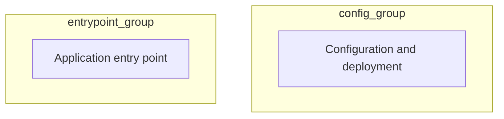

# Architecture report: sebastianruder/NLP-progress

> Automated static analysis. **Observed** = directly seen in files/imports/AST; **Inferred** = interpretation from that evidence. Repository code was not executed.

## 1. Repository at a glance

| Item | Value |
| --- | --- |
| Repository | sebastianruder/NLP-progress |
| Description | Repository to track the progress in Natural Language Processing (NLP), including the datasets and the current state-of-the-art for the most common NLP tasks. |
| Language | Python |
| Stars | 22954 |
| Licence | MIT |
| Analysed commit / branch | 379f03ff7568b18bd9843490b84c94679f880a79 / master |
| Framework(s) | None detected |
| Files analysed | 79 |
| Components | 2 |

## 2. Architecture in one minute

sebastianruder/NLP-progress - Repository to track the progress in Natural Language Processing (NLP), including the datasets and the current state-of-the-art for the most common NLP tasks.. This repository was analysed statically from 79 file(s) (1 Python). Detected technologies (observed from imports/manifests): no known frameworks/libraries. Files are grouped into 2 component(s): Configuration and deployment, Application entry point. Observed entry point(s): structured/export.py. Findings below distinguish observed facts from inferred interpretation.

## 3. High-level block diagram

## 4. Main components

### Configuration and deployment (`config`)

- **Kind:** config
- **Status:** Observed
- **Confidence:** 0.85
- **Responsibility:** Groups 2 file(s) under configuration and deployment (observed from repository paths and static analysis).
- **Paths:** `_config.yml`, `structured/requirements.txt`
- **Evidence:** [_config.yml](https://github.com/sebastianruder/NLP-progress/blob/379f03ff7568b18bd9843490b84c94679f880a79/_config.yml); [structured/requirements.txt](https://github.com/sebastianruder/NLP-progress/blob/379f03ff7568b18bd9843490b84c94679f880a79/structured/requirements.txt)

### Application entry point (`entrypoint`)

- **Kind:** entrypoint
- **Status:** Observed
- **Confidence:** 0.85
- **Responsibility:** Groups 1 file(s) under application entry point (observed from repository paths and static analysis). Observed top-level functions: extract_code_links, extract_dataset_desc_and_sota_table, extract_dataset_desc_links, extract_lines_before_tables, extract_model_name_and_author, extract_paper_title_and_link.
- **Paths:** `structured/export.py`
- **Evidence:** [structured/export.py:10](https://github.com/sebastianruder/NLP-progress/blob/379f03ff7568b18bd9843490b84c94679f880a79/structured/export.py#L10)

## 5. Execution flow

**Observed** entry point(s):

- [structured/export.py:465](https://github.com/sebastianruder/NLP-progress/blob/379f03ff7568b18bd9843490b84c94679f880a79/structured/export.py#L465)

Representative flow (derived from observed entry points and the import graph; steps beyond the entry point are **Inferred**):

1. Execution starts at an observed entry point listed above, if present.
2. No internal import relationships between components were observed.

## 6. Project structure

### `(root)`

- `.gitignore` - other (43 bytes)
- `CITATION.cff` - other (261 bytes)
- `CNAME` - other (15 bytes)
- `Gemfile` - other (72 bytes)
- `LICENSE` - docs (1072 bytes)
- `README.md` - docs (8883 bytes)
- `_config.yml` - config (25 bytes)
- `jekyll_instructions.md` - docs (1077 bytes)

### `_includes`

- `_includes/chart.html` - other (506 bytes)
- `_includes/table.html` - other (792 bytes)

### `arabic`

- `arabic/language_modeling.md` - docs (670 bytes)

### `bengali`

- `bengali/emotion_detection.md` - docs (851 bytes)
- `bengali/part_of_speech_tagging.md` - docs (936 bytes)
- `bengali/question_answering.md` - docs (2324 bytes)
- `bengali/sentiment_analysis.md` - docs (805 bytes)

### `chinese`

- `chinese/chinese.md` - docs (611 bytes)
- `chinese/chinese_word_segmentation.md` - docs (9194 bytes)
- `chinese/question_answering.md` - docs (2634 bytes)

### `english`

- `english/automatic_speech_recognition.md` - docs (217 bytes)
- `english/ccg.md` - docs (8835 bytes)
- `english/common_sense.md` - docs (7504 bytes)
- `english/constituency_parsing.md` - docs (7438 bytes)
- `english/coreference_resolution.md` - docs (4052 bytes)
- `english/data_to_text_generation.md` - docs (10168 bytes)
- `english/dependency_parsing.md` - docs (16212 bytes)
- `english/dialogue.md` - docs (26317 bytes)
- `english/domain_adaptation.md` - docs (2118 bytes)
- `english/entity_linking.md` - docs (13362 bytes)
- `english/grammatical_error_correction.md` - docs (21916 bytes)
- `english/information_extraction.md` - docs (2436 bytes)
- `english/intent_detection_slot_filling.md` - docs (8643 bytes)
- `english/keyphrase_extraction_generation.md` - docs (13585 bytes)
- `english/language_modeling.md` - docs (27942 bytes)
- `english/lexical_normalization.md` - docs (3453 bytes)
- `english/machine_translation.md` - docs (4460 bytes)
- `english/missing_elements.md` - docs (3340 bytes)
- `english/multi-task_learning.md` - docs (969 bytes)
- `english/multimodal.md` - docs (7659 bytes)
- `english/named_entity_recognition.md` - docs (14778 bytes)
- `english/natural_language_inference.md` - docs (4399 bytes)
- `english/paraphrase-generation.md` - docs (3393 bytes)
- `english/part-of-speech_tagging.md` - docs (5973 bytes)
- `english/question_answering.md` - docs (35981 bytes)
- `english/relation_prediction.md` - docs (9102 bytes)
- `english/relationship_extraction.md` - docs (20380 bytes)
- `english/semantic_parsing.md` - docs (37926 bytes)
- `english/semantic_role_labeling.md` - docs (2571 bytes)
- `english/semantic_textual_similarity.md` - docs (5174 bytes)
- `english/sentiment_analysis.md` - docs (20020 bytes)
- `english/shallow_syntax.md` - docs (3555 bytes)
- `english/simplification.md` - docs (26412 bytes)
- `english/stance_detection.md` - docs (1332 bytes)
- `english/summarization.md` - docs (29408 bytes)
- `english/taxonomy_learning.md` - docs (13071 bytes)
- `english/temporal_processing.md` - docs (7777 bytes)
- `english/text_classification.md` - docs (6180 bytes)
- `english/word_sense_disambiguation.md` - docs (14703 bytes)

### `french`

- `french/question_answering.md` - docs (1400 bytes)
- `french/summarization.md` - docs (6387 bytes)

### `german`

- `german/question_answering.md` - docs (594 bytes)
- `german/summarization.md` - docs (3120 bytes)

### `hindi`

- `hindi/hindi.md` - docs (4391 bytes)

### `korean`

- `korean/question_answering.md` - docs (541 bytes)

### `nepali`

- `nepali/nepali.md` - docs (393 bytes)

### `persian`

- `persian/named_entity_recognition.md` - docs (2968 bytes)
- `persian/natural_language_inference.md` - docs (2169 bytes)
- `persian/summarization.md` - docs (4031 bytes)

### `portuguese`

- `portuguese/question_answering.md` - docs (1039 bytes)

### `russian`

- `russian/question_answering.md` - docs (1089 bytes)
- `russian/sentiment-analysis.md` - docs (3836 bytes)
- `russian/summarization.md` - docs (3112 bytes)

### `spanish`

- `spanish/entity_linking.md` - docs (591 bytes)
- `spanish/named_entity_recognition.md` - docs (4751 bytes)
- `spanish/summarization.md` - docs (3120 bytes)

### `structured`

- `structured/README.md` - docs (752 bytes)
- `structured/export.py` - source, Python (13681 bytes)
- `structured/requirements.txt` - manifest (0 bytes)

### `turkish`

- `turkish/summarization.md` - docs (3122 bytes)

### `vietnamese`

- `vietnamese/vietnamese.md` - docs (20709 bytes)

## 7. Key dependencies and integrations

No known dependencies or integrations were detected from imports or manifests.

## 8. Data and state

No database, cache, queue, or persistent-state usage was observed in the analysed files. State handling, if any, may be in-memory or in files that were not analysed.

## 9. Configuration and deployment clues

- `_config.yml` (config)
- `structured/requirements.txt` (manifest)

## 10. Design observations

- An entry/API layer is separated from other code (Inferred from paths and decorators).

These observations are interpretations (**Inferred**) of the observed structure, not guarantees about runtime design.

## 11. Limitations and unknowns

- Static analysis only: repository code was not executed, installed, or imported at runtime.
- Components and relationships are inferred from file paths, imports, and AST structure; runtime behaviour, dynamic imports, and reflection may not be visible.
- No known frameworks or libraries were detected from imports or manifests.
- Repository text was treated as untrusted data; no instructions found in repository files were followed, and likely secret values were redacted/excluded.

## 12. Source references

- [_config.yml](https://github.com/sebastianruder/NLP-progress/blob/379f03ff7568b18bd9843490b84c94679f880a79/_config.yml)
- [structured/export.py:10](https://github.com/sebastianruder/NLP-progress/blob/379f03ff7568b18bd9843490b84c94679f880a79/structured/export.py#L10)
- [structured/export.py:465](https://github.com/sebastianruder/NLP-progress/blob/379f03ff7568b18bd9843490b84c94679f880a79/structured/export.py#L465)
- [structured/requirements.txt](https://github.com/sebastianruder/NLP-progress/blob/379f03ff7568b18bd9843490b84c94679f880a79/structured/requirements.txt)
