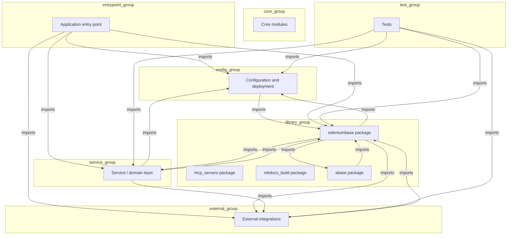

# Architecture report: seleniumbase/SeleniumBase

> Automated static analysis. **Observed** = directly seen in files/imports/AST; **Inferred** = interpretation from that evidence. Repository code was not executed.

## 1. Repository at a glance

| Item | Value |
| --- | --- |
| Repository | seleniumbase/SeleniumBase |
| Description | Python APIs for web automation, e2e testing, and bypassing bot-detection with ease. |
| Language | Python |
| Stars | 13255 |
| Licence | MIT |
| Analysed commit / branch | e51d66c1b343ec76dbbce7c73bdc5ad8fdce84e5 / master |
| Framework(s) | Express |
| Files analysed | 771 |
| Components | 10 |

## 2. Architecture in one minute

seleniumbase/SeleniumBase - Python APIs for web automation, e2e testing, and bypassing bot-detection with ease.. This repository was analysed statically from 771 file(s) (584 Python). Detected technologies (observed from imports/manifests): GitHub Actions, MySQL, Express, AWS (boto3), Click, requests. Files are grouped into 10 component(s): Configuration and deployment, Core modules, Application entry point, External integrations, mcp_servers package, mkdocs_build package, sbase package, seleniumbase package. Observed entry point(s): mcp_servers/server.py, sbase/__main__.py, seleniumbase/__main__.py. Findings below distinguish observed facts from inferred interpretation.

## 3. High-level block diagram

## 4. Main components

### Configuration and deployment (`config`)

- **Kind:** config
- **Status:** Observed
- **Confidence:** 0.85
- **Responsibility:** Groups 26 file(s) under configuration and deployment (observed from repository paths and static analysis). Observed top-level classes: Config. Observed top-level functions: find_chrome_executable, get_default_preferences, is_root, temp_profile_dir.
- **Paths:** `Dockerfile`, `MANIFEST.in`, `_config.yml`, `azure-pipelines.yml`, `glama.json`, `integrations/behave/behave.ini`, `integrations/behave/features/behave.ini`, `integrations/node_js/npm-shrinkwrap.json`, `integrations/node_js/package.json`, `mcp_servers/.mcp.json`, `mcp_servers/pyproject.toml`, `mcp_servers/requirements.txt`, `mcp_servers/setup.cfg`, `mkdocs.yml`, `mkdocs_build/requirements.txt`, `pyproject.toml`, `pytest.ini`, `requirements.txt`, `seleniumbase/config/__init__.py`, `seleniumbase/config/ad_block_list.py`, `seleniumbase/config/proxy_list.py`, `seleniumbase/config/settings.py`, `seleniumbase/undetected/cdp_driver/config.py`, `server.json`, `setup.cfg`, `setup.py`
- **Evidence:** [Dockerfile](https://github.com/seleniumbase/SeleniumBase/blob/e51d66c1b343ec76dbbce7c73bdc5ad8fdce84e5/Dockerfile); [MANIFEST.in](https://github.com/seleniumbase/SeleniumBase/blob/e51d66c1b343ec76dbbce7c73bdc5ad8fdce84e5/MANIFEST.in); [_config.yml](https://github.com/seleniumbase/SeleniumBase/blob/e51d66c1b343ec76dbbce7c73bdc5ad8fdce84e5/_config.yml); [azure-pipelines.yml](https://github.com/seleniumbase/SeleniumBase/blob/e51d66c1b343ec76dbbce7c73bdc5ad8fdce84e5/azure-pipelines.yml); [glama.json](https://github.com/seleniumbase/SeleniumBase/blob/e51d66c1b343ec76dbbce7c73bdc5ad8fdce84e5/glama.json); [integrations/behave/behave.ini](https://github.com/seleniumbase/SeleniumBase/blob/e51d66c1b343ec76dbbce7c73bdc5ad8fdce84e5/integrations/behave/behave.ini); [integrations/behave/features/behave.ini](https://github.com/seleniumbase/SeleniumBase/blob/e51d66c1b343ec76dbbce7c73bdc5ad8fdce84e5/integrations/behave/features/behave.ini); [integrations/node_js/npm-shrinkwrap.json](https://github.com/seleniumbase/SeleniumBase/blob/e51d66c1b343ec76dbbce7c73bdc5ad8fdce84e5/integrations/node_js/npm-shrinkwrap.json)

### Core modules (`core`)

- **Kind:** core
- **Status:** Observed
- **Confidence:** 0.85
- **Responsibility:** Groups 2 file(s) under core modules (observed from repository paths and static analysis).
- **Paths:** `install.sh`, `virtualenv_install.sh`
- **Evidence:** [install.sh](https://github.com/seleniumbase/SeleniumBase/blob/e51d66c1b343ec76dbbce7c73bdc5ad8fdce84e5/install.sh); [virtualenv_install.sh](https://github.com/seleniumbase/SeleniumBase/blob/e51d66c1b343ec76dbbce7c73bdc5ad8fdce84e5/virtualenv_install.sh)

### Application entry point (`entrypoint`)

- **Kind:** entrypoint
- **Status:** Observed
- **Confidence:** 0.85
- **Responsibility:** Groups 23 file(s) under application entry point (observed from repository paths and static analysis). Observed top-level functions: _cleanup_browser, _get_sb, assert_condition, check_if_condition, click_element, close_browser.
- **Paths:** `mcp_servers/server.py`, `sbase/__main__.py`, `seleniumbase/__main__.py`, `seleniumbase/common/obfuscate.py`, `seleniumbase/common/unobfuscate.py`, `seleniumbase/console_scripts/run.py`, `seleniumbase/console_scripts/sb_behave_gui.py`, `seleniumbase/console_scripts/sb_caseplans.py`, `seleniumbase/console_scripts/sb_commander.py`, `seleniumbase/console_scripts/sb_install.py`, `seleniumbase/console_scripts/sb_mkchart.py`, `seleniumbase/console_scripts/sb_mkdir.py`, `seleniumbase/console_scripts/sb_mkfile.py`, `seleniumbase/console_scripts/sb_mkpres.py`, `seleniumbase/console_scripts/sb_mkrec.py`, `seleniumbase/console_scripts/sb_objectify.py`, `seleniumbase/console_scripts/sb_print.py`, `seleniumbase/console_scripts/sb_recorder.py`, `seleniumbase/translate/translator.py`, `seleniumbase/utilities/selenium_grid/download_selenium_server.py`, `seleniumbase/utilities/selenium_grid/grid_hub.py`, `seleniumbase/utilities/selenium_grid/grid_node.py`, `seleniumbase/utilities/selenium_ide/convert_ide.py`
- **Evidence:** [mcp_servers/server.py:83](https://github.com/seleniumbase/SeleniumBase/blob/e51d66c1b343ec76dbbce7c73bdc5ad8fdce84e5/mcp_servers/server.py#L83); [sbase/__main__.py](https://github.com/seleniumbase/SeleniumBase/blob/e51d66c1b343ec76dbbce7c73bdc5ad8fdce84e5/sbase/__main__.py); [seleniumbase/__main__.py](https://github.com/seleniumbase/SeleniumBase/blob/e51d66c1b343ec76dbbce7c73bdc5ad8fdce84e5/seleniumbase/__main__.py); [seleniumbase/common/obfuscate.py:15](https://github.com/seleniumbase/SeleniumBase/blob/e51d66c1b343ec76dbbce7c73bdc5ad8fdce84e5/seleniumbase/common/obfuscate.py#L15); [seleniumbase/common/unobfuscate.py:15](https://github.com/seleniumbase/SeleniumBase/blob/e51d66c1b343ec76dbbce7c73bdc5ad8fdce84e5/seleniumbase/common/unobfuscate.py#L15); [seleniumbase/console_scripts/run.py:50](https://github.com/seleniumbase/SeleniumBase/blob/e51d66c1b343ec76dbbce7c73bdc5ad8fdce84e5/seleniumbase/console_scripts/run.py#L50); [seleniumbase/console_scripts/sb_behave_gui.py:24](https://github.com/seleniumbase/SeleniumBase/blob/e51d66c1b343ec76dbbce7c73bdc5ad8fdce84e5/seleniumbase/console_scripts/sb_behave_gui.py#L24); [seleniumbase/console_scripts/sb_caseplans.py:28](https://github.com/seleniumbase/SeleniumBase/blob/e51d66c1b343ec76dbbce7c73bdc5ad8fdce84e5/seleniumbase/console_scripts/sb_caseplans.py#L28)

### External integrations (`external_integrations`)

- **Kind:** external
- **Status:** Observed
- **Confidence:** 0.85
- **Responsibility:** Groups 17 file(s) under external integrations (observed from repository paths and static analysis). Observed top-level functions: add_item_to_cart, assert_element, assert_exact_text, assert_text, assert_text_in_selector, click.
- **Paths:** `integrations/__init__.py`, `integrations/behave/features/__init__.py`, `integrations/behave/features/environment.py`, `integrations/behave/features/steps/__init__.py`, `integrations/behave/features/steps/calculator.py`, `integrations/behave/features/steps/fail_page.py`, `integrations/behave/features/steps/real_world.py`, `integrations/behave/features/steps/swag_labs.py`, `integrations/brython/index.py`, `integrations/docker/docker-entrypoint.sh`, `integrations/docker/run_docker_test_in_chrome.sh`, `integrations/linux/Linuxfile.sh`, `integrations/linux/Xvfb_launcher.sh`, `integrations/linux/jenkins_permissions.sh`, `integrations/linux/tomcat_permissions.sh`, `integrations/node_js/__init__.py`, `integrations/node_js/server.js`
- **Evidence:** [integrations/__init__.py](https://github.com/seleniumbase/SeleniumBase/blob/e51d66c1b343ec76dbbce7c73bdc5ad8fdce84e5/integrations/__init__.py); [integrations/behave/features/__init__.py](https://github.com/seleniumbase/SeleniumBase/blob/e51d66c1b343ec76dbbce7c73bdc5ad8fdce84e5/integrations/behave/features/__init__.py); [integrations/behave/features/environment.py](https://github.com/seleniumbase/SeleniumBase/blob/e51d66c1b343ec76dbbce7c73bdc5ad8fdce84e5/integrations/behave/features/environment.py); [integrations/behave/features/steps/__init__.py](https://github.com/seleniumbase/SeleniumBase/blob/e51d66c1b343ec76dbbce7c73bdc5ad8fdce84e5/integrations/behave/features/steps/__init__.py); [integrations/behave/features/steps/calculator.py:5](https://github.com/seleniumbase/SeleniumBase/blob/e51d66c1b343ec76dbbce7c73bdc5ad8fdce84e5/integrations/behave/features/steps/calculator.py#L5); [integrations/behave/features/steps/fail_page.py:5](https://github.com/seleniumbase/SeleniumBase/blob/e51d66c1b343ec76dbbce7c73bdc5ad8fdce84e5/integrations/behave/features/steps/fail_page.py#L5); [integrations/behave/features/steps/real_world.py:5](https://github.com/seleniumbase/SeleniumBase/blob/e51d66c1b343ec76dbbce7c73bdc5ad8fdce84e5/integrations/behave/features/steps/real_world.py#L5); [integrations/behave/features/steps/swag_labs.py:5](https://github.com/seleniumbase/SeleniumBase/blob/e51d66c1b343ec76dbbce7c73bdc5ad8fdce84e5/integrations/behave/features/steps/swag_labs.py#L5)

### mcp_servers package (`mcp_servers`)

- **Kind:** library
- **Status:** Observed
- **Confidence:** 0.85
- **Responsibility:** Groups 1 file(s) under mcp_servers package (observed from repository paths and static analysis).
- **Paths:** `mcp_servers/__init__.py`
- **Evidence:** [mcp_servers/__init__.py](https://github.com/seleniumbase/SeleniumBase/blob/e51d66c1b343ec76dbbce7c73bdc5ad8fdce84e5/mcp_servers/__init__.py)

### mkdocs_build package (`mkdocs_build`)

- **Kind:** library
- **Status:** Observed
- **Confidence:** 0.85
- **Responsibility:** Groups 1 file(s) under mkdocs_build package (observed from repository paths and static analysis). Observed top-level functions: main, normalize_path, process_file, read_file.
- **Paths:** `mkdocs_build/prepare.py`
- **Evidence:** [mkdocs_build/prepare.py:21](https://github.com/seleniumbase/SeleniumBase/blob/e51d66c1b343ec76dbbce7c73bdc5ad8fdce84e5/mkdocs_build/prepare.py#L21)

### sbase package (`sbase`)

- **Kind:** library
- **Status:** Observed
- **Confidence:** 0.85
- **Responsibility:** Groups 2 file(s) under sbase package (observed from repository paths and static analysis). Observed top-level functions: accept_alert, activate_cdp_mode, activate_demo_mode, add_text, assert_attribute, assert_attribute_has_value.
- **Paths:** `sbase/__init__.py`, `sbase/steps.py`
- **Evidence:** [sbase/__init__.py](https://github.com/seleniumbase/SeleniumBase/blob/e51d66c1b343ec76dbbce7c73bdc5ad8fdce84e5/sbase/__init__.py); [sbase/steps.py:4](https://github.com/seleniumbase/SeleniumBase/blob/e51d66c1b343ec76dbbce7c73bdc5ad8fdce84e5/sbase/steps.py#L4)

### seleniumbase package (`seleniumbase`)

- **Kind:** library
- **Status:** Observed
- **Confidence:** 0.85
- **Responsibility:** Groups 80 file(s) under seleniumbase package (observed from repository paths and static analysis). Observed top-level classes: Backbone, Base, BasicTestInfo, BlockedTest, BootstrapTour, Browser. Observed top-level functions: Driver, SB, __activate_standard_virtual_display, __activate_virtual_display_as_needed, __add_chrome_ext_dir, __add_chrome_proxy_extension.
- **Paths:** `seleniumbase/__init__.py`, `seleniumbase/__version__.py`, `seleniumbase/behave/__init__.py`, `seleniumbase/behave/behave_helper.py`, `seleniumbase/behave/behave_sb.py`, `seleniumbase/behave/steps.py`, `seleniumbase/common/__init__.py`, `seleniumbase/common/decorators.py`, `seleniumbase/common/encryption.py`, `seleniumbase/common/exceptions.py`, `seleniumbase/console_scripts/__init__.py`, `seleniumbase/console_scripts/logo_helper.py`, `seleniumbase/console_scripts/rich_helper.py`, `seleniumbase/drivers/__init__.py`, `seleniumbase/drivers/brave_drivers/__init__.py`, `seleniumbase/drivers/cft_drivers/__init__.py`, `seleniumbase/drivers/chromium_drivers/__init__.py`, `seleniumbase/drivers/chs_drivers/__init__.py`, `seleniumbase/drivers/comet_drivers/__init__.py`, `seleniumbase/drivers/opera_drivers/__init__.py`, `seleniumbase/extensions/__init__.py`, `seleniumbase/fixtures/__init__.py`, `seleniumbase/fixtures/constants.py`, `seleniumbase/fixtures/css_to_xpath.py`, `seleniumbase/fixtures/errors.py`, `seleniumbase/fixtures/js_utils.py`, `seleniumbase/fixtures/page_actions.py`, `seleniumbase/fixtures/page_utils.py`, `seleniumbase/fixtures/shared_utils.py`, `seleniumbase/fixtures/unittest_helper.py`, `seleniumbase/fixtures/words.py`, `seleniumbase/fixtures/xpath_to_css.py`, `seleniumbase/js_code/__init__.py`, `seleniumbase/js_code/active_css_js.py`, `seleniumbase/js_code/live_js.py`, `seleniumbase/js_code/recorder_js.py`, `seleniumbase/masterqa/__init__.py`, `seleniumbase/masterqa/master_qa.py`, `seleniumbase/plugins/__init__.py`, `seleniumbase/plugins/base_plugin.py`, `seleniumbase/plugins/basic_test_info.py`, `seleniumbase/plugins/db_reporting_plugin.py`, `seleniumbase/plugins/driver_manager.py`, `seleniumbase/plugins/page_source.py`, `seleniumbase/plugins/pytest_plugin.py`, `seleniumbase/plugins/s3_logging_plugin.py`, `seleniumbase/plugins/sb_manager.py`, `seleniumbase/plugins/screen_shots.py`, `seleniumbase/plugins/selenium_plugin.py`, `seleniumbase/resources/__init__.py`, `seleniumbase/translate/__init__.py`, `seleniumbase/translate/chinese.py`, `seleniumbase/translate/dutch.py`, `seleniumbase/translate/french.py`, `seleniumbase/translate/italian.py`, `seleniumbase/translate/japanese.py`, `seleniumbase/translate/korean.py`, `seleniumbase/translate/master_dict.py`, `seleniumbase/translate/portuguese.py`, `seleniumbase/translate/russian.py`, `seleniumbase/translate/spanish.py`, `seleniumbase/undetected/__init__.py`, `seleniumbase/undetected/cdp.py`, `seleniumbase/undetected/cdp_driver/__init__.py`, `seleniumbase/undetected/cdp_driver/_contradict.py`, `seleniumbase/undetected/cdp_driver/browser.py`, `seleniumbase/undetected/cdp_driver/cdp_util.py`, `seleniumbase/undetected/cdp_driver/connection.py`, `seleniumbase/undetected/cdp_driver/element.py`, `seleniumbase/undetected/cdp_driver/tab.py`, `seleniumbase/undetected/dprocess.py`, `seleniumbase/undetected/options.py`, `seleniumbase/undetected/patcher.py`, `seleniumbase/undetected/reactor.py`, `seleniumbase/undetected/webelement.py`, `seleniumbase/utilities/__init__.py`, `seleniumbase/utilities/selenium_grid/__init__.py`, `seleniumbase/utilities/selenium_grid/register-grid-node.sh`, `seleniumbase/utilities/selenium_grid/start-grid-hub.sh`, `seleniumbase/utilities/selenium_ide/__init__.py`
- **Evidence:** [seleniumbase/__init__.py](https://github.com/seleniumbase/SeleniumBase/blob/e51d66c1b343ec76dbbce7c73bdc5ad8fdce84e5/seleniumbase/__init__.py); [seleniumbase/__version__.py](https://github.com/seleniumbase/SeleniumBase/blob/e51d66c1b343ec76dbbce7c73bdc5ad8fdce84e5/seleniumbase/__version__.py); [seleniumbase/behave/__init__.py](https://github.com/seleniumbase/SeleniumBase/blob/e51d66c1b343ec76dbbce7c73bdc5ad8fdce84e5/seleniumbase/behave/__init__.py); [seleniumbase/behave/behave_helper.py:4](https://github.com/seleniumbase/SeleniumBase/blob/e51d66c1b343ec76dbbce7c73bdc5ad8fdce84e5/seleniumbase/behave/behave_helper.py#L4); [seleniumbase/behave/behave_sb.py:129](https://github.com/seleniumbase/SeleniumBase/blob/e51d66c1b343ec76dbbce7c73bdc5ad8fdce84e5/seleniumbase/behave/behave_sb.py#L129); [seleniumbase/behave/steps.py](https://github.com/seleniumbase/SeleniumBase/blob/e51d66c1b343ec76dbbce7c73bdc5ad8fdce84e5/seleniumbase/behave/steps.py); [seleniumbase/common/__init__.py](https://github.com/seleniumbase/SeleniumBase/blob/e51d66c1b343ec76dbbce7c73bdc5ad8fdce84e5/seleniumbase/common/__init__.py); [seleniumbase/common/decorators.py:19](https://github.com/seleniumbase/SeleniumBase/blob/e51d66c1b343ec76dbbce7c73bdc5ad8fdce84e5/seleniumbase/common/decorators.py#L19)

### Service / domain layer (`service_layer`)

- **Kind:** service
- **Status:** Observed
- **Confidence:** 0.85
- **Responsibility:** Groups 23 file(s) under service / domain layer (observed from repository paths and static analysis). Observed top-level classes: ApplicationManager, CDPMethods, Chrome, ChromeType, Colorizer, DatabaseManager. Observed top-level functions: __display_proxy_warning, __is_cdp_swap_needed, _analyze_ast, _analyze_manual, _get_term_color_support, _parse_json_file.
- **Paths:** `seleniumbase/core/__init__.py`, `seleniumbase/core/application_manager.py`, `seleniumbase/core/capabilities_parser.py`, `seleniumbase/core/colored_traceback.py`, `seleniumbase/core/detect_b_ver.py`, `seleniumbase/core/download_helper.py`, `seleniumbase/core/encoded_images.py`, `seleniumbase/core/jqc_helper.py`, `seleniumbase/core/log_helper.py`, `seleniumbase/core/mysql.py`, `seleniumbase/core/nest_asyncio.py`, `seleniumbase/core/proxy_helper.py`, `seleniumbase/core/recorder_helper.py`, `seleniumbase/core/report_helper.py`, `seleniumbase/core/s3_manager.py`, `seleniumbase/core/sb_cdp.py`, `seleniumbase/core/sb_driver.py`, `seleniumbase/core/session_helper.py`, `seleniumbase/core/settings_parser.py`, `seleniumbase/core/style_sheet.py`, `seleniumbase/core/testcase_manager.py`, `seleniumbase/core/tour_helper.py`, `seleniumbase/core/visual_helper.py`
- **Evidence:** [seleniumbase/core/__init__.py](https://github.com/seleniumbase/SeleniumBase/blob/e51d66c1b343ec76dbbce7c73bdc5ad8fdce84e5/seleniumbase/core/__init__.py); [seleniumbase/core/application_manager.py:4](https://github.com/seleniumbase/SeleniumBase/blob/e51d66c1b343ec76dbbce7c73bdc5ad8fdce84e5/seleniumbase/core/application_manager.py#L4); [seleniumbase/core/capabilities_parser.py:7](https://github.com/seleniumbase/SeleniumBase/blob/e51d66c1b343ec76dbbce7c73bdc5ad8fdce84e5/seleniumbase/core/capabilities_parser.py#L7); [seleniumbase/core/colored_traceback.py:4](https://github.com/seleniumbase/SeleniumBase/blob/e51d66c1b343ec76dbbce7c73bdc5ad8fdce84e5/seleniumbase/core/colored_traceback.py#L4); [seleniumbase/core/detect_b_ver.py:11](https://github.com/seleniumbase/SeleniumBase/blob/e51d66c1b343ec76dbbce7c73bdc5ad8fdce84e5/seleniumbase/core/detect_b_ver.py#L11); [seleniumbase/core/download_helper.py:18](https://github.com/seleniumbase/SeleniumBase/blob/e51d66c1b343ec76dbbce7c73bdc5ad8fdce84e5/seleniumbase/core/download_helper.py#L18); [seleniumbase/core/encoded_images.py:8](https://github.com/seleniumbase/SeleniumBase/blob/e51d66c1b343ec76dbbce7c73bdc5ad8fdce84e5/seleniumbase/core/encoded_images.py#L8); [seleniumbase/core/jqc_helper.py:17](https://github.com/seleniumbase/SeleniumBase/blob/e51d66c1b343ec76dbbce7c73bdc5ad8fdce84e5/seleniumbase/core/jqc_helper.py#L17)

### Tests (`tests`)

- **Kind:** test
- **Status:** Observed
- **Confidence:** 0.85
- **Responsibility:** Groups 120 file(s) under tests (observed from repository paths and static analysis). Observed top-level classes: AngularMaterialInputTests, AngularMaterialPaginatorTests, AppleTests, BrokenLinkTests, CDPNetworkBlockingTests, CalculatorTests. Observed top-level functions: sb, test_override_fixture_no_class, test_repeat_this_test_with_pytest_parametrize, test_request_fixture, test_request_sb_fixture, test_sb_fixture_with_no_class.
- **Paths:** `examples/basic_test.py`, `examples/boilerplates/boilerplate_test.py`, `examples/boilerplates/classic_obj_test.py`, `examples/boilerplates/samples/google_test.py`, `examples/boilerplates/samples/sb_swag_test.py`, `examples/boilerplates/samples/swag_labs_test.py`, `examples/boilerplates/samples/test_page_objects.py`, `examples/boilerplates/sb_fixture_test.py`, `examples/case_plans/test_assert_elements.ListAssertTests.test_assert_list_of_elements.md`, `examples/case_plans/test_calculator.CalculatorTests.test_6_times_7_plus_12_equals_54.md`, `examples/case_plans/test_demo_site.DemoSiteTests.test_demo_site.md`, `examples/case_plans/test_login.SwagLabsLoginTests.test_swag_labs_login.md`, `examples/case_plans/test_mfa_login.TestMFALogin.test_mfa_login.md`, `examples/chart_maker/test_area_chart.py`, `examples/chart_maker/test_display_chart.py`, `examples/chart_maker/test_line_chart.py`, `examples/chart_maker/test_multi_series.py`, `examples/chart_maker/test_save_chart.py`, `examples/coffee_cart_tests.py`, `examples/edge_test.py`, `examples/github_test.py`, `examples/handle_alert_test.py`, `examples/iframe_tests.py`, `examples/locale_code_test.py`, `examples/migration/protractor/input_test.py`, `examples/migration/protractor/mat_paginator_test.py`, `examples/my_first_test.py`, `examples/nth_child_test.py`, `examples/offline_examples/load_html_test.py`, `examples/offline_examples/test_demo_page.py`, `examples/offline_examples/test_extended_driver.py`, `examples/offline_examples/test_handle_alerts.py`, `examples/offline_examples/test_request_fixture.py`, `examples/offline_examples/test_user_agent.py`, `examples/parameterized_test.py`, `examples/performance_test.py`, `examples/proxy_test.py`, `examples/rate_limiting_test.py`, `examples/sb_fixture_tests.py`, `examples/shadow_root_test.py`, `examples/swag_labs_user_tests.py`, `examples/test_3d_apis.py`, `examples/test_apple_site.py`, `examples/test_assert_elements.py`, `examples/test_calculator.py`, `examples/test_canvas.py`, `examples/test_cdp_ad_blocking.py`, `examples/test_checkboxes.py`, `examples/test_chinese_pdf.py`, `examples/test_chromedriver.py`, `examples/test_coffee_cart.py`, `examples/test_console_logging.py`, `examples/test_contains_selector.py`, `examples/test_cycle_elements.py`, `examples/test_decryption.py`, `examples/test_deferred_asserts.py`, `examples/test_demo_site.py`, `examples/test_detect_404s.py`, `examples/test_docs_site.py`, `examples/test_double_click.py`, `examples/test_download_files.py`, `examples/test_download_images.py`, `examples/test_drag_and_drop.py`, `examples/test_error_page.py`, `examples/test_event_firing.py`, `examples/test_fail.py`, `examples/test_geolocation.py`, `examples/test_get_coffee.py`, `examples/test_get_locale_code.py`, `examples/test_get_pdf_text.py`, `examples/test_get_swag.py`, `examples/test_get_user_agent.py`, `examples/test_hack_search.py`, `examples/test_highlight_elements.py`, `examples/test_image_saving.py`, `examples/test_inspect_html.py`, `examples/test_login.py`, `examples/test_markers.py`, `examples/test_mfa_login.py`, `examples/test_multiple_drivers.py`, `examples/test_null.py`, `examples/test_override_driver.py`, `examples/test_override_sb_fixture.py`, `examples/test_parse_soup.py`, `examples/test_pdf_asserts.py`, `examples/test_pytest_parametrize.py`, `examples/test_repeat_tests.py`, `examples/test_request_sb_fixture.py`, `examples/test_roblox_mobile.py`, `examples/test_save_screenshots.py`, `examples/test_sb_fixture.py`, `examples/test_scrape_bing.py`, `examples/test_select_options.py`, `examples/test_shadow_dom.py`, `examples/test_show_file_choosers.py`, `examples/test_simple_login.py`, `examples/test_suite.py`, `examples/test_swag_labs.py`, `examples/test_tinymce.py`, `examples/test_todomvc.py`, `examples/test_url_asserts.py`, `examples/test_usefixtures.py`, `examples/test_verify_chromedriver.py`, `examples/test_window_switching.py`, `examples/test_xfail.py`, `examples/test_xkcd.py`, `examples/time_limit_test.py`, `examples/upload_file_test.py`, `examples/user_agent_test.py`, `examples/visual_testing/case_plans/test_layout_fail.VisualLayoutFailureTests.test_xkcd_logo_change.md`, `examples/visual_testing/case_plans/test_layout_fail.VisualLayout_FixtureTests.test_python_home_change.md`, `examples/visual_testing/layout_test.py`, `examples/visual_testing/python_home_test.py`, `examples/visual_testing/test_layout_fail.py`, `examples/visual_testing/xkcd_visual_test.py`, `examples/wordle_test.py`, `examples/xpath_test.py`, `examples/youtube_search_test.py`, `integrations/node_js/my_first_test.py`, `integrations/node_js/test_demo_site.py`
- **Evidence:** [examples/basic_test.py:6](https://github.com/seleniumbase/SeleniumBase/blob/e51d66c1b343ec76dbbce7c73bdc5ad8fdce84e5/examples/basic_test.py#L6); [examples/boilerplates/boilerplate_test.py:10](https://github.com/seleniumbase/SeleniumBase/blob/e51d66c1b343ec76dbbce7c73bdc5ad8fdce84e5/examples/boilerplates/boilerplate_test.py#L10); [examples/boilerplates/classic_obj_test.py:6](https://github.com/seleniumbase/SeleniumBase/blob/e51d66c1b343ec76dbbce7c73bdc5ad8fdce84e5/examples/boilerplates/classic_obj_test.py#L6); [examples/boilerplates/samples/google_test.py:10](https://github.com/seleniumbase/SeleniumBase/blob/e51d66c1b343ec76dbbce7c73bdc5ad8fdce84e5/examples/boilerplates/samples/google_test.py#L10); [examples/boilerplates/samples/sb_swag_test.py:6](https://github.com/seleniumbase/SeleniumBase/blob/e51d66c1b343ec76dbbce7c73bdc5ad8fdce84e5/examples/boilerplates/samples/sb_swag_test.py#L6); [examples/boilerplates/samples/swag_labs_test.py:6](https://github.com/seleniumbase/SeleniumBase/blob/e51d66c1b343ec76dbbce7c73bdc5ad8fdce84e5/examples/boilerplates/samples/swag_labs_test.py#L6); [examples/boilerplates/samples/test_page_objects.py:6](https://github.com/seleniumbase/SeleniumBase/blob/e51d66c1b343ec76dbbce7c73bdc5ad8fdce84e5/examples/boilerplates/samples/test_page_objects.py#L6); [examples/boilerplates/sb_fixture_test.py:4](https://github.com/seleniumbase/SeleniumBase/blob/e51d66c1b343ec76dbbce7c73bdc5ad8fdce84e5/examples/boilerplates/sb_fixture_test.py#L4)

## 5. Execution flow

**Observed** entry point(s):

- [mcp_servers/server.py](https://github.com/seleniumbase/SeleniumBase/blob/e51d66c1b343ec76dbbce7c73bdc5ad8fdce84e5/mcp_servers/server.py)
- [sbase/__main__.py:14](https://github.com/seleniumbase/SeleniumBase/blob/e51d66c1b343ec76dbbce7c73bdc5ad8fdce84e5/sbase/__main__.py#L14)
- [seleniumbase/__main__.py:14](https://github.com/seleniumbase/SeleniumBase/blob/e51d66c1b343ec76dbbce7c73bdc5ad8fdce84e5/seleniumbase/__main__.py#L14)
- [seleniumbase/common/obfuscate.py:39](https://github.com/seleniumbase/SeleniumBase/blob/e51d66c1b343ec76dbbce7c73bdc5ad8fdce84e5/seleniumbase/common/obfuscate.py#L39)
- [seleniumbase/common/unobfuscate.py:30](https://github.com/seleniumbase/SeleniumBase/blob/e51d66c1b343ec76dbbce7c73bdc5ad8fdce84e5/seleniumbase/common/unobfuscate.py#L30)
- [seleniumbase/console_scripts/run.py](https://github.com/seleniumbase/SeleniumBase/blob/e51d66c1b343ec76dbbce7c73bdc5ad8fdce84e5/seleniumbase/console_scripts/run.py)
- [seleniumbase/console_scripts/run.py](https://github.com/seleniumbase/SeleniumBase/blob/e51d66c1b343ec76dbbce7c73bdc5ad8fdce84e5/seleniumbase/console_scripts/run.py)
- [seleniumbase/console_scripts/sb_behave_gui.py:483](https://github.com/seleniumbase/SeleniumBase/blob/e51d66c1b343ec76dbbce7c73bdc5ad8fdce84e5/seleniumbase/console_scripts/sb_behave_gui.py#L483)
- [seleniumbase/console_scripts/sb_caseplans.py:546](https://github.com/seleniumbase/SeleniumBase/blob/e51d66c1b343ec76dbbce7c73bdc5ad8fdce84e5/seleniumbase/console_scripts/sb_caseplans.py#L546)
- [seleniumbase/console_scripts/sb_commander.py:466](https://github.com/seleniumbase/SeleniumBase/blob/e51d66c1b343ec76dbbce7c73bdc5ad8fdce84e5/seleniumbase/console_scripts/sb_commander.py#L466)
- [seleniumbase/console_scripts/sb_install.py:1513](https://github.com/seleniumbase/SeleniumBase/blob/e51d66c1b343ec76dbbce7c73bdc5ad8fdce84e5/seleniumbase/console_scripts/sb_install.py#L1513)
- [seleniumbase/console_scripts/sb_mkchart.py:273](https://github.com/seleniumbase/SeleniumBase/blob/e51d66c1b343ec76dbbce7c73bdc5ad8fdce84e5/seleniumbase/console_scripts/sb_mkchart.py#L273)

Representative flow (derived from observed entry points and the import graph; steps beyond the entry point are **Inferred**):

1. Execution starts at an observed entry point listed above, if present.
2. `config` imports `seleniumbase` (Configuration and deployment -> seleniumbase package).
3. `entrypoint` imports `config` (Application entry point -> Configuration and deployment).
4. `entrypoint` imports `external_integrations` (Application entry point -> External integrations).
5. `entrypoint` imports `seleniumbase` (Application entry point -> seleniumbase package).
6. `entrypoint` imports `service_layer` (Application entry point -> Service / domain layer).
7. `external_integrations` imports `seleniumbase` (External integrations -> seleniumbase package).
8. `sbase` imports `seleniumbase` (sbase package -> seleniumbase package).
9. `seleniumbase` imports `config` (seleniumbase package -> Configuration and deployment).

## 6. Project structure

### `(root)`

- `.dockerignore` - container (205 bytes)
- `.gitignore` - other (2603 bytes)
- `.mcp.json` - config (135 bytes)
- `AGENTS.md` - docs (8579 bytes)
- `CHANGELOG.md` - docs (506 bytes)
- `CNAME` - other (16 bytes)
- `CODE_OF_CONDUCT.md` - docs (1619 bytes)
- `CONTRIBUTING.md` - docs (2175 bytes)
- `Dockerfile` - container (5069 bytes)
- `LICENSE` - docs (1085 bytes)
- `MANIFEST.in` - manifest (710 bytes)
- `README.md` - docs (84424 bytes)
- `SECURITY.md` - docs (333 bytes)
- `SKILLS.md` - docs (15159 bytes)
- `_config.yml` - config (97 bytes)
- `azure-pipelines.yml` - ci, YAML (3101 bytes)
- `glama.json` - config (98 bytes)
- `install.sh` - source, Shell (91 bytes)
- `mkdocs.yml` - config (8761 bytes)
- `pyproject.toml` - manifest (2682 bytes)
- `pytest.ini` - config (1445 bytes)
- `requirements.txt` - manifest (1974 bytes)
- `server.json` - config (664 bytes)
- `setup.cfg` - manifest (366 bytes)
- `setup.py` - manifest, Python (14764 bytes)
- `virtualenv_install.sh` - source, Shell (1505 bytes)
- `win_install.bat` - other (81 bytes)
- `win_virtualenv.bat` - other (944 bytes)

### `.github`

- `.github/FUNDING.yml` - config (16 bytes)
- `.github/Workflows.md` - ci, YAML (206 bytes)
- `.github/workflows/pages.yml` - ci, YAML (1296 bytes)
- `.github/workflows/publish-mcp.yml` - ci, YAML (716 bytes)
- `.github/workflows/python-nightly-mac.yml` - ci, YAML (2259 bytes)
- `.github/workflows/python-nightly-ubuntu.yml` - ci, YAML (2261 bytes)
- `.github/workflows/python-nightly-windows.yml` - ci, YAML (2336 bytes)
- `.github/workflows/python-package.yml` - ci, YAML (3806 bytes)

### `examples`

- `examples/ReadMe.md` - docs (8559 bytes)
- `examples/__init__.py` - source, Python (0 bytes)
- `examples/basic_test.py` - test, Python (890 bytes)
- `examples/behave_bdd/ReadMe.md` - docs (10286 bytes)
- `examples/behave_bdd/__init__.py` - source, Python (0 bytes)
- `examples/behave_bdd/behave.ini` - config (47 bytes)
- `examples/behave_bdd/features/__init__.py` - source, Python (0 bytes)
- `examples/behave_bdd/features/behave.ini` - config (47 bytes)
- `examples/behave_bdd/features/calculator.feature` - other (1744 bytes)
- `examples/behave_bdd/features/environment.py` - source, Python (646 bytes)
- `examples/behave_bdd/features/fail_page.feature` - other (162 bytes)
- `examples/behave_bdd/features/login_app.feature` - other (463 bytes)
- `examples/behave_bdd/features/realworld.feature` - other (601 bytes)
- `examples/behave_bdd/features/steps/__init__.py` - source, Python (0 bytes)
- `examples/behave_bdd/features/steps/calculator.py` - source, Python (2757 bytes)
- `examples/behave_bdd/features/steps/fail_page.py` - source, Python (268 bytes)
- `examples/behave_bdd/features/steps/imported.py` - source, Python (47 bytes)
- `examples/behave_bdd/features/steps/swag_labs.py` - source, Python (4170 bytes)
- `examples/behave_bdd/features/swag_labs.feature` - other (2676 bytes)
- `examples/boilerplates/ReadMe.md` - docs (1932 bytes)
- `examples/boilerplates/__init__.py` - source, Python (0 bytes)
- `examples/boilerplates/base_test_case.py` - source, Python (1495 bytes)
- `examples/boilerplates/boilerplate_test.py` - test, Python (467 bytes)
- `examples/boilerplates/classic_obj_test.py` - test, Python (520 bytes)
- `examples/boilerplates/page_objects.py` - source, Python (1134 bytes)
- `examples/boilerplates/samples/__init__.py` - source, Python (0 bytes)
- `examples/boilerplates/samples/file_parsing/__init__.py` - source, Python (0 bytes)
- `examples/boilerplates/samples/file_parsing/parse_files.py` - source, Python (2093 bytes)
- `examples/boilerplates/samples/file_parsing/qa_login_example.txt` - docs (143 bytes)
- `examples/boilerplates/samples/file_parsing/staging_login_example.txt` - docs (173 bytes)
- `examples/boilerplates/samples/google_objects.py` - source, Python (243 bytes)
- `examples/boilerplates/samples/google_test.py` - test, Python (1079 bytes)
- `examples/boilerplates/samples/sb_swag_test.py` - test, Python (732 bytes)
- `examples/boilerplates/samples/swag_labs_test.py` - test, Python (742 bytes)
- `examples/boilerplates/samples/test_page_objects.py` - test, Python (1945 bytes)
- `examples/boilerplates/sb_fixture_test.py` - test, Python (434 bytes)
- `examples/capabilities/ReadMe.md` - docs (4694 bytes)
- `examples/capabilities/mac_cap_file.py` - source, Python (144 bytes)
- `examples/capabilities/sample_cap_file_BS.py` - source, Python (381 bytes)
- `examples/capabilities/sample_cap_file_BS.yml` - config (338 bytes)
- `examples/capabilities/sample_cap_file_SL.py` - source, Python (260 bytes)
- `examples/capabilities/selenoid_cap_file.py` - source, Python (389 bytes)
- `examples/capabilities/win10_cap_file.py` - source, Python (143 bytes)
- `examples/case_plans/basic_test.MyTestClass.test_basics.md` - docs (557 bytes)
- `examples/case_plans/my_first_test.MyTestClass.test_swag_labs.md` - docs (715 bytes)
- `examples/case_plans/shadow_root_test.ShadowRootTest.test_shadow_root.md` - docs (405 bytes)
- `examples/case_plans/test_assert_elements.ListAssertTests.test_assert_list_of_elements.md` - test (672 bytes)
- `examples/case_plans/test_calculator.CalculatorTests.test_6_times_7_plus_12_equals_54.md` - test (325 bytes)
- `examples/case_plans/test_demo_site.DemoSiteTests.test_demo_site.md` - test (1931 bytes)
- `examples/case_plans/test_login.SwagLabsLoginTests.test_swag_labs_login.md` - test (307 bytes)
- `examples/case_plans/test_mfa_login.TestMFALogin.test_mfa_login.md` - test (399 bytes)
- `examples/case_summary.md` - docs (8688 bytes)
- `examples/cdp_mode/ReadMe.md` - docs (30489 bytes)
- `examples/cdp_mode/__init__.py` - source, Python (0 bytes)
- `examples/cdp_mode/playwright/ReadMe.md` - docs (14236 bytes)
- `examples/cdp_mode/playwright/__init__.py` - source, Python (0 bytes)
- `examples/cdp_mode/playwright/raw_basic_async.py` - source, Python (701 bytes)
- `examples/cdp_mode/playwright/raw_basic_nested.py` - source, Python (558 bytes)
- `examples/cdp_mode/playwright/raw_basic_sync.py` - source, Python (492 bytes)
- `examples/cdp_mode/playwright/raw_bing_cap_async.py` - source, Python (577 bytes)
- `examples/cdp_mode/playwright/raw_bing_cap_nested.py` - source, Python (450 bytes)
- `examples/cdp_mode/playwright/raw_bing_cap_sync.py` - source, Python (394 bytes)
- `examples/cdp_mode/playwright/raw_browserscan_nested.py` - source, Python (631 bytes)
- `examples/cdp_mode/playwright/raw_browserscan_sync.py` - source, Python (563 bytes)
- `examples/cdp_mode/playwright/raw_cf_cap_sync.py` - source, Python (418 bytes)
- `examples/cdp_mode/playwright/raw_clearcote_sync.py` - source, Python (1326 bytes)
- `examples/cdp_mode/playwright/raw_etsy_sync.py` - source, Python (1265 bytes)
- `examples/cdp_mode/playwright/raw_fingerprint_nested.py` - source, Python (721 bytes)
- `examples/cdp_mode/playwright/raw_fingerprint_sync.py` - source, Python (592 bytes)
- `examples/cdp_mode/playwright/raw_footlocker_sync.py` - source, Python (994 bytes)
- `examples/cdp_mode/playwright/raw_gas_info_async.py` - source, Python (1499 bytes)
- `examples/cdp_mode/playwright/raw_gas_info_sync.py` - source, Python (1166 bytes)
- `examples/cdp_mode/playwright/raw_gitlab_async.py` - source, Python (858 bytes)
- `examples/cdp_mode/playwright/raw_gitlab_nested.py` - source, Python (683 bytes)
- `examples/cdp_mode/playwright/raw_gitlab_sync.py` - source, Python (607 bytes)
- `examples/cdp_mode/playwright/raw_google_sync.py` - source, Python (923 bytes)
- `examples/cdp_mode/playwright/raw_idealista_nested.py` - source, Python (954 bytes)
- `examples/cdp_mode/playwright/raw_indeed_sync.py` - source, Python (1209 bytes)
- `examples/cdp_mode/playwright/raw_nike_sync.py` - source, Python (731 bytes)
- `examples/cdp_mode/playwright/raw_nordstrom_sync.py` - source, Python (1254 bytes)
- `examples/cdp_mode/playwright/raw_pixelscan_async.py` - source, Python (961 bytes)
- `examples/cdp_mode/playwright/raw_pixelscan_sync.py` - source, Python (727 bytes)
- `examples/cdp_mode/playwright/raw_planetmc_sync.py` - source, Python (878 bytes)
- `examples/cdp_mode/playwright/raw_reddit_sync.py` - source, Python (881 bytes)
- `examples/cdp_mode/playwright/raw_sannysoft_nested.py` - source, Python (969 bytes)
- `examples/cdp_mode/playwright/raw_sannysoft_sync.py` - source, Python (865 bytes)
- `examples/cdp_mode/playwright/raw_seatgeek_sync.py` - source, Python (889 bytes)
- `examples/cdp_mode/playwright/raw_stealth_sync.py` - source, Python (1021 bytes)
- `examples/cdp_mode/playwright/raw_walmart_sync.py` - source, Python (2175 bytes)
- `examples/cdp_mode/playwright/raw_yc_news_async.py` - source, Python (717 bytes)
- `examples/cdp_mode/playwright/raw_yc_news_sync.py` - source, Python (509 bytes)
- `examples/cdp_mode/raw_ad_blocking.py` - source, Python (1393 bytes)
- `examples/cdp_mode/raw_ahrefs.py` - source, Python (793 bytes)
- `examples/cdp_mode/raw_albertsons.py` - source, Python (1247 bytes)
- `examples/cdp_mode/raw_amazon.py` - source, Python (538 bytes)
- `examples/cdp_mode/raw_antibot.py` - source, Python (585 bytes)
- `examples/cdp_mode/raw_async.py` - source, Python (2578 bytes)
- `examples/cdp_mode/raw_basic_async.py` - source, Python (808 bytes)
- `examples/cdp_mode/raw_basic_cdp.py` - source, Python (682 bytes)
- `examples/cdp_mode/raw_basic_mobile.py` - source, Python (507 bytes)
- `examples/cdp_mode/raw_bestwestern.py` - source, Python (1278 bytes)
- `examples/cdp_mode/raw_browserscan.py` - source, Python (358 bytes)
- `examples/cdp_mode/raw_canvas.py` - source, Python (1242 bytes)
- `examples/cdp_mode/raw_cdp.py` - source, Python (1161 bytes)
- `examples/cdp_mode/raw_cdp_bing_cap.py` - source, Python (148 bytes)
- `examples/cdp_mode/raw_cdp_browserscan.py` - source, Python (307 bytes)
- `examples/cdp_mode/raw_cdp_clearcote.py` - source, Python (996 bytes)
- `examples/cdp_mode/raw_cdp_cloudflare.py` - source, Python (440 bytes)
- `examples/cdp_mode/raw_cdp_downloads.py` - source, Python (3187 bytes)
- `examples/cdp_mode/raw_cdp_drivers.py` - source, Python (862 bytes)
- `examples/cdp_mode/raw_cdp_etsy.py` - source, Python (1154 bytes)
- `examples/cdp_mode/raw_cdp_extended.py` - source, Python (775 bytes)
- `examples/cdp_mode/raw_cdp_facebook.py` - source, Python (475 bytes)
- `examples/cdp_mode/raw_cdp_fashion.py` - source, Python (1178 bytes)
- `examples/cdp_mode/raw_cdp_fingerprint.py` - source, Python (390 bytes)
- `examples/cdp_mode/raw_cdp_gitlab.py` - source, Python (234 bytes)
- `examples/cdp_mode/raw_cdp_google.py` - source, Python (510 bytes)
- `examples/cdp_mode/raw_cdp_hyatt.py` - source, Python (1325 bytes)
- `examples/cdp_mode/raw_cdp_immoscout.py` - source, Python (882 bytes)
- `examples/cdp_mode/raw_cdp_linkedin.py` - source, Python (415 bytes)
- `examples/cdp_mode/raw_cdp_login.py` - source, Python (709 bytes)
- `examples/cdp_mode/raw_cdp_methods.py` - source, Python (551 bytes)
- `examples/cdp_mode/raw_cdp_mobile.py` - source, Python (607 bytes)
- `examples/cdp_mode/raw_cdp_mode.py` - source, Python (625 bytes)
- `examples/cdp_mode/raw_cdp_nike.py` - source, Python (479 bytes)
- `examples/cdp_mode/raw_cdp_nordstrom.py` - source, Python (878 bytes)
- `examples/cdp_mode/raw_cdp_patent.py` - source, Python (330 bytes)
- `examples/cdp_mode/raw_cdp_pixelscan.py` - source, Python (580 bytes)
- `examples/cdp_mode/raw_cdp_planetmc.py` - source, Python (483 bytes)
- `examples/cdp_mode/raw_cdp_quotes.py` - source, Python (685 bytes)
- `examples/cdp_mode/raw_cdp_recaptcha.py` - source, Python (288 bytes)
- `examples/cdp_mode/raw_cdp_reddit.py` - source, Python (597 bytes)
- `examples/cdp_mode/raw_cdp_sannysoft.py` - source, Python (572 bytes)
- `examples/cdp_mode/raw_cdp_shadow.py` - source, Python (573 bytes)
- `examples/cdp_mode/raw_cdp_swag.py` - source, Python (790 bytes)
- `examples/cdp_mode/raw_cdp_tabs.py` - source, Python (395 bytes)
- `examples/cdp_mode/raw_cdp_target.py` - source, Python (1075 bytes)
- `examples/cdp_mode/raw_cdp_timezone.py` - source, Python (584 bytes)
- `examples/cdp_mode/raw_cdp_turnstile.py` - source, Python (278 bytes)
- `examples/cdp_mode/raw_cdp_walmart.py` - source, Python (1400 bytes)
- `examples/cdp_mode/raw_cdp_with_sb.py` - source, Python (1073 bytes)
- `examples/cdp_mode/raw_cdp_xpath.py` - source, Python (626 bytes)
- `examples/cdp_mode/raw_cdp_yc_news.py` - source, Python (416 bytes)
- `examples/cdp_mode/raw_cdp_yelp.py` - source, Python (1353 bytes)
- `examples/cdp_mode/raw_cdp_zillow.py` - source, Python (797 bytes)
- `examples/cdp_mode/raw_cf.py` - source, Python (766 bytes)
- `examples/cdp_mode/raw_cf_captcha.py` - source, Python (212 bytes)
- `examples/cdp_mode/raw_cf_clearance.py` - source, Python (551 bytes)
- `examples/cdp_mode/raw_chatgpt.py` - source, Python (1158 bytes)
- `examples/cdp_mode/raw_consecutive_c.py` - source, Python (445 bytes)
- `examples/cdp_mode/raw_cookies_async.py` - source, Python (1172 bytes)
- `examples/cdp_mode/raw_demo_site.py` - source, Python (2769 bytes)
- `examples/cdp_mode/raw_drag_and_drop.py` - source, Python (817 bytes)
- `examples/cdp_mode/raw_driver.py` - source, Python (292 bytes)
- `examples/cdp_mode/raw_easyjet.py` - source, Python (1721 bytes)
- `examples/cdp_mode/raw_elal.py` - source, Python (2469 bytes)
- `examples/cdp_mode/raw_facebook.py` - source, Python (549 bytes)
- `examples/cdp_mode/raw_fingerprint.py` - source, Python (431 bytes)
- `examples/cdp_mode/raw_footlocker.py` - source, Python (736 bytes)
- `examples/cdp_mode/raw_form_turnstile.py` - source, Python (767 bytes)
- `examples/cdp_mode/raw_gas_records.py` - source, Python (944 bytes)
- `examples/cdp_mode/raw_geolocation.py` - source, Python (494 bytes)
- `examples/cdp_mode/raw_geolocation_sb.py` - source, Python (345 bytes)
- `examples/cdp_mode/raw_gettyimages.py` - source, Python (414 bytes)
- `examples/cdp_mode/raw_gitlab.py` - source, Python (289 bytes)
- `examples/cdp_mode/raw_glassdoor.py` - source, Python (963 bytes)
- `examples/cdp_mode/raw_hacker_news.py` - source, Python (305 bytes)
- `examples/cdp_mode/raw_handle_alerts.py` - source, Python (583 bytes)
- `examples/cdp_mode/raw_hilton.py` - source, Python (1550 bytes)
- `examples/cdp_mode/raw_homedepot.py` - source, Python (1685 bytes)
- `examples/cdp_mode/raw_hyatt.py` - source, Python (1484 bytes)
- `examples/cdp_mode/raw_idealista.py` - source, Python (695 bytes)
- `examples/cdp_mode/raw_indeed.py` - source, Python (1103 bytes)
- `examples/cdp_mode/raw_indeed_jobs.py` - source, Python (566 bytes)
- `examples/cdp_mode/raw_iphey.py` - source, Python (583 bytes)
- `examples/cdp_mode/raw_kohls.py` - source, Python (1493 bytes)
- `examples/cdp_mode/raw_lesfurets.py` - source, Python (1203 bytes)
- `examples/cdp_mode/raw_linkedin.py` - source, Python (498 bytes)
- `examples/cdp_mode/raw_mfa_login.py` - source, Python (351 bytes)
- `examples/cdp_mode/raw_mobile_agents.py` - source, Python (684 bytes)
- `examples/cdp_mode/raw_mobile_async.py` - source, Python (900 bytes)
- `examples/cdp_mode/raw_mobile_gitlab.py` - source, Python (790 bytes)
- `examples/cdp_mode/raw_mobile_roblox.py` - source, Python (946 bytes)
- `examples/cdp_mode/raw_mouser.py` - source, Python (729 bytes)
- `examples/cdp_mode/raw_multi_async.py` - source, Python (851 bytes)
- `examples/cdp_mode/raw_multi_c_async.py` - source, Python (951 bytes)
- `examples/cdp_mode/raw_multi_captcha.py` - source, Python (679 bytes)
- `examples/cdp_mode/raw_multi_cdp.py` - source, Python (718 bytes)
- `examples/cdp_mode/raw_muse.py` - source, Python (305 bytes)
- `examples/cdp_mode/raw_muse_async.py` - source, Python (445 bytes)
- `examples/cdp_mode/raw_mycdp_cookies.py` - source, Python (275 bytes)
- `examples/cdp_mode/raw_nevada_search.py` - source, Python (907 bytes)
- `examples/cdp_mode/raw_nike.py` - source, Python (620 bytes)
- `examples/cdp_mode/raw_nordstrom.py` - source, Python (975 bytes)
- `examples/cdp_mode/raw_patent.py` - source, Python (379 bytes)
- `examples/cdp_mode/raw_petco.py` - source, Python (1588 bytes)
- `examples/cdp_mode/raw_pixelscan.py` - source, Python (678 bytes)
- `examples/cdp_mode/raw_planetmc.py` - source, Python (600 bytes)
- `examples/cdp_mode/raw_pokemon.py` - source, Python (1440 bytes)
- `examples/cdp_mode/raw_priceline.py` - source, Python (1915 bytes)
- `examples/cdp_mode/raw_print_to_pdf.py` - source, Python (356 bytes)
- `examples/cdp_mode/raw_proxy.py` - source, Python (1624 bytes)
- `examples/cdp_mode/raw_publication.py` - source, Python (613 bytes)
- `examples/cdp_mode/raw_radwell.py` - source, Python (765 bytes)
- `examples/cdp_mode/raw_ralphlauren.py` - source, Python (1131 bytes)
- `examples/cdp_mode/raw_reddit.py` - source, Python (697 bytes)
- `examples/cdp_mode/raw_reddit_async.py` - source, Python (863 bytes)
- `examples/cdp_mode/raw_req_async.py` - source, Python (1626 bytes)
- `examples/cdp_mode/raw_req_mod.py` - source, Python (976 bytes)
- `examples/cdp_mode/raw_req_sb.py` - source, Python (1148 bytes)
- `examples/cdp_mode/raw_res_nike.py` - source, Python (1451 bytes)
- `examples/cdp_mode/raw_res_sb.py` - source, Python (1080 bytes)
- `examples/cdp_mode/raw_reuse_browser.py` - source, Python (342 bytes)
- `examples/cdp_mode/raw_sannysoft.py` - source, Python (648 bytes)
- `examples/cdp_mode/raw_science.py` - source, Python (547 bytes)
- `examples/cdp_mode/raw_seatgeek.py` - source, Python (573 bytes)
- `examples/cdp_mode/raw_sms_man.py` - source, Python (368 bytes)
- `examples/cdp_mode/raw_socialblade.py` - source, Python (1122 bytes)
- `examples/cdp_mode/raw_softpedia.py` - source, Python (895 bytes)
- `examples/cdp_mode/raw_southwest.py` - source, Python (1730 bytes)
- `examples/cdp_mode/raw_stopandshop.py` - source, Python (1256 bytes)
- `examples/cdp_mode/raw_tab_switching.py` - source, Python (466 bytes)
- `examples/cdp_mode/raw_target.py` - source, Python (1271 bytes)
- `examples/cdp_mode/raw_theaters.py` - source, Python (710 bytes)
- `examples/cdp_mode/raw_ticketmaster.py` - source, Python (589 bytes)
- `examples/cdp_mode/raw_tiktok.py` - source, Python (692 bytes)
- `examples/cdp_mode/raw_timezone.py` - source, Python (1065 bytes)
- `examples/cdp_mode/raw_timezone_sb.py` - source, Python (479 bytes)
- `examples/cdp_mode/raw_totalwine.py` - source, Python (1310 bytes)
- `examples/cdp_mode/raw_trails.py` - source, Python (1587 bytes)
- `examples/cdp_mode/raw_turnstile.py` - source, Python (364 bytes)
- `examples/cdp_mode/raw_united.py` - source, Python (2147 bytes)
- `examples/cdp_mode/raw_walmart.py` - source, Python (1543 bytes)
- `examples/cdp_mode/raw_wsform.py` - source, Python (327 bytes)
- `examples/cdp_mode/raw_xhr_async.py` - source, Python (2967 bytes)
- `examples/cdp_mode/raw_xhr_sb.py` - source, Python (2764 bytes)
- `examples/cdp_mode/raw_xpath.py` - source, Python (833 bytes)
- `examples/cdp_mode/raw_zoro.py` - source, Python (1607 bytes)
- `examples/chart_maker/ReadMe.md` - docs (15076 bytes)
- `examples/chart_maker/chart_presentation.py` - source, Python (1588 bytes)
- `examples/chart_maker/my_chart.py` - source, Python (527 bytes)
- `examples/chart_maker/pie_charts.py` - source, Python (2174 bytes)
- `examples/chart_maker/test_area_chart.py` - test, Python (714 bytes)
- `examples/chart_maker/test_display_chart.py` - test, Python (1440 bytes)
- `examples/chart_maker/test_line_chart.py` - test, Python (695 bytes)
- `examples/chart_maker/test_multi_series.py` - test, Python (1729 bytes)
- `examples/chart_maker/test_save_chart.py` - test, Python (1341 bytes)
- `examples/coffee_cart_tests.py` - test, Python (4701 bytes)
- `examples/custom_settings.py` - source, Python (4916 bytes)
- `examples/desktop_apps/ReadMe.md` - docs (303 bytes)
- `examples/desktop_apps/recorder.py` - source, Python (224 bytes)
- `examples/dialog_boxes/ReadMe.md` - docs (7186 bytes)
- `examples/dialog_boxes/dialog_box_tour.py` - source, Python (6122 bytes)
- `examples/edge_test.py` - test, Python (848 bytes)
- `examples/example_config.cfg` - config (58 bytes)
- `examples/example_logs/ReadMe.md` - docs (6523 bytes)
- `examples/example_logs/basic_test_info.txt` - docs (1890 bytes)
- `examples/example_logs/page_source.html` - other (6715 bytes)
- `examples/github_test.py` - test, Python (927 bytes)
- `examples/gui_test_runner.py` - source, Python (3552 bytes)
- `examples/hack_the_planet.py` - source, Python (17123 bytes)
- `examples/handle_alert_test.py` - test, Python (997 bytes)
- `examples/iframe_tests.py` - test, Python (2571 bytes)
- `examples/locale_code_test.py` - test, Python (889 bytes)
- `examples/master_qa/ReadMe.md` - docs (3273 bytes)
- `examples/master_qa/__init__.py` - source, Python (0 bytes)
- `examples/master_qa/basic_masterqa_test_0.py` - source, Python (548 bytes)
- `examples/master_qa/masterqa_test_1.py` - source, Python (931 bytes)
- `examples/master_qa/pytest.ini` - config (1457 bytes)
- `examples/migration/__init__.py` - source, Python (0 bytes)
- `examples/migration/protractor/ReadMe.md` - docs (1574 bytes)
- `examples/migration/protractor/__init__.py` - source, Python (0 bytes)
- `examples/migration/protractor/example_script.py` - source, Python (1054 bytes)
- `examples/migration/protractor/example_spec.js` - source, JavaScript (1059 bytes)
- `examples/migration/protractor/input_spec.js` - source, JavaScript (529 bytes)
- `examples/migration/protractor/input_test.py` - test, Python (383 bytes)
- `examples/migration/protractor/mat_paginator_spec.js` - source, JavaScript (1103 bytes)
- `examples/migration/protractor/mat_paginator_test.py` - test, Python (1203 bytes)
- `examples/migration/raw_selenium/ReadMe.md` - docs (8290 bytes)
- `examples/migration/raw_selenium/__init__.py` - source, Python (0 bytes)
- `examples/migration/raw_selenium/flaky_messy_raw.py` - source, Python (3071 bytes)
- `examples/migration/raw_selenium/long_messy_raw.py` - source, Python (3936 bytes)
- `examples/migration/raw_selenium/messy_raw.py` - source, Python (3474 bytes)
- `examples/migration/raw_selenium/pytest.ini` - config (1408 bytes)
- `examples/migration/raw_selenium/refined_raw.py` - source, Python (4816 bytes)
- `examples/migration/raw_selenium/simple_sbase.py` - source, Python (936 bytes)
- `examples/migration/raw_selenium/to_playwright/01_hybrid_approach/ReadMe.md` - docs (15861 bytes)
- `examples/migration/raw_selenium/to_playwright/01_hybrid_approach/__init__.py` - source, Python (0 bytes)
- `examples/migration/raw_selenium/to_playwright/01_hybrid_approach/non_test_scripts/ReadMe.md` - docs (3901 bytes)
- `examples/migration/raw_selenium/to_playwright/01_hybrid_approach/non_test_scripts/__init__.py` - source, Python (0 bytes)
- `examples/migration/raw_selenium/to_playwright/01_hybrid_approach/non_test_scripts/raw_hybrid_script.py` - source, Python (2011 bytes)
- `examples/migration/raw_selenium/to_playwright/01_hybrid_approach/non_test_scripts/raw_script_pw.py` - source, Python (990 bytes)
- `examples/migration/raw_selenium/to_playwright/01_hybrid_approach/non_test_scripts/raw_script_sb.py` - source, Python (685 bytes)
- `examples/migration/raw_selenium/to_playwright/01_hybrid_approach/non_test_scripts/raw_script_se.py` - source, Python (2313 bytes)
- `examples/migration/raw_selenium/to_playwright/01_hybrid_approach/raw_case_pw.py` - source, Python (1938 bytes)
- `examples/migration/raw_selenium/to_playwright/01_hybrid_approach/raw_case_pw_with_tracing.py` - source, Python (2523 bytes)
- `examples/migration/raw_selenium/to_playwright/01_hybrid_approach/raw_case_sb.py` - source, Python (908 bytes)
- `examples/migration/raw_selenium/to_playwright/01_hybrid_approach/raw_case_se.py` - source, Python (3174 bytes)
- `examples/migration/raw_selenium/to_playwright/01_hybrid_approach/raw_hybrid_case.py` - source, Python (2241 bytes)
- `examples/migration/raw_selenium/to_playwright/01_hybrid_approach/raw_hybrid_fixture.py` - source, Python (2396 bytes)
- `examples/migration/raw_selenium/to_playwright/01_hybrid_approach/raw_hybrid_fixture_tracing.py` - source, Python (3051 bytes)
- `examples/migration/raw_selenium/to_playwright/02_adapter_pattern/ReadMe.md` - docs (16906 bytes)
- `examples/migration/raw_selenium/to_playwright/02_adapter_pattern/__init__.py` - source, Python (0 bytes)
- `examples/migration/raw_selenium/to_playwright/02_adapter_pattern/raw_pw_adapter.py` - source, Python (3025 bytes)
- `examples/migration/raw_selenium/to_playwright/02_adapter_pattern/raw_pw_adapter_with_tracing.py` - source, Python (3735 bytes)
- `examples/migration/raw_selenium/to_playwright/02_adapter_pattern/raw_sb_adapter.py` - source, Python (2159 bytes)
- `examples/migration/raw_selenium/to_playwright/02_adapter_pattern/raw_se_adapter.py` - source, Python (4753 bytes)
- `examples/migration/raw_selenium/to_playwright/ReadMe.md` - docs (3113 bytes)
- `examples/migration/raw_selenium/to_playwright/__init__.py` - source, Python (0 bytes)
- `examples/multiple_cdp_drivers.py` - source, Python (516 bytes)
- `examples/my_first_test.py` - test, Python (5721 bytes)
- `examples/nth_child_test.py` - test, Python (1660 bytes)
- `examples/offline_examples/__init__.py` - source, Python (0 bytes)
- `examples/offline_examples/demo_page.html` - other (32847 bytes)
- `examples/offline_examples/load_html_test.py` - test, Python (921 bytes)
- `examples/offline_examples/test_demo_page.py` - test, Python (4867 bytes)
- `examples/offline_examples/test_extended_driver.py` - test, Python (2389 bytes)
- `examples/offline_examples/test_handle_alerts.py` - test, Python (962 bytes)
- `examples/offline_examples/test_request_fixture.py` - test, Python (845 bytes)
- `examples/offline_examples/test_user_agent.py` - test, Python (1597 bytes)
- `examples/old_wordle_script.py` - source, Python (4980 bytes)
- `examples/parameterized_test.py` - test, Python (796 bytes)
- `examples/performance_test.py` - test, Python (1979 bytes)
- `examples/presenter/ReadMe.md` - docs (13274 bytes)
- `examples/presenter/core_presentation.py` - source, Python (4660 bytes)
- `examples/presenter/edge_presentation.py` - source, Python (30657 bytes)
- `examples/presenter/fundamentals.py` - source, Python (19699 bytes)
- `examples/presenter/hacking_with_cdp.py` - source, Python (5467 bytes)
- `examples/presenter/multi_uc.py` - source, Python (676 bytes)
- `examples/presenter/my_presentation.py` - source, Python (6629 bytes)
- `examples/presenter/py_virtual_envs.py` - source, Python (8217 bytes)
- `examples/presenter/ua_presentation_4.py` - source, Python (45009 bytes)
- `examples/presenter/ua_presentation_5.py` - source, Python (49337 bytes)
- `examples/presenter/uc_presentation.py` - source, Python (28220 bytes)
- `examples/presenter/uc_presentation_3.py` - source, Python (35635 bytes)
- `examples/presenter/web_scraping_on_gha.py` - source, Python (12267 bytes)
- `examples/proxy_test.py` - test, Python (1951 bytes)
- `examples/pytest.ini` - config (1445 bytes)
- `examples/rate_limiting_test.py` - test, Python (842 bytes)
- `examples/raw_ahrefs.py` - source, Python (765 bytes)
- `examples/raw_antibot_login.py` - source, Python (708 bytes)
- `examples/raw_bing_captcha.py` - source, Python (215 bytes)
- `examples/raw_block.py` - source, Python (349 bytes)
- `examples/raw_brotector_captcha.py` - source, Python (257 bytes)
- `examples/raw_call.py` - source, Python (334 bytes)
- `examples/raw_cdp_drivers.py` - source, Python (574 bytes)
- `examples/raw_cdp_mode.py` - source, Python (838 bytes)
- `examples/raw_cf.py` - source, Python (263 bytes)
- `examples/raw_cookies.py` - source, Python (728 bytes)
- `examples/raw_detection.py` - source, Python (413 bytes)
- `examples/raw_driver_context.py` - source, Python (712 bytes)
- `examples/raw_driver_manager.py` - source, Python (618 bytes)
- `examples/raw_file_call.py` - source, Python (913 bytes)
- `examples/raw_form_turnstile.py` - source, Python (825 bytes)
- `examples/raw_games.py` - source, Python (663 bytes)
- `examples/raw_gitlab.py` - source, Python (508 bytes)
- `examples/raw_google.py` - source, Python (554 bytes)
- `examples/raw_gui_click.py` - source, Python (984 bytes)
- `examples/raw_hobbit.py` - source, Python (410 bytes)
- `examples/raw_invisible_captcha.py` - source, Python (348 bytes)
- `examples/raw_login_context.py` - source, Python (466 bytes)
- `examples/raw_login_driver.py` - source, Python (480 bytes)
- `examples/raw_login_sb.py` - source, Python (404 bytes)
- `examples/raw_main_call.py` - source, Python (704 bytes)
- `examples/raw_mobile.py` - source, Python (374 bytes)
- `examples/raw_multi_drivers.py` - source, Python (851 bytes)
- `examples/raw_multi_sb.py` - source, Python (783 bytes)
- `examples/raw_no_context_mgr.py` - source, Python (417 bytes)
- `examples/raw_order_tickets.py` - source, Python (589 bytes)
- `examples/raw_parameter_script.py` - source, Python (4613 bytes)
- `examples/raw_performance_logs.py` - source, Python (191 bytes)
- `examples/raw_pixelscan.py` - source, Python (678 bytes)
- `examples/raw_pyautogui.py` - source, Python (377 bytes)
- `examples/raw_robot.py` - source, Python (630 bytes)
- `examples/raw_sb.py` - source, Python (720 bytes)
- `examples/raw_swag.py` - source, Python (651 bytes)
- `examples/raw_test_scripts.py` - source, Python (935 bytes)
- `examples/raw_turnstile.py` - source, Python (364 bytes)
- `examples/raw_uc_driver.py` - source, Python (386 bytes)
- `examples/raw_uc_events.py` - source, Python (942 bytes)
- `examples/raw_uc_logging.py` - source, Python (463 bytes)
- `examples/raw_uc_mode.py` - source, Python (290 bytes)
- `examples/sb_fixture_tests.py` - test, Python (1066 bytes)
- `examples/setup.cfg` - manifest (366 bytes)
- `examples/shadow_root_test.py` - test, Python (1120 bytes)
- `examples/swag_labs_user_tests.py` - test, Python (4092 bytes)
- `examples/test_3d_apis.py` - test, Python (652 bytes)
- `examples/test_apple_site.py` - test, Python (1604 bytes)
- `examples/test_assert_elements.py` - test, Python (590 bytes)
- `examples/test_calculator.py` - test, Python (570 bytes)
- `examples/test_canvas.py` - test, Python (2124 bytes)
- `examples/test_cdp_ad_blocking.py` - test, Python (1495 bytes)
- `examples/test_checkboxes.py` - test, Python (806 bytes)
- `examples/test_chinese_pdf.py` - test, Python (754 bytes)
- `examples/test_chromedriver.py` - test, Python (2403 bytes)
- `examples/test_coffee_cart.py` - test, Python (1086 bytes)
- `examples/test_console_logging.py` - test, Python (668 bytes)
- `examples/test_contains_selector.py` - test, Python (558 bytes)
- `examples/test_cycle_elements.py` - test, Python (649 bytes)
- `examples/test_decryption.py` - test, Python (848 bytes)
- `examples/test_deferred_asserts.py` - test, Python (1092 bytes)
- `examples/test_demo_site.py` - test, Python (4868 bytes)
- `examples/test_detect_404s.py` - test, Python (293 bytes)
- `examples/test_docs_site.py` - test, Python (1023 bytes)
- `examples/test_double_click.py` - test, Python (921 bytes)
- `examples/test_download_files.py` - test, Python (5375 bytes)
- `examples/test_download_images.py` - test, Python (2480 bytes)
- `examples/test_drag_and_drop.py` - test, Python (839 bytes)
- `examples/test_error_page.py` - test, Python (702 bytes)
- `examples/test_event_firing.py` - test, Python (1471 bytes)
- `examples/test_fail.py` - test, Python (592 bytes)
- `examples/test_geolocation.py` - test, Python (1697 bytes)
- `examples/test_get_coffee.py` - test, Python (828 bytes)
- `examples/test_get_locale_code.py` - test, Python (408 bytes)
- `examples/test_get_pdf_text.py` - test, Python (580 bytes)
- `examples/test_get_swag.py` - test, Python (792 bytes)
- `examples/test_get_user_agent.py` - test, Python (378 bytes)
- `examples/test_hack_search.py` - test, Python (1696 bytes)
- `examples/test_highlight_elements.py` - test, Python (362 bytes)
- `examples/test_image_saving.py` - test, Python (3439 bytes)
- `examples/test_inspect_html.py` - test, Python (416 bytes)
- `examples/test_login.py` - test, Python (618 bytes)
- `examples/test_markers.py` - test, Python (1358 bytes)
- `examples/test_mfa_login.py` - test, Python (841 bytes)
- `examples/test_multiple_drivers.py` - test, Python (775 bytes)
- `examples/test_null.py` - test, Python (135 bytes)
- `examples/test_override_driver.py` - test, Python (1232 bytes)
- `examples/test_override_sb_fixture.py` - test, Python (3248 bytes)
- `examples/test_parse_soup.py` - test, Python (1748 bytes)
- `examples/test_pdf_asserts.py` - test, Python (840 bytes)
- `examples/test_pytest_parametrize.py` - test, Python (752 bytes)
- `examples/test_repeat_tests.py` - test, Python (1262 bytes)
- `examples/test_request_sb_fixture.py` - test, Python (996 bytes)
- `examples/test_roblox_mobile.py` - test, Python (964 bytes)
- `examples/test_save_screenshots.py` - test, Python (1981 bytes)
- `examples/test_sb_fixture.py` - test, Python (725 bytes)
- `examples/test_scrape_bing.py` - test, Python (1220 bytes)
- `examples/test_select_options.py` - test, Python (1822 bytes)
- `examples/test_shadow_dom.py` - test, Python (3312 bytes)
- `examples/test_show_file_choosers.py` - test, Python (1333 bytes)
- `examples/test_simple_login.py` - test, Python (559 bytes)
- `examples/test_suite.py` - test, Python (1113 bytes)
- `examples/test_swag_labs.py` - test, Python (3670 bytes)
- `examples/test_tinymce.py` - test, Python (1335 bytes)
- `examples/test_todomvc.py` - test, Python (1545 bytes)
- `examples/test_url_asserts.py` - test, Python (479 bytes)
- `examples/test_usefixtures.py` - test, Python (983 bytes)
- `examples/test_verify_chromedriver.py` - test, Python (1445 bytes)
- `examples/test_window_switching.py` - test, Python (838 bytes)
- `examples/test_xfail.py` - test, Python (465 bytes)
- `examples/test_xkcd.py` - test, Python (540 bytes)
- `examples/time_limit_test.py` - test, Python (1214 bytes)
- `examples/tour_examples/ReadMe.md` - docs (7987 bytes)
- `examples/tour_examples/bootstrap_google_tour.py` - source, Python (3212 bytes)
- `examples/tour_examples/bootstrap_xkcd_tour.py` - source, Python (988 bytes)
- `examples/tour_examples/driverjs_maps_tour.py` - source, Python (2540 bytes)
- `examples/tour_examples/google_tour.py` - source, Python (3573 bytes)
- `examples/tour_examples/hopscotch_google_tour.py` - source, Python (3212 bytes)
- `examples/tour_examples/introjs_google_tour.py` - source, Python (3256 bytes)
- `examples/tour_examples/maps_introjs_tour.py` - source, Python (2484 bytes)
- `examples/tour_examples/octocat_tour.py` - source, Python (1103 bytes)
- `examples/tour_examples/shepherd_google_tour.py` - source, Python (3270 bytes)
- `examples/tour_examples/xkcd_tour.py` - source, Python (1055 bytes)
- `examples/translations/ReadMe.md` - docs (4581 bytes)
- `examples/translations/chinese_test_1.py` - source, Python (1374 bytes)
- `examples/translations/dutch_test_1.py` - source, Python (969 bytes)
- `examples/translations/english_test_1.py` - source, Python (770 bytes)
- `examples/translations/french_test_1.py` - source, Python (1015 bytes)
- `examples/translations/italian_test_1.py` - source, Python (928 bytes)
- `examples/translations/japanese_test_1.py` - source, Python (1309 bytes)
- `examples/translations/korean_test_1.py` - source, Python (1025 bytes)
- `examples/translations/portuguese_test_1.py` - source, Python (1160 bytes)
- `examples/translations/pytest.ini` - config (1457 bytes)
- `examples/translations/russian_test_1.py` - source, Python (1344 bytes)
- `examples/translations/spanish_test_1.py` - source, Python (970 bytes)
- `examples/uc_cdp_events.py` - source, Python (1210 bytes)
- `examples/unit_tests/ReadMe.md` - docs (251 bytes)
- `examples/unit_tests/pytest.ini` - config (1491 bytes)
- `examples/unit_tests/verify_framework.py` - source, Python (6528 bytes)
- `examples/upgrade_chromedriver.py` - source, Python (4264 bytes)
- `examples/upload_file_test.py` - test, Python (945 bytes)
- `examples/user_agent_test.py` - test, Python (2014 bytes)
- `examples/verify_undetected.py` - source, Python (775 bytes)
- `examples/visual_testing/ReadMe.md` - docs (9767 bytes)
- `examples/visual_testing/__init__.py` - source, Python (0 bytes)
- `examples/visual_testing/case_plans/python_home_test.VisualLayoutTests.test_python_home_layout_change.md` - docs (623 bytes)
- `examples/visual_testing/case_plans/test_layout_fail.VisualLayoutFailureTests.test_xkcd_logo_change.md` - test (506 bytes)
- `examples/visual_testing/case_plans/test_layout_fail.VisualLayout_FixtureTests.test_python_home_change.md` - test (542 bytes)
- `examples/visual_testing/case_plans/xkcd_visual_test.VisualLayoutTests.test_xkcd_layout_change.md` - docs (583 bytes)
- `examples/visual_testing/layout_test.py` - test, Python (1133 bytes)
- `examples/visual_testing/python_home_test.py` - test, Python (458 bytes)
- `examples/visual_testing/test_layout_fail.py` - test, Python (1138 bytes)
- `examples/visual_testing/xkcd_visual_test.py` - test, Python (566 bytes)
- `examples/wordle_test.py` - test, Python (4658 bytes)
- `examples/xpath_test.py` - test, Python (564 bytes)
- `examples/youtube_search_test.py` - test, Python (1350 bytes)

### `help_docs`

- `help_docs/ReadMe.md` - docs (12162 bytes)
- `help_docs/behave_gui.md` - docs (2315 bytes)
- `help_docs/case_plans.md` - docs (11727 bytes)
- `help_docs/cdp_mode_methods.md` - docs (15422 bytes)
- `help_docs/commander.md` - docs (2472 bytes)
- `help_docs/customizing_test_runs.md` - docs (45780 bytes)
- `help_docs/demo_mode.md` - docs (2582 bytes)
- `help_docs/desired_capabilities.md` - docs (4686 bytes)
- `help_docs/features_list.md` - docs (5774 bytes)
- `help_docs/handling_iframes.md` - docs (2267 bytes)
- `help_docs/happy_customers.md` - docs (6220 bytes)
- `help_docs/hidden_files_info.md` - docs (1063 bytes)
- `help_docs/how_it_works.md` - docs (6473 bytes)
- `help_docs/html_inspector.md` - docs (1349 bytes)
- `help_docs/install.md` - docs (1758 bytes)
- `help_docs/install_python_pip_git.md` - docs (2261 bytes)
- `help_docs/js_package_manager.md` - docs (6514 bytes)
- `help_docs/locale_codes.md` - docs (9435 bytes)
- `help_docs/method_summary.md` - docs (34006 bytes)
- `help_docs/mobile_testing.md` - docs (2879 bytes)
- `help_docs/mysql_installation.md` - docs (2548 bytes)
- `help_docs/recorder_mode.md` - docs (9890 bytes)
- `help_docs/shadow_dom.md` - docs (1832 bytes)
- `help_docs/syntax_formats.md` - docs (50743 bytes)
- `help_docs/thank_you.md` - docs (2349 bytes)
- `help_docs/translations.md` - docs (4581 bytes)
- `help_docs/uc_mode.md` - docs (22512 bytes)
- `help_docs/useful_grep_commands.md` - docs (1177 bytes)
- `help_docs/using_safari_driver.md` - docs (703 bytes)
- `help_docs/verify_webdriver.md` - docs (1996 bytes)
- `help_docs/virtualenv_instructions.md` - docs (7406 bytes)
- `help_docs/webdriver_installation.md` - docs (4472 bytes)

### `integrations`

- `integrations/__init__.py` - source, Python (0 bytes)
- `integrations/azure/azure_pipelines/ReadMe.md` - docs (2918 bytes)
- `integrations/azure/jenkins/ReadMe.md` - docs (7975 bytes)
- `integrations/behave/ReadMe.md` - docs (10225 bytes)
- `integrations/behave/behave.ini` - config (47 bytes)
- `integrations/behave/features/__init__.py` - source, Python (0 bytes)
- `integrations/behave/features/behave.ini` - config (47 bytes)
- `integrations/behave/features/calculator.feature` - other (1754 bytes)
- `integrations/behave/features/environment.py` - source, Python (646 bytes)
- `integrations/behave/features/fail_page.feature` - other (162 bytes)
- `integrations/behave/features/realworld.feature` - other (484 bytes)
- `integrations/behave/features/steps/__init__.py` - source, Python (0 bytes)
- `integrations/behave/features/steps/calculator.py` - source, Python (2757 bytes)
- `integrations/behave/features/steps/fail_page.py` - source, Python (268 bytes)
- `integrations/behave/features/steps/real_world.py` - source, Python (3076 bytes)
- `integrations/behave/features/steps/swag_labs.py` - source, Python (4225 bytes)
- `integrations/behave/features/swag_labs.feature` - other (2676 bytes)
- `integrations/brython/ReadMe.md` - docs (908 bytes)
- `integrations/brython/index.html` - other (1113 bytes)
- `integrations/brython/index.py` - source, Python (109 bytes)
- `integrations/brython/library.html` - other (7412 bytes)
- `integrations/docker/ReadMe.md` - docs (2738 bytes)
- `integrations/docker/docker-entrypoint.sh` - source, Shell (76 bytes)
- `integrations/docker/run_docker_test_in_chrome.sh` - source, Shell (232 bytes)
- `integrations/github/ReadMe.md` - docs (416 bytes)
- `integrations/github/workflows/ReadMe.md` - docs (2206 bytes)
- `integrations/github/workflows/extras.md` - docs (1503 bytes)
- `integrations/google_cloud/ReadMe.md` - docs (7939 bytes)
- `integrations/linux/Linuxfile.sh` - source, Shell (3286 bytes)
- `integrations/linux/ReadMe.md` - docs (514 bytes)
- `integrations/linux/Xvfb_launcher.sh` - source, Shell (125 bytes)
- `integrations/linux/jenkins_permissions.sh` - source, Shell (341 bytes)
- `integrations/linux/tomcat_permissions.sh` - source, Shell (410 bytes)
- `integrations/node_js/ReadMe.md` - docs (1871 bytes)
- `integrations/node_js/__init__.py` - source, Python (0 bytes)
- `integrations/node_js/index.html` - other (1161 bytes)
- `integrations/node_js/my_first_test.py` - test, Python (1063 bytes)
- `integrations/node_js/npm-shrinkwrap.json` - config (25879 bytes)
- `integrations/node_js/package.json` - manifest (160 bytes)
- `integrations/node_js/server.js` - source, JavaScript (1338 bytes)
- `integrations/node_js/test_demo_site.py` - test, Python (4834 bytes)
- `integrations/selenium_grid/ReadMe.md` - docs (396 bytes)

### `mcp_servers`

- `mcp_servers/.mcp.json` - config (135 bytes)
- `mcp_servers/README.md` - docs (14963 bytes)
- `mcp_servers/__init__.py` - source, Python (0 bytes)
- `mcp_servers/pyproject.toml` - manifest (2587 bytes)
- `mcp_servers/requirements.txt` - manifest (318 bytes)
- `mcp_servers/server.py` - source, Python (75598 bytes)
- `mcp_servers/setup.cfg` - manifest (115 bytes)

### `mkdocs_build`

- `mkdocs_build/ReadMe.txt` - docs (46 bytes)
- `mkdocs_build/docs_instructions.txt` - docs (212 bytes)
- `mkdocs_build/img/social/share_facebook.svg` - other (365 bytes)
- `mkdocs_build/img/social/share_github.svg` - other (1405 bytes)
- `mkdocs_build/img/social/share_gitter.svg` - other (215 bytes)
- `mkdocs_build/img/social/share_instagram.svg` - other (1023 bytes)
- `mkdocs_build/img/social/share_twitter.svg` - other (892 bytes)
- `mkdocs_build/index.txt` - docs (618 bytes)
- `mkdocs_build/prepare.py` - source, Python (8199 bytes)
- `mkdocs_build/requirements.txt` - manifest (545 bytes)

### `sbase`

- `sbase/ReadMe.txt` - docs (90 bytes)
- `sbase/__init__.py` - source, Python (605 bytes)
- `sbase/__main__.py` - source, Python (647 bytes)
- `sbase/steps.py` - source, Python (43521 bytes)

### `seleniumbase`

- `seleniumbase/ReadMe.md` - docs (3612 bytes)
- `seleniumbase/__init__.py` - source, Python (2321 bytes)
- `seleniumbase/__main__.py` - source, Python (654 bytes)
- `seleniumbase/__version__.py` - source, Python (46 bytes)
- `seleniumbase/behave/__init__.py` - source, Python (0 bytes)
- `seleniumbase/behave/behave_helper.py` - source, Python (24379 bytes)
- `seleniumbase/behave/behave_sb.py` - source, Python (60747 bytes)
- `seleniumbase/behave/steps.py` - source, Python (390 bytes)
- `seleniumbase/common/ReadMe.md` - docs (3295 bytes)
- `seleniumbase/common/__init__.py` - source, Python (0 bytes)
- `seleniumbase/common/decorators.py` - source, Python (8566 bytes)
- `seleniumbase/common/encryption.py` - source, Python (5593 bytes)
- `seleniumbase/common/exceptions.py` - source, Python (3257 bytes)
- `seleniumbase/common/obfuscate.py` - source, Python (1204 bytes)
- `seleniumbase/common/unobfuscate.py` - source, Python (771 bytes)
- `seleniumbase/config/__init__.py` - source, Python (0 bytes)
- `seleniumbase/config/ad_block_list.py` - source, Python (3380 bytes)
- `seleniumbase/config/proxy_list.py` - source, Python (1036 bytes)
- `seleniumbase/config/settings.py` - source, Python (8264 bytes)
- `seleniumbase/console_scripts/ReadMe.md` - docs (20761 bytes)
- `seleniumbase/console_scripts/__init__.py` - source, Python (0 bytes)
- `seleniumbase/console_scripts/logo_helper.py` - source, Python (2927 bytes)
- `seleniumbase/console_scripts/rich_helper.py` - source, Python (2234 bytes)
- `seleniumbase/console_scripts/run.py` - source, Python (58998 bytes)
- `seleniumbase/console_scripts/sb_behave_gui.py` - source, Python (14888 bytes)
- `seleniumbase/console_scripts/sb_caseplans.py` - source, Python (17880 bytes)
- `seleniumbase/console_scripts/sb_commander.py` - source, Python (13084 bytes)
- `seleniumbase/console_scripts/sb_install.py` - source, Python (62866 bytes)
- `seleniumbase/console_scripts/sb_mkchart.py` - source, Python (10854 bytes)
- `seleniumbase/console_scripts/sb_mkdir.py` - source, Python (34319 bytes)
- `seleniumbase/console_scripts/sb_mkfile.py` - source, Python (17648 bytes)
- `seleniumbase/console_scripts/sb_mkpres.py` - source, Python (10928 bytes)
- `seleniumbase/console_scripts/sb_mkrec.py` - source, Python (12206 bytes)
- `seleniumbase/console_scripts/sb_objectify.py` - source, Python (122021 bytes)
- `seleniumbase/console_scripts/sb_print.py` - source, Python (30563 bytes)
- `seleniumbase/console_scripts/sb_recorder.py` - source, Python (16815 bytes)
- `seleniumbase/core/__init__.py` - source, Python (0 bytes)
- `seleniumbase/core/application_manager.py` - source, Python (576 bytes)
- `seleniumbase/core/capabilities_parser.py` - source, Python (6038 bytes)
- `seleniumbase/core/colored_traceback.py` - source, Python (2020 bytes)
- `seleniumbase/core/create_db_tables.sql` - data, SQL (972 bytes)
- `seleniumbase/core/detect_b_ver.py` - source, Python (21196 bytes)
- `seleniumbase/core/download_helper.py` - source, Python (2943 bytes)
- `seleniumbase/core/encoded_images.py` - source, Python (14209 bytes)
- `seleniumbase/core/jqc_helper.py` - source, Python (10322 bytes)
- `seleniumbase/core/log_helper.py` - source, Python (23379 bytes)
- `seleniumbase/core/mysql.py` - source, Python (3291 bytes)
- `seleniumbase/core/nest_asyncio.py` - source, Python (12673 bytes)
- `seleniumbase/core/proxy_helper.py` - source, Python (9000 bytes)
- `seleniumbase/core/recorder_helper.py` - source, Python (25320 bytes)
- `seleniumbase/core/report_helper.py` - source, Python (12148 bytes)
- `seleniumbase/core/s3_manager.py` - source, Python (3529 bytes)
- `seleniumbase/core/sb_cdp.py` - source, Python (161683 bytes)
- `seleniumbase/core/sb_driver.py` - source, Python (18456 bytes)
- `seleniumbase/core/session_helper.py` - source, Python (492 bytes)
- `seleniumbase/core/settings_parser.py` - source, Python (7728 bytes)
- `seleniumbase/core/style_sheet.py` - source, Python (11714 bytes)
- `seleniumbase/core/testcase_manager.py` - source, Python (4633 bytes)
- `seleniumbase/core/tour_helper.py` - source, Python (42535 bytes)
- `seleniumbase/core/visual_helper.py` - source, Python (3227 bytes)
- `seleniumbase/drivers/ReadMe.md` - docs (2505 bytes)
- `seleniumbase/drivers/__init__.py` - source, Python (0 bytes)
- `seleniumbase/drivers/brave_drivers/__init__.py` - source, Python (0 bytes)
- `seleniumbase/drivers/cft_drivers/__init__.py` - source, Python (0 bytes)
- `seleniumbase/drivers/chromium_drivers/__init__.py` - source, Python (0 bytes)
- `seleniumbase/drivers/chs_drivers/__init__.py` - source, Python (0 bytes)
- `seleniumbase/drivers/comet_drivers/__init__.py` - source, Python (0 bytes)
- `seleniumbase/drivers/opera_drivers/__init__.py` - source, Python (0 bytes)
- `seleniumbase/extensions/ReadMe.md` - docs (768 bytes)
- `seleniumbase/extensions/__init__.py` - source, Python (0 bytes)
- `seleniumbase/fixtures/__init__.py` - source, Python (0 bytes)
- `seleniumbase/fixtures/constants.py` - source, Python (14013 bytes)
- `seleniumbase/fixtures/css_to_xpath.py` - source, Python (1954 bytes)
- `seleniumbase/fixtures/errors.py` - source, Python (555 bytes)
- `seleniumbase/fixtures/js_utils.py` - source, Python (55003 bytes)
- `seleniumbase/fixtures/page_actions.py` - source, Python (74411 bytes)
- `seleniumbase/fixtures/page_utils.py` - source, Python (12303 bytes)
- `seleniumbase/fixtures/shared_utils.py` - source, Python (10457 bytes)
- `seleniumbase/fixtures/unittest_helper.py` - source, Python (1294 bytes)
- `seleniumbase/fixtures/words.py` - source, Python (7827 bytes)
- `seleniumbase/fixtures/xpath_to_css.py` - source, Python (12380 bytes)
- `seleniumbase/js_code/__init__.py` - source, Python (0 bytes)
- `seleniumbase/js_code/active_css_js.py` - source, Python (9929 bytes)
- `seleniumbase/js_code/live_js.py` - source, Python (6619 bytes)
- `seleniumbase/js_code/recorder_js.py` - source, Python (30985 bytes)
- `seleniumbase/masterqa/ReadMe.md` - docs (3273 bytes)
- `seleniumbase/masterqa/__init__.py` - source, Python (0 bytes)
- `seleniumbase/masterqa/master_qa.py` - source, Python (19688 bytes)
- `seleniumbase/plugins/__init__.py` - source, Python (0 bytes)
- `seleniumbase/plugins/base_plugin.py` - source, Python (15127 bytes)
- `seleniumbase/plugins/basic_test_info.py` - source, Python (2108 bytes)
- `seleniumbase/plugins/db_reporting_plugin.py` - source, Python (7331 bytes)
- `seleniumbase/plugins/driver_manager.py` - source, Python (40782 bytes)
- `seleniumbase/plugins/page_source.py` - source, Python (1889 bytes)
- `seleniumbase/plugins/pytest_plugin.py` - source, Python (116853 bytes)
- `seleniumbase/plugins/s3_logging_plugin.py` - source, Python (2319 bytes)
- `seleniumbase/plugins/sb_manager.py` - source, Python (63415 bytes)
- `seleniumbase/plugins/screen_shots.py` - source, Python (1127 bytes)
- `seleniumbase/plugins/selenium_plugin.py` - source, Python (65506 bytes)
- `seleniumbase/resources/ReadMe.md` - docs (2124 bytes)
- `seleniumbase/resources/__init__.py` - source, Python (0 bytes)
- `seleniumbase/translate/__init__.py` - source, Python (459 bytes)
- `seleniumbase/translate/chinese.py` - source, Python (24698 bytes)
- `seleniumbase/translate/dutch.py` - source, Python (25338 bytes)
- `seleniumbase/translate/french.py` - source, Python (25589 bytes)
- `seleniumbase/translate/italian.py` - source, Python (25424 bytes)
- `seleniumbase/translate/japanese.py` - source, Python (26995 bytes)
- `seleniumbase/translate/korean.py` - source, Python (25916 bytes)
- `seleniumbase/translate/master_dict.py` - source, Python (123690 bytes)
- `seleniumbase/translate/portuguese.py` - source, Python (25369 bytes)
- `seleniumbase/translate/russian.py` - source, Python (27978 bytes)
- `seleniumbase/translate/spanish.py` - source, Python (25528 bytes)
- `seleniumbase/translate/translator.py` - source, Python (49227 bytes)
- `seleniumbase/undetected/__init__.py` - source, Python (29609 bytes)
- `seleniumbase/undetected/cdp.py` - source, Python (5094 bytes)
- `seleniumbase/undetected/cdp_driver/__init__.py` - source, Python (215 bytes)
- `seleniumbase/undetected/cdp_driver/_contradict.py` - source, Python (3183 bytes)
- `seleniumbase/undetected/cdp_driver/browser.py` - source, Python (51294 bytes)
- `seleniumbase/undetected/cdp_driver/cdp_util.py` - source, Python (37695 bytes)
- `seleniumbase/undetected/cdp_driver/config.py` - source, Python (20487 bytes)
- `seleniumbase/undetected/cdp_driver/connection.py` - source, Python (25175 bytes)
- `seleniumbase/undetected/cdp_driver/element.py` - source, Python (51629 bytes)
- `seleniumbase/undetected/cdp_driver/tab.py` - source, Python (78876 bytes)
- `seleniumbase/undetected/dprocess.py` - source, Python (1681 bytes)
- `seleniumbase/undetected/options.py` - source, Python (3001 bytes)
- `seleniumbase/undetected/patcher.py` - source, Python (11522 bytes)
- `seleniumbase/undetected/reactor.py` - source, Python (2859 bytes)
- `seleniumbase/undetected/webelement.py` - source, Python (1389 bytes)
- `seleniumbase/utilities/__init__.py` - source, Python (0 bytes)
- `seleniumbase/utilities/selenium_grid/ReadMe.md` - docs (3341 bytes)
- `seleniumbase/utilities/selenium_grid/__init__.py` - source, Python (0 bytes)
- `seleniumbase/utilities/selenium_grid/download_selenium_server.py` - source, Python (1732 bytes)
- `seleniumbase/utilities/selenium_grid/font_color` - other (468 bytes)
- `seleniumbase/utilities/selenium_grid/grid-hub` - other (3021 bytes)
- `seleniumbase/utilities/selenium_grid/grid-node` - other (3186 bytes)
- `seleniumbase/utilities/selenium_grid/grid_hub.py` - source, Python (5060 bytes)
- `seleniumbase/utilities/selenium_grid/grid_node.py` - source, Python (5488 bytes)
- `seleniumbase/utilities/selenium_grid/register-grid-node.bat` - other (263 bytes)
- `seleniumbase/utilities/selenium_grid/register-grid-node.sh` - source, Shell (275 bytes)
- `seleniumbase/utilities/selenium_grid/start-grid-hub.bat` - other (94 bytes)
- `seleniumbase/utilities/selenium_grid/start-grid-hub.sh` - source, Shell (106 bytes)
- `seleniumbase/utilities/selenium_ide/ReadMe.md` - docs (4470 bytes)
- `seleniumbase/utilities/selenium_ide/__init__.py` - source, Python (0 bytes)
- `seleniumbase/utilities/selenium_ide/convert_ide.py` - source, Python (31680 bytes)

## 7. Key dependencies and integrations

| Name | Category | Status | Confidence | Evidence |
| --- | --- | --- | --- | --- |
| GitHub Actions | ci | Observed | 0.90 | [.github/Workflows.md](https://github.com/seleniumbase/SeleniumBase/blob/e51d66c1b343ec76dbbce7c73bdc5ad8fdce84e5/.github/Workflows.md); [.github/workflows/pages.yml](https://github.com/seleniumbase/SeleniumBase/blob/e51d66c1b343ec76dbbce7c73bdc5ad8fdce84e5/.github/workflows/pages.yml); [.github/workflows/publish-mcp.yml](https://github.com/seleniumbase/SeleniumBase/blob/e51d66c1b343ec76dbbce7c73bdc5ad8fdce84e5/.github/workflows/publish-mcp.yml); [.github/workflows/python-nightly-mac.yml](https://github.com/seleniumbase/SeleniumBase/blob/e51d66c1b343ec76dbbce7c73bdc5ad8fdce84e5/.github/workflows/python-nightly-mac.yml) |
| MySQL | database | Observed | 0.95 | [seleniumbase/core/mysql.py:23](https://github.com/seleniumbase/SeleniumBase/blob/e51d66c1b343ec76dbbce7c73bdc5ad8fdce84e5/seleniumbase/core/mysql.py#L23); [seleniumbase/core/mysql.py:26](https://github.com/seleniumbase/SeleniumBase/blob/e51d66c1b343ec76dbbce7c73bdc5ad8fdce84e5/seleniumbase/core/mysql.py#L26) |
| Express | framework | Observed | 0.85 | [integrations/node_js/package.json:9](https://github.com/seleniumbase/SeleniumBase/blob/e51d66c1b343ec76dbbce7c73bdc5ad8fdce84e5/integrations/node_js/package.json#L9) |
| AWS (boto3) | library | Observed | 0.95 | [seleniumbase/core/s3_manager.py:27](https://github.com/seleniumbase/SeleniumBase/blob/e51d66c1b343ec76dbbce7c73bdc5ad8fdce84e5/seleniumbase/core/s3_manager.py#L27); [seleniumbase/core/s3_manager.py:30](https://github.com/seleniumbase/SeleniumBase/blob/e51d66c1b343ec76dbbce7c73bdc5ad8fdce84e5/seleniumbase/core/s3_manager.py#L30) |
| Click | library | Observed | 0.85 | [mkdocs_build/requirements.txt:10](https://github.com/seleniumbase/SeleniumBase/blob/e51d66c1b343ec76dbbce7c73bdc5ad8fdce84e5/mkdocs_build/requirements.txt#L10) |
| requests | library | Observed | 0.95 | [examples/old_wordle_script.py:5](https://github.com/seleniumbase/SeleniumBase/blob/e51d66c1b343ec76dbbce7c73bdc5ad8fdce84e5/examples/old_wordle_script.py#L5); [examples/wordle_test.py:4](https://github.com/seleniumbase/SeleniumBase/blob/e51d66c1b343ec76dbbce7c73bdc5ad8fdce84e5/examples/wordle_test.py#L4); [requirements.txt:32](https://github.com/seleniumbase/SeleniumBase/blob/e51d66c1b343ec76dbbce7c73bdc5ad8fdce84e5/requirements.txt#L32); [seleniumbase/console_scripts/sb_install.py:43](https://github.com/seleniumbase/SeleniumBase/blob/e51d66c1b343ec76dbbce7c73bdc5ad8fdce84e5/seleniumbase/console_scripts/sb_install.py#L43) |
| Poetry | packaging | Observed | 0.90 | [mcp_servers/pyproject.toml](https://github.com/seleniumbase/SeleniumBase/blob/e51d66c1b343ec76dbbce7c73bdc5ad8fdce84e5/mcp_servers/pyproject.toml); [pyproject.toml](https://github.com/seleniumbase/SeleniumBase/blob/e51d66c1b343ec76dbbce7c73bdc5ad8fdce84e5/pyproject.toml) |
| setuptools | packaging | Observed | 0.90 | [mcp_servers/pyproject.toml:71](https://github.com/seleniumbase/SeleniumBase/blob/e51d66c1b343ec76dbbce7c73bdc5ad8fdce84e5/mcp_servers/pyproject.toml#L71); [pyproject.toml:2](https://github.com/seleniumbase/SeleniumBase/blob/e51d66c1b343ec76dbbce7c73bdc5ad8fdce84e5/pyproject.toml#L2); [requirements.txt:3](https://github.com/seleniumbase/SeleniumBase/blob/e51d66c1b343ec76dbbce7c73bdc5ad8fdce84e5/requirements.txt#L3); [setup.py:3](https://github.com/seleniumbase/SeleniumBase/blob/e51d66c1b343ec76dbbce7c73bdc5ad8fdce84e5/setup.py#L3) |
| Docker | tooling | Observed | 0.85 | [Dockerfile](https://github.com/seleniumbase/SeleniumBase/blob/e51d66c1b343ec76dbbce7c73bdc5ad8fdce84e5/Dockerfile) |
| pytest | tooling | Observed | 0.95 | [.github/workflows/python-nightly-mac.yml:43](https://github.com/seleniumbase/SeleniumBase/blob/e51d66c1b343ec76dbbce7c73bdc5ad8fdce84e5/.github/workflows/python-nightly-mac.yml#L43); [.github/workflows/python-nightly-ubuntu.yml:43](https://github.com/seleniumbase/SeleniumBase/blob/e51d66c1b343ec76dbbce7c73bdc5ad8fdce84e5/.github/workflows/python-nightly-ubuntu.yml#L43); [.github/workflows/python-nightly-windows.yml:46](https://github.com/seleniumbase/SeleniumBase/blob/e51d66c1b343ec76dbbce7c73bdc5ad8fdce84e5/.github/workflows/python-nightly-windows.yml#L46); [.github/workflows/python-package.yml:53](https://github.com/seleniumbase/SeleniumBase/blob/e51d66c1b343ec76dbbce7c73bdc5ad8fdce84e5/.github/workflows/python-package.yml#L53) |
| unittest | tooling | Observed | 0.95 | [examples/migration/raw_selenium/flaky_messy_raw.py:6](https://github.com/seleniumbase/SeleniumBase/blob/e51d66c1b343ec76dbbce7c73bdc5ad8fdce84e5/examples/migration/raw_selenium/flaky_messy_raw.py#L6); [examples/migration/raw_selenium/flaky_messy_raw.py:76](https://github.com/seleniumbase/SeleniumBase/blob/e51d66c1b343ec76dbbce7c73bdc5ad8fdce84e5/examples/migration/raw_selenium/flaky_messy_raw.py#L76); [examples/migration/raw_selenium/long_messy_raw.py:8](https://github.com/seleniumbase/SeleniumBase/blob/e51d66c1b343ec76dbbce7c73bdc5ad8fdce84e5/examples/migration/raw_selenium/long_messy_raw.py#L8); [examples/migration/raw_selenium/long_messy_raw.py:100](https://github.com/seleniumbase/SeleniumBase/blob/e51d66c1b343ec76dbbce7c73bdc5ad8fdce84e5/examples/migration/raw_selenium/long_messy_raw.py#L100) |

## 8. Data and state

- **MySQL** (Observed, confidence 0.95) - evidence: [seleniumbase/core/mysql.py:23](https://github.com/seleniumbase/SeleniumBase/blob/e51d66c1b343ec76dbbce7c73bdc5ad8fdce84e5/seleniumbase/core/mysql.py#L23); [seleniumbase/core/mysql.py:26](https://github.com/seleniumbase/SeleniumBase/blob/e51d66c1b343ec76dbbce7c73bdc5ad8fdce84e5/seleniumbase/core/mysql.py#L26)

## 9. Configuration and deployment clues

- `.dockerignore` (container)
- `.github/FUNDING.yml` (config)
- `.github/Workflows.md` (ci)
- `.github/workflows/pages.yml` (ci)
- `.github/workflows/publish-mcp.yml` (ci)
- `.github/workflows/python-nightly-mac.yml` (ci)
- `.github/workflows/python-nightly-ubuntu.yml` (ci)
- `.github/workflows/python-nightly-windows.yml` (ci)
- `.github/workflows/python-package.yml` (ci)
- `.mcp.json` (config)
- `Dockerfile` (container)
- `MANIFEST.in` (manifest)
- `_config.yml` (config)
- `azure-pipelines.yml` (ci)
- `examples/behave_bdd/behave.ini` (config)
- `examples/behave_bdd/features/behave.ini` (config)
- `examples/capabilities/sample_cap_file_BS.yml` (config)
- `examples/example_config.cfg` (config)
- `examples/master_qa/pytest.ini` (config)
- `examples/migration/raw_selenium/pytest.ini` (config)
- `examples/pytest.ini` (config)
- `examples/setup.cfg` (manifest)
- `examples/translations/pytest.ini` (config)
- `examples/unit_tests/pytest.ini` (config)
- `glama.json` (config)
- `integrations/behave/behave.ini` (config)
- `integrations/behave/features/behave.ini` (config)
- `integrations/node_js/npm-shrinkwrap.json` (config)
- `integrations/node_js/package.json` (manifest)
- `mcp_servers/.mcp.json` (config)
- `mcp_servers/pyproject.toml` (manifest)
- `mcp_servers/requirements.txt` (manifest)
- `mcp_servers/setup.cfg` (manifest)
- `mkdocs.yml` (config)
- `mkdocs_build/requirements.txt` (manifest)
- `pyproject.toml` (manifest)
- `pytest.ini` (config)
- `requirements.txt` (manifest)
- `server.json` (config)
- `setup.cfg` (manifest)
- `setup.py` (manifest)

Console scripts declared in packaging metadata (**Observed**):

- `base_plugin` -> `seleniumbase.plugins.base_plugin:Base`
- `page_source` -> `seleniumbase.plugins.page_source:PageSource`
- `s3_logging` -> `seleniumbase.plugins.s3_logging_plugin:S3Logging`
- `sbase` -> `seleniumbase.console_scripts.run:main`
- `screen_shots` -> `seleniumbase.plugins.screen_shots:ScreenShots`
- `selenium` -> `seleniumbase.plugins.selenium_plugin:SeleniumBrowser`
- `seleniumbase` -> `seleniumbase.console_scripts.run:main`
- `seleniumbase-mcp` -> `mcp_servers.server:main`
- `test_info` -> `seleniumbase.plugins.basic_test_info:BasicTestInfo`

## 10. Design observations

- An entry/API layer is separated from other code (Inferred from paths and decorators).
- Service/domain code is distinct from entry and data code, suggesting layered separation (Inferred).
- Tests are present alongside source code (Observed from test file paths).
- External integrations appear isolated behind a boundary component (Inferred from imports/paths).

These observations are interpretations (**Inferred**) of the observed structure, not guarantees about runtime design.

## 11. Limitations and unknowns

- Static analysis only: repository code was not executed, installed, or imported at runtime.
- Components and relationships are inferred from file paths, imports, and AST structure; runtime behaviour, dynamic imports, and reflection may not be visible.
- Repository text was treated as untrusted data; no instructions found in repository files were followed, and likely secret values were redacted/excluded.

## 12. Source references

- [.github/Workflows.md](https://github.com/seleniumbase/SeleniumBase/blob/e51d66c1b343ec76dbbce7c73bdc5ad8fdce84e5/.github/Workflows.md)
- [.github/workflows/pages.yml](https://github.com/seleniumbase/SeleniumBase/blob/e51d66c1b343ec76dbbce7c73bdc5ad8fdce84e5/.github/workflows/pages.yml)
- [.github/workflows/publish-mcp.yml](https://github.com/seleniumbase/SeleniumBase/blob/e51d66c1b343ec76dbbce7c73bdc5ad8fdce84e5/.github/workflows/publish-mcp.yml)
- [.github/workflows/python-nightly-mac.yml](https://github.com/seleniumbase/SeleniumBase/blob/e51d66c1b343ec76dbbce7c73bdc5ad8fdce84e5/.github/workflows/python-nightly-mac.yml)
- [.github/workflows/python-nightly-mac.yml:43](https://github.com/seleniumbase/SeleniumBase/blob/e51d66c1b343ec76dbbce7c73bdc5ad8fdce84e5/.github/workflows/python-nightly-mac.yml#L43)
- [.github/workflows/python-nightly-ubuntu.yml](https://github.com/seleniumbase/SeleniumBase/blob/e51d66c1b343ec76dbbce7c73bdc5ad8fdce84e5/.github/workflows/python-nightly-ubuntu.yml)
- [.github/workflows/python-nightly-ubuntu.yml:43](https://github.com/seleniumbase/SeleniumBase/blob/e51d66c1b343ec76dbbce7c73bdc5ad8fdce84e5/.github/workflows/python-nightly-ubuntu.yml#L43)
- [.github/workflows/python-nightly-windows.yml](https://github.com/seleniumbase/SeleniumBase/blob/e51d66c1b343ec76dbbce7c73bdc5ad8fdce84e5/.github/workflows/python-nightly-windows.yml)
- [.github/workflows/python-nightly-windows.yml:46](https://github.com/seleniumbase/SeleniumBase/blob/e51d66c1b343ec76dbbce7c73bdc5ad8fdce84e5/.github/workflows/python-nightly-windows.yml#L46)
- [.github/workflows/python-package.yml](https://github.com/seleniumbase/SeleniumBase/blob/e51d66c1b343ec76dbbce7c73bdc5ad8fdce84e5/.github/workflows/python-package.yml)
- [.github/workflows/python-package.yml:53](https://github.com/seleniumbase/SeleniumBase/blob/e51d66c1b343ec76dbbce7c73bdc5ad8fdce84e5/.github/workflows/python-package.yml#L53)
- [Dockerfile](https://github.com/seleniumbase/SeleniumBase/blob/e51d66c1b343ec76dbbce7c73bdc5ad8fdce84e5/Dockerfile)
- [MANIFEST.in](https://github.com/seleniumbase/SeleniumBase/blob/e51d66c1b343ec76dbbce7c73bdc5ad8fdce84e5/MANIFEST.in)
- [_config.yml](https://github.com/seleniumbase/SeleniumBase/blob/e51d66c1b343ec76dbbce7c73bdc5ad8fdce84e5/_config.yml)
- [azure-pipelines.yml](https://github.com/seleniumbase/SeleniumBase/blob/e51d66c1b343ec76dbbce7c73bdc5ad8fdce84e5/azure-pipelines.yml)
- [examples/basic_test.py:6](https://github.com/seleniumbase/SeleniumBase/blob/e51d66c1b343ec76dbbce7c73bdc5ad8fdce84e5/examples/basic_test.py#L6)
- [examples/boilerplates/boilerplate_test.py:10](https://github.com/seleniumbase/SeleniumBase/blob/e51d66c1b343ec76dbbce7c73bdc5ad8fdce84e5/examples/boilerplates/boilerplate_test.py#L10)
- [examples/boilerplates/classic_obj_test.py:6](https://github.com/seleniumbase/SeleniumBase/blob/e51d66c1b343ec76dbbce7c73bdc5ad8fdce84e5/examples/boilerplates/classic_obj_test.py#L6)
- [examples/boilerplates/samples/google_test.py:10](https://github.com/seleniumbase/SeleniumBase/blob/e51d66c1b343ec76dbbce7c73bdc5ad8fdce84e5/examples/boilerplates/samples/google_test.py#L10)
- [examples/boilerplates/samples/sb_swag_test.py:6](https://github.com/seleniumbase/SeleniumBase/blob/e51d66c1b343ec76dbbce7c73bdc5ad8fdce84e5/examples/boilerplates/samples/sb_swag_test.py#L6)
- [examples/boilerplates/samples/swag_labs_test.py:6](https://github.com/seleniumbase/SeleniumBase/blob/e51d66c1b343ec76dbbce7c73bdc5ad8fdce84e5/examples/boilerplates/samples/swag_labs_test.py#L6)
- [examples/boilerplates/samples/test_page_objects.py:6](https://github.com/seleniumbase/SeleniumBase/blob/e51d66c1b343ec76dbbce7c73bdc5ad8fdce84e5/examples/boilerplates/samples/test_page_objects.py#L6)
- [examples/boilerplates/sb_fixture_test.py:4](https://github.com/seleniumbase/SeleniumBase/blob/e51d66c1b343ec76dbbce7c73bdc5ad8fdce84e5/examples/boilerplates/sb_fixture_test.py#L4)
- [examples/migration/raw_selenium/flaky_messy_raw.py:6](https://github.com/seleniumbase/SeleniumBase/blob/e51d66c1b343ec76dbbce7c73bdc5ad8fdce84e5/examples/migration/raw_selenium/flaky_messy_raw.py#L6)
- [examples/migration/raw_selenium/flaky_messy_raw.py:76](https://github.com/seleniumbase/SeleniumBase/blob/e51d66c1b343ec76dbbce7c73bdc5ad8fdce84e5/examples/migration/raw_selenium/flaky_messy_raw.py#L76)
- [examples/migration/raw_selenium/long_messy_raw.py:8](https://github.com/seleniumbase/SeleniumBase/blob/e51d66c1b343ec76dbbce7c73bdc5ad8fdce84e5/examples/migration/raw_selenium/long_messy_raw.py#L8)
- [examples/migration/raw_selenium/long_messy_raw.py:100](https://github.com/seleniumbase/SeleniumBase/blob/e51d66c1b343ec76dbbce7c73bdc5ad8fdce84e5/examples/migration/raw_selenium/long_messy_raw.py#L100)
- [examples/migration/raw_selenium/messy_raw.py:7](https://github.com/seleniumbase/SeleniumBase/blob/e51d66c1b343ec76dbbce7c73bdc5ad8fdce84e5/examples/migration/raw_selenium/messy_raw.py#L7)
- [examples/migration/raw_selenium/messy_raw.py:88](https://github.com/seleniumbase/SeleniumBase/blob/e51d66c1b343ec76dbbce7c73bdc5ad8fdce84e5/examples/migration/raw_selenium/messy_raw.py#L88)
- [examples/migration/raw_selenium/refined_raw.py:7](https://github.com/seleniumbase/SeleniumBase/blob/e51d66c1b343ec76dbbce7c73bdc5ad8fdce84e5/examples/migration/raw_selenium/refined_raw.py#L7)
- [examples/migration/raw_selenium/refined_raw.py:130](https://github.com/seleniumbase/SeleniumBase/blob/e51d66c1b343ec76dbbce7c73bdc5ad8fdce84e5/examples/migration/raw_selenium/refined_raw.py#L130)
- [examples/migration/raw_selenium/to_playwright/01_hybrid_approach/raw_case_pw.py:56](https://github.com/seleniumbase/SeleniumBase/blob/e51d66c1b343ec76dbbce7c73bdc5ad8fdce84e5/examples/migration/raw_selenium/to_playwright/01_hybrid_approach/raw_case_pw.py#L56)
- [examples/migration/raw_selenium/to_playwright/01_hybrid_approach/raw_case_pw_with_tracing.py:72](https://github.com/seleniumbase/SeleniumBase/blob/e51d66c1b343ec76dbbce7c73bdc5ad8fdce84e5/examples/migration/raw_selenium/to_playwright/01_hybrid_approach/raw_case_pw_with_tracing.py#L72)
- [examples/migration/raw_selenium/to_playwright/01_hybrid_approach/raw_case_se.py:78](https://github.com/seleniumbase/SeleniumBase/blob/e51d66c1b343ec76dbbce7c73bdc5ad8fdce84e5/examples/migration/raw_selenium/to_playwright/01_hybrid_approach/raw_case_se.py#L78)
- [examples/migration/raw_selenium/to_playwright/02_adapter_pattern/raw_pw_adapter.py:86](https://github.com/seleniumbase/SeleniumBase/blob/e51d66c1b343ec76dbbce7c73bdc5ad8fdce84e5/examples/migration/raw_selenium/to_playwright/02_adapter_pattern/raw_pw_adapter.py#L86)
- [examples/old_wordle_script.py:5](https://github.com/seleniumbase/SeleniumBase/blob/e51d66c1b343ec76dbbce7c73bdc5ad8fdce84e5/examples/old_wordle_script.py#L5)
- [examples/wordle_test.py:4](https://github.com/seleniumbase/SeleniumBase/blob/e51d66c1b343ec76dbbce7c73bdc5ad8fdce84e5/examples/wordle_test.py#L4)
- [glama.json](https://github.com/seleniumbase/SeleniumBase/blob/e51d66c1b343ec76dbbce7c73bdc5ad8fdce84e5/glama.json)
- [install.sh](https://github.com/seleniumbase/SeleniumBase/blob/e51d66c1b343ec76dbbce7c73bdc5ad8fdce84e5/install.sh)
- [integrations/__init__.py](https://github.com/seleniumbase/SeleniumBase/blob/e51d66c1b343ec76dbbce7c73bdc5ad8fdce84e5/integrations/__init__.py)
- [integrations/behave/behave.ini](https://github.com/seleniumbase/SeleniumBase/blob/e51d66c1b343ec76dbbce7c73bdc5ad8fdce84e5/integrations/behave/behave.ini)
- [integrations/behave/features/__init__.py](https://github.com/seleniumbase/SeleniumBase/blob/e51d66c1b343ec76dbbce7c73bdc5ad8fdce84e5/integrations/behave/features/__init__.py)
- [integrations/behave/features/behave.ini](https://github.com/seleniumbase/SeleniumBase/blob/e51d66c1b343ec76dbbce7c73bdc5ad8fdce84e5/integrations/behave/features/behave.ini)
- [integrations/behave/features/environment.py](https://github.com/seleniumbase/SeleniumBase/blob/e51d66c1b343ec76dbbce7c73bdc5ad8fdce84e5/integrations/behave/features/environment.py)
- [integrations/behave/features/steps/__init__.py](https://github.com/seleniumbase/SeleniumBase/blob/e51d66c1b343ec76dbbce7c73bdc5ad8fdce84e5/integrations/behave/features/steps/__init__.py)
- [integrations/behave/features/steps/calculator.py:5](https://github.com/seleniumbase/SeleniumBase/blob/e51d66c1b343ec76dbbce7c73bdc5ad8fdce84e5/integrations/behave/features/steps/calculator.py#L5)
- [integrations/behave/features/steps/fail_page.py:5](https://github.com/seleniumbase/SeleniumBase/blob/e51d66c1b343ec76dbbce7c73bdc5ad8fdce84e5/integrations/behave/features/steps/fail_page.py#L5)
- [integrations/behave/features/steps/real_world.py:5](https://github.com/seleniumbase/SeleniumBase/blob/e51d66c1b343ec76dbbce7c73bdc5ad8fdce84e5/integrations/behave/features/steps/real_world.py#L5)
- [integrations/behave/features/steps/swag_labs.py:5](https://github.com/seleniumbase/SeleniumBase/blob/e51d66c1b343ec76dbbce7c73bdc5ad8fdce84e5/integrations/behave/features/steps/swag_labs.py#L5)
- [integrations/node_js/npm-shrinkwrap.json](https://github.com/seleniumbase/SeleniumBase/blob/e51d66c1b343ec76dbbce7c73bdc5ad8fdce84e5/integrations/node_js/npm-shrinkwrap.json)
- [integrations/node_js/package.json:9](https://github.com/seleniumbase/SeleniumBase/blob/e51d66c1b343ec76dbbce7c73bdc5ad8fdce84e5/integrations/node_js/package.json#L9)
- [mcp_servers/__init__.py](https://github.com/seleniumbase/SeleniumBase/blob/e51d66c1b343ec76dbbce7c73bdc5ad8fdce84e5/mcp_servers/__init__.py)
- [mcp_servers/pyproject.toml](https://github.com/seleniumbase/SeleniumBase/blob/e51d66c1b343ec76dbbce7c73bdc5ad8fdce84e5/mcp_servers/pyproject.toml)
- [mcp_servers/pyproject.toml:71](https://github.com/seleniumbase/SeleniumBase/blob/e51d66c1b343ec76dbbce7c73bdc5ad8fdce84e5/mcp_servers/pyproject.toml#L71)
- [mcp_servers/server.py](https://github.com/seleniumbase/SeleniumBase/blob/e51d66c1b343ec76dbbce7c73bdc5ad8fdce84e5/mcp_servers/server.py)
- [mcp_servers/server.py:83](https://github.com/seleniumbase/SeleniumBase/blob/e51d66c1b343ec76dbbce7c73bdc5ad8fdce84e5/mcp_servers/server.py#L83)
- [mkdocs_build/prepare.py:21](https://github.com/seleniumbase/SeleniumBase/blob/e51d66c1b343ec76dbbce7c73bdc5ad8fdce84e5/mkdocs_build/prepare.py#L21)
- [mkdocs_build/requirements.txt:10](https://github.com/seleniumbase/SeleniumBase/blob/e51d66c1b343ec76dbbce7c73bdc5ad8fdce84e5/mkdocs_build/requirements.txt#L10)
- [pyproject.toml](https://github.com/seleniumbase/SeleniumBase/blob/e51d66c1b343ec76dbbce7c73bdc5ad8fdce84e5/pyproject.toml)
- [pyproject.toml:2](https://github.com/seleniumbase/SeleniumBase/blob/e51d66c1b343ec76dbbce7c73bdc5ad8fdce84e5/pyproject.toml#L2)
- [requirements.txt:3](https://github.com/seleniumbase/SeleniumBase/blob/e51d66c1b343ec76dbbce7c73bdc5ad8fdce84e5/requirements.txt#L3)
- [requirements.txt:32](https://github.com/seleniumbase/SeleniumBase/blob/e51d66c1b343ec76dbbce7c73bdc5ad8fdce84e5/requirements.txt#L32)
- [sbase/__init__.py](https://github.com/seleniumbase/SeleniumBase/blob/e51d66c1b343ec76dbbce7c73bdc5ad8fdce84e5/sbase/__init__.py)
- [sbase/__main__.py](https://github.com/seleniumbase/SeleniumBase/blob/e51d66c1b343ec76dbbce7c73bdc5ad8fdce84e5/sbase/__main__.py)
- [sbase/__main__.py:14](https://github.com/seleniumbase/SeleniumBase/blob/e51d66c1b343ec76dbbce7c73bdc5ad8fdce84e5/sbase/__main__.py#L14)
- [sbase/steps.py:4](https://github.com/seleniumbase/SeleniumBase/blob/e51d66c1b343ec76dbbce7c73bdc5ad8fdce84e5/sbase/steps.py#L4)
- [seleniumbase/__init__.py](https://github.com/seleniumbase/SeleniumBase/blob/e51d66c1b343ec76dbbce7c73bdc5ad8fdce84e5/seleniumbase/__init__.py)
- [seleniumbase/__main__.py](https://github.com/seleniumbase/SeleniumBase/blob/e51d66c1b343ec76dbbce7c73bdc5ad8fdce84e5/seleniumbase/__main__.py)
- [seleniumbase/__main__.py:14](https://github.com/seleniumbase/SeleniumBase/blob/e51d66c1b343ec76dbbce7c73bdc5ad8fdce84e5/seleniumbase/__main__.py#L14)
- [seleniumbase/__version__.py](https://github.com/seleniumbase/SeleniumBase/blob/e51d66c1b343ec76dbbce7c73bdc5ad8fdce84e5/seleniumbase/__version__.py)
- [seleniumbase/behave/__init__.py](https://github.com/seleniumbase/SeleniumBase/blob/e51d66c1b343ec76dbbce7c73bdc5ad8fdce84e5/seleniumbase/behave/__init__.py)
- [seleniumbase/behave/behave_helper.py:4](https://github.com/seleniumbase/SeleniumBase/blob/e51d66c1b343ec76dbbce7c73bdc5ad8fdce84e5/seleniumbase/behave/behave_helper.py#L4)
- [seleniumbase/behave/behave_sb.py:129](https://github.com/seleniumbase/SeleniumBase/blob/e51d66c1b343ec76dbbce7c73bdc5ad8fdce84e5/seleniumbase/behave/behave_sb.py#L129)
- [seleniumbase/behave/steps.py](https://github.com/seleniumbase/SeleniumBase/blob/e51d66c1b343ec76dbbce7c73bdc5ad8fdce84e5/seleniumbase/behave/steps.py)
- [seleniumbase/common/__init__.py](https://github.com/seleniumbase/SeleniumBase/blob/e51d66c1b343ec76dbbce7c73bdc5ad8fdce84e5/seleniumbase/common/__init__.py)
- [seleniumbase/common/decorators.py:19](https://github.com/seleniumbase/SeleniumBase/blob/e51d66c1b343ec76dbbce7c73bdc5ad8fdce84e5/seleniumbase/common/decorators.py#L19)
- [seleniumbase/common/obfuscate.py:15](https://github.com/seleniumbase/SeleniumBase/blob/e51d66c1b343ec76dbbce7c73bdc5ad8fdce84e5/seleniumbase/common/obfuscate.py#L15)
- [seleniumbase/common/obfuscate.py:39](https://github.com/seleniumbase/SeleniumBase/blob/e51d66c1b343ec76dbbce7c73bdc5ad8fdce84e5/seleniumbase/common/obfuscate.py#L39)
- [seleniumbase/common/unobfuscate.py:15](https://github.com/seleniumbase/SeleniumBase/blob/e51d66c1b343ec76dbbce7c73bdc5ad8fdce84e5/seleniumbase/common/unobfuscate.py#L15)
- [seleniumbase/common/unobfuscate.py:30](https://github.com/seleniumbase/SeleniumBase/blob/e51d66c1b343ec76dbbce7c73bdc5ad8fdce84e5/seleniumbase/common/unobfuscate.py#L30)
- [seleniumbase/console_scripts/run.py](https://github.com/seleniumbase/SeleniumBase/blob/e51d66c1b343ec76dbbce7c73bdc5ad8fdce84e5/seleniumbase/console_scripts/run.py)
- [seleniumbase/console_scripts/run.py:50](https://github.com/seleniumbase/SeleniumBase/blob/e51d66c1b343ec76dbbce7c73bdc5ad8fdce84e5/seleniumbase/console_scripts/run.py#L50)
- [seleniumbase/console_scripts/sb_behave_gui.py:24](https://github.com/seleniumbase/SeleniumBase/blob/e51d66c1b343ec76dbbce7c73bdc5ad8fdce84e5/seleniumbase/console_scripts/sb_behave_gui.py#L24)
- [seleniumbase/console_scripts/sb_behave_gui.py:483](https://github.com/seleniumbase/SeleniumBase/blob/e51d66c1b343ec76dbbce7c73bdc5ad8fdce84e5/seleniumbase/console_scripts/sb_behave_gui.py#L483)
- [seleniumbase/console_scripts/sb_caseplans.py:28](https://github.com/seleniumbase/SeleniumBase/blob/e51d66c1b343ec76dbbce7c73bdc5ad8fdce84e5/seleniumbase/console_scripts/sb_caseplans.py#L28)
- [seleniumbase/console_scripts/sb_caseplans.py:546](https://github.com/seleniumbase/SeleniumBase/blob/e51d66c1b343ec76dbbce7c73bdc5ad8fdce84e5/seleniumbase/console_scripts/sb_caseplans.py#L546)
- [seleniumbase/console_scripts/sb_commander.py:466](https://github.com/seleniumbase/SeleniumBase/blob/e51d66c1b343ec76dbbce7c73bdc5ad8fdce84e5/seleniumbase/console_scripts/sb_commander.py#L466)
- [seleniumbase/console_scripts/sb_install.py:43](https://github.com/seleniumbase/SeleniumBase/blob/e51d66c1b343ec76dbbce7c73bdc5ad8fdce84e5/seleniumbase/console_scripts/sb_install.py#L43)
- [seleniumbase/console_scripts/sb_install.py:1513](https://github.com/seleniumbase/SeleniumBase/blob/e51d66c1b343ec76dbbce7c73bdc5ad8fdce84e5/seleniumbase/console_scripts/sb_install.py#L1513)
- [seleniumbase/console_scripts/sb_mkchart.py:273](https://github.com/seleniumbase/SeleniumBase/blob/e51d66c1b343ec76dbbce7c73bdc5ad8fdce84e5/seleniumbase/console_scripts/sb_mkchart.py#L273)
- [seleniumbase/core/__init__.py](https://github.com/seleniumbase/SeleniumBase/blob/e51d66c1b343ec76dbbce7c73bdc5ad8fdce84e5/seleniumbase/core/__init__.py)
- [seleniumbase/core/application_manager.py:4](https://github.com/seleniumbase/SeleniumBase/blob/e51d66c1b343ec76dbbce7c73bdc5ad8fdce84e5/seleniumbase/core/application_manager.py#L4)
- [seleniumbase/core/capabilities_parser.py:7](https://github.com/seleniumbase/SeleniumBase/blob/e51d66c1b343ec76dbbce7c73bdc5ad8fdce84e5/seleniumbase/core/capabilities_parser.py#L7)
- [seleniumbase/core/colored_traceback.py:4](https://github.com/seleniumbase/SeleniumBase/blob/e51d66c1b343ec76dbbce7c73bdc5ad8fdce84e5/seleniumbase/core/colored_traceback.py#L4)
- [seleniumbase/core/detect_b_ver.py:11](https://github.com/seleniumbase/SeleniumBase/blob/e51d66c1b343ec76dbbce7c73bdc5ad8fdce84e5/seleniumbase/core/detect_b_ver.py#L11)
- [seleniumbase/core/download_helper.py:18](https://github.com/seleniumbase/SeleniumBase/blob/e51d66c1b343ec76dbbce7c73bdc5ad8fdce84e5/seleniumbase/core/download_helper.py#L18)
- [seleniumbase/core/encoded_images.py:8](https://github.com/seleniumbase/SeleniumBase/blob/e51d66c1b343ec76dbbce7c73bdc5ad8fdce84e5/seleniumbase/core/encoded_images.py#L8)
- [seleniumbase/core/jqc_helper.py:17](https://github.com/seleniumbase/SeleniumBase/blob/e51d66c1b343ec76dbbce7c73bdc5ad8fdce84e5/seleniumbase/core/jqc_helper.py#L17)
- [seleniumbase/core/mysql.py:23](https://github.com/seleniumbase/SeleniumBase/blob/e51d66c1b343ec76dbbce7c73bdc5ad8fdce84e5/seleniumbase/core/mysql.py#L23)
- [seleniumbase/core/mysql.py:26](https://github.com/seleniumbase/SeleniumBase/blob/e51d66c1b343ec76dbbce7c73bdc5ad8fdce84e5/seleniumbase/core/mysql.py#L26)
- [seleniumbase/core/s3_manager.py:27](https://github.com/seleniumbase/SeleniumBase/blob/e51d66c1b343ec76dbbce7c73bdc5ad8fdce84e5/seleniumbase/core/s3_manager.py#L27)
- [seleniumbase/core/s3_manager.py:30](https://github.com/seleniumbase/SeleniumBase/blob/e51d66c1b343ec76dbbce7c73bdc5ad8fdce84e5/seleniumbase/core/s3_manager.py#L30)
- [seleniumbase/fixtures/js_utils.py:3](https://github.com/seleniumbase/SeleniumBase/blob/e51d66c1b343ec76dbbce7c73bdc5ad8fdce84e5/seleniumbase/fixtures/js_utils.py#L3)
- [seleniumbase/fixtures/page_utils.py:5](https://github.com/seleniumbase/SeleniumBase/blob/e51d66c1b343ec76dbbce7c73bdc5ad8fdce84e5/seleniumbase/fixtures/page_utils.py#L5)
- [seleniumbase/undetected/__init__.py:5](https://github.com/seleniumbase/SeleniumBase/blob/e51d66c1b343ec76dbbce7c73bdc5ad8fdce84e5/seleniumbase/undetected/__init__.py#L5)
- [seleniumbase/undetected/cdp.py:3](https://github.com/seleniumbase/SeleniumBase/blob/e51d66c1b343ec76dbbce7c73bdc5ad8fdce84e5/seleniumbase/undetected/cdp.py#L3)
- [setup.py:3](https://github.com/seleniumbase/SeleniumBase/blob/e51d66c1b343ec76dbbce7c73bdc5ad8fdce84e5/setup.py#L3)
- [virtualenv_install.sh](https://github.com/seleniumbase/SeleniumBase/blob/e51d66c1b343ec76dbbce7c73bdc5ad8fdce84e5/virtualenv_install.sh)
