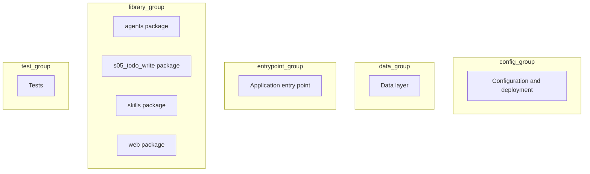

# Architecture report: shareAI-lab/learn-claude-code

> Automated static analysis. **Observed** = directly seen in files/imports/AST; **Inferred** = interpretation from that evidence. Repository code was not executed.

## 1. Repository at a glance

| Item | Value |
| --- | --- |
| Repository | shareAI-lab/learn-claude-code |
| Description | Bash is all you need -  A nano claude code–like 「agent harness」, built from 0 to 1 |
| Language | Python |
| Stars | 80407 |
| Licence | MIT |
| Analysed commit / branch | 7226f555d48900076eba126acf37c9ed5f002b5d / main |
| Framework(s) | Next.js, React |
| Files analysed | 413 |
| Components | 8 |

## 2. Architecture in one minute

shareAI-lab/learn-claude-code - Bash is all you need -  A nano claude code–like 「agent harness」, built from 0 to 1. This repository was analysed statically from 413 file(s) (57 Python). Detected technologies (observed from imports/manifests): GitHub Actions, Next.js, React, Tailwind CSS, pytest, TypeScript. Files are grouped into 8 component(s): agents package, Configuration and deployment, Data layer, Application entry point, s05_todo_write package, skills package, Tests, web package. Observed entry point(s): agents/s01_agent_loop.py, agents/s02_tool_use.py, agents/s03_todo_write.py. Findings below distinguish observed facts from inferred interpretation.

## 3. High-level block diagram

## 4. Main components

### agents package (`agents`)

- **Kind:** library
- **Status:** Observed
- **Confidence:** 0.85
- **Responsibility:** Groups 1 file(s) under agents package (observed from repository paths and static analysis).
- **Paths:** `agents/__init__.py`
- **Evidence:** [agents/__init__.py](https://github.com/shareAI-lab/learn-claude-code/blob/7226f555d48900076eba126acf37c9ed5f002b5d/agents/__init__.py)

### Configuration and deployment (`config`)

- **Kind:** config
- **Status:** Observed
- **Confidence:** 0.85
- **Responsibility:** Groups 41 file(s) under configuration and deployment (observed from repository paths and static analysis).
- **Paths:** `requirements.txt`, `web/package.json`, `web/src/data/annotations/s01.json`, `web/src/data/annotations/s02.json`, `web/src/data/annotations/s03.json`, `web/src/data/annotations/s04.json`, `web/src/data/annotations/s05.json`, `web/src/data/annotations/s06.json`, `web/src/data/annotations/s07.json`, `web/src/data/annotations/s08.json`, `web/src/data/annotations/s09.json`, `web/src/data/annotations/s10.json`, `web/src/data/annotations/s11.json`, `web/src/data/annotations/s12.json`, `web/src/data/annotations/s13.json`, `web/src/data/annotations/s14.json`, `web/src/data/annotations/s15.json`, `web/src/data/annotations/s16.json`, `web/src/data/annotations/s17.json`, `web/src/data/scenarios/s01.json`, `web/src/data/scenarios/s02.json`, `web/src/data/scenarios/s03.json`, `web/src/data/scenarios/s04.json`, `web/src/data/scenarios/s05.json`, `web/src/data/scenarios/s06.json`, `web/src/data/scenarios/s07.json`, `web/src/data/scenarios/s08.json`, `web/src/data/scenarios/s09.json`, `web/src/data/scenarios/s10.json`, `web/src/data/scenarios/s11.json`, `web/src/data/scenarios/s12.json`, `web/src/data/scenarios/s13.json`, `web/src/data/scenarios/s14.json`, `web/src/data/scenarios/s15.json`, `web/src/data/scenarios/s16.json`, `web/src/data/scenarios/s17.json`, `web/src/i18n/messages/en.json`, `web/src/i18n/messages/ja.json`, `web/src/i18n/messages/zh.json`, `web/tsconfig.json`, `web/vercel.json`
- **Evidence:** [requirements.txt](https://github.com/shareAI-lab/learn-claude-code/blob/7226f555d48900076eba126acf37c9ed5f002b5d/requirements.txt); [web/package.json](https://github.com/shareAI-lab/learn-claude-code/blob/7226f555d48900076eba126acf37c9ed5f002b5d/web/package.json); [web/src/data/annotations/s01.json](https://github.com/shareAI-lab/learn-claude-code/blob/7226f555d48900076eba126acf37c9ed5f002b5d/web/src/data/annotations/s01.json); [web/src/data/annotations/s02.json](https://github.com/shareAI-lab/learn-claude-code/blob/7226f555d48900076eba126acf37c9ed5f002b5d/web/src/data/annotations/s02.json); [web/src/data/annotations/s03.json](https://github.com/shareAI-lab/learn-claude-code/blob/7226f555d48900076eba126acf37c9ed5f002b5d/web/src/data/annotations/s03.json); [web/src/data/annotations/s04.json](https://github.com/shareAI-lab/learn-claude-code/blob/7226f555d48900076eba126acf37c9ed5f002b5d/web/src/data/annotations/s04.json); [web/src/data/annotations/s05.json](https://github.com/shareAI-lab/learn-claude-code/blob/7226f555d48900076eba126acf37c9ed5f002b5d/web/src/data/annotations/s05.json); [web/src/data/annotations/s06.json](https://github.com/shareAI-lab/learn-claude-code/blob/7226f555d48900076eba126acf37c9ed5f002b5d/web/src/data/annotations/s06.json)

### Data layer (`data_layer`)

- **Kind:** data
- **Status:** Observed
- **Confidence:** 0.85
- **Responsibility:** Groups 1 file(s) under data layer (observed from repository paths and static analysis).
- **Paths:** `web/src/data/execution-flows.ts`
- **Evidence:** [web/src/data/execution-flows.ts](https://github.com/shareAI-lab/learn-claude-code/blob/7226f555d48900076eba126acf37c9ed5f002b5d/web/src/data/execution-flows.ts)

### Application entry point (`entrypoint`)

- **Kind:** entrypoint
- **Status:** Observed
- **Confidence:** 0.85
- **Responsibility:** Groups 32 file(s) under application entry point (observed from repository paths and static analysis). Observed top-level classes: AgentSession, AnthropicAgentRunner, BackgroundManager, Budget, ConsoleBroker, ContextCompactor. Observed top-level functions: _agent_cwd, _block_type, _block_value, _check_shutdown_status, _cron_field_matches, _enqueue_due_job.
- **Paths:** `agents/s01_agent_loop.py`, `agents/s02_tool_use.py`, `agents/s03_todo_write.py`, `agents/s04_subagent.py`, `agents/s05_skill_loading.py`, `agents/s06_context_compact.py`, `agents/s07_task_system.py`, `agents/s08_background_tasks.py`, `agents/s09_agent_teams.py`, `agents/s10_team_protocols.py`, `agents/s11_autonomous_agents.py`, `agents/s12_worktree_task_isolation.py`, `agents/s_full.py`, `s01_agent_loop/code.py`, `s02_tool_use/code.py`, `s03_permission/code.py`, `s04_hooks/code.py`, `s05_todo_write/code.py`, `s06_subagent/code.py`, `s07_skill_loading/code.py`, `s08_context_compact/code.py`, `s09_memory/code.py`, `s10_task_system/code.py`, `s11_background_tasks/code.py`, `s12_cron_scheduler/code.py`, `s13_agent_teams/code.py`, `s14_mcp_plugin/code.py`, `s15_integrated_harness/code.py`, `s16_workflow_runtime/code.py`, `s17_goal_loop/code.py`, `skills/agent-builder/references/minimal-agent.py`, `skills/agent-builder/scripts/init_agent.py`
- **Evidence:** [agents/s01_agent_loop.py:65](https://github.com/shareAI-lab/learn-claude-code/blob/7226f555d48900076eba126acf37c9ed5f002b5d/agents/s01_agent_loop.py#L65); [agents/s02_tool_use.py:47](https://github.com/shareAI-lab/learn-claude-code/blob/7226f555d48900076eba126acf37c9ed5f002b5d/agents/s02_tool_use.py#L47); [agents/s03_todo_write.py:58](https://github.com/shareAI-lab/learn-claude-code/blob/7226f555d48900076eba126acf37c9ed5f002b5d/agents/s03_todo_write.py#L58); [agents/s04_subagent.py:53](https://github.com/shareAI-lab/learn-claude-code/blob/7226f555d48900076eba126acf37c9ed5f002b5d/agents/s04_subagent.py#L53); [agents/s05_skill_loading.py:65](https://github.com/shareAI-lab/learn-claude-code/blob/7226f555d48900076eba126acf37c9ed5f002b5d/agents/s05_skill_loading.py#L65); [agents/s06_context_compact.py:69](https://github.com/shareAI-lab/learn-claude-code/blob/7226f555d48900076eba126acf37c9ed5f002b5d/agents/s06_context_compact.py#L69); [agents/s07_task_system.py:53](https://github.com/shareAI-lab/learn-claude-code/blob/7226f555d48900076eba126acf37c9ed5f002b5d/agents/s07_task_system.py#L53); [agents/s08_background_tasks.py:56](https://github.com/shareAI-lab/learn-claude-code/blob/7226f555d48900076eba126acf37c9ed5f002b5d/agents/s08_background_tasks.py#L56)

### s05_todo_write package (`s05_todo_write`)

- **Kind:** library
- **Status:** Observed
- **Confidence:** 0.85
- **Responsibility:** Groups 1 file(s) under s05_todo_write package (observed from repository paths and static analysis). Observed top-level functions: greet.
- **Paths:** `s05_todo_write/example/hello.py`
- **Evidence:** [s05_todo_write/example/hello.py:1](https://github.com/shareAI-lab/learn-claude-code/blob/7226f555d48900076eba126acf37c9ed5f002b5d/s05_todo_write/example/hello.py#L1)

### skills package (`skills`)

- **Kind:** library
- **Status:** Observed
- **Confidence:** 0.85
- **Responsibility:** Groups 2 file(s) under skills package (observed from repository paths and static analysis). Observed top-level functions: execute_tool, get_agent_descriptions, get_tools_for_agent, run_bash, run_edit_file, run_read_file.
- **Paths:** `skills/agent-builder/references/subagent-pattern.py`, `skills/agent-builder/references/tool-templates.py`
- **Evidence:** [skills/agent-builder/references/subagent-pattern.py:49](https://github.com/shareAI-lab/learn-claude-code/blob/7226f555d48900076eba126acf37c9ed5f002b5d/skills/agent-builder/references/subagent-pattern.py#L49); [skills/agent-builder/references/tool-templates.py:141](https://github.com/shareAI-lab/learn-claude-code/blob/7226f555d48900076eba126acf37c9ed5f002b5d/skills/agent-builder/references/tool-templates.py#L141)

### Tests (`tests`)

- **Kind:** test
- **Status:** Observed
- **Confidence:** 0.85
- **Responsibility:** Groups 21 file(s) under tests (observed from repository paths and static analysis). Observed top-level classes: AgentTeamsRuntimeTests, BackgroundManagerTests, CompactionToolPairTests, FakeClient, FakeMessages, FakeMessagesApi. Observed top-level functions: _quit_checks, acquire_workflow_lock_in_child, assert_no_orphan_tool_results, assistant_text, bash_tool_call, child_command.
- **Paths:** `tests/test_agent_loop_boundaries.py`, `tests/test_agent_teams_runtime.py`, `tests/test_agents_smoke.py`, `tests/test_background_tasks.py`, `tests/test_chapter_readmes.py`, `tests/test_compaction_tool_pairs.py`, `tests/test_cron_scheduler.py`, `tests/test_goal_loop.py`, `tests/test_permission_command_words.py`, `tests/test_readline_prompts.py`, `tests/test_repl_quit_commands.py`, `tests/test_s06_subagent.py`, `tests/test_s08_context_compact.py`, `tests/test_s_full_background.py`, `tests/test_skill_loading.py`, `tests/test_subprocess_output_encoding.py`, `tests/test_task_system.py`, `tests/test_todo_write_string_input.py`, `tests/test_utf8_text_io.py`, `tests/test_web_scenarios.py`, `tests/test_workflow_goal_lessons.py`
- **Evidence:** [tests/test_agent_loop_boundaries.py:37](https://github.com/shareAI-lab/learn-claude-code/blob/7226f555d48900076eba126acf37c9ed5f002b5d/tests/test_agent_loop_boundaries.py#L37); [tests/test_agent_teams_runtime.py:41](https://github.com/shareAI-lab/learn-claude-code/blob/7226f555d48900076eba126acf37c9ed5f002b5d/tests/test_agent_teams_runtime.py#L41); [tests/test_agents_smoke.py:18](https://github.com/shareAI-lab/learn-claude-code/blob/7226f555d48900076eba126acf37c9ed5f002b5d/tests/test_agents_smoke.py#L18); [tests/test_background_tasks.py:15](https://github.com/shareAI-lab/learn-claude-code/blob/7226f555d48900076eba126acf37c9ed5f002b5d/tests/test_background_tasks.py#L15); [tests/test_chapter_readmes.py:9](https://github.com/shareAI-lab/learn-claude-code/blob/7226f555d48900076eba126acf37c9ed5f002b5d/tests/test_chapter_readmes.py#L9); [tests/test_compaction_tool_pairs.py:17](https://github.com/shareAI-lab/learn-claude-code/blob/7226f555d48900076eba126acf37c9ed5f002b5d/tests/test_compaction_tool_pairs.py#L17); [tests/test_cron_scheduler.py:19](https://github.com/shareAI-lab/learn-claude-code/blob/7226f555d48900076eba126acf37c9ed5f002b5d/tests/test_cron_scheduler.py#L19); [tests/test_goal_loop.py:22](https://github.com/shareAI-lab/learn-claude-code/blob/7226f555d48900076eba126acf37c9ed5f002b5d/tests/test_goal_loop.py#L22)

### web package (`web`)

- **Kind:** library
- **Status:** Observed
- **Confidence:** 0.85
- **Responsibility:** Groups 56 file(s) under web package (observed from repository paths and static analysis).
- **Paths:** `web/next.config.ts`, `web/postcss.config.mjs`, `web/scripts/extract-content.ts`, `web/src/app/[locale]/(learn)/[version]/client.tsx`, `web/src/app/[locale]/(learn)/[version]/diff/diff-content.tsx`, `web/src/app/[locale]/(learn)/[version]/diff/page.tsx`, `web/src/app/[locale]/(learn)/[version]/page.tsx`, `web/src/app/[locale]/(learn)/compare/page.tsx`, `web/src/app/[locale]/(learn)/layers/page.tsx`, `web/src/app/[locale]/(learn)/layout.tsx`, `web/src/app/[locale]/(learn)/timeline/page.tsx`, `web/src/app/[locale]/layout.tsx`, `web/src/app/[locale]/page.tsx`, `web/src/app/page.tsx`, `web/src/components/architecture/arch-diagram.tsx`, `web/src/components/architecture/design-decisions.tsx`, `web/src/components/architecture/execution-flow.tsx`, `web/src/components/architecture/message-flow.tsx`, `web/src/components/code/source-viewer.tsx`, `web/src/components/diff/code-diff.tsx`, `web/src/components/diff/whats-new.tsx`, `web/src/components/layout/header.tsx`, `web/src/components/layout/sidebar.tsx`, `web/src/components/simulator/agent-loop-simulator.tsx`, `web/src/components/simulator/simulator-controls.tsx`, `web/src/components/simulator/simulator-message.tsx`, `web/src/components/timeline/timeline.tsx`, `web/src/components/ui/badge.tsx`, `web/src/components/ui/card.tsx`, `web/src/components/ui/tabs.tsx`, `web/src/components/visualizations/index.tsx`, `web/src/components/visualizations/s01-agent-loop.tsx`, `web/src/components/visualizations/s02-tool-dispatch.tsx`, `web/src/components/visualizations/s03-permission.tsx`, `web/src/components/visualizations/s03-todo-write.tsx`, `web/src/components/visualizations/s04-hooks.tsx`, `web/src/components/visualizations/s06-subagent.tsx`, `web/src/components/visualizations/s07-skill-loading.tsx`, `web/src/components/visualizations/s08-context-compact.tsx`, `web/src/components/visualizations/s09-memory.tsx`, `web/src/components/visualizations/s10-task-system.tsx`, `web/src/components/visualizations/s11-background-tasks.tsx`, `web/src/components/visualizations/s12-cron-scheduler.tsx`, `web/src/components/visualizations/s13-team-runtime.tsx`, `web/src/components/visualizations/s14-mcp-tools.tsx`, `web/src/components/visualizations/s15-integrated-harness.tsx`, `web/src/components/visualizations/shared/mechanism-flow.tsx`, `web/src/components/visualizations/shared/step-controls.tsx`, `web/src/hooks/useDarkMode.ts`, `web/src/hooks/useSimulator.ts`, `web/src/hooks/useSteppedVisualization.ts`, `web/src/lib/constants.ts`, `web/src/lib/i18n-server.ts`, `web/src/lib/i18n.tsx`, `web/src/lib/utils.ts`, `web/src/types/agent-data.ts`
- **Evidence:** [web/next.config.ts](https://github.com/shareAI-lab/learn-claude-code/blob/7226f555d48900076eba126acf37c9ed5f002b5d/web/next.config.ts); [web/postcss.config.mjs](https://github.com/shareAI-lab/learn-claude-code/blob/7226f555d48900076eba126acf37c9ed5f002b5d/web/postcss.config.mjs); [web/scripts/extract-content.ts](https://github.com/shareAI-lab/learn-claude-code/blob/7226f555d48900076eba126acf37c9ed5f002b5d/web/scripts/extract-content.ts); [web/src/app/[locale]/(learn)/[version]/client.tsx](https://github.com/shareAI-lab/learn-claude-code/blob/7226f555d48900076eba126acf37c9ed5f002b5d/web/src/app/%5Blocale%5D/%28learn%29/%5Bversion%5D/client.tsx); [web/src/app/[locale]/(learn)/[version]/diff/diff-content.tsx](https://github.com/shareAI-lab/learn-claude-code/blob/7226f555d48900076eba126acf37c9ed5f002b5d/web/src/app/%5Blocale%5D/%28learn%29/%5Bversion%5D/diff/diff-content.tsx); [web/src/app/[locale]/(learn)/[version]/diff/page.tsx](https://github.com/shareAI-lab/learn-claude-code/blob/7226f555d48900076eba126acf37c9ed5f002b5d/web/src/app/%5Blocale%5D/%28learn%29/%5Bversion%5D/diff/page.tsx); [web/src/app/[locale]/(learn)/[version]/page.tsx](https://github.com/shareAI-lab/learn-claude-code/blob/7226f555d48900076eba126acf37c9ed5f002b5d/web/src/app/%5Blocale%5D/%28learn%29/%5Bversion%5D/page.tsx); [web/src/app/[locale]/(learn)/compare/page.tsx](https://github.com/shareAI-lab/learn-claude-code/blob/7226f555d48900076eba126acf37c9ed5f002b5d/web/src/app/%5Blocale%5D/%28learn%29/compare/page.tsx)

## 5. Execution flow

**Observed** entry point(s):

- [agents/s01_agent_loop.py:104](https://github.com/shareAI-lab/learn-claude-code/blob/7226f555d48900076eba126acf37c9ed5f002b5d/agents/s01_agent_loop.py#L104)
- [agents/s02_tool_use.py:141](https://github.com/shareAI-lab/learn-claude-code/blob/7226f555d48900076eba126acf37c9ed5f002b5d/agents/s02_tool_use.py#L141)
- [agents/s03_todo_write.py:201](https://github.com/shareAI-lab/learn-claude-code/blob/7226f555d48900076eba126acf37c9ed5f002b5d/agents/s03_todo_write.py#L201)
- [agents/s04_subagent.py:177](https://github.com/shareAI-lab/learn-claude-code/blob/7226f555d48900076eba126acf37c9ed5f002b5d/agents/s04_subagent.py#L177)
- [agents/s05_skill_loading.py:217](https://github.com/shareAI-lab/learn-claude-code/blob/7226f555d48900076eba126acf37c9ed5f002b5d/agents/s05_skill_loading.py#L217)
- [agents/s06_context_compact.py:252](https://github.com/shareAI-lab/learn-claude-code/blob/7226f555d48900076eba126acf37c9ed5f002b5d/agents/s06_context_compact.py#L252)
- [agents/s07_task_system.py:233](https://github.com/shareAI-lab/learn-claude-code/blob/7226f555d48900076eba126acf37c9ed5f002b5d/agents/s07_task_system.py#L233)
- [agents/s08_background_tasks.py:251](https://github.com/shareAI-lab/learn-claude-code/blob/7226f555d48900076eba126acf37c9ed5f002b5d/agents/s08_background_tasks.py#L251)
- [agents/s09_agent_teams.py:388](https://github.com/shareAI-lab/learn-claude-code/blob/7226f555d48900076eba126acf37c9ed5f002b5d/agents/s09_agent_teams.py#L388)
- [agents/s10_team_protocols.py:469](https://github.com/shareAI-lab/learn-claude-code/blob/7226f555d48900076eba126acf37c9ed5f002b5d/agents/s10_team_protocols.py#L469)
- [agents/s11_autonomous_agents.py:561](https://github.com/shareAI-lab/learn-claude-code/blob/7226f555d48900076eba126acf37c9ed5f002b5d/agents/s11_autonomous_agents.py#L561)
- [agents/s12_worktree_task_isolation.py:768](https://github.com/shareAI-lab/learn-claude-code/blob/7226f555d48900076eba126acf37c9ed5f002b5d/agents/s12_worktree_task_isolation.py#L768)

Representative flow (derived from observed entry points and the import graph; steps beyond the entry point are **Inferred**):

1. Execution starts at an observed entry point listed above, if present.
2. No internal import relationships between components were observed.

## 6. Project structure

### `(root)`

- `.env.example` - config (2945 bytes)
- `.gitignore` - other (5155 bytes)
- `CONTRIBUTING.md` - docs (2940 bytes)
- `LICENSE` - docs (1068 bytes)
- `README-ja.md` - docs (33448 bytes)
- `README-zh.md` - docs (27695 bytes)
- `README.md` - docs (25596 bytes)
- `requirements.txt` - manifest (50 bytes)

### `.github`

- `.github/workflows/ci.yml` - ci, YAML (673 bytes)
- `.github/workflows/test.yml` - ci, YAML (1163 bytes)

### `agents`

- `agents/__init__.py` - source, Python (203 bytes)
- `agents/s01_agent_loop.py` - source, Python (4167 bytes)
- `agents/s02_tool_use.py` - source, Python (5946 bytes)
- `agents/s03_todo_write.py` - source, Python (8826 bytes)
- `agents/s04_subagent.py` - source, Python (8195 bytes)
- `agents/s05_skill_loading.py` - source, Python (8839 bytes)
- `agents/s06_context_compact.py` - source, Python (10760 bytes)
- `agents/s07_task_system.py` - source, Python (10474 bytes)
- `agents/s08_background_tasks.py` - source, Python (10539 bytes)
- `agents/s09_agent_teams.py` - source, Python (17271 bytes)
- `agents/s10_team_protocols.py` - source, Python (21464 bytes)
- `agents/s11_autonomous_agents.py` - source, Python (25448 bytes)
- `agents/s12_worktree_task_isolation.py` - source, Python (26392 bytes)
- `agents/s_full.py` - source, Python (37785 bytes)

### `docs`

- `docs/en/s01-the-agent-loop.md` - docs (3583 bytes)
- `docs/en/s02-tool-use.md` - docs (3423 bytes)
- `docs/en/s03-todo-write.md` - docs (3318 bytes)
- `docs/en/s04-subagent.md` - docs (3529 bytes)
- `docs/en/s05-skill-loading.md` - docs (3701 bytes)
- `docs/en/s06-context-compact.md` - docs (4316 bytes)
- `docs/en/s07-task-system.md` - docs (5163 bytes)
- `docs/en/s08-background-tasks.md` - docs (3638 bytes)
- `docs/en/s09-agent-teams.md` - docs (4508 bytes)
- `docs/en/s10-team-protocols.md` - docs (3964 bytes)
- `docs/en/s11-autonomous-agents.md` - docs (4723 bytes)
- `docs/en/s12-worktree-task-isolation.md` - docs (5017 bytes)
- `docs/ja/s01-the-agent-loop.md` - docs (3970 bytes)
- `docs/ja/s02-tool-use.md` - docs (3702 bytes)
- `docs/ja/s03-todo-write.md` - docs (3665 bytes)
- `docs/ja/s04-subagent.md` - docs (3860 bytes)
- `docs/ja/s05-skill-loading.md` - docs (3988 bytes)
- `docs/ja/s06-context-compact.md` - docs (4635 bytes)
- `docs/ja/s07-task-system.md` - docs (5781 bytes)
- `docs/ja/s08-background-tasks.md` - docs (3918 bytes)
- `docs/ja/s09-agent-teams.md` - docs (4942 bytes)
- `docs/ja/s10-team-protocols.md` - docs (4352 bytes)
- `docs/ja/s11-autonomous-agents.md` - docs (5316 bytes)
- `docs/ja/s12-worktree-task-isolation.md` - docs (5592 bytes)
- `docs/zh/s01-the-agent-loop.md` - docs (3665 bytes)
- `docs/zh/s02-tool-use.md` - docs (3467 bytes)
- `docs/zh/s03-todo-write.md` - docs (3462 bytes)
- `docs/zh/s04-subagent.md` - docs (3645 bytes)
- `docs/zh/s05-skill-loading.md` - docs (3806 bytes)
- `docs/zh/s06-context-compact.md` - docs (4381 bytes)
- `docs/zh/s07-task-system.md` - docs (5053 bytes)
- `docs/zh/s08-background-tasks.md` - docs (3643 bytes)
- `docs/zh/s09-agent-teams.md` - docs (4658 bytes)
- `docs/zh/s10-team-protocols.md` - docs (3963 bytes)
- `docs/zh/s11-autonomous-agents.md` - docs (4863 bytes)
- `docs/zh/s12-worktree-task-isolation.md` - docs (4986 bytes)

### `s01_agent_loop`

- `s01_agent_loop/README.ja.md` - docs (5673 bytes)
- `s01_agent_loop/README.md` - docs (4832 bytes)
- `s01_agent_loop/README.zh.md` - docs (4659 bytes)
- `s01_agent_loop/code.py` - source, Python (4843 bytes)
- `s01_agent_loop/images/agent-loop.en.svg` - other (5535 bytes)
- `s01_agent_loop/images/agent-loop.ja.svg` - other (5813 bytes)
- `s01_agent_loop/images/agent-loop.svg` - other (5593 bytes)

### `s02_tool_use`

- `s02_tool_use/README.ja.md` - docs (6753 bytes)
- `s02_tool_use/README.md` - docs (5725 bytes)
- `s02_tool_use/README.zh.md` - docs (5542 bytes)
- `s02_tool_use/code.py` - source, Python (7646 bytes)
- `s02_tool_use/images/tool-dispatch.en.svg` - other (6790 bytes)
- `s02_tool_use/images/tool-dispatch.ja.svg` - other (7037 bytes)
- `s02_tool_use/images/tool-dispatch.svg` - other (6783 bytes)

### `s03_permission`

- `s03_permission/README.ja.md` - docs (6725 bytes)
- `s03_permission/README.md` - docs (5844 bytes)
- `s03_permission/README.zh.md` - docs (5553 bytes)
- `s03_permission/code.py` - source, Python (9967 bytes)
- `s03_permission/images/permission-overview.en.svg` - other (6236 bytes)
- `s03_permission/images/permission-overview.ja.svg` - other (6388 bytes)
- `s03_permission/images/permission-overview.svg` - other (6258 bytes)
- `s03_permission/images/permission-pipeline.en.svg` - other (4159 bytes)
- `s03_permission/images/permission-pipeline.ja.svg` - other (4316 bytes)
- `s03_permission/images/permission-pipeline.svg` - other (4236 bytes)

### `s04_hooks`

- `s04_hooks/README.ja.md` - docs (9274 bytes)
- `s04_hooks/README.md` - docs (8223 bytes)
- `s04_hooks/README.zh.md` - docs (7891 bytes)
- `s04_hooks/code.py` - source, Python (10755 bytes)
- `s04_hooks/images/hooks-overview.en.svg` - other (6752 bytes)
- `s04_hooks/images/hooks-overview.ja.svg` - other (6847 bytes)
- `s04_hooks/images/hooks-overview.svg` - other (6747 bytes)

### `s05_todo_write`

- `s05_todo_write/README.ja.md` - docs (6531 bytes)
- `s05_todo_write/README.md` - docs (5504 bytes)
- `s05_todo_write/README.zh.md` - docs (5316 bytes)
- `s05_todo_write/code.py` - source, Python (14008 bytes)
- `s05_todo_write/example/hello.py` - source, Python (85 bytes)
- `s05_todo_write/images/todo-overview.en.svg` - other (5710 bytes)
- `s05_todo_write/images/todo-overview.ja.svg` - other (5865 bytes)
- `s05_todo_write/images/todo-overview.svg` - other (5736 bytes)

### `s06_subagent`

- `s06_subagent/README.ja.md` - docs (5310 bytes)
- `s06_subagent/README.md` - docs (4583 bytes)
- `s06_subagent/README.zh.md` - docs (4376 bytes)
- `s06_subagent/code.py` - source, Python (12946 bytes)
- `s06_subagent/images/subagent-overview.en.svg` - other (8262 bytes)
- `s06_subagent/images/subagent-overview.ja.svg` - other (8569 bytes)
- `s06_subagent/images/subagent-overview.svg` - other (8330 bytes)

### `s07_skill_loading`

- `s07_skill_loading/README.ja.md` - docs (5778 bytes)
- `s07_skill_loading/README.md` - docs (5185 bytes)
- `s07_skill_loading/README.zh.md` - docs (5151 bytes)
- `s07_skill_loading/code.py` - source, Python (13710 bytes)
- `s07_skill_loading/images/skill-overview.en.svg` - other (4765 bytes)
- `s07_skill_loading/images/skill-overview.ja.svg` - other (4818 bytes)
- `s07_skill_loading/images/skill-overview.svg` - other (4778 bytes)

### `s08_context_compact`

- `s08_context_compact/README.ja.md` - docs (19511 bytes)
- `s08_context_compact/README.md` - docs (16303 bytes)
- `s08_context_compact/README.zh.md` - docs (15713 bytes)
- `s08_context_compact/code.py` - source, Python (25003 bytes)
- `s08_context_compact/images/auto-compact.en.svg` - other (5828 bytes)
- `s08_context_compact/images/auto-compact.ja.svg` - other (5890 bytes)
- `s08_context_compact/images/auto-compact.svg` - other (5785 bytes)
- `s08_context_compact/images/compact-overview.en.svg` - other (9194 bytes)
- `s08_context_compact/images/compact-overview.ja.svg` - other (9355 bytes)
- `s08_context_compact/images/compact-overview.svg` - other (9283 bytes)
- `s08_context_compact/images/compaction-layers.en.svg` - other (6784 bytes)
- `s08_context_compact/images/compaction-layers.ja.svg` - other (7043 bytes)
- `s08_context_compact/images/compaction-layers.svg` - other (6791 bytes)
- `s08_context_compact/images/layer1-budget.en.svg` - other (3616 bytes)
- `s08_context_compact/images/layer1-budget.ja.svg` - other (3752 bytes)
- `s08_context_compact/images/layer1-budget.svg` - other (3602 bytes)
- `s08_context_compact/images/micro-compact.en.svg` - other (4443 bytes)
- `s08_context_compact/images/micro-compact.ja.svg` - other (4623 bytes)
- `s08_context_compact/images/micro-compact.svg` - other (4425 bytes)

### `s09_memory`

- `s09_memory/README.ja.md` - docs (9811 bytes)
- `s09_memory/README.md` - docs (8631 bytes)
- `s09_memory/README.zh.md` - docs (8159 bytes)
- `s09_memory/code.py` - source, Python (27591 bytes)
- `s09_memory/images/memory-overview.en.svg` - other (7220 bytes)
- `s09_memory/images/memory-overview.ja.svg` - other (7293 bytes)
- `s09_memory/images/memory-overview.svg` - other (7207 bytes)
- `s09_memory/images/memory-subsystems.en.svg` - other (4624 bytes)
- `s09_memory/images/memory-subsystems.ja.svg` - other (4756 bytes)
- `s09_memory/images/memory-subsystems.svg` - other (4623 bytes)

### `s10_task_system`

- `s10_task_system/README.ja.md` - docs (10705 bytes)
- `s10_task_system/README.md` - docs (9368 bytes)
- `s10_task_system/README.zh.md` - docs (8881 bytes)
- `s10_task_system/code.py` - source, Python (20773 bytes)
- `s10_task_system/images/task-dag.en.svg` - other (4043 bytes)
- `s10_task_system/images/task-dag.ja.svg` - other (4096 bytes)
- `s10_task_system/images/task-dag.svg` - other (4042 bytes)
- `s10_task_system/images/task-system-overview.en.svg` - other (6926 bytes)
- `s10_task_system/images/task-system-overview.ja.svg` - other (7106 bytes)
- `s10_task_system/images/task-system-overview.svg` - other (6921 bytes)

### `s11_background_tasks`

- `s11_background_tasks/README.ja.md` - docs (8582 bytes)
- `s11_background_tasks/README.md` - docs (7395 bytes)
- `s11_background_tasks/README.zh.md` - docs (6882 bytes)
- `s11_background_tasks/code.py` - source, Python (17998 bytes)
- `s11_background_tasks/images/background-tasks-overview.en.svg` - other (7656 bytes)
- `s11_background_tasks/images/background-tasks-overview.ja.svg` - other (7796 bytes)
- `s11_background_tasks/images/background-tasks-overview.svg` - other (7609 bytes)

### `s12_cron_scheduler`

- `s12_cron_scheduler/README.ja.md` - docs (7081 bytes)
- `s12_cron_scheduler/README.md` - docs (6245 bytes)
- `s12_cron_scheduler/README.zh.md` - docs (5846 bytes)
- `s12_cron_scheduler/code.py` - source, Python (25494 bytes)
- `s12_cron_scheduler/images/cron-scheduler-overview.en.svg` - other (9043 bytes)
- `s12_cron_scheduler/images/cron-scheduler-overview.ja.svg` - other (9096 bytes)
- `s12_cron_scheduler/images/cron-scheduler-overview.svg` - other (9012 bytes)

### `s13_agent_teams`

- `s13_agent_teams/README.ja.md` - docs (24041 bytes)
- `s13_agent_teams/README.md` - docs (20302 bytes)
- `s13_agent_teams/README.zh.md` - docs (18980 bytes)
- `s13_agent_teams/code.py` - source, Python (71053 bytes)
- `s13_agent_teams/images/agent-teams-overview.en.svg` - other (8691 bytes)
- `s13_agent_teams/images/agent-teams-overview.ja.svg` - other (8937 bytes)
- `s13_agent_teams/images/agent-teams-overview.svg` - other (8638 bytes)
- `s13_agent_teams/images/team-protocols-overview.en.svg` - other (11449 bytes)
- `s13_agent_teams/images/team-protocols-overview.ja.svg` - other (11807 bytes)
- `s13_agent_teams/images/team-protocols-overview.svg` - other (11444 bytes)
- `s13_agent_teams/images/team-topology.en.svg` - other (4653 bytes)
- `s13_agent_teams/images/team-topology.ja.svg` - other (4717 bytes)
- `s13_agent_teams/images/team-topology.svg` - other (5240 bytes)

### `s14_mcp_plugin`

- `s14_mcp_plugin/README.ja.md` - docs (7549 bytes)
- `s14_mcp_plugin/README.md` - docs (6853 bytes)
- `s14_mcp_plugin/README.zh.md` - docs (6557 bytes)
- `s14_mcp_plugin/code.py` - source, Python (18721 bytes)
- `s14_mcp_plugin/images/mcp-architecture.en.svg` - other (7834 bytes)
- `s14_mcp_plugin/images/mcp-architecture.ja.svg` - other (7873 bytes)
- `s14_mcp_plugin/images/mcp-architecture.svg` - other (7835 bytes)

### `s15_integrated_harness`

- `s15_integrated_harness/README.ja.md` - docs (14934 bytes)
- `s15_integrated_harness/README.md` - docs (13470 bytes)
- `s15_integrated_harness/README.zh.md` - docs (12470 bytes)
- `s15_integrated_harness/code.py` - source, Python (128230 bytes)
- `s15_integrated_harness/images/system-architecture.en.svg` - other (7821 bytes)
- `s15_integrated_harness/images/system-architecture.ja.svg` - other (7846 bytes)
- `s15_integrated_harness/images/system-architecture.svg` - other (7977 bytes)

### `s16_workflow_runtime`

- `s16_workflow_runtime/README.ja.md` - docs (16885 bytes)
- `s16_workflow_runtime/README.md` - docs (15312 bytes)
- `s16_workflow_runtime/README.zh.md` - docs (14657 bytes)
- `s16_workflow_runtime/code.py` - source, Python (33253 bytes)
- `s16_workflow_runtime/images/workflow-runtime-overview.svg` - other (9635 bytes)

### `s17_goal_loop`

- `s17_goal_loop/README.ja.md` - docs (11364 bytes)
- `s17_goal_loop/README.md` - docs (9905 bytes)
- `s17_goal_loop/README.zh.md` - docs (9054 bytes)
- `s17_goal_loop/code.py` - source, Python (30835 bytes)
- `s17_goal_loop/images/goal-loop-overview.svg` - other (5869 bytes)

### `skills`

- `skills/agent-builder/SKILL.md` - docs (4713 bytes)
- `skills/agent-builder/references/agent-philosophy.md` - docs (8030 bytes)
- `skills/agent-builder/references/minimal-agent.py` - source, Python (4193 bytes)
- `skills/agent-builder/references/subagent-pattern.py` - source, Python (7773 bytes)
- `skills/agent-builder/references/tool-templates.py` - source, Python (7967 bytes)
- `skills/agent-builder/scripts/init_agent.py` - source, Python (10117 bytes)
- `skills/code-review/SKILL.md` - docs (4266 bytes)
- `skills/mcp-builder/SKILL.md` - docs (4918 bytes)
- `skills/pdf/SKILL.md` - docs (2581 bytes)

### `tests`

- `tests/test_agent_loop_boundaries.py` - test, Python (14568 bytes)
- `tests/test_agent_teams_runtime.py` - test, Python (91409 bytes)
- `tests/test_agents_smoke.py` - test, Python (603 bytes)
- `tests/test_background_tasks.py` - test, Python (5319 bytes)
- `tests/test_chapter_readmes.py` - test, Python (1052 bytes)
- `tests/test_compaction_tool_pairs.py` - test, Python (22365 bytes)
- `tests/test_cron_scheduler.py` - test, Python (6266 bytes)
- `tests/test_goal_loop.py` - test, Python (16044 bytes)
- `tests/test_permission_command_words.py` - test, Python (3776 bytes)
- `tests/test_readline_prompts.py` - test, Python (3267 bytes)
- `tests/test_repl_quit_commands.py` - test, Python (2419 bytes)
- `tests/test_s06_subagent.py` - test, Python (4361 bytes)
- `tests/test_s08_context_compact.py` - test, Python (11928 bytes)
- `tests/test_s_full_background.py` - test, Python (6023 bytes)
- `tests/test_skill_loading.py` - test, Python (6756 bytes)
- `tests/test_subprocess_output_encoding.py` - test, Python (3795 bytes)
- `tests/test_task_system.py` - test, Python (8627 bytes)
- `tests/test_todo_write_string_input.py` - test, Python (7458 bytes)
- `tests/test_utf8_text_io.py` - test, Python (2295 bytes)
- `tests/test_web_scenarios.py` - test, Python (8274 bytes)
- `tests/test_workflow_goal_lessons.py` - test, Python (19550 bytes)

### `web`

- `web/.gitignore` - other (492 bytes)
- `web/README.md` - docs (1450 bytes)
- `web/next.config.ts` - source, TypeScript (181 bytes)
- `web/package.json` - manifest (961 bytes)
- `web/postcss.config.mjs` - source, JavaScript (94 bytes)
- `web/public/course-assets/s01_agent_loop/agent-loop.en.svg` - other (5535 bytes)
- `web/public/course-assets/s01_agent_loop/agent-loop.ja.svg` - other (5813 bytes)
- `web/public/course-assets/s01_agent_loop/agent-loop.svg` - other (5593 bytes)
- `web/public/course-assets/s02_tool_use/tool-dispatch.en.svg` - other (6790 bytes)
- `web/public/course-assets/s02_tool_use/tool-dispatch.ja.svg` - other (7037 bytes)
- `web/public/course-assets/s02_tool_use/tool-dispatch.svg` - other (6783 bytes)
- `web/public/course-assets/s03_permission/permission-overview.en.svg` - other (6236 bytes)
- `web/public/course-assets/s03_permission/permission-overview.ja.svg` - other (6388 bytes)
- `web/public/course-assets/s03_permission/permission-overview.svg` - other (6258 bytes)
- `web/public/course-assets/s03_permission/permission-pipeline.en.svg` - other (4159 bytes)
- `web/public/course-assets/s03_permission/permission-pipeline.ja.svg` - other (4316 bytes)
- `web/public/course-assets/s03_permission/permission-pipeline.svg` - other (4236 bytes)
- `web/public/course-assets/s04_hooks/hooks-overview.en.svg` - other (6752 bytes)
- `web/public/course-assets/s04_hooks/hooks-overview.ja.svg` - other (6847 bytes)
- `web/public/course-assets/s04_hooks/hooks-overview.svg` - other (6747 bytes)
- `web/public/course-assets/s05_todo_write/todo-overview.en.svg` - other (5710 bytes)
- `web/public/course-assets/s05_todo_write/todo-overview.ja.svg` - other (5865 bytes)
- `web/public/course-assets/s05_todo_write/todo-overview.svg` - other (5736 bytes)
- `web/public/course-assets/s06_subagent/subagent-overview.en.svg` - other (8262 bytes)
- `web/public/course-assets/s06_subagent/subagent-overview.ja.svg` - other (8569 bytes)
- `web/public/course-assets/s06_subagent/subagent-overview.svg` - other (8330 bytes)
- `web/public/course-assets/s07_skill_loading/skill-overview.en.svg` - other (4765 bytes)
- `web/public/course-assets/s07_skill_loading/skill-overview.ja.svg` - other (4818 bytes)
- `web/public/course-assets/s07_skill_loading/skill-overview.svg` - other (4778 bytes)
- `web/public/course-assets/s08_context_compact/auto-compact.en.svg` - other (5828 bytes)
- `web/public/course-assets/s08_context_compact/auto-compact.ja.svg` - other (5890 bytes)
- `web/public/course-assets/s08_context_compact/auto-compact.svg` - other (5785 bytes)
- `web/public/course-assets/s08_context_compact/compact-overview.en.svg` - other (9194 bytes)
- `web/public/course-assets/s08_context_compact/compact-overview.ja.svg` - other (9355 bytes)
- `web/public/course-assets/s08_context_compact/compact-overview.svg` - other (9283 bytes)
- `web/public/course-assets/s08_context_compact/compaction-layers.en.svg` - other (6784 bytes)
- `web/public/course-assets/s08_context_compact/compaction-layers.ja.svg` - other (7043 bytes)
- `web/public/course-assets/s08_context_compact/compaction-layers.svg` - other (6791 bytes)
- `web/public/course-assets/s08_context_compact/layer1-budget.en.svg` - other (3616 bytes)
- `web/public/course-assets/s08_context_compact/layer1-budget.ja.svg` - other (3752 bytes)
- `web/public/course-assets/s08_context_compact/layer1-budget.svg` - other (3602 bytes)
- `web/public/course-assets/s08_context_compact/micro-compact.en.svg` - other (4443 bytes)
- `web/public/course-assets/s08_context_compact/micro-compact.ja.svg` - other (4623 bytes)
- `web/public/course-assets/s08_context_compact/micro-compact.svg` - other (4425 bytes)
- `web/public/course-assets/s09_memory/memory-overview.en.svg` - other (7220 bytes)
- `web/public/course-assets/s09_memory/memory-overview.ja.svg` - other (7293 bytes)
- `web/public/course-assets/s09_memory/memory-overview.svg` - other (7207 bytes)
- `web/public/course-assets/s09_memory/memory-subsystems.en.svg` - other (4624 bytes)
- `web/public/course-assets/s09_memory/memory-subsystems.ja.svg` - other (4756 bytes)
- `web/public/course-assets/s09_memory/memory-subsystems.svg` - other (4623 bytes)
- `web/public/course-assets/s10_task_system/task-dag.en.svg` - other (4043 bytes)
- `web/public/course-assets/s10_task_system/task-dag.ja.svg` - other (4096 bytes)
- `web/public/course-assets/s10_task_system/task-dag.svg` - other (4042 bytes)
- `web/public/course-assets/s10_task_system/task-system-overview.en.svg` - other (6926 bytes)
- `web/public/course-assets/s10_task_system/task-system-overview.ja.svg` - other (7106 bytes)
- `web/public/course-assets/s10_task_system/task-system-overview.svg` - other (6921 bytes)
- `web/public/course-assets/s11_background_tasks/background-tasks-overview.en.svg` - other (7656 bytes)
- `web/public/course-assets/s11_background_tasks/background-tasks-overview.ja.svg` - other (7796 bytes)
- `web/public/course-assets/s11_background_tasks/background-tasks-overview.svg` - other (7609 bytes)
- `web/public/course-assets/s12_cron_scheduler/cron-scheduler-overview.en.svg` - other (9043 bytes)
- `web/public/course-assets/s12_cron_scheduler/cron-scheduler-overview.ja.svg` - other (9096 bytes)
- `web/public/course-assets/s12_cron_scheduler/cron-scheduler-overview.svg` - other (9012 bytes)
- `web/public/course-assets/s13_agent_teams/agent-teams-overview.en.svg` - other (8691 bytes)
- `web/public/course-assets/s13_agent_teams/agent-teams-overview.ja.svg` - other (8937 bytes)
- `web/public/course-assets/s13_agent_teams/agent-teams-overview.svg` - other (8638 bytes)
- `web/public/course-assets/s13_agent_teams/team-protocols-overview.en.svg` - other (11449 bytes)
- `web/public/course-assets/s13_agent_teams/team-protocols-overview.ja.svg` - other (11807 bytes)
- `web/public/course-assets/s13_agent_teams/team-protocols-overview.svg` - other (11444 bytes)
- `web/public/course-assets/s13_agent_teams/team-topology.en.svg` - other (4653 bytes)
- `web/public/course-assets/s13_agent_teams/team-topology.ja.svg` - other (4717 bytes)
- `web/public/course-assets/s13_agent_teams/team-topology.svg` - other (5240 bytes)
- `web/public/course-assets/s14_mcp_plugin/mcp-architecture.en.svg` - other (7834 bytes)
- `web/public/course-assets/s14_mcp_plugin/mcp-architecture.ja.svg` - other (7873 bytes)
- `web/public/course-assets/s14_mcp_plugin/mcp-architecture.svg` - other (7835 bytes)
- `web/public/course-assets/s15_integrated_harness/system-architecture.en.svg` - other (7821 bytes)
- `web/public/course-assets/s15_integrated_harness/system-architecture.ja.svg` - other (7846 bytes)
- `web/public/course-assets/s15_integrated_harness/system-architecture.svg` - other (7977 bytes)
- `web/public/course-assets/s16_workflow_runtime/workflow-runtime-overview.svg` - other (9635 bytes)
- `web/public/course-assets/s17_goal_loop/goal-loop-overview.svg` - other (5869 bytes)
- `web/public/file.svg` - other (391 bytes)
- `web/public/globe.svg` - other (1035 bytes)
- `web/public/next.svg` - other (1375 bytes)
- `web/public/vercel.svg` - other (128 bytes)
- `web/public/window.svg` - other (385 bytes)
- `web/scripts/extract-content.ts` - source, TypeScript (15082 bytes)
- `web/src/app/[locale]/(learn)/[version]/client.tsx` - source, TypeScript (2571 bytes)
- `web/src/app/[locale]/(learn)/[version]/diff/diff-content.tsx` - source, TypeScript (7645 bytes)
- `web/src/app/[locale]/(learn)/[version]/diff/page.tsx` - source, TypeScript (403 bytes)
- `web/src/app/[locale]/(learn)/[version]/page.tsx` - source, TypeScript (4601 bytes)
- `web/src/app/[locale]/(learn)/compare/page.tsx` - source, TypeScript (12764 bytes)
- `web/src/app/[locale]/(learn)/layers/page.tsx` - source, TypeScript (5507 bytes)
- `web/src/app/[locale]/(learn)/layout.tsx` - source, TypeScript (280 bytes)
- `web/src/app/[locale]/(learn)/timeline/page.tsx` - source, TypeScript (468 bytes)
- `web/src/app/[locale]/layout.tsx` - source, TypeScript (1821 bytes)
- `web/src/app/[locale]/page.tsx` - source, TypeScript (9571 bytes)
- `web/src/app/globals.css` - other (10490 bytes)
- `web/src/app/page.tsx` - source, TypeScript (104 bytes)
- `web/src/components/architecture/arch-diagram.tsx` - source, TypeScript (7542 bytes)
- `web/src/components/architecture/design-decisions.tsx` - source, TypeScript (5613 bytes)
- `web/src/components/architecture/execution-flow.tsx` - source, TypeScript (12286 bytes)
- `web/src/components/architecture/message-flow.tsx` - source, TypeScript (2723 bytes)
- `web/src/components/code/source-viewer.tsx` - source, TypeScript (3446 bytes)
- `web/src/components/diff/code-diff.tsx` - source, TypeScript (7466 bytes)
- `web/src/components/diff/whats-new.tsx` - source, TypeScript (4101 bytes)
- `web/src/components/docs/doc-renderer.tsx` - docs (2685 bytes)
- `web/src/components/layout/header.tsx` - source, TypeScript (5992 bytes)
- `web/src/components/layout/sidebar.tsx` - source, TypeScript (2404 bytes)
- `web/src/components/simulator/agent-loop-simulator.tsx` - source, TypeScript (4714 bytes)
- `web/src/components/simulator/simulator-controls.tsx` - source, TypeScript (3098 bytes)
- `web/src/components/simulator/simulator-message.tsx` - source, TypeScript (2899 bytes)
- `web/src/components/timeline/timeline.tsx` - source, TypeScript (7885 bytes)
- `web/src/components/ui/badge.tsx` - source, TypeScript (923 bytes)
- `web/src/components/ui/card.tsx` - source, TypeScript (840 bytes)
- `web/src/components/ui/tabs.tsx` - source, TypeScript (1118 bytes)
- `web/src/components/visualizations/index.tsx` - source, TypeScript (1398 bytes)
- `web/src/components/visualizations/s01-agent-loop.tsx` - source, TypeScript (15634 bytes)
- `web/src/components/visualizations/s02-tool-dispatch.tsx` - source, TypeScript (13778 bytes)
- `web/src/components/visualizations/s03-permission.tsx` - source, TypeScript (14834 bytes)
- `web/src/components/visualizations/s03-todo-write.tsx` - source, TypeScript (11878 bytes)
- `web/src/components/visualizations/s04-hooks.tsx` - source, TypeScript (9715 bytes)
- `web/src/components/visualizations/s06-subagent.tsx` - source, TypeScript (11369 bytes)
- `web/src/components/visualizations/s07-skill-loading.tsx` - source, TypeScript (15850 bytes)
- `web/src/components/visualizations/s08-context-compact.tsx` - source, TypeScript (18284 bytes)
- `web/src/components/visualizations/s09-memory.tsx` - source, TypeScript (15115 bytes)
- `web/src/components/visualizations/s10-task-system.tsx` - source, TypeScript (8622 bytes)
- `web/src/components/visualizations/s11-background-tasks.tsx` - source, TypeScript (19191 bytes)
- `web/src/components/visualizations/s12-cron-scheduler.tsx` - source, TypeScript (9025 bytes)
- `web/src/components/visualizations/s13-team-runtime.tsx` - source, TypeScript (12081 bytes)
- `web/src/components/visualizations/s14-mcp-tools.tsx` - source, TypeScript (9843 bytes)
- `web/src/components/visualizations/s15-integrated-harness.tsx` - source, TypeScript (15146 bytes)
- `web/src/components/visualizations/shared/mechanism-flow.tsx` - source, TypeScript (8685 bytes)
- `web/src/components/visualizations/shared/step-controls.tsx` - source, TypeScript (3386 bytes)
- `web/src/data/annotations/s01.json` - config (6505 bytes)
- `web/src/data/annotations/s02.json` - config (6713 bytes)
- `web/src/data/annotations/s03.json` - config (2976 bytes)
- `web/src/data/annotations/s04.json` - config (2705 bytes)
- `web/src/data/annotations/s05.json` - config (2754 bytes)
- `web/src/data/annotations/s06.json` - config (2587 bytes)
- `web/src/data/annotations/s07.json` - config (2819 bytes)
- `web/src/data/annotations/s08.json` - config (2702 bytes)
- `web/src/data/annotations/s09.json` - config (2668 bytes)
- `web/src/data/annotations/s10.json` - config (3722 bytes)
- `web/src/data/annotations/s11.json` - config (3949 bytes)
- `web/src/data/annotations/s12.json` - config (3319 bytes)
- `web/src/data/annotations/s13.json` - config (7562 bytes)
- `web/src/data/annotations/s14.json` - config (3036 bytes)
- `web/src/data/annotations/s15.json` - config (3292 bytes)
- `web/src/data/annotations/s16.json` - config (2961 bytes)
- `web/src/data/annotations/s17.json` - config (3352 bytes)
- `web/src/data/execution-flows.ts` - source, TypeScript (24422 bytes)
- `web/src/data/scenarios/s01.json` - config (1589 bytes)
- `web/src/data/scenarios/s02.json` - config (1428 bytes)
- `web/src/data/scenarios/s03.json` - config (1407 bytes)
- `web/src/data/scenarios/s04.json` - config (1554 bytes)
- `web/src/data/scenarios/s05.json` - config (1574 bytes)
- `web/src/data/scenarios/s06.json` - config (1532 bytes)
- `web/src/data/scenarios/s07.json` - config (1257 bytes)
- `web/src/data/scenarios/s08.json` - config (1336 bytes)
- `web/src/data/scenarios/s09.json` - config (1151 bytes)
- `web/src/data/scenarios/s10.json` - config (2885 bytes)
- `web/src/data/scenarios/s11.json` - config (1711 bytes)
- `web/src/data/scenarios/s12.json` - config (1809 bytes)
- `web/src/data/scenarios/s13.json` - config (6232 bytes)
- `web/src/data/scenarios/s14.json` - config (1633 bytes)
- `web/src/data/scenarios/s15.json` - config (4392 bytes)
- `web/src/data/scenarios/s16.json` - config (4943 bytes)
- `web/src/data/scenarios/s17.json` - config (1830 bytes)
- `web/src/hooks/useDarkMode.ts` - source, TypeScript (1753 bytes)
- `web/src/hooks/useSimulator.ts` - source, TypeScript (2305 bytes)
- `web/src/hooks/useSteppedVisualization.ts` - source, TypeScript (2031 bytes)
- `web/src/i18n/messages/en.json` - config (4763 bytes)
- `web/src/i18n/messages/ja.json` - config (5776 bytes)
- `web/src/i18n/messages/zh.json` - config (4608 bytes)
- `web/src/lib/constants.ts` - source, TypeScript (6111 bytes)
- `web/src/lib/i18n-server.ts` - source, TypeScript (584 bytes)
- `web/src/lib/i18n.tsx` - source, TypeScript (1007 bytes)
- `web/src/lib/utils.ts` - source, TypeScript (118 bytes)
- `web/src/types/agent-data.ts` - source, TypeScript (1555 bytes)
- `web/tsconfig.json` - config (670 bytes)
- `web/vercel.json` - config (356 bytes)

## 7. Key dependencies and integrations

| Name | Category | Status | Confidence | Evidence |
| --- | --- | --- | --- | --- |
| GitHub Actions | ci | Observed | 0.90 | [.github/workflows/ci.yml](https://github.com/shareAI-lab/learn-claude-code/blob/7226f555d48900076eba126acf37c9ed5f002b5d/.github/workflows/ci.yml); [.github/workflows/test.yml](https://github.com/shareAI-lab/learn-claude-code/blob/7226f555d48900076eba126acf37c9ed5f002b5d/.github/workflows/test.yml) |
| Next.js | framework | Observed | 0.85 | [web/package.json:8](https://github.com/shareAI-lab/learn-claude-code/blob/7226f555d48900076eba126acf37c9ed5f002b5d/web/package.json#L8) |
| React | framework | Observed | 0.90 | [web/package.json:16](https://github.com/shareAI-lab/learn-claude-code/blob/7226f555d48900076eba126acf37c9ed5f002b5d/web/package.json#L16); [web/package.json:19](https://github.com/shareAI-lab/learn-claude-code/blob/7226f555d48900076eba126acf37c9ed5f002b5d/web/package.json#L19) |
| Tailwind CSS | library | Observed | 0.85 | [web/package.json:30](https://github.com/shareAI-lab/learn-claude-code/blob/7226f555d48900076eba126acf37c9ed5f002b5d/web/package.json#L30) |
| pytest | tooling | Observed | 0.95 | [.github/workflows/test.yml:23](https://github.com/shareAI-lab/learn-claude-code/blob/7226f555d48900076eba126acf37c9ed5f002b5d/.github/workflows/test.yml#L23); [tests/test_agent_loop_boundaries.py:9](https://github.com/shareAI-lab/learn-claude-code/blob/7226f555d48900076eba126acf37c9ed5f002b5d/tests/test_agent_loop_boundaries.py#L9); [tests/test_agents_smoke.py:6](https://github.com/shareAI-lab/learn-claude-code/blob/7226f555d48900076eba126acf37c9ed5f002b5d/tests/test_agents_smoke.py#L6); [tests/test_cron_scheduler.py:12](https://github.com/shareAI-lab/learn-claude-code/blob/7226f555d48900076eba126acf37c9ed5f002b5d/tests/test_cron_scheduler.py#L12) |
| TypeScript | tooling | Observed | 0.85 | [web/package.json:36](https://github.com/shareAI-lab/learn-claude-code/blob/7226f555d48900076eba126acf37c9ed5f002b5d/web/package.json#L36) |
| unittest | tooling | Observed | 0.95 | [tests/test_agent_teams_runtime.py:11](https://github.com/shareAI-lab/learn-claude-code/blob/7226f555d48900076eba126acf37c9ed5f002b5d/tests/test_agent_teams_runtime.py#L11); [tests/test_agent_teams_runtime.py:14](https://github.com/shareAI-lab/learn-claude-code/blob/7226f555d48900076eba126acf37c9ed5f002b5d/tests/test_agent_teams_runtime.py#L14); [tests/test_compaction_tool_pairs.py:6](https://github.com/shareAI-lab/learn-claude-code/blob/7226f555d48900076eba126acf37c9ed5f002b5d/tests/test_compaction_tool_pairs.py#L6); [tests/test_cron_scheduler.py:10](https://github.com/shareAI-lab/learn-claude-code/blob/7226f555d48900076eba126acf37c9ed5f002b5d/tests/test_cron_scheduler.py#L10) |

## 8. Data and state

- Data component `data_layer` (Observed): Groups 1 file(s) under data layer (observed from repository paths and static analysis).

## 9. Configuration and deployment clues

- `.env.example` (config)
- `.github/workflows/ci.yml` (ci)
- `.github/workflows/test.yml` (ci)
- `requirements.txt` (manifest)
- `web/package.json` (manifest)
- `web/src/data/annotations/s01.json` (config)
- `web/src/data/annotations/s02.json` (config)
- `web/src/data/annotations/s03.json` (config)
- `web/src/data/annotations/s04.json` (config)
- `web/src/data/annotations/s05.json` (config)
- `web/src/data/annotations/s06.json` (config)
- `web/src/data/annotations/s07.json` (config)
- `web/src/data/annotations/s08.json` (config)
- `web/src/data/annotations/s09.json` (config)
- `web/src/data/annotations/s10.json` (config)
- `web/src/data/annotations/s11.json` (config)
- `web/src/data/annotations/s12.json` (config)
- `web/src/data/annotations/s13.json` (config)
- `web/src/data/annotations/s14.json` (config)
- `web/src/data/annotations/s15.json` (config)
- `web/src/data/annotations/s16.json` (config)
- `web/src/data/annotations/s17.json` (config)
- `web/src/data/scenarios/s01.json` (config)
- `web/src/data/scenarios/s02.json` (config)
- `web/src/data/scenarios/s03.json` (config)
- `web/src/data/scenarios/s04.json` (config)
- `web/src/data/scenarios/s05.json` (config)
- `web/src/data/scenarios/s06.json` (config)
- `web/src/data/scenarios/s07.json` (config)
- `web/src/data/scenarios/s08.json` (config)
- `web/src/data/scenarios/s09.json` (config)
- `web/src/data/scenarios/s10.json` (config)
- `web/src/data/scenarios/s11.json` (config)
- `web/src/data/scenarios/s12.json` (config)
- `web/src/data/scenarios/s13.json` (config)
- `web/src/data/scenarios/s14.json` (config)
- `web/src/data/scenarios/s15.json` (config)
- `web/src/data/scenarios/s16.json` (config)
- `web/src/data/scenarios/s17.json` (config)
- `web/src/i18n/messages/en.json` (config)
- `web/src/i18n/messages/ja.json` (config)
- `web/src/i18n/messages/zh.json` (config)
- `web/tsconfig.json` (config)
- `web/vercel.json` (config)

Environment variable *names* seen in example env files (values never recorded):

- `.env.example`: `ANTHROPIC_API_KEY`, `MODEL_ID`

## 10. Design observations

- An entry/API layer is separated from other code (Inferred from paths and decorators).
- Data-related code is grouped separately, suggesting a data-layer boundary (Inferred).
- Tests are present alongside source code (Observed from test file paths).

These observations are interpretations (**Inferred**) of the observed structure, not guarantees about runtime design.

## 11. Limitations and unknowns

- Static analysis only: repository code was not executed, installed, or imported at runtime.
- Components and relationships are inferred from file paths, imports, and AST structure; runtime behaviour, dynamic imports, and reflection may not be visible.
- 1 file(s) were skipped during inventory (1 x lockfile excluded).
- Repository text was treated as untrusted data; no instructions found in repository files were followed, and likely secret values were redacted/excluded.

## 12. Source references

- [.github/workflows/ci.yml](https://github.com/shareAI-lab/learn-claude-code/blob/7226f555d48900076eba126acf37c9ed5f002b5d/.github/workflows/ci.yml)
- [.github/workflows/test.yml](https://github.com/shareAI-lab/learn-claude-code/blob/7226f555d48900076eba126acf37c9ed5f002b5d/.github/workflows/test.yml)
- [.github/workflows/test.yml:23](https://github.com/shareAI-lab/learn-claude-code/blob/7226f555d48900076eba126acf37c9ed5f002b5d/.github/workflows/test.yml#L23)
- [agents/__init__.py](https://github.com/shareAI-lab/learn-claude-code/blob/7226f555d48900076eba126acf37c9ed5f002b5d/agents/__init__.py)
- [agents/s01_agent_loop.py:65](https://github.com/shareAI-lab/learn-claude-code/blob/7226f555d48900076eba126acf37c9ed5f002b5d/agents/s01_agent_loop.py#L65)
- [agents/s01_agent_loop.py:104](https://github.com/shareAI-lab/learn-claude-code/blob/7226f555d48900076eba126acf37c9ed5f002b5d/agents/s01_agent_loop.py#L104)
- [agents/s02_tool_use.py:47](https://github.com/shareAI-lab/learn-claude-code/blob/7226f555d48900076eba126acf37c9ed5f002b5d/agents/s02_tool_use.py#L47)
- [agents/s02_tool_use.py:141](https://github.com/shareAI-lab/learn-claude-code/blob/7226f555d48900076eba126acf37c9ed5f002b5d/agents/s02_tool_use.py#L141)
- [agents/s03_todo_write.py:58](https://github.com/shareAI-lab/learn-claude-code/blob/7226f555d48900076eba126acf37c9ed5f002b5d/agents/s03_todo_write.py#L58)
- [agents/s03_todo_write.py:201](https://github.com/shareAI-lab/learn-claude-code/blob/7226f555d48900076eba126acf37c9ed5f002b5d/agents/s03_todo_write.py#L201)
- [agents/s04_subagent.py:53](https://github.com/shareAI-lab/learn-claude-code/blob/7226f555d48900076eba126acf37c9ed5f002b5d/agents/s04_subagent.py#L53)
- [agents/s04_subagent.py:177](https://github.com/shareAI-lab/learn-claude-code/blob/7226f555d48900076eba126acf37c9ed5f002b5d/agents/s04_subagent.py#L177)
- [agents/s05_skill_loading.py:65](https://github.com/shareAI-lab/learn-claude-code/blob/7226f555d48900076eba126acf37c9ed5f002b5d/agents/s05_skill_loading.py#L65)
- [agents/s05_skill_loading.py:217](https://github.com/shareAI-lab/learn-claude-code/blob/7226f555d48900076eba126acf37c9ed5f002b5d/agents/s05_skill_loading.py#L217)
- [agents/s06_context_compact.py:69](https://github.com/shareAI-lab/learn-claude-code/blob/7226f555d48900076eba126acf37c9ed5f002b5d/agents/s06_context_compact.py#L69)
- [agents/s06_context_compact.py:252](https://github.com/shareAI-lab/learn-claude-code/blob/7226f555d48900076eba126acf37c9ed5f002b5d/agents/s06_context_compact.py#L252)
- [agents/s07_task_system.py:53](https://github.com/shareAI-lab/learn-claude-code/blob/7226f555d48900076eba126acf37c9ed5f002b5d/agents/s07_task_system.py#L53)
- [agents/s07_task_system.py:233](https://github.com/shareAI-lab/learn-claude-code/blob/7226f555d48900076eba126acf37c9ed5f002b5d/agents/s07_task_system.py#L233)
- [agents/s08_background_tasks.py:56](https://github.com/shareAI-lab/learn-claude-code/blob/7226f555d48900076eba126acf37c9ed5f002b5d/agents/s08_background_tasks.py#L56)
- [agents/s08_background_tasks.py:251](https://github.com/shareAI-lab/learn-claude-code/blob/7226f555d48900076eba126acf37c9ed5f002b5d/agents/s08_background_tasks.py#L251)
- [agents/s09_agent_teams.py:388](https://github.com/shareAI-lab/learn-claude-code/blob/7226f555d48900076eba126acf37c9ed5f002b5d/agents/s09_agent_teams.py#L388)
- [agents/s10_team_protocols.py:469](https://github.com/shareAI-lab/learn-claude-code/blob/7226f555d48900076eba126acf37c9ed5f002b5d/agents/s10_team_protocols.py#L469)
- [agents/s11_autonomous_agents.py:561](https://github.com/shareAI-lab/learn-claude-code/blob/7226f555d48900076eba126acf37c9ed5f002b5d/agents/s11_autonomous_agents.py#L561)
- [agents/s12_worktree_task_isolation.py:768](https://github.com/shareAI-lab/learn-claude-code/blob/7226f555d48900076eba126acf37c9ed5f002b5d/agents/s12_worktree_task_isolation.py#L768)
- [requirements.txt](https://github.com/shareAI-lab/learn-claude-code/blob/7226f555d48900076eba126acf37c9ed5f002b5d/requirements.txt)
- [s05_todo_write/example/hello.py:1](https://github.com/shareAI-lab/learn-claude-code/blob/7226f555d48900076eba126acf37c9ed5f002b5d/s05_todo_write/example/hello.py#L1)
- [skills/agent-builder/references/subagent-pattern.py:49](https://github.com/shareAI-lab/learn-claude-code/blob/7226f555d48900076eba126acf37c9ed5f002b5d/skills/agent-builder/references/subagent-pattern.py#L49)
- [skills/agent-builder/references/tool-templates.py:141](https://github.com/shareAI-lab/learn-claude-code/blob/7226f555d48900076eba126acf37c9ed5f002b5d/skills/agent-builder/references/tool-templates.py#L141)
- [tests/test_agent_loop_boundaries.py:9](https://github.com/shareAI-lab/learn-claude-code/blob/7226f555d48900076eba126acf37c9ed5f002b5d/tests/test_agent_loop_boundaries.py#L9)
- [tests/test_agent_loop_boundaries.py:37](https://github.com/shareAI-lab/learn-claude-code/blob/7226f555d48900076eba126acf37c9ed5f002b5d/tests/test_agent_loop_boundaries.py#L37)
- [tests/test_agent_teams_runtime.py:11](https://github.com/shareAI-lab/learn-claude-code/blob/7226f555d48900076eba126acf37c9ed5f002b5d/tests/test_agent_teams_runtime.py#L11)
- [tests/test_agent_teams_runtime.py:14](https://github.com/shareAI-lab/learn-claude-code/blob/7226f555d48900076eba126acf37c9ed5f002b5d/tests/test_agent_teams_runtime.py#L14)
- [tests/test_agent_teams_runtime.py:41](https://github.com/shareAI-lab/learn-claude-code/blob/7226f555d48900076eba126acf37c9ed5f002b5d/tests/test_agent_teams_runtime.py#L41)
- [tests/test_agents_smoke.py:6](https://github.com/shareAI-lab/learn-claude-code/blob/7226f555d48900076eba126acf37c9ed5f002b5d/tests/test_agents_smoke.py#L6)
- [tests/test_agents_smoke.py:18](https://github.com/shareAI-lab/learn-claude-code/blob/7226f555d48900076eba126acf37c9ed5f002b5d/tests/test_agents_smoke.py#L18)
- [tests/test_background_tasks.py:15](https://github.com/shareAI-lab/learn-claude-code/blob/7226f555d48900076eba126acf37c9ed5f002b5d/tests/test_background_tasks.py#L15)
- [tests/test_chapter_readmes.py:9](https://github.com/shareAI-lab/learn-claude-code/blob/7226f555d48900076eba126acf37c9ed5f002b5d/tests/test_chapter_readmes.py#L9)
- [tests/test_compaction_tool_pairs.py:6](https://github.com/shareAI-lab/learn-claude-code/blob/7226f555d48900076eba126acf37c9ed5f002b5d/tests/test_compaction_tool_pairs.py#L6)
- [tests/test_compaction_tool_pairs.py:17](https://github.com/shareAI-lab/learn-claude-code/blob/7226f555d48900076eba126acf37c9ed5f002b5d/tests/test_compaction_tool_pairs.py#L17)
- [tests/test_cron_scheduler.py:10](https://github.com/shareAI-lab/learn-claude-code/blob/7226f555d48900076eba126acf37c9ed5f002b5d/tests/test_cron_scheduler.py#L10)
- [tests/test_cron_scheduler.py:12](https://github.com/shareAI-lab/learn-claude-code/blob/7226f555d48900076eba126acf37c9ed5f002b5d/tests/test_cron_scheduler.py#L12)
- [tests/test_cron_scheduler.py:19](https://github.com/shareAI-lab/learn-claude-code/blob/7226f555d48900076eba126acf37c9ed5f002b5d/tests/test_cron_scheduler.py#L19)
- [tests/test_goal_loop.py:9](https://github.com/shareAI-lab/learn-claude-code/blob/7226f555d48900076eba126acf37c9ed5f002b5d/tests/test_goal_loop.py#L9)
- [tests/test_goal_loop.py:22](https://github.com/shareAI-lab/learn-claude-code/blob/7226f555d48900076eba126acf37c9ed5f002b5d/tests/test_goal_loop.py#L22)
- [tests/test_permission_command_words.py:8](https://github.com/shareAI-lab/learn-claude-code/blob/7226f555d48900076eba126acf37c9ed5f002b5d/tests/test_permission_command_words.py#L8)
- [tests/test_s06_subagent.py:8](https://github.com/shareAI-lab/learn-claude-code/blob/7226f555d48900076eba126acf37c9ed5f002b5d/tests/test_s06_subagent.py#L8)
- [tests/test_s08_context_compact.py:5](https://github.com/shareAI-lab/learn-claude-code/blob/7226f555d48900076eba126acf37c9ed5f002b5d/tests/test_s08_context_compact.py#L5)
- [tests/test_s08_context_compact.py:7](https://github.com/shareAI-lab/learn-claude-code/blob/7226f555d48900076eba126acf37c9ed5f002b5d/tests/test_s08_context_compact.py#L7)
- [tests/test_s_full_background.py:6](https://github.com/shareAI-lab/learn-claude-code/blob/7226f555d48900076eba126acf37c9ed5f002b5d/tests/test_s_full_background.py#L6)
- [tests/test_subprocess_output_encoding.py:10](https://github.com/shareAI-lab/learn-claude-code/blob/7226f555d48900076eba126acf37c9ed5f002b5d/tests/test_subprocess_output_encoding.py#L10)
- [tests/test_todo_write_string_input.py:6](https://github.com/shareAI-lab/learn-claude-code/blob/7226f555d48900076eba126acf37c9ed5f002b5d/tests/test_todo_write_string_input.py#L6)
- [web/next.config.ts](https://github.com/shareAI-lab/learn-claude-code/blob/7226f555d48900076eba126acf37c9ed5f002b5d/web/next.config.ts)
- [web/package.json](https://github.com/shareAI-lab/learn-claude-code/blob/7226f555d48900076eba126acf37c9ed5f002b5d/web/package.json)
- [web/package.json:8](https://github.com/shareAI-lab/learn-claude-code/blob/7226f555d48900076eba126acf37c9ed5f002b5d/web/package.json#L8)
- [web/package.json:16](https://github.com/shareAI-lab/learn-claude-code/blob/7226f555d48900076eba126acf37c9ed5f002b5d/web/package.json#L16)
- [web/package.json:19](https://github.com/shareAI-lab/learn-claude-code/blob/7226f555d48900076eba126acf37c9ed5f002b5d/web/package.json#L19)
- [web/package.json:30](https://github.com/shareAI-lab/learn-claude-code/blob/7226f555d48900076eba126acf37c9ed5f002b5d/web/package.json#L30)
- [web/package.json:36](https://github.com/shareAI-lab/learn-claude-code/blob/7226f555d48900076eba126acf37c9ed5f002b5d/web/package.json#L36)
- [web/postcss.config.mjs](https://github.com/shareAI-lab/learn-claude-code/blob/7226f555d48900076eba126acf37c9ed5f002b5d/web/postcss.config.mjs)
- [web/scripts/extract-content.ts](https://github.com/shareAI-lab/learn-claude-code/blob/7226f555d48900076eba126acf37c9ed5f002b5d/web/scripts/extract-content.ts)
- [web/src/app/[locale]/(learn)/[version]/client.tsx](https://github.com/shareAI-lab/learn-claude-code/blob/7226f555d48900076eba126acf37c9ed5f002b5d/web/src/app/%5Blocale%5D/%28learn%29/%5Bversion%5D/client.tsx)
- [web/src/app/[locale]/(learn)/[version]/diff/diff-content.tsx](https://github.com/shareAI-lab/learn-claude-code/blob/7226f555d48900076eba126acf37c9ed5f002b5d/web/src/app/%5Blocale%5D/%28learn%29/%5Bversion%5D/diff/diff-content.tsx)
- [web/src/app/[locale]/(learn)/[version]/diff/page.tsx](https://github.com/shareAI-lab/learn-claude-code/blob/7226f555d48900076eba126acf37c9ed5f002b5d/web/src/app/%5Blocale%5D/%28learn%29/%5Bversion%5D/diff/page.tsx)
- [web/src/app/[locale]/(learn)/[version]/page.tsx](https://github.com/shareAI-lab/learn-claude-code/blob/7226f555d48900076eba126acf37c9ed5f002b5d/web/src/app/%5Blocale%5D/%28learn%29/%5Bversion%5D/page.tsx)
- [web/src/app/[locale]/(learn)/compare/page.tsx](https://github.com/shareAI-lab/learn-claude-code/blob/7226f555d48900076eba126acf37c9ed5f002b5d/web/src/app/%5Blocale%5D/%28learn%29/compare/page.tsx)
- [web/src/data/annotations/s01.json](https://github.com/shareAI-lab/learn-claude-code/blob/7226f555d48900076eba126acf37c9ed5f002b5d/web/src/data/annotations/s01.json)
- [web/src/data/annotations/s02.json](https://github.com/shareAI-lab/learn-claude-code/blob/7226f555d48900076eba126acf37c9ed5f002b5d/web/src/data/annotations/s02.json)
- [web/src/data/annotations/s03.json](https://github.com/shareAI-lab/learn-claude-code/blob/7226f555d48900076eba126acf37c9ed5f002b5d/web/src/data/annotations/s03.json)
- [web/src/data/annotations/s04.json](https://github.com/shareAI-lab/learn-claude-code/blob/7226f555d48900076eba126acf37c9ed5f002b5d/web/src/data/annotations/s04.json)
- [web/src/data/annotations/s05.json](https://github.com/shareAI-lab/learn-claude-code/blob/7226f555d48900076eba126acf37c9ed5f002b5d/web/src/data/annotations/s05.json)
- [web/src/data/annotations/s06.json](https://github.com/shareAI-lab/learn-claude-code/blob/7226f555d48900076eba126acf37c9ed5f002b5d/web/src/data/annotations/s06.json)
- [web/src/data/execution-flows.ts](https://github.com/shareAI-lab/learn-claude-code/blob/7226f555d48900076eba126acf37c9ed5f002b5d/web/src/data/execution-flows.ts)
